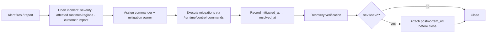

# Incident Response Platform

*Part of the [LetBuyy Internal Operating System](../LETBUYY_INTERNAL_OPERATING_SYSTEM.md). Benchmark: Cloudflare incident command / PagerDuty.*

**Maturity: 3.0 / 5.** The strongest internal platform by far. There is a real incident data model, real lifecycle endpoints, a severity taxonomy, mitigation control-commands, error budgets, and a certification model — plus a governance doc and a SEV-1 runbook. The gap is almost entirely **UI and on-call**: the console renders incidents read-only, and there is no on-call schedule or paging integration yet.

---

## 1. Purpose

Detect, command, mitigate, and learn from production incidents across workers, queues, cron, payments, storefronts, themes, apps, and domains. Treat incidents as **operational records, not chat-only events** (per `incident-response-governance.md`). Drive SEV-1/2/3/4 response with a commander, audited mitigations, and mandatory postmortems for SEV-1/2.

## 2. Users

| User | Need |
|---|---|
| On-call engineer | Get paged, triage, mitigate, update status |
| Incident commander | Coordinate, assign, declare severity, drive resolution |
| Platform Eng / SRE | Error budgets, runbooks, mitigations, postmortems |
| Leadership | Real-time status, customer impact, comms |
| Support | Customer-facing status, link tickets to incidents |

## 3. Current state (cited)

- **Data model:** `production_incidents` — `incident_id`, title, `severity` ∈ {sev1, sev2, sev3, sev4}, `status` ∈ {open, mitigating, resolved, closed}, `affected_runtimes[]`, `affected_regions[]`, `customer_impact`, `commander_id`, started/mitigated/resolved timestamps, `postmortem_url`. Plus `production_incident_events` (timeline).
- **Lifecycle endpoints:** `GET /v1/operations/runtime/incidents` (`operations.ts:1027`), `POST /runtime/incidents` (`:1041`), `PATCH /runtime/incidents/:incidentId/status` (`:1066`).
- **Mitigation tooling:** `/runtime/control-commands` (GET/POST), `/runtime/queues/:q/recover-leases`, `/redrive-dead-letters`, `/runtime/replays[/authorize]`, `/runtime/failover-drills`, `/runtime/chaos-experiments`, `/runtime/load-tests`, `/runtime/deployments`, `/runtime/readiness-gates`, `/runtime/deployment-health-gates`.
- **Reliability evidence:** `sre_error_budget_snapshots`, `runtime_slo_definitions`, `runtime_alert_evaluations`, `runtime_health_projections`, `operational_certification_reports`, `security_enforcement_events`.
- **Surfacing:** `apps/platform-console/.../operations/page.tsx` reads `/v1/operations/runtime/overview` and renders health, queues, alerts, **incidents**, deployments, integrity, budgets, regional routing, certification — **read-only summary cards**.
- **Governance:** `incident-response-governance.md` (severity defs, required records, response flow) + runbook `docs/runbooks/incident-sev1.md`.

**Verdict:** real control plane + governance + runbook; **no interactive incident console, no on-call schedule, no paging.**

## 4. Workflow (matches governance doc)

**Severity (from governance):** sev1 = checkout/auth/storefront/API outage, broad impact · sev2 = degraded commerce, queue backlog, regional failover, provider outage · sev3 = isolated/tenant-scoped · sev4 = no customer-visible impact.

## 5. Permissions

| Action | Tier |
|---|---|
| View incidents/overview | Operator |
| Open incident, update status, timeline | Operator (on-call) |
| Execute mitigation control-commands | Lead (platform-operator) + audit |
| Authorize replay/redrive/failover/rollback | Lead + dual-control |
| Close sev1/sev2 (requires postmortem) | Lead |

Per `security-operations-governance.md`, replay/redrive/failover/override/rollback require platform-operator authorization and audit via `runtime_control_commands`/`execution_audit_trail`.

## 6. Dashboards

- **Incident command:** active incidents by severity, commander, timers (TTM/TTR), affected runtimes/regions, customer impact, live mitigations.
- **Reliability:** error budgets (burn/freeze), SLO status, firing alerts, DLQ depth, deployment gates, event-store integrity, certification score.
- **Status/comms:** internal + (future) public status surface.

These mostly *exist as read-only cards* in the console operations page — the work is making them interactive.

## 7. Alerts

Per `observability-governance.md` live-telemetry contract, Prometheus rules must cover: error burn, queue/DLQ growth, replay lag, deployment-gate failure, event-store integrity, error-budget freeze, regional overrides. Add **paging** (PagerDuty/Opsgenie) on SEV-1/2 and budget freeze.

## 8. Automations

- Auto-open incident from alert correlation (de-dupe by signature).
- Auto-attach alert evidence (`runtime_alert_evaluations`), queue/replay/deployment context.
- On-call paging + escalation timers.
- Auto-link related deployments/changes (likely cause).
- Postmortem reminder + close-gate for sev1/sev2.
- Chaos/failover-drill scheduling (endpoints exist).

## 9. Audit logging

Incident lifecycle + every mitigation command → `production_incident_events`, `runtime_control_commands`, `execution_audit_trail`, `security_enforcement_events`. Required records per governance: incident metadata, timeline, alert evidence, control commands, and linked security/deployment/queue/replay/regional evidence. This is already specified — enforce it in the UI.

## 10. Review & escalation

- **Review:** blameless postmortem for sev1/sev2; action items tracked; close-gate enforces postmortem link.
- **Escalation:** sev1 pages commander + leadership immediately; provider outage → vendor + Finance (if payments); security incident → Risk/T&S + security ops; data incident → Compliance (breach notification clocks).

## 11. Current → target

| | Today | Target (Stage A) |
|---|---|---|
| Data + lifecycle | ✅ real | Keep |
| Console | read-only cards | Interactive incident command UI |
| On-call | none | `oncall_schedules` + paging integration |
| Postmortems | `postmortem_url` field | `incident_postmortems` + action tracking |
| Comms | none | Status page (internal first) |

**Build:** the cheapest high-value win in the whole internal OS — wire the *existing* `/v1/operations/runtime/incidents` + control-command endpoints into an interactive console page (in `platform-console`), add on-call scheduling + paging, and a postmortem tracker. Then activate `apps/mobile/operator-app` (Stage C) for on-call on mobile.

## 12. Benchmark vs Cloudflare / PagerDuty

Cloudflare-style incident command: severity taxonomy, commander role, audited mitigations, error budgets, blameless postmortems, status comms. LetBuyy already has the **taxonomy, commander, audited mitigations, error budgets, and certification** — genuinely rare at this stage. It lacks **on-call + paging + interactive UI + public status**. This platform is closest to "done."

## 13. Scaling

- **100:** Slack + a doc → but the data model already beats that; use it.
- **1k:** interactive console + on-call rota + paging.
- **10k:** SEV process discipline, error-budget policy enforcement, regional failover drills.
- **100k:** multi-region incident command, follow-the-sun on-call, automated mitigation playbooks, operator mobile app (Stage C).
