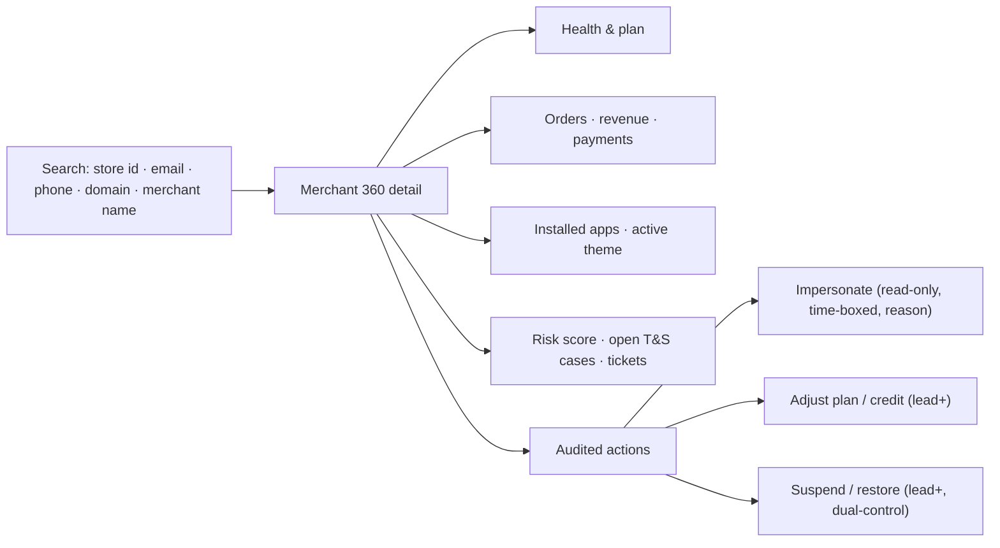

# Merchant Operations Console

*Part of the [LetBuyy Internal Operating System](../LETBUYY_INTERNAL_OPERATING_SYSTEM.md). Benchmark: Shopify Merchant Operations / "Stores" internal tooling.*

**Maturity: 2.0 / 5.** A real, governed merchant directory exists and is read-only. There is no single "open one merchant, see everything" pane, no operator actions (impersonate, suspend, adjust plan), and merchant context is split across two apps.

---

## 1. Purpose

The single place an operator opens a merchant and sees **everything relevant** — store health, plan, orders, revenue, risk, apps, themes, support history — without opening twenty tabs. It is the connective tissue every other internal team links *into* ("show me this merchant"). Shopify's internal merchant view is the canonical model: one search box → one merchant → full context + audited actions.

## 2. Users

| User | Need |
|---|---|
| Merchant Success | Health, plan, usage, churn risk, outreach history |
| Support | Fast lookup → full context to resolve a ticket |
| Risk / T&S | Pivot from a merchant to signals, cases, payment history |
| Finance | Plan, subscription, payment state, refunds |
| Leadership | Aggregate merchant health, cohort views |

## 3. Current state (what exists, cited)

- **Platform Console → Merchant Directory** (`apps/platform-console/src/app/(dashboard)/stores/page.tsx`) lists tenant sites via `/v1/internal/console/stores`. Columns: store name, subdomain, `site_type`, status, `views_count`, created. Search + status filter + pagination. **Read-only.**
- **Operations Portal → merchant-health** (`apps/platform-operations-portal/.../merchant-health`) and **CRM** (`crm/CrmContactIndexTable.tsx`) + **retention** give Merchant Success a separate, employee-scoped view via `/v1/employees/*`.
- **Console → Dashboard** surfaces `active_stores/total_stores` from `/internal/console/summary`.
- Underlying data: tenant sites are stored as **`sites`** (never `stores` — UI/URL term only, per `AGENTS.md`).

**Gaps:** no unified merchant detail page; no cross-link from a store to its orders/subscription/apps/tickets/risk; no operator actions; merchant context fragmented across console (super-admin) and ops-portal (employee).

## 4. Workflows (target)

Core workflows: **unified search** (by store id, email, phone, custom domain, merchant name) → **Merchant 360** → **pivot** to any linked domain → **audited action** with reason capture.

## 5. Permissions

| Action | Tier (see master §7) |
|---|---|
| Search + view directory | Viewer |
| Open Merchant 360 (non-PII) | Viewer |
| View full PII / payment detail | Operator + reason |
| Impersonate (read-only, time-boxed) | Operator + reason + audit |
| Adjust plan / issue credit | Lead |
| Suspend / restore store | Lead + dual-control |

Built on `employees`/`employee_roles`/`employee_permissions`. All views/actions audited (`audit_logs`). Never bypass tenant `site_id` ownership (`actor-governance.md`).

## 6. Dashboards

- **Merchant 360** (new): identity, plan, lifetime + 30-day revenue, order count, health score, risk badge, installed apps, active theme, open tickets, recent audit events.
- **Fleet health** (extend console dashboard): active/total stores, by `site_type`, by plan, by cohort, churn-risk band.
- **Merchant Success board** (ops-portal): assigned accounts, health trend, last-touch, renewal date.

## 7. Alerts

- Store flips to `suspended`/`unpublished` unexpectedly.
- Revenue drop > X% week-over-week for a high-value merchant.
- Health score crosses churn threshold.
- Custom-domain verification failure (ties to `domain-governance.md`).

## 8. Automations

- Health score recompute (nightly rollup) from orders/usage/login recency.
- Auto-tag at-risk merchants → Merchant Success queue.
- Welcome/activation nudges via `notification-core` on onboarding-stage transitions.
- Renewal reminders from `subscriptions.current_period_end`.

## 9. Audit logging

Every Merchant 360 open by an operator → `audit_logs` (actor_type=`employee`/`super_admin`, action=`merchant.view`, resource_type=`site`, resource_id). Impersonation start/stop, plan changes, suspensions → immutable records with `old_values`/`new_values` and reason in `metadata`. Per `observability-governance.md`: platform console actions require privileged immutable audit.

## 10. Review & escalation

- **Review:** suspensions and plan overrides above a threshold require a second approver (dual-control) and a linked reason.
- **Escalation:** Support → Merchant Success → Risk/T&S when a lookup reveals fraud/abuse signals; a one-click "raise to Risk" creates a linked case (see Risk & T&S docs).

## 11. Current → target

| | Today | Target (Stage A, in existing apps) |
|---|---|---|
| Search | Directory list + filter | Unified multi-key search |
| Detail | None (row only) | Merchant 360 page |
| Cross-links | None | Orders/subs/apps/theme/tickets/risk |
| Actions | None | Impersonate, plan, suspend (audited) |
| Contract | `/internal/console/stores` | + `/internal/console/merchants/:id/overview` aggregate |

**Build:** add `/v1/internal/console/merchants/:id/overview` aggregate endpoint (joins sites + subscriptions + orders count + installs + active theme + open tickets + risk score) and a `merchants/[id]/page.tsx` in `platform-console`. No new tables required initially; reuse existing.

## 12. Benchmark vs Shopify

Shopify's internal merchant tooling = one search → full merchant context + heavily audited staff actions + impersonation with consent/audit. LetBuyy has the directory and the audit spine; it lacks the 360 view and the action layer. Closing this is mostly an **aggregate endpoint + one detail page**, because the data already exists in governed tables.

## 13. Scaling

- **100–1k:** Merchant 360 + manual health tags.
- **10k:** automated health scoring, cohort fleet view, Merchant Success board with assignment.
- **100k:** predictive churn, segment automation, regional ops ownership; consider promoting Merchant Ops to its own console (Stage B).
