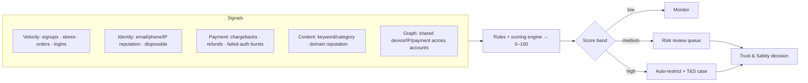

# Risk Detection Platform

*Part of the [LetBuyy Internal Operating System](../LETBUYY_INTERNAL_OPERATING_SYSTEM.md). Benchmark: Stripe Radar.*

**Maturity: 0.5 / 5.** Greenfield. Schema grep confirms **0 tables** matching `risk_`, `fraud`, `chargeback`, or `reputation`. The only risk-adjacent data is `security_enforcement_events`, which is *infrastructure* security (control checks on runtimes), not *merchant/transaction* risk. This is the single biggest exposure gap for a payments-handling commerce platform.

> Risk Detection is the **machine** half; [Trust & Safety](TRUST_AND_SAFETY_PLATFORM.md) is the **human** half. Risk produces signals and scores; T&S makes decisions. Keep them separate (Stripe Radar vs Stripe's review teams).

---

## 1. Purpose

Continuously score merchants, stores, payments, apps, themes, and developers for risk (0–100) from signals, surface high-risk entities into review queues, and auto-act on the highest-confidence abuse. Protect the platform from fraud, phishing, fake stores, payment abuse, chargebacks, and spam **before** they cause loss or reputational damage.

## 2. Users

| User | Need |
|---|---|
| Risk analyst | Triage flagged entities, tune rules, investigate |
| Risk lead | Approve auto-action thresholds, review high-impact blocks |
| T&S | Receive high-risk entities for human decision |
| Finance | Chargeback/dispute exposure, payment-abuse loss |
| Leadership | Aggregate risk posture, loss rate |

## 3. Current state (cited)

- **No risk domain exists.** `grep "CREATE TABLE public.*risk_|fraud|chargeback"` → 0.
- Closest signal sources already present: `audit_logs` (ip_address, user_agent, action velocity), `subscriptions`/`app_billing_charges`/`partner_payout_ledger_entries` (payment events), `sites` (store creation velocity), Lookup-style data is absent.
- The console's **Trust & Safety** page shows `security_enforcement_events` + firing alerts — infra security, mislabeled in the popular imagination as "risk." It is not transaction/merchant risk.

**Verdict:** must be designed from zero, but rich raw signals already exist in audit + payment + tenant tables to feed it.

## 4. Risk model (target)

**Score = weighted signals**, banded Low (0–39) / Medium (40–74) / High (75–100). Bands drive routing: monitor → queue → auto-restrict + open a T&S case.

**Flag families:** velocity, IP/device changes, fraud patterns, domain reputation, payment abuse, content/policy.

## 5. Permissions

| Action | Tier |
|---|---|
| View risk dashboards/queues | Operator (risk role) |
| Investigate entity, add notes | Operator |
| Tune rule weights (sandbox) | Lead |
| Activate rule / change auto-action threshold | Lead + dual-control |
| Manual block (pre-T&S) | Lead + reason + audit |

## 6. Dashboards

- **Risk overview:** entities by band, new high-risk today, loss/chargeback rate, top firing rules.
- **Entity risk detail:** score breakdown by signal, history, linked accounts (graph), payment events, recommended action.
- **Rule performance:** precision/recall per rule, false-positive rate, override rate.

## 7. Alerts

- Entity crosses High band.
- Velocity spike (mass signup/store creation from one IP/device).
- Chargeback rate breach for a merchant or platform-wide.
- New account sharing payment instrument/device with a previously-banned account.
- Rule false-positive rate spike (protect good merchants).

## 8. Automations

- Real-time scoring on signup, store publish, first payment, app/theme submit.
- Velocity counters (`velocity_counters`) with sliding windows.
- Auto-restrict (soft: limit payouts/publishing) on High band, pending human review.
- Auto-open linked T&S case on auto-action.
- Feed reviewer queues (App/Theme review) with a risk badge.

## 9. Audit logging

Every score change driver, rule activation, threshold change, and auto/manual action → immutable audit (`audit_logs` + proposed `risk_action_events`). Auto-actions must record the rule + signal evidence that triggered them (explainability — critical for appeals and for not nuking good merchants).

## 10. Review & escalation

- **Review:** Medium-band entities enter the Risk review queue; analysts confirm/dismiss; confirmations escalate to T&S for enforcement.
- **Escalation:** High-confidence fraud → auto-restrict + immediate T&S case; platform-wide chargeback spike → Incident Center (financial SEV); suspected coordinated abuse ring → Risk lead + T&S lead.

## 11. Current → target

| | Today | Target (Stage A) |
|---|---|---|
| Tables | 0 | `risk_signals`, `risk_scores`, `risk_rules`, `velocity_counters`, `chargeback_events`, `risk_action_events` |
| Engine | None | Rules + weighted scoring (start rules-based, add ML later) |
| Surface | None | Console Risk module + ops-portal review queue |
| Contract | None | `/v1/operations/risk/*` (signals, scores, rules, queue, decisions) |

**Build:** Phase 1 priority (with T&S). Start **rules-based** (velocity + payment + identity) — deterministic, explainable, governance-friendly — then layer ML scoring at 10k. Reuse `audit_logs`, payment tables, and `notification-core`. New tables follow `AGENTS.md` (RLS, audit columns, indexes).

## 12. Benchmark vs Stripe Radar

Radar = real-time ML risk scoring + rules + manual review queues + block/allow lists + explainable signals. LetBuyy has none of it but has the raw event streams (audit, payments, tenant) to bootstrap a rules engine quickly. **Do not skip explainability** — every auto-action needs a human-readable reason, both for appeals and to avoid silently harming legitimate India-first merchants.

## 13. Scaling

- **100:** manual eyeballing + a few hard rules (velocity, disposable email).
- **1k:** rules engine + review queue + chargeback tracking.
- **10k:** ML scoring, network/graph analysis, auto-restrict with appeals.
- **100k:** real-time scoring at the edge, link-analysis at scale, continuous model retraining, dedicated `risk.` console (Stage B).
