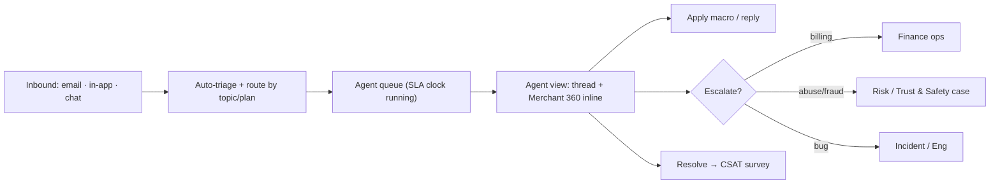

# Support Operations Platform

*Part of the [LetBuyy Internal Operating System](../LETBUYY_INTERNAL_OPERATING_SYSTEM.md). Benchmark: Stripe Support / Intercom / Zendesk.*

**Maturity: 1.0 / 5.** The portal has support/ticket pages and an `/v1/employees/tickets` endpoint, but the backing infrastructure is **not configured** — the app literally probes for it and renders an unavailable state. There are **0 ticket tables** in the schema. This is the highest-frequency internal tool and it is currently a stub.

---

## 1. Purpose

Let a support agent resolve a merchant's problem from one screen — ticket + full merchant context (orders, plan, payments, apps, audit history) — without opening twenty tabs, with SLA tracking, macros, escalation, and CSAT. The Stripe model: support sees *Merchant → everything relevant* inline.

## 2. Users

| User | Need |
|---|---|
| Support agent (L1) | Triage, respond, resolve with context + macros |
| Support lead (L2) | Escalations, SLA breaches, quality review |
| Merchant Success | Proactive outreach, links from health to tickets |
| Risk / T&S | Receive escalations where a ticket reveals abuse/fraud |

## 3. Current state (cited)

- **Ops Portal → support** (`apps/platform-operations-portal/.../support/page.tsx`, `TicketIndexTable.tsx`) and **tickets** page exist.
- `apps/platform-operations-portal/src/lib/api/employee-modules.ts` → `probeTicketInfrastructure()` calls `/employees/tickets` and, on failure, returns *"Support ticket infrastructure is not configured."* — an honest unavailable state.
- Gateway `services/api-gateway/src/routes/employee.ts` mounts `GET /tickets` (line 297) but there is **no `support_tickets` table** (grep: 0).
- Merchant context to attach to a ticket *does* exist (`/internal/console/stores`, orders, subscriptions) but is not wired in.

**Verdict:** UI shell + endpoint stub + zero persistence. Greenfield with a façade.

## 4. Workflows (target)

## 5. Permissions

| Action | Tier |
|---|---|
| View queue, own tickets | Operator (support role) |
| View merchant PII in ticket | Operator + reason capture |
| Reassign / merge / bulk action | Operator |
| Override SLA, mass-reply, refund link | Lead |
| Configure macros, routing rules | Lead/Admin |

Built on `employees.role='support'`. Every PII view and merchant action audited.

## 6. Dashboards

- **Agent workspace:** my queue, SLA timers, ticket thread + Merchant 360, macros, canned replies.
- **Team board:** open/pending/solved, SLA at-risk, backlog age, first-response/resolution time, CSAT.
- **Lead view:** agent load balancing, breaches, escalation funnel, reopen rate.

## 7. Alerts

- SLA first-response / resolution breach imminent or missed.
- Backlog spike (queue depth > threshold).
- VIP/high-value merchant ticket opened.
- Reopen rate or negative-CSAT cluster.
- Ticket flagged "mentions fraud/chargeback/legal" → route to Risk/T&S.

## 8. Automations

- Auto-triage and topic/plan-based routing.
- Macro suggestions; AI draft replies (deflection at scale).
- Auto-attach Merchant 360 context on open.
- SLA clocks (`ticket_sla_clocks`) with pause on "pending customer".
- Auto-create linked Risk/T&S case on keyword/category match.
- Post-resolution CSAT survey.

## 9. Audit logging

Ticket lifecycle (create/assign/reply/escalate/resolve), PII views, and merchant actions taken from a ticket → `audit_logs` (actor_type=`employee`). Per `observability-governance.md`, ops-portal actions require employee role + target resource + workflow state. Internal notes vs customer-visible replies must be distinguishable and retained.

## 10. Review & escalation

- **Quality review:** leads sample resolved tickets for QA; CSAT + reopen feed coaching.
- **Escalation matrix:** L1 → L2 lead; billing → Finance; abuse/fraud → Risk/T&S (auto-linked case); outage/bug → Incident Center (link a `production_incident`).

## 11. Current → target

| | Today | Target (Stage A) |
|---|---|---|
| Persistence | None (0 tables) | `support_tickets`, `ticket_messages`, `ticket_macros`, `ticket_sla_clocks` |
| Endpoint | `/employees/tickets` stub | `/v1/operations/support/*` full CRUD + threads |
| Context | Not wired | Merchant 360 inline |
| SLA/CSAT | None | SLA clocks + CSAT survey |

**Build:** add the four tables (with id/created_at/updated_at/deleted_at/RLS per `AGENTS.md`), a `/v1/operations/support/*` route group, and turn the existing portal pages into a real agent workspace. Reuse `notification-core` for replies/email and the merchant aggregate from the Merchant Ops doc.

## 12. Benchmark

Stripe/Intercom/Zendesk: omnichannel intake, SLA tiers, macros, inline customer context, CSAT, escalation, AI deflection. LetBuyy has the UI shell and employee RBAC but none of the persistence or SLA/CSAT machinery. This is the **most-used internal tool** — prioritize after Risk/T&S because it is the daily workhorse.

## 13. Scaling

- **100:** shared inbox is fine; thin ticketing.
- **1k:** real ticketing + macros + SLA.
- **10k:** SLA tiers, CSAT, routing, lead QA, knowledge base.
- **100k:** self-serve deflection, AI assist/draft, follow-the-sun staffing, regional queues.
