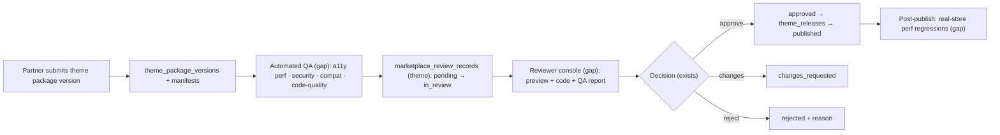

# Theme Review Platform

*Part of the [LetBuyy Internal Operating System](../LETBUYY_INTERNAL_OPERATING_SYSTEM.md). Benchmark: Shopify Theme Store review.*

**Maturity: 1.5 / 5.** Themes share the marketplace review queue (`marketplace_review_records` with `submission_type='theme'`), so the **queue and decision machinery already work**. What's missing is theme-specific automated QA — accessibility, performance, security, compatibility, code quality — and a reviewer UI. The `theme_reviews` table is merchant *star ratings*, not platform review; don't confuse them.

---

## 1. Purpose

Gate every theme before it reaches a merchant's storefront, and keep the catalog high-quality. Review theme **quality, accessibility, performance, security, compatibility, and code quality**. Lifecycle mirrors apps: **submitted → in review → changes requested → approved → published.** A bad theme degrades real shopper conversion, so this is a revenue-protection function, not just hygiene.

## 2. Users

| User | Need |
|---|---|
| Theme reviewer | Run QA suite, inspect code/preview, decide |
| Review lead | Quality bar, edge cases, escalations |
| Developer Relations | Help theme partners pass, communicate decisions |
| Performance/Eng | Define perf/a11y budgets the suite enforces |

## 3. Current state (cited)

- **Shared queue:** `marketplace_review_records.submission_type='theme'` flows through the same `GET /v1/operations/marketplace-reviews` + `POST /marketplace-reviews/:id/decision` endpoints as apps.
- **Theme platform tables are rich:** `theme_packages`, `theme_package_versions`, `theme_releases`, `theme_renderer_manifests`, `theme_schema_manifests`, `theme_section_definitions`, `theme_block_definitions`, `theme_templates`, `store_themes`, `theme_purchases`. Governed by `packages/theme-engine` and `theme-engine-governance.md`.
- **`theme_reviews`** = merchant ratings (rating 1–5, is_verified_purchase, status published/pending/rejected) — **shopper feedback, not platform QA**.
- **Gaps:** no automated theme QA (`automated_checks` empty), no reviewer UI, no perf/a11y budgets enforced at submit time.

**Verdict:** queue + decision + rich theme data model exist; **automated QA and reviewer console are greenfield.**

## 4. Workflow

## 5. Permissions

| Action | Tier |
|---|---|
| View theme queue | Operator (theme-reviewer role) |
| Run QA, inspect, comment | Operator |
| Request changes | Operator |
| Approve / publish release | Lead |
| Reject / unpublish theme | Lead + reason + audit |

## 6. Dashboards

- **Theme review queue:** by status/age, QA pass/fail, perf & a11y scores.
- **Theme review detail:** live preview, code/asset inspector, QA report (Lighthouse-style perf, WCAG a11y, security scan, compatibility matrix), version diff vs prior release.
- **Catalog quality:** avg perf/a11y across published themes, regression count, top-rated vs flagged.

## 7. Alerts

- Submission SLA breach.
- QA hard-fail (security issue, broken checkout, a11y below floor).
- Published theme perf regression on real stores.
- Theme version introduces a breaking schema/manifest change.

## 8. Automations

- **Automated QA suite** (populate `automated_checks`): performance budget (LCP/CLS/TBT), WCAG 2.1 AA accessibility, security scan (injection, unsafe scripts, data exfil), compatibility (sections/blocks against `theme-engine` contracts), code quality (bundle size, unused CSS — ties to UI governance's "undefined CSS class" lesson).
- Auto-block release on hard-fail; auto-flag soft-fails for reviewer.
- Version-diff summarization for reviewers.
- Post-publish real-store performance monitoring → regression alerts.

## 9. Audit logging

Submission, QA runs, status transitions, decisions, releases → `audit_logs` + `marketplace_review_records` + `theme_releases` history. Approvals/unpublish capture reviewer + reason. Theme-engine release governance (`theme-engine-governance.md`) already expects releases to be governed; tie review decisions to release records.

## 10. Review & escalation

- **Review:** automated QA → human review (preview + code) → decision; change-requests loop back.
- **Escalation:** security finding → Risk/T&S + emergency unpublish; perf/a11y policy dispute → review lead + Eng; partner dispute → Developer Relations + appeal.

## 11. Current → target

| | Today | Target (Stage A) |
|---|---|---|
| Queue/decision | ✅ shared with apps | Keep; theme-specific view |
| Automated QA | none | Perf + a11y + security + compat + code-quality suite |
| Reviewer UI | none | Preview + code + QA report console |
| Post-publish | none | Real-store perf regression monitoring |

**Build:** reuse the existing marketplace-review queue/decision; add a theme QA runner (can run in `services/queue-workers` as an async job) writing into `automated_checks` / a `review_check_runs` table; build the reviewer console in `platform-operations-portal`. Leverage existing `accessibility-review` and `design` skills/budgets for the a11y/perf criteria.

## 12. Benchmark vs Shopify Theme Store

Shopify: strict automated + manual review across performance, accessibility, code quality, and compatibility, with a published rubric. LetBuyy has the **review pipeline** but not the **rubric automation**. Because the theme engine is contract-governed, compatibility checks are unusually tractable here — the schema/section/block manifests give you a machine-checkable surface.

## 13. Scaling

- **100:** founder previews each theme; manual QA.
- **1k:** automated QA suite + reviewer console.
- **10k:** reviewer pool, enforced budgets, post-publish monitoring.
- **100k:** continuous re-validation on engine upgrades, automated regression gates, shared `reviews.` console with App Review (Stage B).
