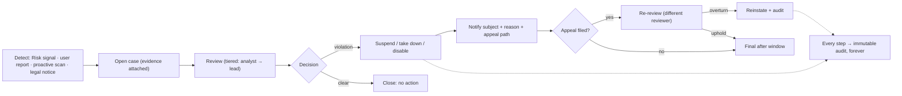

# Trust & Safety Platform

*Part of the [LetBuyy Internal Operating System](../LETBUYY_INTERNAL_OPERATING_SYSTEM.md). Benchmark: Shopify Trust & Safety / Stripe review teams.*

**Maturity: 1.0 / 5.** A read-only Trust & Safety page exists in the console; **case management is greenfield**. Schema grep confirms **0 tables** for `appeal`, `takedown`, `moderation`, `abuse_report`, `safety_case`, or `suspension`. T&S today can *look* but cannot *act, track, or remember*.

> T&S is the **human-decision** half. [Risk Detection](RISK_DETECTION_PLATFORM.md) feeds it machine signals; T&S owns the irreversible calls — suspend, take down, reinstate — and the appeals that follow. Every action is audited **forever**.

---

## 1. Purpose

The system of record for human safety decisions: illegal products, scams, phishing, counterfeit brands/medicines, fraud, copyright/trademark, abuse reports, and the **detect → review → suspend → appeal → reinstate** lifecycle. This is the "Zero Tolerance Console" — the surface Shopify and Stripe take most seriously because mistakes here are legal, financial, and reputational.

## 2. Users

| User | Need |
|---|---|
| T&S analyst | Work case queue, gather evidence, decide |
| T&S lead | High-impact takedowns, appeals decisions, policy |
| Risk | Hand off confirmed high-risk entities |
| Legal/Compliance | Copyright/trademark, regulator requests |
| Support | File reports surfaced from tickets |

## 3. Current state (cited)

- **Console → Trust & Safety** (`apps/platform-console/.../trust-safety/page.tsx`): read-only. Loads `/v1/internal/console/audit-logs` + `/v1/operations/runtime/overview` (security_events, firing alerts). Self-described: *"Read-only governance view for platform audit events, security enforcement projections, and unresolved safety gaps."*
- **Console → Marketplace Governance** (`.../marketplace-governance/page.tsx`): `SkipBackendPanel` placeholders. States explicitly: *"Appeals, takedowns, and emergency disable flows need audited mutation endpoints before they can be interactive."*
- **No case tables.** No `ts_cases`, `appeals`, `takedowns`, `moderation_*`. The `audit_logs` trail is the only durable substrate.

**Verdict:** correct read-only foundation, zero case-management capability.

## 4. Workflow — the lifecycle (target)

## 5. Permissions

| Action | Tier |
|---|---|
| View cases/reports | Operator (t&s role) |
| Open case, attach evidence, recommend | Operator |
| Suspend store / disable app / takedown | Lead + reason + audit |
| Decide appeal (must differ from original reviewer) | Lead (segregation of duty) |
| Reinstate | Lead + dual-control |
| Emergency platform-wide disable | Admin + dual-control |

Segregation of duty (appeal reviewer ≠ enforcing reviewer) is mandatory.

## 6. Dashboards

- **Case queue:** by type, severity, age, SLA, assignee.
- **Case detail:** subject (merchant/app/theme/developer), evidence, linked Risk score, decision history, appeal thread.
- **Enforcement board:** active suspensions/takedowns, pending appeals, overturn rate.
- **Policy & trends:** violation categories over time, repeat offenders, false-positive (overturn) rate.

## 7. Alerts

- New High-severity case (illegal/medical/CSAM-adjacent → immediate).
- Appeal SLA breach imminent.
- Repeat offender re-offends.
- Spike in a violation category (coordinated abuse).
- Legal/regulator deadline approaching.

## 8. Automations

- Auto-open case from Risk auto-action or user report.
- Auto-attach Risk evidence + merchant context.
- Auto-route by category (legal → compliance, payment → finance).
- Appeal-window timers; auto-finalize after window if no appeal.
- Templated, audited subject notifications via `notification-core`.

## 9. Audit logging — forever

This is the non-negotiable. Every detect/open/evidence/decision/enforce/notify/appeal/reinstate event → immutable, append-only audit (`audit_logs` + proposed `ts_case_events`). Records must be **retained indefinitely** and never hard-deleted (soft-delete only, per `AGENTS.md`'s `deleted_at` rule, but T&S enforcement records are retention-exempt from purge). Decisions must capture *who, when, why, what evidence*. This protects LetBuyy legally and protects merchants from arbitrary action.

## 10. Review & escalation

- **Review:** tiered — analyst recommends, lead enforces on high-impact; appeals re-reviewed by a *different* person.
- **Escalation:** illegal/safety-critical → lead + legal immediately; platform-wide pattern → Incident Center (trust SEV) + Risk lead; regulator/court order → compliance + legal with hard deadlines.

## 11. Current → target

| | Today | Target (Stage A) |
|---|---|---|
| Tables | 0 (audit only) | `ts_cases`, `ts_case_events`, `ts_appeals`, `ts_takedowns`, `ts_evidence` |
| Actions | None (read-only) | Suspend/takedown/disable/reinstate (audited) |
| Appeals | None | Full appeal lifecycle + SoD |
| Contract | read-only audit | `/v1/operations/trust-safety/*` mutation endpoints |

**Build:** Phase 1 priority (with Risk). Turn the marketplace-governance placeholders into a real case console in `platform-console` (governance view) + enforcement actions in `platform-operations-portal` (employee execution). Add audited mutation endpoints `/v1/operations/trust-safety/*`. Reuse `audit_logs`, Risk signals, and `notification-core`.

## 12. Benchmark

Shopify/Stripe T&S: case management, evidence, tiered review, segregation of duty on appeals, immutable forever-audit, policy versioning, regulator workflows. LetBuyy has the read-only governance view and the audit spine — the strongest possible *foundation* — but no case lifecycle. The discipline to copy: **never an irreversible action without a logged reason and an appeal path.**

## 13. Scaling

- **100:** founder decides; log every action manually in audit.
- **1k:** case queue + appeals SLA + SoD.
- **10k:** tiered reviewer pool, policy versioning, automated triage of reports.
- **100k:** automated triage + human review pool, regional legal workflows, dedicated `trust.` console (Stage B).
