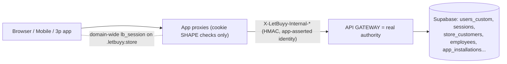
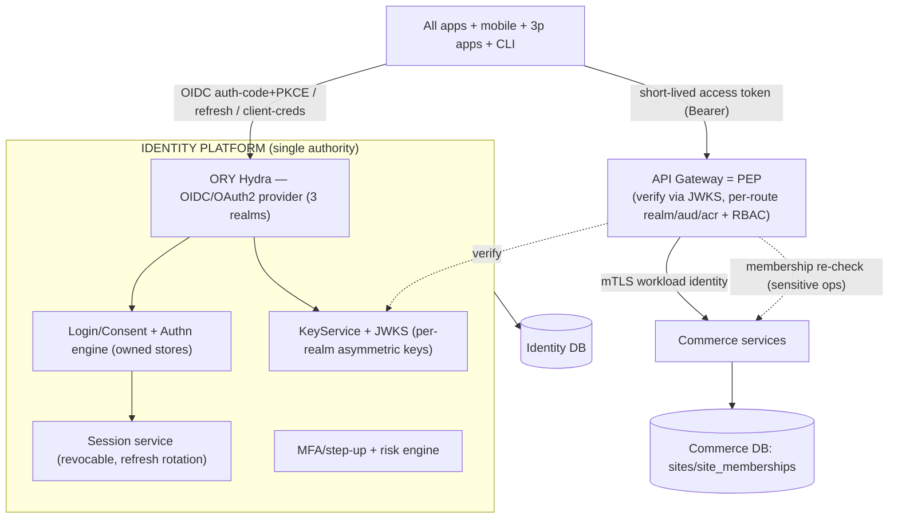
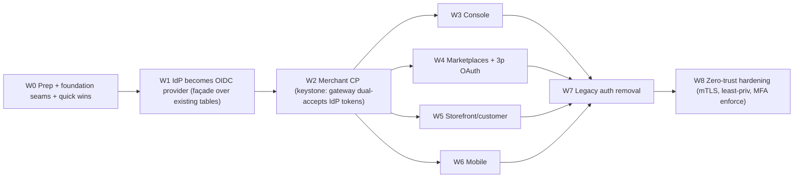

# LETBUYY IDENTITY TRANSFORMATION BLUEPRINT

**Phase 15 — Final Executive Blueprint (master source of truth)**
Status date: 2026-06-08
Status: Proposed architecture. **No code changes. Architecture only.**
Scope: implementation-ready target architecture + execution roadmap for the LetBuyy identity ecosystem at 100k+ merchants and millions of customers.

> This document consolidates Phases 1–14. Where it summarizes, the authoritative detail lives in the per-phase document named in brackets. Everything traces to `AUTH_AUDIT_REPORT.md` / `CURRENT_AUTH_ARCHITECTURE.md` or directly-read repository paths.

---

## 1. Executive summary

LetBuyy has **no central identity service**. The component named **"Identity Platform" is a UI shell**; the **API Gateway is the real authority** that owns `users_custom`/`sessions` and validates every request. Frontend apps read a cookie and then **assert the user's identity to the gateway via a shared-HMAC-signed header** — meaning any app holding one shared secret can impersonate any user. There are **3 parallel session systems, 2 identity stores (`users`/`users_custom`), 2 CSRF cookies, and 2 server-auth systems (custom + legacy Supabase)**, unified only by that one secret and one Postgres database. There is **no OIDC, no SSO broker, no consent, no merchant-org layer, and no real MFA enforcement** (the factor storage exists; enforcement does not).

The transformation **inverts ownership**: a real **Identity Platform service** becomes the single issuer of identity and sessions; the gateway becomes a stateless **policy enforcement point** that verifies **IdP-signed tokens via JWKS** and applies resource authorization. Identity is **issued by one authority and verified by everyone** — never asserted by apps. The system is organized into **three strictly-isolated realms** (merchant, customer, admin), runs on **ORY Hydra** as a certified OIDC/OAuth2 provider fronted by LetBuyy's own login/consent app over LetBuyy-owned stores, and is reached through **standard OIDC SSO** instead of a shared domain-wide cookie.

The two highest current risks — a **domain-wide `lb_session` cookie** (🔴20) and **app-asserted identity via a shared secret** (🔴20) — are both eliminated structurally. The migration is **wave-based, dual-run, flag-gated, and reversible**, bridging from today's actual (immature) implementation rather than assuming a clean slate.

**The one-sentence thesis:** *Promote the existing primitives (`auth-core` OAuth issuer, federation token, session table, 2FA factors) into a standards-compliant, single-authority, zero-trust Identity Platform across three isolated realms — consolidating, not rebuilding.*

---

## 2. Current state (condensed) [AUTH_SYSTEM_MAP, AUTHORITY_MATRIX]

| Reality | Evidence |
|---------|----------|
| Identity Platform owns only UI + cookies; gateway owns all identity logic + data | Audit §Supabase ("Identity calls gateway, not direct Supabase"); `auth.ts` routes |
| Merchant session = 30-day opaque bearer, no rotation/refresh | `AUTH_SESSION_DURATION_MS=30d`; Audit §Session Lifecycle |
| Identity is **app-asserted** over one shared HMAC secret | `getInternalAuthContext()`; `getLetbuyyInternalAuthSecret()` |
| `lb_session` is domain-wide on `.letbuyy.store`, `SameSite=lax` | Audit §Cookie Attribute Audit |
| 3 session systems, 2 identity stores, 2 CSRF cookies, 2 server-auth systems | Phase 1 §2–4; `users` + `users_custom`; `letbuyy_csrf`+`lb_csrf`; custom + Supabase Auth |
| No OIDC / SSO broker / consent / merchant-org | Audit (no `organization_id`); app-OAuth has scopes, no consent |
| MFA factor storage exists; **enforcement UNKNOWN** | `merchant_2fa_factors` (totp+passkey); Audit §Session Lifecycle |
| Raw tokens returned in JSON; `verification_tokens` plaintext | Audit §Security Findings |

---

## 3. Target state [TARGET_AUTH_ARCHITECTURE]

**Boundary rule:** Identity answers *"who is this principal, what org/roles do they hold?"* (verifiable subject + claims). Commerce answers *"may they do this to this resource?"* (authorization stays in commerce core). Identity never makes resource-authz decisions; commerce never re-authenticates.

---

## 4. Realm model [REALM_ARCHITECTURE]

| | Merchant | Customer | Admin |
|--|----------|----------|-------|
| Issuer | `/realms/merchant` | `/realms/customer` | `/realms/admin` |
| Users | sellers/staff/org | shoppers (store-scoped) | LetBuyy staff |
| Cookie (host-only) | `__Host-lb_m_sess` | `__Host-lb_c_sess` | `__Host-lb_a_sess` |
| Idle / absolute | 12h / 30d | 30d / 90d | 30m / 8h |
| MFA | required (sensitive ops) | optional/risk-based | **mandatory (aal3 for super-admin)** |
| Primary auth | password+passkey | OTP/magic-link | corporate SSO / allowlist+TOTP |
| Blast radius | store/org | one shopper | **platform-wide** |

**Four "no shared" guarantees made structural:** no shared cookies (host-only per realm), no shared sessions (partitioned `sid`), no shared refresh tokens (realm+client+sid bound), no privilege crossover (separate issuer/keys/audience; gateway rejects cross-realm tokens at signature/audience check). The **only** sanctioned crossover is Identity-minted, audited, time-boxed **operator impersonation** carrying both the operator's real `sub` and `act_as`/`on_behalf_of`.

---

## 5. OIDC model [OIDC_DECISION_RECORD, OIDC_CLIENT_INVENTORY]

**Decision: ORY Hydra (certified, headless OIDC/OAuth2 provider) + LetBuyy login/consent app over owned stores; federate external IdPs for admin + enterprise-merchant SSO; WorkOS optional for the B2B-SSO slice only.** Weighted score: ORY 4.44 > Managed 3.74 > Custom 3.18 > Keycloak 2.98 > Authentik 2.97.

Rejected: custom OIDC protocol (security-maintenance burden — the audit already shows hand-rolled auth defects); Keycloak/Authentik as core (realm-per-tenant + owns-users mismatch — **tenancy is org-as-claim, not realm-per-tenant**); full managed for the millions-scale customer realm (cost/residency/lock-in).

**Clients** (each in exactly one realm; PKCE everywhere; consent for 3rd-party + CLI): merchant control plane, ops portal, theme/app marketplaces (silent SSO), mobile (BFF + native PKCE), 3rd-party apps (auth-code + client-credentials), M2M API keys (client-credentials), storefront + checkout (customer realm, token-exchange), console (admin realm), future customer app + CLI (device-code).

---

## 6. SSO model [SSO_ARCHITECTURE]

Log in once at `id.letbuyy.com` → reach every merchant app with **no re-auth** via OIDC `prompt=none` against the central IdP SSO session. **No app shares a cookie with another** — the only cross-app artifact is the host-only IdP session. **Single logout** = RP-initiated `/end_session` revokes the IdP session + all refresh chains + back-channel logout to every RP; access dies within one short TTL. Customer/admin SSO sessions are wholly separate. Custom-domain storefronts join via OIDC redirects + the generalized single-use **federation token** (promoted from today's `createCustomerFederationToken`). Checkout uses **token-exchange** (replacing the HMAC handoff).

---

## 7. Session & token model [SESSION_MANAGEMENT, TOKEN_STRATEGY]

- **Three layers:** server-side revocable `sid` → rotating refresh (reuse-detection ⇒ revoke chain) → short access JWT (5–10 min, audience-pinned, JWKS-verifiable).
- **Signing:** per-realm **asymmetric (EdDSA)** keys via JWKS; the shared symmetric internal secret is retired from the identity path.
- **Single-use tokens** (magic/reset/verify/federation/auth-code) are **hashed at rest or opaque + server-side single-use**; no raw tokens in JSON bodies.
- **Cookie matrix:** 11 → ~8 cookies; zero domain-wide, zero JS-readable auth cookies, one attribute policy; CSRF closed by Bearer-auth APIs (no double-submit cookie).
- **Revocation:** logout / remote-revoke / password-change / device-revoke / privilege-change all end access within one access-TTL via revoked-`sid` cache.

---

## 8. MFA & authenticators [AUTHENTICATOR_STRATEGY]

Passkeys (WebAuthn) are the target primary for merchant/admin (phishing-resistant); TOTP is universal step-up; email OTP/magic-link is the low-friction customer default; recovery codes are break-glass. Reuses the existing `merchant_2fa_factors` storage (totp+passkey, `recovery_code_hashes[]`). Assurance levels **aal1/2/3** map operations → required `acr`; insufficient `acr` triggers **step-up** (re-mint token, not re-login). Merchant MFA **enforced** for payouts/staff/API-key/app-install (closes the enforcement gap); admin MFA mandatory with aal3 for super-admin; customer MFA optional + risk-based.

---

## 9. Threat model & risk register [THREAT_MODEL]

| Risk | Current | Target | Primary mitigation |
|------|:-------:|:------:|--------------------|
| Cookie theft / domain-wide exposure (T5) | 🔴20 | 🟢3 | remove domain-wide cookie; host-only + OIDC SSO |
| Privilege escalation via app-asserted identity (T10) | 🔴20 | 🟡10 | verify IdP-signed tokens; remove asserted-identity headers |
| Token-at-rest plaintext (T14) | 🟠16 | 🟢3 | hash tokens; no raw tokens in JSON |
| Session hijacking (T1) | 🟠15 | 🟡8 | short access + rotating refresh + revocable sid |
| XSS → token theft (T3) | 🟠15 | 🟡8 | no tokens in localStorage; CSP; host-only cookies |
| Internal-secret forgery (T13) | 🟠15 | 🟡5 | asymmetric keys + mTLS workload identity |
| Tenant escalation (T8) | 🟠15 | 🟡10 | verified subject + membership re-check; reduce service-role |
| CSRF (T2) | 🟡12 | 🟢3 | Bearer-auth APIs; drop legacy `lb_csrf` |
| Admin takeover (T11) | 🟠10 | 🟡5 | admin realm aal3, revocable, kill synthetic principal |

The transformation cuts **every edge** of the principal attack tree (domain-wide cookie → shared-secret forgery → 30-day no-rotation → missing ownership check).

---

## 10. Zero-trust model [ZERO_TRUST_ARCHITECTURE]

From a **secret-bearer / app-asserted** model to **never-trust-always-verify**: identity asserted only by the IdP and verified by all via JWKS; workloads get **mTLS/SPIFFE** identity (no shared HMAC secret); every request authn+authz'd at the gateway PEP; least-privilege short-TTL scopes; service-role decomposed; sessions continuously revocable; no standing super-identity (break-glass only, audited). Maturity ladder L0→L4 maps onto migration waves.

---

## 11. Foundation refactors (before migration) [FOUNDATION_REFACTOR_PLAN]

Five seams refactored in `packages/auth-core` + gateway, **with zero behavior change**, so apps migrate by swapping an implementation: RP-SDK auth abstraction, SessionService, realm-aware CookiePolicy, gateway verifier-registry PEP, and KeyService/JWKS. Plus the IdentityRepository boundary (enables the later data move), the parity harness + legacy-path counters (enable shadow-compare + safe deletion), and quick security wins (hash `verification_tokens`, drop `lb_csrf`, stop raw-token JSON).

---

## 12. Execution roadmap [MIGRATION_PLAN]

Guardrails on every wave: **dual-accept old+new**, **shadow-before-enforce**, **flag-gated + cohorted**, **metrics-as-gates**, **reversible migrations**, run `node scripts/validate-governance.mjs` on governed changes. Ownership of the *decision* moves before the *data*; nothing is deleted until its legacy path shows zero traffic for N days.

---

## 13. Architectural debt explicitly retired

| Debt (evidence) | Retired in |
|-----------------|-----------|
| Domain-wide `lb_session` on `.letbuyy.store` | W2/W7 |
| App-asserted identity headers + shared HMAC secret | W2/W7/W8 |
| `users` vs `users_custom` dual store | W7 |
| `letbuyy_csrf` (JS-readable) + legacy `lb_csrf` | W0/W7 |
| 3 customer/merchant/console session systems | W2/W5 |
| Legacy Supabase Auth bridge + raw tokens in JSON | W0/W7 |
| Plaintext `verification_tokens` | W0 |
| Static synthetic `platform-console@letbuyy.local` principal | W3/W8 |
| Blanket service-role on gateway/workers | W8 |
| Bespoke app-OAuth issuer without consent | W4 |

---

## 14. Open decisions for human sign-off

1. **ORY Kratos now or later?** Adopt Hydra (protocol) immediately; decide whether to also adopt Kratos to own identity flows, or keep owned stores behind Hydra's login provider (Phase 5 §6).
2. **WorkOS for B2B SSO** — buy now or defer until the first enterprise-merchant "bring-your-own-IdP" request.
3. **Merchant org model timing** — `org` claim is null until the org overlay lands (Phase 2 #19); decide whether org is in the first migration window or a fast-follow.
4. **Checkout customer-login requirement** — product decision (Phase 1 UNKNOWN #5): guest-only, optional, or required.
5. **Hydra deployment target** — k8s vs managed-container; KMS/HSM provider for per-realm keys; India data-residency constraints.
6. **Access-token TTL vs introspection cost** — final tuning of the revocation-freshness/refresh-rate tradeoff (Phase 8 §4).

---

## 15. Definition of done (program-level acceptance)

- One issuer (`id.letbuyy.com`), three realms, each with its own JWKS + discovery.
- Gateway has **zero** code paths trusting app-asserted identity; cross-service identity is mTLS + IdP-signed tokens; shared internal HMAC secret removed from the identity path.
- Every human session is **server-revocable**; remote logout works estate-wide within one access-TTL.
- No raw `access_token`/`refresh_token` in any JSON body; all single-use tokens hashed/opaque.
- Cookie matrix: no domain-wide, no JS-readable auth cookie, one policy; legacy `lb_csrf` gone.
- Merchant MFA enforced for sensitive ops; passkeys live; admin aal3 for super-admin; synthetic principal removed/constrained.
- `users`/`users_custom` collapsed to one `principals` directory; legacy Supabase Auth deleted; merchant `org` claim populated.
- Top two current risks (domain-wide cookie 🔴20, app-asserted identity 🔴20) reduced to 🟢/🟡.

---

## Appendix A — Document set

| Phase | Document | Purpose |
|-------|----------|---------|
| 1 | `AUTH_SYSTEM_MAP.md` | Current-system model: surfaces, stores, trust boundaries, ownership |
| 2 | `AUTHORITY_MATRIX.md` | Per-capability current/future owner, difficulty, risk |
| 3 | `TARGET_AUTH_ARCHITECTURE.md` | Identity Platform as single authority |
| 4 | `REALM_ARCHITECTURE.md` | Merchant/customer/admin realm isolation |
| 5 | `OIDC_DECISION_RECORD.md` | Provider scoring + recommendation (ORY hybrid) |
| 6 | `OIDC_CLIENT_INVENTORY.md` | Every client: type, redirects, scopes, claims, refresh |
| 7 | `SSO_ARCHITECTURE.md` | Login/token-exchange/propagation/logout flows |
| 8 | `SESSION_MANAGEMENT.md` | Sessions, rotation, revocation, cookie matrix |
| 9 | `TOKEN_STRATEGY.md` | Every token: iss/aud/claims/alg/exp |
| 10 | `AUTHENTICATOR_STRATEGY.md` | TOTP/passkeys/recovery/device-trust per realm |
| 11 | `THREAT_MODEL.md` | Scored threats + mitigations (current vs target) |
| 12 | `ZERO_TRUST_ARCHITECTURE.md` | Trust assumptions → zero-trust redesign |
| 13 | `MIGRATION_PLAN.md` | Waves 0–8: goals/deps/risks/rollback/success |
| 14 | `FOUNDATION_REFACTOR_PLAN.md` | Seams to refactor before migration |
| 15 | `LETBUYY_IDENTITY_TRANSFORMATION_BLUEPRINT.md` | This master document |

## Appendix B — Source evidence

Authoritative inputs: `docs/auth/2026-06-08-auth-session-sso-cookie-architecture/AUTH_AUDIT_REPORT.md` and `…/CURRENT_AUTH_ARCHITECTURE.md`. Code groundings cited inline throughout: `packages/auth-core/src/index.ts`, `packages/auth-core/src/customer-session.ts`, `services/api-gateway/src/middleware/auth.ts`, `database/supabase/migrations/000_baseline.sql`, `…/121_mobile_merchant_2fa_factors.sql`.
