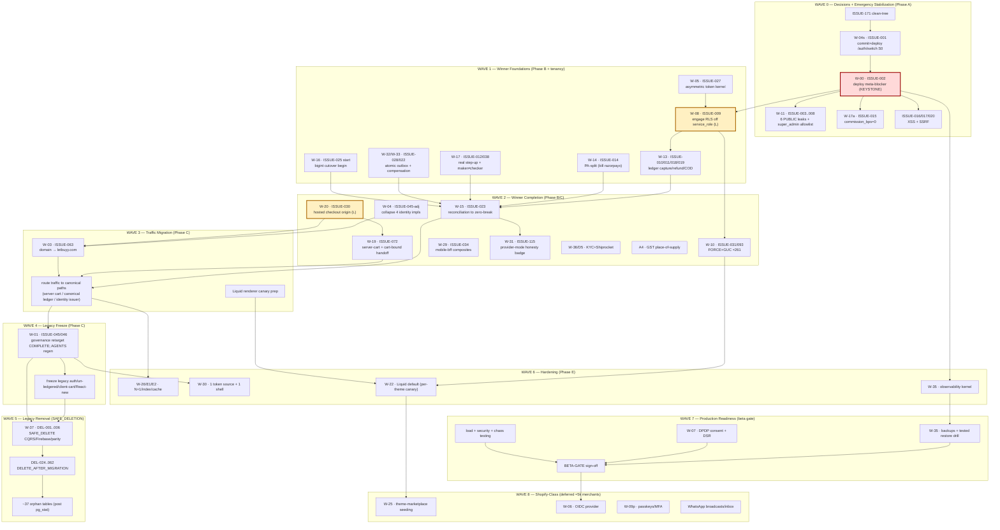

# LETBUYY — IMPLEMENTATION EXECUTION ROADMAP (wave-by-wave)

> **Document type:** The wave-by-wave execution roadmap for the Strategic Canonicalization program — the single ordered plan that sequences every strategic-winner action onto the directive's 9 waves (0–8), with squad assignment, sizing, dependencies, validation gates, and the critical path. Architecture Review Board (ARB) program-lead deliverable.
> **Date:** 2026-06-10
> **Repo:** `/Users/saai_sidd/Git/Letbuyy_Store` (working tree, evidence pinned at `stepup/main` @ `c4fc3cd6`, dirty, 2026-06-10).
> **Constitution:** `LETBUYY_EXECUTABLE_ARCHITECTURE_V1.md` + `LETBUYY_FINAL_ARCHITECTURE_FREEZE.md` (the single canonical destination). The maximalist `LETBUYY_CHECKOUT_PLATFORM_ARCHITECTURE.md` (22 services / 1M merchants / Wasm) and the `AGENTS.md` 9-app end-state are the **rejected** visions.
> **Companion gate:** `TESTING_AND_VALIDATION_MASTER_PLAN.md` (same directory) — the test taxonomy that gates each wave exit. **No wave exits until its validation gate is green; no system is deleted until its deletion-validation is green.**
> **Authoritative inputs (read in full):** `_ANCHOR_DECISIONS_SPINE.md` (A0–A9), `STRATEGIC_WINNERS_MASTER_PLAN.md` (32-domain winner ledger + 9-cluster ABR blocks), `CANONICAL_ARCHITECTURE_MATRIX.md` (component-level classifications + action IDs), `PRODUCTION_READINESS_GAP_REPORT.md` (W-00…W-37 completion% + eng-weeks + critical path — **the sequencing driver**), the eight domain deliverables (THEME/IDENTITY/MONEY/TENANT/UI_UX/LEGACY/SAFE_DELETION/PLATFORM), and `FORENSIC_MASTER_2026_06_10/LETBUYY_MASTER_EXECUTION_PLAN.md` (Phases A–E + ISSUE-001…291) + `TOP_250_PLATFORM_ISSUES.md`.

---

## 0. How to read this roadmap

### 0.1 The nine waves (the directive's structure; every action maps onto it)

| Wave | One-line theme | Maps to (forensic Phase / readiness) |
|---|---|---|
| **0** | Architecture decisions ratified **+ emergency stabilization** (deploy meta-blocker, S0 security) | Forensic **Phase A** |
| **1** | Strategic-winner **foundations** (identity kernel, RLS engage, ledger-the-money, PA-split, outbox) | Forensic **Phase B** + tenancy start |
| **2** | Strategic-winner **completion** (recon-to-zero, FORCE+GUC ×261, hosted-origin, composites, KYC/Shiprocket) | Forensic **Phase B/C** |
| **3** | **Traffic migration** (domain → letbuyy.com; route all traffic to canonical paths) | Forensic **Phase C** (domain + handoff) |
| **4** | **Legacy freeze** (no new work on losers; governance retarget COMPLETE; single-constitution) | Forensic **Phase C** (constitution) |
| **5** | **Legacy removal** (execute SAFE_DELETION_PLAN: SAFE_DELETE then DELETE_AFTER_MIGRATION; drop orphan tables) | Forensic **Phase C/E** (deletion) |
| **6** | **Hardening** (perf/N+1/indexes; design-system unification; dark-mode/a11y; observability kernel) | Forensic **Phase E** |
| **7** | **Production readiness** (backups + tested restore drill; monitoring; load/security/chaos; DPDP/DSR; beta-gate) | Forensic **Phase D/E** gate |
| **8** | **Shopify-class readiness** (Liquid default + marketplace seeding; OIDC; passkeys; WhatsApp broadcasts; deferred-canonical) | Forensic deferred (≈5k-merchant trigger) |

> **Sequencing law (anchor spine §65–66, gap report §6):** security-data-leak S0s and the deploy meta-blocker FIRST (nothing matters if data leaks / nothing deploys); then money-correctness for live keys; then tenancy+architecture true-up; then product-completeness for beta; then theme-Liquid + perf/design-debt hardening; ecosystem last, demand-gated. **A winner can be "75% complete in tree" and 0% live** until Wave 0 clears (gap report §0 hard caveat).

### 0.2 The squads (V1 §13 — realistic for a 6–9 engineer team)

| Squad | Owns | Critical-path role |
|---|---|---|
| **Finance / Payments** | money kernel, ledger, PA-split, settlement, reconciliation | critical-path owner for Wave 1 money |
| **Checkout** | server cart, checkout session, hosted origin, outbox, inventory | hosted-origin long-pole (Wave 2) |
| **Mobile** | Flutter merchant app, release signing, mobile honesty badge | parallel |
| **Platform / Security** | RLS kernel, query-lint, deploy/governance, domain, CSP, observability | critical-path owner for Wave 0/1 tenancy |
| **Fulfillment / Identity** | KYC, carrier, identity-platform, OTP/login, consent | identity issuer + KYC |

One **DB-owning engineer** reviews **every** migration (forward + rollback) and enforces module boundaries + RLS discipline — a hard serialization point on all money/tenancy/schema work.

### 0.3 Sizing (V1 §16 / gap report effort rubric, honored verbatim)

XS ≈ ≤0.5 eng-wk · S ≈ 0.5–1.5 eng-wk · M ≈ 2–4 eng-wk · L ≈ 5–10 eng-wk. "Eng-weeks" are single-squad to **beta-ready** (live keys connectable; no open S0/S1 on that winner), excluding deferred 10k-end-state scope. **~80 eng-weeks** is the total beta planning number (gap report §1/§6); **~4–6 months wall-clock** with 2–3 parallel squads bounded by the serial critical path.

### 0.4 Action-ID legend (every action is traceable)

- **A0–A9** — anchor-spine load-bearing calls.
- **W-NN** — readiness-report winner ID (completion% + eng-weeks).
- **THEME-C / DEC-n** (theme) · **IDN-n / D-nn** (identity) · **MNY-n / PAY-n / DB-n** (money) · **TEN-n / FND-n** (tenancy) · **UIUX-n / MOB-n** (UI/mobile) · **LEG-n / DEL-n** (legacy/deletion) · **PLT-n / TOPO-n** (platform) · **SHOP-n** (Shopify alignment) — domain-deliverable decision IDs.
- **ISSUE-nnn** — forensic `TOP_250_PLATFORM_ISSUES.md` (001…291; 9 S0 / 41 S1).
- **RDY-nnn** — readiness-gap findings.
- **RT-n / V-XXX** — validation suites/gates (defined in the companion testing plan).

---

## 1. Critical path & what parallelizes

### 1.1 The critical path (longest hard-dependency chain across all waves)

```
W0  ISSUE-171 clean-tree
 →  ISSUE-001 commit/deploy the /api/auth/switch S0 fix          [DEAD now; W-04 S0 portion]
 →  ISSUE-002 restore deploy capability (merge stepup/main→main)  [W-00 meta-blocker — THE keystone]
W1  ISSUE-009 engage RLS off blanket service_role (SET LOCAL GUC) [W-08 — L long-pole #1]
 →  ISSUE-013 ledger GUC derived from validated claims, not param
 →  ISSUE-010/011 capture posts the canonical ledger             [W-13 — #1 money wiring blocker]
W2  ISSUE-023 reconciliation closes to zero-break-or-suspense    [W-15]
 →  ISSUE-014 + ISSUE-012/038 safe PA-split payout (kill razorpayx, unforgeable step-up, maker≠checker) [W-14/W-17]
 →  ISSUE-115 honest provider-mode badge on the live money surface [W-31]
 →  ISSUE-030 hosted checkout origin checkout.letbuyy.com        [W-20 — L long-pole #2]
W3  ISSUE-072 cart-bound signed handoff resolves to the live origin → beta-ready completed checkout
```

**One line:** **deploy-capability → engage-RLS-off-service_role → ledger-the-capture → close-reconciliation → safe-PA-split-payout → hosted-origin handoff.** The spine is serial because each link makes the next *meaningful*: you cannot trust reconciliation before captures post; you cannot trust the payout gate before reconciliation closes; you cannot use the signed handoff before the origin exists. The two genuine **L long-poles on the spine** are `ISSUE-009 / W-08` (off-`service_role` connection model, 12–16 eng-wk) and `ISSUE-030 / W-20` (hosted origin, 5–7 eng-wk) — **fund both first within their waves.**

### 1.2 What parallelizes off the spine (run from Day 1 once Wave 0 deploy lands)

- **Buyer-facing breach cluster** — stored XSS pair `ISSUE-016+017`, SSRF `ISSUE-020` (Platform/Security) — independent of the tenancy/ledger spine.
- **Constitution + governance retarget** `ISSUE-045/046` / `W-01` — runs independently; **must precede** the package deletions (Wave 5) because the validator-liveness loop blocks them.
- **`commission_bps=0`** `ISSUE-015` — a Day-1 config flip so the 0%-fee promise holds the moment anything deploys.
- **bigint cutover scaffolding** `W-16`, **mobile-bff composites** `W-29`, **theme foundation unification** `W-23`, **design-system burn-down** `W-30` — all parallel background tracks gated only on Wave 0 (and, for the ratchet, on Wave 4's single constitution).
- **Theme-Liquid flip** `W-22` and **OIDC** `W-06` / **passkeys** `W-09`-passkey are **deferred** (Waves 4/8) and never block beta.

### 1.3 Cross-wave dependency graph



### 1.4 Timeline (waves → calendar)

With 2–3 parallel squads on the V1 §13 map, beta is **~4–6 months wall-clock**, bounded by the serial spine (gap report §6). Waves 0–7 reach the **beta gate**; Wave 8 is demand-gated and not on the beta clock.

| Calendar block | Waves in flight | Milestone |
|---|---|---|
| **Weeks 1–3** | Wave 0 | All 9 S0 closed; deploy restored; `commission_bps=0` live |
| **Weeks 3–9** | Wave 1 (+ Wave 0 security cluster finishing) | RLS engaged; capture/refund/COD ledgered; PA-split + real step-up; outbox atomic |
| **Weeks 8–16** | Wave 2 | Reconciliation closes; FORCE+GUC ×261; identity collapse; hosted origin; composites; KYC/Shiprocket; honesty badge |
| **Weeks 14–18** | Wave 3 | Domain → letbuyy.com; all traffic on canonical paths |
| **Weeks 16–20** | Wave 4 | Single constitution; governance enforces V1; AGENTS.md regenerated; legacy frozen |
| **Weeks 18–22** | Wave 5 | Dead packages + Firebase + parity catalog deleted; orphan tables dropped |
| **Weeks 20–26** | Wave 6 | Perf/index; 1 token source + 1 shell; observability kernel; Liquid default (canaried) |
| **Weeks 24–28** | Wave 7 | Tested restore drill; DPDP/DSR; load/security/chaos; **BETA GATE** |
| **Demand-gated (≈5k merchants)** | Wave 8 | OIDC; passkeys; theme/app marketplace authoring; WhatsApp broadcasts |

> Waves overlap by squad. Wave 0 is **Platform/Security-led**; Finance/Payments and Checkout begin Wave-1/2 *design* the moment `ISSUE-002` lands but cannot *exit* until `ISSUE-009` (Wave 1) closes (the ledger GUC + immutability gate). Numbers honor the gap-report estimates (W-08 12–16, money cluster W-13/14/15/17 ~17–26, W-20 5–7).

---

## 2. The waves

> For each wave: **Goals · Deliverables (action-ID-tied) · Dependencies · Risks · Validation (the exit gate) · Success Criteria**, a **workstream table** (Workstream · Action-IDs · Squad · Size · Depends-on · Exit-gate), and a **one-line Definition of Done**. Validation suites (V-*, RT-*) are specified in the companion `TESTING_AND_VALIDATION_MASTER_PLAN.md`.

---

### WAVE 0 — Architecture Decisions + Emergency Stabilization

**Theme:** Ratify this program's decisions; then fix the things that cannot wait — nothing matters if data leaks or nothing deploys. *(= forensic Phase A; readiness W-00, W-11, W-04 S0 portion, ISSUE-001/002/003/004…008/015/016/017/020.)*

**Goals**
1. **Ratify the canonical decisions** — V1 + Freeze as the single constitution; the A0–A9 winner calls; the wave model; the squad map; the UNVERIFIED register carried forward (gap report §8). This is the ARB sign-off that authorizes the rest of the program.
2. **Restore deploy capability** — `main` is ~30 commits behind `stepup/main` and `production-deploy.yml` triggers only on `main`, so **nothing ships, including the S0 fixes** (the meta-blocker).
3. **Close all 9 continuously-exploitable S0s** live on every deployable artifact today.

**Deliverables**
- **Decisions ratified** — ARB minutes adopting V1+Freeze, A0–A9, the 9-wave model, the V1 §13 squads, and the deletion/validation gate rules. *(A0; meta.)*
- **Deploy meta-blocker fixed** — establish clean-tree/worktree discipline (`ISSUE-171`), commit+test the `/api/auth/switch` takeover fix that lives only in the dirty tree (`ISSUE-001 / W-04` S0; the untracked `auth-switch-guard.test.ts` must land), execute `MERGE_RUNBOOK.md` to fast-forward `stepup/main`→`develop`→`main`, collapse the two racing staging workflows to one (`DEL-067`), add a branch-lag CI guard, and harden CI migration-replay + rollback-pairing (`ISSUE-044/176/178`). *(W-00; TOPO-001/002; A0.)*
- **6 anon RLS-to-PUBLIC leaks + super-admin allowlist closed** — migration `162` drops/recreates each `USING(true)` policy as `TO service_role` + correct owner/public-active policies on orders/sites/products/subscriptions/billing/`store_customers` (the PII leak), `REVOKE INSERT/UPDATE/DELETE FROM anon, authenticated`, and a `super_admin_allowlist` audit trigger; anon `PATCH sites.user_id` store-takeover closed. *(W-11; FND-001…006; ISSUE-003…008; A2.)*
- **Kill the live 3% rake** — `commission_bps=0`, stop auto-seeding, `commission_bps` CHECK ≤3000; a Day-1 flip so the 0%-fee promise holds the instant anything deploys. *(A3; LEG-042; ISSUE-015; W-17 partial.)*
- **Buyer-facing XSS/SSRF closed** — DOMPurify/strict allowlist on rendered theme HTML, per-request nonce `script-src` with `'unsafe-inline'` dropped (land together), SVG/HTML upload rejection, JSON-LD escaping (`ISSUE-016/017/095/096/097`); outbound webhook + wasm fetch SSRF blocklist with response-echo dropped (`ISSUE-020/098`); Turnstile on public order-create (`ISSUE-076`). *(forensic Phase A A6/A7/A8.)*
- **Ledger immutability staged** — `REVOKE UPDATE/DELETE` on ledger tables + no-login owner lands with the RLS-engagement gate (`ISSUE-021`), so append-only is not one `DISABLE TRIGGER` from mutation.

**Dependencies (hard):** none — Wave 0 is the universal precondition for every later wave. Internally: `ISSUE-171` ⟶ `ISSUE-001` ⟶ `ISSUE-002`; the 6 policy fixes land **with** the RLS-engagement *start* so they are load-bearing (the full off-`service_role` cutover is Wave 1).

**Risks**
- **R0.1 — The policy fixes are insufficient alone.** Under a `BYPASSRLS service_role` runtime that never sets the GUC, fixing table policies leaves the live write path with no DB backstop. *Mitigation:* pair the policy fixes with the **start** of the off-`service_role`/`SET LOCAL` work (carries into Wave 1); confirm with an anon-key probe.
- **R0.2 — Live anon-GRANT state is UNVERIFIED.** The 6 anon GRANTs are set by Supabase's managed bootstrap, not repo SQL (gap report §8.2). *Mitigation:* an anon-key probe (`\dp public.orders`) before final S0 sign-off — the one item that needs a live probe.
- **R0.3 — Working tree advances mid-commit.** Concurrent automation can lose the switch fix. *Mitigation:* `ISSUE-171` clean-tree/worktree discipline FIRST.

**Validation (exit gate — must pass to exit Wave 0)**
- `git rev-list --count main..stepup/main` **= 0**; the pipeline deploys remediation to staging+prod from `main` (**V-DEPLOY**, **V-SMOKE** waves-0 code live).
- The switch regression test (`auth-switch-guard.test.ts`) passes: 401 without a valid session + `lb_accounts` membership (**Security/auth: forgery-escalation**).
- **RT-1 anon probe** green: the anon Supabase key returns **0 rows / denied** on orders/sites/products/subscriptions/billing/`store_customers`, `super_admin_allowlist` insert denied, `sites` ownership patch denied — proven with a positive control first; plus a **live anon-key probe** confirming the PUBLIC policies are gone.
- Stored-XSS and SSRF-with-exfil suites green (injected script does not execute on a buyer page; outbound fetch cannot reach private/loopback/link-local/ULA).
- CI policy-lint forbids any new `USING(true)`-to-PUBLIC; `commission_bps=0` ratchet green.

**Success Criteria:** A real merchant/staff session cannot be taken over unauthenticated; the anon key returns zero rows on every commerce-core table; the live gateway write path begins setting a tenant GUC; ledger history cannot be mutated by the runtime role; a buyer page cannot execute injected script; outbound webhooks cannot reach internal hosts; and **the remediation proving all of this is deployed to production from `main`** (not a working tree). The 0%-fee promise holds.

**Wave-0 workstream table**

| Workstream | Action-IDs | Squad | Size | Depends-on | Exit-gate |
|---|---|---|---|---|---|
| W0.0 Ratify A0–A9 decisions + gate rules | A0; meta | Platform/Security (ARB) | XS | — | ARB minutes signed |
| W0.1 Restore deploy capability | W-00; ISSUE-002/171/044/176/178; DEL-067 | Platform/Security | S | ISSUE-171, ISSUE-001 | `main..stepup/main`=0; V-DEPLOY; V-SMOKE |
| W0.2 Commit+deploy the /auth/switch S0 fix | W-04(s); ISSUE-001; DEL-028 | Fulfillment/Identity | S | W0.1 (deployable) | switch 401-without-session test green |
| W0.3 Close 6 PUBLIC leaks + super-admin allowlist | W-11; ISSUE-003…008; FND-001…006 | Platform/Security (DB) | S | W0.1; lands with W0.4-start | RT-1 anon probe + live `\dp` probe |
| W0.4 Engage RLS — START (off service_role) | W-08(start); ISSUE-009/021 | Platform/Security (DB) | (L, →W1) | W0.1 | live path sets GUC on the hot tables; REVOKE on ledger |
| W0.5 Kill the 3% rake | ISSUE-015; LEG-042 | Finance/Payments | XS | W0.1 | `commission_bps=0` ratchet green |
| W0.6 Close stored XSS (together) | ISSUE-016/017/095/096/097 | Platform/Security | M | W0.1 | XSS suite green; CSP nonce, no `'unsafe-inline'` |
| W0.7 Close SSRF-with-exfil | ISSUE-020/098 | Platform/Security | M | W0.1 | SSRF blocklist suite green |
| W0.8 Public order-create DoS gate | ISSUE-076/075 | Checkout | S | W0.4 | Turnstile + per-IP/store rate-limit; TTL-reserve for COD |

**Definition of Done (Wave 0):** Every live exploit is closed, the 0%-fee promise holds, and the remediation that proves it is **deployed to production from `main`** — not sitting in a working tree.

---

### WAVE 1 — Strategic Winner Foundations

**Theme:** Lay the load-bearing kernels — make RLS real, make money post to the one ledger, make payout safe, make the issuer asymmetric, make events atomic. *(= forensic Phase B + tenancy start; readiness W-05/08/13/14/16(start)/17/32/33.)*

**Goals**
1. **Engage RLS off blanket `service_role`** — flip tenancy's load-bearing layer from app-discipline-only to a DB backstop (the structural long-pole).
2. **Ledger every live money event** — make capture/refund/COD post to the canonical double-entry ledger so the book stops being blind to ~100% of live volume.
3. **Make money-out safe and honest** — PA-split rail (kill `razorpayx`), real cryptographic step-up + maker≠checker, append-only by `REVOKE`.
4. **Re-key the token kernel** — start the asymmetric sole-signer cutover so a leaked verification key is no longer a forgery key.
5. **Make events atomic** — same-transaction outbox + the scoped compensation executor.

**Deliverables**
- **RLS engaged off `service_role`** — create the `app_tenant` non-`BYPASSRLS` role + grants; build `withTenantTx(siteId, fn)` over a Hyperdrive-pooled `pg` connection that runs `SET LOCAL app.site_id` from validated claims; wire `current_site_id()`/`tenantGucSetLocalStatement` to the live path (today **0 live callers** — dead code); add the audited `withServiceRole(reason, fn)` break-glass hatch; stop trusting `post_settlement_ledger_transaction`'s raw param (derive tenant in-RPC); revive the reservation kernel (`require_inventory_site_guc` no longer raises) and the worker/webhook guards. *(W-08; A2; TEN §4; FND-008/016; ISSUE-009/013/021/041/032/033.)*
- **Ledger the money-in/out feeds** — capture RPC posts debit `pa_clearing` / credit `merchant_payable` idempotently (or routes captures through the V1 adapter); `complete_order_refund` posts the reversing txn; COD collect/remit post `cod_receivable`; `capture_posted_to_ledger` set true only after a real post; forbid ledger posting for `mode != live`. *(W-13; MNY §2/§3; PAY-001/002/003; ISSUE-010/011/018/019/040.)*
- **PA-split payout (kill `razorpayx`)** — rail returns `razorpay_route`/`cashfree`, wire the split-instruction client, assert the rail is a split product, derive `no_custody` from the rail (not a literal). *(W-14; PAY-014; LEG-039; ISSUE-014; R-6.)*
- **Real crypto step-up + maker≠checker + append-only** — challenge issue→verify against `step_up_challenges`/`sensitive_action_approvals` (HMAC, actor+action-bound, single-use); `payout:release` permission with checker ≠ `maker_actor_id`; `REVOKE UPDATE,DELETE` + RESTRICT FKs on ledger/audit. *(W-17; PAY-008/018/021; ISSUE-012/038; ARCH-001/025.)*
- **Asymmetric token kernel — START** — provision an Ed25519/ES256 keypair in real KMS; begin the D0–D4 dual-verify cutover (D0 key-provision → D1 dual-issue); remove the 8 `|| AUTH_SECRET` fallbacks (mandatory/fail-closed); cap `lb_accounts` TTL 365d→≤90d (drain prerequisite); remove `MOCK_JWKS` (serve 404). *(W-05; AUTH-002; IDN D-03; ISSUE-027.)*
- **Atomic outbox + compensation executor** — move emits into SECURITY DEFINER RPCs that write domain row + `outbox_events` in one transaction; make missing-table fatal; move the relay to a queue-workers handler; build the compensation executor (queue-workers job claiming `(status=pending, action=refund_payment_intent)` → idempotent canonical refund). *(W-32/W-33; ARCH-004/011; PAY-007/026; ISSUE-028/022/169.)*
- **bigint cutover — START** — expand/`_bigint` shadows authoritative scaffolding for `orders.*`/`refunds.amount`/COD; finish the 160 cutover plumbing (full contract is Wave 6). *(W-16; DB-003; ISSUE-025.)*

**Dependencies (hard):** Wave 0 (`ISSUE-002` deploy). The ledger GUC must source from a *validated* claim (couples to `W-05` token kernel and to `W-08`'s `withTenantTx`). Money money-out trust gates on the step-up (`W-17`) and reconciliation (Wave 2). The compensation executor depends on the refund adapter (`W-13`).

**Risks**
- **R1.1 — Connection-architecture cutover (Critical).** Off-`service_role` is a real connection change with cutover risk. *Mitigation:* staged S-1→S0(shadow)→S1(reads)→S2(writes)→S3(narrow-hatch); a route can be reverted to the old client during the window; FORCE added table-by-table fails *closed* (surfaces, never silently leaks); `rls_shadow_divergences` audit.
- **R1.2 — Money is real (Critical, latent).** Latent today because live PSP/Route keys are `[HUMAN-REQUIRED]`-gated, but a single live key turns these into loss. *Mitigation:* the reconciliation harness is the gate (Wave 2); ledger postings are append-only (a wrong adapter is corrected by a reversing entry, never a mutation); razorpayx→PA-split is feature-gated until live keys present.
- **R1.3 — Token cutover ordering.** Dropping HS256 before the drain completes locks out valid tokens. *Mitigation:* D3 drop is gated on telemetry showing **zero** legacy-HS256 verifications; verifier-pin and issuer-alg deploy as independently-revertible changes; a rollback drill is mandatory before D3 (which itself is Wave 2).

**Validation (exit gate)**
- **RT-2 / RT-7** under `app_tenant`: forged `site_id` → **0 rows**; unset GUC → **0 rows** (the fail-closed invariant proven for the *production-shaped* role); S0 shadow-divergence audit → 0 unexpected; E2E money/checkout green under the new role; p95 read/write within budget.
- **Money property + concurrency + reconciliation suites:** per-transaction **Σdebit=Σcredit** on every posting; capture→balanced `pa_clearing→merchant_payable`; double-webhook/double-verify → exactly one posting; step-up rejects forged strings; payout double-release blocked under `FOR UPDATE`; `mode!=live` cannot post.
- **Token dual-verify:** sign/verify round-trip; forge-with-public-key **fails**; wrong-`aud` rejected; alg-pinning rejects `none`/HS256; telemetry instrumented for the legacy-verification drain.
- **Outbox/compensation:** crash-between-writes loses no event; missing-table fails loudly; fault-injected capture-succeeds+order-fails → executor issues an idempotent refund that posts canonical.

**Success Criteria:** RLS is load-bearing (proven by the non-bypass fail-closed test); every live capture/refund/COD posts a balanced ledger transaction idempotently; money-out runs through a PA-split rail with `no_custody` derived and an unforgeable step-up by a checker ≠ maker; the asymmetric dual-issue is live; the outbox is atomic and the compensation executor runs.

**Wave-1 workstream table**

| Workstream | Action-IDs | Squad | Size | Depends-on | Exit-gate |
|---|---|---|---|---|---|
| W1.1 Engage RLS off service_role | W-08; TEN §4; ISSUE-009/041/032/033 | Platform/Security (DB) | **L** | Wave 0 | RT-2/RT-7 under `app_tenant`; shadow→0 |
| W1.2 Ledger capture/refund/COD | W-13; PAY-001/002/003; ISSUE-010/011/018/019/040 | Finance/Payments | M | W1.1 (GUC+immutability) | Σdebit=Σcredit; idempotent replay |
| W1.3 PA-split payout (kill razorpayx) | W-14; PAY-014; ISSUE-014 | Finance/Payments | M | Wave 0; W1.2 (fee posting) | payout refuses non-split rails; `no_custody` derived |
| W1.4 Real step-up + maker≠checker + REVOKE | W-17; PAY-008/018/021; ISSUE-012/038 | Finance/Payments + Security | M | Wave 0 | forged/replayed step-up rejected; UPDATE/DELETE on ledger denied |
| W1.5 Asymmetric token kernel (D0–D1) | W-05; AUTH-002; ISSUE-027 | Fulfillment/Identity + Security | L | Wave 0; real KMS | dual-issue live; forge-with-pubkey fails; MOCK_JWKS→404 |
| W1.6 Atomic outbox + compensation | W-32/W-33; ARCH-004/011; ISSUE-028/022/169 | Checkout + Platform | M | W1.2 (refund adapter) | crash-loses-no-event; auto-refund executor runs |
| W1.7 bigint cutover — start | W-16; DB-003; ISSUE-025 | Finance/Payments (DB) | (L, →W6) | Wave 0; CI replay | `_bigint` shadows present; expand migrations replay |

**Definition of Done (Wave 1):** RLS is engaged off `service_role`, every live money event posts to the one canonical ledger, payout is a PA-split with real-crypto step-up, the token kernel dual-issues asymmetric, and events are atomic — the load-bearing kernels are real (in tree, deployed).

---

### WAVE 2 — Strategic Winner Completion

**Theme:** Finish the winners to beta-ready — reconciliation closes, every tenant table is fail-closed, the four identity impls collapse to one, the hosted origin serves, and the live vendor paths (KYC/Shiprocket/GST) are real. *(= forensic Phase B/C; readiness W-04/10/15/19/20/29/31/36 + GST/Shipping.)*

**Goals**
1. **Reconciliation to zero-break + ledger backfill** — close the honesty gate so the wallet unlocks and payouts are trustworthy.
2. **FORCE+GUC on all 261 tenant tables** — make the DB backstop unconditional (today ~41/261).
3. **Collapse the four identity implementations to one issuer**; complete the asymmetric cutover (D2–D4).
4. **Build the hosted `checkout.letbuyy.com` origin** + server-cart completion + cart-bound signed handoff.
5. **Build the mobile-bff composite endpoints**; ship the provider-mode honesty badge; bring the `[HUMAN-REQUIRED]` paths (KYC, Shiprocket) and GST/immutable-invoice to readiness.

**Deliverables**
- **Reconciliation closure + scheduler + reconcile-on-uncertainty** — queue-workers scheduled job invoking backfill+assert per active site (the DDL-real/wiring-dead `assert_money_ledger_site_reconciliation`/`backfill_wallet_ledger_to_canonical` get **callers**); payout status reconciler (poll/callback → suspense/break + idempotent retry) so a PA-success+local-fail never strands a payout; signed `recon_breaks` (variance direction). *(W-15; MNY §2/§4; PAY-005/013; ARCH-037; ISSUE-023/024/070/084.)*
- **Compensation + de-dup money authorities** — one fee-assessment + one payout-creation authority (idempotency namespace); refundable derived from `refund_clearing`/`merchant_payable`. *(W-... ; ISSUE-035/036/037.)*
- **FORCE+GUC ×261** — registry-driven backfill migration applying ENABLE+FORCE+`USING(site_id=current_site_id())` to all 261 tables; backfill+`SET NOT NULL` the 64 nullable tenant columns first; AST-based isolation validator scanning all services; worker/webhook scan complete; RESTRICT (not CASCADE) on money/audit FKs. *(W-10; FND-009/021/022; ISSUE-031/093/079/080/089/090/091/092/201.)*
- **Identity four-impl collapse + asymmetric D2–D4** — deprecate→delete legacy Supabase `/auth/*` (closes the `user_metadata.role` escalation + orphan reset pipeline), SAFE_DELETE the identity-foundation shadow stack, reduce gateway to verify-only, add default-deny `middleware.ts`, unify sessions/cookies/logout under identity-platform; complete the token drain (D2) and drop HS256 (D3, gated on zero legacy verifications) + rotation proof (D4). *(W-04; IDN D-01/D-06; AUTH §1; LEG-024…030; ISSUE-045-adj.)*
- **Hosted checkout origin + cart-bound handoff** — storefront host-routing (middleware on `checkout.*`) + a root `/checkout` page consuming signed params + rendering the checkout client; bind the signature to a hash of (sorted line items + coupons + subtotal_minor); gate public order-create behind it (reserve-with-TTL, not hard-decrement); wire the stale-reservation sweeper; demote the client React cart to a thin view. *(W-20/W-19/W-21; ARCH-003; CHK-015; ISSUE-030/072/024.)*
- **mobile-bff composites + honesty badge** — `GET /v1/dashboard` (fan in 6–8 blocks + 5 rollups over the service binding) + `/v1/orders/:id/bundle`; the shared `ProviderModeBadge` in `@letbuyy/ui` + Dart `ui_kit` bound to `provider_mode`, validator-enforced on every money/fulfillment surface. *(W-29/W-31; PERF-001/002; ARCH-019/020; ISSUE-034/115; MOB-005.)*
- **Vendor-real paths + GST** — real KYC (Signzy/HyperVerge) gating payouts; Shiprocket adapter for AWB/label/tracking + pincode+COD serviceability (others mocked behind the adapter); GST place-of-supply CGST/SGST vs IGST + HSN-rate table + immutable invoice (IRN/QR via mock IRP) + marketplace TCS; activate the typed 3-class `combines_with` discount engine; maker-checker + dispute log in the thin ops sliver. *(A4; W-36; V1 §3/§16 P1; ISSUE-... GST/Shipping.)*
- **Provider-mode honesty + mobile signing** — fix mobile production release signing (debug-keystore is a release blocker); cert pinning + `debugPrint` strip. *(W-28; MOB; ISSUE-052/053/054.)*

**Dependencies (hard):** Wave 1 — reconciliation depends on `W-13` (captures must post for reconciliation to be *possible*); FORCE+GUC live effect depends on `W-08`; the hosted origin depends on the cart-bound signature (`W-19`) and couples to the domain DNS (Wave 3); the honesty badge depends on the money payloads exposing `provider_mode` (`W-14/W-15`); identity D3 depends on the drain telemetry from Wave 1.

**Risks**
- **R2.1 — 220-table FORCE+GUC backfill (High).** A misconfigured table fails *closed*. *Mitigation:* registry-driven template migration; backfill nullable columns first; the DDL is inert under `service_role` so it can land early; contract test registry==policy coverage.
- **R2.2 — Hosted origin is greenfield + on the critical path (L long-pole).** *Mitigation:* fund first within the wave; the old unsigned path stays during the window then is gated off; E2E signed-handoff → hosted page → confirm.
- **R2.3 — Identity D3 (drop HS256) is a cross-service contract change.** *Mitigation:* D3 gated on zero legacy-HS256 verifications; rollback = re-widen the verifier (never revert the issuer); mandatory rollback drill before D3.
- **R2.4 — Vendor onboarding is `[HUMAN-REQUIRED]`.** KYC/Shiprocket/Route live keys are external. *Mitigation:* land behind feature flags with the mock adapter as fallback; the badge tells the truth about mode.

**Validation (exit gate)**
- **Reconciliation harness is the gate:** replay PSP + COD fixtures and assert the book ties to provider reality (zero break or aged-and-explained suspense); wallet GET returns `verified` zero-variance for a fully-ledgered store; fault-injection PA-success+local-fail resolves to suspense/break.
- **RT-1…RT-9 full cross-tenant red-team** green across all 261 tables (RT-1 anon, RT-2 forged value, RT-3 missing predicate, RT-4 worker forgery, RT-5 hatch-audit, RT-6 GUC-from-param, RT-7 unset-GUC, RT-8 non-registry, RT-9 owner-column) — positive control first; the isolation validator fails a test PR adding an unscoped query.
- **Auth:** the AUTH §12 walkthroughs A–E all fail (no takeover); cross-realm cookie-bleed stays green; dual-verify telemetry shows **zero** legacy-HS256 verifications before D3; `aud`-pinning test green.
- **Checkout:** order forgery blocked (RPC reads DB price); oversell closed under `FOR UPDATE`; the signed URL rejects a mutated cart; public order-create rejects an unsigned request; E2E signed-handoff → hosted origin → confirm.
- **Mobile/BFF:** the composite returns one payload and kills the N+1 (PERF-001/002 closed); the honesty badge renders `mock/sandbox/live` truthfully and the validator fires if a money screen lacks it; signed release artifact builds.
- **GST/Shipping:** place-of-supply (CGST/SGST vs IGST) + immutable invoice (no post-issue mutation); Shiprocket AWB/tracking round-trip.

**Success Criteria:** Reconciliation closes to zero-break-or-suspense and the wallet unlocks; FORCE+GUC on all 261 tables with the gateway off blanket `service_role`; one identity issuer with no HS256-accept path; one hosted server-authoritative checkout origin with a cart-bound signature and no public pre-payment order door; the mobile dashboard loads in one round-trip; the honesty badge is systemic; KYC gates payouts and Shiprocket produces real AWBs; GST place-of-supply + immutable invoice live. **All 33 go-live blockers are now closed across Waves 0–2.**

**Wave-2 workstream table**

| Workstream | Action-IDs | Squad | Size | Depends-on | Exit-gate |
|---|---|---|---|---|---|
| W2.1 Reconciliation closure + scheduler | W-15; PAY-005/013; ISSUE-023/024/070 | Finance/Payments | M | W1.2 | recon harness zero-break; wallet `verified` |
| W2.2 De-dup money authorities | ISSUE-035/036/037 | Finance/Payments | M | W1.2 | no double-debit/over-refund |
| W2.3 FORCE+GUC ×261 + validator | W-10; FND-009/021/022; ISSUE-031/093 | Platform/Security (DB) | M | W1.1 | RT-1…9 green ×261; validator blocks unscoped PR |
| W2.4 Identity collapse + asymmetric D2–D4 | W-04; IDN D-01/D-06; LEG-024…030 | Fulfillment/Identity + Security | L | W1.5 | AUTH §12 A–E fail; zero HS256 verify pre-D3 |
| W2.5 Hosted checkout origin + cart-bind | W-20/W-19; ARCH-003; ISSUE-030/072 | Checkout | **L** | W1; couples W3 DNS | E2E signed-handoff→origin→confirm; mutated-cart rejected |
| W2.6 Inventory sweeper + side-door unify | W-21; CHK-002…005; ISSUE-024 | Checkout | S | W1.1 | sweeper releases stale; one reserve→commit path |
| W2.7 mobile-bff composites + interim | W-29; PERF-001/002; ISSUE-034 | Mobile + Platform | M | Wave 0 | one-round-trip dashboard; N+1 closed |
| W2.8 Provider-mode honesty badge | W-31; ISSUE-115; MOB-005 | Design-Systems + Merchant-OS | S | W2.1 (provider_mode payload) | badge truthful; validator fires on omission |
| W2.9 KYC + Shiprocket + GST + discounts | W-36; A4; V1 §16 P1 | Fulfillment/Identity + Commerce | M | W1.3 (payout) | KYC gates payout; Shiprocket AWB; GST place-of-supply |
| W2.10 Mobile release signing + safety | W-28; MOB; ISSUE-052/053/054 | Mobile | M | Wave 0 | signed release artifact; double-submit guard |

**Definition of Done (Wave 2):** Every go-live-gating winner is beta-ready — reconciliation closes, all 261 tables are fail-closed, identity is one issuer, the hosted origin serves a cart-bound handoff, the mobile dashboard is one round-trip, and the live vendor paths are wired behind honest badges.

---

### WAVE 3 — Traffic Migration

**Theme:** Cut the domain over and route **all** live traffic onto the canonical paths — server cart, canonical ledger, identity-platform issuer — and prep the Liquid renderer canary. *(= forensic Phase C domain + handoff; readiness W-03 + the canonical-path cutover.)*

**Goals**
1. **Domain cutover to `letbuyy.com`** — kill the `letbuyy.store`↔`letbuyy.com` split-brain (143 files, `api.letbuyy.store` vs `bff.letbuyy.com`).
2. **Route all traffic to canonical paths** — the server cart, the canonical ledger, and the identity-platform issuer become the *only* live paths (legacy paths still present but no longer carry traffic — Wave 4 freezes them).
3. **Liquid renderer canary prep** — stand up the per-theme `renderer.engine` switch + canary harness so the Wave-6 flip is a controlled event.

**Deliverables**
- **Domain migration** — one PR migrating wrangler routes to `api.letbuyy.com`/`webhooks.letbuyy.com`, workflow envs, and Vercel domains to `letbuyy.com` with `.store` 301s; add the `letbuyy.com` DNS zone including the `checkout.` record (couples to the Wave-2 hosted origin); a validator banning `letbuyy.store` literals in deploy config; mobile URLs via `AppConfig`; high-trust cookies scoped per-app (the `COOKIE_DOMAIN` flip couples to identity D-07 to avoid an SSO break). *(W-03; PLT-008; TOPO-006; ISSUE-063/192/103.)*
- **Canonical-path routing** — gate the public `POST /:subdomain/orders` behind the signed hosted-origin handoff; retire the legacy app-local checkout/Stripe/PayPal Next handlers from the live path; confirm all captures route through the V1 ledger adapter, all sessions through the identity-platform issuer, all reads through the server cart. *(A4/A1/A3; ISSUE-205/227; CHK side-doors.)*
- **Liquid canary scaffolding** — the `renderer.engine` column + per-theme switch + the screenshot/DOM-diff parity harness wired into CI (the flip itself is Wave 6); designate the single internal canary store. *(THEME DEC-1; W-22 prep.)*

**Dependencies (hard):** Wave 2 (the hosted origin must serve before traffic is routed to it; the identity issuer must be sole before sessions route to it; reconciliation must close before the canonical ledger is the only money path). The `checkout.` DNS record couples Wave-2 `W-20` to this wave's domain PR.

**Risks**
- **R3.1 — Cookie-domain flip can break SSO (High).** *Mitigation:* couple the `COOKIE_DOMAIN` flip to identity D-07; `.store` 301s as the fallback; the migration is a single revertible PR.
- **R3.2 — Live DNS state is UNVERIFIED (gap report §8.11).** *Mitigation:* verify live DNS before the cutover; the `.store` hosts keep 301-redirecting during the window.
- **R3.3 — Routing traffic to the new origin exposes any residual gap.** *Mitigation:* the canary store first; the unsigned path stays gated-but-revertible for one window.

**Validation (exit gate)**
- A `letbuyy.store` literal in deploy config **fails CI**; the deploy matrix resolves on `letbuyy.com`; store-route smoke (`/`, `/shop`, `/product/[id]`, `/store/[subdomain]`, `checkout.letbuyy.com/checkout`) stays 200; `.store` → `.com` 301s verified.
- **V-SMOKE** confirms the live path uses: the server cart (no client-cart order path), the canonical ledger (capture posts), and the identity-platform issuer (no Supabase-native token dependence).
- Cross-app cookie reuse closed; the canary store renders identically on `renderer.engine=react` (the parity harness baseline is captured).

**Success Criteria:** Production runs on `letbuyy.com` with `.store` 301s; every live money/auth/commerce request flows through the canonical winner (server cart, canonical ledger, identity issuer); the signed `checkout_url` resolves to the live hosted origin; the Liquid canary harness is armed.

**Wave-3 workstream table**

| Workstream | Action-IDs | Squad | Size | Depends-on | Exit-gate |
|---|---|---|---|---|---|
| W3.1 Domain → letbuyy.com (one PR) | W-03; TOPO-006; ISSUE-063/192/103 | Platform/Security | M | W2.5 (checkout DNS) | `.store`-ban CI; 301s; route smoke 200 |
| W3.2 Route traffic to canonical paths | A4/A1/A3; ISSUE-205/227 | Checkout + Identity + Payments | M | W2 (origin/issuer/recon) | V-SMOKE canonical-path-only |
| W3.3 Cookie-scope + SSO safety | ISSUE-103; identity D-07 | Fulfillment/Identity | S | W3.1 | no cross-app cookie reuse; SSO intact |
| W3.4 Liquid canary scaffolding | THEME DEC-1; W-22 prep | Theme-Platform + Storefront | S | W2.3 (tenant-safe persistence) | `renderer.engine` switch + parity harness in CI |

**Definition of Done (Wave 3):** All live traffic runs on `letbuyy.com` and on the canonical server-cart / canonical-ledger / identity-issuer paths, with the legacy paths bypassed and the Liquid canary armed.

---

### WAVE 4 — Legacy Freeze

**Theme:** Freeze every LEGACY system (no new work), complete the governance retarget so validators enforce V1, regenerate AGENTS.md — one constitution, machine-enforced. *(= forensic Phase C constitution; readiness W-01.)*

**Goals**
1. **Freeze all LEGACY systems** — legacy auth routes, un-ledgered money paths, the client cart, React-only new sections — no new work lands on a loser.
2. **Complete the governance retarget** — validators enforce V1, the rejected-architecture validators are removed, AGENTS.md is regenerated from V1 §6.
3. **Single constitution** — V1+Freeze is the sole authority; CLAUDE.md re-ranked V1-first; the maximalist/9-app docs archived.

**Deliverables**
- **Freeze the losers** — CI-ban new React sections + new Liquid capability (designate ONE seam); freeze the legacy Supabase `/auth/*` and gateway `routes/auth.ts` mint (verify-only only), the un-ledgered capture/refund/COD RPCs (adapters only), the client React cart (thin view only), the scalar discount RPC, the inventory side doors. *(A1/A3/A4/A5; LEG-024/031/032/033/044; THEME DEC-1.)*
- **Governance retarget COMPLETE** — regenerate `AGENTS.md` from V1 §6; rewrite `governance-common.mjs` canonical lists to the 4-app+4-worker topology; **delete the ~36 rejected-architecture validators** (replay/projection/saga/CRDT/failover/WAL/lease/multi-region); KEEP the real-invariant validators (tenant-isolation, session-security, single-writer, antifabrication, crypto/currency single-source); ADD the 5 missing V1 gates (migration-rollback pairing ≥138, deploy↔V1-topology contract, `letbuyy.store` ban, `commission_bps=0` ratchet, topology-JSON anti-fabrication); regenerate `production-topology.json` from the real deploy matrix (reserved marked `reserved`); de-deploy app-marketplace + developer-portal (FREEZE, keep the OAuth2/PKCE seam); fold the redundant ops console. *(W-01; ARCH-005/006; TOPO-013/024; ISSUE-045/046/061/166/213; LEG-063/064/065/076.)*
- **Single constitution** — mark each post-freeze authority doc subordinate-to-V1; adopt a root-doc budget; archive `LETBUYY_CHECKOUT_PLATFORM_ARCHITECTURE.md`, k8s/Helm, and `legacy/firebase` prose to `docs/archive/`. *(A0; LEG-075; ISSUE-179/180/188.)*

**Dependencies (hard):** Wave 3 (traffic is on canonical paths, so freezing the legacy paths is safe). **The governance retarget must precede the Wave-5 deletions** — the validator-liveness loop currently *blocks* deleting the rejected packages (deleting them fails CI today). This is the hard ordering constraint between Waves 4 and 5.

**Risks**
- **R4.1 — Retarget-before-delete ordering (the validator-liveness loop).** Deleting the dead packages before retargeting the validators that assert them fails CI. *Mitigation:* retarget/remove the asserting validators **first** (this wave), then delete the code (Wave 5) — additive-then-subtractive.
- **R4.2 — Freezing a path still carrying residual traffic.** *Mitigation:* Wave 3's V-SMOKE proves the canonical paths carry traffic before this wave freezes the legacy ones.
- **R4.3 — Which ops console survives is an ARB decision, not a code fact (UNVERIFIED).** *Mitigation:* ARB records the survivor (tentatively `platform-console`, which already adopts `AppNavigation`) before folding the other.

**Validation (exit gate)**
- `node scripts/validate-governance.mjs` passes the **retargeted** suite (**V-GOV** — run *after* the validator edit, never before); the suite references V1 and no longer mandates CQRS/saga/multi-region; the deploy matrix equals the V1 §6 production list; reserved services marked `reserved` not `production`.
- A CI lint blocks any new React section / new Liquid capability / `letbuyy.store` literal; AGENTS.md is the generated map of V1.
- V-SMOKE confirms no regression on the canonical paths after the freeze.

**Success Criteria:** Every LEGACY system is frozen (no new work); the validator suite enforces V1 (not the 9-app/CQRS canon); AGENTS.md is the regenerated map of V1; the repository has exactly one constitution; the meta-blocker can never silently re-accumulate (branch-lag guard from Wave 0).

**Wave-4 workstream table**

| Workstream | Action-IDs | Squad | Size | Depends-on | Exit-gate |
|---|---|---|---|---|---|
| W4.1 Freeze legacy auth/money/cart/React paths | A1/A3/A4/A5; LEG-024/031/032/044 | each squad (owner) | S | Wave 3 | CI-ban on new work on losers |
| W4.2 Governance retarget COMPLETE | W-01; ISSUE-045/046; TOPO-024 | Platform/Security | M | Wave 3; gates W5 | V-GOV green on retargeted suite |
| W4.3 Regenerate AGENTS.md + topology.json | ISSUE-180; LEG-064/065/076 | Platform/Security | S | W4.2 | AGENTS = map of V1; reserved=`reserved` |
| W4.4 De-deploy marketplace/dev-portal; fold ops console | ISSUE-061/166/213; LEG-020/021/023 | Platform/Security | M | W4.2 | matrix = V1 §6 list; OAuth2/PKCE seam kept |
| W4.5 Single-constitution + archive | A0; LEG-075; ISSUE-179/188 | Platform/Security | S | W4.2 | one authority; root-doc budget enforced |

**Definition of Done (Wave 4):** No new work can land on a legacy system, the validators enforce V1, AGENTS.md is the generated map of V1 — single constitution, machine-enforced.

---

### WAVE 5 — Legacy Removal

**Theme:** Execute the SAFE_DELETION_PLAN — SAFE_DELETE the dead packages, then DELETE_AFTER_MIGRATION the bridges now that the winners are live, then drop the orphan tables (after `pg_stat` proof). *(= forensic Phase C/E deletion; readiness W-37; SAFE_DELETION DEL-001…062.)*

**Goals**
1. **SAFE_DELETE the dead packages** — the ~13.3k-LOC CQRS/saga cluster, ~15.3k-LOC Firebase, the parity catalog — zero-importer removals that need no winner, only proof.
2. **DELETE_AFTER_MIGRATION the bridges** — the legacy ledger/auth/cart/schema/draft forks now that their winners serve, each gated on zero-drift.
3. **Drop the orphan tables** — ~37 product-dead tables + duplicate index, after a live-write check.

**Deliverables**
- **Zero-importer SAFE_DELETE (DEL-001…006, 009, 073)** — delete `app-engine`, `application-services`, `extension-host`, `projection-runtime`, `orchestration`, `distributed-runtime` (ordered by import dependency: `application-services` first frees `orchestration`; `projection`+`distributed` together), `schema-registry-execution.adapter`, the `packages/dart/services` phantom — each with its asserting validator cut in the **same** change set (the retarget from Wave 4 unblocked this). *(W-37; LEG-001…009; TOPO-008; ISSUE-112.)*
- **Governance/infra/doc SAFE_DELETE (DEL-063…078)** — the ~36 fiction validators, the duplicate staging workflow (already W0), k8s/Helm + Firebase to `docs/archive/`, the runtime-manifest authority prose slimmed. *(LEG-063/066/071; TOPO-015/019.)*
- **runtime-composition unwire + delete (DEL-008)** — unwire from the storefront read path FIRST, then SAFE_DELETE. *(A6; LEG-008; TOPO-005.)*
- **Identity legacy deletion (DEL-024…030, 053)** — gateway auth-mint, Supabase `/auth/*` + second reset pipeline, per-app session libs (×4), the 6 identity micro-packages folded into `auth-core`, `sessions_v2`/v2-session-services — gated on the identity-platform sole-issuer serving. *(A1; LEG-024…030/053.)*
- **Money legacy-path deletion (DEL-031…043, 054)** — the legacy un-ledgered RPCs (→adapters), the 4 compat ledger tables, mutable balances, `payment_transactions` dual row — gated on the canonical ledger + PA-split serving **and zero-drift proof**. *(A3; LEG-031…043; MNY §deletion.)*
- **Theme + checkout legacy deletion (DEL-045…047, 010/011)** — storefront schema/compose forks, `theme_editor_drafts`, the gateway GraphQL/dead REST scope — gated on the engine serving (Liquid flip itself is Wave 6; the React renderer stays FROZEN, deleted-or-frozen at Wave 6 by data). *(A5; LEG-045…047; ISSUE-010/011.)*
- **Schema canonicalization + orphan drops (DEL-050…062, 034…038)** — `store_id`/`site_id` collapse + `users`/`users_custom` normalization (generated-then-dropped); drop ~37 product-dead tables + the duplicate `provider_payment_id` index + 6 superseded theme tables — **after a `pg_stat_user_tables` live-write check**. *(A2/A3; LEG-050…062; DUP-1/2; TD-7.)*

**Dependencies (hard):** Wave 4 (governance retarget — the validator-liveness loop). Each DELETE_AFTER_MIGRATION block is gated on its winner serving + the deletion-validation green (money on the reconciliation-harness zero-drift; identity on the sole-issuer V-SMOKE; theme on the engine; tables on `pg_stat`).

**Risks**
- **R5.1 — Dead packages are load-bearing imports today (High).** They are imported by active runtimes and kept alive by 4 validators. *Mitigation:* inline the few used contracts into `event-core`/`shared-types` first; the Wave-4 retarget already cut the asserting validators; **V-IMPORT (0)** before delete.
- **R5.2 — Dropping a table with a live RPC/ops-script writer (UNVERIFIED).** Some product-dead tables may be RPC/ops-written (gap report §8). *Mitigation:* `pg_stat_user_tables` write-count proof before any DROP; this is the hard gate.
- **R5.3 — Deleting a money/auth bridge before zero-drift.** *Mitigation:* the money-rigor rule — no money system deleted until the reconciliation harness proves zero drift on the path it replaces (DEL gated on row-count parity + `variance_minor=0` per site + harness zero-drift).

**Validation (exit gate)** — **no system is deleted until its deletion-validation is green** (the program rule):
- **V-IMPORT** (zero importers) + **V-BUILD** (`pnpm turbo build` / `flutter analyze` green) + **V-TEST** (suites green) + **V-GOV** (governance green after the paired validator edit) for every code deletion.
- For money/identity/theme bridges: the **winner-serving** proof (V-SMOKE) + the domain zero-drift proof (reconciliation harness for money; sole-issuer for identity; engine for theme).
- For tables: `pg_stat_user_tables` shows zero recent writes before DROP; paired rollback migration exists.

**Success Criteria:** The ~28.7k LOC of dead weight (CQRS cluster + Firebase) is gone; every legacy bridge whose winner serves is deleted with zero-drift proof; the orphan tables are dropped after a live-write check; `runtime-composition` is unwired and removed; the workspace is free of rejected-architecture packages and competing constitutions.

**Wave-5 workstream table**

| Workstream | Action-IDs | Squad | Size | Depends-on | Exit-gate |
|---|---|---|---|---|---|
| W5.1 SAFE_DELETE dead packages | W-37; DEL-001…006/009/073; ISSUE-112 | Platform/Security | M | W4.2 (validators cut) | V-IMPORT(0)+V-BUILD+V-GOV |
| W5.2 Gov/infra/doc SAFE_DELETE + archive | DEL-063…078; LEG-066/071 | Platform/Security | S | W4.2 | k8s/Helm/Firebase archived; V-GOV |
| W5.3 runtime-composition unwire+delete | DEL-008; LEG-008; TOPO-005 | Storefront + Platform | S | W4.2; A6 query-layer moved | V-IMPORT(0) post-unwire |
| W5.4 Identity legacy deletion | DEL-024…030/053; LEG-024…030 | Fulfillment/Identity | M | W2.4 (sole issuer live) | V-SMOKE issuer-only; legacy routes gone |
| W5.5 Money legacy-path deletion | DEL-031…043/054; LEG-031…043 | Finance/Payments | M | W1/W2 (ledger+recon) | recon-harness zero-drift; row-count parity |
| W5.6 Theme/checkout legacy deletion | DEL-045…047/010/011; LEG-045…047 | Theme-Platform + Checkout | M | W4 (engine serves) | engine-serving proof; React stays FROZEN |
| W5.7 Schema canon + orphan-table drops | DEL-050…062/034…038; TD-7 | Platform/Security (DB) | L | W2.3 (FORCE+GUC) | `pg_stat` zero-write; paired rollback |

**Definition of Done (Wave 5):** Every dead package and orphan table is removed with deletion-validation green, every legacy bridge whose winner serves is deleted with zero-drift proof — the codebase is the canonical architecture, nothing more.

---

### WAVE 6 — Hardening

**Theme:** Burn down performance, design-debt, and the observability kernel; flip Liquid to default per-theme behind a canary. *(= forensic Phase E; readiness W-22/26/30/35; PERF; UIUX.)*

**Goals**
1. **Performance** — kill the N+1s, add `EXPLAIN`-verified indexes, keep the strong 3-tier cache.
2. **Design-system unification** — one token source, one app shell, dark-mode/a11y reachable, the ratchet BLOCKS new drift.
3. **Observability kernel** — structured logs + redaction, audit relay (atomic), alerting, tracing.
4. **Liquid default** — flip the renderer per-theme behind a canary (the deferred theme winner becomes the live default).

**Deliverables**
- **Hot-path performance** — web dashboard composite endpoint; worker rollups batched into set-based RPCs; per-message ack/retry + idempotent sends; store resolved once per request; `EXPLAIN`-verified indexes at envelope volume (`pg_trgm`/FTS for search, composite money-join indexes, partial storefront indexes); Hyperdrive widened wherever pooled-SQL runs. *(W-26; PERF-001…025; ISSUE-058/149…164.)*
- **Design-system unification** — roll `AppNavigation` 2/9→9/9 (merchant first); re-point mobile `ThemeData` at the generated bridge (extend for type+density) + delete the duplicate `LetbuyyColorTokens`/4 mobile color classes; install stylelint + wire `lint:css` to CI; promote warn-only color/form rules to error after burn-down; the ratchet auto-lowers 10%/release; dark-mode toggle in each app. *(W-30; UIUX-001…033; MOB-001…022; ISSUE-049…056/130…144.)*
- **Observability kernel** — wire security/audit events to alerting + ingress block for clear-cut payloads (today `console.warn`'d only); fix the audit dual-write to be atomic (same defect as the outbox); add distributed trace IDs across BFF→gateway→PostgREST; surface hot-path latency/cache-hit metrics; `pa_clearing` drift / `variance≠0` / stranded-payout / stale-reservation monitors. *(W-35; SEC-017/A09; ARCH-035/037; ISSUE-... observability.)*
- **Liquid default (per-theme canary)** — replace the regex sanitizer with DOMPurify/allowlist (the HARD entry gate); port ~20 first-party `sections/*.liquid` with `` parity; un-orphan the engine renderer; flip `renderer.engine=liquid` per-theme starting with the canary store; add dynamic sources + theme-blocks + web drag-reorder + the Issues panel. *(W-22; THEME DEC-1/3; ISSUE-016 at flip; ISSUE-117…126.)*

**Dependencies (hard):** Wave 5 (deletion done — the hardening targets the canonical codebase); the DS ratchet needs Wave 4's single constitution to live under; the Liquid flip needs the Wave-3 canary harness + Wave-2 tenant-safe persistence + DOMPurify.

**Risks**
- **R6.1 — Parity drift / sandbox escape at the Liquid flip (High).** *Mitigation:* the per-theme `renderer.engine` switch IS the rollback (flip any theme back to React instantly); the canary contains blast radius to one store; the Security suite (SSTI/XSS/sandbox-escape) is a HARD gate — Liquid does not reach a buyer until green; the screenshot/DOM-diff parity harness gates each section.
- **R6.2 — Index creation without measurement.** *Mitigation:* `EXPLAIN`-then-add at envelope volume, not blind index creation (V1 R-13: perf is indexes, not partitioning).
- **R6.3 — Performance figures are code-estimated, not measured (UNVERIFIED, gap report §8.9).** *Mitigation:* this wave adds the tracing/metrics that make them measurable; perf items require measured evidence to exit.

**Validation (exit gate)**
- **Liquid:** render-parity (screenshot/DOM-diff Liquid≡React per section); the **Security suite as a HARD gate** (SSTI/XSS/sandbox-escape); E2E-editor runs identically on `renderer.engine=react|liquid`; Liquid p50/p95 within budget (the data that decides the eventual React delete-or-freeze).
- **Performance:** operator dashboard (web+mobile) loads within target via composite endpoints; worker pipeline does not N+1; every hot-path index `EXPLAIN`-verified.
- **Design system:** the CI ratchet **fails** a new-drift PR (does not baseline it); shell adoption 9/9; one token source feeds web + the mobile bridge (CI parity gate); dark-mode reachable; floor: **no migration regresses accessibility**.
- **Observability:** an alert fires on a security/abuse event; the audit relay is atomic; distributed traces span the round-trips.

**Success Criteria:** Dashboards load within target with no N+1; one token source + one shell 9/9 with the ratchet blocking new drift and dark-mode reachable; the observability kernel logs+redacts, relays audit atomically, alerts, and traces; Liquid is the default renderer per-theme behind a canary with parity+security+perf green and the editor never broke.

**Wave-6 workstream table**

| Workstream | Action-IDs | Squad | Size | Depends-on | Exit-gate |
|---|---|---|---|---|---|
| W6.1 Hot-path perf (N+1 + round-trips) | W-26; PERF-001…003; ISSUE-058/149…155 | Platform + Checkout | M | W5; W2.7 (composites) | dashboards within target; no worker N+1 |
| W6.2 Index verification at envelope | ISSUE-156…164/270…274 | Platform/Security (DB) | M | measured evidence | `EXPLAIN`-verified hot-path indexes |
| W6.3 DS unification (1 token + 1 shell) | W-30; UIUX-001…033; ISSUE-049…056 | Design-Systems + Merchant-OS + Mobile | L | W4 (one constitution) | ratchet BLOCKS drift; shell 9/9; parity CI |
| W6.4 Dark-mode + a11y passes | ISSUE-127/134/135/144 | Design-Systems | M | W6.3 | dark-mode reachable; a11y review pass |
| W6.5 Observability kernel | W-35; SEC-017/A09; ARCH-035/037 | Platform/Security | M | Wave 0 | alert-fires; atomic audit; tracing |
| W6.6 Liquid default (per-theme canary) | W-22; THEME DEC-1/3; ISSUE-016 | Theme-Platform + Storefront + Security | L | W3.4; W2.3; DOMPurify | render-parity + Security suite HARD gate green |

**Definition of Done (Wave 6):** The platform is fast (no N+1, `EXPLAIN`-verified indexes), unified (one token source + one shell + ratchet that blocks drift), observable (logs+redaction+atomic-audit+alerting+tracing), and Liquid-default per-theme behind a canary — all green.

---

### WAVE 7 — Production Readiness

**Theme:** Close the production floor — backups + a tested restore drill, complete monitoring/alerting, load/security/chaos testing, DPDP/DSR — and sign the beta gate. *(= forensic Phase D/E gate; readiness W-07/35; the beta-gate.)*

**Goals**
1. **Backups + tested restore drill** — execute the staged drill (today `SKIP-W0-PITR-TIER`, never executed) and activate PITR — the V1 P0 "tested restore drill" hole.
2. **Monitoring/alerting complete** — the money-correctness and security monitors fully wired and dashboarded.
3. **Load + security + chaos testing** — prove the platform under envelope load, adversarial probing, and fault injection.
4. **DPDP/DSR** — the consent ledger + DSR export/erasure (India legal go-live consideration).
5. **Beta-gate sign-off** — the ARB gate that authorizes onboarding a real merchant with live keys.

**Deliverables**
- **Backups + tested restore drill** — execute `scripts/governance/foundation-restore-drill.mjs` against a staging fixture with recorded evidence; activate PITR `[HUMAN-REQUIRED]`; backup-success monitoring. *(W-35; ARCH-035; ISSUE-116.)*
- **Monitoring/alerting complete** — `pa_clearing` drift, reconciliation `variance≠0`, stranded payouts, stale reservations, webhook DLQ depth, auth-failure/lockout telemetry — all alerting and dashboarded; the durable JTI replay cache (today a per-isolate `Map`). *(W-35; ARCH-037; AUTH-021.)*
- **Load + security + chaos** — load test the operator/buyer hot paths at envelope volume; a security regression run (the full Security suite: forgery/replay/escalation, XSS/SSRF/SSTI/sandbox, cross-tenant red-team); chaos/fault-injection (PA-success+local-fail, double-webhook, crash-between-writes, region-loss restore). *(forensic Phase E; SEC; ISSUE-... chaos.)*
- **DPDP consent + DSR** — the append-only `consents` ledger + write API in identity-platform; DSR export (assemble subject data) + erasure (tombstone/anonymize) in the gateway; WhatsApp opt-in wired to it (fail-closed). *(W-07; IDN D-10; V1 §3; ISSUE-... consent.)*
- **Notifications + scoped WhatsApp** — the WhatsApp-first notifications router (→SMS→email→push) with preferences/suppression/consent + multi-ESP failover + abandoned-checkout recovery; the scoped `channel=whatsapp` order-lifecycle + COD-confirm (reply-to-confirm) gated on the consent ledger. *(A9; V1 §11; R-7; ISSUE COD/RTO.)*
- **Beta-gate sign-off** — the ARB checklist: 0 open S0/S1; reconciliation zero-break; tested restore drill evidence; honesty badge systemic; KYC-gated PA-split payout; observability floor live; DPDP path live.

**Dependencies (hard):** Wave 6 (observability kernel must exist before alerting/monitoring is completed; the platform must be hardened before load/chaos is meaningful). The WhatsApp wedge gates on the consent ledger (this wave) + the canonical ledger (Wave 1, COD reconciliation) + the outbox (Wave 1).

**Risks**
- **R7.1 — Restore drill is human-gated + never executed (the P0 hole).** A single-region DB SPOF with unproven recovery. *Mitigation:* execute against a fixture this wave; activate PITR; this is a hard beta-gate item.
- **R7.2 — DPDP legal exposure on WhatsApp consent.** *Mitigation:* the consent gate is fail-closed by design (a rollback that disables it must hard-stop sends, never open them).
- **R7.3 — Chaos testing surfaces latent money/tenancy gaps late.** *Mitigation:* the fault-injection suites were specified from Wave 1; this wave is the *integrated* run, not first contact.

**Validation (exit gate — the beta gate)**
- A restore drill has been **executed** against a staging fixture with recorded evidence; PITR active; backup-success monitored.
- Load test meets target latency at envelope volume; the full Security regression is green; chaos/fault-injection (PA-success+local-fail, double-webhook, crash-between-writes, region-loss) all recover correctly.
- DSR export + erasure E2E green; a withdrawn consent blocks the matching WhatsApp send (fail-closed).
- **Beta-gate checklist signed:** 0 open S0/S1; reconciliation zero-break; honesty badge systemic; KYC-gated PA-split payout; observability floor live.

**Success Criteria:** The platform has a *tested* restore path, complete money/security monitoring, proven behavior under load/attack/fault, and a live DPDP/DSR path — and the ARB has signed the beta gate authorizing a real merchant with live keys.

**Wave-7 workstream table**

| Workstream | Action-IDs | Squad | Size | Depends-on | Exit-gate |
|---|---|---|---|---|---|
| W7.1 Backups + tested restore drill | W-35; ARCH-035; ISSUE-116 | Platform/Security | S (human-gated) | W6.5 | drill executed + evidence; PITR active |
| W7.2 Monitoring/alerting complete | W-35; ARCH-037; AUTH-021 | Platform/Security | M | W6.5 | money+security monitors dashboarded |
| W7.3 Load + security + chaos testing | forensic Phase E; SEC | Platform/Security + Finance | M | W6 | load target; Security regression; chaos recovers |
| W7.4 DPDP consent + DSR | W-07; IDN D-10; V1 §3 | Fulfillment/Identity | M | Wave 2 | DSR E2E; withdrawn consent blocks send |
| W7.5 Notifications + scoped WhatsApp | A9; V1 §11; R-7 | Growth + Identity + Payments | M | W7.4 (consent); W1 (outbox/COD) | router selects channel; WhatsApp fail-closed |
| W7.6 Beta-gate sign-off | gate | Platform/Security (ARB) | XS | W7.1…W7.5 | checklist signed; 0 S0/S1 |

**Definition of Done (Wave 7):** Backups are tested, monitoring is complete, the platform survives load/attack/fault, DPDP/DSR is live — and the ARB has signed the beta gate.

---

### WAVE 8 — Shopify-Class Readiness

**Theme:** The deferred-canonical, demand-gated milestone — Liquid default + theme-marketplace seeding, OIDC, passkeys/MFA, WhatsApp broadcasts/inbox, reseller links — the "Shopify-class" end-state. *(= deferred canonical; readiness W-06/09-passkey/22-end/25; triggered at ≈5k merchants + developer/theme-author demand.)*

**Goals**
1. **Liquid as the universal default + theme-marketplace seeded** — flip Liquid platform-wide (per the Wave-6 canary data), seed 5–10 first-party themes, decide the React renderer's delete-or-freeze by perf data.
2. **OIDC provider** — a real discoverable IdP for SSO/headless/partner apps.
3. **Passkeys + first-class MFA** — WebAuthn on the asymmetric kernel; merchant TOTP enrollment + recovery codes.
4. **WhatsApp broadcasts/inbox + reseller links** — the deferred commerce-channel capabilities + reseller payout links.
5. **The deferred-canonical set** — gift-card-as-tender, dynamic-source breadth, theme app-blocks for 3rd-party authors.

**Deliverables**
- **Liquid universal + marketplace seeding** — flip Liquid as the default for all themes (canary→cohort→all per Wave-6 data); author 5–10 first-party Liquid-bundle themes and seed the catalog; the React renderer is **deleted-or-frozen by data** (delete only with the full suite green per-section, else frozen as a documented first-party fast-path). *(W-22-end/W-25; THEME DEC-1/10; ISSUE-122…126; R-11 3rd-party authoring gated here.)*
- **OIDC provider** — client registry, authorize+consent (PKCE/state/nonce), token, userinfo, refresh rotation, revocation/introspection, back/front-channel logout, real rotating JWKS (replacing the 404-until-real placeholder). *(W-06; IDN D-13; AUTH-020.)*
- **Passkeys + MFA** — identity-platform WebAuthn (passkeys) on the asymmetric kernel, flipped per-cohort; first-class merchant TOTP enrollment + recovery codes (`TOTP_ENCRYPTION_KEY` boot-required). *(IDN D-11/D-12; AUTH-023; ISSUE-... passkey/MFA.)*
- **WhatsApp broadcasts/inbox + reseller** — the deferred in-WhatsApp capabilities (broadcasts/campaigns/inbox/in-thread) and reseller payout links — built only at this trigger (R-7). *(A9; V1 §11; R-7; reseller P2.)*
- **Deferred-canonical set** — gift-card/store-credit/AI-credits as ledger tenders; dynamic-source/metafield breadth; theme app-blocks opened to 3rd-party authors. *(A3 tenders; THEME SHOP-014/015; R-11.)*

**Dependencies (hard):** Wave 7 (beta gate signed). OIDC depends on the asymmetric key service (Wave 1/2), the session service (Wave 2), and the consent ledger (Wave 7). Passkeys depend on the issuer+session+MFA. The Liquid universal flip depends on the Wave-6 canary parity/perf data. **This entire wave is demand-gated** — it is not on the beta clock and is built only when ≈5k merchants + developer/theme-author demand exists.

**Risks**
- **R8.1 — Building ecosystem before demand (the rejected-architecture trap).** *Mitigation:* the named trigger (≈5k merchants + developer demand) is the gate; everything here is FROZEN-with-seam until then.
- **R8.2 — OIDC advertises a JWKS it cannot sign with (today's foot-gun).** *Mitigation:* it serves 404 until real (Wave 4); this wave makes it real with a rotating JWKS.
- **R8.3 — React renderer deleted prematurely.** *Mitigation:* delete-or-freeze is data-driven on the Wave-6 perf parity; if Liquid is not at perf parity, React stays frozen as a first-party fast-path (the directive's "do NOT pick React for completeness" cuts both ways).

**Validation (exit gate)**
- OIDC conformance suite green (a real IdP, not a 501 skeleton); rotating JWKS verified.
- Passkey enroll→login→recovery; MFA enroll→login→recovery-code.
- Liquid universal: the full theme suite (parity + Security + perf) green across the seeded catalog; the React delete-or-freeze decision recorded with its perf evidence.
- WhatsApp broadcasts respect consent/suppression (fail-closed); reseller payout links post canonical.

**Success Criteria:** Liquid is the universal default with a stocked first-party catalog and 3rd-party authoring open; OIDC is a real provider; passkeys + first-class MFA are live; WhatsApp broadcasts/inbox + reseller links ship — the Shopify-class milestone, reached on demand, not on speculation.

**Wave-8 workstream table**

| Workstream | Action-IDs | Squad | Size | Depends-on | Exit-gate |
|---|---|---|---|---|---|
| W8.1 Liquid universal + marketplace seeding | W-22-end/W-25; THEME DEC-1/10; ISSUE-122…126 | Theme-Platform | L | W6.6 (canary data); W7 gate | full theme suite green; catalog seeded |
| W8.2 OIDC provider | W-06; IDN D-13; AUTH-020 | Fulfillment/Identity | L | W1/W2 keys+session; W7.4 consent | OIDC conformance green; rotating JWKS |
| W8.3 Passkeys + first-class MFA | IDN D-11/D-12; AUTH-023 | Fulfillment/Identity | M | W8.2 (issuer/session) | passkey + MFA enroll/login/recovery |
| W8.4 WhatsApp broadcasts/inbox + reseller | A9; V1 §11; R-7 | Growth | L | W7.5 (scoped WA); W7 gate | broadcasts consent-gated; reseller posts canonical |
| W8.5 Deferred-canonical (tenders/app-blocks) | A3; THEME SHOP-014/015; R-11 | Theme-Platform + Finance | M | W7 gate | tenders on ledger; app-blocks 3rd-party-open |

**Definition of Done (Wave 8):** The Shopify-class capabilities — Liquid-universal + seeded marketplace, real OIDC, passkeys/MFA, WhatsApp broadcasts, reseller links — are live, each reached at its demand trigger, not before.

---

## 3. Risk burn-down (S0/S1 + readiness% closing per wave, cumulative)

> Totals: **9 S0**, **41 S1** (forensic). Platform readiness starts at **≈55% working-tree / ≈0% live** (gap report §1). "Readiness%" below is *live* beta-readiness against the canonical V1 target. The S0 curve goes to zero in Wave 0; the S1 curve is ~85% retired by end of Wave 2 (the latent-money + buyer-breach + secret set). All 33 go-live blockers close across Waves 0–2.

| Wave | S0 closed (in wave) | S0 cum. | S1 closed (in wave) | S1 cum. | Live readiness% (cum.) | Note |
|---|---:|---:|---:|---:|---:|---|
| **0** | **9** | **9/9** | ~13 | ~13/41 | ~5% → ~15% | All live exploits closed; deploy restored; RLS engagement started; rake killed. The S0 curve hits zero here. |
| **1** | 0 | 9/9 | ~18 | ~31/41 | ~35% | Ledger feeds posted; RLS engaged off service_role; PA-split + real step-up; outbox atomic; token dual-issue. The latent-money gate begins closing. |
| **2** | 0 | 9/9 | ~7 | ~38/41 | ~60% | Reconciliation closes; FORCE+GUC ×261; identity collapse; hosted origin; composites; KYC/Shiprocket; badge. **All 33 go-live blockers closed.** |
| **3** | 0 | 9/9 | ~2 | ~40/41 | ~68% | Domain → letbuyy.com; all traffic on canonical paths. Split-brain + cross-app cookie reuse retired. |
| **4** | 0 | 9/9 | ~1 | ~41/41 | ~72% | Single constitution; governance enforces V1; legacy frozen. Last architecture S1s (45/46) close. |
| **5** | 0 | 9/9 | 0 | 41/41 | ~76% | Dead packages + Firebase + parity catalog deleted; orphan tables dropped. Drift source removed. |
| **6** | 0 | 9/9 | 0 | 41/41 | ~88% | Perf/index; 1 token + 1 shell; observability kernel; Liquid default canaried. S2/S3 burn-down. |
| **7** | 0 | 9/9 | 0 | 41/41 | **~98% (beta-ready)** | Tested restore drill; DPDP/DSR; load/security/chaos; **BETA GATE signed**. |
| **8** | 0 | 9/9 | 0 | 41/41 | (10k-end-state) | Demand-gated ecosystem; not on the beta clock. |

> **Leadership read:** the S0 curve goes to zero in **Wave 0** (the live exploits), the S1 curve is **~85% retired by Wave 2** (the latent-money + breach + secret set), and **every go-live blocker is closed by Wave 2**. After Wave 2 the work is traffic-cutover (3), single-constitution (4), deletion (5), hardening (6), and the production floor (7) — none a safety or money gate. The remaining S1 trickle (architecture true-up) closes by Wave 4.

---

## 4. One-line Definition of Done per wave

| Wave | Definition of Done (one line) |
|---|---|
| **0** | Every live exploit is closed, the 0%-fee promise holds, and the remediation proving it is deployed to production from `main` — not a working tree. |
| **1** | RLS is engaged off `service_role`, every live money event posts to the one ledger, payout is PA-split with real-crypto step-up, the token kernel dual-issues asymmetric, and events are atomic. |
| **2** | Every go-live-gating winner is beta-ready — reconciliation closes, all 261 tables fail-closed, identity is one issuer, the hosted origin serves a cart-bound handoff, and the live vendor paths are honest. |
| **3** | All live traffic runs on `letbuyy.com` and on the canonical server-cart / canonical-ledger / identity-issuer paths, with legacy paths bypassed and the Liquid canary armed. |
| **4** | No new work can land on a legacy system, the validators enforce V1, and AGENTS.md is the generated map of V1 — single constitution, machine-enforced. |
| **5** | Every dead package and orphan table is removed with deletion-validation green, and every legacy bridge whose winner serves is deleted with zero-drift proof. |
| **6** | The platform is fast, unified (one token + one shell + drift-blocking ratchet), observable (logs+redaction+atomic-audit+alerting+tracing), and Liquid-default per-theme behind a canary — all green. |
| **7** | Backups are tested, monitoring is complete, the platform survives load/attack/fault, DPDP/DSR is live — and the ARB has signed the beta gate. |
| **8** | The Shopify-class capabilities — Liquid-universal + seeded marketplace, real OIDC, passkeys/MFA, WhatsApp broadcasts, reseller links — are live, each reached at its demand trigger. |

---

## 5. Traceability & UNVERIFIED (carried forward, never silently upgraded)

**Traceability.** Every action above carries its source IDs: A0–A9 (anchor), W-NN (readiness completion%/effort), the domain decision IDs (THEME-C/DEC, IDN/D-, MNY/PAY/DB, TEN/FND, UIUX/MOB, LEG/DEL, PLT/TOPO, SHOP), the forensic ISSUE-001…291, RDY-nnn, and the validation suites (RT-*, V-*) defined in the companion `TESTING_AND_VALIDATION_MASTER_PLAN.md`. The wave-by-wave classification movements trace to `CANONICAL_ARCHITECTURE_MATRIX.md §3.3`; the Phase A–E mapping and the critical path trace to `FORENSIC_MASTER_2026_06_10/LETBUYY_MASTER_EXECUTION_PLAN.md §3–§6`; the completion%/eng-weeks trace to `PRODUCTION_READINESS_GAP_REPORT.md §2/§3/§6`; the deletion ordering traces to `SAFE_DELETION_PLAN.md §3`.

**UNVERIFIED (these gate final sign-off, not the plan):**
1. **Live/deployed state of everything** — this is a working-tree audit; nothing is provably in the production DB until Wave 0 (`ISSUE-002`) clears. Every readiness% is tree-state; live readiness is ≈0% until then.
2. **The 6 anon RLS-to-PUBLIC GRANTs** are set by Supabase's managed bootstrap (outside the repo); strongly evidenced live but require an anon-key probe (`\dp public.orders`) before final S0 sign-off (Wave 0 R0.2).
3. **Money-kernel test depth** — ~20 Postgres test files exist and claim PASS but were not executed in-audit; property/concurrency rigor is asserted by file presence (Wave 1/2 must *execute* them — see the testing plan).
4. **Live-DB writers for the ~37 product-dead tables** cannot be confirmed code-only — `pg_stat_user_tables` proof is the hard gate before any DROP (Wave 5 R5.2).
5. **Full RLS/FORCE coverage per tenant table** (≈41–76/261 confirmed in migrations) needs live `pg_policies` introspection (Wave 2).
6. **Which ops console survives** (`platform-console` vs `platform-operations-portal`) is an ARB decision, not a code fact (Wave 4 R4.3).
7. **`legacy/` git-tracked file count** (37 vs empty from the Linux mount) — on-disk LOC confirmed; proof = `git ls-files legacy/` from the macOS repo root (Wave 5).
8. **Performance figures** are code-estimated, not measured — Wave 6 adds the tracing/metrics that make them real; perf items require measured evidence to exit (Wave 6 R6.3).
9. **`pnpm turbo build` green baseline** is assumed by the dead-package deletions, not executed in-audit (Wave 5 pre-deletion V-BUILD).
10. **Live DNS / `.store` vs `.com` routing** asserted from config; live DNS UNVERIFIED before the Wave-3 cutover (Wave 3 R3.2).

*End of Implementation Execution Roadmap. Sequenced against `_ANCHOR_DECISIONS_SPINE.md` (A0–A9), the readiness completion%/effort (W-00…W-37), and the forensic Phase A–E order (ISSUE-001…291); mapped onto the directive's 9 waves. No repo code was modified. The validation gates that authorize each wave exit are defined in the companion `TESTING_AND_VALIDATION_MASTER_PLAN.md`.*
