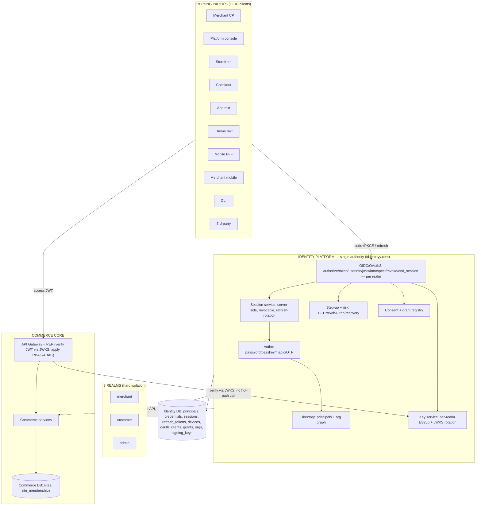

# IDENTITY FOUNDATION RECOVERY PLAN
### Surgical recovery blueprint · 2026-06-09 · evidence-grounded · re-verified against source
### Authors-of-record: Principal Identity / Security / Platform / Frontend / Design-System Architecture

> **This is not an audit.** It is the bridge from today's reality to the ratified north-star already in the repo (`docs/auth/2026-06-08-identity-platform-transformation/`, 30 design docs). The single question answered here: **how do we transform the current Identity Platform into the future-state Identity Platform with the least risk and least technical debt?** Every recommendation is anchored to source. Where this plan and prior conclusions disagree, **the re-verified evidence wins** (see corrections below).

---

## §0. What changed on re-verification (read first)

This plan supersedes two claims in `IDENTITY_PLATFORM_AUDIT/` after re-reading source:

1. **There IS active middleware.** Next 16's `apps/identity-platform/src/proxy.ts` (the renamed `middleware`) sets `X-Frame-Options: DENY`, `X-Content-Type-Options: nosniff`, `Referrer-Policy` (`proxy.ts:59-61`) and mints the CSRF cookie (`:50-56`). → **Retract** the audit's clickjacking finding (M-10). **Reframe** "no middleware" (M-9/OPS-1): middleware exists and guards *page* routes, but **explicitly passes `/api/*` through** (`proxy.ts:28-30` `return NextResponse.next()`), so it does **not** protect `/api/auth/switch`.
2. **The "dead v2 foundation" is dormant-by-design, not abandoned.** The six `*-core` packages + the 1,663-LOC `services/api-gateway/src/identity-foundation/*` + migration `159_identity_foundation_core.sql` were built in the CODEX StepUp pass (`docs/auth/2026-06-08-identity-platform-transformation/CODEX_IDENTITY_FOUNDATION_STEPUP_STATUS.md`) under an explicit "build everything, switch nothing" mandate — all 15 feature flags default false (`packages/auth-core/src/feature-flags.ts`). → These are **KEEP-and-complete seed rails**, not delete targets. The audit's "delete dead scaffolding" framing is **withdrawn** for these; only genuinely-legacy/duplicated paths are deletion candidates (§13).

Everything else in the audit re-verified true — most importantly the **`/api/auth/switch` account-takeover**, which the entire target corpus treats as benign session rotation and therefore **does not fix** (§4).

---

## §1. Executive verdict

# PARTIAL REBUILD REQUIRED

Not "YES WITH REFACTORING" — the OIDC provider, key service, refresh/rotation engine, and consent registry **do not exist as running code**; every `oauth2/*` route returns a disabled skeleton (`apps/identity-platform/src/lib/identity-foundation/oidc-disabled.ts:50-103`) and JWKS is a literal `mock-x-coordinate` (`:4-16`). You cannot refactor your way to an authority layer that was never built.

Not "FULL REBUILD" — the destination is already **ratified in 30 design docs**, the **rails are ~70–80% scaffolded dormant** (migration 159; six `*-core` packages; gateway `identity-foundation/*` 1,663 LOC incl. a mock ES256 key service; `CODEX_…_STATUS` "Built in this pass"), and the **seed primitives are real and verified in source**: `createAppScopedAccessToken` (`auth-core/src/index.ts:1013`), `createCustomerFederationToken` (`:806`), `merchant_2fa_factors` (migration `121_mobile_merchant_2fa_factors.sql`), the `sessions` table + `createSession/validateSession`, `site_api_clients`, and a real ops RBAC engine (`services/api-gateway/src/middleware/rbac.ts:273-361`). A from-scratch IdP would throw all of that away.

**Therefore: a partial rebuild of the authority layer (build the provider, promote the dormant rails to live, collapse the seven systems), wrapped around a salvageable shell, flows, UI, and design system — preceded by an immediate S0 security track the architecture corpus omits.**

| Evidence for the verdict | Source |
|---|---|
| Authority layer 0% live | `oidc-disabled.ts:50-103` (501); flags default false (`feature-flags.ts`) |
| …but ~70–80% scaffolded dormant | `CODEX_…_STATUS.md` "Built/Not switched on"; migration 159; `identity-foundation/*` 1,663 LOC |
| Destination ratified | 30 docs in `docs/auth/2026-06-08-identity-platform-transformation/` |
| Seed primitives real | `auth-core/src/index.ts:806,1013`; migrations 121/153/159 |
| 3 live S0 defects block trust | §4 (switch ATO, console dev-secret, mock-KMS default) |
| Shell/flows/UI salvageable | 4 DS-native pages; single-use email tokens; password-set-intent flow |

**Confidence: 84/100.** Identity-platform + auth-core claims are first-hand; the target corpus and CODEX status are read in full; residual uncertainty is operational (Hydra/KMS provisioning, env posture) not architectural.

---

## §2. Identity inventory (KEEP / REFACTOR / REPLACE / DELETE)

| # | Subsystem | Purpose | Owner / Runtime | DB | Session model | Cookie | Security model | Tenant model | **Status** |
|---|---|---|---|---|---|---|---|---|:--:|
| 1 | **Merchant authentication** | password/OTP/magic login for merchants/staff | `apps/identity-platform` (Next 16) orchestrates → `api-gateway` | `sessions`,`users_custom` | opaque `randomHex(32)`, 30d, DB lookup | `lb_session` (.store, 30d) | bcrypt-12, CSRF, Turnstile, rate-limit | app-layer `verifySiteOwnership` | **REFACTOR** → OIDC merchant realm |
| 2 | **Customer authentication** | buyer login on storefronts | `auth-core` host-only provider | `store_customers`,`customer_credentials` | HS256 JWT, 7d | `lb_customer_session` (host-only) | bcrypt-10, separate realm | host-only realm split | **REFACTOR** → OIDC customer realm |
| 3 | **Platform console (ops)** | staff admin auth + MFA | `apps/platform-console` | `employees`,`employee_permissions` | 2-part HMAC token, 8h, MFA flag | `lb_console_session` | real RBAC + TOTP + break-glass | ops scopes | **REFACTOR** → OIDC admin realm; **fix dev-secret (S0)** |
| 4 | **Mobile authentication** | Flutter merchant app | `apps/mobile/merchant-app` → accounts host | reuses #1 | reuses `lb_session` | secure-storage + cookie | Turnstile hard-block | reuses #1 | **REFACTOR** → native OIDC+PKCE via BFF |
| 5 | **Marketplace / app OAuth** | app-install authorization | `app-marketplace` + gateway | `app_installations` | gateway bearer + auth code | — | **real PKCE S256** | per-merchant grant | **KEEP** (seed of OIDC token svc) |
| 6 | **Gateway authentication** | verify all inbound requests | `api-gateway` middleware | — | 4-verifier registry | — | HMAC S2S + Supabase bearer + console token | service_role / BYPASSRLS | **REFACTOR** → PEP (verify IdP JWT via JWKS) |
| 7 | **Legacy Supabase auth** | parallel GoTrue path | gateway `routes/auth.ts:1214-1372` | Supabase auth | Supabase JWT access+refresh | Supabase | auto-confirm email (M-7) | — | **DELETE** (Wave 7) |
| 8 | **"V2 identity foundation"** | dormant target rails | 6 `*-core` pkgs + gateway `identity-foundation/*` | migration 159 (empty) | session/refresh scaffolds | cookie-policy scaffold | mock ES256 key svc | realm registry | **KEEP & COMPLETE** (not delete — dormant by design) |
| 9 | **`lb_accounts` multi-account** | account-picker list | identity-platform | cookie-only | HS256 JWT, 365d, PII | `lb_accounts` (.store) | signed-not-encrypted; dev-key fallback (H3) | — | **REPLACE** → IdP `account_links` |
| 10 | **Internal S2S HMAC** | service-to-service trust | `auth-core`/`internal-auth` | — | HMAC headers, 5-min | — | shared `AUTH_SECRET` (T13) | — | **REPLACE** → mTLS workload identity (Wave 8) |

No ambiguity rule applied: anything that asserts "who the user is" via shared HMAC over app-supplied headers (#6 legacy branch, #10) is **REPLACE**; anything that is a real, standards-aligned primitive (#5 PKCE, #3 RBAC engine, #8 dormant rails) is **KEEP**; the two legacy/parallel stores (#7 Supabase, the `users` vs `users_custom` split) are **DELETE**.

---

## §3. Canonical authority map (final ownership = Identity Platform)

Per `TARGET_AUTH_ARCHITECTURE.md §3` and `AUTHORITY_MATRIX.md`, every concern below resolves to **one owner: the Identity Platform**. Current violators (who owns it *today*) are named so the recovery can move ownership.

| Authority concern | Final owner | Owns it today (violation) | Move evidence |
|---|---|---|---|
| Authentication | **Identity Platform** | gateway `routes/auth.ts` (logic) + identity-platform (UI) | invert per TARGET §7 (IdP becomes issuer) |
| Authorization (who-you-are + org/roles) | **Identity Platform** (identity); commerce decides resource actions | gateway + per-route predicates | TARGET §4 boundary rule |
| Sessions | **Identity Platform** | gateway `sessions` table | seed `sessions`→session service (TARGET §10) |
| Refresh tokens | **Identity Platform** | **nobody** (interface-only `session-core`) | build (Wave 3) |
| Cookies | **Identity Platform** | identity-platform `cookies.ts` + console + merchant-cp (3 places) | consolidate (§6) |
| Consent | **Identity Platform** | **nobody** (501) | build + reuse `consents` (migration 153) |
| Passkeys | **Identity Platform** | **nobody** (`FEATURE_PASSKEY` flag, no impl) | seed `merchant_2fa_factors` |
| MFA | **Identity Platform** | console only (TOTP) | generalize across realms |
| OIDC / OAuth / JWKS / Client registry | **Identity Platform** | **nobody** (mock) | build; reuse `createAppScopedAccessToken` |
| Logout | **Identity Platform** | identity + merchant-cp + console (3 dup routes) | consolidate → `/end_session` |
| Device management | **Identity Platform** | gateway `devices` | seed → device registry |
| Account recovery / email verify / magic links | **Identity Platform** | identity-platform routes (real) | KEEP & move under IdP |

**Anything violating "Identity owns identity":** the gateway's app-asserted-identity branch (`X-LetBuyy-Internal-User-ID/Email/Store-ID` consumed in `middleware/auth.ts`) and the shared HMAC secret (`getLetbuyyInternalAuthSecret` `auth-core/src/index.ts:447`) — both let a *non-Identity* component assert identity. Target deletes both (`ZERO_TRUST_ARCHITECTURE.md` ZT2; TARGET §11 "zero code paths that trust app-asserted headers").

---

## §4. Security recovery — Immediate Recovery Matrix

> The architecture corpus is forward-looking and **does not hotfix the live CVEs** — it documents `/switch` as benign rotation (`SESSION_MANAGEMENT.md §3`), is silent on the console dev-secret, and treats mock-KMS as intended-dormant. **This track runs on a separate, faster clock than the architecture (Wave −1 below); it must not wait for Hydra/KMS provisioning.**

### S0 — fix this week, before any architecture work

| Finding | Evidence | Root cause | Fix strategy | Effort | Risk if deferred |
|---|---|---|---|:--:|---|
| **S0-1 Account takeover via `/api/auth/switch`** | `apps/identity-platform/src/app/api/auth/switch/route.ts:22,52,61-64`; comment `:12` claims an accounts-cookie check that does not exist; `getAccounts()` only called in `accounts/route.ts`; `multiAccount` flag gates nothing; `proxy.ts:28-30` skips `/api/` | route mints a session for any `email_verified` email from the request body with no possession proof | require an **authenticated current session** AND verify the target email is in the signed `lb_accounts` cookie (re-mint only for already-proven accounts); add rate-limit + Turnstile; or disable the route until multi-account is real | S | **full account/store takeover of any verified user** |
| **S0-2 Forgeable ops super-admin session** | `apps/platform-console/src/lib/console-session.ts:24,26,30` (`'dev-only-console-session-secret'`, `NODE_ENV`-only gate) | dev fallback secret reachable on any non-`production` `NODE_ENV` deploy | delete the literal; fail-closed if `PLATFORM_CONSOLE_SESSION_SECRET` unsafe; gate on `NODE_ENV`+`APP_ENV`+`VERCEL_ENV` like `console-auth-server.ts:138-142` | S | forged `mfaVerified:true` ops session → platform control |
| **S0-3 Default mock KMS literal** | `services/api-gateway/src/lib/crypto.ts:146,180` (`'letbuyy-local-mock-kms-envelope-secret'`, default `'mock'`) | live KMS unimplemented; mock is the default | provision real KMS (HR-KMS-LIVE); make non-mock mandatory in prod (throw if `LETBUYY_KMS_MODE!=='live'` when `APP_ENV=production`); rotate any data wrapped with the literal | M | data-at-rest effectively plaintext |

### Attack path — S0-1 re-proven (exact, end-to-end)

1. Attacker opens any accounts page in their own browser, e.g. `GET https://accounts.letbuyy.com/lookup`. Next-16 middleware mints a CSRF cookie: `proxy.ts:48-58` sets `letbuyy_csrf=<rand>` with **`httpOnly:false`** (JS-readable) and `sameSite:strict`.
2. Attacker reads it: `document.cookie` → `letbuyy_csrf=R` (`csrf-client.ts:11`).
3. Attacker, from that same origin, calls:
   `POST /api/auth/switch`  headers `{ 'X-CSRF-Token': 'R', Cookie: 'letbuyy_csrf=R' }`  body `{ "email": "victim@merchant.com" }`.
4. `validateCsrf` passes — it only checks `cookie === header` (`csrf.ts:11-14`), both attacker-controlled and same-origin. Double-submit stops *cross-origin* forgery, not a first-party attacker request.
5. `switch/route.ts`: `getSessionCookie()` is empty → skips destroy (`:31-34`); looks up victim by email (`:37-50`); passes because `victim.email_verified` (`:52`); **mints a real `lb_session` for the victim** (`:61-64`).
6. Attacker's browser now holds a valid merchant session for the victim. **No credentials, no victim interaction, no rate-limit, no Turnstile.** (Confirmed: `/switch` has only CSRF — Phase 5 coverage map.)

### S1 — fix within Wave −1/0 (high)

| Finding | Evidence | Fix |
|---|---|---|
| S1-1 `service_role`/BYPASSRLS default, dead RLS net | `supabase-adapter/index.ts:35`; `supabase.ts:10`; dead `tenant-core` GUC `tenant-core/src/index.ts:590-629` | **pull Wave-8 work forward** (§8): RLS as real second layer for tenant-scoped reads |
| S1-2 Static shared-token super-admin | `middleware/auth.ts:224-226` | scope/rotate `PLATFORM_CONSOLE_API_TOKEN`; per-principal attribution |
| S1-3 Forgeable `lb_accounts` dev key | `cookies.ts:11-19` (`NODE_ENV`-only) | unify 4-var prod gate; or move list server-side (IdP `account_links`) |
| S1-4 `AUTH_SECRET` reuse across 3 domains | `console-session.ts:24`; `cookies.ts:12`; `auth-core:451` | per-realm asymmetric keys (KEY_MANAGEMENT §2); retire shared HMAC |
| S1-5 Gateway Turnstile bypass needs no flag | `middleware/security.ts:199-205,222-224` | converge on identity's strict flag-gated verifier (§9 C1) |
| S1-6 `/switch` + `/lookup` lack rate-limit/Turnstile; `/lookup` enumeration | `switch/route.ts`; `lookup/route.ts:56-60` | add throttle+bot-check; make `/lookup` non-enumerating |

### S2 — Wave 0–2 (medium)
`lb_accounts` signed-not-encrypted PII 365d (`cookies.ts:171-176`); non-constant-time CSRF compare (`csrf.ts:14`); magic-link token-in-URL (`verify/route.ts:26-28`); login rate-limit IP-only (`login/route.ts:22`); Supabase auto-confirm+client-role (`routes/auth.ts:1214-1241`); in-memory auth fallback maps (`routes/auth.ts:82-85`); `verification_tokens` stored plaintext (migration `000_baseline`) → hash (TOKEN_STRATEGY §5).

---

## §5. Session consolidation

### Current session topology (verified)
Five live session implementations + one dormant:

```
MERCHANT   lb_session (opaque randomHex32, 30d)  ── mint gw routes/auth.ts:1047 ── validate gw :266-348 (DB lookup) ── destroy = row delete
CUSTOMER   lb_customer_session (HS256 JWT, 7d)   ── auth-core index.ts:693-764 (host-only realm)
ADMIN      lb_console_session (2-part HMAC, 8h)  ── console-session.ts (+ mfaVerified)
MOBILE     reuses lb_session                     ── store_auth_service.dart:160-197 (no rotation; "refresh"=re-validate)
SUPABASE   GoTrue JWT access+refresh             ── gw routes/auth.ts:1244-1268 (legacy, DELETE)
DORMANT    sessions_v2 + refresh scaffolds       ── gateway identity-foundation/session-services.ts (FEATURE_NEW_SESSION_ENGINE=false)
```
Defects (Phase 3): no rotation, no idle timeout, no reuse detection, no integrity binding; logout=delete; `last_active` written (`validate` path) but never enforced. `verifyLetbuyySessionCookieValue` (`auth-core:534`) is a **shape check only** (length/charset; customer=3-part JWT) — it does not verify a merchant signature, confirming the token is genuinely opaque.

### Future session topology (target = `SESSION_MANAGEMENT.md §1-4`)
**One session service**, three-layer, per realm:

```
              ┌─────────────────────── Identity Platform: Session Service ───────────────────────┐
sid record  → server-side, REVOCABLE (the authority)   idle + absolute timeout enforced on sid
refresh     → rotating opaque ≥256-bit, reuse-detect ⇒ revoke whole chain (RFC 6819)  cookie __Host-lb_rt (path /token, Strict)
access JWT  → short-lived (merchant 8m / customer 10m / admin 5m), verified at gateway via JWKS
              └──────────────────────────────────────────────────────────────────────────────────┘
Rotation triggers: each refresh · login · account-switch · password/credential change · PRIVILEGE CHANGE (new) · step-up re-mints AT (no new sid)
Revocation: gateway revoked-sid cache (short-TTL, push-invalidated) → common path = local JWT verify, no per-request introspection
```
Per-realm TTLs already specified (`SESSION_MANAGEMENT.md §2`): merchant abs 30d (= existing `AUTH_SESSION_DURATION_MS` `auth-core:127`), customer abs 90d, admin abs 8h (= `LETBUYY_PLATFORM_SESSION_TTL_SECONDS` `:133`).

**Consolidation path:** seed the service from the existing `sessions` table + `createSession/validateSession` (TARGET §10), add a `refresh_chains`/`refresh_tokens` shape (migration 159 already stubs these), enable behind `FEATURE_NEW_SESSION_ENGINE` with shadow-compare before enforce (Wave 2), then retire the four other realms onto it (Waves 3–6). **Keep** today's `switch` destroy+create rotation behavior — but only **after** S0-1 is fixed.

---

## §6. Cookie consolidation

### Current (11 cookies, verified — Phase 4)
`lb_session` (.store, 30d, HttpOnly) · `letbuyy_csrf` (JS-readable, Strict, 1h) · `lb_accounts` (.store, 365d, **signed PII**) · `lb_device` (90d) · `lb_password_set_intent` (Strict, 15m) · `lb_customer_session` (host-only, 7d) · `lb_console_session` (8h) · `lb_csrf` (legacy dup) · mobile secure-storage keys (×3).

Classification + defects:
| Class | Cookies | Defect | Target |
|---|---|---|---|
| Authentication | `lb_session`,`lb_customer_session`,`lb_console_session` | domain-wide `.store`; opaque/symmetric | `__Host-lb_m_sess`/`lb_c_sess`/`lb_a_sess` host-only on `id.letbuyy.com` |
| SSO | `lb_session` (parent-domain share) | breaks at `.store`→`.com` cutover (D2) | per-RP `__Host-{app}_sess` + IdP SSO session |
| CSRF | `letbuyy_csrf` + `lb_csrf` | **two names**; JS-readable; non-constant-time compare | single mechanism; drop `lb_csrf` |
| Refresh | (none today) | no refresh cookie | `__Host-lb_rt` (path `/token`, Strict, rotate) |
| Preferences/Theme | `letbuyy_lang` (localStorage), theme via provider | n/a | keep (non-auth) |
| Tracking | none in identity | — | — |

### Final cookie architecture (target = `SESSION_MANAGEMENT.md §6` Cookie Ownership Matrix)
All auth cookies become **host-only `__Host-` prefixed** on `id.letbuyy.com` (browser-enforced secure+path+no-domain), zero domain-wide, **zero JS-readable auth cookie** (CSRF moves to a non-readable double-submit or origin-bound token). Count **11 → ~8**. **Two cutovers must be jointly sequenced** (a gap the corpus leaves open, §15 Wave 2): the SEO `.store`→`.com` domain migration (`docs/seo/`) and the `lb_session` domain-wide→host-only move. Flipping either alone breaks SSO or logout (the `.letbuyy.store` literal is duplicated in `merchant-control-plane/.../logout/route.ts:33` — reconcile both before cutover).

---

## §7. OIDC recovery (using actual LetBuyy requirements)

Not hypothetical — the realm model and client inventory are **already decided** (`REALM_ARCHITECTURE.md`, `OIDC_CLIENT_INVENTORY.md`). This plan ratifies and sequences them.

### Realm model (3 realms, hard isolation — `REALM_ARCHITECTURE.md §1-5`)
`merchant` · `customer` · `admin`. One issuer host `id.letbuyy.com`, path `…/realms/{realm}`; each realm has its own keys, JWKS, audience, cookie host, principal partition, session partition. **No cross-realm token ever valid.** Tenancy is **org-as-claim within the merchant realm**, not realm-per-tenant (`OIDC_DECISION_RECORD §1.1`) — 100k merchants are one realm, distinguished by the `org` claim. Reuse existing `ActorType` (`auth-core:44`, 7 values) as the `act`/`realm` vocabulary.

### OIDC client inventory (15 clients — `OIDC_CLIENT_INVENTORY.md`)
| Client | Realm | Type | Grant | Redirect (sample) | Key scopes |
|---|---|---|---|---|---|
| Merchant control plane | merchant | confidential | code+PKCE | `app.letbuyy.com/auth/callback`, `{sub}.letbuyy.com/...` | `openid profile email merchant:* org:read` |
| Platform console | admin | confidential | code+PKCE, **MFA mandatory** | `console.letbuyy.com/auth/callback` (no wildcard) | `admin:console ops:*` |
| Ops portal | merchant+ops | confidential | code+PKCE | `ops.letbuyy.com/auth/callback` | `ops:*` |
| Storefront runtime | customer | confidential | code+PKCE | `{store}.letbuyy.com/auth/callback` + custom domains | `openid customer:self store:{id}` |
| Checkout | customer | confidential | **token-exchange (RFC 8693)** / guest | `checkout.letbuyy.com/callback` | `checkout:session customer:self` |
| Theme marketplace | merchant | confidential | code+PKCE, **silent `prompt=none`** | `themes.letbuyy.com/auth/callback` | merchant SSO |
| App marketplace | merchant | confidential | code+PKCE, silent SSO | `apps.letbuyy.com/auth/callback` | merchant SSO |
| Mobile BFF | merchant | confidential | code+PKCE on behalf of native | BFF holds tokens | merchant |
| Merchant mobile | merchant | **public/native** | code+PKCE (system browser) | `com.letbuyy.merchant://auth/callback` | `…offline_access` |
| 3rd-party apps | merchant (delegated) | conf/public | code+PKCE; client-creds; **consent required** | developer-registered exact https | scoped |
| Merchant API clients | merchant | M2M | client-credentials | — (from `site_api_clients`) | scoped |
| Future CLI | merchant | public | **device-code (RFC 8628)**+PKCE | — | scoped |
| Future customer app | customer | public/native | code+PKCE; device-code | greenfield | customer |
| Background workers | none | M2M internal | client-creds / mTLS | — | per-worker |
| Identity login/consent | all | 1st-party | (is the provider's login/consent app) | — | — |

### OIDC build roadmap (4 phases — maps to migration waves)
- **Phase 1 (Wave 1):** stand up the provider as a **façade over existing `users_custom`/`sessions`** (no data move). Per-realm discovery + JWKS (replace `MOCK_JWKS` with real ES256 from the key service); mint tokens for **one pilot client**; inject `org`(null)/`sites`/`amr` claims. Production auth untouched. Seed token service from `createAppScopedAccessToken` (`auth-core:1013`).
- **Phase 2 (Wave 2):** merchant control plane → first real RP; gateway **dual-accepts** IdP tokens + legacy header path; shadow-compare authz before enforce; canary by % merchants; per-merchant flag rollback.
- **Phase 3 (Waves 3–5):** admin realm (console), then marketplaces (silent SSO + 3rd-party OAuth with consent + M2M client-credentials), then customer realm + checkout token-exchange.
- **Phase 4 (Waves 6–8):** mobile native OIDC/PKCE via BFF; introspection/revocation/end-session hardening; retire legacy; GA.

**Hard rule (operators):** keep `FEATURE_IDENTITY_PROVIDER`/`FEATURE_NEW_KEY_SERVICE` **off in production until a real key service replaces `MOCK_JWKS`** — enabling them today publishes an unusable issuer (`oidc-disabled.ts:4-16`; Phase 2 H-5).

---

## §8. Tenant isolation recovery

### Current (verified — Phase 7)
One enforcement layer: per-route app predicates (`verifySiteOwnership` `services/api-gateway/src/lib/auth-user.ts:40-67`) over a **`service_role`/BYPASSRLS** connection (`supabase-adapter/index.ts:35`; `supabase.ts:10`). The RLS-respecting `getSupabaseUser` has **zero callers**; the `tenant-core` GUC/`set_config` bridge is **never executed** (`tenant-core/src/index.ts:590-629` — re-exported, test-asserted, never run). Merchant staff RBAC is owner-or-nothing (`middleware/permission.ts` is plan-gating, not access control).

### Can Identity become the ecosystem authority with this tenant model? **NO — not yet.**
SSO **multiplies** the number of services that can forget the per-route check; federating an identity whose tenancy has no database safety net turns "one missing predicate" into an ecosystem-wide IDOR. The corpus agrees the model is unsafe (`ZERO_TRUST_ARCHITECTURE.md` ZT4/ZT8; `THREAT_MODEL.md` T8) but **schedules the fix last (Wave 8)**. This plan **pulls it forward**.

### Tenant Recovery Plan (3 steps, front-loaded)
1. **Wave −1/0 (cheap safety net):** add a mandatory query-builder wrapper / lint rule that **refuses unscoped tenant queries** and flags raw `getSupabaseAdmin` use in tenant-scoped routes — catches the *first* missing predicate without a DB change.
2. **Wave 1–2 (real second layer):** wire the dead `tenant-core` GUC into a **RLS-respecting connection** for tenant-scoped reads — execute `SET LOCAL app.site_id` per transaction and enable the `tenantRlsPolicyTemplate` policies (`tenant-core/src/index.ts:614-629`) so the database rejects cross-tenant rows even if the app forgets.
3. **Wave 8 (least-privilege):** decompose `service_role` into per-domain DB principals + mTLS workload identity (`ZERO_TRUST §7`).

**Future authorization split (ratified — `PERMISSION_MODEL.md` A-1):** Identity owns **ReBAC** (who is related to what — org/team/store membership graph); Commerce owns **RBAC+ABAC** (role→permission, plan/entitlement); deny-overrides across the three planes. `org`-as-claim, `sites` as a bounded snapshot re-checked against the Commerce Membership API on sensitive ops (TARGET §5). This requires the A-1 human sign-off (membership graph moves to Identity).

---

## §9. Duplication elimination

For each cluster: **canonical** implementation, **delete**, **merge**, **keep**, est. LOC reclaimed. (Full evidence: `IDENTITY_PLATFORM_AUDIT/DUPLICATION_FORENSICS_REPORT.md`.)

| Cluster | Canonical (keep) | Delete / merge | LOC | Why it's also a security win |
|---|---|---|---:|---|
| **Auth backends** | `/custom/*` opaque-session stack | **delete** legacy Supabase path `routes/auth.ts:1214-1372` | ~160 | removes auto-confirm-email + client-role path (M-7) |
| **Turnstile verifier** | identity strict `turnstile.ts:7-34` | **merge** gateway `security.ts:219-249` into it; delete loose bypass | ~35 | closes S1-5 (no-flag bypass) |
| **Dev-bypass gate** | `dev-auth-bypass.ts:13-23` (4-var + flag) | **merge** 5 other forks (console, gw-auth, gw-turnstile, 2 widgets) | ~60 | one prod-detection truth ⇒ no env-drift bypass |
| **CSRF** | one double-submit mechanism | **delete** `lb_csrf` name; collapse `csrf.ts`+`csrf-client.ts`+`proxy.ts:43-58` mint | ~70 | one constant-time compare; no dual-name |
| **Cookie-domain literal** | one shared `COOKIE_DOMAIN` config | **delete** `.letbuyy.store` in `cookies.ts:54` + `merchant-control-plane/.../logout/route.ts:33` | ~6 | prevents silent cutover SSO/logout break |
| **JWT / crypto** | key-service signer + shared `base64url`/`timingSafeEqual` | **merge** hand-rolled HS256/ES256 + base64url ×10 + timingSafeEqual ×28 | ~230 | one place to fix constant-time/padding |
| **Logout** | one IdP `/end_session` | **merge** 3 routes (identity, merchant-cp, console) | ~40 | consistent session kill |
| **Pages** | shared `AuthShell` + i18n module | **delete** 9× boilerplate + login≈lookup clone (282 lines) | ~560 | removes drifted return_to/rate-limit handling |
| **Session impls** | future session service | collapse 5 realms onto it (Waves 3–6) | (large) | one revocable authority |

**Total reclaimable from duplication ≈ 1,490–1,600 LOC.** **Do NOT delete** the dormant `*-core` packages or gateway `identity-foundation/*` — those are the **canonical future**, not duplication (§0 correction).

---

## §10. UI/UX foundation recovery

### Evaluation vs `@letbuyy/ui` (verified — Phase 8/9)
| Dimension | State | Evidence |
|---|---|---|
| Typography / spacing | bypassed in shadow CSS | 77 hardcoded font-sizes, 424 raw px in `globals.css` |
| Buttons / inputs | DS components neutered via `unstyled` | 67/79 Buttons, 9/15 Inputs `unstyled` (`login:245`,`signup:570`) |
| Dark / light | real provider, leakage | `useAuthTheme.ts` good; `--purple` undefined (`globals.css:212,527`) |
| Accessibility | split | 9 silent `.auth-error` (no `aria-live`); `outline:none`×4 no `:focus-visible`; unlabelled OTP; dead `href="#"` |
| Responsive | adequate | — |

### UI Recovery Plan
1. **Anchor on the gold standard:** `reset-password`/`set-password`/`forgot-password`/`check-email` are already fully DS-native — adopt them as the reference pattern.
2. **Convert the shadow pages** (`login`,`lookup`,`signup`,`onboarding`) off `.auth-*` CSS to DS components, **deleting the corresponding shadow classes as each page converts** (so `globals.css` shrinks monotonically).
3. **Collapse `login`≈`lookup`** into one screen (§9) and extract the 9× top-bar/i18n boilerplate into `AuthShell`.
4. **Fix accessibility:** route all errors through DS `Banner` (announced); restore `:focus-visible`; label OTP digits; wire real Terms/Privacy links.
5. **Delete `globals.css` shadow stylesheet** at the end of conversion (target: 1,984 → a few hundred lines of genuinely identity-specific CSS).

---

## §11. Theme governance

**Single theme architecture:** light / dark / system through `LetbuyyThemeProvider` + `ThemeScript` only; **no inline colors, no component-level themes, only `--lb-*` design tokens.** The engine is already correct (`layout.tsx:98,106`; `useAuthTheme.ts`) — the work is removing the hand-maintained escapes.

Violations to remove (verified — Phase 11):
- Parallel hand-written `.dark` block + 14 `.dark` selectors (`globals.css:31-40,267,…,1655`) → source from `--lb-*`.
- Hardcoded `rgb(5 8 16)` body bg (`globals.css:1108`) and `rgb(10 15 26)` in TSX (`layout.tsx:102`) → tokenize.
- **Undefined `--purple`** consumed at `globals.css:212,527` (live at `lookup:543`) → define or remove (broken in both themes today).
- Hardcoded `rgba()` state overlays (`:476,526,287,1714`) → themed tokens.

Enforced by §12 (ban non-`--lb-` color vars + raw `rgb()/hex` in app CSS).

---

## §12. Design system enforcement

**Can Identity be the reference implementation for all LetBuyy apps?** **Not today** (shell adoption is low; the app itself runs a shadow design system), **but it is the right candidate** — `@letbuyy/ui` v1.0.0 + the ESLint plugin are already wired here (`apps/identity-platform/eslint.config.mjs:11-22`). Recovery makes it the reference by **finishing adoption and closing the loophole**.

### Design System Recovery Plan
| Control | Action |
|---|---|
| **Lint rules** | promote the 3 `warn` rules → **`error`**: `no-raw-form-controls`, `no-raw-color-functions`, `no-tailwind-default-color`; add a new rule flagging **`unstyled` on DS components** in the auth surface (the loophole) |
| **Token enforcement** | ban raw `hex`/`rgb()`/`px` in app CSS via stylelint; require `--lb-*` for color/space/type |
| **Component enforcement** | ban shadow `.auth-*` classes once pages convert; require DS `Button`/`Input`/`Banner`/`ProgressBar` |
| **Theme enforcement** | ban non-`--lb-` color custom properties; ban `.dark` hand-overrides |
| **CI checks** | gate PRs on `eslint` (DS plugin) + `stylelint` + `node scripts/validate-governance.mjs`; fail on new `unstyled`/`globals.css` growth |

---

## §13. Deletion plan — `DELETE.md` preview (most important)

**Rule: delete legacy and duplication; KEEP the dormant target rails.** The single most common mistake available here is deleting the `*-core`/`identity-foundation` scaffolding — that is the future, switched off on purpose (§0).

### DELETE (legacy / dup / dead)
| Target | Path / evidence | LOC | Wave |
|---|---|---:|---|
| Legacy Supabase auth backend | `services/api-gateway/src/routes/auth.ts:1214-1372` | ~160 | 7 |
| App-asserted-identity branch + shared HMAC identity path | `middleware/auth.ts` internal-identity verifier; `getLetbuyyInternalAuthSecret` `auth-core:447` | ~120 | 7–8 |
| In-memory auth fallback maps | `routes/auth.ts:82-85,925,1058` | ~60 | 0 |
| `lb_csrf` legacy cookie name + dual-read | `csrf.ts:22`; `csrf-client.ts:12` | ~15 | 2 |
| Shadow `.auth-*` stylesheet | `apps/identity-platform/src/app/globals.css` (most of 1,984) | ~1,400 | UI track |
| `login`≈`lookup` clone + 9× page boilerplate | `login/page.tsx`,`lookup/page.tsx` + 9 pages | ~640 | UI track |
| Second Turnstile validator + 6-way bypass fork | `security.ts:219-249`; 5 dev-bypass forks | ~95 | 1 |
| `users` vs `users_custom` split | collapse → `principals` (migration 159 target) | (schema) | 7 |
| Undefined `--purple` / orphan `.auth-label`/`.auth-input` | `globals.css:212,527`; `onboarding:885,950` | ~10 | UI track |
| Dead feature flags after enablement/retirement | `feature-flags.ts` (per-flag, once promoted) | ~30 | 7–8 |

**Estimate: ~30–40 files touched, ≈ 3,000–3,500 LOC removable across waves** (≈1,500 duplication + ≈1,400 shadow CSS + ≈600 legacy/parallel). The identity surface shrinks materially while *capability grows* — the hallmark of a good recovery.

### DO NOT DELETE (KEEP & complete — dormant target)
`packages/{session,token,permission,identity,audit,organization}-core` · `services/api-gateway/src/identity-foundation/*` (1,663 LOC) · migration `159_identity_foundation_core.sql` · `apps/identity-platform/src/app/oauth2/*` + `.well-known/*` skeletons · the disabled-by-default flags. These are Wave-0 foundation; the recovery **completes and enables** them (it replaces only the **mock** key service with a real one).

---

## §14. Final target architecture


**Invariants (TARGET §11):** one issuer host; zero gateway paths trusting app-asserted headers; no raw access/refresh tokens in any JSON body; every session server-revocable within one access-token TTL; `users`+`users_custom`→one `principals` directory; single CSRF mechanism; per-realm asymmetric keys (shared HMAC retired).

---

## §15. Migration waves

> Sequenced from the existing `MIGRATION_PLAN.md` / `IDENTITY_IMPLEMENTATION_MASTER_PLAN.md`, **prepended with Wave −1 (the S0 hotfix track the corpus omits)** and with tenant-isolation pulled forward. Principle (theirs, kept): ownership of the *decision* moves before ownership of the *data*; no big-bang; dual-accept old+new; remove old only on drained telemetry; metrics-as-gates; `node scripts/validate-governance.mjs` at every boundary.

| Wave | Objective | Dependencies | Top risks | Rollback |
|---|---|---|---|---|
| **−1 · S0 hotfix** | Fix `/api/auth/switch` ATO (S0-1); delete console dev-secret (S0-2); add tenant query-guard (S1-1); add throttle/Turnstile to switch+lookup | none (independent of architecture) | regression in account-switch UX | feature-flag each fix; revert is 1 commit; no schema change |
| **0 · Foundation + GATE** | Provision Hydra in `ap-south-1`, **real KMS** (HR-KMS-LIVE) + per-realm ES256/JWKS, India OTP/DLT, residency pin; enable dormant rails in **shadow**; merge `@auth-core` decomposition + parity harness | −1 done; 8 HR sign-offs (`CODEX_…_STATUS` HR rows) | **Operational readiness 58 is the binding constraint** (`IMPLEMENTATION_READINESS_REVIEW`) | nothing user-facing flips; rails stay flag-off |
| **1 · IdP as façade** | OIDC provider over existing `users_custom`/`sessions`; per-realm discovery+JWKS (replace `MOCK_JWKS`); mint tokens for **one pilot client**; wire real tenant RLS second layer (pull-forward) | Wave 0 gate (Ops ≥75, Impl ≥85) | mock→real key cutover; JWKS caching | flag `FEATURE_IDENTITY_PROVIDER` off; prod auth untouched |
| **2 · Merchant CP (keystone)** | merchant control plane → first real RP; gateway **dual-accepts** IdP token + legacy header; shadow-compare authz; host-only CP cookie; **joint `.store`→`.com` + cookie-domain cutover** | Wave 1; SEO domain runbook (`docs/seo/`) | the two cutovers interacting (SSO/logout break) | per-merchant flag; canary %; revert to legacy header path |
| **3 · Admin realm** | console → admin realm; revocable sessions; retire shared TOTP→per-user; constrain synthetic super-admin principal | Wave 2 | ops lockout | dual-accept console token |
| **4 · Marketplaces** | app/theme silent SSO (`prompt=none`); 3rd-party OAuth→Hydra **with consent**; M2M→client-credentials | Wave 2 | installed-app long dual-run | keep legacy app-OAuth accepted |
| **5 · Customer + checkout** | collapse the **two** customer session systems → one revocable session; checkout token-exchange; **execute credential migration** cohorted by store | Waves 1–2; credential-migration gate (HR) | buyer-facing; conversion risk | cohort flags; rollback per store |
| **6 · Mobile** | native OIDC/PKCE via BFF; `lb_session`→rotating refresh | Wave 2; app-store release | update lag → forced-update floor | long dual-run; min-version gate |
| **7 · Legacy removal** | delete app-asserted-identity, legacy Supabase routes, raw-token JSON, domain-wide `lb_session`/`lb_accounts`/JS-readable CSRF; collapse `users`+`users_custom`→`principals` (§13) | zero traffic N days per path | premature delete | dark-ship 1 release before hard delete; telemetry-gated |
| **8 · Zero-trust + org GA** | mTLS workload identity (retire shared HMAC); decompose `service_role`→least-privilege; enforce merchant MFA+step-up+privilege-change rotation+device-revoke UI; **GA merchant org model**, populate `org` claim | Waves 2–7 | broad blast radius | per-control flags; staged by service |

### Critical-path callouts
- **Wave −1 ships first and alone.** The `/switch` takeover is live; it must not wait for Hydra/KMS provisioning.
- **Wave 0's binding constraint is operational maturity (58→≥75), not code.** Per `IMPLEMENTATION_READINESS_REVIEW.md` the build is a CONDITIONAL PASS gated on 8 human-required provisioning items, not on more scaffolding.
- **Wave 2 carries the only un-designed interaction in the whole program:** the SEO `.store`→`.com` migration and the cookie-domain cutover must be designed *together* (neither corpus owns this jointly).
- **Tenant RLS is pulled from Wave 8 into Waves −1/1** — the cheap query-guard now, the real RLS layer at façade time — because SSO cannot safely launch over a BYPASSRLS-only tenancy.

---

## Appendix — source-of-truth index
**Re-verified this pass:** `apps/identity-platform/src/{proxy.ts, app/api/auth/*, lib/auth/*, lib/identity-foundation/oidc-disabled.ts, lib/config/features.ts}`; `packages/auth-core/src/index.ts` (`:44,127,128,447,534,806,1013`); `packages/{session,token,permission,identity,audit,organization}-core/src`; `services/api-gateway/src/{routes/auth.ts, middleware/auth.ts, middleware/security.ts, lib/crypto.ts, lib/supabase.ts}`; `apps/platform-console/src/lib/console-session.ts`; migrations `121/153/159`.
**Ratified design corpus (north-star):** `docs/auth/2026-06-08-identity-platform-transformation/` (TARGET_AUTH_ARCHITECTURE, REALM_ARCHITECTURE, SESSION_MANAGEMENT, TOKEN_STRATEGY, KEY_MANAGEMENT_ARCHITECTURE, OIDC_CLIENT_INVENTORY, OIDC_DECISION_RECORD, IDENTITY_DATA_MODEL, PERMISSION_MODEL, ORGANIZATION_ARCHITECTURE, MIGRATION_PLAN, IDENTITY_IMPLEMENTATION_MASTER_PLAN, IMPLEMENTATION_READINESS_REVIEW, ZERO_TRUST_ARCHITECTURE, THREAT_MODEL, CODEX_IDENTITY_FOUNDATION_STEPUP_STATUS) + `docs/auth/2026-06-08-auth-session-sso-cookie-architecture/{AUTH_AUDIT_REPORT, CURRENT_AUTH_ARCHITECTURE}`.
**This audit's evidence base:** `IDENTITY_PLATFORM_AUDIT/` (14 reports).

*Analysis-only deliverable. No source code was modified in producing this plan.*
