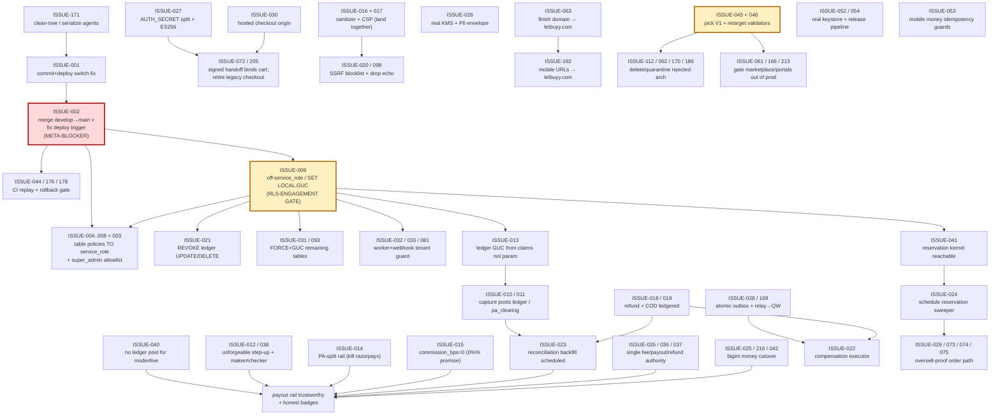

# PHASE 14 — LETBUYY MASTER EXECUTION PLAN

**LetBuyy Forensic Master Audit · 2026-06-10**
**Principal architect — remediation execution plan (audit close-out)**
**Evidence baseline:** working tree `stepup/main` @ `c4fc3cd6`, dirty tree, 2026-06-10.
**Primary input:** `FORENSIC_MASTER_2026_06_10/TOP_250_PLATFORM_ISSUES.md` (291 unique issues, ISSUE-001..291; 9 S0s).
**Constitution:** `LETBUYY_EXECUTABLE_ARCHITECTURE_V1.md` (FROZEN & EXECUTABLE; §12 roadmap, §13 squads, §16 backlog, 100→1k→10k envelope).

---

## 0. Methodology

This is a **plan, not new architecture.** It orders the remediation of the 291 ranked issues against V1's frozen intent and its 100→10k envelope. No new systems are invented; every workstream maps to a V1-approved capability or to an explicit V1 directive (kill the rake, finish the domain migration, ship the hosted origin, off-`service_role` connection, provider-mode honesty badge, etc.).

**How the plan was built:**
1. **Ingested the ranked register** (ISSUE-001..291), the 9-issue S0 set, the Go-Live Blocker Shortlist (21 numbered items / 33 canonical issues), and the severity/area/complexity breakdowns.
2. **Re-read V1** §3 (approved architecture), §4 (rejected), §5 (deferred), §6 (topology), §7–9 (DB/payments/checkout), §10 (merchant-OS beta scope), §12 (roadmap), §13 (squads), §16 (backlog + dependencies).
3. **Mined the four most sequencing-critical phase docs** (PAYMENTS, FOUNDATION, AUTH, ARCHITECTURE_COMPLIANCE) for hard fix-order constraints, captured below with `path:line` anchors.
4. **Applied the six-dimension priority model** (revenue > security > data > money > architecture > UX) to assign every issue a phase, then re-sorted within phase by hard dependency.
5. **Encoded the dependency graph** (list + Mermaid), the five phases (A–E) with entry/exit/DoD, the critical path, the squad parallelization map, the risk burn-down, the anti-scope-creep guardrails, and a full ISSUE-ID → phase appendix so all 291 issues have a home.

**Sizing scale (V1 §16):** XS ≤1wk · S 1–3wk · M 1–2mo · L quarter. Team: **6–9 engineers**, V1 §13 squads. This is a monolith, so parallelism is real but bounded by the critical path and by the DB-owning engineer who must review every migration.

---

## 1. Executive Summary

**The situation in five sentences.** LetBuyy's hardest engineering is built correctly and then *not connected* — a balanced double-entry ledger, a FORCE-RLS + tenant-GUC kernel, a reservation sweeper, a compensation executor, and a reconciliation backfill all exist as code with the wiring dead, so the platform is "DDL-real, integration-dead" rather than primitive-poor. There are **nine continuously-exploitable S0s** live on every deployable artifact today (an uncommitted account-takeover fix, an anon path to platform super-admin, six commerce-core tables leaking to the anon key, and the `service_role`-BYPASSRLS architecture that makes those leaks irrecoverable), and **none of the remediation can reach production** because `main` is 30 commits behind `stepup/main` and `production-deploy.yml` only triggers on `main` (ISSUE-002). Layered on top is a **latent-money gate**: every payments S1 is one config flip (`live` keys / `mode='mock'` removed) from active loss — captures never post to the canonical ledger, the step-up second factor is a forgeable string, the payout rail is the banned self-custody `razorpayx`, and a 3% GMV rake (300 bps + 18% GST) is silently deducted against a public 0%-fee promise. The platform is **governed by the constitution V1 rejected** (AGENTS.md 9-app canon, CQRS/saga validators, marketplace + runtime-composition deployed), so engineering is taxed maintaining proofs for rejected architecture while real drift (split apex domains, dead hosted-checkout origin) goes unfixed. The fix is therefore not "write more architecture" — it is to **make remediation deployable, close the live exploits, make money provably correct before any live key connects, then true up tenancy and scope to V1.**

**The single most important sequencing insight.** *Deploy capability is the meta-blocker, and `service_role` is the hidden gate under the entire S0 set.* ISSUE-002 (merge `develop`→`main`, fix the deploy trigger) must be **first**, because every other fix — including the nine S0s — is worthless if it cannot reach production; the audit's central finding is "built-but-undeployed." Immediately behind it, the six table-policy fixes (ISSUE-004…008) and the super-admin allowlist (ISSUE-003) are **individually insufficient** while the gateway connects as a `BYPASSRLS service_role` role and never sets the tenant GUC (ISSUE-009; `107:17-19`, `supabase-adapter/index.ts:34-39`, `tenant-scoped.ts` 0 call sites): correct RLS is inert under that role, and a single forgotten app-layer ownership check crosses tenants. **The GUC-bridge / RLS-engagement work (ISSUE-009) is the load-bearing node that makes the cheap table-policy fixes actually load-bearing** — so Phase A pairs them, and the same `SET LOCAL` work simultaneously revives the reservation kernel (ISSUE-041), the ledger-GUC posting path (ISSUE-013), and the worker/webhook tenant guards (ISSUE-032/033). Everything downstream — trustworthy reconciliation, payout gating, inventory-correctness claims, usable signed handoff — chains off these two nodes.

---

## 2. Prioritization Model — the six risk dimensions

Issues are ordered by a composite priority weighted, in strict order, by the six dimensions below. Within a dimension, severity breaks ties (S0 > S1 > S2 > S3). A money defect that is "latent until live keys connect" is ranked high because it **blocks go-live**, even though it is not bleeding cash today.

| # | Dimension | What it captures | Why it ranks here | Canonical exemplars |
|---|---|---|---|---|
| 1 | **Revenue risk** | Anything that forfeits revenue or the strategy wedge, or that prevents the platform from earning at all (incl. "cannot deploy the thing that earns"). | A platform that can't ship or that violates its own pricing promise has no business to protect. | ISSUE-002 (undeployable), ISSUE-015 (3% rake vs 0% promise), ISSUE-030/072 (dead checkout origin = no completed sales) |
| 2 | **Security risk** | Unauthenticated takeover, privilege escalation, forgeable money-auth, buyer-facing XSS/SSRF, secret blast-radius. | A live exploit is exploited *now*; it outranks correctness defects that are gated. | ISSUE-001 (takeover), ISSUE-003 (anon→super-admin), ISSUE-012 (forgeable step-up), ISSUE-016/017 (stored XSS), ISSUE-027 (AUTH_SECRET) |
| 3 | **Data risk** | Cross-tenant read/write, PII exfiltration, integrity loss, immutability bypass. | Data leaks are irreversible and regulatory; they outrank money-arithmetic that is recoverable in a ledger. | ISSUE-004…009 (anon/cross-tenant), ISSUE-008/026 (PII), ISSUE-021 (ledger mutability), ISSUE-032/033 (worker/webhook) |
| 4 | **Money risk** | Ledger correctness, double-post, over-refund, overflow, recon trust, payout safety. | Latent-until-live, but a single live key turns these into loss; they gate go-live. | ISSUE-010/011/018/019 (unledgered), ISSUE-013/014/035/036/037/040, ISSUE-022/023/024, ISSUE-025 (overflow) |
| 5 | **Architecture risk** | Two-constitution conflict, rejected arch wired live, duplicate systems, topology drift. | Real long-run tax and drift source, but not an immediate exploit or loss. | ISSUE-045/046 (constitutions), ISSUE-047/062/112 (rejected arch wired), ISSUE-034/063/065 |
| 6 | **UX risk** | Design-system drift, a11y, navigation forks, theme-editor parity, polish. | Important for adoption but never blocks safety, money, or go-live. | ISSUE-049…056 (DS/nav), ISSUE-123–144 (theme/a11y), most S3 polish |

**Application rule.** Every **go-live blocker** (the 33 canonical issues in the Shortlist) lands in **Phase A or B**. Dimensions 1–3 drive Phase A; dimension 4 drives Phase B; dimensions 5–6 distribute across C/D/E. Where one issue spans dimensions (e.g. ISSUE-026 is both data and money, ISSUE-009 is data and architecture), it is placed by its **highest** dimension and cross-referenced.

---

## 3. Dependency Graph

### 3.1 Hard dependencies (readable list)

Notation: `A ⟶ B` means **A must precede B** (A is a prerequisite / A gates B being meaningful). Clusters in **bold** must close together.

**META — deploy capability (gates literally everything):**
- **ISSUE-002 (merge `develop`→`main`, fix `production-deploy.yml` trigger) ⟶ every other fix in the plan.** Nothing reaches staging/prod until remediation can deploy. This is the first action on day 1.
- ISSUE-171 (serialize agent work / clean-tree gate) ⟶ ISSUE-001 commit (so the takeover fix isn't lost/half-committed) ⟶ supports ISSUE-002.
- ISSUE-044 (CI migration replay) and ISSUE-178/176 (rollback-pairing validator) ⟶ harden the pipeline so the *next* wave of money/RLS migrations can't ship un-replayed; land early in Phase A right after ISSUE-002.

**TENANCY CLUSTER — the `service_role` gate (the headline dependency):**
- **ISSUE-009 (off-`service_role` connection / `SET LOCAL app.site_id` from JWT claims, or lint-enforce `tenantScoped()` on every `db.from(tenantTable)`) ⟶ ISSUE-004, 005, 006, 007, 008, 003 being load-bearing.** Fixing the six table policies + the allowlist closes the *anon* surface, but while the runtime is `BYPASSRLS service_role` and never sets the GUC (`107:17-19`; `tenant-scoped.ts` 0 call sites; `middleware/store-context.ts` no `set_config`), corrected RLS is inert on the live write path and one forgotten ownership check crosses tenants. **Close the table policies AND engage RLS in the same wave.**
- ISSUE-009 ⟶ ISSUE-041 (reservation kernel: `require_inventory_site_guc` raises because the GUC is never set) and ISSUE-031/093 (FORCE+GUC on remaining tables only bites once the GUC is engaged) and ISSUE-013 (ledger-GUC posting must derive site from claims, not a raw param) and ISSUE-083/279 (the claims→GUC bridge is dead code until executed).
- ISSUE-009 ⟶ ISSUE-032 (worker client) and ISSUE-033 (webhook lookup) — the same "derive tenant from a trustworthy source, not the payload/global" discipline; extend the CI scan (ISSUE-081) to workers+webhook once the guard is the standard.
- ISSUE-021 (REVOKE UPDATE/DELETE on ledger tables) is **S0-adjacent paired with ISSUE-009**: while the runtime is the table owner, append-only is one `DISABLE TRIGGER` away — REVOKE + no-login ledger owner must land with the tenancy cluster.

**LEDGER CLUSTER — post before you reconcile or pay out:**
- **ISSUE-010/011 (capture posts the F6 ledger; `pa_clearing` credited by capture) ⟶ ISSUE-023 (reconciliation backfill) ⟶ payout gating being trustworthy.** The payout release already gates on `ledger_account_balance_minor(...,'merchant_payable')` (`160:398`), but that gate is starved while 100% of captures never post (`baseline:1590-1709`). Until capture posts, reconciliation cannot close and the wallet view is permanently `LEDGER_RECONCILIATION_REQUIRED` (409).
- ISSUE-018 (returns-path refund ledgered) and ISSUE-019 (COD remittance ledgered) ⟶ ISSUE-023 (recon closes) — same dependency: every money-in/out feed must post before recon is meaningful.
- ISSUE-013 (RPC sets GUC from a raw param) ⟶ trustworthy ledger posting (cross-store ledger write otherwise). Depends on ISSUE-009's GUC discipline.
- ISSUE-040 (forbid ledger posting for `mode!='live'`) ⟶ payout balance integrity (mock money must not drive a payout).
- ISSUE-025 (finish `_bigint` cutover) ⟶ correct large-amount money (overflow at ₹21,474,836.47); ISSUE-216 (make `_bigint` authoritative) and ISSUE-042 (one money representation) are the same cutover, staged.
- **ISSUE-012 (unforgeable step-up) + ISSUE-038 (`payout:release` permission + maker≠checker) ⟶ any money-out being safe.** Both gate ISSUE-014/036/070 (payout rail + reconciliation) being trustable.

**RAIL & FEE CLUSTER:**
- ISSUE-014 (switch payout rail `razorpayx` → PA split-instruction; derive `no_custody`) ⟶ honest payout badges (ISSUE-115) and R-6 compliance; precedes any live payout.
- ISSUE-015 (set `commission_bps=0`, stop auto-seeding) ⟶ payout correctness AND the 0%-fee promise; pairs with ISSUE-088/191 (constraint + default-mode honesty).
- ISSUE-035/036/037 (de-duplicate fee/payout/refund authorities) ⟶ no double-debit; depend on the ledger cluster being the single source of truth.

**OUTBOX & COMPENSATION:**
- ISSUE-028 (atomic outbox via SECURITY DEFINER RPC) ⟶ ISSUE-022 (compensation executor consumes durable events) and reliable `order.paid` side-effects; pairs with ISSUE-169 (move relay to QW).
- ISSUE-022 (compensation executor: captured-but-failed → auto-refund) ⟶ V1 §9 "must-pass" checkout-confirm safety; depends on the payments adapter refund path (ISSUE-018 wiring).

**SECRET & HANDOFF CLUSTER:**
- **ISSUE-027 (AUTH_SECRET split: mandatory per-domain secrets, fail-closed; remove every `|| AUTH_SECRET`; migrate to ES256) ⟶ trusting any signed handoff** (checkout grant, media ticket, console session, internal money call, identity cookie). HS256 means verify-key = forgery-key (`cookies.ts:13`, `checkout.ts:86`, `webhook-service:543`).
- **ISSUE-030 (provision hosted checkout origin `checkout.letbuyy.com`: host-routing + `/checkout` page + DNS) ⟶ ISSUE-072 (signed `checkout_url` handoff) being usable.** Today the signed URL targets a dead host (`cart-routes.ts:293-303`; no `/checkout` route; `dns.tf` no record). ISSUE-072 (bind cart contents into the signature) and ISSUE-205 (retire legacy checkout codepaths) chain after the origin exists.

**XSS/SSRF CLUSTER (buyer-facing, must land together):**
- **ISSUE-016 (DOMPurify/strict sanitizer on rendered theme HTML or Liquid `outputEscape`) + ISSUE-017 (drop CSP `'unsafe-inline'`, per-request nonces) ⟶ stored XSS closed.** The CSP is the only containment for the sanitizer bypass; they must land in one change.
- ISSUE-095/096/097 (SVG upload allowlist, JSON-LD escaping, block-on-detection) chain behind/with ISSUE-016.
- ISSUE-020 (SSRF blocklist + drop response echo) + ISSUE-098 (wasm fetch blocklist) ⟶ exfil surface closed.
- ISSUE-026 (real KMS + envelope-encrypt PII) ⟶ closes the plaintext-PII exposure that ISSUE-008 reads out; large, can run in parallel.

**DOMAIN MIGRATION:**
- ISSUE-063 (one migration PR: wrangler routes + workflow envs + Vercel domains → `letbuyy.com`, `.store` 301s) ⟶ ISSUE-192 (mobile URLs) and consistent cookies/CORS/SEO; pairs with the hosted-origin DNS (ISSUE-030).

**RESERVATION / INVENTORY:**
- ISSUE-024 (schedule `expire_inventory_reservations` on the QW cron) ⟶ any inventory-correctness claim (reservations otherwise pin stock forever).
- ISSUE-029/073/074/075 (order-edit inventory RPC; converge order RPC onto reserve/commit; consistent decrement) ⟶ oversell-proof inventory; depend on ISSUE-041 (kernel reachable) which depends on ISSUE-009.

**CONSTITUTION & REJECTED-ARCH (gates safe deletion):**
- **ISSUE-045 (pick V1; regenerate AGENTS.md from V1; retarget validators to V1) + ISSUE-046 (prune rejected-arch validator families) ⟶ ISSUE-112 (delete dead CQRS/saga packages), ISSUE-062 (re-home/re-dormant runtime-composition), ISSUE-170/186 (delete schema-registry/GraphQL dead weight), ISSUE-061/166/213 (gate marketplace/extra portals out of prod).** The validator loop *actively blocks deletion* of the rejected architecture (`validate-governance.mjs:30-65`), so the validator retarget must precede the deletions or CI fails.

### 3.2 Dependency graph (Mermaid)

---

## 4. The Phases

Phase ordering is by the six-dimension model, then by dependency. **Every go-live blocker is in Phase A or B.** Phases overlap in calendar time across squads (see §5), but a later phase's **exit** cannot be claimed until the earlier phase's blocking nodes are closed.

---

### Phase A — STOP THE BLEED / make remediation deployable + close live exploits

**Narrative.** Phase A exists because two facts dominate everything else: the remediation is undeployable (ISSUE-002), and there are nine continuously-exploitable S0s live on every artifact *today*. We first restore deploy capability (merge `develop`→`main`, fix the trigger, harden CI replay), then commit-and-deploy the account-takeover fix that currently lives only in a dirty working tree (ISSUE-001), then close the anon/cross-tenant surface — but we do it correctly: the six cheap table-policy fixes (ISSUE-004…008, S-sized: add `TO service_role` + `REVOKE … FROM anon, authenticated`) and the super-admin allowlist (ISSUE-003) are landed **in the same wave as** the RLS-engagement work (ISSUE-009), because under a `BYPASSRLS service_role` runtime that never sets the GUC, fixing table policies alone leaves the live write path with no DB backstop. That single off-`service_role` / `SET LOCAL` change is the load-bearing node of the whole audit: it makes the policy fixes real, revives the reservation kernel, fixes the ledger-GUC posting path, and standardizes the worker/webhook guards. We also close the buyer-facing breach surface that is continuously exploitable at scale: stored XSS (ISSUE-016 + ISSUE-017 together) and SSRF-with-exfil (ISSUE-020). Phase A is mostly S-sized fixes with one L (ISSUE-009) — the catastrophe-to-effort ratio is the headline.

**Entry criteria:** Forensic register ratified; ARB sign-off to treat ISSUE-002 and the 9 S0s as a release-blocking gate; a clean working tree (ISSUE-171) so the switch fix can be committed without loss.

**Exit criteria:** (1) remediation pipeline deploys to staging+prod from `main`; (2) no anon cross-tenant read/write on commerce-core tables; (3) no unauthenticated account takeover on any branch; (4) RLS is *engaged* on the live tenant write path (GUC set per request) so corrected policies are load-bearing; (5) ledger immutability is REVOKE-protected; (6) stored XSS and SSRF-with-exfil are closed; (7) public order-create requires Turnstile.

| Workstream | Issue-IDs | Why now (risk dim) | Hard dependencies | Size | Exit criteria |
|---|---|---|---|---|---|
| **A0. Restore deploy capability** | ISSUE-002, ISSUE-171, ISSUE-044, ISSUE-176, ISSUE-178 | Revenue (1) — nothing ships until this is fixed; meta-blocker | none (FIRST) | S | `main` fast-forwarded; `production-deploy.yml` deploys remediation; CI replays 000→161 + runs `verification/*.sql`; rollback-pairing validator green |
| **A1. Kill the live takeover** | ISSUE-001 | Security (2) — unauth full takeover on every deploy branch | A0 (must be deployable); ISSUE-171 (committable) | S | `validateSession` + `lb_accounts` membership + rate-limit committed, tested, cherry-picked to `main`/`develop`; tagged security release |
| **A2. Close anon → super-admin** | ISSUE-003 | Data/Security (3/2) — anon self-insert → platform super-admin | A0; lands with A4 | S | `super_admin_allowlist` policy `TO service_role`; anon writes denied; INSERT-audit trigger; PostgREST exposure verified |
| **A3. Close the six commerce-core anon leaks** | ISSUE-004, ISSUE-005, ISSUE-006, ISSUE-007, ISSUE-008, plus ISSUE-031 (`theme_purchases`), ISSUE-202/203 (catalog/wishlist read) | Data (3) — anon read+write of stores/orders/PII/catalog/billing | A0; **must land with A4** | S | `TO service_role` + `REVOKE … FROM anon, authenticated` + owner/public-active policies on all six families; policy-lint banning `USING(true)` without role/predicate in CI |
| **A4. Engage RLS on the live path (the gate)** | ISSUE-009, ISSUE-041, ISSUE-013, ISSUE-021, ISSUE-083/279 | Data/Architecture (3/5) — makes A2/A3 load-bearing; revives kernels | A0; gates A3 being meaningful | L | Non-`BYPASSRLS` pooled connection with per-tx `SET LOCAL app.site_id` from JWT claims for tenant tables (or lint-enforced `tenantScoped()` on every `db.from(tenantTable)`); reservation RPCs no longer RAISE; ledger RPC derives site from claims; `REVOKE UPDATE,DELETE` on ledger tables + no-login owner |
| **A5. Worker + webhook tenant guards** | ISSUE-032, ISSUE-033, ISSUE-081, ISSUE-082 | Data (3) — forged/buggy job or colliding payment_id → cross-tenant write | A4 (same discipline) | M | Worker client wrapped in tenant guard + payload-`site_id`↔FK assertion; webhook bound by `(gateway, provider_payment_id)` unique + HMAC-before-write; CI scan extended to workers+webhook |
| **A6. Close stored XSS (land together)** | ISSUE-016, ISSUE-017, ISSUE-095, ISSUE-096, ISSUE-097 | Security (2) — stored XSS to all buyers | A0 | M | DOMPurify/strict allowlist on all rendered theme HTML (or Liquid `outputEscape`); per-request nonce `script-src`, `'unsafe-inline'` dropped; SVG/HTML upload rejected; JSON-LD `<`-escaped; ingress block on clear-cut payloads |
| **A7. Close SSRF-with-exfil** | ISSUE-020, ISSUE-098 | Security (2) — SSRF to cloud-metadata with response echo | A0 | M | Outbound webhook + wasm fetch reject private/loopback/link-local/ULA, re-check after redirect, response preview dropped; app-domain allowlist |
| **A8. Public order-create DoS gate** | ISSUE-076, ISSUE-075 (reserve-not-decrement for COD/pre-pay) | Security/Revenue (2/1) — inventory-starvation/queue-flood | A4 (reservation kernel reachable) | S | `requireValidTurnstile` on public order-create; per-IP/per-store rate limit; COD/pre-payment uses TTL reservation not hard decrement |

**Definition of Done (Phase A):** A real merchant or staff session cannot be taken over unauthenticated; the anon Supabase key returns zero rows on `orders`/`sites`/`products`/`subscriptions`/`store_customers`/`super_admin_allowlist`; the live gateway write path sets a tenant GUC per request so a forgotten ownership check no longer crosses tenants; ledger history cannot be mutated by the runtime role; a buyer page cannot be made to execute injected script; outbound webhooks cannot reach internal hosts; and the remediation that proves all of this is **deployed to production from `main`**, not sitting in a working tree.

---

### Phase B — MONEY-SAFE FOR LIVE KEYS

**Narrative.** Phase B closes the *latent-money gate*: the cluster of payments S1s that are harmless only because the live rails are `[HUMAN-REQUIRED]`/mock today and become active loss the moment a live PSP/disbursement key connects. The spine is the ledger: legacy + webhook capture, returns-path refund, and COD remittance all bypass the canonical double-entry ledger (ISSUE-010/011/018/019; `baseline:1590-1709`, `1039-1208`; `cod-reconciliation.ts:305`), which means `merchant_payable`/`pa_clearing` are blind to 100% of live volume, reconciliation can never close, and the wallet view stays permanently 409 (ISSUE-023). We wire every money-in/out feed to post first, *then* schedule the reconciliation backfill, *then* the payout-balance gate (already correct at `160:398`) becomes trustworthy. In parallel we make money-out safe: unforgeable step-up bound to actor+action (ISSUE-012; `security-controls.ts:20-83`), a `payout:release` permission with maker≠checker (ISSUE-038), the ledger-GUC-from-param fix (ISSUE-013, completed in A4), switching the payout rail off the banned self-custody `razorpayx` to a PA split product (ISSUE-014, R-6), and killing the 3% rake (ISSUE-015) to honor the 0%-fee promise. We finish the `bigint` money cutover so amounts above ₹21.4M don't silently wrap (ISSUE-025), make the outbox atomic and the compensation executor real (ISSUE-028/022 — "captured but order failed ⇒ auto-refund," a V1 must-pass), and forbid mock-mode posting into a live ledger (ISSUE-040). Exit is a hard, demonstrable invariant: a rupee cannot be lost, duplicated, or cross-posted; reconciliation closes to zero-or-explained-suspense; the payout rail is PA-split with honest badges.

**Entry criteria:** Phase A exit met (especially A4 — the ledger GUC path and immutability — and a deployable pipeline); Finance/Payments squad freed from Phase A security deploys.

**Exit criteria:** (1) every capture, refund (returns + API), and COD remittance posts a balanced ledger transaction idempotently; (2) the reconciliation harness closes to zero break or explained suspense, on a schedule; (3) money-out requires an unforgeable step-up + `payout:release` + maker≠checker; (4) the payout rail is a PA split-instruction product with `no_custody` derived, never `razorpayx`; (5) `commission_bps` defaults to 0; (6) money columns are `bigint` paise end-to-end on the live paths; (7) mock-mode cannot post to or be paid from the live ledger; (8) the compensation executor runs the captured-but-failed → auto-refund path.

| Workstream | Issue-IDs | Why now (risk dim) | Hard dependencies | Size | Exit criteria |
|---|---|---|---|---|---|
| **B1. Ledger the money-in/out feeds** | ISSUE-010, ISSUE-011, ISSUE-018, ISSUE-019, ISSUE-043, ISSUE-066, ISSUE-067 | Money (4) — canonical ledger blind to 100% of captures/refunds/COD | A4 (ledger GUC + immutability) | M | Capture RPC posts debit `pa_clearing`/credit `merchant_payable` idempotently; `complete_order_refund` posts reversing txn; COD collect/remit post `cod_receivable`; `capture_posted_to_ledger` true only after a real post; capture↔settlement recon harness green |
| **B2. Schedule reconciliation + restore the wallet** | ISSUE-023, ISSUE-024 (recon-adjacent), ISSUE-070, ISSUE-084, ISSUE-215 | Money (4) — wallet permanently 409; payouts strand on uncertainty | B1 (feeds must post first) | S | QW scheduled job runs backfill+assert per active site; variance≠0 alerts; signed variance direction on `recon_breaks`; post-transfer reconcile/suspense for payouts |
| **B3. Make money-out unforgeable** | ISSUE-012, ISSUE-038, ISSUE-199, ISSUE-200 | Security/Money (2/4) — forgeable second factor; owner-coarse money routes | A4 | M | Step-up verified against `step_up_challenges`/`sensitive_action_approvals` with HMAC + actor+action binding + single-use; `payout:release`/`settlement:ingest`/`commission:reconcile`/`wallet:read` enforced; checker actor ≠ `maker_actor_id` |
| **B4. PA-split rail + kill the rake** | ISSUE-014, ISSUE-015, ISSUE-088, ISSUE-191, ISSUE-115 (honesty badge on money) | Revenue/Money (1/4) — R-6 self-custody + R-14 rake | A0 (deploy); B1 (ledger for fee posting) | M | Rail defaults to `razorpay_route`/Cashfree split; `no_custody` derived from rail; `razorpayx` behind ARB flag; `commission_bps` default 0, auto-seed stopped; `commission_bps` CHECK ≤3000; provider-mode honesty badge on every money surface (web + Flutter) |
| **B5. De-duplicate money authorities** | ISSUE-035, ISSUE-036, ISSUE-037, ISSUE-071, ISSUE-087, ISSUE-111 | Money (4) — double fee/payout/refund posting; over-refund | B1 (single ledger source) | M | One fee-assessment authority sharing an idempotency namespace; one payout-creation authority reconciling `source_order_ids`; refundable derived from `refund_clearing`/`merchant_payable`; replay assert extended to `payments`; gift-card balance ledger-backed |
| **B6. Finish bigint money cutover** | ISSUE-025, ISSUE-216, ISSUE-042, ISSUE-214 | Money (4) — int32 overflow at ₹21,474,836.47 | A0 (deploy); CI replay (A0) | M | Expand/contract complete; `_bigint` authoritative; `integer` originals dropped; API repointed; `orders`/`refunds`/`gift_*` money in `*_minor bigint` with backfill+compat views; rupee→paise rounding removed on legacy paths |
| **B7. Atomic outbox + compensation + mode safety** | ISSUE-028, ISSUE-169, ISSUE-022, ISSUE-039, ISSUE-040, ISSUE-068, ISSUE-069, ISSUE-085, ISSUE-086 | Money/Data (4/3) — lost events; trapped captured money; mock-bleed; replay | A4 (RPC pattern); B1 (refund path for compensation) | M | Emits inside SECURITY DEFINER RPCs (domain row + outbox in one tx); relay moved to QW; compensation executor refunds captured-but-failed idempotently; webhook dedup marked processed only after side effects; ledger posting forbidden for `mode!='live'`; reject-mutation triggers on all `*_ledger_entries`; backfill RPC gated/dropped; COD upsert via `ON CONFLICT`; inbound webhook timestamp-window rejection |

**Definition of Done (Phase B):** Replay the PSP + COD remittance fixtures and the ledger reconciles to zero break or explained suspense; a double-submitted capture/refund/payout produces exactly one effect; no path can double-debit `merchant_payable` or over-refund beyond captured; an amount above ₹21.4M is represented and posted correctly; a mock-mode session can neither post to the live ledger nor inflate a payout balance; a payout cannot be released without an unforgeable step-up by a checker who is not the maker, through a PA-split rail with `no_custody` derived; and `commission_bps` is 0 so the 0%-fee promise holds. **All 33 go-live-blocker canonical issues are now closed across Phases A+B.**

---

### Phase C — TENANCY & ARCHITECTURE TRUE-UP

**Narrative.** With exploits closed and money safe, Phase C makes the foundation *true* rather than aspirational and resolves the two-constitution conflict that taxes every change. RLS/GUC is extended from "engaged on the live path" (A4) to "load-bearing across **all** tenant tables and **all** processes" — FORCE+GUC on the remaining registry tables (ISSUE-031/093), the worker/webhook scans complete (carried from A5), the app-guard tightened to check tenant *value* not just predicate *presence* (ISSUE-079/080/201). We resolve the constitution: **pick V1**, regenerate AGENTS.md from it, and **retarget the validators** off the rejected architecture — which must happen *before* we delete/quarantine the rejected wired arch, because the validator loop currently blocks that deletion (ISSUE-045/046 ⟶ ISSUE-112/062/170/186). We unwire the rejected-architecture code on live paths: runtime-composition out of the storefront read path (ISSUE-062), checkout-extensions/app-functions out of the payment route (ISSUE-047), CQRS/saga/extension packages deleted (ISSUE-112), schema-registry/GraphQL dead weight removed (ISSUE-170/186), and the marketplace + extra admin portals gated out of the production matrix (ISSUE-061/166/213). We finish the domain migration to `letbuyy.com` (ISSUE-063), provision the hosted checkout origin so the signed handoff is usable (ISSUE-030 ⟶ ISSUE-072/205), unify the reservation lifecycle and confirm the sweeper schedule (ISSUE-024/041/073/074), and build the mobile-bff composite endpoints the BFF exists for (ISSUE-034). We also consolidate the duplicate systems (four ledgers, two theme engines, dual user/order/audit tables) onto a single canonical spine.

**Entry criteria:** Phases A+B exit met; Platform/Security and Checkout squads available; ARB decision recorded to ratify V1 as the single constitution.

**Exit criteria:** (1) FORCE+GUC + a correct app-guard on every tenant table and every process; (2) one constitution (V1), validators retargeted, AGENTS.md regenerated; (3) zero rejected-architecture packages in the workspace/CI and none on live paths; (4) marketplace/extra portals out of the production matrix (or ARB-overturned); (5) production runs on `letbuyy.com` with `.store` 301s; (6) the hosted checkout origin serves the signed handoff and legacy checkout codepaths are retired; (7) one reservation lifecycle with the sweeper scheduled; (8) mobile-bff composite endpoints live (or BFF duties folded into the gateway with V1 §3 corrected).

| Workstream | Issue-IDs | Why now (risk dim) | Hard dependencies | Size | Exit criteria |
|---|---|---|---|---|---|
| **C1. RLS load-bearing everywhere** | ISSUE-031, ISSUE-093, ISSUE-079, ISSUE-080, ISSUE-201, ISSUE-092, ISSUE-091, ISSUE-089, ISSUE-090, ISSUE-281 | Data (3) — table-owner/definer bypass; null-tenant invisibility; CASCADE on money/audit | A4 (GUC engaged) | M | FORCE+GUC template applied to all 261 registry tables; app-guard separates tenant-value from owner-predicate and default-denies unknown tables; tenant columns NOT NULL; money/audit FKs RESTRICT not CASCADE |
| **C2. Resolve the constitution + retarget validators** | ISSUE-045, ISSUE-046, ISSUE-180, ISSUE-179, ISSUE-188, ISSUE-189, ISSUE-113, ISSUE-182, ISSUE-190 | Architecture (5) — agents mechanically reproduce rejected arch; validators enforce fiction | none (decision) — **gates C3** | M | V1 ratified as sole constitution; AGENTS.md regenerated from V1; rejected-arch validator families pruned (keep outbox/idempotency/tenancy/money lanes); topology files regenerated from the real deploy matrix; root-doc budget adopted |
| **C3. Delete / quarantine rejected wired arch** | ISSUE-112, ISSUE-062, ISSUE-047, ISSUE-170, ISSUE-186, ISSUE-064, ISSUE-187, ISSUE-183, ISSUE-282, ISSUE-290 | Architecture (5) — 13k+ LOC dead arch on live paths / in CI | **C2 (validators must be retargeted first)** | M | runtime-composition out of storefront read path (re-dormant or reclassify via ARB); checkout-extensions/app-functions feature-flagged OFF in the payment route; CQRS/saga/extension packages deleted/archived; schema-registry adapter + GraphQL removed/flag-gated; Firebase `legacy/` archived; Helm/K8s archived |
| **C4. Gate rejected surfaces out of production** | ISSUE-061, ISSUE-166, ISSUE-213, ISSUE-167, ISSUE-168, ISSUE-165, ISSUE-172, ISSUE-186 | Architecture/Security (5/2) — marketplace/extra portals/AI/deferred routes deployed beyond scope | C2 | M | app-marketplace + developer-portal gated out of the prod matrix (or ARB sign-off); one ops console behind SSO/allowlist, the other parked; AI FAB/screens behind a disabled flag; deferred routers flag-gated; partition maintenance cron disabled |
| **C5. Finish domain migration** | ISSUE-063, ISSUE-192 (mobile), ISSUE-103 (cookie scope) | Architecture/Security (5/2) — split apex domains; cross-app cookie reuse | A0 (deploy) | M | One migration PR: wrangler routes + workflow envs + Vercel domains → `letbuyy.com` with `.store` 301s; validator bans `letbuyy.store` in deploy config; mobile URLs via `AppConfig`; high-trust cookies scoped per-app |
| **C6. Hosted checkout origin + handoff** | ISSUE-030, ISSUE-072, ISSUE-205, ISSUE-227 | Revenue/Architecture (1/5) — signed URL targets a dead host; two checkout codepaths | A0; ISSUE-027 (secret split, for handoff trust); C5 (domain) | L | storefront host-routing on `checkout.*` + a `/checkout` page consuming signed params + DNS record + validator; signature binds a hash of (sorted lines+coupons+subtotal_minor); legacy app-local checkout/payment handlers retired; token value patterns allowlisted |
| **C7. Reservation lifecycle unification** | ISSUE-024, ISSUE-041, ISSUE-073, ISSUE-074, ISSUE-029, ISSUE-093 (carry), ISSUE-224, ISSUE-225 | Data/Money (3/4) — two inventory systems; sweeper unscheduled; oversell risk | A4 (kernel reachable) | M | Order RPC converges onto reserve→commit lifecycle; sweeper scheduled on QW cron; add/remove order lines route through inventory RPCs (restock on removal); optimistic CAS where intended |
| **C8. Duplicate-systems consolidation** | ISSUE-065, ISSUE-042 (carry), ISSUE-108, ISSUE-109, ISSUE-110, ISSUE-060, ISSUE-185, ISSUE-118, ISSUE-119, ISSUE-217, ISSUE-218, ISSUE-064 (carry) | Architecture/Money (5/4) — four ledgers, two theme engines, dual user/order/audit tables | C2; B1 (canonical ledger is the target) | L | All money writers post canonical first (compat derived) then freeze legacy read-only; `site_id` chosen over `store_id` (compat column); `users_custom`/relational models canonical with compat views; `customers`→`store_customers` resolved; one theme composition home |
| **C9. mobile-bff composite endpoints** | ISSUE-034, ISSUE-257 | Architecture/UX (5/6) — the BFF's raison d'être is unbuilt; mobile N+1 live | A0 | L | `/v1/mobile/dashboard` + order-detail bundle fan-in server-side (or fold BFF duties into gateway routes and correct V1 §3); `/storefront` added to the BFF allow-list |
| **C10. CI/migration hygiene true-up** | ISSUE-044 (carry), ISSUE-173, ISSUE-174, ISSUE-175, ISSUE-177, ISSUE-094, ISSUE-184, ISSUE-198, ISSUE-181, ISSUE-196, ISSUE-194, ISSUE-195 | Architecture/Security (5/2) — non-deterministic replay; dup-129; double staging; mislocated secrets; no edge WAF | C2 | M | Baseline regenerated from clean replay; dup `129` renumbered; in-era money rollbacks backfilled; one staging pipeline; secret-shaped keys moved to `wrangler secret`; tenant registry split <1500 lines; CI bans `*_DEV_AUTH_BYPASS=true`; SBOM/audit blocking; Cloudflare managed OWASP ruleset enabled |

**Definition of Done (Phase C):** A query against any tenant table from any process (gateway, workers, webhook) is tenant-scoped and fails closed when the GUC is unset; the repository has exactly one constitution (V1) and the validators enforce deployed reality, not fiction; no rejected-architecture package is built or imported and none sits on a live path; the production deploy matrix contains only V1's approved surfaces; production cookies/CORS/SEO are unified on `letbuyy.com`; a signed `checkout_url` resolves to a live hosted origin that re-validates inventory and discount; and there is one ledger, one user table, one order tenant key, one theme composition path.

---

### Phase D — PRODUCT-COMPLETE FOR BETA

**Narrative.** Phase D closes V1 §10's merchant-OS beta scope so a real merchant can run today's business honestly. The throughline is **honesty + parity removal + the two India wedges**. We ship the provider-mode honesty badge as an actual shared UI system on every money/fulfillment surface, web and Flutter (ISSUE-115 finalization), make the theme renderer decision (enable Liquid behind a per-theme switch with a canary, or formally delete the Liquid path — ISSUE-117/118/140), remove the TD-5 parity catalog on both web and mobile (ISSUE-249/145), and wire the WhatsApp order-lifecycle + COD-confirm + consent ledger that is the durable India differentiator (P1 scope, ISSUE in WhatsApp module). We bring the `[HUMAN-REQUIRED]` live paths to readiness — real KYC (Signzy/HyperVerge) gating payouts, one real carrier (Shiprocket) replacing scaffold labels, backups + a tested restore drill executed (ISSUE-116). And we make mobile shippable and safe: a real upload keystore + signed release pipeline (ISSUE-052/054), money-screen double-submit guards + stable idempotency keys (ISSUE-053 — also a Phase-A/B go-live item if mobile is in scope), biometric/PIN app-lock (ISSUE-147), Gradle flavors (ISSUE-193), and re-enabled dangerous-bug lints (ISSUE-146). The merchant-OS IA gets its first-class Finance node and operator-first ordering (ISSUE-129).

**Entry criteria:** Phases A–C exit met (money safe, tenancy true, one constitution); Mobile and Fulfillment/Identity squads available; vendor onboarding (KYC, Shiprocket, WhatsApp BSP) initiated as `[HUMAN-REQUIRED]`.

**Exit criteria:** (1) every money/fulfillment surface shows a truthful live/sandbox/scaffold badge; (2) the theme renderer story is decided and consistent (no editor↔storefront fallback mismatch); (3) the parity catalog is gone from web and mobile; (4) WhatsApp order-lifecycle + COD-confirm + consent ledger ship (if in beta scope); (5) KYC gates payouts and Shiprocket produces real AWBs/labels; (6) a restore drill has been executed against a fixture; (7) mobile has a signed release artifact with money-screen safety and an app-lock.

| Workstream | Issue-IDs | Why now (risk dim) | Hard dependencies | Size | Exit criteria |
|---|---|---|---|---|---|
| **D1. Provider-mode honesty as a UI system** | ISSUE-115, ISSUE-191 (carry) | UX/Money (6/4) — merchants can't tell live from sandbox (R2) | B4 (badge bound to real `provider_mode`) | M | Shared badge component in `@letbuyy/ui` + Flutter `ui_kit` bound to `provider_mode`; validator-enforced on every money/fulfillment screen |
| **D2. Theme renderer decision** | ISSUE-117, ISSUE-118, ISSUE-119, ISSUE-140, ISSUE-120, ISSUE-121, ISSUE-125, ISSUE-126, ISSUE-207, ISSUE-208 | UX (6) — Liquid dead-by-flag; editor composes sections that render as fallbacks | C8 (one composition home) | M | Decision recorded: enable Liquid per-theme behind a canary OR delete the Liquid path; React registry is the single authority; editor cannot offer renderer-less sections; schema generated from one source; persistence on one canonical spine |
| **D3. Remove the parity catalog (TD-5)** | ISSUE-249, ISSUE-145 | UX/Architecture (6/5) — placeholder screens erode trust; inflate coverage | none | M | `merchant_feature_screen.dart` + `merchant_feature_definitions.dart` deleted; Settings hub renders explicit tiles to real routes; `SKIP-NEEDS-BACKEND` paths removed from user-reachable nav |
| **D4. WhatsApp wedge (if in beta scope)** | (WhatsApp module — V1 §11 P1; tracked as roadmap, surfaced via ISSUE-168 deferral discipline) | Revenue (1) — the durable India differentiator + COD/RTO lever | A4, B1, outbox (B7), orders | S | Order-lifecycle utility messages on `order.paid|shipped|delivered`; COD reply-to-confirm with auto-cancel/hold; DPDP opt-in consent ledger governing all sends; BSP adapter mock→live `[HUMAN-REQUIRED]` |
| **D5. Live `[HUMAN-REQUIRED]` paths + restore drill** | ISSUE-116, plus KYC/Shiprocket readiness (V1 §16 P0 fulfillment) | Money/Data (4/3) — payout without KYC; scaffold labels; unproven recovery | B3 (payout auth) for KYC gate | S | Real KYC (Signzy/HyperVerge) gates payouts; Shiprocket produces real AWB/label/tracking; restore drill executed against a staging fixture with recorded evidence; PITR activated `[HUMAN-REQUIRED]` |
| **D6. Mobile shippable + safe** | ISSUE-052, ISSUE-054, ISSUE-053, ISSUE-147, ISSUE-193, ISSUE-146, ISSUE-148, ISSUE-247, ISSUE-248, ISSUE-250 | Security/Revenue (2/1) — debug keystore (can't publish); double-tap payouts; no app-lock | A0 (deploy); B3 (money auth) | M | Real upload keystore + `keystore.properties`; signed release CI (`appbundle --release` + Fastlane/Play track); money-screen `_isSubmitting` guard + stable client-action UUID idempotency keys; biometric/PIN gate before money/KYC; dev/staging/prod flavors; dangerous-bug lints re-enabled; deep-links wired; cert pinning; secure-storage accessibility set |
| **D7. Merchant-OS IA for beta** | ISSUE-129, ISSUE-212 | UX (6) — no first-class Money/Finance node (V1 §10) | none | M | Top-level `Finance` (payouts/balances/statements) nav node; Orders/Money/Customers primary; non-store profiles demoted behind a mode switch if commerce-first |

**Definition of Done (Phase D):** A beta merchant opens the app, sees Orders/Money/Customers first, connects their own Razorpay, sees a truthful badge on every money/fulfillment surface, receives order-lifecycle + COD-confirm WhatsApp messages, gets paid through a KYC-gated PA-split rail, ships with real Shiprocket labels, and uses a signed, app-locked mobile build whose money screens cannot double-submit — with no placeholder "parity" screens and a coherent theme-editor story.

---

### Phase E — HARDENING, PERFORMANCE & GOVERNANCE DEBT

**Narrative.** Phase E burns down the remaining S2/S3 debt judged at the 100→10k envelope — explicitly *not* gold-plating for a scale the platform does not have. Performance work targets the measured operator/buyer hot paths: composite dashboard endpoints (web ISSUE-058 and the mobile fan-in completed in C9), the worker N+1s and serial-processor batching (ISSUE-149–153), the store-resolution and checkout-step round-trip taxes (ISSUE-154/155), and **index verification** at envelope volume rather than blind index creation (ISSUE-156–164, mostly S-sized `EXPLAIN`-then-add). The design-system governance ratchet is turned into a clock-based burn-down with shell adoption and dark-mode reachability (ISSUE-049/050/051/055/056/128 and the token-debt migration ISSUE-130–144), accessibility passes on the weak surfaces (ISSUE-127/134/135/144), dead code is deleted (ISSUE-219/220/187 residue), and observability/restore-drill/alerting are finished. Everything below 250 that is pure S3 hygiene/polish (ISSUE-251–291) collects here as the **Phase-E backlog**, drained on a ratchet — it is fine to not enumerate all of them in flight; the appendix assigns each a home.

**Entry criteria:** Phases A–D exit met; the platform is live-key-safe and product-complete for beta; perf items have measured evidence (not assumed) at envelope volume.

**Exit criteria:** (1) the operator dashboard (web + mobile) loads via a composite endpoint within target latency; (2) worker N+1s batched; (3) hot-path indexes verified by `EXPLAIN` and added where missing; (4) the DS ratchet lowers on a clock with shell adoption progressing and dark mode reachable; (5) the weak a11y surfaces pass a manual review; (6) dead code archived; (7) observability/alerting/restore-drill complete; (8) remaining S2/S3 drained on the ratchet.

| Workstream | Issue-IDs | Why now (risk dim) | Hard dependencies | Size | Exit criteria |
|---|---|---|---|---|---|
| **E1. Hot-path performance (N+1 + round-trips)** | ISSUE-057 (carry from mobile), ISSUE-058, ISSUE-149, ISSUE-150, ISSUE-151, ISSUE-152, ISSUE-153, ISSUE-154, ISSUE-155 | UX/Perf (6) — operator-facing latency at envelope | C9 (composite endpoints) | M | Web dashboard composite endpoint; worker rollups batched into set-based RPCs; per-message ack/retry + idempotent sends; store resolved once per request; store-resolution fallback collapsed |
| **E2. Index verification at envelope** | ISSUE-156, ISSUE-157, ISSUE-158, ISSUE-159, ISSUE-160, ISSUE-161, ISSUE-162, ISSUE-197, ISSUE-163, ISSUE-164, ISSUE-270, ISSUE-271, ISSUE-272, ISSUE-273, ISSUE-274 | Perf (6) — scans on highest-frequency lookups as data grows | none (measured) | M | `pg_trgm`/FTS for search; composite money-join indexes; partial storefront indexes verified by `EXPLAIN` at envelope volume; estimated counts; Hyperdrive bound wherever pooled-SQL runs |
| **E3. Design-system governance ratchet + shell adoption** | ISSUE-049, ISSUE-050, ISSUE-051, ISSUE-055, ISSUE-056, ISSUE-128, ISSUE-130, ISSUE-136, ISSUE-137, ISSUE-138, ISSUE-139, ISSUE-263, ISSUE-264, ISSUE-265, ISSUE-266, ISSUE-268 | UX (6) — drift frozen-not-repaid; nav forks; dark mode unreachable | C2 (one constitution for the ratchet to live under) | L | `AppNavigation` rolled to merchant; stylelint installed + CI-blocking; ratchet auto-lowers per release; dark-mode toggle added to each app; Tailwind default-palette promoted to error after burn-down; token redefinitions forbidden |
| **E4. Token-debt migration** | ISSUE-131, ISSUE-132, ISSUE-133, ISSUE-141, ISSUE-142, ISSUE-143, ISSUE-267, ISSUE-283 | UX (6) — largest drift stores can't theme | E3 (ratchet + lint in place) | L | merchant/storefront/marketing token migration against a ratcheting budget; forked StatusBadge/tables/headers consolidated into `@letbuyy/ui`; hand-rolled money formatting unified |
| **E5. Accessibility passes** | ISSUE-127, ISSUE-134, ISSUE-135, ISSUE-144, ISSUE-051 (mobile a11y carry) | UX (6) — SR/keyboard gaps on console/marketing/identity/developer-portal | E3 | M | Roles/labels on data tables + panels; `:focus-visible` on marketing; auth-form a11y pass; developer-portal landmarks + DS `Table`/`Tabs` |
| **E6. Mobile design-system convergence** | ISSUE-050 (carry), ISSUE-051 (carry), ISSUE-252, ISSUE-253, ISSUE-254, ISSUE-255, ISSUE-256, ISSUE-258, ISSUE-262 | UX (6) — Flutter forks tokens; minor leaks | E3 | M | `store_theme.dart` points at generated tokens; duplicate `LetbuyyColorTokens` deleted; type+density emitted to the bridge; `dart_code_metrics` rule bans raw color/size; controller-dispose ratio fixed; dead native config removed |
| **E7. Dead-code deletion + doc budget** | ISSUE-219, ISSUE-220, ISSUE-221, ISSUE-222, ISSUE-260, ISSUE-261, ISSUE-284, ISSUE-285, ISSUE-286, ISSUE-287, ISSUE-288, ISSUE-289, ISSUE-291 | Architecture (5) — schema bloat, doc sprawl, untracked constitutions | C2 (validators retargeted) | M | ~37 dead tables dropped after writer-check; theme seeds moved to fixtures; root-doc budget enforced; superseded specs archived; build caches/empty dirs removed; screenshots/baselines de-bloated |
| **E8. Theme capability backlog (beta+)** | ISSUE-122, ISSUE-123, ISSUE-124, ISSUE-209, ISSUE-210, ISSUE-211, ISSUE-259 | UX (6) — below OS-2.0 (DnD, dynamic sources, theme-check) | D2 (renderer decided) | L | First-party theme bundles authored; DnD section reorder; dynamic-source/metafield binding; theme-check editor panel; focal-point/responsive images; cart/search renderers; AI-hook stubs labeled honestly |
| **E9. Auth hardening backlog** | ISSUE-101, ISSUE-102, ISSUE-104, ISSUE-105, ISSUE-106, ISSUE-107, ISSUE-231, ISSUE-232, ISSUE-233, ISSUE-234, ISSUE-235, ISSUE-236, ISSUE-237, ISSUE-238, ISSUE-239, ISSUE-240, ISSUE-241, ISSUE-242, ISSUE-243, ISSUE-244, ISSUE-245, ISSUE-246 | Security (2) — residual auth/session/crypto hygiene (not live exploits) | C5 (cookie scope), ISSUE-027 (ES256) | M | Role read from `app_metadata`/DB only; httpOnly CSRF + Origin check; per-account lockout; one reset pipeline; legacy public auth routes deprecated; OTP uniformity; JWE accounts cookie; durable JTI cache; HKDF for payment-secret key; deprecated headers fixed; bcryptjs unified |
| **E10. Remaining S2/S3 polish → Phase-E backlog** | ISSUE-204, ISSUE-206, ISSUE-223, ISSUE-226, ISSUE-228, ISSUE-229, ISSUE-230, ISSUE-275, ISSUE-276, ISSUE-277, ISSUE-278, ISSUE-251, ISSUE-280 | UX/Money (6/4) — confusing-but-not-exploit polish | as scoped | S–M | Drained on the ratchet; each item closed or explicitly deferred with an ARB note |

**Definition of Done (Phase E):** Operator dashboards load within target on web and mobile; the worker pipeline does not N+1; every hot-path index is `EXPLAIN`-verified at envelope volume; the design-system debt lowers every release with the canonical shell adopted and dark mode reachable; the weak a11y surfaces pass review; the workspace is free of dead code and competing constitutions; and the remaining S2/S3 backlog is on a visible ratchet rather than frozen.

---

## 5. Critical Path & Parallelization

### 5.1 The critical path (longest dependency chain)

The longest hard-dependency chain runs:

**ISSUE-171 (clean tree) → ISSUE-001 (commit takeover fix) → ISSUE-002 (deploy capability) → ISSUE-009 (engage RLS / off-`service_role`) → ISSUE-013 (ledger GUC from claims) → ISSUE-010/011 (capture posts ledger) → ISSUE-023 (reconciliation closes) → ISSUE-014 (PA-split rail) + ISSUE-012/038 (unforgeable money-out) → PA-split payout trustworthy with honest badges (ISSUE-115) → ISSUE-030 (hosted origin) → ISSUE-072 (usable signed handoff) → beta-ready completed checkout.**

In one line: **deploy-capability → engage-RLS → ledger-the-capture → close-reconciliation → safe-PA-split-payout → hosted-origin handoff.** Everything else parallelizes around this spine; the spine itself is mostly serial because each link makes the next link *meaningful* (you cannot trust reconciliation before captures post; you cannot trust the payout gate before reconciliation closes; you cannot use the signed handoff before the origin exists).

The two genuine **L-sized long poles** on the spine are ISSUE-009 (off-`service_role` connection model) and ISSUE-030 (hosted origin) — fund them first within their phases.

### 5.2 Squad map (V1 §13) and what parallelizes

| Squad (V1 §13) | Owns | Phase A | Phase B | Phase C | Phase D | Phase E |
|---|---|---|---|---|---|---|
| **Platform / Security** (critical-path owner for A) | RLS kernel, query-lint, security deploys, domain migration, CSP | A0 deploy, A2/A3 policies, **A4 GUC gate (L)**, A6 XSS, A7 SSRF | (supports B3 step-up) | C1 RLS-everywhere, **C2 constitution**, C3/C4 delete+gate, C5 domain, C10 CI | (supports D1 badge validator) | E9 auth hardening, E2 indexes |
| **Finance / Payments** (critical-path owner for B) | money kernel, ledger, PA-split, reconciliation | (frees from A by end) | **B1 ledger feeds, B2 recon, B3 money-out, B4 rail+rake, B5 dedup, B6 bigint, B7 outbox/comp** | C7 reservation-money, C8 ledger consolidation | D5 KYC gate | E10 money polish |
| **Checkout** | server cart, checkout session, outbox | A8 order-create DoS | (B7 outbox shared) | C6 hosted origin+handoff (L), C7 reservation | D2 (renderer interacts) | E1 round-trips |
| **Mobile** | Flutter merchant app | (A1 cookie/token interplay) | (B4 badge in app) | C9 BFF composites (L) | **D1 app badge, D6 mobile shippable, D3 parity removal** | E6 mobile DS |
| **Fulfillment / Identity** | KYC, carrier, identity | (A4 identity-table guards) | B3 (permissions) | C2 (identity dedup), C8 user-table | **D4 WhatsApp, D5 KYC+Shiprocket+restore, D7 IA** | E5/E8 |

**Parallelization rules:**
- Phase A is **Platform/Security-led**; Finance/Payments and Checkout can begin Phase-B/C *design* and the non-blocking parts (e.g. B6 bigint cutover scaffolding, C9 BFF) the moment A0 (deploy) lands, but **B1/B2/B3** cannot *exit* until **A4** closes (they depend on the ledger GUC + immutability).
- The XSS cluster (A6/A7) and the constitution decision (C2) run **independently** of the tenancy/ledger spine and can be staffed in parallel from day 1.
- The DS/perf work (Phase E) needs **C2** to land first (so the ratchet lives under one constitution) but is otherwise fully parallel and can start early as a background burn-down.

### 5.3 Day-1 ordering (literally what to do first, second, third)

1. **First — make it committable, then deployable.** Establish the clean-tree/worktree discipline (ISSUE-171) so concurrent automation stops advancing HEAD mid-fix; then **commit and test the `/api/auth/switch` takeover fix** (ISSUE-001) that exists only in the dirty working tree, and **execute the merge runbook** to fast-forward `develop`→`main` and fix `production-deploy.yml` so remediation can ship (ISSUE-002). Until this is green, nothing else can reach prod — so it is the literal first action.
2. **Second — close the anon surface and engage RLS in one wave.** Land the six table-policy fixes + the super-admin allowlist (ISSUE-004…008, ISSUE-003: `TO service_role` + `REVOKE … FROM anon, authenticated` + the policy-lint) **together with** the start of the off-`service_role` / `SET LOCAL` GUC work (ISSUE-009) and the ledger REVOKE (ISSUE-021). Confirm with an anon-key probe (`\dp public.orders`) that the leaks are closed and that the live path now sets the GUC.
3. **Third — kill the buyer-facing breach surface and the rake, in parallel.** Land the stored-XSS pair (ISSUE-016 + ISSUE-017 in one change) and the SSRF blocklist (ISSUE-020); independently, set `commission_bps=0` and stop auto-seeding (ISSUE-015) so the 0%-fee promise holds the moment anything deploys, and put Turnstile on public order-create (ISSUE-076). These three are independent of the tenancy/ledger spine and can be staffed concurrently on day 1.

---

## 6. Risk Burn-Down View

How many S0 / S1 close per phase, cumulative. (Totals: **9 S0**, **41 S1**. S0s all live in Phase A; S1s split across A/B/C with the bulk — the latent-money set — in B.)

| Phase | S0 closed (in phase) | S0 cumulative | S1 closed (in phase) | S1 cumulative | Note |
|---|---:|---:|---:|---:|---|
| **A** | **9** | **9 / 9** | **~13** | ~13 / 41 | All live exploits closed; deploy restored; RLS engaged. S1s closed: 010-cluster prerequisites via 013/021, 016, 017, 020, 026 start, 027 start, 030 start, 031, 032, 033, 041, 047 (flag-off), 048, 063 start. *(XSS/SSRF/secret S1s land here.)* |
| **B** | 0 | 9 / 9 | **~22** | ~35 / 41 | The latent-money gate. S1s closed: 010, 011, 012, 013(done), 014, 015, 018, 019, 021(done), 022, 023, 024, 025, 026, 027, 028, 034 start, 035, 036, 037, 038, 039, 040, 042 start. **All 33 go-live blockers closed by end of B.** |
| **C** | 0 | 9 / 9 | **~6** | ~41 / 41 | Remaining S1s: 034 (BFF), 042 (money-type), 045, 046, 049/050/051 carry, 062, 064, 065. Tenancy/architecture true-up; constitution resolved. |
| **D** | 0 | 9 / 9 | 0 | 41 / 41 | Beta product-completeness; no S0/S1 remain — all are S2/S3 (52/54 mobile, 115 badge, 117 renderer, 145/249 parity, 116 restore). |
| **E** | 0 | 9 / 9 | 0 | 41 / 41 | S2/S3 hardening/perf/governance burn-down on a ratchet. |

> **Leadership read:** the S0 curve goes to zero entirely within **Phase A** (the live exploits), and the S1 curve is **~85% retired by the end of Phase B** (the latent-money + buyer-facing-breach + secret set). After Phase B, **every go-live blocker is closed** and the remaining work is true-up (C), product-completeness (D), and debt (E) — none of which is a safety or money gate. (S1 counts are indicative groupings; a handful of S1s span phases via "start in A, finish in B/C" — e.g. ISSUE-026 KMS, ISSUE-027 AUTH_SECRET, ISSUE-030 hosted origin, ISSUE-034 BFF — and are counted where they *close*.)

---

## 7. Guardrails — do NOT do these while fixing

V1's anti-scope-creep rules are **part of the remediation**: a fix that re-expands scope is a regression, not a fix. The following are hard "do-not-do" rules during remediation, with the V1 citation, the current violation (if any), and where the *correction* lives in this plan.

| Guardrail (V1) | Rule while fixing | Current violation in code | Correction lands in |
|---|---|---|---|
| **R-11 — marketplace/extensions stay rejected** | Do **not** revive the App Marketplace, Checkout Extensions, Wasm runtime, or Workflow engine as active. Do not "improve" the marketplace while fixing it — flag it OFF and gate it out of prod. | `app-marketplace` (19.5k LOC) + `developer-portal` deploy to production (ISSUE-061); checkout-extensions/app-functions execute in the live payment route (ISSUE-047); GraphQL/wasm ship in the bundle (ISSUE-170/186). | **Phase C** (C3 unwire from payment path, C4 gate out of prod) — *not* repaired, *removed/gated*. |
| **R-1 / R-2 — no 22-service split; reserved services stay EMPTY** | Do **not** activate any of the six reserved service roots or extract a module into a service while fixing. Behavior stays in `api-gateway` + `queue-workers`. | Reserved roots are correctly empty (ARCH-compliance APPROVED), but `production-topology.json` *declares* them as production runtimes (ISSUE-113/213). | **Phase C** (C2 regenerate topology from the real matrix; mark reserved as `reserved`). |
| **R-14 / P9 — 0% transaction fee is permanent** | Do **not** add or "tune" any GMV/transaction fee. The only correct value is 0. | 3% GMV rake (300 bps + 18% GST) deducted from every payout (ISSUE-015); marketing promises "no transaction fees." | **Phase B** (B4: `commission_bps=0`, stop auto-seed, gate any nonzero behind ARB; align Pricing/FAQ copy). Also set as a **day-1** action (§5.3) so it holds the moment anything deploys. |
| **R-6 — never self-custody money-out** | Do **not** build or default to a self-custody disbursement rail. Rent the PA split. | Payout rail hardcoded to self-custody `razorpayx`; `no_custody` is a literal not derived (ISSUE-014). | **Phase B** (B4: switch to `razorpay_route`/Cashfree split; derive `no_custody`; `razorpayx` behind ARB flag). |
| **R-4 / R-5 — no event bus / saga / CQRS / schema registry** | Do **not** add event-sourcing/CQRS/saga infrastructure while "improving reliability." Use the transactional outbox + scoped compensation only. | CQRS/saga/extension packages remain wired into governance (ISSUE-112); schema-registry adapter ships (ISSUE-170); validators *mandate* the rejected discipline (ISSUE-046). | **Phase C** (C2 prune validators *first*, then C3 delete packages). Reliability fix is the **outbox** (Phase B B7), not a bus. |
| **R-13 — no partitioning/sharding/read-replica/multi-region now** | Do **not** partition hot tables or add scale infra for the 100→10k envelope, even where "the helper exists." | A monthly prod cron runs hot-table partition maintenance (ISSUE-172); `webhook_deliveries` already partitioned pre-V1 (ISSUE-222). | **Phase C** (C4 disable the schedule; grandfather the existing partition in governance memory). Perf is solved by **indexes**, not partitioning (Phase E E2). |
| **R-3 — one in-monolith checkout, no `checkout-runtime`** | Do **not** stand up a separate checkout runtime/edge service when fixing checkout. The hosted origin is served from the monolith/storefront read-path. | `runtime-composition` is wired into the production storefront read path despite being on the dormant list (ISSUE-062). | **Phase C** (C3 re-home the storefront-query layer into the monolith/storefront and re-dormant the package, or reclassify via ARB). |
| **R-7 — WhatsApp ships scoped (lifecycle + COD + consent only)** | Do **not** build broadcasts/campaigns/inbox/catalog-sync/in-thread checkout while shipping the WhatsApp wedge. | Deferred capabilities (draft orders, metafields, localization, gift-card tender, AI surfaces) left active (ISSUE-167/168). | **Phase C** (C4 flag-gate deferred routers off) + **Phase D** (D4 ships only the scoped wedge). |
| **R-15 — no AI/NLU/copilots in P0/P1** | Do **not** wire AI backends while fixing; keep the seam dormant. | AI operator/copilot surfaces shipped on mock backends (ISSUE-167). | **Phase C** (C4: hide the AI FAB/screens behind a disabled flag; keep `/ai` as a dormant seam). |
| **P12 — no new architecture documents** | Do **not** answer governance drift by writing another constitution. Subordinate everything to V1. | ≥3 post-freeze authority docs claim SSOT (ISSUE-179/188); AGENTS.md is stale-but-enforced (ISSUE-180). | **Phase C** (C2: mark each subordinate-to-V1; adopt a root-doc budget; regenerate AGENTS.md from V1). This execution plan is the *last* planning doc — it produces ordered work, not new architecture. |

**The meta-guardrail:** remediation is measured against the **100 → 1,000 → 10,000-merchant envelope**, not Shopify's end-state. Any fix that requires new topology, a new service, a new fee, a self-custody rail, or scale infrastructure is **out of scope by construction** and needs ARB sign-off measured against that envelope (V1 §15 R11).

---

## 8. Appendix — Full ISSUE-ID → Phase Assignment Map

Every one of the 291 issues has a phase. Go-live blockers (the 33 canonical Shortlist issues) are marked **[GL]**. Cross-phase issues note "start→finish."

### Phase A (live exploits + deploy + buyer-facing breach)
- **ISSUE-001** [GL] · **ISSUE-002** [GL] · **ISSUE-003** [GL] · **ISSUE-004** [GL] · **ISSUE-005** [GL] · **ISSUE-006** [GL] · **ISSUE-007** [GL] · **ISSUE-008** [GL] · **ISSUE-009** [GL] · ISSUE-013 [GL] (also B) · ISSUE-016 [GL] · ISSUE-017 [GL] · ISSUE-020 [GL] · ISSUE-021 [GL] · ISSUE-031 (A start / C finish) · ISSUE-032 · ISSUE-033 · ISSUE-041 · ISSUE-044 (A start / C finish) · ISSUE-047 (flag-off A / remove C) · ISSUE-048 · ISSUE-075 · ISSUE-076 [GL] · ISSUE-081 · ISSUE-082 · ISSUE-095 · ISSUE-096 · ISSUE-097 · ISSUE-098 [GL] · ISSUE-083 (dead claims→GUC bridge; executed/deleted with A4) · ISSUE-171 · ISSUE-202 · ISSUE-203
- *Start in A, finish later (deploy-once-then-deepen):* ISSUE-026 [GL] (A start / B finish) · ISSUE-027 [GL] (A start / B finish) · ISSUE-030 [GL] (A start / C finish) · ISSUE-063 (A start / C finish)

### Phase B (money-safe for live keys)
- **ISSUE-010** [GL] · **ISSUE-011** [GL] · **ISSUE-012** [GL] · ISSUE-013 [GL] (closes here) · **ISSUE-014** [GL] · **ISSUE-015** [GL] · **ISSUE-018** [GL] · **ISSUE-019** [GL] · **ISSUE-022** [GL] · **ISSUE-023** [GL] · ISSUE-024 [GL] (B schedule / C unify) · **ISSUE-025** [GL] · ISSUE-026 [GL] (closes here) · ISSUE-027 [GL] (closes here) · ISSUE-028 · ISSUE-035 · ISSUE-036 · ISSUE-037 · ISSUE-038 [GL] · ISSUE-039 · **ISSUE-040** [GL] · ISSUE-078 (mock-confirm prod-only guard; with 040) · ISSUE-042 (B start / C finish) · ISSUE-043 · ISSUE-066 · ISSUE-067 · ISSUE-068 · ISSUE-069 · ISSUE-070 · ISSUE-071 · ISSUE-084 · ISSUE-085 · ISSUE-086 · ISSUE-087 · ISSUE-088 · ISSUE-111 · ISSUE-115 (badge bound in B / UI system D) · ISSUE-169 · ISSUE-191 · ISSUE-199 · ISSUE-200
- *Mobile money go-live items (B if mobile in go-live scope, else D6):* ISSUE-052 [GL] · ISSUE-053 [GL] · ISSUE-054 [GL]

### Phase C (tenancy & architecture true-up)
- ISSUE-029 · ISSUE-030 [GL] (closes here) · ISSUE-031 (closes here) · ISSUE-034 · ISSUE-042 (closes here) · ISSUE-044 (closes here) · ISSUE-045 · ISSUE-046 · ISSUE-047 (removed here) · ISSUE-060 · ISSUE-061 · ISSUE-062 · ISSUE-063 (closes here) · ISSUE-064 · ISSUE-065 · ISSUE-072 · ISSUE-073 · ISSUE-074 · ISSUE-079 · ISSUE-080 · ISSUE-089 · ISSUE-090 · ISSUE-091 · ISSUE-092 · ISSUE-093 · ISSUE-094 · ISSUE-103 · ISSUE-108 · ISSUE-109 · ISSUE-110 · ISSUE-077 (coupon-stacking: wire planDiscountStack or accept single-code) · ISSUE-099 (GraphQL depth/alias limit — moot if GraphQL gated off in C4, else fix) · ISSUE-112 · ISSUE-113 · ISSUE-114 (route admin/draft order creation through checkout confirm) · ISSUE-118 · ISSUE-119 · ISSUE-165 · ISSUE-166 · ISSUE-167 · ISSUE-168 · ISSUE-170 · ISSUE-172 · ISSUE-173 · ISSUE-174 · ISSUE-175 · ISSUE-177 · ISSUE-178 · ISSUE-179 · ISSUE-180 · ISSUE-181 · ISSUE-182 · ISSUE-183 · ISSUE-184 · ISSUE-185 · ISSUE-186 · ISSUE-187 · ISSUE-188 · ISSUE-189 · ISSUE-190 · ISSUE-192 · ISSUE-194 · ISSUE-195 · ISSUE-196 · ISSUE-198 · ISSUE-201 · ISSUE-205 · ISSUE-213 · ISSUE-217 · ISSUE-218 · ISSUE-224 · ISSUE-225 · ISSUE-227 · ISSUE-257 · ISSUE-282 · ISSUE-290
- *Note:* ISSUE-176 (rollback pairing) lands in **A0/C10**; counted in A for the pipeline gate, finished in C10.

### Phase D (product-complete for beta)
- ISSUE-052 [GL] (here if mobile not in initial go-live) · ISSUE-053 [GL] (here if mobile not in initial go-live) · ISSUE-054 [GL] (here if mobile not in initial go-live) · ISSUE-115 (UI system here) · ISSUE-116 · ISSUE-117 · ISSUE-120 · ISSUE-121 · ISSUE-122 (D decision / E author) · ISSUE-125 · ISSUE-126 · ISSUE-129 · ISSUE-140 · ISSUE-145 · ISSUE-146 · ISSUE-147 · ISSUE-148 · ISSUE-191 (carry) · ISSUE-193 · ISSUE-207 · ISSUE-208 · ISSUE-212 · ISSUE-247 · ISSUE-248 · ISSUE-249 · ISSUE-250
- *WhatsApp wedge (V1 §11 P1):* tracked as roadmap D4; its go-live-scope discipline is enforced via ISSUE-167/168 (Phase C flag-gating) and ISSUE-191 (mode honesty).

### Phase E (hardening, performance & governance debt)
- ISSUE-049 · ISSUE-050 · ISSUE-051 · ISSUE-055 · ISSUE-056 · ISSUE-057 · ISSUE-058 · ISSUE-059 (composite-source + `customers` fix; pairs with ISSUE-060 in C) · ISSUE-100 · ISSUE-101 · ISSUE-102 · ISSUE-104 · ISSUE-105 · ISSUE-106 · ISSUE-107 · ISSUE-123 · ISSUE-124 · ISSUE-127 · ISSUE-128 · ISSUE-130 · ISSUE-131 · ISSUE-132 · ISSUE-133 · ISSUE-134 · ISSUE-135 · ISSUE-136 · ISSUE-137 · ISSUE-138 · ISSUE-139 · ISSUE-141 · ISSUE-142 · ISSUE-143 · ISSUE-144 · ISSUE-149 · ISSUE-150 · ISSUE-151 · ISSUE-152 · ISSUE-153 · ISSUE-154 · ISSUE-155 · ISSUE-156 · ISSUE-157 · ISSUE-158 · ISSUE-159 · ISSUE-160 · ISSUE-161 · ISSUE-162 · ISSUE-163 · ISSUE-164 · ISSUE-197 (consolidated storefront hot-path index gap; with 158/159) · ISSUE-204 · ISSUE-206 · ISSUE-209 · ISSUE-210 · ISSUE-211 · ISSUE-214 · ISSUE-215 · ISSUE-216 · ISSUE-219 · ISSUE-220 · ISSUE-221 · ISSUE-222 · ISSUE-223 · ISSUE-226 · ISSUE-228 · ISSUE-229 · ISSUE-230 · ISSUE-231 · ISSUE-232 · ISSUE-233 · ISSUE-234 · ISSUE-235 · ISSUE-236 · ISSUE-237 · ISSUE-238 · ISSUE-239 · ISSUE-240 · ISSUE-241 · ISSUE-242 · ISSUE-243 · ISSUE-244 · ISSUE-245 · ISSUE-246 · ISSUE-251 · ISSUE-252 · ISSUE-253 · ISSUE-254 · ISSUE-255 · ISSUE-256 · ISSUE-258 · ISSUE-259 · ISSUE-260 · ISSUE-261 · ISSUE-262 · ISSUE-263 · ISSUE-264 · ISSUE-265 · ISSUE-266 · ISSUE-267 · ISSUE-268 · ISSUE-269 · ISSUE-270 · ISSUE-271 · ISSUE-272 · ISSUE-273 · ISSUE-274 · ISSUE-275 · ISSUE-276 · ISSUE-277 · ISSUE-278 · ISSUE-279 (closes with A4's GUC work; verification lands E) · ISSUE-280 · ISSUE-281 · ISSUE-283 · ISSUE-284 · ISSUE-285 · ISSUE-286 · ISSUE-287 · ISSUE-288 · ISSUE-289 · ISSUE-291

### Coverage check
- **291 / 291 issues assigned.** Go-live blockers (33 canonical): all in **A or B** (a subset of the mobile money trio — ISSUE-052/053/054 — moves to **D6** only if mobile is explicitly *out* of the initial go-live scope; if mobile is in scope they stay in A/B as the Shortlist lists them).
- **No issue is unassigned.** The two "control-present" informationals (CHK-009, SEC-019) and the accepted-with-monitoring items (SEC-015/016) are folded into ISSUE-291's catch-all (Phase E) per the source register's own treatment; they are controls/accepted, not defects, and require **no regression** rather than a fix.

---

*End of PHASE 14 — LetBuyy Master Execution Plan. Ordered against `LETBUYY_EXECUTABLE_ARCHITECTURE_V1.md` and the PHASE 13 Top-250 register; no code modified; no new architecture introduced. The plan's contract: Phase A makes remediation deployable and closes every live exploit; Phase B makes money provably correct before any live key connects; Phases C–E true up tenancy, complete the beta product, and burn down debt — all measured against the 100 → 10,000-merchant envelope, not Shopify.*
