# Phase 7 — Integration Investigation

Investigation date: 2026-06-05 (second pass, post-remediation)

> Forensic scope: document the *current* state of cross-component communication on the LetBuyy
> platform after the remediation/consolidation merge (`develop` head `a8cd5fde`). Every edge
> below cites file/line or config evidence. Where a path could not be proven from the
> repository it is marked "not found in repository". This pass re-verifies the first-pass
> findings against the post-remediation tree and maps the new internal surfaces.

---

## Changes since first pass

| # | Delta | Status verified | Evidence |
|---|-------|-----------------|----------|
| D1 | **Webhook-service no longer writes gateway-owned tables.** First pass: webhook-service `patchRows` mutated `orders`/`subscriptions`/`sites`/`billing_history` and wrote `outbox_events` directly. Now its only direct DB writes are `payment_webhook_events` (`upsertSupabaseRows` at `src/index.ts:76`, `patchSupabaseRows` at `:96`); all order/billing/event mutations route through the gateway via the `API_GATEWAY_SERVICE` service binding. | VERIFIED FIXED | grep of `patchSupabaseRows/upsertSupabaseRows/insertSupabaseRows` in `services/webhook-service/src/index.ts` → only lines 76, 96 (payment_webhook_events); new clients `src/gateway-order-transitions.ts`, `src/gateway-billing-transitions.ts`, `src/gateway-events.ts` |
| D2 | **New gateway internal endpoints (worker→worker):** `POST /v1/storefront/internal/payments/{confirm,failure,event,reference}` + `GET /v1/storefront/internal/orders/:id/payable` (extracted to `routes/storefront/internal-payment-routes.ts`, registered at `storefront.ts:1826`); `POST /v1/internal/billing/subscriptions/{activate,sync,invoice}` (`routes/internal-billing.ts`); `POST /v1/internal/events/domain` (`routes/internal-events.ts`). Mounted at `index.ts:459-460` (billing/events) before `authMiddleware` at `:463`; gated by `X-Internal-API-Secret`. | NEW SURFACE MAPPED | `internal-payment-routes.ts:106-233`; `internal-billing.ts:96,132,153`; `internal-events.ts:26`; `index.ts:42-43,455,459-460` |
| D3 | **`API_GATEWAY_SERVICE` reverse binding now has callers** (first-pass A3/M-A2: declared, no caller). webhook-service calls it in 3 client modules; queue-workers gained the same binding (`wrangler.toml:191-193, 293-295`) plus its own `src/gateway-events.ts`, used for `payout.ledger_entry.created` emission. | VERIFIED FIXED | `webhook-service/src/index.ts:18-29,53`; `queue-workers/src/platform-queue-consumer.ts:18,137-138,728` |
| D4 | **Scheduled dispatch now produces to all 5 Cloudflare queues** (first-pass H-A1/A1: NOTIFICATION/SEARCH/RUNTIME had consumers but no producer). New `execution/cloudflare-queue-triggers.ts` plans EVENT+RUNTIME triggers on every completed/failed dispatch and ANALYTICS/SEARCH/NOTIFICATION `platform.queue.drain` triggers when platform-queue work occurred; `enqueueCloudflareQueueTriggers` sends via `createCloudflareQueueProducer` per binding. New `*_QUEUE_NAME` vars per env and a `GET /v1/health/queues` readiness endpoint. | VERIFIED FIXED | `cloudflare-queue-triggers.ts:92-137`; `index.ts:304-355` (enqueue), `:413-416` (health), `:619,665` (call sites); `wrangler.toml:51-55,130-134,234-238` |
| D5 | **`theme.purchase.*` / `theme.draft.*` contracts registered** (first-pass C-A1/A6). `DOMAIN_EVENT_TYPES` grew 24→27 with `theme.purchase.payment_order_created`, `theme.purchase.completed`, `theme.draft.saved`, `theme.draft.discarded` plus typed payload schemas and consumers including `webhook-service`. Emitters now pass contract-conformant payloads. | VERIFIED FIXED | `packages/event-core/src/index.ts:74-102,200-227,398-429`; emitters `routes/themes.ts:754-770,843-858`; test `tests/contracts/domain-event-contracts.test.ts` |
| D6 | **`payout.released` / `payout.failed` marked `reserved-human-gated`** (first-pass H-A3/A7: contracts without producers). Contracts now carry `implementationStatus: 'reserved-human-gated'` with `reservedReason` ("No payout release rail … human-gated"); still no emitter — intentionally. | VERIFIED (status formalized) | `event-core/src/index.ts:131-132,438-457`; grep `payout.released/payout.failed` in `services/` → contract refs only, no emit site |
| D7 | **New governance validator `single-writer-ownership-validator.mjs` (suite now 129 validators, was 128).** Forbids webhook-service writes to `orders/products/subscriptions/sites/billing_history/outbox_events`, queue-workers writes to `outbox_events`, and api-gateway + queue-workers writes to `payment_webhook_events`; also forbids webhook-service calling the gateway-owned `*_with_ledger` order RPCs. Passing: "107 source files checked". | VERIFIED | `scripts/validators/single-writer-ownership-validator.mjs:22-62`; runner `scripts/validate-governance.mjs:129`; run output below |
| D8 | **New asymmetry introduced:** outbox dispatch now upserts a `platform_queue_jobs` row with `queue_name='webhook-deliveries'` per event with subscriptions, but no consumer ever claims that queue name (both drains are limited to `analytics-events`/`search-indexing`/`payment-events`). Rows stay `queued` forever; actual partner delivery still flows via `webhook_deliveries` + webhook-service RPCs. | NEW (see 08 N-1) | `outbox-execution.adapter.ts:165-189`; `index.ts:196,552` (gateway queue names); `platform-queue-consumer.ts:21` (`PlatformQueueName` union) |
| D9 | Internal payment routes were **extracted** from `storefront.ts` into `routes/storefront/internal-payment-routes.ts` (storefront.ts no longer contains `isInternalRequest`/`X-Internal-API-Secret`); the non-production no-secret trust survived the move (`internal-payment-routes.ts:73`). | VERIFIED (moved, behavior unchanged) | grep `isInternalRequest` in `storefront.ts` → none; `internal-payment-routes.ts:71-76`; commit `f1b3253b refactor(storefront): split internal payment routes` |
| D10 | Merge of 5 workstreams into `develop` (`38879413`, `ee03071a`, `18ddd1d5`, `59d46886`, `fbc16178`, `eda7d714`) + 3 `fix(consolidation)` commits (`218a0905`, `98b7653c`, `a8cd5fde`). No unresolved conflict markers in `apps/`, `services/`, `packages/`, `scripts/`, `config/`; full governance suite passes (129/129). | VERIFIED CLEAN | `git log --oneline`; conflict-marker grep → empty; governance run below |

---

## Method

Read-only inspection via file tools (`/Users/saai_sidd/Git/Letbuyy_Store`) and bash
(`/sessions/brave-sweet-gates/mnt/Letbuyy_Store`). No files were modified except the two
permitted report files. Commands / actions (second pass):

- Read first-pass `07-integration.md` and `08-error-misconfiguration.md` as baseline; re-verified every cited claim against the current tree.
- Read all new internal-surface files: `services/api-gateway/src/routes/internal-billing.ts`, `routes/internal-events.ts`, `routes/storefront/internal-payment-routes.ts`; webhook-service `gateway-order-transitions.ts`, `gateway-billing-transitions.ts`, `gateway-events.ts`; queue-workers `gateway-events.ts`.
- Read `scripts/validators/single-writer-ownership-validator.mjs` and re-ran `node scripts/validate-governance.mjs` (exit 0, 129 validators) plus 5 individual validators.
- Re-read all three `wrangler.toml` (producers/consumers/service bindings per env), `src/index.ts` of all three workers, `execution/cloudflare-queue-triggers.ts`, `outbox-execution.adapter.ts`, `queue-execution.adapter.ts`, `event-execution.adapter.ts`, `payment-execution.adapter.ts`, `platform-queue-consumer.ts`.
- Re-traced event contracts (`packages/event-core/src/index.ts`, now 27 types) and routing (`packages/orchestration/src/event-runtime.ts:178-212`).
- Re-grepped queue producers (`createCloudflareQueueProducer`/`queue.send`), table writers per service, dart-defines, conflict markers, root/workspace `test` scripts, CI workflows.
- Ran `services/webhook-service` node tests (`node --test test/gateway-order-transitions.test.mjs` → 5 pass).
- Git history inspected: `git log --oneline -15`, `git show --stat` for `218a0905`, `98b7653c`, `a8cd5fde`.
- Caveat: the repo-root `node_modules` present during the first pass (tsc/turbo/playwright) is **absent** in this pass, so the standalone `tsc --noEmit` repro for webhook-service/queue-workers could not be re-run; the tsconfig asymmetry was re-verified structurally instead (see 08 M-C1).

---

## Topology overview

Unchanged: only **three** services contain executable source and deploy as Cloudflare Workers.

| Service | Worker name (prod) | Routes (prod) | Source |
|---------|--------------------|---------------|--------|
| `services/api-gateway` | `letbuyy-api` | `api.letbuyy.store` | `src/index.ts` (Hono, `/v1` basePath); cron `*/1` prod, `*/5` staging (`wrangler.toml:207,103`) |
| `services/webhook-service` | `letbuyy-webhook` | `webhooks.letbuyy.store` | `src/index.ts` + 3 gateway-client modules |
| `services/queue-workers` | `letbuyy-queue-workers` | none (queue consumer) | `src/index.ts`, `src/platform-queue-consumer.ts`, `src/gateway-events.ts` |

Six `services/*` roots remain declaration-only (`analytics-pipeline`, `checkout-runtime`,
`event-bus`, `media-service`, `notification-service`, `search-service`) — each still only
`AGENTS.md` + `runtime.manifest.json`. Eight Next.js apps + 3 Flutter apps remain gateway
clients through `createLetbuyyApiClient()` (`packages/typescript/api-client/src/index.ts`).
`apps/platform-operations-portal` grew new dashboard sections (crm, merchant-health, support,
tickets, campaigns, retention, marketing, communications, onboarding, operations) all using the
same client (`src/lib/api/client.ts:28-68`). `apps/developer-portal` grew 7→18 source files but
still has no API client and reads no env vars.

---

## Integration matrix

Mechanism legend: HTTP = fetch over HTTPS; SB = Cloudflare service binding (worker→worker);
Q = Cloudflare Queue; DB = Supabase Postgres table; RPC = Supabase RPC function; PM = browser
`postMessage`; ENV = environment/config value. Edges E1–E27 re-verified; E28–E33 are new.

| # | From → To | Mechanism | Contract | Ownership boundary | Evidence |
|---|-----------|-----------|----------|--------------------|----------|
| E1 | merchant-control-plane → api-gateway | HTTP `/v1/*` via `createMerchantApiClient`; HMAC internal-session headers | Typed (`@letbuyy/api-client`) | App = thin client; gateway = auth+logic | `apps/merchant-control-plane/src/lib/api/client.ts:10,82,108` |
| E2 | storefront-runtime → api-gateway | HTTP `/v1/*` via `createStorefrontApiClient`; HMAC app-attestation on internal-only customer paths; `internalStorefrontApiFetch` helper sets `X-Internal-API-Secret` (no in-repo caller currently) | Typed; attestation paths enumerated `client.ts:90-100` | App = SSR client; gateway = data owner | `apps/storefront-runtime/src/lib/api/client.ts:60-154` |
| E3 | identity-platform → api-gateway | HTTP `/v1/auth/custom/*`; `requireAccountsInternal` verify | Typed inline | App = auth UI; gateway = users_custom owner | `services/api-gateway/src/routes/auth.ts:47,144-290` |
| E4 | app-marketplace → api-gateway | HTTP via `createAppMarketplaceApiClient` | Typed (shared-types) | App = catalog UI | `apps/app-marketplace/src/lib/app-service.ts` |
| E5 | theme-marketplace → api-gateway | HTTP via `createThemeMarketplaceApiClient` | Typed (theme-engine) | App = theme catalog UI | `apps/theme-marketplace/src/lib/theme-service.ts` |
| E6 | platform-console → api-gateway | HTTP `/v1/internal/console/*`; static bearer `PLATFORM_CONSOLE_API_TOKEN` | Token-gated | Console = super-admin UI | `routes/internal-console.ts:44-45,204` |
| E7 | platform-operations-portal → api-gateway | HTTP via `createPlatformOperationsApiClient` + HMAC internal-session headers; new ops pages call `api.operations.*` | Typed client | Portal = employee UI | `apps/platform-operations-portal/src/lib/api/client.ts:28-68`; `src/app/(dashboard)/operations/page.tsx:12,26,74` |
| E8 | marketing-site → api-gateway | HTTP `NEXT_PUBLIC_API_URL`; public reads | Loosely typed | Marketing = public | env scan (unchanged) |
| E9 | mobile/merchant-app (Flutter) → api-gateway | HTTP `API_BASE_URL` default `https://api.letbuyy.store/v1` | Hand-mirrored Dart models | Native client | `apps/mobile/merchant-app/lib/config/app_config.dart:6-24` |
| E10 | api-gateway → Supabase Postgres | HTTP PostgREST + RPC, service-role; Hyperdrive | RLS + adapters | Gateway owns service-role | `index.ts:59-62`; `wrangler.toml:165-167,269-271` |
| E11 | api-gateway → Cloudflare Queues (producer) | Q: 5 producer bindings; **all 5 now produced to** — scheduled-dispatch trigger plan (EVENT+RUNTIME always; ANALYTICS/SEARCH/NOTIFICATION `platform.queue.drain` when work occurred) + product-view sampling to ANALYTICS | `CloudflareQueueTriggerPlan` typed plan; envelope `{id,queueName,jobType,payload,attempts,correlationId}` | Gateway = sole producer | `execution/cloudflare-queue-triggers.ts:92-137`; `index.ts:304-355,619,665`; `routes/storefront.ts:453-501` |
| E12 | queue-workers ← Cloudflare Queues (consumer) | Q: 7 consumer bindings per env incl. DLQs (`letbuyy-events/analytics/search/notifications/-staging|production` + `letbuyy-{staging,production}-queue` + dead-letters) | Consumer persists `distributed_queue_messages` + `runtime_telemetry_metrics`, then drains mapped platform queues (`platformQueueNamesForCloudflareQueue`: search→search-indexing, payment→payment-events, analytics/notification→analytics-events; events/runtime → none unless `PLATFORM_QUEUE_DRAIN_GENERIC_FANOUT=on`, currently `off`) | Queue-workers = consumer | `queue-workers/wrangler.toml:36-95,130-189,232-291`; `src/index.ts:257-303`; `platform-queue-consumer.ts:276-302`; fanout var `wrangler.toml:34,128,230` |
| E13 | api-gateway → webhook-service | SB `WEBHOOK_SERVICE` → `POST /webhook-deliveries/dispatch` + `/app-lifecycle/dispatch`; auth `X-LetBuyy-Internal-Secret` (or `Authorization: Bearer`) | Ad-hoc JSON; secret-gated, fails 500 when secret unset | Gateway invokes; webhook-service owns outbound HMAC delivery | `index.ts:585-597`; `routes/operations.ts:404-444`; verify `webhook-service/src/index.ts:526-555,636-655` |
| **E14** | **webhook-service → api-gateway (NEW: active)** | SB `API_GATEWAY_SERVICE` → `POST /v1/storefront/internal/payments/{confirm,failure,event}`, `POST /v1/internal/billing/subscriptions/{activate,sync,invoice}`, `POST /v1/internal/events/domain`; auth `X-Internal-API-Secret`; client throws if binding/secret absent | Typed client modules; gateway re-validates (Zod for events; field checks for payments/billing) | **Gateway = single writer of orders/subscriptions/billing/outbox; webhook-service = verifier+forwarder** | clients `gateway-order-transitions.ts:14-46,59,82,104`; `gateway-billing-transitions.ts:56,78,103`; `gateway-events.ts:31`; call sites `index.ts:323,361,395,462,508,815,976,1002`; binding `wrangler.toml:60-62,99-101`; tests `test/*.test.mjs` (run: 5/5 pass) |
| E15 | webhook-service → Supabase | HTTP PostgREST: **reads** `orders` (`selectRows`, `src/index.ts:303`), **writes only** `payment_webhook_events` (`:76,96`); RPCs `claim/complete/fail_webhook_delivery` (`:584,604,612`) | Single-writer enforced by validator (D7) | webhook-service owns `payment_webhook_events` + delivery lifecycle | `webhook-service/src/index.ts:66-104,303,584-621` |
| E16 | Payment providers → webhook-service | HTTP inbound `POST /razorpay`(:661), `/stripe`(:852), `/paypal`(:1051), `/cashfree`(:1189); signature verify before mutation; idempotency via `payment_webhook_events` upsert `onConflict provider,provider_event_id` | Provider-specific verify via infrastructure adapters | webhook-service owns verification; mutations forwarded per E14 | `webhook-service/src/index.ts:661,852,1051,1189,76-87` |
| E17 | api-gateway (cron) → outbox dispatch | cron `*/1` prod / `*/5` staging → preflight `hasPendingScheduledDispatchWork` (counts outbox + platform-queue + webhook-delivery rows) → `OutboxExecutionAdapter.dispatchBatch` → webhook-service dispatch (E13) → `queue.consumeQueues` → queue triggers (E11) | Claims via RPC `claim_outbox_events` (120s lock) | Gateway scheduled handler owns loop | `index.ts:230-267,546-693`; `outbox-execution.adapter.ts:73-120` |
| E18 | outbox → platform_queue_jobs (fanout) | DB upsert; queues from `queueNamesForEvent()`; **plus a `webhook-deliveries` marker job when deliveries were created (no consumer — D8/N-1)** | Typed envelope via `@letbuyy/orchestration` | Gateway adapter writes job rows | `outbox-execution.adapter.ts:134-189`; `event-runtime.ts:178-212` |
| E19 | outbox → webhook_deliveries (fanout) | DB upsert from active `webhook_subscriptions` match (`eventMatchesSubscription` + `isValidWebhookTarget`) | onConflict `subscription_id,event_id` | Gateway adapter writes; webhook-service delivers | `outbox-execution.adapter.ts:191-239` |
| E20 | theme editor (merchant) ↔ storefront preview iframe | PM bridge; child→parent target falls back to `'*'` when referrer empty (unchanged) | Loose postMessage JSON | Merchant hosts editor | `CenterPanel.tsx`; `storefront-preview-bridge.tsx:25-33,44` |
| E21 | theme editor → gateway (save/publish/preview) | HTTP `api.themes.editor/saveDraft/publish/previewSession` | Typed | Merchant proxies; gateway owns release | api-client `index.ts:1284-1290`; `routes/themes.ts` |
| E22 | storefront preview token → gateway | HTTP `GET /v1/storefront/:sub/theme-preview?token=` | Typed `themePreview()` | Storefront reads; gateway validates | api-client `index.ts:1335` |
| E23 | admin app bridge (embedded app iframe) → gateway | PM `letbuyy:bridge.*` → `POST /v1/app-store/bridge/fetch` | Path-allowlisted GET-only proxy | Merchant hosts bridge | `EmbeddedAppBridgeClient.tsx`; `routes/app-store.ts` |
| E24 | checkout UI extensions ← gateway | HTTP extensions registry; gated `FEATURE_EXTENSIONS` (`index.ts:431-435,450-452`) | Typed; feature-gated | Storefront renders | `index.ts:450-452`; `CheckoutExtensionHost.tsx` |
| E25 | queue-workers → platform_queue_jobs drain | RPC `claim_platform_queue_jobs` (per-queue-name) → writes `analytics_event_stream`, `notifications`, `search_documents`, `partner_payout_ledger_entries`; completes via `complete/fail_platform_queue_job` RPCs; circuit breaker + drain budget per env vars | Positional RPC; envelope normalized via `@letbuyy/runtime-composition` | Shared drain with gateway cron (E17) — see A2 | `platform-queue-consumer.ts:392,448,529,644-673,751-790,813-823`; RPC def `000_baseline.sql:793-796` |
| E26 | apps ↔ identity (cross-app SSO cookie) | ENV shared cookie domain; `lb_session` via `@letbuyy/auth-core` | Shared cookie + HMAC | Identity issues; apps verify | unchanged |
| E27 | GraphQL (storefront + admin) | HTTP `/v1/{storefront,admin}/graphql` + `/v1/graphql/{storefront,admin}` aliases; gated `FEATURE_GRAPHQL`; REST-shim subrequests skip rate-limit via internal header | Feature-gated; delegates to own REST | Gateway hosts both | `index.ts:423-430,446-454,471-474,179-181` |
| **E28** | **webhook-service → gateway internal payments (NEW)** | SB E14 subset: `confirm` → `PaymentExecutionAdapter.confirmPayment` (RPC `confirm_order_payment_with_ledger`) → emits contracted `order.paid`; `failure` → `record_order_payment_failure_with_ledger`; `event` → `orders.last_payment_event_id` update | Field-validated; provider enum check; idempotency keys `payment-webhook:<provider>:<eventId>:<state>` | Gateway = order single writer | route `internal-payment-routes.ts:153-232`; adapter `payment-execution.adapter.ts:196-311`; `order.paid` emit `storefront.ts:558-592` via deps `:1826-1829` |
| **E29** | **webhook-service → gateway internal billing (NEW)** | SB: `activate` → `SubscriptionExecutionAdapter.activateMerchantSubscription`; `sync` → `syncProviderSubscription`; `invoice` → `recordSubscriptionInvoice` | Internal-secret gated, **fails closed when secret unset** (`internal-billing.ts:49-53`) | Gateway = subscriptions/billing_history single writer | `internal-billing.ts:96-195` |
| **E30** | **webhook-service & queue-workers → gateway internal events (NEW)** | SB: `POST /v1/internal/events/domain` → Zod `DomainEventEmitSchema` → `EventExecutionAdapter.emitDomainEvent` → `outbox_events` upsert | Envelope Zod-validated; payload contract-validated **only for the 27 registered types** — webhook-service still emits uncontracted `payment.captured`/`payment.failed`/`refund.created`/`payment.subscription.*` through it (raw payload accepted) | Gateway = `outbox_events` single writer | `internal-events.ts:9-59`; `event-execution.adapter.ts:48-86`; emitters `webhook-service/src/index.ts:264-288,335,375,481`; `queue-workers/platform-queue-consumer.ts:703-738` |
| **E31** | **gateway → 5 queues on scheduled dispatch (NEW producer path)** | Q: trigger plans (D4). EVENT/RUNTIME carry `runtime.scheduled_dispatch.{completed,failed}`; ANALYTICS/SEARCH/NOTIFICATION carry `platform.queue.drain` with `platform_queue_name` hints; failures logged per-trigger (`missing-binding`/`failed`) | Typed plan; consumed per E12 mapping (EVENT/RUNTIME messages persist telemetry only — no platform drain mapping) | Gateway = producer | `cloudflare-queue-triggers.ts:107-134`; `index.ts:304-355,617-633,665-679` |
| **E32** | **queue-workers → gateway (payout event emission, NEW)** | SB E30: payout ledger upsert (`partner_payout_ledger_entries`, onConflict `source_event_id`) then `emitGatewayDomainEvent('payout.ledger_entry.created')`; contract aggregate-type + payload validated locally before send | Contract producer declared as `queue-workers` (`event-core:430-437`); note gateway's own `queue-execution.adapter.ts:491-506` also emits the same event type when the cron drains payment-events | Dual emitters of one event type (see A2b) | `platform-queue-consumer.ts:644-738`; `queue-execution.adapter.ts:491-506` |
| **E33** | **gateway `GET /v1/health/queues` (NEW)** | HTTP readiness: reports all 5 queue bindings + resolved names; 503 when any binding missing | Plain JSON | Gateway self-report | `index.ts:143-173,413-416` |

---

## Communication diagram

```mermaid
flowchart TB
  subgraph Clients
    MCP["merchant-control-plane (Next)"]
    SF["storefront-runtime (Next)"]
    IDP["identity-platform (Next)"]
    APPMK["app-marketplace (Next)"]
    THMK["theme-marketplace (Next)"]
    CONSOLE["platform-console (Next)"]
    OPS["platform-operations-portal (Next)"]
    MKT["marketing-site (Next)"]
    MOB["mobile/* (Flutter)"]
  end

  subgraph Workers["Cloudflare Workers (deployable source)"]
    GW["api-gateway (letbuyy-api) Hono /v1"]
    WH["webhook-service (letbuyy-webhook)"]
    QW["queue-workers (letbuyy-queue-workers)"]
  end

  subgraph GWInternal["gateway internal surface (X-Internal-API-Secret)"]
    IP["/v1/storefront/internal/payments/* + orders/:id/payable"]
    IB["/v1/internal/billing/subscriptions/*"]
    IE["/v1/internal/events/domain"]
  end

  subgraph Data
    PG[("Supabase Postgres + RLS + RPC")]
    HD["Hyperdrive"]
    KV["KV CACHE"]
    R2["R2 media"]
    D1[("D1 RUNTIME_DB")]
    DO["Durable Object RUNTIME_COORDINATOR"]
  end

  subgraph Queues["Cloudflare Queues (all 5 produced + consumed)"]
    EQ["EVENT_QUEUE"]
    AQ["ANALYTICS_QUEUE"]
    SQ["SEARCH_QUEUE"]
    NQ["NOTIFICATION_QUEUE"]
    RQ["RUNTIME_QUEUE"]
    DLQ["dead-letters"]
  end

  Providers["Razorpay / Stripe / PayPal / Cashfree"]

  MCP -->|HTTP /v1 + HMAC session| GW
  SF -->|HTTP /v1 + app attestation| GW
  IDP -->|HTTP /v1/auth/custom| GW
  APPMK --> GW
  THMK --> GW
  CONSOLE -->|bearer console token| GW
  OPS -->|HTTP /v1 + HMAC session| GW
  MKT -->|public reads| GW
  MOB -->|HTTP /v1| GW

  MCP <-->|postMessage iframe| SF
  MCP -->|bridge.fetch proxy| GW

  GW -->|service-role + RLS| PG
  GW -.-> HD
  GW --> KV
  GW --> R2
  GW --> D1
  GW --> DO
  GW -->|scheduled triggers + sampling| EQ
  GW --> AQ
  GW --> SQ
  GW --> NQ
  GW --> RQ
  GW -->|SB WEBHOOK_SERVICE: dispatch| WH

  EQ --> QW
  AQ --> QW
  SQ --> QW
  NQ --> QW
  RQ --> QW
  QW --> DLQ
  QW -->|claim_platform_queue_jobs + projections| PG
  QW -->|SB API_GATEWAY_SERVICE| IE

  WH -->|writes payment_webhook_events only| PG
  WH -->|SB API_GATEWAY_SERVICE| IP
  WH -->|SB API_GATEWAY_SERVICE| IB
  WH -->|SB API_GATEWAY_SERVICE| IE
  IP --> GW
  IB --> GW
  IE --> GW
  Providers -->|signed webhooks| WH
```



---

## Event flow (traced against current code)

`packages/event-core/src/index.ts` defines `DOMAIN_EVENT_CONTRACTS` for **27** event types
(`DOMAIN_EVENT_TYPES`, lines 74-102), each with consumers from
`{analytics, notifications, search-indexing, webhook-service, payout-ledger}` and an optional
`implementationStatus` (`payout.released`/`payout.failed` = `reserved-human-gated`,
lines 438-457).

Producer → fanout → consumer chain (re-verified):

```
Domain mutation (e.g. orders, themes.ts:754/843, internal payment confirm → order.paid storefront.ts:576)
  → EventExecutionAdapter.emitDomainEvent() → upsert outbox_events            (event-execution.adapter.ts:48-86)
  ← also reachable by webhook-service / queue-workers via POST /v1/internal/events/domain (internal-events.ts:26-59)
  → [cron */1 prod] runScheduledDispatch (preflight-gated) → OutboxExecutionAdapter.dispatchBatch (index.ts:546-583)
       → claim_outbox_events RPC (120s lock)                                   (outbox-execution.adapter.ts:108-120)
       → queueNamesForEvent(event_type)                                        (event-runtime.ts:178-212)
       ├─ enqueuePlatformJobs() → platform_queue_jobs rows                     (outbox-execution.adapter.ts:134-163)
       ├─ createWebhookDeliveries() → webhook_deliveries per subscription      (191-239)
       └─ enqueueWebhookDeliveryJob() → platform_queue_jobs queue_name='webhook-deliveries' [no consumer] (165-189)
  → [cron] WEBHOOK_SERVICE.fetch /webhook-deliveries/dispatch → claim/complete/fail_webhook_delivery RPCs (index.ts:585-597; webhook-service:580-630)
  → [cron] queue.consumeQueues(['analytics-events','search-indexing','payment-events'])   (index.ts:599)
  → [cron, when work] enqueueScheduledDispatchTriggers → 2-5 Cloudflare queue messages    (index.ts:617-620)
        → queue-workers queue() → persist + map to platform queues → drain again          (queue-workers/index.ts:257-303)
```

Payment-provider inbound flow (post-remediation single-writer chain):

```
Provider webhook → webhook-service verify (provider adapter)
  → writeWebhookEvent: upsert payment_webhook_events (dedupe)                  (webhook-service:66-87)
  → markOrderPaid/Failed/Refunded → SB API_GATEWAY_SERVICE
       → POST /v1/storefront/internal/payments/{confirm|failure}               (gateway-order-transitions.ts:59,82)
       → gateway PaymentExecutionAdapter RPC *_with_ledger                     (payment-execution.adapter.ts:203,229,261)
       → on confirm: emitStorefrontOrderPaidEvent → contracted 'order.paid'    (storefront.ts:558-592)
  → emitPaymentDomainEvent → POST /v1/internal/events/domain
       (uncontracted types: payment.captured/payment.failed/refund.created/payment.subscription.*) (webhook-service:264-288)
  → subscription events → POST /v1/internal/billing/subscriptions/*            (gateway-billing-transitions.ts:56,78,103)
  → markWebhookEvent: patch payment_webhook_events processed/failed/ignored    (webhook-service:89-104)
```

### Event consumer realization

| Consumer label (event-core) | Realized by | Evidence |
|-----------------------------|-------------|----------|
| `analytics` | `analytics-events` platform queue → `analytics_event_stream` + rollups (gateway cron AND queue-workers) | `queue-execution.adapter.ts:269`; `platform-queue-consumer.ts:448` |
| `search-indexing` | `search-indexing` platform queue → `search_documents` (both drains) | `queue-execution.adapter.ts:525-564`; `platform-queue-consumer.ts:740-790` |
| `payout-ledger` | `payment-events` platform queue → `partner_payout_ledger_entries` (both drains) | `queue-execution.adapter.ts:444-506`; `platform-queue-consumer.ts:644-700` |
| `notifications` | in-app `notifications` insert (side-effect of analytics job, both drains) | `queue-execution.adapter.ts:350`; `platform-queue-consumer.ts:529` |
| `webhook-service` | `webhook_deliveries` → outbound HMAC POST (claim/complete/fail RPCs) | `outbox-execution.adapter.ts:191-239`; `webhook-service:580-630` |

---

## Database & RPC integration

- **Single-writer enforcement (NEW):** `single-writer-ownership-validator.mjs` blocks
  webhook-service writes to `orders`, `products`, `subscriptions`, `sites`, `billing_history`,
  `outbox_events` (rules:24-27); queue-workers writes to `outbox_events` (rules:29-32);
  api-gateway and queue-workers writes to `payment_webhook_events` (rules:34-42); and
  webhook-service calls to 8 gateway-owned order RPCs (`attach/confirm/record/release_*_with_ledger`,
  lines 53-62). Passing: "107 source files checked". The validator does **not** cover
  `analytics_event_stream`, `notifications`, `search_documents`, `partner_payout_ledger_entries`,
  `platform_queue_jobs` — those remain dual-writer (see A2).
- **Verified writer sets (current):**
  - `payment_webhook_events`: webhook-service only (`src/index.ts:76,96`); zero references in api-gateway/queue-workers src (grep empty).
  - `outbox_events`: api-gateway only (`event-execution.adapter.ts:58-75`); webhook-service/queue-workers reach it via `/v1/internal/events/domain`.
  - `orders` mutation: api-gateway only (RPCs `payment-execution.adapter.ts` + `recordPaymentEvent` direct update at `:288-297`); webhook-service reads only (`selectRows`, `index.ts:303`).
  - Still ≥2 writers: `analytics_event_stream` (`queue-execution.adapter.ts:269` + `platform-queue-consumer.ts:448`), `notifications` (`:350` + `:529` + `routes/notifications.ts`), `search_documents` (3 sites each side + `routes/storefront.ts:885`), `partner_payout_ledger_entries` (both drains), `platform_queue_jobs` claim (both drains via `claim_platform_queue_jobs`).
- **RPC integrity:** `claim_platform_queue_jobs(p_queue_name, p_worker_id, …)` defined
  `000_baseline.sql:793-796`; webhook RPCs unchanged. New RPC usage by the internal payment
  routes is the pre-existing `*_with_ledger` family (all defined; the single-writer validator
  hard-codes their names, lines 53-62).

---

## Flagged asymmetries (re-verified)

| ID | Asymmetry | First-pass | Second-pass status | Evidence |
|----|-----------|-----------|--------------------|----------|
| A1 | NOTIFICATION/SEARCH/RUNTIME/EVENT queues had consumers but (almost) no producers | Open | **RESOLVED** — scheduled dispatch produces to all 5 (D4/E31). Residual nuance: EVENT/RUNTIME messages map to no platform drain in queue-workers (`platformQueueNamesForCloudflareQueue` keyword routing; generic fanout `off`), so those two queues carry telemetry/ack-only traffic. | `cloudflare-queue-triggers.ts:107-134`; `platform-queue-consumer.ts:276-287`; wrangler fanout var |
| A2 | Dual drain of `platform_queue_jobs` (gateway cron + queue-workers) writing the same projections | Open | **OPEN** — both still claim `claim_platform_queue_jobs` and write `analytics_event_stream`/`notifications`/`search_documents`/`partner_payout_ledger_entries`; coordination is the RPC row-lock + onConflict keys. A2b: `payout.ledger_entry.created` emitted by both runtimes (gateway directly, queue-workers via E30) while the contract declares producer `queue-workers` only. | `index.ts:599`; `queue-execution.adapter.ts:217,269,350,491-506`; `platform-queue-consumer.ts:392,448,529,728`; `event-core:430-437` |
| A3 | `API_GATEWAY_SERVICE` binding declared but no caller | Open | **RESOLVED** — webhook-service (8 call sites) and queue-workers (payout events) call it; binding added to queue-workers wrangler. Residual nuance: binding only declared in `env.staging`/`env.production` blocks, not the top-level default env of either worker, and the clients throw at runtime when binding/secret absent. | E14/E30/E32 evidence above; `queue-workers/wrangler.toml:191-193,293-295` |
| A4 | `FEATURE_LIQUID` declared but never enforced | Open | **OPEN (now documented)** — still no `featureGate('FEATURE_LIQUID', …)` and no `c.env.FEATURE_LIQUID` read in any route (grep); Liquid bundle handling in `schema-registry-execution.adapter.ts:160-299` runs regardless. `docs/governance/feature-flag-governance.md:20` now records it as production-disabled with an enable path, and `tests/feature-flags/gateway-feature-gates.test.mjs:11-15` asserts only the type union + wrangler values, not enforcement. | `index.ts:108,426-435`; `featureFlags.ts:4`; doc + test cited |
| A5 | Six reserved `services/*` roots are declaration-only | Open | **OPEN (unchanged, governed as reserved)** | directory listings unchanged |
| A6 | `theme.purchase.*`/`theme.draft.*` emitted without contracts | Open | **RESOLVED** for theme events (D5). **Residual:** `runtime.scheduled_dispatch.{completed,failed}` and `platform.queue.drain*` remain non-domain-event job types carried on Cloudflare queues (not in `DOMAIN_EVENT_TYPES`); and webhook-service emits uncontracted `payment.captured`/`payment.failed`/`refund.created`/`payment.subscription.activated` into the outbox via E30 with no payload validation (`event-execution.adapter.ts:54-56` raw passthrough when contract null). | `event-core:74-102`; `webhook-service:335,375,481`; `cloudflare-queue-triggers.ts:94,116` |
| A7 | `payout.released`/`payout.failed` contracts without producers | Open | **RESOLVED-BY-DESIGNATION** — formally `reserved-human-gated` with `reservedReason`; still no emitter (intentional). Notification templates for them remain in `notification-core`. | `event-core:438-457`; grep emitters → none |
| A8 | Preview postMessage `'*'` origin fallback | Open | **OPEN (unchanged)** | `storefront-preview-bridge.tsx:25-33,44` |
| **A9 (new)** | `platform_queue_jobs` rows with `queue_name='webhook-deliveries'` are produced (one per webhook-fanout event) but no consumer claims that queue name; preflight ignores them (`.in('queue_name', [3 names])`), so rows accumulate as `queued` indefinitely. | — | **NEW** | `outbox-execution.adapter.ts:165-189`; `index.ts:196,242-247,552`; `platform-queue-consumer.ts:21` |
| **A10 (new)** | Internal-auth divergence inside the new internal surface: `internal-billing.ts:49-53` and `internal-events.ts:20-24` **fail closed** when `INTERNAL_API_SECRET` unset; `internal-payment-routes.ts:71-76` **trusts requests with no secret** in any non-production environment. Same header, two trust policies. | (was L-A2 generic) | **PARTIAL** | cited lines; documented as a known gap in `docs/audit/12-api-refactoring-roadmap.md:43` |

---

## Contract quality summary

- **Single typed web contract** unchanged: `@letbuyy/shared-types` → `@letbuyy/api-types` →
  `@letbuyy/api-client`; `undeclared-import-validator` and `dependency-graph-validator` pass
  (37 manifests; 48 roots / 138 edges).
- **Worker→worker contracts are hand-rolled fetch clients** (no shared package): the three
  webhook-service `gateway-*` modules and queue-workers `gateway-events.ts` duplicate the same
  `GatewayServiceBinding`/error-handling shape in 4 files; queue-workers' copy is a near-verbatim
  duplicate of webhook-service's (`gateway-events.ts` both sides).
- **Internal payment endpoints have a production-path contract test**
  (`tests/contracts/storefront-internal-payment-routes.test.ts` asserts 403 without secret when
  `ENVIRONMENT='production'`) and webhook-service has 3 client test files (run: pass). Note the
  repo-root `test` script glob `tests/*/*.test.mjs` does **not** match these two new `.test.ts`
  files (see 08 H-C1).
- **Dart drift risk** unchanged (hand-mirrored models; no codegen).
- **Internal trust schemes** still heterogeneous: HMAC session, HMAC app-attestation,
  raw `X-Internal-API-Secret` (now the worker→gateway scheme), static console bearer, and
  `X-LetBuyy-Internal-Secret`/Bearer for gateway→webhook-service.

---

## Governance suite evidence (second pass)

`node scripts/validate-governance.mjs` → **exit 0**, 130 output lines, terminating with
`Governance validation passed (129 validators).` (first pass: 128). The runner array in
`scripts/validate-governance.mjs` lists exactly 129 validators; the addition since first pass is
`single-writer-ownership-validator.mjs` (runner line 129, executed between
`domain-boundary-validator` and `environment-validator`). Tail:

```
Domain boundary validator passed (13 domain packages, 17 schema facades, and 115 app API route ownership records checked).
Single-writer ownership validator passed (107 source files checked for Single-Writer table ownership).
Environment validator passed (3043 tracked files scanned).
Generated artifact validator passed (3043 tracked files scanned).
Stale artifact validator passed (1 untracked non-ignored files and 2672 workspace files scanned).
Tooling governance validator passed (9 canonical tooling directories checked).
Governance validation passed (129 validators).
```

(Tracked-file count rose 2931 → 3043 since first pass; no failing run was observed this pass —
the first-pass non-deterministic failure on `routes/analytics.ts`/`storefront.ts` did not recur
across 2 full runs + 6 individual validator runs.)

---

## Evidence Index

| Ref | Path | Lines |
|-----|------|-------|
| api-gateway entry / Env / mounts / health | `services/api-gateway/src/index.ts` | 42-55, 58-130, 143-173, 196-267, 304-355, 408-499, 546-699 |
| api-gateway wrangler (queues, names, crons, bindings) | `services/api-gateway/wrangler.toml` | 19-20, 26-83, 102-188, 206-292 |
| Cloudflare queue trigger planner | `services/api-gateway/src/execution/cloudflare-queue-triggers.ts` | 1-137 |
| internal payment routes (new) | `services/api-gateway/src/routes/storefront/internal-payment-routes.ts` | 71-76, 106-233 |
| internal billing routes (new) | `services/api-gateway/src/routes/internal-billing.ts` | 49-53, 96-195 |
| internal events route (new) | `services/api-gateway/src/routes/internal-events.ts` | 9-59 |
| storefront route registration + order.paid emit | `services/api-gateway/src/routes/storefront.ts` | 33, 453-501, 558-592, 1826-1829 |
| payment execution adapter (RPCs) | `services/api-gateway/src/execution/payment-execution.adapter.ts` | 196-311 |
| outbox adapter (fanout + webhook-deliveries job) | `services/api-gateway/src/execution/outbox-execution.adapter.ts` | 73-275 |
| queue execution adapter (cron drain) | `services/api-gateway/src/execution/queue-execution.adapter.ts` | 24, 168-229, 269, 350, 444-506, 525-564 |
| event execution adapter | `services/api-gateway/src/execution/event-execution.adapter.ts` | 48-86 |
| webhook-service entry + gateway clients | `services/webhook-service/src/index.ts`; `src/gateway-order-transitions.ts`; `src/gateway-billing-transitions.ts`; `src/gateway-events.ts` | index 11-29, 36-60, 66-104, 264-514, 518-655, 661, 852, 1051, 1189; transitions full |
| webhook-service wrangler (API_GATEWAY_SERVICE) | `services/webhook-service/wrangler.toml` | 60-62, 99-101 |
| queue-workers entry + consumer + gateway client | `services/queue-workers/src/index.ts`; `src/platform-queue-consumer.ts`; `src/gateway-events.ts` | index 1-40, 257-303; consumer 1-30, 122-151, 276-302, 388-401, 448, 529, 644-738, 813-823 |
| queue-workers wrangler (consumers, service binding, fanout var) | `services/queue-workers/wrangler.toml` | 19-98, 100-200, 202-303 |
| event contracts (27 types, reserved markers) | `packages/event-core/src/index.ts` | 74-133, 200-235, 398-471, 487-504 |
| event routing | `packages/orchestration/src/event-runtime.ts` | 169-212 |
| single-writer validator | `scripts/validators/single-writer-ownership-validator.mjs` | 22-62, 68-112 |
| governance runner | `scripts/validate-governance.mjs` | validators array (129 entries; line 129 = single-writer) |
| contract tests (new) | `tests/contracts/storefront-internal-payment-routes.test.ts`; `tests/contracts/domain-event-contracts.test.ts`; `services/webhook-service/test/*.test.mjs` | full |
| feature-flag governance doc + test | `docs/governance/feature-flag-governance.md`; `tests/feature-flags/gateway-feature-gates.test.mjs` | doc 14-22; test 10-52 |
| ops portal client + new pages | `apps/platform-operations-portal/src/lib/api/client.ts`; `src/app/(dashboard)/operations/page.tsx` | client 19-68; page 12-74 |
| storefront client (attestation + internal helper) | `apps/storefront-runtime/src/lib/api/client.ts` | 60-154 |
| consolidation commits | git `218a0905`, `98b7653c`, `a8cd5fde`; merges `38879413…eda7d714` | `git show --stat` |
| RPC defs | `database/supabase/migrations/000_baseline.sql` | 793-796 (claim_platform_queue_jobs), 941, 1398, 4161 |
