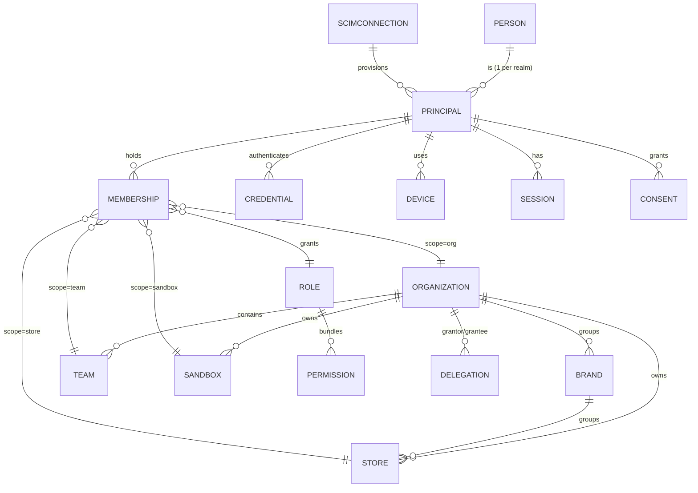

# IDENTITY DOMAIN MODEL (enhancement)
### 2026-06-09 · ANALYSIS-ONLY · enhancement-delta over `docs/auth/2026-06-08-identity-platform-transformation/IDENTITY_DATA_MODEL.md`

> **Relationship to the corpus.** `IDENTITY_DATA_MODEL.md` already defines the *physical* schema (principals, credentials, authenticators, sessions, refresh chains, devices, oauth_clients, grants, org graph, signing_keys, audit). That is **strong and not rebuilt here.** This document adds the *conceptual* entity layer the corpus collapses, and fills four scale gaps it leaves open: the Account↔User↔Principal distinction, a canonical Person for N-way linking (the corpus's `account_links` is pairwise/N²), SCIM/external-directory hooks, and the Brand and Sandbox entities. Every entity is tagged **KEEP** (defined in corpus), **CLARIFY** (exists but boundary ambiguous), or **NEW** (white space).

---

## 1. The 14 entities — definition, owner, lifecycle

| Entity | Status | Definition (boundary) | Primary owner | Lifecycle states |
|---|:--:|---|---|---|
| **Person** | **NEW** | The real-world human. Canonical anchor above Principals; resolves the N-way linking problem. | Identity | active → merged → erased(tombstone) |
| **Account** | **CLARIFY** | The *login-able* entity in a realm = a credential-bearing access record. In LetBuyy today "account" is conflated with User; we fix the meaning: an Account is a (Person, realm) login. | Identity | invited → active → suspended → closed |
| **User** | **CLARIFY** | UI/colloquial term for a merchant/staff human; **not** a distinct data entity — it is an Account in the merchant/admin realm. Deprecate as a schema noun. | — (alias of Account) | — |
| **Principal** | **KEEP** | `prn:<realm>:user:<ULID>` — the realm-scoped, opaque subject downstream services see. One Person → up to one Principal per realm. | Identity | `IDENTITY_DATA_MODEL §2` |
| **Organization** | **KEEP** | Billing/ownership boundary; owns stores+teams. `org_<ULID>`. | Identity | `ORGANIZATION_ARCHITECTURE §6` state machine |
| **Brand** | **NEW** | First-class grouping *between* Org and Store for multi-brand enterprises (distinct from Team, which is an access grouping). | Identity | active → archived |
| **Store** | **KEEP** | `store_id = sites.id`; commerce surface. | Commerce (record) / Identity (membership) | `ORG §7` Draft→Active→Frozen→Transferring→Archived→Deleted |
| **Sandbox** | **NEW** | A dev/test resource sibling to Store, with its own membership + a hard `prod=false` flag, so 3P devs/Developer-role staff are confined (closes scale-Q5). | Identity (membership) / Commerce (resource) | created → active → deleted |
| **Membership** | **KEEP** | Principal↔(Org\|Team\|Store\|Sandbox) edge carrying role + scope + expiry. | Identity | `ORG §8.1`; add `expires_at`, `prod_scope` |
| **Team** | **KEEP** | Access grouping within an org. | Identity | `ORG §5` |
| **Role** | **KEEP** | Named permission bundle; system + custom. | Commerce (catalog) / Identity (assignment) | `PERMISSION_MODEL §5` |
| **Permission** | **KEEP** | `<resource>.<action>[.<qualifier>]` atom in a versioned registry. | Commerce (registry) | `PERMISSION_MODEL §3` (+ governance, this pass) |
| **Invitation** | **KEEP** | Pending membership offer; single-use, expiring. | Identity | `ORG §10`; `invitations` table |
| **Credential** | **KEEP** | Password (Argon2id) / passkey / TOTP factor. | Identity | `IDENTITY_DATA_MODEL §3` |
| **Device** | **KEEP** | Recognized client with trust state. | Identity | `IDENTITY_DATA_MODEL §4` |
| **Session** | **KEEP** | Server-side revocable `sid` + refresh chain. | Identity | `SESSION_MANAGEMENT §1-3` |
| **Consent** | **KEEP** | Persisted OAuth grant per (principal, client, scope). | Identity | `IDENTITY_DATA_MODEL §5` `oauth_grants` |
| **SCIMConnection** | **NEW** | Enterprise IdP linkage + group mapping + JIT provision/deprovision record. | Identity | configured → syncing → suspended |

---

## 2. The Account / User / Principal distinction (CLARIFY — closes a real ambiguity)

The corpus uses "user," "account," and "principal" interchangeably; at Shopify scale they must be three layers:

```
Person (NEW, canonical human)
  └─ Account  (Person × realm login)         e.g. same human is a merchant Account AND a customer Account
       └─ Principal (prn:<realm>:user:<ULID>) the token subject
            └─ Memberships (org/brand/store/team/sandbox)  → roles → permissions
```

- **Why Person is needed:** the corpus's `account_links` is **pairwise** (`principal_a`,`principal_b`) → a human with 4 linked identities needs 6 edges (N²) and has no single deletion/GDPR anchor. A canonical `persons` row (with `person_links` mapping Person→Principal, 1→N) makes linking O(N), gives one erasure target, and one "this human" view for fraud/risk. **Migration implication:** add `persons` + `principal.person_id` (nullable, backfilled by verified email/login correlation); keep `account_links` as a transitional view, deprecate post-backfill.
- **Boundary rule:** downstream services **never** see Person — they see realm-scoped Principal only (preserves realm isolation). Person is an Identity-internal correlation entity, exposed only to risk/fraud/admin with explicit scope.

---

## 3. Relationship model (entity graph)



---

## 4. Boundaries (who may write what)
- **Identity owns** Person, Account, Principal, Membership, Org, Brand, Team, Sandbox-membership, Credential, Device, Session, Consent, Invitation, Delegation, SCIMConnection, Role-*assignment*.
- **Commerce owns** Store record, Sandbox record, Role-*catalog* + Permission-*registry* + plan/entitlement.
- **The one rule:** Identity answers *who/what-org-roles*; Commerce answers *may-this-action-on-this-resource* (`TARGET_AUTH_ARCHITECTURE §4`). Person never crosses to Commerce; Brand/Sandbox memberships are Identity, the Brand/Sandbox records are Commerce.

---

## 5. SCIM / enterprise hooks (NEW — reserve now, build on first enterprise demand)
The corpus defers SCIM (`G-12`) with **no schema hooks**, forcing a future migration. Reserve them now (additive, dormant):
- `persons.scim_external_id`, `principals.idp_connection_id` (nullable FKs).
- `scim_connections(id, org_id, idp_type, domain, status, group_map jsonb, created_at)`.
- `scim_group_mappings(connection_id, external_group, org_role|team_id)` → drives JIT membership.
- **Deprovisioning tombstone:** `principals.deprovisioned_at` + a rule that SCIM-deprovision **revokes all sessions** (the security-critical half SCIM designs routinely miss).
Reserving these columns is a one-line-each migration now vs a backfill-under-pressure later.

---

## 6. Lifecycle & migration implications
- **Backfill order (extends `IDENTITY_DATA_MODEL §12`):** Person ← correlate verified emails across `users_custom`+`store_customers`+`employees` (conservative: only auto-link on verified-email match; ambiguous matches flagged, never auto-merged — avoids cross-realm identity collision). Then Principal.person_id, then Brand (default: one brand per org = "Default"), then Sandbox (none by default).
- **GDPR/DPDP:** erasure targets **Person** (crypto-shred PII across all its Principals, retain audit tombstones) — cleaner than the corpus's per-principal erasure.
- **Scalability:** `persons`/`person_links` indexed by email-hash; Brand/Sandbox are low-cardinality; the heavy tables (`memberships`) keep the corpus's bidirectional `(principal_id)`/`(store_id)` indexes + ULID sharding (`IDENTITY_DATA_MODEL §11`).

---

## 7. What stays in the corpus doc (do not duplicate)
All physical column lists, retention table, RLS-as-defense, time-partitioning, and the existing seed-from mapping live in `IDENTITY_DATA_MODEL.md`. This document only adds the conceptual layer + Person/Brand/Sandbox/SCIM entities and their boundaries.
