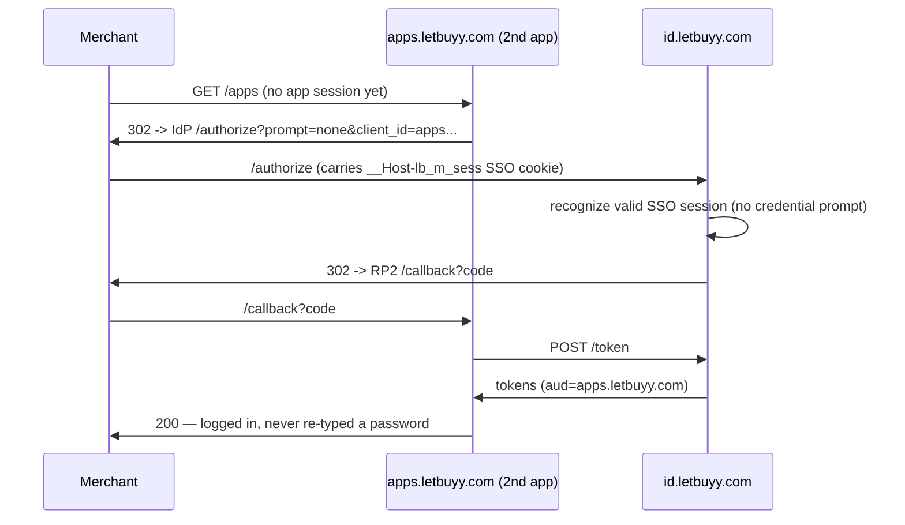
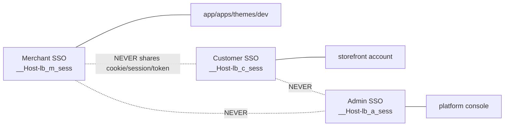

# SSO_ARCHITECTURE (final authority)

> **Status:** FINAL. Ratifies the OIDC-SSO design in `docs/auth/2026-06-08-…/SSO_ARCHITECTURE.md` and reconciles it with the canonical-domain migration (`letbuyy.store → letbuyy.com`) and the deferral sequencing in `TARGET_AUTH_ARCHITECTURE.md`. **This is target-state SSO; it is built in migration Waves 1–5, after the foundation P0s.**

## 1. Model — central IdP session + per-app silent tokens
A merchant logs in **once** at the IdP and reaches every merchant-realm app without re-authenticating. The **only** durable cross-app artifact is the **IdP SSO session cookie**, host-only on `id.letbuyy.com`. Each relying-party app (control plane, app marketplace, theme marketplace, future apps) holds its **own** short-lived access token + host-only app session and refreshes silently via OIDC `prompt=none`. **No shared cookie across apps** — this replaces today’s accidental, domain-wide `lb_session` on `.letbuyy.store` (the blast-radius weakness).

RP clients (merchant realm): `app.letbuyy.com` (control plane), `apps.letbuyy.com` (app marketplace), `themes.letbuyy.com` (theme marketplace), `developers.letbuyy.com` (developer portal), merchant mobile (via BFF), future CLI. Storefront account area = **customer realm** (separate IdP issuer, never a merchant token). Platform console = **admin realm** (separate issuer).

## 2. First login — Authorization Code + PKCE
```mermaid
sequenceDiagram
  participant U as Merchant (browser)
  participant RP as app.letbuyy.com (RP)
  participant IDP as id.letbuyy.com (merchant realm)
  U->>RP: GET /dashboard (no app session)
  RP->>U: 302 -> IdP /authorize?client_id&redirect_uri&code_challenge&scope&state&nonce
  U->>IDP: /authorize (no SSO session)
  IDP->>U: login page (password / passkey / OTP)
  U->>IDP: credentials (+ step-up if risk)
  IDP->>IDP: create server-side session (sid), set __Host-lb_m_sess (host-only)
  IDP->>U: 302 -> RP /callback?code&state
  U->>RP: /callback?code&state
  RP->>IDP: POST /token (code + code_verifier, client auth)
  IDP->>RP: id_token + access_token (EdDSA, aud=RP) + rotating refresh
  RP->>RP: create host-only app session; cache AT in memory
  RP->>U: 200 dashboard
```

## 3. Cross-app SSO — silent token (prompt=none)

If no SSO session exists, `prompt=none` returns `login_required` and the app falls back to §2.

## 4. Logout — global + back-channel
```mermaid
sequenceDiagram
  participant U as Merchant
  participant RP as any RP
  participant IDP as id.letbuyy.com
  participant RPS as other RPs (registered)
  U->>RP: click Logout
  RP->>IDP: GET /end-session (id_token_hint, post_logout_redirect)
  IDP->>IDP: revoke sid -> refresh chain dead
  IDP-->>RPS: back-channel logout (per registered client)
  RPS->>RPS: destroy local app session
  IDP->>U: clear __Host-lb_m_sess; redirect to post-logout
```
Revoking the `sid` kills the refresh chain; every app’s access token expires within one short TTL → **logout is global, not per-tab**.

## 5. Session continuity & token exchange
- App access tokens are 5–10 min; apps silently refresh against the IdP SSO session (rotating refresh, reuse-detection). Continuity = the IdP session’s idle/absolute bounds (see `SESSION_MANAGEMENT.md`), not any single app.
- **Token exchange** (RFC 8693) only for explicitly-approved delegation (e.g., BFF → narrowed audience); never as a general identity-assertion mechanism.

## 6. Realm separation (SSO never crosses realms)

A customer login can never yield a merchant token (different issuer/keys/audience). The storefront account area and console authenticate against their own realm issuers.

## 7. Device trust & risk controls
- IdP registers devices (`devices` registry + revoke), binds the SSO session to a device fingerprint, and feeds the risk engine. New device / impossible travel / sensitive action (payout, admin op, key change) triggers **step-up** (AAL2/AAL3) before issuing/continuing tokens. Edge proxies do **shape-only** checks; all real verification is at the IdP/PEP.

## 8. Mobile & CLI
- **Merchant mobile** uses the **Mobile BFF** as a confidential OIDC client (Auth Code + PKCE in-app, tokens held by the BFF / device secure storage; never embedded secrets). **Future CLI** uses Device Authorization Grant.

## 9. Future federation
- Merchant realm can later add enterprise SSO (SAML/OIDC IdP brokering) and social login for customers — additive, because each realm is already a standards OIDC issuer. No re-architecture needed.

## 10. Transition (interim, during migration)
Until the IdP exists, today’s apps share `lb_session` on the parent domain. The bridge: introduce the IdP session + `prompt=none` for **one** RP first (control plane), keep the legacy cookie valid behind a flag for the others, migrate RPs one at a time (Waves 2–5), then **remove the parent-domain cookie last**. Cookie domain flips `.letbuyy.store → id/app.letbuyy.com` only at cutover (coupled to the canonical-domain migration). **Never flip the cookie domain ahead of the DNS/host move** (breaks SSO).

## 11. What SSO does NOT do (guardrails)
- It does not share a cookie across apps. It does not cross realms. It is **not built before the money/tenancy P0s.** It does not replace commerce-resource RBAC (that stays at the PEP).
