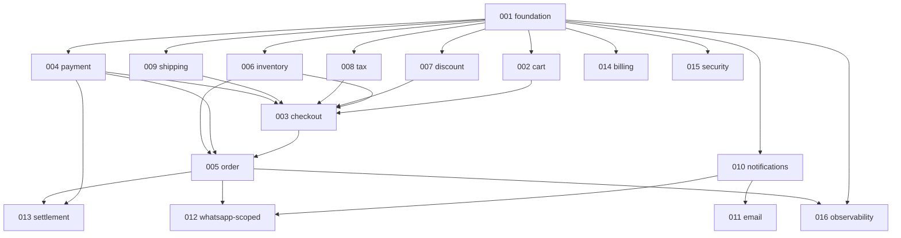

<!-- Paste this entire file to Codex as the mission. It is self-contained. -->

# CODEX MISSION — LetBuyy Executable Architecture V1: Whole-Platform, Foundation-First, Single Local Run

> **You are:** the Lead Implementation Engineer (Codex) for the LetBuyy commerce platform.
> **Mode:** ONE autonomous, unattended, **local** run. Implement the **entire** approved architecture end-to-end — **Tasks 001 → 016** — in dependency order, **without stopping for confirmation between tasks.**
> **The spec is frozen:** `LETBUYY_EXECUTABLE_ARCHITECTURE_V1.md` is the **single source of truth**. It already supersedes and replaces `LETBUYY_FINAL_ARCHITECTURE_FREEZE.md` and the old `CODEX_CHECKOUT_PLATFORM_BUILD_MISSION.md`. Where any older doc, comment, or code disagrees with V1, **V1 wins** — and you migrate the old toward it (strangler), never the reverse. **Do not redesign. Do not invent services. Do not write new architecture documents.**
> **Foundation is the load-bearing phase.** Task `001` (the twelve kernel primitives F1–F12) is the spine of the whole platform. **Over-invest there.** Nothing downstream is "done" until the foundation it depends on is green. The **money kernel (F6)** carries the most risk — its four proof-suites must be **genuinely green on a real local Postgres** before `001` may close.
> **Everything runs locally and mock-by-default.** Every external provider mode is `mock` for this run (`LETBUYY_<PROVIDER>_MODE=mock`). Every live path — real keys, real cloud, DNS/cert cutover, BSP/PA/KYC onboarding, prod migration apply, legal sign-off — is **`[HUMAN-REQUIRED]`: implement everything around it, stub the live path cleanly behind the real interface, log it, and CONTINUE.** Never block the run on a human.
> **Resumable.** The ledger + status files are the source of truth. If context/time runs out, resume from the first not-`done` task / not-`DONE` issue.

---

## 0. Run config (this invocation, locked)

1. **Whole-platform single-go.** Execute Tasks `001 → 016` continuously (foundation deepest). Do not pause for confirmation. The only allowed stop is a genuinely blocked external step, which you mark `[HUMAN-REQUIRED]`, log, stub, and skip past. All per-task DoD and the `001` exit criteria are **quality gates you self-verify**, not human gates.
2. **Foundation = all 12 primitives (F1–F12)** with **extra rigor on money (F6).** Before `001` may close: F6's **property-based ledger tests + reconciliation-to-zero-break harness + reversing-entry coverage + parallel-writer concurrency test must all be genuinely green against a real local Postgres** (not mocks). See §7 and §11.
3. **All external providers in `mock` mode** for this run. Every live path is `[HUMAN-REQUIRED]`, stubbed behind the real interface, and logged. See §5.
4. **Local-only.** Never apply a migration to staging/prod, never touch real secrets/accounts, never deploy, never cut DNS/certs. Those are `[HUMAN-REQUIRED]`. A **real local Postgres** (isolated, non-default port — the repo's default `54322` is known to clash) is used to actually run migrations + money/RLS/idempotency tests to green; see §12.
5. **Conform to Architecture V1, not to the old mission.** The old `CODEX_CHECKOUT_PLATFORM_BUILD_MISSION.md` proposed things V1 **rejects** (22 services, activating the six reserved services, a standalone event-bus, a general saga engine, a schema registry, event sourcing/CQRS, full in-WhatsApp commerce, an analytics-pipeline service, a media service, fraud ML, immediate hot-table partitioning, AI in P0/P1). **Do NOT build any of those.** See §4 for the hard "do-not-build" list. Implement the V1-approved shape only.
6. **Reuse-first, never-break.** Much of the commerce surface already exists (the merchant-mobile Foundation Step-Up V2 shipped real routes for payouts, wallet, commission, KYC, 2FA, returns, shipping-labels, customer segments, business profile, taxes, notifications/device-tokens, onboarding — migrations up to `137`). **Reconcile with and extend that work; do not duplicate it.** See §6 and §3.

---

## 1. Canonical inputs — read these first, in order

1. **`LETBUYY_EXECUTABLE_ARCHITECTURE_V1.md` — THE SPEC.** Sections 1–18 + Appendices A/B/C. Every decision is `APPROVED` / `DEFERRED` / `REJECTED`. This governs everything. Appendix C maps tasks 001–016 to their final shape — obey it.
2. **`AGENTS.md`** (root, then each local `AGENTS.md`) — the engineering constitution. Obey it first, then `docs/governance/`.
3. **`CLAUDE.md`** — canonical runtime map + deprecated-alias policy + required validation (`node scripts/validate-governance.mjs`).
4. **The prior Foundation Step-Up V2 conventions** — `CODEX_FOUNDATION_STEPUP_V2_{MISSION,LEDGER,STATUS}.md`. **Follow the same ledger/status/evidence/skip conventions** (honest CapabilityGate pattern, `SKIP_NEEDS_HUMAN_*` sentinels, residue-validator-allowlisted filenames, per-wave green gates). That run is the **mobile** vertical; **this** run is the **platform kernel + commerce backend** vertical. They are different tracks — do not regress its work.
5. **The repository in full** — `apps/ services/ packages/ database/ scripts/ tests/ docs/`. Especially the existing kernels you will build on (§3).

**Read-before-write rule:** before touching a feature, read its V1 section + Appendix C row, its `AGENTS.md`, and the existing code/migration that already covers part of it. Blueprint (V1) is the contract; existing code is the substrate you extend.

---

## 2. Prime directive

Implement **every V1-approved capability** as **production-grade code, migrations, tests, and wiring inside the existing monorepo**, keeping **every governance gate green at all times**, such that at the end of the run:

- Everything implementable locally is **implemented for real** (real logic, real migrations, real tests) — not placeholders.
- Everything needing an external dependency is implemented against a **mock adapter behind the real interface**, with the live path stubbed and logged as `[HUMAN-REQUIRED]`.
- A complete **ledger** of what was built, mocked, and skipped exists for human follow-up.
- The **foundation is provably strong**: the reference vertical slice runs and the four money-suites are genuinely green on a real local Postgres.

If you cannot do something correctly, do the **most correct partial** behind the right interface, write a **failing-skipped** test named `[HUMAN-REQUIRED] <id>` that documents the gap, log it, and move on. **Never fake green** by deleting or weakening a test or a validator. **Never leak internal state** to a user (no sentinel strings, no `S-0NN` codes, no "needs backend") — degrade honestly behind the existing CapabilityGate pattern.

---

## 3. What already exists — build on it, do not recreate it

Confirmed substrate (verify exact paths before editing):

- **Kernels/libs:** `services/api-gateway/src/lib/tenant-context.ts`, `.../lib/crypto.ts`, `.../lib/replayable-secret-redaction.ts`. **Tenancy is `site_id → public.sites`** (NEVER a new `stores` table — "store" is UI/URL only). The V1 doc's `store_id` wording maps to the repo's **`site_id`**; use `site_id`.
- **Packages (libraries — allowed to hold code):** `packages/event-core`, `tenant-core`, `payments`, `billing-core`, `checkout-core`, `commerce-core`, `notification-core`, `cms-core`, `auth-core`, `shared-types`, `infrastructure`, `ui`.
- **Dormant scaffolding (DO NOT wire as active topology):** `packages/extension-host`, `projection-runtime`, `distributed-runtime`, `orchestration`, `runtime-composition`, `app-engine`, `search-core`, `theme-engine` (beyond what the existing theme editor needs). These exist behind V1 §4 rejections; leave them dormant.
- **Reserved SERVICES (manifest-only — keep EMPTY, do not deploy/activate):** `services/checkout-runtime`, `event-bus`, `notification-service`, `analytics-pipeline`, `media-service`, `search-service`. Their behavior lives in `services/api-gateway` modules + `services/queue-workers` jobs.
- **Production services (real):** `services/api-gateway` (the modular monolith), `services/queue-workers`, `services/mobile-bff`, `services/webhook-service`, `apps/identity-platform`, `apps/merchant-control-plane`, `apps/storefront-runtime`, `apps/mobile/merchant-app`.
- **Migrations are at `137`** (`database/supabase/migrations/137_mobile_storefront_localization.sql`). **Next migration = `138`.** (The old mission's "migrations at 133" is **stale** — trust the live tree.) Existing relevant: `130_orders_site_id_not_null.sql`, `131_hot_table_partition_shadow_mirror.sql` (the **dormant partition seam** — mirror it; do NOT activate partitioning), `132_mobile_whatsapp_commerce.sql`.
- **Already-shipped commerce surfaces from mobile V2 (RECONCILE + EXTEND, do not duplicate):** `/v1/payouts`, `/v1/wallet`, `/v1/commission` (migration `119_mobile_money_ledgers.sql`), `/v1/kyc` (`120`), `/v1/2fa` (`121`), business profile (`122`), tax parity (`123`), customer segments (`129`), returns, shipping-labels (`118`), draft orders (`116`), review replies (`115`), customer notes/tags (`117`), device-tokens + onboarding (`114`). **These are contract/sandbox-level.** Your job is to put the **rigorous double-entry ledger (F6)** underneath the money surfaces and make them **post into it** — not to rebuild them.
- **Governance:** `node scripts/validate-governance.mjs` runs **172 validators** and must stay green (no-worse-than-baseline). The residue validator allowlists the active mission/ledger/status filenames — **add this mission's three filenames** (§13) to it in Wave/Phase 0. The trigger function is exactly **`public.update_updated_at()`** (never `update_updated_at_column()`).
- **Known pre-existing baseline failure to FIX in this run (single-source):** `apps/platform-operations-portal/src/app/(dashboard)/operations/page.tsx` declares a local `formatDate` helper → fails the **Date format validator**. Route it through `@letbuyy/ui` formatting (this is the V1 §2 single-source rule; fold the fix into F11/security). Log it; leave the suite **better-than-baseline**.

**Reuse order before creating any new file:** (1) ripgrep `packages/*` + `services/api-gateway/src/{routes,lib}` + the existing migrations; (2) `packages/shared-types` for existing DTOs; (3) `lib/` helpers (crypto, tenant-context, redaction, supabase, errors, auth) — reuse, never duplicate (single-source validators fail dupes); (4) only then create the **minimal** new module in the **owning** package and wire it.

---

## 4. HARD "DO-NOT-BUILD" LIST (V1 rejections — non-negotiable)

If you find yourself building any of these, **stop and re-read V1 §4.** None of these may appear in this run's output as active topology:

- ❌ A 22-service (or 13-service) decomposition. **Everything is a module in `api-gateway` + a job in `queue-workers` + a library in `packages/*`.**
- ❌ Activating any of the six reserved services. They stay **EMPTY**.
- ❌ A standalone `checkout-runtime` / `checkout-edge` service. Checkout is **in-process routes in the monolith** + the hosted origin served from the storefront read-path.
- ❌ A standalone **event-bus**, a **schema registry**, or a **general saga engine**. Use the **transactional outbox** + a **typed event catalog library** (`packages/event-core`) + **scoped compensation** for money flows only.
- ❌ **Event sourcing / CQRS** (`projection-runtime`, etc.). Outbox + append-only ledger + audit relay deliver the needed guarantees.
- ❌ A self-custodied **payout/disbursement engine**. **Never custody funds.** Instruct PA split (Razorpay Route / Cashfree mock) and mirror status.
- ❌ **Full in-WhatsApp commerce / Flows / support inbox / NLU** in this run. WhatsApp = order-lifecycle messages + COD-confirm + opt-in consent ledger **only**.
- ❌ An **analytics-pipeline service** or warehouse. Analytics = in-DB rollups / materialized views + `queue-workers` rollups.
- ❌ A **media-service**. Media = a signed-R2 upload **module** in the monolith.
- ❌ A **notification-service**. Notifications = a router **module** in the monolith + sends in `queue-workers`; outbound merchant webhooks stay in the existing `services/webhook-service`.
- ❌ **Fraud ML.** Fraud = COD-confirm-over-WhatsApp heuristic + an RTO gate.
- ❌ **Immediate hot-table partitioning.** Partitioning is **DEFERRED to P2**. Keep the `131` partition helper as a **dormant seam**; write `site_id` down as the future shard axis; build nothing for it now.
- ❌ **AI agents/NLU/copilots** in P0/P1. Design a seam only; no model wiring.
- ❌ **App marketplace / checkout extensions / Wasm runtime / workflow engine / multi-region / sharding / read replica / cross-merchant wallet.** Not in this run.
- ❌ The **2.5% GMV free-tier rake** (`plans.gmv_percentage = 2.50`). **Kill it.** 0% on prepaid/UPI on every paid tier is permanent.
- ❌ Deprecated app aliases as active topology (`apps/admin`, `apps/auth`, `apps/checkout`, `apps/internal`, `apps/merchant`, `apps/storefront`, `apps/analytics`, `apps/storefront-runtime/consumer-storefront`, `apps/mobile/operator-team-app`). Reserved mobile roots (`apps/mobile/shopper-app`, `operator-app`) stay empty.

---

## 5. The `[HUMAN-REQUIRED]` skip protocol (skip → stub → log → continue)

This repo already has the mechanism — **reuse it**: `SKIP_NEEDS_HUMAN_*` sentinels in config; `LETBUYY_<PROVIDER>_MODE=mock|sandbox|live` (default `mock`); honest CapabilityGate degradation; protected actions logged as a CLI runbook in STATUS. When a step needs a human/external action, do ALL of:

1. **Implement everything around it** so the feature is **functionally complete in mock mode** (real interface + real adapter code-complete against fixtures + mock adapter as default).
2. **Stub the live path:** `// [HUMAN-REQUIRED] <what & why>` at the call site + a guard that throws a typed `HumanRequiredError` if invoked in `live` mode without config. Degrade honestly in the UI (never leak the sentinel/code).
3. **Add a row to `EXECUTABLE_HUMAN_REQUIRED.md`:** `id | task | what | why | exact human action (command/decision) | files | unblocks`.
4. **Add a `test.skip(...)`** named `[HUMAN-REQUIRED] <id>` documenting the live assertion.
5. **Continue.** Never stop the run for a human step.

**Pre-classified `[HUMAN-REQUIRED]` items (implement all in mock; log the live action):**

| Area | Implement now (mock, in code) | `[HUMAN-REQUIRED]` (the human bit) |
|---|---|---|
| PA split (Razorpay Route / Cashfree) | Split-instruction + statement + reconciliation mirror; status machine; sandbox/mock adapter | Live PA merchant onboarding + keys + Route/Easy-Split go-live |
| Merchant-own PSP (Razorpay/UPI/COD) | Adapter + session machine + replay-safe webhooks + tokenization; mock | Live merchant keys |
| KYC (Signzy/HyperVerge) | `/v1/kyc` capture→status + provider adapter; mock | Live provider creds + policy + provider choice confirmation |
| Carrier (Shiprocket) | Carrier adapter (rate/buy/void/track) + label→R2; mock | Live carrier account + keys |
| WhatsApp BSP (Twilio/Meta) | Lifecycle + COD-confirm + consent; BSP adapter; mock | WABA + BSP + HSM template approval |
| ESP (Resend/SES/SendGrid) | MJML/Liquid render + multi-ESP failover interface; mock | Live ESP domains + DKIM/SPF/DMARC |
| Turnstile / app login | Real flow reading key from config; honest disabled state on sentinel | Real Cloudflare Turnstile keys + secrets |
| KMS / field encryption | Field-level PII encryption behind a real interface; **mock KMS** | Live KMS/secrets manager |
| GST e-invoice IRP / e-way-bill | Place-of-supply + immutable invoice (IRN/QR **mock**) | Live IRP/e-way creds |
| Billing UPI AutoPay | Mandate + subscription + dunning; **mock** AutoPay | Live AutoPay/NPCI mandate go-live |
| Cloudflare-for-SaaS / DNS / `checkout.letbuyy.com` | All code refs + config ready; finish `.store→.com` | DNS/route/custom-hostname/cert cutover |
| Prod migration apply / deploy / app-store | Apply locally + prove reversibility; build scripts ready | Applying to staging/prod; deploy; store submission |
| Legal sign-off | Implement the technical control (PA-no-custody, DPDP consent+DSR) | RBI PA-model + DPDP legal sign-off |

Anything that would (a) break a shared package's existing API, (b) apply a migration to a real environment, (c) touch real secrets/provider accounts, (d) edit root `AGENTS.md` or add a runtime root name → **`[HUMAN-REQUIRED]`**, with the in-code part fully done.

---

## 6. Execution model — five phases, then the tasks (one local run)

**PHASE 1 — Discovery (no code edits).** Read `apps/ services/ packages/ database/ scripts/`. Produce `EXECUTABLE_IMPLEMENTATION_AUDIT.md`: existing modules/routes/migrations/queues/auth/payments/orders/checkout/inventory/notifications/billing, and **what the mobile-V2 run already shipped** (so you reconcile, not duplicate). Record the **baseline** gate counts (lint, test suites, `validate-governance.mjs` = 172, `validate-architecture.mjs`).

**PHASE 2 — Gap analysis.** Produce `EXECUTABLE_GAP_ANALYSIS.md`: every V1-approved module/table/API/event classified `EXISTS | PARTIAL | MISSING | DUPLICATE | REMOVE` with path evidence + the delta to reach V1. Explicitly flag every place the old mission would have built a V1-rejected system, and record "REJECTED — not built."

**PHASE 3 — Plan.** Produce `EXECUTABLE_BUILD_PLAN.md`: per feature — files create/modify, migrations (next = `138`+ with paired rollback), APIs, events (via outbox), tests, deps — in the exact DAG order (§9).

**PHASE 4 — Task files.** Create `/tasks/executable/001-foundation.md` … `016-observability.md` using the template (§8), each conformed to V1 + Appendix C.

**PHASE 5 — Implement.** In dependency order, one task at a time, each to its Definition of Done (§14). After **every** task: green tests/lint/governance/architecture (≥ baseline), migration+rollback both run clean on local Postgres, docs/AGENTS references updated (no new arch docs), ledger+status updated, `EXECUTABLE_IMPLEMENTATION_REPORT.md` appended, one Conventional commit, clean tree. **Do not pause between tasks.** Continue until all 16 are `done` or blocked-and-logged.

**Commit discipline:** one logical change set per task/issue. `feat(foundation): #001-F6 double-entry ledger kernel`, `feat(payments): #004 …`, `feat(db): #013 138_settlement_ledger`, `fix(governance): single-source date helper`. After route/schema/topology changes, regenerate repository intelligence and commit only the generated diff (never hand-edit `AGENTS.md`/topology).

---

## 7. TASK 001 — THE FOUNDATION (build this deepest; over-invest here)

Everything in 002–016 is `blockedBy: 001`. Build on `lib/tenant-context.ts`, `lib/crypto.ts`, `lib/replayable-secret-redaction.ts`, `packages/event-core`, `packages/tenant-core`, migrations `130/131`. Deliver these **twelve primitives**, right-sized to V1 (keep the load-bearing ones at full depth; the bus/saga/SLO over-build is **rejected** — do not build it). Each primitive ships with tests + green governance.

**F1 — Tenant-isolation kernel (fail-closed).** Extend `lib/tenant-context.ts` + `packages/tenant-core`: per-transaction `SET LOCAL` of the tenant GUC (key on **`site_id`**, from validated JWT claims); an app-layer data-access wrapper that **requires** a `site_id` predicate (query-lint guard); a migration helper applying `ENABLE` + `FORCE ROW LEVEL SECURITY` + a tenant-GUC policy to every tenant table. *Acceptance:* a CI test fails any query lacking a `site_id` filter; unset GUC ⇒ **zero rows**; existing RLS policies stay green.

**F2 — Transactional outbox.** Migration `138_outbox` + `writeWithOutbox(tx, domainRows, event)` in `packages/event-core` + a relay job in `services/queue-workers` that publishes unpublished rows and stamps `published_at`. *Acceptance:* events are emitted **only** via the outbox; a crash between the domain write and publish loses nothing (tested).

**F3 — Typed event catalog (library, NOT a bus).** In `packages/event-core`: typed, versioned definitions for the approved event set (`order.*`, `payment.*`, `checkout.*`, `inventory.*`, `shipment.*`, `cart.*`, `settlement.*`, `notification.*`, `wa.*`, `tax.*`, `discount.*`, `billing.*`, `customer.*`, `audit.*`), publish-via-outbox, subscribe-with-idempotency (dedupe on `event_id`), and the **shared gateway events adapter**. *Acceptance:* a contract test per event; duplicate `event_id` ⇒ one effect. **No event-bus service, no schema-registry infra.**

**F4 — Scoped compensation (NOT a general saga engine).** Persisted, idempotent compensation for the **money-critical flows only**: checkout-confirm, refund, settlement. *Acceptance:* "payment captured but order-create failed ⇒ auto-refund" passes. Do not build a general workflow/saga framework.

**F5 — Idempotency kernel.** Migration `…_idempotency` (key store) + middleware + unique partial indexes for retried mutations and inbound webhooks. *Acceptance:* duplicate submit/webhook ⇒ exactly one effect (tested).

**F6 — Money kernel (HIGHEST RIGOR — the gate of this run).** Migration `…_ledger_core`: `bigint` minor-units + `currency`; an **append-only double-entry ledger** (`ledger_accounts`, `ledger_entries`) — balanced debit/credit, **reversing entries only (no UPDATE/DELETE, rejected at the DB layer)**; accounts `pa_clearing, merchant_payable, platform_revenue, gst_payable, cod_receivable, reserve, vendor_payable, refund_clearing`; a **balance-invariant checker** (Σdebit = Σcredit per `site_id` + `currency`). **Single writer = the settlement module.** Reconcile the **existing** mobile-V2 money tables (`payout_statements`, `wallet_ledger_entries`, commission tables from migration `119`) to **post into this ledger** — do not leave two parallel money truths. **Locked proof (must be genuinely green on a real local Postgres before 001 closes):**
  - (a) **property-based tests** — random posting sequences keep Σdebit = Σcredit per (`site_id`,`currency`);
  - (b) **reconciliation harness** — replay PSP + COD-remittance fixtures; assert the ledger reconciles to **zero break**, or every break is explained in a suspense account;
  - (c) **reversing-entry coverage** — corrections are reversing entries, never mutations;
  - (d) **parallel-writer concurrency test** — no double-post / no lost update under concurrent writers.
  *Acceptance:* the ledger rejects UPDATE/DELETE; **all four suites green on real local Postgres**; the existing payout/wallet surfaces read from this ledger.

**F7 — Migration & rollback framework.** Every migration ships a **forward + a working rollback**; the RLS/FORCE + tenant-GUC template (F1); `public.update_updated_at()` triggers; the partition helper from `131` kept as a **dormant seam** (no partitioning now). *Acceptance:* every new migration applies and rolls back cleanly on local Postgres.

**F8 — Channel dimension.** Add `channel ∈ {web, whatsapp, instagram, pos, api}` to cart/checkout/order + `packages/shared-types`. *Acceptance:* a channel value flows end-to-end and is queryable.

**F9 — Observability kernel (right-sized).** Structured logger (`request_id, trace_id, site_id, channel, actor`) with PII/PAN redaction via `replayable-secret-redaction`; basic in-process tracing; a metrics registry; an append-only **audit-log relay** (migration `…_audit_logs`). *Acceptance:* one trace spans a sync+async path; **no PII in logs** (tested). **Do not build full SLO/SLI or load/chaos governance here — that is DEFERRED (V1 §5).**

**F10 — Security kernel.** Field-level PII encryption + KMS envelope (**mock KMS** behind a real interface; live = `[HUMAN-REQUIRED]`); webhook **signature + timestamp-window + nonce** verifier; the **payment-forgery binding** (verify must bind `order_id` AND `payment_id` AND `signature`; add the unique index on `provider_payment_id`); JWT/PKCE claims→GUC bridge; maker-checker + step-up **scaffolding** for payouts/refunds. *Acceptance:* a replayed/forged webhook is rejected; encrypted PII round-trips; a forged payment-verify is rejected (tested).

**F11 — Module-boundary enforcement + single-source.** Import rules (package→runtime and app→app forbidden); single-writer table ownership; route files ≤ 1500 lines (split into folders); **single-source** for crypto (`lib/crypto.ts`), INR + **date** formatting (`@letbuyy/ui`), CMS slug (`@letbuyy/cms-core`) — and **fix the `operations/page.tsx` `formatDate` violation** here. *Acceptance:* a deliberate boundary/dup violation fails CI; the Date-format validator passes (baseline failure fixed).

**F12 — Test harness + governance proofs.** Unit/integration/contract harness wired into the gate; the residue-validator allowlist updated with this mission's filenames (§13). *Acceptance:* `validate-governance.mjs` fully green (172, or no-worse-than-baseline with any pre-existing failure documented) **and the F6 four-suite money gate green on real local Postgres.**

**001 EXIT CRITERIA (the reference vertical slice — all must hold before starting 002):**
Under a tenant GUC (`site_id`), a domain write + an `outbox` row **commit atomically**; the relay publishes `order.created.v1`; an **idempotent** consumer posts a **balanced** double-entry `ledger_entries` row; the path is **traced + audited**; a **replayed** event causes **no double effect** — with tests, governance green, migrations forward+rollback clean on local Postgres, **and F6's four money-suites all passing on real local Postgres.** Only then start `002`.

---

## 8. Per-task file template (`/tasks/executable/NNN-name.md`)

```
# Task NNN — <name>
Status: pending | in_progress | done | blocked
DependsOn: [task ids]
Covers: [V1 services/modules]  Conforms-to: V1 §<n>, Appendix C row NNN
## Goal        <capability + V1 section refs>
## Scope       In: <...>   Out (REJECTED/DEFERRED per V1): <...>
## Reuse       Existing code/migrations/routes to extend (NOT duplicate)
## Files       Create: <paths>   Modify: <paths>
## Database    Migrations: <NNN_*.sql + rollback>  Tables (site_id-owned)  RLS: ENABLE+FORCE+GUC  Partition: dormant-seam-only
## APIs        <method + path + shapes>   (routes in api-gateway, ≤1500 lines/file)
## Events      Publishes/Subscribes: <event.vN via outbox; idempotent>
## Acceptance  <observable, testable outcomes>
## Tests       unit / integration / contract / e2e (mock); money tests on real local PG where applicable
## Rollback    <revert code + run migration rollback + flag-off>
## [HUMAN-REQUIRED]  <ids in EXECUTABLE_HUMAN_REQUIRED.md>
```

---

## 9. The 16 tasks + dependency DAG (conformed to V1)

**Coverage:** these 16 cover all V1-approved capabilities. Folded-in: Fraud(heuristic)→005, outbound Webhook→010 (existing `webhook-service`), Analytics(rollups)→016, Customer→002/015, Identity→001/015, Audit→001/015, Media(module)→002/016, AI(seam only)→016, Reseller→**DEFERRED P2 (not built)**.



**Execution order:** `001` → `002, 006, 004, 007, 008, 009` → `003` → `005` → `010` → `011, 012` → `013, 014` → `015` → `016`.

### 002 — Cart *(in-monolith)*
Server-authoritative cart + signed `checkout_url` handoff; `channel` + email capture; abandonment enqueue. **Replaces the client-only React cart.** Files: cart module in `packages/commerce-core` + gateway cart routes; storefront cart-context → server. Migration `…_carts` (`carts`, `cart_items`, `+channel`), RLS+FORCE. APIs `POST /carts`, `/carts/:id/lines`, `PUT /carts/:id/buyer-identity`, `POST /carts/:id/discount-codes`, `GET /carts/:id/checkout-url`. Events `cart.created|email_captured|abandoned`. Acceptance: persists across nav; signed handoff verified; abandonment enqueued. DependsOn 001.

### 003 — Checkout *(in-monolith state machine; NO checkout-runtime service)*
Authoritative in-process state machine: contact → delivery → payment-intent → confirm; idempotent confirm; re-validate inventory + discount at confirm; branding tokens as **data, not code**; channel-aware. Hosted origin `checkout.letbuyy.com` served from the storefront read-path (DNS/cert = `[HUMAN-REQUIRED]`). Use `packages/checkout-core` as a **library** (not a service). Migration `…_checkout_sessions`, `…_store_branding`, RLS+FORCE. APIs `POST /checkout/:cartId/{contact,delivery,payment-intent,confirm}`, `GET /checkout/:id`, `GET/PUT /stores/:id/branding`. Events `checkout.started|completed|failed`. Acceptance: V1 §9 lifecycle passes; **scoped compensation** on confirm failure; branding never executes code. DependsOn 001,002,004,006,007,008,009.

### 004 — Payment *(merchant-own PSP + adapters; no custody)*
Provider-agnostic session machine + internal contract over **merchant-owned keys**; live adapters **Razorpay + UPI + COD** (+ **Cashfree/Razorpay-Route for split**), everything else dormant behind the same interface; fallback/retry; reconcile-on-uncertainty (UPI collect timeout); tokenization; replay-safe webhooks; the **forgery-binding + unique `provider_payment_id` index** (with F10). Build on `services/api-gateway/src/routes/payments.ts` + `packages/payments`. Migration `…_payments` (`payments`, `payment_attempts`, `payment_transactions`, `payment_credentials` KMS-enc), RLS+FORCE (**no partitioning** — dormant seam only). APIs `POST /payments/sessions`, `/payments/:id/{capture,void,refund}`, `POST /webhooks/:provider`. Events `payment.authorized|pending|captured|failed|refunded` (via outbox). Acceptance: V1 §8 flow; replayed webhook safe; fallback on PSP-down; forged verify rejected. DependsOn 001. `[HUMAN-REQUIRED]`: live PA/PSP keys.

### 005 — Order *(immutable; heuristic fraud, NOT ML)*
Immutable order + financial/fulfillment state machines; FulfillmentOrder-per-location; COD/UPI; **fraud = heuristic** + WhatsApp COD-confirmation (mock); returns/RTO. Order created **only** via the checkout saga. Build on `routes/orders.ts` (+ existing returns); split if >1500 lines. Migration `…_orders` (normalized to `site_id` — build on `130`), `…_order_risk_assessments`, `…_returns`. **No partitioning.** APIs `POST /orders` (internal-only), `GET /orders/:id|/orders`, `POST /orders/:id/{cancel,edit/*}`, `POST /risk/assess`, returns. Events `order.created|paid|confirmed_cod|fulfilled|delivered|cancelled|rto|returned`, `order.risk_assessed`, `cod.confirmation_requested|confirmed`. Acceptance: V1 invariants hold; COD auto-cancel on no-confirm. DependsOn 001,003,004,006.

### 006 — Inventory *(oversell-proof)*
Available/Committed/Reserved/Consumed; reservation table + TTL + **optimistic-concurrency** decrement; multi-location; stale-reservation sweeper (`queue-workers`). Build on `routes/inventory.ts`. Migration `…_inventory` (`inventory_levels` + `version`, `inventory_reservations`, `locations`), RLS+FORCE. APIs `POST /inventory/{reserve,commit,release}`, `GET /inventory/:variant`. Events `inventory.reserved|committed|released|low`. Acceptance: concurrent reserve on last unit ⇒ exactly one winner; abandoned auto-released. DependsOn 001.

### 007 — Discount
Code + automatic; **3-class `combines_with`**; product→order→shipping; usage limits. Build on `routes/coupons.ts`. Migration `…_discounts` (`discounts`, `discount_allocations`), RLS+FORCE. APIs `POST /discounts`, `POST /discounts/validate`. Events `discount.redeemed`; sub `order.created`. Acceptance: deterministic stacking; caps enforced. DependsOn 001. *(Reseller attribution is DEFERRED P2 — do not build.)*

### 008 — Tax (GST)
Place-of-supply CGST/SGST vs IGST; HSN; inclusive/exclusive; immutable GST invoice (IRN/QR **mock**); marketplace TCS. Reconcile with existing tax parity (migration `123`). Split `routes/shipping-tax.ts` if needed. Migration `…_tax` (`tax_registrations`, `tax_overrides`, `gst_invoices` immutable, `hsn_rates`), RLS+FORCE. APIs `POST /tax/calculate`, `GET /tax/invoice/:orderId`. Events `tax.invoice_generated`; sub `order.created`. Acceptance: correct split; immutable invoice; TCS computed. DependsOn 001. `[HUMAN-REQUIRED]`: live IRP.

### 009 — Shipping
Zones/profiles/rates; **pincode + COD serviceability**; **Shiprocket** carrier adapter (rate/label/AWB/track) live-shaped, others mock; delivery display rules. Reconcile with existing shipping-labels (migration `118`). Migration `…_shipping` (zones/profiles/rates, `shipments`), RLS+FORCE. APIs `POST /shipping/rates`, `GET /shipping/serviceability/:pincode`, label/manifest. Events `shipment.created|out_for_delivery|delivered|rto`; sub `order.created`. Acceptance: serviceability + COD eligibility resolved; tracking ingest → notifications. DependsOn 001. `[HUMAN-REQUIRED]`: live carrier keys.

### 010 — Notifications *(router module + existing webhook-service)*
WhatsApp-first channel selection (→ SMS → email → push); preferences/suppression/consent; retries; delivery tracking — as a **module** in the monolith + sends in `queue-workers`. Reuse existing device-tokens (migration `114`). Outbound merchant webhooks stay in the existing `services/webhook-service` (HMAC + timestamp/nonce replay, DLQ, outbox-sourced). Migration `…_notification_logs`, `…_webhooks` (`webhook_subscriptions`, `webhook_deliveries`) — **no partitioning**. APIs `POST /notifications/send`, webhook subscription CRUD. Events sub `order.*`, `payment.refunded`, `cart.abandoned`, `shipment.*`; pub `notification.sent|failed`. Acceptance: event → correct channel; webhook signed + replay-safe + retried + DLQ. DependsOn 001. `[HUMAN-REQUIRED]`: DLT/TRAI. **Do NOT activate `notification-service`.**

### 011 — Email
MJML/Liquid render against one context object; multi-ESP failover (Resend/SES/SendGrid) behind one interface; SPF/DKIM/DMARC + From-rewrite; bounce/suppression; tracking; v1 template set. Generalize the existing identity email into `packages/notification-core`. Migration `…_email` (`email_logs`, suppression, `sender_domains`), RLS+FORCE. APIs `POST /email/{render,send}`. Events `email.delivered|bounced|complained`. Acceptance: templates render; failover; suppression honored. DependsOn 001,010. `[HUMAN-REQUIRED]`: live ESP/DKIM.

### 012 — WhatsApp *(SCOPED — lifecycle + COD-confirm + consent ONLY)*
Order-lifecycle utility messages on `order.paid|shipped|delivered`; **COD confirmation (reply-to-confirm)** (doubles as the RTO lever; no-confirm ⇒ auto-cancel/hold); **opt-in consent ledger (DPDP)**. Reuse the notification router with `channel=whatsapp`; BSP/Meta adapter **mock**; build on `132_mobile_whatsapp_commerce.sql`. Migration `…_whatsapp` (`wa_templates`, `wa_sessions`, `wa_optins`, `whatsapp_messages`) — **no partitioning**. APIs `POST /wa/{webhook,send}`. Events `wa.message_received|cod_confirmed`; sub `order.*`, `shipment.*`, `cart.abandoned`. Acceptance: lifecycle send + COD-confirm round-trip via mock BSP; idempotent inbound; consent enforced. DependsOn 001,005,010. `[HUMAN-REQUIRED]`: WABA/BSP + HSM approval. **Out (DEFERRED P2/P3, do not build):** broadcasts, campaigns, support inbox, catalog sync, in-thread checkout, NLU/AI, Instagram reseller `/r/:code`.

### 013 — Settlement *(PA-split, no custody; posts to the F6 ledger)*
Ingest PA settlement + COD remittance → post **double-entry** to the F6 ledger → reconcile → break-management/suspense; payout via PA split-instruction (**mock**, **no self-custody**); reserves; fee/commission engine. **Reconcile and supersede the mobile-V2 sandbox money tables** (`payout_statements`/`wallet_ledger_entries`/commission from `119`) so they post into the canonical ledger. Files: settlement/payout jobs in `services/queue-workers` + `packages/billing-core`; existing `routes/payouts.ts`/`routes/commission.ts`. Migration `…_settlement` (`settlements`, `reserves`, `payouts`, `payout_items`, `recon_breaks`). APIs `POST /settlements/ingest`, `GET /settlements/:site`, payouts/commission. Events `settlement.recorded|recon.break_detected|payout.scheduled|paid|failed`; sub `payment.captured|refunded`, `shipment.delivered`. Acceptance: ledger balanced post-recon; COD cash-in-transit modeled; payout instructions correct; maker-checker + step-up on manual. DependsOn 001,004,005. `[HUMAN-REQUIRED]`: live PA feeds + Route. *(Reseller commission is DEFERRED P2.)*

### 014 — Billing
Plans/subscriptions via UPI AutoPay mandates (**mock**) + cards; usage/fee metering; dunning; merchant GST invoices; plan gating. **Kill the 2.5% GMV rake** (`plans.gmv_percentage`). Build on `routes/internal-billing.ts` + `packages/billing-core`. Migration `…_billing` (`plans`, `subscriptions`, `mandates`, `invoices`). APIs `POST /billing/{subscribe,mandate}`, `GET /billing/invoices`. Events `billing.charged|failed|plan_changed`; sub `order.created` (metering). Acceptance: subscription lifecycle; dunning; merchant GST invoice; rake removed. DependsOn 001. `[HUMAN-REQUIRED]`: live AutoPay.

### 015 — Security *(Identity + Customer + DPDP + the date-helper fix)*
Passwordless buyer OTP; merchant/staff login + **RBAC** (enforce stored `employee_permissions`); OAuth2/PKCE; claims→GUC; **layered tenant isolation** (app filter + RLS + routing seam); field-level PII encryption; webhook verify; idempotency; **DPDP consent ledger + DSR** (export/erasure across PII tables); maker-checker + step-up; **fix the `operations/page.tsx` date-helper single-source violation** (also covered in F11 — ensure it lands). Files: `apps/identity-platform`, `routes/auth.ts`, `routes/customers.ts`, `lib/tenant-context.ts`, `packages/auth-core`/`tenant-core`. Migration `…_identity_security` (`consents`, `store_credit`, PII field-enc as needed; reuse existing `2fa`/users). APIs `auth/*`, `customers/*` + DSR. Events `auth.login|stepup`, `customer.created|updated|dsr_requested`. Acceptance: cross-tenant denied (fail-closed); DSR export+erase works; replayed/forged webhook rejected; step-up on payout/refund; **Date-format validator green**. DependsOn 001. `[HUMAN-REQUIRED]`: live KMS, SSO.

### 016 — Observability + Analytics(rollups) + Media(module) + AI(seam)
Structured logs/metrics/basic tracing/alerts + **dashboards from in-DB rollups / materialized views** (replica/warehouse = DEFERRED); finalize the **media module** (signed R2 upload — **not** a service); AI **interfaces/seam only** (no model wiring — DEFERRED). **Do NOT build full SLO/SLI or load/chaos governance, an analytics-pipeline service, a media service, or reseller analytics.** Files: observability in `packages/infrastructure`; analytics-read module + MVs in `api-gateway`/`queue-workers`; `routes/media.ts`. Migration `…_analytics_media` (`media_assets`, MVs). APIs `GET /analytics/:site/*`, `POST/GET /media`. Events sub all (analytics rollups); pub `media.processed`. Acceptance: dashboards from MVs; one trace spans an order; media signed-upload works. DependsOn 001,005. `[HUMAN-REQUIRED]`: live warehouse, live models.

---

## 10. Database rules

- **Next migration = `138`** (live tree is at `137`). One capability per migration, split as needed; **every migration ships a forward AND a rollback**, both proven on **local Postgres** (§12).
- **Tenancy:** every tenant table keys on **`site_id → public.sites`**; apply `ENABLE` + `FORCE ROW LEVEL SECURITY` + a tenant-GUC policy (service-role + `site_id` predicate) — match the modern pattern (`107`-style), never blanket `service_role`. Unset GUC ⇒ zero rows.
- **Triggers:** use `public.update_updated_at()` exactly (never `update_updated_at_column()`). PK, FKs, indexes on every new table.
- **Money tables:** append-only ledger; UPDATE/DELETE rejected at the DB layer; reversing entries only; settlement is the sole writer.
- **Partitioning is DEFERRED (V1 §5).** Keep the `131` partition helper as a **dormant seam**; do **not** partition orders/payments/webhooks/whatsapp now.
- **Never** edit `000_baseline.sql` or any applied migration in place. Forward-only.

---

## 11. Money / ledger — the locked proof (must be real-green before 001 closes)

- Accounts: `pa_clearing, merchant_payable, platform_revenue, gst_payable, cod_receivable, reserve, vendor_payable, refund_clearing` (per `site_id`).
- Invariant: Σdebit = Σcredit per (`site_id`, `currency`); checked continuously.
- Four suites, all on a **real isolated local Postgres** (non-default port; the repo default `54322` is known to clash — pick e.g. `54329`): **(a)** property-based balance invariance over random posting sequences; **(b)** reconciliation harness replaying PSP + COD-remittance fixtures to **zero break or explained suspense**; **(c)** reversing-entry coverage; **(d)** parallel-writer concurrency (no double-post / lost update).
- The existing mobile-V2 money surfaces (`payouts`/`wallet`/`commission`) must **post into / read from** this ledger after 013 — no parallel money truth.

---

## 12. Local verification harness + green gates

Spin up an **isolated local Postgres** (Docker or local, non-default port `54329`), apply migrations `≤138+`, run RLS/idempotency/money tests for real, then prove rollback. **Never** target staging/prod (that's `[HUMAN-REQUIRED]`). If a real local Postgres truly cannot start, log `BLOCKED (LOCAL ENV)` with the exact unblock command **and still run the logic-level tests** — but the F6 four-suite gate is **required real-green for 001 to close**, so resolve the port/clash rather than skipping it.

Run the full suite as a baseline (Phase 1) and after **every** task (must be ≥ baseline):

```bash
pnpm turbo typecheck
cd services/api-gateway && npx tsc --noEmit && cd -
pnpm lint
pnpm run test:unit:gateway
pnpm run test:behavioral
pnpm run test:contracts
pnpm turbo test
# Foundation money/RLS/idempotency suites against the isolated local Postgres (port 54329)
# Migrations: apply + prove rollback on the isolated local Postgres ONLY
node scripts/validate-governance.mjs        # 172 validators — must stay green (document any pre-existing baseline failure)
node scripts/validate-architecture.mjs      # if present — must stay green
# After route/schema/topology changes:
node scripts/generate-repository-intelligence.mjs   # commit only the generated diff
```

Capture baseline counts in the ledger (lint, each test suite, validators=172). Any **net-new** failure ⇒ fix or revert. The known `operations/page.tsx` date-helper failure is **fixed** in this run (F11/015) — leave the suite better-than-baseline.

---

## 13. Ledger, status, report & skip files (you create + maintain at repo root)

Follow the V2 conventions. **In Phase 0/1, add these filenames to `scripts/validators/source-ledger-residue-validator.mjs`'s allowlist** so the residue gate passes:

- **`CODEX_LETBUYY_EXECUTABLE_BUILD_MISSION.md`** — this file.
- **`CODEX_EXECUTABLE_BUILD_LEDGER.md`** — append-only chronological log: `timestamp | task | action | files | migrations | tests | governance(before→after) | evidence`.
- **`CODEX_EXECUTABLE_BUILD_STATUS.md`** — live snapshot: task table (`id | status | covers | tests | governance | human-skips`) + baseline-vs-current suite counts + the money-suite gate state + overall % complete + a "SKIPPED — NEEDS HUMAN" CLI runbook.
- **`EXECUTABLE_IMPLEMENTATION_REPORT.md`** — appended per task: Files Changed · Migrations (+rollback) · Tests Added · Risks · `[HUMAN-REQUIRED]` · Next Task.
- **`EXECUTABLE_HUMAN_REQUIRED.md`** — skip registry: `id | task | what | why | exact human action | files | unblocks`.
- **Phase outputs:** `EXECUTABLE_IMPLEMENTATION_AUDIT.md` / `EXECUTABLE_GAP_ANALYSIS.md` / `EXECUTABLE_BUILD_PLAN.md`.

**No other new top-level docs.** No new architecture documents (V1 is the only architecture doc).

---

## 14. Definition of Done

**Per task:** V1 refs implemented; reuse-first honored (existing mobile-V2 surfaces reconciled, not duplicated); code production-grade (typed, validated, idempotent, structured-logged, no leaked internal state); unit+integration+contract tests added and passing in mock mode; migration **and** rollback present and both run clean on the **isolated local Postgres**; lint clean; `validate-governance.mjs` (+ `validate-architecture.mjs`) ≥ baseline (green); single-source/route-≤1500/single-writer respected; docs/AGENTS references updated (no new arch docs); ledger + status updated; `EXECUTABLE_IMPLEMENTATION_REPORT.md` appended; `[HUMAN-REQUIRED]` items logged with stub + `test.skip`; one Conventional commit; clean tree.

**001 specifically:** all twelve primitives done; the reference vertical slice passes; **F6's four money-suites genuinely green on real local Postgres.** Do not start 002 until this holds.

**Global (end of run):** all 16 tasks done-or-blocked-and-logged; the approved event set wired via the outbox; the ledger balance-invariant + tenant-isolation + outbox-exactly-once tests green; every V1-approved module present; no V1-rejected system built (no 22 services, no reserved-service activation, no event-bus/saga/schema-registry, no event sourcing/CQRS, no analytics/media/notification service, no fraud ML, no partitioning, no AI in P0/P1, no GMV rake); no deprecated aliases; route files ≤1500 lines; single-source (crypto/INR/date/slug) satisfied; every migration has a rollback; `EXECUTABLE_HUMAN_REQUIRED.md` complete with a `test.skip` + guarded stub per item; governance fully green (pre-existing baseline failures documented and, for the date-helper, fixed). Write a final completion entry to the ledger.

---

## 15. Final self-check (run before declaring the mission complete)

1. `node scripts/validate-governance.mjs` (and `validate-architecture.mjs`) green (or no-worse-than-documented-baseline; date-helper fixed).
2. `lint` + all test suites green ≥ baseline; **ledger-balance + tenant-isolation (fail-closed) + outbox-exactly-once + F6 four-suite** tests pass on real local Postgres.
3. Every V1 §3 approved module has code + tests; **no V1 §4 rejected system exists** (grep the topology — reserved services empty, no event-bus/saga/projection wiring, no partitioning DDL, no `gmv_percentage` rake).
4. Every approved event is published/consumed via the outbox; every approved API exists; tenancy is `site_id`/`sites` everywhere.
5. Every tenant table has RLS `ENABLE`+`FORCE`+GUC and a working rollback migration; partition helper remains dormant.
6. No deprecated aliases; no new architecture docs; route files ≤1500 lines; single-source satisfied; mobile-V2 money surfaces reconciled to the canonical ledger.
7. `EXECUTABLE_HUMAN_REQUIRED.md` lists every parked live-path item; each has a `test.skip` and a guarded stub; modes default to `mock`.
8. Ledger/status/report updated; working tree clean; final completion entry written.

---

## 16. First actions (do these now, in order)

1. **Read** `LETBUYY_EXECUTABLE_ARCHITECTURE_V1.md` (all 18 sections + Appendices), root + touched `AGENTS.md`, `docs/governance/`, and the V2 step-up conventions. Internalize §4's do-not-build list.
2. **Create** the ledger/status/report/human-required files (§13) and **allowlist their names** in the residue validator. Inventory existing kernels, packages, routes, and the **mobile-V2 money/commerce surfaces** so you reconcile rather than duplicate.
3. **Baseline:** stand up the isolated local Postgres (port `54329`); run the §12 gate suite; record the clean baseline (suite counts, validators=172, the known date-helper failure) in STATUS.
4. **Phases 1–4:** produce the audit / gap-analysis / build-plan / task files (`/tasks/executable/001…016`).
5. **Build Task 001 to its full depth** — all twelve primitives, the reference vertical slice, and **F6's four money-suites genuinely green on real local Postgres** — before anything else. Then proceed `002 → 016` in the §9 order, one task at a time, never pausing, marking `[HUMAN-REQUIRED]` where §5 says, never leaking internal state, never faking green.

> **The foundation is strong when, on a real local Postgres:** a tenant-scoped write + its outbox event commit atomically, the relay fans it out, an idempotent consumer posts a balanced double-entry ledger entry, the path is traced and audited, a replay causes no double effect, and money cannot go out of balance under concurrency or fail to reconcile — **with every external rail mocked-but-honest and every live cutover logged as `[HUMAN-REQUIRED]`.** Build the spine first. Conform to V1. Decide the mock default, flag the human sign-off, and do not stop.

*End of `CODEX_LETBUYY_EXECUTABLE_BUILD_MISSION.md`.*
