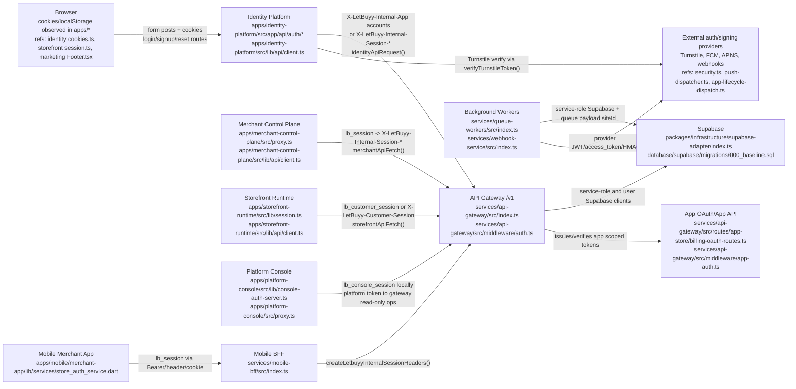

# AUTH_AUDIT_REPORT

Audit date: 2026-06-08.

Evidence rule used in this file: every non-UNKNOWN row cites at least one repository path and the relevant symbol, route, middleware, table, migration, or cookie name.

## Authentication Surface Inventory

| Runtime | Auth Type | Entry Point | Session Type | Cookie(s) | Identity Source | Evidence |
|---|---|---|---|---|---|---|
| Marketing Site | UNKNOWN for application authentication. Observed client preference storage only. | UNKNOWN | UNKNOWN | UNKNOWN | UNKNOWN | `apps/marketing-site/src/components/Footer.tsx` stores `letbuyy_privacy_choices`; `apps/marketing-site/src/components/ThemeProvider.tsx` stores `theme`; `apps/marketing-site/src/app/layout.tsx` reads `theme`. |
| Merchant App | Merchant session cookie shape check at proxy plus server/page API validation through gateway internal session headers. | `apps/merchant-control-plane/src/proxy.ts` `proxy()` for `/:store/*`; `apps/merchant-control-plane/src/lib/auth/session.ts` `getSessionUser()` | Opaque `lb_session` token validated by gateway `sessions` table through internal session headers. | `lb_session` | Custom users and gateway sessions. | Cookie constant in `packages/auth-core/src/index.ts` `LETBUYY_MERCHANT_SESSION_COOKIE`; proxy in `apps/merchant-control-plane/src/proxy.ts`; gateway client in `apps/merchant-control-plane/src/lib/api/client.ts` `merchantApiFetch()`; session lookup in `services/api-gateway/src/routes/auth.ts` `GET /auth/custom/session`. |
| Identity App | Merchant authentication owner for lookup, login, signup, OTP, password, store creation, session, switch, logout. | `apps/identity-platform/src/app/api/auth/login/route.ts` `POST`; `signup/route.ts` `POST`; `verify-otp/route.ts` `POST`; `reset-password/route.ts` `POST`; `create-store/route.ts` `POST` | Opaque `lb_session` stored in `sessions`; password-set intent cookie for password creation. | `lb_session`, `lb_accounts`, `lb_device`, `lb_password_set_intent`, `letbuyy_csrf`, legacy reader `lb_csrf` | `users_custom`, `sessions`, `devices`, `verification_tokens`, `auth_password_set_intents`. | Cookie helpers in `apps/identity-platform/src/lib/auth/cookies.ts`; session API in `apps/identity-platform/src/lib/auth/session.ts`; gateway custom auth in `services/api-gateway/src/routes/auth.ts`; migrations `database/supabase/migrations/000_baseline.sql` tables `users_custom`, `sessions`, `devices`, `verification_tokens`; migration `database/supabase/migrations/078_password_set_intents.sql` table `auth_password_set_intents`. |
| Storefront Runtime | Shopper/customer session JWT in host-only cookie plus storefront gate/preview cookies. | `apps/storefront-runtime/src/app/api/customer/login/route.ts` `POST`; `customer/session/route.ts` `GET`; `customer/logout/route.ts` `POST`; `apps/storefront-runtime/src/proxy.ts` `proxy()` | Customer JWT cookie from `createHostOnlyShopperIdentityProvider()` and gateway customer session middleware. | `lb_customer_session`, `__Host-lb_store_gate`, `__Host-lb_preview`, `lb_theme_preview_${subdomain}` | `store_customers`, `customer_credentials`, storefront access tokens, public tenant resolution. | Cookie constants in `packages/auth-core/src/index.ts`; customer cookie provider in `packages/auth-core/src/index.ts` `createHostOnlyShopperIdentityProvider()`; storefront cookie code in `apps/storefront-runtime/src/lib/session.ts`; gateway customer middleware in `services/api-gateway/src/middleware/customer-session.ts`; gate/preview code in `apps/storefront-runtime/src/proxy.ts`; tables in `database/supabase/migrations/000_baseline.sql` `store_customers`, `customer_credentials`. |
| Checkout | Hosted checkout signed handoff and checkout session persistence; customer login requirement UNKNOWN. | `services/api-gateway/src/routes/checkout.ts` hosted checkout route; `apps/storefront-runtime/src/app/store/[subdomain]/checkout/page.tsx` | `checkout_sessions` row state; cart token handoff. | UNKNOWN for checkout auth cookie. | Signed handoff plus `carts` and `checkout_sessions`. | Handoff verification in `services/api-gateway/src/routes/checkout.ts` using `CHECKOUT_SIGNING_SECRET`; checkout table in `database/supabase/migrations/000_baseline.sql` `checkout_sessions`; storefront checkout UI path `apps/storefront-runtime/src/app/store/[subdomain]/checkout/checkout-client.tsx`. |
| Admin / Platform Console | Console allowlist, magic-link callback, MFA-gated `lb_console_session`; gateway supports platform console token for read-only operations. | `apps/platform-console/src/app/api/console-auth/login/route.ts` `POST`; `callback/route.ts` `GET`; `mfa/route.ts` `POST`; `apps/platform-console/src/proxy.ts` | Signed platform console session token. | `lb_console_session`; merchant `lb_session` also checked by console proxy before redirecting to console login. | `PLATFORM_CONSOLE_ALLOWED_EMAILS`, `PLATFORM_CONSOLE_TOTP_SECRET`, `super_admin_allowlist`, `employees`, gateway platform token. | Session helpers in `apps/platform-console/src/lib/console-session.ts`; server auth in `apps/platform-console/src/lib/console-auth-server.ts`; proxy in `apps/platform-console/src/proxy.ts`; gateway platform token branch in `services/api-gateway/src/middleware/auth.ts` `authMiddleware()`; tables in `database/supabase/migrations/000_baseline.sql` `super_admin_allowlist`, `employees`. |
| Internal APIs | HMAC-signed internal app requests and HMAC-signed internal session headers. | `services/api-gateway/src/lib/internal-auth.ts` `verifyInternalAppRequest()`; `services/api-gateway/src/middleware/auth.ts` `getInternalSessionAuthContext()` | Internal session header trust boundary backed by `sessions` table. | No browser cookie at gateway boundary; apps read cookies and forward signed headers. | `users_custom`, `sessions`, Supabase service client. | Header creation in `packages/auth-core/src/index.ts` `createLetbuyyInternalSessionHeaders()`; verification in `verifyLetbuyyInternalSessionHeaders()`; gateway auth in `services/api-gateway/src/middleware/auth.ts`; identity app client in `apps/identity-platform/src/lib/api/client.ts` `identityApiRequest()`; merchant client in `apps/merchant-control-plane/src/lib/api/client.ts` `merchantApiFetch()`. |
| Background Workers | Service-role Supabase execution and provider JWTs for push dispatch. | `services/queue-workers/src/index.ts`; `services/queue-workers/src/push-dispatcher.ts`; `services/webhook-service/src/index.ts` | Worker queue payloads and provider access tokens; no browser session cookie. | UNKNOWN | Supabase service role, FCM OAuth token, APNS JWT, webhook internal secret. | Supabase worker env in `services/queue-workers/src/index.ts`; FCM `access_token` handling and APNS JWT in `services/queue-workers/src/push-dispatcher.ts`; webhook internal dispatch secret in `services/webhook-service/src/index.ts`; webhook HMAC headers in `services/webhook-service/src/app-lifecycle-dispatch.ts`. |
| CLI Tools | UNKNOWN | UNKNOWN | UNKNOWN | UNKNOWN | UNKNOWN | No CLI auth source reference recorded in this audit. |
| Mobile APIs | Mobile merchant app stores `lb_session` in Flutter secure storage and sends it to Mobile BFF; Mobile BFF re-signs gateway internal session headers. | `apps/mobile/merchant-app/lib/services/store_auth_service.dart` `signInWithPassword()` and `_persistSession()`; `services/mobile-bff/src/index.ts` `extractMobileSessionToken()` | Opaque `lb_session` transport via Bearer, `X-LetBuyy-Session-Token`, or cookie to Mobile BFF. | `lb_session`, `letbuyy_csrf` | Identity Platform and API Gateway custom sessions. | Mobile storage keys in `apps/mobile/merchant-app/lib/services/store_auth_service.dart`; BFF token extraction in `services/mobile-bff/src/index.ts`; Dart client cookie/header attachment in `packages/dart/api_client/lib/src/api_client.dart`; tests in `services/mobile-bff/test/session-token.test.ts`. |

## Cookie Attribute Audit

| Name | Domain | Path | HttpOnly | Secure | SameSite | MaxAge | Expiration | Setter | Reader | Runtime Owner | Evidence |
|---|---|---|---|---|---|---|---|---|---|---|---|
| `lb_session` | `COOKIE_DOMAIN` or `.letbuyy.store` in production; undefined otherwise. | `/` | `true` | `true` in identity helper | `lax` | `AUTH_SESSION_DURATION_MS / 1000` | Not explicitly set by identity helper. | `apps/identity-platform/src/lib/auth/cookies.ts` `setSessionCookie()` | `getSessionCookie()`, identity proxy, merchant proxy, app/theme marketplace clients, mobile BFF token extraction | Identity Platform merchant auth | Constants in `packages/auth-core/src/index.ts`; setter in `apps/identity-platform/src/lib/auth/cookies.ts`; readers in `apps/identity-platform/src/proxy.ts`, `apps/merchant-control-plane/src/proxy.ts`, `services/mobile-bff/src/index.ts`. |
| `lb_accounts` | `COOKIE_DOMAIN` or `.letbuyy.store` in production; undefined otherwise. | `/` | `true` | `true` in identity helper | `lax` | `365 * 24 * 60 * 60` | JWT `exp` one year in payload. | `apps/identity-platform/src/lib/auth/cookies.ts` `addAccount()` | `getAccounts()`, `removeAccount()`, `apps/identity-platform/src/app/api/auth/accounts/route.ts` | Identity Platform account switcher | `apps/identity-platform/src/lib/auth/cookies.ts` symbols `COOKIE_NAMES.accounts`, `addAccount()`, `getAccounts()`, `removeAccount()`. |
| `letbuyy_csrf` | Identity helper uses `COOKIE_DOMAIN` or `.letbuyy.store`; identity proxy sets no domain; gateway customer route sets no domain. | `/` | Identity helper/proxy: `false`; gateway customer route: no `HttpOnly` flag when default helper called. | Identity helper `true`; identity proxy `NODE_ENV === 'production'`; gateway customer route always appends `Secure`. | Identity helper/proxy `strict`; gateway customer route `Lax`. | Identity helper/proxy `60 * 60`; gateway customer route `LETBUYY_CUSTOMER_GATEWAY_SESSION_TTL_SECONDS`. | Gateway customer helper includes `Expires`. | `apps/identity-platform/src/lib/auth/cookies.ts` `setCsrfCookie()`; `apps/identity-platform/src/proxy.ts`; `services/api-gateway/src/routes/storefront/customer-engagement-routes.ts` `buildCookie()` | `apps/identity-platform/src/lib/auth/csrf.ts` `validateCsrf()`; `apps/identity-platform/src/lib/csrf-client.ts`; `services/api-gateway/src/middleware/security.ts` `csrfProtection()` | Identity Platform and Storefront customer gateway routes | Cookie names in `apps/identity-platform/src/lib/auth/cookies.ts`; proxy setter in `apps/identity-platform/src/proxy.ts`; gateway reader in `services/api-gateway/src/middleware/security.ts`; gateway setter lines in `services/api-gateway/src/routes/storefront/customer-engagement-routes.ts`. |
| `lb_csrf` | UNKNOWN | UNKNOWN | UNKNOWN | UNKNOWN | UNKNOWN | UNKNOWN | UNKNOWN | UNKNOWN | `apps/identity-platform/src/lib/auth/csrf.ts` and `apps/identity-platform/src/lib/csrf-client.ts` read it; `services/api-gateway/src/middleware/security.ts` accepts it. | Legacy CSRF reader | Reader evidence in `apps/identity-platform/src/lib/auth/csrf.ts` `validateCsrf()`, `apps/identity-platform/src/lib/csrf-client.ts`, `services/api-gateway/src/middleware/security.ts` `csrfProtection()`. |
| `lb_device` | `COOKIE_DOMAIN` or `.letbuyy.store` in production; undefined otherwise. | `/` | `true` | `true` in identity helper | `lax` | `90 * 24 * 60 * 60` | Not explicitly set by identity helper. | `apps/identity-platform/src/lib/auth/cookies.ts` `setDeviceCookie()` | `getDeviceCookie()` | Identity Platform device marker | `apps/identity-platform/src/lib/auth/cookies.ts` symbols `COOKIE_NAMES.device`, `setDeviceCookie()`, `getDeviceCookie()`. |
| `lb_password_set_intent` | `COOKIE_DOMAIN` or `.letbuyy.store` in production; undefined otherwise. | `/` | `true` | `true` in identity helper | `strict` | `15 * 60` | Not explicitly set by identity helper. | `apps/identity-platform/src/lib/auth/cookies.ts` `setPasswordSetIntentCookie()` | `getPasswordSetIntentCookie()`, `clearPasswordSetIntentCookie()` | Identity Platform password creation | `apps/identity-platform/src/lib/auth/cookies.ts`; routes `apps/identity-platform/src/app/api/auth/verify-otp/route.ts`, `apps/identity-platform/src/app/api/auth/set-password/route.ts`. |
| `lb_customer_session` | Storefront app provider is host-only; gateway customer route sets no Domain. | `/` | `true` | Storefront app `NODE_ENV === 'production'`; gateway route appends `Secure`. | `lax` | Storefront app `LETBUYY_CUSTOMER_SESSION_TTL_SECONDS`; gateway route `LETBUYY_CUSTOMER_GATEWAY_SESSION_TTL_SECONDS`. | Gateway helper includes `Expires`; storefront app does not explicitly set expiration. | `apps/storefront-runtime/src/lib/session.ts` `createSession()`; `services/api-gateway/src/routes/storefront/customer-engagement-routes.ts` `buildCookie()` | `apps/storefront-runtime/src/lib/session.ts` `getSession()`; `services/api-gateway/src/middleware/customer-session.ts` `verifyGatewayCustomerSession()` | Storefront customer auth | Constants in `packages/auth-core/src/index.ts`; cookie provider in `packages/auth-core/src/index.ts` `createHostOnlyShopperIdentityProvider()`; storefront setter/reader in `apps/storefront-runtime/src/lib/session.ts`; gateway reader in `services/api-gateway/src/middleware/customer-session.ts`. |
| `lb_console_session` | No Domain set. | `/` | `true` | `NODE_ENV === 'production'` | `strict` | `LETBUYY_PLATFORM_SESSION_TTL_SECONDS` | Not explicitly set. | `apps/platform-console/src/lib/console-auth-server.ts` `setConsoleSessionCookie()` | `readConsoleSession()` and `getConsoleSessionFromCookies()` | Platform Console | Constant in `packages/auth-core/src/index.ts`; platform cookie code in `apps/platform-console/src/lib/console-session.ts`, `apps/platform-console/src/lib/console-auth-server.ts`. |
| `__Host-lb_store_gate` | No Domain set. | `/` | `true` | `NODE_ENV === 'production'` | `lax` | `LETBUYY_STOREFRONT_GATE_TTL_SECONDS` | Not explicitly set. | `apps/storefront-runtime/src/proxy.ts` password gate branch | `apps/storefront-runtime/src/proxy.ts` reads gate token | Storefront Runtime | Constants in `packages/auth-core/src/storefront-access.ts`; setter/reader in `apps/storefront-runtime/src/proxy.ts`. |
| `__Host-lb_preview` | No Domain set. | `/` | `true` | `NODE_ENV === 'production'` | `lax` | `LETBUYY_STOREFRONT_PREVIEW_MERCHANT_TTL_SECONDS` or preview token TTL branch | Not explicitly set. | `apps/storefront-runtime/src/proxy.ts` preview branch | `apps/storefront-runtime/src/proxy.ts` reads preview token | Storefront Runtime | Constants in `packages/auth-core/src/storefront-access.ts`; setter/reader in `apps/storefront-runtime/src/proxy.ts`. |
| `lb_theme_preview_${subdomain}` | No Domain set. | `/` | `true` | `NODE_ENV === 'production'` | `lax` | `15 * 60` | Not explicitly set. | `apps/storefront-runtime/src/proxy.ts` `applyThemePreviewCookie()` | `apps/storefront-runtime/src/proxy.ts` via `getThemePreviewCookieName()` | Storefront Runtime theme preview | Cookie prefix in `apps/storefront-runtime/src/lib/theme-preview-cookie.ts`; setter in `apps/storefront-runtime/src/proxy.ts`. |

## Authentication Dependency Graph

| Edge | Dependency Type | Evidence |
|---|---|---|
| Browser -> Identity | Form/API auth route entry plus cookies. | `apps/identity-platform/src/app/api/auth/login/route.ts` `POST`; `signup/route.ts` `POST`; `reset-password/route.ts` `POST`; cookie setters in `apps/identity-platform/src/lib/auth/cookies.ts`. |
| Identity -> Gateway | Internal app HMAC and internal session HMAC. | `apps/identity-platform/src/lib/api/client.ts` `identityApiRequest()`; `services/api-gateway/src/lib/internal-auth.ts` `verifyInternalAppRequest()`; `services/api-gateway/src/middleware/auth.ts` `getInternalSessionAuthContext()`. |
| Merchant -> Gateway | Merchant cookie read and signed internal session headers. | `apps/merchant-control-plane/src/lib/api/client.ts` `merchantApiFetch()`; `packages/auth-core/src/index.ts` `createLetbuyyInternalSessionHeaders()`. |
| Storefront -> Gateway | Customer cookie or customer session header. | `apps/storefront-runtime/src/lib/api/client.ts` `storefrontApiFetch()`; `services/api-gateway/src/middleware/customer-session.ts` `verifyGatewayCustomerSession()`. |
| Console -> Gateway | Console session cookie locally and platform console token branch in gateway. | `apps/platform-console/src/lib/console-auth-server.ts` `setConsoleSessionCookie()`; `services/api-gateway/src/middleware/auth.ts` platform token branch in `authMiddleware()`. |
| Mobile -> Mobile BFF -> Gateway | Secure-storage `lb_session` transport converted to internal session headers. | `apps/mobile/merchant-app/lib/services/store_auth_service.dart`; `services/mobile-bff/src/index.ts` `extractMobileSessionToken()` and `signHeadersForSession()`. |
| Gateway -> Supabase | Service-role and user-scoped Supabase clients. | `services/api-gateway/src/lib/supabase.ts`; `packages/infrastructure/supabase-adapter/index.ts` `createSupabaseServiceClient()` and `createSupabaseUserClient()`. |
| Gateway -> App OAuth/App API | Token issuer and validator. | `services/api-gateway/src/routes/app-store/billing-oauth-routes.ts` token routes; `services/api-gateway/src/routes/app-store/shared.ts` `mintAppOAuthAccessToken()` and `appendAppOAuthTokenConfig()`; `services/api-gateway/src/middleware/app-auth.ts` `appAuthMiddleware()`. |
| Workers -> Supabase / Providers | Service-role queue persistence and provider JWT/access-token dispatch. | `services/queue-workers/src/index.ts`; `services/queue-workers/src/push-dispatcher.ts`; `services/webhook-service/src/app-lifecycle-dispatch.ts`. |

## Client-Side Auth Exposure Audit

| Surface | Observed Exposure | Storage / Transport | Evidence |
|---|---|---|---|
| Identity Platform browser | CSRF token is JS-readable by design in client utility. | `document.cookie` reads `letbuyy_csrf` and `lb_csrf`. | `apps/identity-platform/src/lib/csrf-client.ts` `getCsrfToken()`. |
| Identity Platform browser | Theme and language preferences are in browser localStorage. | `localStorage` keys `letbuyy_theme`, `letbuyy_lang`. | `apps/identity-platform/src/app/login/page.tsx`, `signup/page.tsx`, `lookup/page.tsx`, `onboarding/page.tsx`, `reset-password/page.tsx`, `set-password/page.tsx`, `select/page.tsx`, `forgot-password/page.tsx`, `check-email/page.tsx`. |
| Marketing Site browser | Privacy choices and theme are in localStorage. | `localStorage` key `letbuyy_privacy_choices`; key `theme`. | `apps/marketing-site/src/components/Footer.tsx`; `apps/marketing-site/src/components/ThemeProvider.tsx`; `apps/marketing-site/src/app/layout.tsx`. |
| Merchant Control Plane browser | Theme preference is in localStorage. | `localStorage` key `letbuyy_theme`. | `apps/merchant-control-plane/src/app/layout.tsx`; `apps/merchant-control-plane/src/components/HeaderBar.tsx`; `apps/merchant-control-plane/src/app/stores/AllStoresClient.tsx`. |
| Merchant Control Plane app bridge | App bridge token is used in a browser component Authorization header. | In-memory prop/state `session.bridge.access_token`; `Authorization` header. | `apps/merchant-control-plane/src/components/apps/EmbeddedAppBridgeClient.tsx` fetch authorization header. |
| Storefront browser | Guest cart and wishlist state are in localStorage. | `lb_wishlist`, cart storage key, cart token storage key. | `apps/storefront-runtime/src/context/wishlist-context.tsx`; `apps/storefront-runtime/src/context/customer-auth-context.tsx`; `apps/storefront-runtime/src/context/cart-context.tsx`; `apps/storefront-runtime/src/lib/theme-engine/liquid-hydration-islands.tsx`. |
| App Marketplace browser | Marketplace account profile fields are in localStorage. | `letbuyy_marketplace_account`, `letbuyy_account_email`, `letbuyy_account_name`. | `apps/app-marketplace/src/components/Header.tsx`. |
| App Marketplace browser | Telemetry session id is in sessionStorage. | `sessionStorage` session key from telemetry module. | `apps/app-marketplace/src/lib/telemetry.ts`. |
| App Marketplace server route | Bridge session access token is used to call gateway from a Next route. | `Authorization` header with `session.bridge.access_token`. | `apps/app-marketplace/src/app/api/apps/[id]/install/route.ts`. |
| Gateway legacy Supabase auth routes | Raw Supabase `access_token` and `refresh_token` are returned in JSON. | HTTP JSON response. | `services/api-gateway/src/routes/auth.ts` `POST /auth/signin` and `POST /auth/signin/otp/verify`. |
| Gateway employee route | Raw Supabase `access_token` and `refresh_token` are returned in JSON. | HTTP JSON response. | `services/api-gateway/src/routes/employee.ts` token response. |
| App OAuth gateway | Raw app `access_token` and `refresh_token` are returned by OAuth token routes while hashes are persisted. | HTTP JSON response; stored hashes in installation config. | `services/api-gateway/src/routes/app-store/billing-oauth-routes.ts`; `services/api-gateway/src/routes/app-store/shared.ts` `appendAppOAuthTokenConfig()` and `mintAppOAuthAccessToken()`. |
| Mobile Merchant App | Merchant session token and session user are stored in Flutter secure storage, not browser localStorage. | `FlutterSecureStorage` keys `lb_session`, `lb_session_user`, `lb_session_expires_at`. | `apps/mobile/merchant-app/lib/services/store_auth_service.dart`. |
| IndexedDB | UNKNOWN | UNKNOWN | No source-backed IndexedDB auth finding recorded in this audit. |

## Trust Boundary Mapping

| Hop | Authentication Mechanism | Authorization Mechanism | Trusted Headers | Signature Validation | Session Validation | Evidence |
|---|---|---|---|---|---|---|
| Browser -> Identity Platform | Form posts to identity API routes; `lb_session` cookie after login; CSRF token header/cookie for mutations. | Route-specific logic in identity API routes. | `X-CSRF-Token`; Turnstile token in request body where routes call Turnstile. | Turnstile verification uses Cloudflare API. | `createSession()` and `validateSession()` call gateway custom session endpoints. | `apps/identity-platform/src/app/api/auth/login/route.ts`; `apps/identity-platform/src/lib/auth/csrf.ts` `validateCsrf()`; `apps/identity-platform/src/lib/auth/session.ts`; `services/api-gateway/src/middleware/security.ts` `verifyTurnstileToken()`. |
| Browser -> App Proxy / Edge | Fast cookie shape checks in Next proxies. | Redirects for protected pages based on cookie presence/shape. | Cookie headers. | `verifyLetbuyySessionCookieValue('merchant')` verifies token shape only. | Page/API boundaries call gateway session validation. | `apps/identity-platform/src/proxy.ts`; `apps/merchant-control-plane/src/proxy.ts`; `apps/app-marketplace/src/proxy.ts`; `apps/theme-marketplace/src/proxy.ts`; `apps/platform-console/src/proxy.ts`. |
| Identity Platform -> Gateway | Accounts internal app HMAC; internal session HMAC for session-required calls. | Gateway route checks `requireAccountsInternal()` for custom auth routes. | `X-LetBuyy-Internal-App`, `X-LetBuyy-Internal-Timestamp`, `X-LetBuyy-Internal-Signature`, `X-LetBuyy-Internal-Session-*`. | `verifyInternalAppRequest()` and `verifyLetbuyyInternalSessionHeaders()`. | Gateway `GET /auth/custom/session` and auth middleware load `sessions`. | `apps/identity-platform/src/lib/api/client.ts`; `services/api-gateway/src/lib/internal-auth.ts`; `services/api-gateway/src/routes/auth.ts`; `services/api-gateway/src/middleware/auth.ts`. |
| Merchant / Marketplace Apps -> Gateway | App reads `lb_session`, then signs internal session headers. | Gateway resolves custom user and per-route ownership/RBAC. | `X-LetBuyy-Internal-Session-Token`, `X-LetBuyy-Internal-Timestamp`, `X-LetBuyy-Internal-Signature`. | `verifyLetbuyyInternalSessionHeaders()`. | Gateway queries `sessions`, deletes expired rows, updates `last_active`. | `apps/merchant-control-plane/src/lib/api/client.ts`; `apps/app-marketplace/src/lib/api/client.ts`; `apps/theme-marketplace/src/lib/api/client.ts`; `services/api-gateway/src/middleware/auth.ts` `getInternalSessionAuthContext()`. |
| Storefront -> Gateway | Public storefront routes; customer routes use `lb_customer_session` cookie or `X-LetBuyy-Customer-Session`. | Customer route middleware sets customer context; storefront store scopes use `store_id`. | `X-LetBuyy-Customer-Session`; cookie `lb_customer_session`; internal storefront headers for server calls. | Customer JWT verification in auth-core customer session functions. | `verifyGatewayCustomerSession()` sets customer session in context. | `apps/storefront-runtime/src/lib/api/client.ts`; `services/api-gateway/src/middleware/customer-session.ts`; `packages/auth-core/src/customer-session.ts`; `packages/auth-core/src/index.ts` customer JWT functions. |
| Gateway -> Supabase | Service-role client for server authority; user client for Bearer token flows. | Gateway middleware, route ownership checks, RLS policies in migrations. | `Authorization: Bearer` for user client; service role bearer inside adapter. | Supabase Auth validates Bearer token in `supabase.auth.getUser()`. | Gateway custom sessions table for internal session auth. | `services/api-gateway/src/lib/supabase.ts`; `packages/infrastructure/supabase-adapter/index.ts`; `services/api-gateway/src/middleware/auth.ts`; `database/supabase/migrations/000_baseline.sql` RLS/policies. |
| Mobile App -> Mobile BFF -> Gateway | Mobile sends `lb_session` via Bearer, `X-LetBuyy-Session-Token`, or cookie; BFF signs gateway internal session headers. | Gateway same internal session auth and route auth. | Mobile inbound `Authorization`, `X-LetBuyy-Session-Token`, cookie `lb_session`; outbound `X-LetBuyy-Internal-Session-*`. | BFF creates internal session HMAC using `createLetbuyyInternalSessionHeaders()`. | Gateway validates `sessions`. | `services/mobile-bff/src/index.ts`; `packages/auth-core/src/index.ts`; `services/api-gateway/src/middleware/auth.ts`. |
| Gateway -> External Providers | Turnstile secret, FCM OAuth token, APNS JWT, app lifecycle webhook HMAC. | Provider-specific validation or signature. | Turnstile POST fields; FCM/APNS Authorization Bearer; `X-LetBuyy-Hmac-SHA256`. | Turnstile response check; JWT signing for FCM/APNS; webhook HMAC. | UNKNOWN for browser session; provider auth is service-to-service. | `services/api-gateway/src/middleware/security.ts` `verifyTurnstileToken()`; `services/queue-workers/src/push-dispatcher.ts`; `services/webhook-service/src/app-lifecycle-dispatch.ts`. |

## Multi-Tenant Security Audit

| Identifier | Observed Flow | API Layer | Middleware / Guards | DB / RLS | RBAC | Evidence |
|---|---|---|---|---|---|---|
| `site_id` | Canonical persisted tenant/store identifier in many tables; store URL/UI maps to site. | Gateway routes use `site_id` in app OAuth, checkout, analytics, media, queues, and storefront. | `verifySiteOwnership()` and tenant context helpers. | `sites` table plus RLS policies referencing site ownership. | Tenant context loads membership roles and permissions. | `services/api-gateway/src/lib/auth-user.ts` `verifySiteOwnership()`; `services/api-gateway/src/lib/tenant-context.ts`; `database/supabase/migrations/000_baseline.sql` tables `sites`, `site_memberships`, `site_roles`, `site_role_permissions`; RLS policies for `sites`, `site_memberships`. |
| `store_id` | Public/API alias used for store-scoped commerce, customer, app, checkout, and mobile requests. | Gateway app API rejects mismatched requested store id against token store id; storefront customer routes bind session store id. | `storeContext()` resolves route/header/query store id and checks ownership. | Store owner RLS policies compare table `store_id` to owned `sites`. | `requireStoreOwner()` resolves store id and calls ownership check. | `services/api-gateway/src/middleware/store-context.ts` `storeContext()`; `services/api-gateway/src/routes/app-api.ts` `assertTokenStoreScope()`; `services/api-gateway/src/middleware/rbac.ts` `requireStoreOwner()`; `apps/storefront-runtime/src/app/api/customer/login/route.ts`; `database/supabase/migrations/000_baseline.sql` store owner policies. |
| `merchant_id` | Observed as platform-console form value that maps to `site.id`, and internal-console JSON field. | Platform console merchant actions submit `merchant_id`; internal-console returns `merchant_id: site.id`. | UNKNOWN beyond platform console action handling in audited references. | UNKNOWN as a standalone DB column in audited references. | UNKNOWN beyond console/admin route guards. | `apps/platform-console/src/app/(dashboard)/merchants/[id]/page.tsx`; `services/api-gateway/src/routes/internal-console.ts`. |
| `organization_id` | UNKNOWN | UNKNOWN | UNKNOWN | UNKNOWN | UNKNOWN | No source-backed `organization_id` auth/tenant flow recorded in this audit. |
| `tenant_id` | UNKNOWN | UNKNOWN | UNKNOWN | UNKNOWN | UNKNOWN | No source-backed `tenant_id` auth/tenant flow recorded in this audit. |
| Customer tenant binding | Customer session carries store id and customer id. | Customer routes use session store id and request store id. | `requireCustomerSession()` and `optionalCustomerSession()`. | `store_customers` and `customer_credentials` are store-scoped. | Customer session role context is separate from merchant RBAC. | `packages/auth-core/src/customer-session.ts`; `services/api-gateway/src/middleware/customer-session.ts`; `services/api-gateway/src/routes/storefront.ts`; `database/supabase/migrations/000_baseline.sql` tables `store_customers`, `customer_credentials`. |
| App token tenant binding | App tokens carry installation/app/store identifiers and scopes. | App API requires token scopes and rejects store mismatch. | `appAuthMiddleware()` verifies JWT and stored token hash. | `app_installations.config.oauth.access_token_hash` and refresh hash are stored. | App scopes are enforced per endpoint. | `services/api-gateway/src/middleware/app-auth.ts`; `services/api-gateway/src/routes/app-api.ts`; `services/api-gateway/src/routes/app-store/shared.ts`; `database/supabase/migrations/000_baseline.sql` table `app_installations`. |

## JWT Usage

| Token / JWT | Issuer | Validator | Storage / Transport | Evidence |
|---|---|---|---|---|
| Customer host-only JWT | `packages/auth-core/src/index.ts` `createCustomerSessionToken()` and storefront provider | `verifyCustomerSessionToken()` | Cookie `lb_customer_session`. | `packages/auth-core/src/index.ts`; `apps/storefront-runtime/src/lib/session.ts`. |
| Gateway customer session JWT | `packages/auth-core/src/customer-session.ts` `issueCustomerSession()` | `verifyCustomerSession()` | Cookie/header `lb_customer_session` or `X-LetBuyy-Customer-Session`. | `packages/auth-core/src/customer-session.ts`; `services/api-gateway/src/middleware/customer-session.ts`. |
| Platform console session token | `packages/auth-core/src/index.ts` `createLetbuyyPlatformSessionToken()` | `verifyLetbuyyPlatformSessionToken()` | Cookie `lb_console_session`. | `packages/auth-core/src/index.ts`; `apps/platform-console/src/lib/console-session.ts`. |
| Platform console magic link | `packages/auth-core/src/index.ts` `createLetbuyyPlatformMagicLinkToken()` | `verifyLetbuyyPlatformMagicLinkToken()` | Query token callback. | `packages/auth-core/src/index.ts`; `apps/platform-console/src/app/api/console-auth/callback/route.ts`. |
| Identity `lb_accounts` JWT | `apps/identity-platform/src/lib/auth/cookies.ts` `addAccount()` | `getAccounts()` | Cookie `lb_accounts`. | `apps/identity-platform/src/lib/auth/cookies.ts`. |
| App OAuth authorization code and app scoped access token | `packages/auth-core/src/index.ts` `createAppAuthorizationCode()` and `createAppScopedAccessToken()` | `verifyAppAuthorizationCode()` and `verifyAppScopedAccessToken()` | HTTP JSON OAuth response; Authorization Bearer to app API. | `packages/auth-core/src/index.ts`; `services/api-gateway/src/routes/app-store/billing-oauth-routes.ts`; `services/api-gateway/src/middleware/app-auth.ts`. |
| FCM OAuth access token | External Google OAuth response consumed by worker. | UNKNOWN | In-memory service-to-service Authorization Bearer. | `services/queue-workers/src/push-dispatcher.ts` reads JSON `access_token`. |
| APNS JWT | Worker signs APNS token. | APNS provider validates. | In-memory service-to-service Authorization Bearer. | `services/queue-workers/src/push-dispatcher.ts`. |

## Supabase Integration Points

| Integration | Client Type | Auth / Session Role | Evidence |
|---|---|---|---|
| API Gateway service client | Supabase service role. | Custom auth routes, sessions, users, tenant checks, app tokens, admin routes. | `services/api-gateway/src/lib/supabase.ts`; `packages/infrastructure/supabase-adapter/index.ts` `createSupabaseServiceClient()`. |
| API Gateway user client | Supabase anon key plus user Bearer token. | Legacy Supabase Bearer user flow in `authMiddleware()`. | `services/api-gateway/src/lib/supabase.ts` `getSupabaseUser()`; `services/api-gateway/src/middleware/auth.ts`. |
| Identity Platform | Calls gateway, not direct Supabase in audited identity session helpers. | Accounts internal HMAC to gateway custom auth. | `apps/identity-platform/src/lib/api/client.ts`; `apps/identity-platform/src/lib/auth/session.ts`. |
| Queue Workers | Supabase service role adapter. | Queue persistence, telemetry, projection/job work. | `services/queue-workers/src/index.ts`; `packages/infrastructure/supabase-adapter/index.ts`. |
| Webhook Service | Supabase service role env and client. | Webhook persistence/dispatch context. | `services/webhook-service/src/index.ts`. |
| Platform Console | Calls gateway/internal console API for audit and data; local session cookie for console UI. | Platform session plus platform API token for gateway calls. | `apps/platform-console/src/lib/console-auth-server.ts`; `services/api-gateway/src/middleware/auth.ts`. |

## Gateway Middleware Chains

| Chain | Order / Registration | Evidence |
|---|---|---|
| Global gateway middleware | `securityHeaders`, `requestId`, `inputValidation`, `errorResponseSanitizer`, timing, `observability`, CORS, `apiVersioning`, `queryCostRateLimit`, auth route rate limit. | `services/api-gateway/src/index.ts` middleware registrations. |
| Public/pre-auth gateway routes | `/auth`, `/contacts`, storefront/graphql, graphql/storefront, storefront, checkout, public store branding, themes, app-store, app, WhatsApp inbound, internal console/billing/events/store-access/custom-domain-reconcile. | `services/api-gateway/src/index.ts` route registrations before `api.use('/*', authMiddleware)`. |
| Protected gateway chain | `authMiddleware`, then `csrfProtection`, then `protectedMutationIdempotency`, then protected routers. | `services/api-gateway/src/index.ts` protected middleware registrations. |
| Gateway auth middleware | Platform console token branch, internal session header branch, internal auth header branch, Bearer Supabase branch, otherwise 401. | `services/api-gateway/src/middleware/auth.ts` `authMiddleware()`. |
| Gateway CSRF middleware | Skips safe methods; skips Bearer and internal signed requests; otherwise compares CSRF cookie/header. | `services/api-gateway/src/middleware/security.ts` `csrfProtection()`. |
| Storefront customer route middleware | `requireCustomerSession()` and `optionalCustomerSession()` validate `lb_customer_session` or `X-LetBuyy-Customer-Session`. | `services/api-gateway/src/middleware/customer-session.ts`; `services/api-gateway/src/routes/storefront.ts`. |
| Platform console proxy chain | Reads `lb_console_session`; redirects `/login`, `/mfa`, protected dashboard routes based on session and MFA state. | `apps/platform-console/src/proxy.ts`; `apps/platform-console/src/lib/console-auth-server.ts`. |

## RBAC Implementation

| RBAC Surface | Implementation | Evidence |
|---|---|---|
| Store ownership | `verifySiteOwnership()` checks `sites` by `id` and custom/user ownership, with optional session store id match. | `services/api-gateway/src/lib/auth-user.ts` `verifySiteOwnership()`. |
| Store route guard | `requireStoreOwner()` resolves `storeId` and calls custom user resolution plus ownership check. | `services/api-gateway/src/middleware/rbac.ts` `requireStoreOwner()`. |
| Role/category guard | `requireRoleCategory()` uses ops allowlist or partner developer persistence and does not rely on JWT role claims for privileged categories. | `services/api-gateway/src/middleware/rbac.ts` `requireRoleCategory()`. |
| Permission guard | `requirePermission()` loads effective permissions from employee roles, permissions, break-glass grants, and allowlist. | `services/api-gateway/src/middleware/rbac.ts` `loadEffectivePermissionScopes()` and `requirePermission()`. |
| Super admin guard | `requireSuperAdmin()` checks email allowlist and platform console token context. | `services/api-gateway/src/middleware/rbac.ts` `requireSuperAdmin()`. |
| Admin route guard | Admin router applies ops role category and super admin guard. | `services/api-gateway/src/routes/admin.ts` `router.use('*', requireRoleCategory('ops'), requireSuperAdmin)`. |
| Operations route guard | Operations routes apply ops/super-admin and permission guards. | `services/api-gateway/src/routes/operations.ts`; `services/api-gateway/src/routes/operations-*`. |
| Tenant role aggregation | Tenant context loads `site_memberships`, `site_roles`, and `site_role_permissions`. | `services/api-gateway/src/lib/tenant-context.ts` `resolveTenantAccessProfile()`. |

## Security Findings With Direct Evidence Only

| Finding | Evidence |
|---|---|
| Identity and gateway accept legacy CSRF cookie name `lb_csrf` in addition to `letbuyy_csrf`. | `apps/identity-platform/src/lib/auth/csrf.ts` `validateCsrf()`; `apps/identity-platform/src/lib/csrf-client.ts`; `services/api-gateway/src/middleware/security.ts` `csrfProtection()`; test `services/api-gateway/src/__tests__/security.test.ts` accepts legacy `lb_csrf`. |
| Gateway legacy Supabase sign-in routes return raw `access_token` and `refresh_token` values in JSON. | `services/api-gateway/src/routes/auth.ts` `POST /auth/signin` and `POST /auth/signin/otp/verify`. |
| Employee route returns raw Supabase `access_token` and `refresh_token` values in JSON. | `services/api-gateway/src/routes/employee.ts` token response. |
| App OAuth token route returns raw app `access_token` and `refresh_token`, while persisted installation config stores token hashes. | `services/api-gateway/src/routes/app-store/billing-oauth-routes.ts`; `services/api-gateway/src/routes/app-store/shared.ts` `appendAppOAuthTokenConfig()`. |
| Identity `letbuyy_csrf` is readable by browser JavaScript. | `apps/identity-platform/src/lib/auth/cookies.ts` `setCsrfCookie()` uses `httpOnly: false`; `apps/identity-platform/src/lib/csrf-client.ts` reads it with `document.cookie`. |
| Platform console auth requires MFA verification before protected console routes. | `apps/platform-console/src/proxy.ts`; `apps/platform-console/src/app/api/console-auth/mfa/route.ts`; `apps/platform-console/src/lib/console-auth-server.ts` `requireConsoleSession({ mfa: true })`. |

