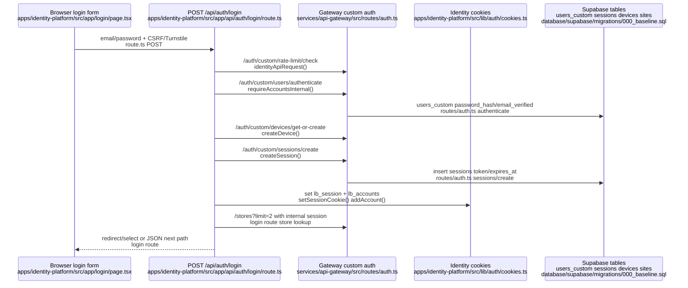
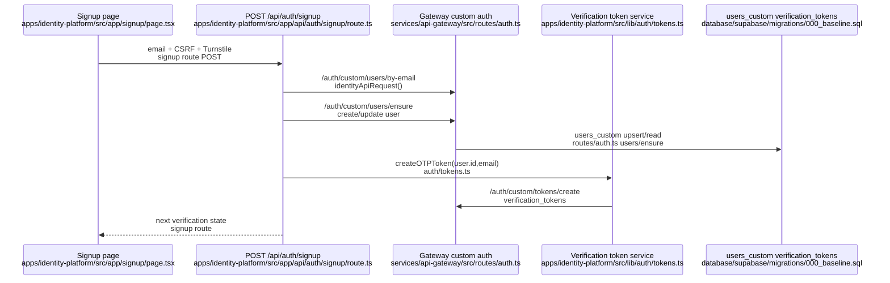
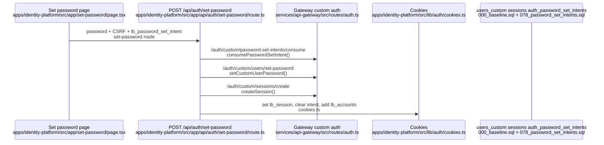
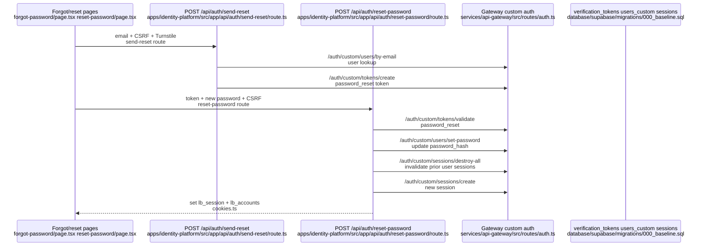
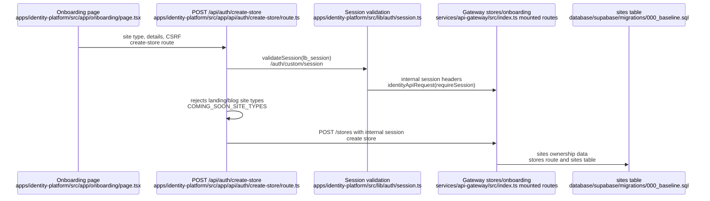
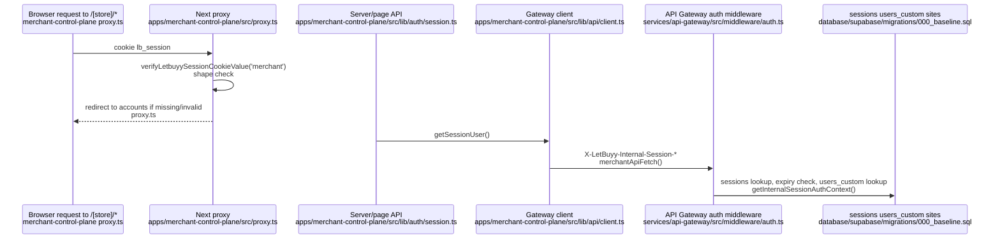
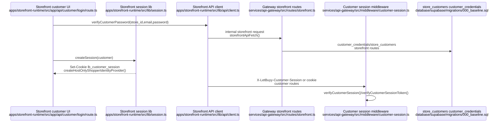
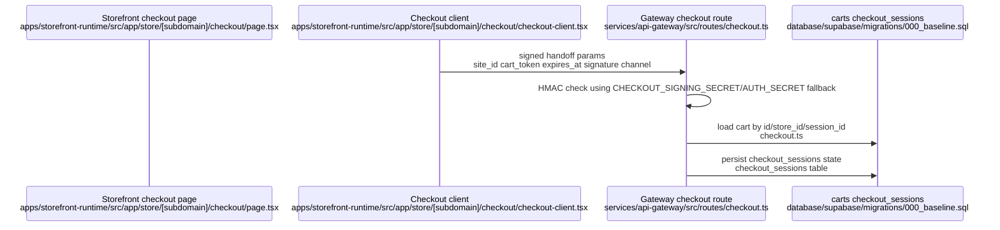
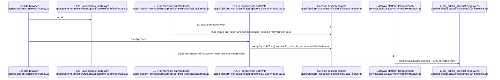
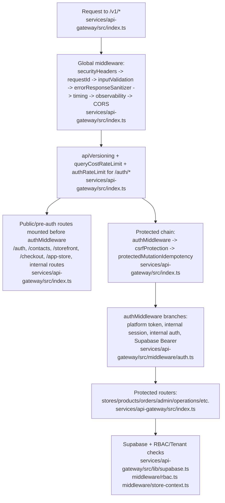

# CURRENT_AUTH_ARCHITECTURE

Audit date: 2026-06-08.

Evidence rule used in this file: every non-UNKNOWN flow step cites at least one repository path and the relevant symbol, route, middleware, table, migration, or cookie name.

## Current Login Flow



| Step | Observed Behavior | Evidence |
|---|---|---|
| Login request | Login route validates rate limit, CSRF, and Turnstile before gateway authentication. | `apps/identity-platform/src/app/api/auth/login/route.ts` `POST`; `apps/identity-platform/src/lib/auth/csrf.ts` `validateCsrf()`; `services/api-gateway/src/middleware/security.ts` `verifyTurnstileToken()`. |
| Password verification | Gateway custom auth loads `users_custom`, checks password hash, and requires verified email. | `services/api-gateway/src/routes/auth.ts` `POST /auth/custom/users/authenticate`; table `users_custom` in `database/supabase/migrations/000_baseline.sql`. |
| Session creation | Identity calls gateway `sessions/create`; gateway inserts `sessions` token and expiry. | `apps/identity-platform/src/lib/auth/session.ts` `createSession()`; `services/api-gateway/src/routes/auth.ts` `POST /auth/custom/sessions/create`; table `sessions` in `database/supabase/migrations/000_baseline.sql`. |
| Cookie issue | Identity sets `lb_session` and `lb_accounts`; `lb_session` is the merchant session cookie. | `apps/identity-platform/src/lib/auth/cookies.ts` `setSessionCookie()` and `addAccount()`; `packages/auth-core/src/index.ts` `LETBUYY_MERCHANT_SESSION_COOKIE`. |
| Post-login store selection | Login route asks gateway for first stores and redirects based on store count. | `apps/identity-platform/src/app/api/auth/login/route.ts`; `services/api-gateway/src/routes/stores.ts` route surface mounted in `services/api-gateway/src/index.ts`. |

## Current Signup Flow



| Step | Observed Behavior | Evidence |
|---|---|---|
| Signup request | Signup route validates rate limit, CSRF, and Turnstile. | `apps/identity-platform/src/app/api/auth/signup/route.ts` `POST`; `apps/identity-platform/src/lib/auth/csrf.ts`; `services/api-gateway/src/middleware/security.ts`. |
| User lookup/create | Signup route calls custom user lookup and ensure endpoints through accounts internal auth. | `apps/identity-platform/src/app/api/auth/signup/route.ts`; `services/api-gateway/src/routes/auth.ts` `POST /auth/custom/users/by-email` and `POST /auth/custom/users/ensure`. |
| OTP/token creation | Signup route creates an OTP token through identity token helpers and gateway verification token route. | `apps/identity-platform/src/app/api/auth/signup/route.ts`; `apps/identity-platform/src/lib/auth/tokens.ts`; `services/api-gateway/src/routes/auth.ts` `POST /auth/custom/tokens/create`; table `verification_tokens` in `database/supabase/migrations/000_baseline.sql`. |

## Current Email Verification / OTP Flow

```mermaid
sequenceDiagram
  participant B as Browser verification UI<br/>apps/identity-platform/src/app/check-email/page.tsx
  participant OTP as POST /api/auth/verify-otp<br/>apps/identity-platform/src/app/api/auth/verify-otp/route.ts
  participant Link as GET /api/auth/verify<br/>apps/identity-platform/src/app/api/auth/verify/route.ts
  participant G as Gateway custom auth<br/>services/api-gateway/src/routes/auth.ts
  participant C as Password intent cookie<br/>apps/identity-platform/src/lib/auth/cookies.ts
  participant DB as verification_tokens auth_password_set_intents<br/>000_baseline.sql + 078_password_set_intents.sql

  B->>OTP: OTP + email + CSRF<br/>verify-otp route
  OTP->>G: /auth/custom/tokens/validate<br/>validateToken()
  OTP->>G: /auth/custom/users/verify-email<br/>verifyEmail()
  OTP->>G: /auth/custom/password-set-intents/create<br/>createPasswordSetIntent()
  OTP->>C: set lb_password_set_intent<br/>setPasswordSetIntentCookie()
  Link->>G: /auth/custom/tokens/validate for email_verify/magic_link<br/>verify route GET
```

| Flow | Observed Behavior | Evidence |
|---|---|---|
| OTP verification | OTP route validates CSRF and token, verifies email, creates password-set intent, and sets `lb_password_set_intent`. | `apps/identity-platform/src/app/api/auth/verify-otp/route.ts`; `apps/identity-platform/src/lib/auth/tokens.ts` `validateToken()`; `apps/identity-platform/src/lib/auth/password-set-intents.ts`; `apps/identity-platform/src/lib/auth/cookies.ts` `setPasswordSetIntentCookie()`. |
| Email verify link | Verify route handles `type=email_verify`, validates token, verifies email, creates password-set intent, sets intent cookie, and redirects to `/set-password`. | `apps/identity-platform/src/app/api/auth/verify/route.ts`; `services/api-gateway/src/routes/auth.ts` `POST /auth/custom/tokens/validate`, `POST /auth/custom/users/verify-email`, `POST /auth/custom/password-set-intents/create`. |
| Magic link | Verify route handles `type=magic_link`, validates token, creates device/session, sets `lb_session` and `lb_accounts`, then redirects by store lookup. | `apps/identity-platform/src/app/api/auth/verify/route.ts`; `apps/identity-platform/src/lib/auth/session.ts` `createSession()`; `apps/identity-platform/src/lib/auth/cookies.ts` `setSessionCookie()`, `addAccount()`. |

## Current Set Password Flow



| Step | Observed Behavior | Evidence |
|---|---|---|
| Intent consume | Set-password route consumes `lb_password_set_intent` through gateway password-set-intent endpoint. | `apps/identity-platform/src/app/api/auth/set-password/route.ts`; `apps/identity-platform/src/lib/auth/password-set-intents.ts`; `services/api-gateway/src/routes/auth.ts` `POST /auth/custom/password-set-intents/consume`. |
| Password update | Gateway hashes password and updates `users_custom.password_hash`. | `services/api-gateway/src/routes/auth.ts` `POST /auth/custom/users/set-password`; table `users_custom` in `database/supabase/migrations/000_baseline.sql`. |
| Session issue | Route creates a new device/session and sets `lb_session`, clears intent, and adds account cookie. | `apps/identity-platform/src/app/api/auth/set-password/route.ts`; `apps/identity-platform/src/lib/auth/session.ts`; `apps/identity-platform/src/lib/auth/cookies.ts`. |

## Current Password Reset Flow



| Step | Observed Behavior | Evidence |
|---|---|---|
| Send reset | Send-reset route validates rate limit, CSRF, Turnstile, looks up custom user, creates password reset token, and sends email. | `apps/identity-platform/src/app/api/auth/send-reset/route.ts`; `apps/identity-platform/src/lib/auth/tokens.ts` `createPasswordResetToken()`; `services/api-gateway/src/routes/auth.ts` custom user and token routes. |
| Reset validate | Reset-password route validates password reset token through gateway token validation. | `apps/identity-platform/src/app/api/auth/reset-password/route.ts`; `apps/identity-platform/src/lib/auth/tokens.ts` `validateToken()`. |
| Reset invalidation | Reset-password route calls `destroyAllUserSessions(user.id)` before creating a new session. | `apps/identity-platform/src/app/api/auth/reset-password/route.ts`; `apps/identity-platform/src/lib/auth/session.ts` `destroyAllUserSessions()`; `services/api-gateway/src/routes/auth.ts` `POST /auth/custom/sessions/destroy-all`. |
| New session after reset | Reset route creates device/session and sets `lb_session` and `lb_accounts`. | `apps/identity-platform/src/app/api/auth/reset-password/route.ts`; `apps/identity-platform/src/lib/auth/cookies.ts`; `services/api-gateway/src/routes/auth.ts` `POST /auth/custom/sessions/create`. |

## Current Merchant Onboarding / Store Creation Flow



| Step | Observed Behavior | Evidence |
|---|---|---|
| Session required | Create-store route requires `lb_session`, validates session, and validates CSRF. | `apps/identity-platform/src/app/api/auth/create-store/route.ts`; `apps/identity-platform/src/lib/auth/session.ts` `validateSession()`; `apps/identity-platform/src/lib/auth/csrf.ts`. |
| Site type lock | Create-store route allows active type `store` and returns 403 for `landing` and `blog`. | `apps/identity-platform/src/app/api/auth/create-store/route.ts` `ACTIVE_SITE_TYPES`, `COMING_SOON_SITE_TYPES`. |
| Store creation call | Route calls gateway store creation with session headers. | `apps/identity-platform/src/app/api/auth/create-store/route.ts`; `services/api-gateway/src/index.ts` `stores` route mounted after protected middleware; table `sites` in `database/supabase/migrations/000_baseline.sql`. |

## Current Merchant App Session Validation Flow



| Step | Observed Behavior | Evidence |
|---|---|---|
| Proxy guard | Merchant proxy checks `lb_session` shape and redirects unauthenticated protected paths to accounts lookup. | `apps/merchant-control-plane/src/proxy.ts` `proxy()`; `packages/auth-core/src/index.ts` `verifyLetbuyySessionCookieValue()`. |
| Page/session validation | Merchant session helper calls gateway session endpoint through API client. | `apps/merchant-control-plane/src/lib/auth/session.ts` `getSessionUser()`; `apps/merchant-control-plane/src/lib/api/client.ts` `merchantApiFetch()`. |
| Gateway validation | Gateway verifies internal session headers, queries `sessions`, deletes expired sessions, resolves `users_custom`, updates `last_active`. | `services/api-gateway/src/middleware/auth.ts` `getInternalSessionAuthContext()`; `services/api-gateway/src/routes/auth.ts` `GET /auth/custom/session`; tables `sessions`, `users_custom` in `database/supabase/migrations/000_baseline.sql`. |
| Store ownership | Merchant helper validates store access through gateway store lookup and ownership checks. | `apps/merchant-control-plane/src/lib/auth/session.ts` `getStoreForUser()`; `services/api-gateway/src/lib/auth-user.ts` `verifySiteOwnership()`. |

## Current Storefront Customer Login / Session Flow



| Step | Observed Behavior | Evidence |
|---|---|---|
| Customer login route | Storefront `POST /api/customer/login` verifies email/password against gateway and creates customer session cookie. | `apps/storefront-runtime/src/app/api/customer/login/route.ts`; `apps/storefront-runtime/src/lib/session.ts` `createSession()`; `apps/storefront-runtime/src/lib/api/client.ts`. |
| Customer cookie | Storefront session library sets host-only `lb_customer_session` with customer JWT. | `apps/storefront-runtime/src/lib/session.ts`; `packages/auth-core/src/index.ts` `createHostOnlyShopperIdentityProvider()` and `createCustomerSessionToken()`. |
| Session read | Storefront `GET /api/customer/session` reads and verifies customer session cookie. | `apps/storefront-runtime/src/app/api/customer/session/route.ts`; `apps/storefront-runtime/src/lib/session.ts` `getSession()`. |
| Logout | Storefront `POST /api/customer/logout` clears customer session cookie. | `apps/storefront-runtime/src/app/api/customer/logout/route.ts`; `apps/storefront-runtime/src/lib/session.ts` `clearSession()`. |
| Gateway customer routes | Gateway customer middleware accepts `lb_customer_session` cookie or `X-LetBuyy-Customer-Session` header. | `services/api-gateway/src/middleware/customer-session.ts` `verifyGatewayCustomerSession()`; `services/api-gateway/src/routes/storefront.ts`. |

## Current Checkout / Customer Auth Flow



| Step | Observed Behavior | Evidence |
|---|---|---|
| Checkout handoff | Gateway hosted checkout validates signed query parameters including `site_id`, `cart_token`, `expires_at`, `signature`, and `channel`. | `services/api-gateway/src/routes/checkout.ts`. |
| Checkout secret | Handoff verification uses `CHECKOUT_SIGNING_SECRET` with fallback to `AUTH_SECRET` or `STORE_ACCESS_SIGNING_KEY`. | `services/api-gateway/src/routes/checkout.ts`. |
| Checkout persistence | Checkout flow uses `carts` and `checkout_sessions` persistence. | `services/api-gateway/src/routes/checkout.ts`; `database/supabase/migrations/000_baseline.sql` table `checkout_sessions`. |
| Customer-auth requirement | UNKNOWN | No source-backed checkout customer-login requirement recorded in `services/api-gateway/src/routes/checkout.ts` or `apps/storefront-runtime/src/app/store/[subdomain]/checkout/checkout-client.tsx`. |

## Current Platform Console / Admin / Staff Auth Flow



| Step | Observed Behavior | Evidence |
|---|---|---|
| Console proxy | Protected console pages require console session and MFA; merchant `lb_session` can redirect to console login but does not itself satisfy MFA. | `apps/platform-console/src/proxy.ts`; `apps/platform-console/src/lib/console-session.ts`; `apps/platform-console/src/lib/console-auth-server.ts`. |
| Email allowlist | Login route and auth server check platform console allowed emails. | `apps/platform-console/src/app/api/console-auth/login/route.ts`; `apps/platform-console/src/lib/console-auth-server.ts` `isConsoleEmailAllowed()`. |
| Magic link callback | Callback verifies console magic link token and sets `lb_console_session` with `mfaVerified: false`. | `apps/platform-console/src/app/api/console-auth/callback/route.ts`; `apps/platform-console/src/lib/console-auth-server.ts` `setConsoleSessionCookie()`. |
| MFA enforcement | MFA route verifies TOTP and sets console session with `mfaVerified: true`. | `apps/platform-console/src/app/api/console-auth/mfa/route.ts`; `apps/platform-console/src/lib/console-auth-server.ts` `verifyConsoleTotp()`. |
| Logout | Console logout clears `lb_console_session`. | `apps/platform-console/src/app/api/console-auth/logout/route.ts`; `apps/platform-console/src/lib/console-auth-server.ts` `clearConsoleSessionCookie()`. |
| Gateway staff/admin RBAC | Gateway RBAC uses allowlists, employees, role permissions, break-glass grants, and route guards. | `services/api-gateway/src/middleware/rbac.ts`; `services/api-gateway/src/routes/admin.ts`; `services/api-gateway/src/routes/operations.ts`; tables `employees`, `super_admin_allowlist` in `database/supabase/migrations/000_baseline.sql`. |
| Merchant-facing operations portal | Operations portal proxy uses merchant `lb_session` shape and redirects to accounts lookup if missing. | `apps/platform-operations-portal/src/proxy.ts`; `packages/auth-core/src/index.ts` `LETBUYY_MERCHANT_SESSION_COOKIE`. |

## Current API Authentication and Middleware Chain Flow



| Middleware / Route Segment | Observed Behavior | Evidence |
|---|---|---|
| Global middleware | Security headers, request ID, input validation, response sanitizer, timing, observability, and CORS are registered before route groups. | `services/api-gateway/src/index.ts`; `services/api-gateway/src/middleware/security.ts`; `services/api-gateway/src/middleware/observability.ts`. |
| Public/pre-auth routes | Auth, contacts, storefront, checkout, selected public/internal routes are mounted before global `authMiddleware`. | `services/api-gateway/src/index.ts` route registration order. |
| Protected middleware | `authMiddleware`, `csrfProtection`, and `protectedMutationIdempotency` are registered before protected routers. | `services/api-gateway/src/index.ts`. |
| Auth branches | Gateway accepts platform token branch, internal session HMAC, internal auth HMAC, and Supabase Bearer token branch. | `services/api-gateway/src/middleware/auth.ts` `authMiddleware()`, `getInternalSessionAuthContext()`, `getInternalAuthContext()`. |
| CSRF | Protected mutation CSRF skips Bearer and internal signed requests; otherwise compares cookie/header. | `services/api-gateway/src/middleware/security.ts` `csrfProtection()`. |
| Supabase legacy auth | Public `/auth/signin`, `/auth/signup`, OTP, signout, password reset/update routes use Supabase Auth and return/consume Supabase session tokens. | `services/api-gateway/src/routes/auth.ts` Supabase auth route definitions. |
| App API auth | App API routes use scoped app Bearer tokens and stored token hash validation. | `services/api-gateway/src/middleware/app-auth.ts`; `services/api-gateway/src/routes/app-api.ts`. |

## Session Lifecycle

| Lifecycle Event | Current Behavior | Evidence |
|---|---|---|
| Merchant session creation | Identity calls gateway `POST /auth/custom/sessions/create`; gateway inserts a random token in `sessions` with `expires_at`. | `apps/identity-platform/src/lib/auth/session.ts` `createSession()`; `services/api-gateway/src/routes/auth.ts` `POST /auth/custom/sessions/create`; table `sessions` in `database/supabase/migrations/000_baseline.sql`. |
| Merchant session validation | Gateway validates internal session headers, loads `sessions`, deletes expired rows, resolves `users_custom`, and updates `last_active`. | `services/api-gateway/src/middleware/auth.ts` `getInternalSessionAuthContext()`; `services/api-gateway/src/routes/auth.ts` `GET /auth/custom/session`. |
| Merchant session refresh | Token refresh/renewal UNKNOWN; observed behavior updates `sessions.last_active` during validation. | `services/api-gateway/src/middleware/auth.ts` `getInternalSessionAuthContext()`; `services/api-gateway/src/routes/auth.ts` `GET /auth/custom/session`. |
| Merchant session rotation after login | Login creates a new session token after password authentication. | `apps/identity-platform/src/app/api/auth/login/route.ts`; `apps/identity-platform/src/lib/auth/session.ts` `createSession()`. |
| Rotation after account switch | Switch route destroys current session and creates a new target account session. | `apps/identity-platform/src/app/api/auth/switch/route.ts`; `apps/identity-platform/src/lib/auth/session.ts` `destroySession()`, `createSession()`. |
| Rotation after password reset | Reset route destroys all user sessions, updates password, then creates a new session. | `apps/identity-platform/src/app/api/auth/reset-password/route.ts`; `apps/identity-platform/src/lib/auth/session.ts` `destroyAllUserSessions()`, `createSession()`. |
| Rotation after privilege changes | UNKNOWN | No source-backed privilege-change rotation flow recorded in this audit. |
| Merchant logout invalidation | Identity logout route destroys current gateway session if present and clears `lb_session`. | `apps/identity-platform/src/app/api/auth/logout/route.ts`; `apps/identity-platform/src/lib/auth/session.ts` `destroySession()`; `apps/identity-platform/src/lib/auth/cookies.ts` `clearSessionCookie()`. |
| Merchant all-session invalidation | Password reset calls `destroyAllUserSessions(user.id)`; gateway deletes sessions by `user_id`. | `apps/identity-platform/src/app/api/auth/reset-password/route.ts`; `apps/identity-platform/src/lib/auth/session.ts` `destroyAllUserSessions()`; `services/api-gateway/src/routes/auth.ts` `POST /auth/custom/sessions/destroy-all`. |
| Device creation | Identity creates or gets device record before login/reset/set-password session creation. | `apps/identity-platform/src/lib/auth/devices.ts`; `services/api-gateway/src/routes/auth.ts` `POST /auth/custom/devices/get-or-create`; table `devices` in `database/supabase/migrations/000_baseline.sql`. |
| Device revocation | UNKNOWN | No source-backed device revocation endpoint recorded in this audit. |
| Customer session creation | Storefront creates `lb_customer_session` on login/reset confirmation; gateway customer engagement routes can issue gateway customer session cookie. | `apps/storefront-runtime/src/lib/session.ts` `createSession()`; `services/api-gateway/src/routes/storefront/customer-engagement-routes.ts` `issueCustomerSession()` and `buildCookie()`. |
| Customer session validation | Storefront verifies local customer cookie; gateway validates cookie/header via customer middleware. | `apps/storefront-runtime/src/lib/session.ts` `getSession()`; `services/api-gateway/src/middleware/customer-session.ts` `verifyGatewayCustomerSession()`. |
| Customer logout | Storefront logout clears `lb_customer_session`. | `apps/storefront-runtime/src/app/api/customer/logout/route.ts`; `apps/storefront-runtime/src/lib/session.ts` `clearSession()`. |
| Platform console session creation | Console callback sets `lb_console_session` with `mfaVerified:false`; MFA route sets new cookie with `mfaVerified:true`. | `apps/platform-console/src/app/api/console-auth/callback/route.ts`; `apps/platform-console/src/app/api/console-auth/mfa/route.ts`; `apps/platform-console/src/lib/console-auth-server.ts`. |
| Platform console session validation | Console proxy and server helpers read/verify `lb_console_session`. | `apps/platform-console/src/proxy.ts`; `apps/platform-console/src/lib/console-session.ts`; `apps/platform-console/src/lib/console-auth-server.ts`. |
| Platform console logout | Console logout clears `lb_console_session`. | `apps/platform-console/src/app/api/console-auth/logout/route.ts`; `apps/platform-console/src/lib/console-auth-server.ts` `clearConsoleSessionCookie()`. |
| 2FA / MFA enforcement | Platform Console enforces MFA for protected routes; migration defines merchant 2FA factors but merchant auth enforcement is UNKNOWN. | `apps/platform-console/src/proxy.ts`; `apps/platform-console/src/app/api/console-auth/mfa/route.ts`; `database/supabase/migrations/121_mobile_merchant_2fa_factors.sql`; no merchant enforcement source recorded in this audit. |
| Supabase Bearer session validation | Gateway Bearer branch calls `supabase.auth.getUser(token)` and builds auth user context. | `services/api-gateway/src/middleware/auth.ts` Bearer branch; `services/api-gateway/src/lib/supabase.ts` `getSupabaseUser()`. |
| App OAuth refresh rotation | OAuth token route supports `grant_type=refresh_token`, looks up stored refresh token hash, issues new access token, and returns rotated refresh token. | `services/api-gateway/src/routes/app-store/billing-oauth-routes.ts`; `services/api-gateway/src/routes/app-store/shared.ts` `appendAppOAuthTokenConfig()`. |

## Current Storage Locations

| Storage Location | Stored Values | Evidence |
|---|---|---|
| Browser cookies | `lb_session`, `lb_accounts`, `lb_device`, `lb_password_set_intent`, `letbuyy_csrf`, `lb_customer_session`, `lb_console_session`, `__Host-lb_store_gate`, `__Host-lb_preview`, `lb_theme_preview_${subdomain}`. | `packages/auth-core/src/index.ts`; `packages/auth-core/src/storefront-access.ts`; `apps/identity-platform/src/lib/auth/cookies.ts`; `apps/storefront-runtime/src/lib/session.ts`; `apps/storefront-runtime/src/proxy.ts`; `apps/platform-console/src/lib/console-auth-server.ts`. |
| Browser localStorage | Identity theme/language; merchant theme; marketing privacy/theme; storefront cart/wishlist; app marketplace draft/profile/recent; theme marketplace preferences. | `apps/identity-platform/src/app/*/page.tsx` localStorage references; `apps/merchant-control-plane/src/app/layout.tsx`; `apps/marketing-site/src/components/Footer.tsx`; `apps/storefront-runtime/src/context/cart-context.tsx`; `apps/app-marketplace/src/components/Header.tsx`; `apps/theme-marketplace/src/components/theme-preference-actions.tsx`. |
| Browser sessionStorage | App marketplace telemetry session id. | `apps/app-marketplace/src/lib/telemetry.ts`. |
| Flutter secure storage | Mobile merchant `lb_session`, `lb_session_user`, `lb_session_expires_at`. | `apps/mobile/merchant-app/lib/services/store_auth_service.dart`. |
| Supabase tables | `sessions`, `devices`, `users_custom`, `verification_tokens`, `auth_password_set_intents`, `store_customers`, `customer_credentials`, `app_installations`, `checkout_sessions`. | `database/supabase/migrations/000_baseline.sql`; `database/supabase/migrations/078_password_set_intents.sql`. |

