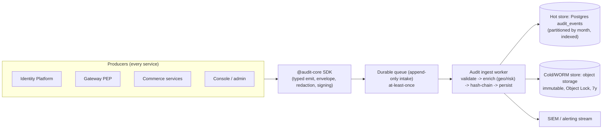
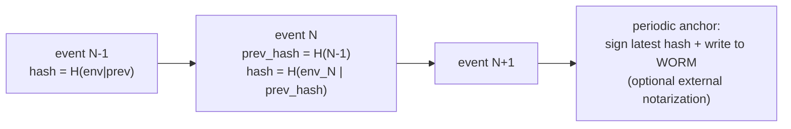
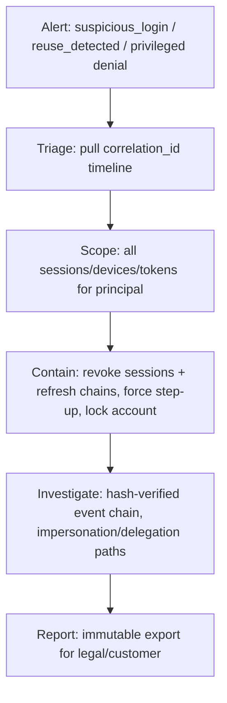

# AUDIT_LOG_ARCHITECTURE

**Phase 16 — Document 4 of 4 (Enterprise Audit Logging)**
Status date: 2026-06-08
Status: Proposed (implementation-ready; no code).

> **Mandate.** Every security-relevant action must be traceable. Define the audit event taxonomy, per-event schema, ingestion/storage/query architecture, retention + legal hold, tamper resistance, forensics + incident response, and SOC2 / ISO 27001 / GDPR readiness.

> **Grounding (consolidation, not greenfield).** The estate already has **fragmented** audit infrastructure (read from `000_baseline.sql`):
> - `audit_logs` — actor_id/actor_type(**user/employee/super_admin/system**)/action/resource_type/resource_id/old_values/new_values/ip/ua.
> - `audit_activity_events` — store_id/actor_id/actor_type(**user/customer/employee/system/webhook**)/action/resource_type/resource_id/request_id/before_state/after_state/ip/ua.
> - `security_enforcement_events` — governance-control enforcement (control_name/severity/status/evidence).
> - `customer_activity_log`, `execution_audit_trail`, `operational_feature_flag_audit_events`, `audit_export_cursors`.
> **Problems:** two overlapping general audit tables with **different actor_type enums**, **no** `correlation_id`/`session_id`/`risk_level`/`device`/`location`, **no tamper resistance**, no unified taxonomy, no retention/legal-hold policy. This document defines one canonical `audit_events` model that consolidates them (Finding AU-1).

---

## 1. Principles

1. **One append-only ledger.** A single canonical `audit_events` store; the existing tables become producers into it (or are migrated), ending the two-table fragmentation.
2. **Append-only + tamper-evident.** Events are immutable and hash-chained; deletion/mutation is detectable.
3. **Every event is correlatable.** `correlation_id` + `request_id` + `session_id` thread an action across services.
4. **Separate from application data.** Audit is written by an audit service, not as a side-effect a route can forget; ingestion is async + durable.
5. **PII-aware.** PII fields are crypto-shreddable to satisfy GDPR without breaking the integrity chain (`IDENTITY_DATA_MODEL.md` §10).
6. **Queryable for humans and machines.** Fast investigative search + compliance export.

---

## 2. Audit event taxonomy

Canonical event name = **`<category>.<resource>.<action>`** (e.g. `auth.session.created`, `org.store.transferred`). Categories:

| Category | Example events |
|----------|----------------|
| **Authentication** | `auth.login.succeeded` `auth.login.failed` `auth.logout` `auth.magic_link.sent` `auth.otp.verified` `auth.password.changed` `auth.step_up.required` `auth.step_up.satisfied` |
| **Authorization** | `authz.access.denied` `authz.permission.granted` `authz.permission.revoked` `authz.role.assigned` `authz.role.removed` |
| **Session** | `session.created` `session.refreshed` `session.revoked` `session.expired` `session.reuse_detected` |
| **Token** | `token.issued` `token.refresh.rotated` `token.revoked` `token.introspected` |
| **MFA** | `mfa.factor.enrolled` `mfa.factor.disabled` `mfa.challenge.failed` `mfa.recovery_code.used` |
| **Passkey** | `passkey.registered` `passkey.authenticated` `passkey.removed` |
| **Account linking** | `account.link.created` `account.link.removed` `account.switched` |
| **Consent** | `consent.granted` `consent.revoked` `consent.scope.changed` |
| **OAuth** | `oauth.client.created` `oauth.client.secret_rotated` `oauth.authorize.approved` `oauth.token.issued` `oauth.grant.revoked` |
| **Organization** | `org.created` `org.suspended` `org.merged` `org.split` `org.deleted` `org.member.invited` `org.member.role_changed` `org.delegation.granted` `org.delegation.revoked` |
| **Store** | `store.created` `store.transferred` `store.archived` `store.deleted` `store.member.added` |
| **Marketplace** | `marketplace.app.installed` `marketplace.app.uninstalled` `marketplace.app.submitted` `marketplace.theme.published` |
| **Administrative** | `admin.merchant.suspended` `admin.feature_flag.changed` `admin.config.changed` |
| **Impersonation** | `impersonation.started` `impersonation.action` `impersonation.ended` |
| **Security** | `security.account.locked` `security.suspicious_login` `security.password.breached` `security.principal.erased` `security.key.rotated` |

This taxonomy maps cleanly onto the per-phase designs: session/token events ↔ `SESSION_MANAGEMENT.md`/`TOKEN_STRATEGY.md`; MFA/passkey ↔ `AUTHENTICATOR_STRATEGY.md`; org/store ↔ `ORGANIZATION_ARCHITECTURE.md`; authz ↔ `PERMISSION_MODEL.md`; impersonation ↔ `REALM_ARCHITECTURE.md` §6.

---

## 3. Canonical event schema

Every event carries a common envelope (superset of what `audit_logs` + `audit_activity_events` have today, adding the missing forensic fields):

```json
{
  "event_id": "evt_01J...ULID",
  "event_name": "org.store.transferred",
  "category": "organization",
  "occurred_at": "2026-06-08T12:34:56.789Z",
  "schema_version": 1,

  "actor": {
    "principal_id": "prn:admin:user:...",
    "actor_type": "employee",                 // human/employee/customer/system/webhook/service/oauth_client
    "realm": "admin",
    "email_ref": "enc:...",                    // crypto-shreddable PII
    "on_behalf_of": null,                      // impersonation/delegation subject
    "acting_via": "delegation:del_..."         // delegation/impersonation path
  },
  "subject": {                                  // the impersonated/affected principal, if any
    "principal_id": "prn:merchant:user:...",
    "realm": "merchant"
  },
  "target": {
    "resource_type": "store",
    "resource_id": "store_abc",
    "org_id": "org_...",
    "store_id": "store_abc"
  },
  "context": {
    "ip_address": "enc:...",                    // PII → crypto-shreddable
    "device_id": "dev_...",
    "user_agent": "enc:...",
    "location": { "country": "IN", "region": "KA", "geo_source": "ip" },
    "session_id": "sess_...",
    "request_id": "req_...",
    "correlation_id": "cor_...",                // threads multi-service flows
    "client_id": "cli_..."
  },
  "outcome": "success",                          // success/failure/denied
  "risk_level": "high",                          // low/medium/high/critical
  "risk_signals": ["new_device","privileged_op"],
  "changes": { "before": {...}, "after": {...} }, // reuses today's old_values/new_values
  "integrity": {
    "seq": 84217,                                // per-partition monotonic
    "prev_hash": "sha256:...",
    "hash": "sha256:...(envelope + prev_hash)"   // hash chain
  }
}
```

**Field provenance:** `actor`, `target`, `changes`, `ip`, `ua` exist today (in `audit_logs`/`audit_activity_events`); **new and required**: `correlation_id`, `session_id`, `request_id` (only `audit_activity_events` has request_id), `device`, `location`, `risk_level`, `integrity` chain, `on_behalf_of`/`acting_via` for impersonation/delegation.

---

## 4. Ingestion architecture



- **SDK, not ad-hoc inserts.** `@audit-core` provides typed `emit(event)` so producers can't forget required fields or leak raw PII (it encrypts PII fields). Replaces today's scattered direct inserts into two different tables.
- **Durable async intake.** Events go to a durable queue first (at-least-once), so a route failure never loses an audit record and never blocks the request hot path.
- **Enrichment** at ingest: geo from IP, risk level from `risk_signals`, correlation threading.
- **Dual write:** hot store (Postgres, queryable) + cold WORM store (object storage with Object Lock, immutable 7y) for legal retention + tamper resistance.
- **Idempotency:** `event_id` dedupes at-least-once delivery.

---

## 5. Storage architecture

| Tier | Tech | Purpose | Retention |
|------|------|---------|-----------|
| **Hot** | Postgres `audit_events`, monthly partitions | recent investigative queries (90–180d) | rolling, archived to cold |
| **Warm** | search index (OpenSearch/ClickHouse) | fast full-text + aggregation across longer windows | 1–2y |
| **Cold/WORM** | object storage, Object Lock (immutable) | legal/compliance retention, tamper-proof | **7y** (configurable per compliance) |

### `audit_events` (hot) schema
| Column | Type | Index |
|--------|------|-------|
| `event_id` | text PK | |
| `event_name`, `category` | text | `(category, occurred_at)` |
| `occurred_at` | timestamptz | partition key (monthly) |
| `actor_principal_id`, `actor_type`, `actor_realm` | text | `(actor_principal_id, occurred_at)` |
| `subject_principal_id` | text | `(subject_principal_id)` (impersonation lookups) |
| `resource_type`, `resource_id`, `org_id`, `store_id` | text | `(org_id, occurred_at)`, `(store_id, occurred_at)` |
| `session_id`, `request_id`, `correlation_id`, `client_id` | text | `(correlation_id)`, `(session_id)` |
| `ip_enc`, `user_agent_enc`, `email_enc` | bytea | crypto-shreddable |
| `location` | jsonb | GIN (country) |
| `outcome`, `risk_level` | text | `(risk_level, occurred_at) WHERE risk_level IN ('high','critical')` |
| `changes` | jsonb | GIN (selective) |
| `seq`, `prev_hash`, `hash` | bigint/text | `(category, seq)` unique per partition |

Partition-by-month keeps the hot table fast and makes archival a partition detach. Highest-volume category (`session`/`token`/`auth`) can be sub-partitioned or sampled (keep failures + sensitive ops at full fidelity, sample high-volume successes).

---

## 6. Tamper resistance (hash chaining + WORM)



- Each event's `hash` = SHA-256 over (canonical envelope + `prev_hash`) within its partition/stream → an **append-only hash chain**. Any deletion or mutation breaks the chain and is detectable by re-verification.
- **Periodic anchoring:** the latest chain hash is signed (Identity signing key) and written to the WORM store at intervals; optionally externally notarized (e.g. transparency log) for the highest assurance.
- **WORM cold store** with Object Lock provides immutability even against privileged operators (closes the "admin can delete audit" risk — relevant given the static synthetic admin principal in the audit).
- `event_store_integrity_checks` (existing table) is repurposed to record periodic chain-verification results.

---

## 7. Query & search architecture

| Use case | Path | Strategy |
|----------|------|----------|
| Investigate one principal/session | hot Postgres | indexed `(actor_principal_id, occurred_at)`, `(session_id)`, `(correlation_id)` |
| "What did this operator do while impersonating?" | hot | `(subject_principal_id)` + `acting_via` filter |
| Cross-service trace of one action | hot/warm | `correlation_id` join across categories |
| Security analytics / anomaly | warm (search index) | full-text + aggregations; risk_level partial index |
| Compliance export (date range, tenant) | cold + cursor | `audit_export_cursors` (existing table) for resumable export |
| Tenant-facing "activity log" | hot, scoped | `(store_id/org_id, occurred_at)`; redacted view |

Indexing strategy: time + actor + subject + correlation + tenant scope are all indexed; PII columns are **not** indexed (encrypted). High-risk events get a dedicated partial index for fast security triage.

---

## 8. Retention & legal hold

| Class | Default retention | Legal hold |
|-------|-------------------|-----------|
| Security/admin/impersonation/authz events | **7y** (WORM) | indefinite while hold active |
| Authn/session/token events | 1–2y hot/warm, then summarized | per-tenant config |
| Tenant activity (store/org) | per-plan (e.g. 1y free, longer enterprise) | tenant export on offboarding |
| Customer activity | per privacy policy | — |

- **Legal hold** flag freezes affected events from any lifecycle/archival movement until released; recorded as an audit event itself.
- Retention is **per-category + per-tenant configurable** to support enterprise contractual requirements.

---

## 9. Compliance readiness

| Framework | What this architecture provides |
|-----------|--------------------------------|
| **SOC 2** | complete audit trail of access + changes, tamper-evidence, retention, restricted access to audit, monitoring/alerting (CC6/CC7) |
| **ISO 27001** | A.12.4 logging & monitoring, A.12.4.2 log protection (WORM + hash chain), A.12.4.3 admin/operator logs (impersonation + admin events) |
| **GDPR** | Art.30 records of processing (audit of data access), Art.17 erasure via crypto-shred PII while retaining the event (§GDPR), Art.15 access (subject can be given their activity) |
| **PCI/finance (future)** | payout/refund/bank-change events at full fidelity, aal3-gated, immutable |
| **Enterprise customers** | tenant-scoped audit export + retention config + "who accessed my data" reports |

---

## 10. Forensics & incident response



- **IR hooks:** high/critical `risk_level` events stream to SIEM in real time; specific events (`session.reuse_detected`, `security.suspicious_login`, privileged `authz.access.denied`, `impersonation.started`) trigger alerts.
- **Containment is one query away:** `correlation_id`/`principal_id`/`session_id` give the full blast radius; revocation actions (Phase 8) are themselves audited.
- **Forensic integrity:** investigators verify the hash chain before relying on a sequence; WORM copy is the legal record.

---

## 11. Migration & consolidation plan

| Step | Action |
|------|--------|
| 1 | Define canonical `audit_events` + `@audit-core` SDK + envelope/taxonomy |
| 2 | Dual-write: new producers emit canonical events; wrap existing `audit_logs`/`audit_activity_events` inserts to also emit canonical (shim) |
| 3 | Backfill/import historical `audit_logs` + `audit_activity_events` into `audit_events` (map differing actor_type enums to the canonical set) |
| 4 | Stand up ingest worker + hash chain + WORM dual-write + SIEM stream |
| 5 | Cut consumers (investigations, exports, tenant activity) to `audit_events` |
| 6 | Deprecate the two legacy tables (retain read-only until backfill verified); keep `security_enforcement_events` (distinct governance concern) and `audit_export_cursors`/`event_store_integrity_checks` (reused) |

---

## 12. Acceptance criteria

- One canonical, append-only `audit_events` ledger consolidating `audit_logs` + `audit_activity_events`; unified actor_type vocabulary.
- Every event carries actor, subject, target, timestamp, IP, device, location, correlation/session/request IDs, outcome, risk level (the fields missing today).
- Hash-chained + WORM cold store = tamper-evident and immutable against privileged deletion.
- Async durable ingestion via an SDK; audit never lost and never blocks the request path.
- Retention + legal hold + crypto-shred GDPR erasure satisfy SOC2/ISO27001/GDPR simultaneously.
- Impersonation/delegation fully attributed (`on_behalf_of`/`acting_via`); forensic timeline reconstructable by `correlation_id`.

Cross-references: event sources → all Phase 1–16 docs; PII crypto-shred → `IDENTITY_DATA_MODEL.md` §10; impersonation → `PERMISSION_MODEL.md` §9 / `REALM_ARCHITECTURE.md` §6; fragmentation finding → `IMPLEMENTATION_READINESS_REVIEW.md` AU-1.
