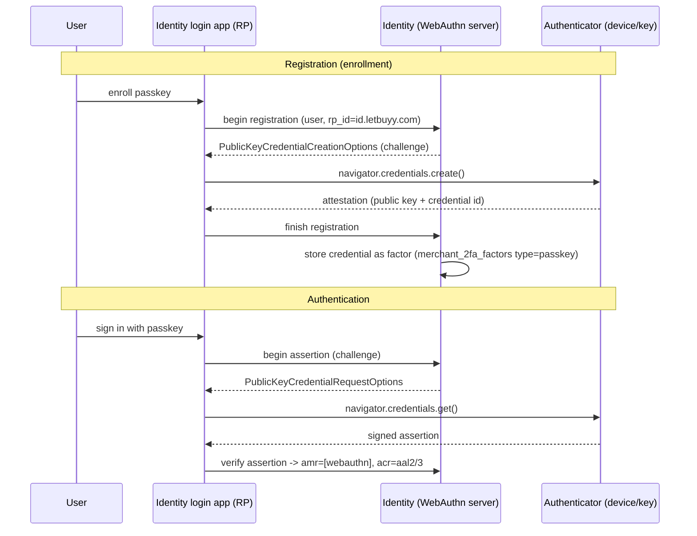
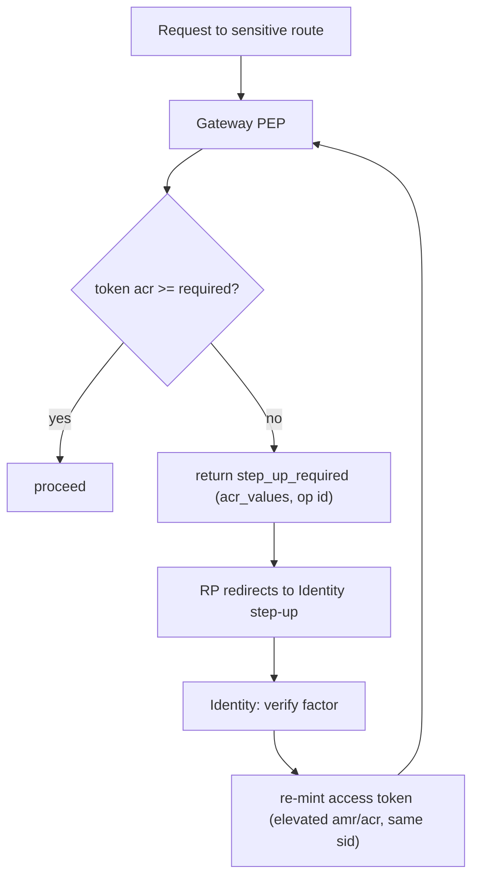

# AUTHENTICATOR_STRATEGY

**Phase 10 — MFA and Passkey Strategy**
Status date: 2026-06-08

> Designs TOTP, passkeys (WebAuthn), recovery codes, backup devices, and device trust, with distinct requirements for **merchant**, **admin**, and **customer** realms.

> **Grounding (important).** The schema scaffolding already exists. `merchant_2fa_factors` (migration `121_mobile_merchant_2fa_factors.sql`) supports **both `totp` and `passkey`** factor types, with `secret_ciphertext`, `recovery_code_hashes[]`, and `status` (pending/active/disabled), written by `services/api-gateway/src/routes/two-factor.ts`. **Enrollment exists; enforcement is UNKNOWN** (Audit §Session Lifecycle "2FA/MFA enforcement"). The work is therefore mostly **policy + enforcement + ceremony**, not net-new storage.

---

## 1. Authenticator inventory

| Authenticator | Standard | Phishing-resistant | Realm fit | Status today |
|---------------|----------|:------------------:|-----------|--------------|
| **Passkey (WebAuthn/FIDO2)** | W3C WebAuthn | **Yes** | all (primary for merchant/admin) | factor *type* allowed; **no ceremony** |
| **TOTP** | RFC 6238 | No | merchant/admin step-up | factor exists; console TOTP live (`verifyConsoleTotp`) |
| **Recovery codes** | — | No (one-time) | all (account recovery) | `recovery_code_hashes[]` column exists |
| **Magic-link / email OTP** | — | No | customer primary; bootstrap | exists in `verification_tokens` |
| **Backup device / trusted device** | — | n/a | merchant/customer | `devices` + `lb_device` exist; trust state new |
| **Hardware security key** | FIDO2 | **Yes** | admin (high-assurance) | new |

**Strategic stance:** **passkeys are the target primary factor** for merchant and admin (phishing-resistant, no shared secret, good UX). TOTP is the universally-available step-up. Email OTP/magic-link is the low-friction customer default. Recovery codes are the break-glass for all.

---

## 2. Assurance levels (acr)

| Level | Meaning | `amr` examples | Required for |
|-------|---------|----------------|--------------|
| **aal1** | single factor | `pwd`, `otp` (email), `magic` | customer browsing, low-risk merchant reads |
| **aal2** | two factors / one phishing-resistant | `pwd+totp`, `passkey` | merchant writes, app install, API-key issuance, admin baseline |
| **aal3** | hardware-backed, phishing-resistant | `webauthn` (hardware key), device-bound | admin sensitive ops, payout config, super-admin |

The gateway maps **sensitive operations → required `acr`**; if the token's `acr` is insufficient, it returns a **step-up challenge** (Identity re-prompts for the missing factor and re-mints the access token with elevated `amr`/`acr`). This is "step-up auth," not "log in again."

---

## 3. Per-realm requirements

### 3.1 Merchant realm
| Aspect | Policy |
|--------|--------|
| Baseline | Password or passkey (aal1) for sign-in |
| MFA enforcement | **Required (aal2)** to enroll within N days of first store creation; **mandatory** for: payout/bank config, staff/role management, API-key/M2M issuance, app install with write scopes, data export |
| Primary 2nd factor | **Passkey** (preferred) or TOTP |
| Recovery | 10 one-time recovery codes (hashed — column exists) + verified-email fallback with cooldown |
| Trusted device | After aal2, a device may be trusted for 30d to skip step-up on **low-risk** ops (never on payouts/staff) |
| Org policy | Org admins (new org model) can **mandate** MFA for all org members; enterprise can require passkey-only |

### 3.2 Admin realm
| Aspect | Policy |
|--------|--------|
| Baseline | Corporate SSO (preferred) or allowlist+magic-link |
| MFA enforcement | **Mandatory always** (today console already enforces MFA — Audit). Minimum aal2; **aal3 (hardware key/passkey) for super-admin + break-glass** |
| Primary 2nd factor | **Passkey/hardware key**; TOTP allowed as backup only |
| Recovery | Admin recovery is **operationally controlled** (security team re-provision), not self-service codes, to prevent social-engineering takeover |
| Trusted device | **No** trusted-device skip for admin sensitive ops; re-prompt frequently |
| Extra | IP allowlist + mandatory device registration; eliminate the static `platform-console@letbuyy.local` synthetic principal or constrain to read-only, non-PII ops |

### 3.3 Customer realm
| Aspect | Policy |
|--------|--------|
| Baseline | Email OTP / magic-link (passwordless-friendly) or password |
| MFA | **Optional, encouraged**; offered as passkey or TOTP. Never mandatory (conversion) |
| Step-up triggers | Risk-based: new device + high-value action (change email, view full order history, saved-card actions) → OTP/passkey challenge |
| Recovery | Email-based; rate-limited; account-lockout protections |
| Trusted device | Long trusted-device window (matches 90d session) |

---

## 4. Passkey (WebAuthn) design

| Decision | Choice |
|----------|--------|
| RP ID | `id.letbuyy.com` (single RP for all realms; realm carried in user handle) — passkeys live at the IdP, not per-app, so they work across all SSO apps |
| Resident keys / discoverable | Yes (usernameless sign-in) |
| User verification | required for aal2+ |
| Attestation | none/indirect for merchant/customer; **direct** acceptable for admin hardware keys |
| Storage | credential id + public key in factor registry (`secret_ciphertext` not needed for passkeys — public key only) |
| Multiple passkeys | encouraged (phone + laptop + hardware key) = backup devices |

---

## 5. TOTP design
- RFC 6238, 30s window, ±1 step skew, SHA-1/SHA-256.
- Secret encrypted at rest (`secret_ciphertext` — column exists).
- Enrolment QR + manual key; verify before activating (`status: pending → active`).
- Rate-limit verification; lock after repeated failures.
- Console TOTP already implemented (`verifyConsoleTotp`) — generalize the same engine to merchant realm.

## 6. Recovery codes
- 10 single-use codes, shown once, **stored hashed** (`recovery_code_hashes[]` exists).
- Consuming a code marks it used; regenerate invalidates the set.
- Using a recovery code raises a risk event (notify user, optionally force re-enroll a factor).

## 7. Backup devices & device trust
- A "trusted device" = a `devices` row marked trusted after a successful aal2 on that device.
- Trust window per realm (merchant 30d low-risk only; customer 90d; admin none for sensitive).
- Trust is **revocable** (device-revoke kills trust + sessions — Phase 8 §5).
- Risk engine inputs: device recency, IP/geo velocity, Turnstile signal, factor strength → decide step-up dynamically.

---

## 8. Enforcement architecture (the missing piece)

The **policy map (operation → required acr)** lives at the gateway/commerce core (it knows which operations are sensitive). Identity provides the *verification* and *token re-minting*. This cleanly splits "what needs MFA" (commerce policy) from "how MFA is performed" (identity) — consistent with the Phase 2/3 boundary.

---

## 9. Acceptance criteria

- Merchant MFA **enforced** (closes Audit's "enforcement UNKNOWN") for the defined sensitive operations; passkey enrollment available.
- Admin MFA mandatory with aal3 for super-admin/break-glass; static synthetic console principal removed or constrained.
- Passkey registration + authentication ceremonies exist (closes Phase 1 UNKNOWN: passkeys); reuse `merchant_2fa_factors` storage.
- Recovery codes hashed; device trust revocable; step-up (not full re-login) for elevation.
- Customer MFA optional + risk-based step-up; no conversion-killing mandates.

Phase 11 threat-models the whole design.
