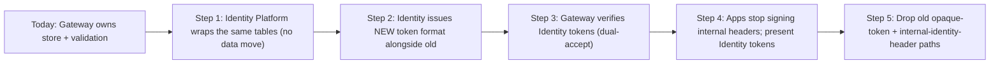
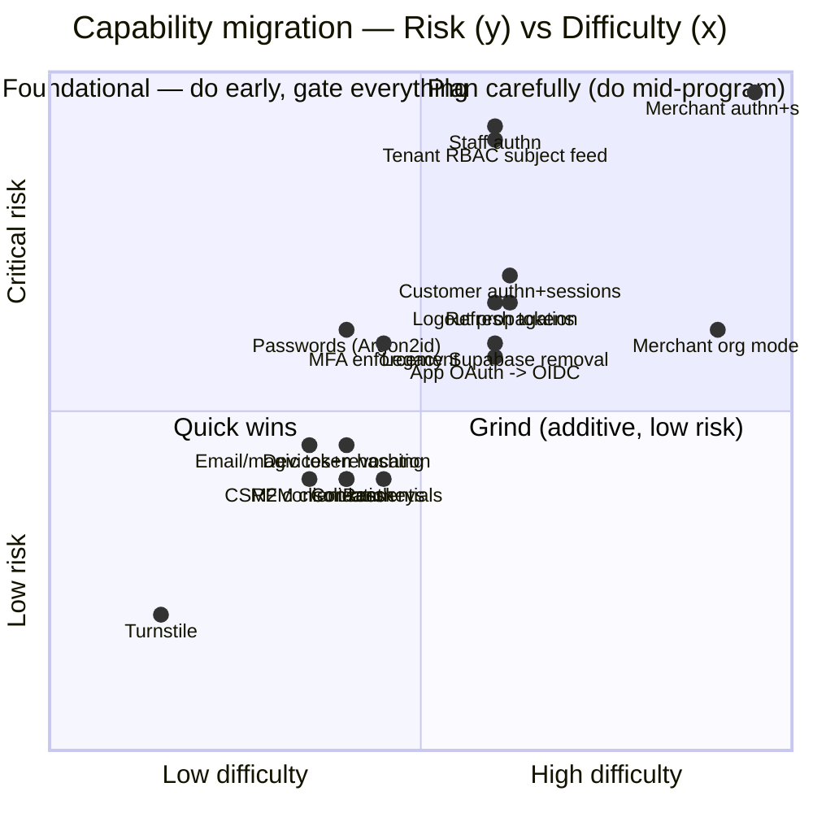

# AUTHORITY_MATRIX

**Phase 2 — Authority Analysis**
Status date: 2026-06-08

> For each identity capability: **Current Owner** (who actually owns it today, by evidence), **Future Owner** (target state), **Migration Difficulty**, and **Risk Level**. "Owner" = the component that holds the source of truth and makes the authoritative decision, not the component that renders the UI.

**Legend.**
Difficulty: **S** (mechanical/config), **M** (new code, contained), **L** (cross-app coordination), **XL** (data migration + dual-run + cutover).
Risk if mishandled: 🟢 low · 🟡 medium · 🟠 high · 🔴 critical (auth bypass / lockout / tenant breach).

---

## 1. Capability authority matrix

| # | Capability | Current Owner (evidence) | Future Owner | Difficulty | Risk |
|---|------------|--------------------------|--------------|:----------:|:----:|
| 1 | **Authentication (merchant)** | API Gateway custom-auth routes (`services/api-gateway/src/routes/auth.ts` `/auth/custom/users/authenticate`); store `users_custom` | **Identity Platform** (authn service) | XL | 🔴 |
| 2 | **Authentication (customer)** | Gateway storefront routes verify `customer_credentials`; storefront mints JWT | **Identity Platform – Customer realm** | L | 🟠 |
| 3 | **Authentication (staff/admin)** | Platform Console (`console-auth-server.ts`) + gateway allowlist/employees | **Identity Platform – Admin realm** (broker to IdP/SSO) | L | 🔴 |
| 4 | **Authorization (tenant/store RBAC)** | Gateway `rbac.ts` + `tenant-context.ts` over `site_memberships/site_roles/site_role_permissions` | **Stays in Commerce core**; Identity supplies verified subject + org/role claims | L | 🔴 |
| 5 | **Authorization (staff RBAC)** | Gateway `requireRoleCategory/requirePermission/requireSuperAdmin` over `employees` | **Commerce/Ops core** consumes Admin-realm claims; PEP stays at gateway | M | 🔴 |
| 6 | **Sessions (merchant)** | Gateway `sessions` table; `createSession/validateSession/destroySession` | **Identity Platform** (server-side session store + refresh) | XL | 🔴 |
| 7 | **Sessions (customer)** | Stateless JWT, storefront + gateway (two issuers/TTLs) | **Identity Platform** (single issuer, revocable) | L | 🟠 |
| 8 | **Sessions (console)** | `lb_console_session` signed token (stateless) | **Identity Platform** (Admin realm, revocable) | M | 🟠 |
| 9 | **MFA / 2FA** | Schema `merchant_2fa_factors` + `two-factor.ts` route; **enforcement UNKNOWN** | **Identity Platform** (step-up engine, policy-driven) | M | 🟠 |
| 10 | **Passkeys (WebAuthn)** | Factor *type* allowed in schema; **no ceremony exists** | **Identity Platform** (greenfield WebAuthn) | M | 🟡 |
| 11 | **Passwords** | Gateway `users/set-password` hashes; `customer_credentials` | **Identity Platform** (Argon2id, per-realm policy) | M | 🟠 |
| 12 | **Email verification** | Gateway `verification_tokens` (type `email_verify`), raw token text | **Identity Platform** (hashed single-use tokens) | M | 🟡 |
| 13 | **Magic links** | Merchant: `verification_tokens` type `magic_link`; Console: `createLetbuyyPlatformMagicLinkToken()` | **Identity Platform** (one provider, hashed) | M | 🟡 |
| 14 | **Devices** | Gateway `devices` `get-or-create`; cookie `lb_device`; **no revocation** | **Identity Platform** (device registry + trust + revoke) | M | 🟡 |
| 15 | **Refresh tokens** | **None for merchant/customer** (opaque 30-day token, no rotation). App OAuth has refresh rotation (`billing-oauth-routes.ts`) | **Identity Platform** (rotating refresh, reuse detection) | L | 🟠 |
| 16 | **Consent** | **None** (app OAuth has scopes, no consent record/UI) | **Identity Platform** (consent registry + screen) | M | 🟡 |
| 17 | **Logout** | Per-app cookie clear + gateway `destroySession` (merchant only); customer/console = cookie clear, no server revoke | **Identity Platform** (global + per-client logout, back-channel) | L | 🟠 |
| 18 | **Store membership** | Gateway `verifySiteOwnership()` + `site_memberships` | **Stays in Commerce core**; exposed to Identity as claim source | M | 🟠 |
| 19 | **Merchant membership / org** | **Does not exist** (`organization_id` UNKNOWN) | **New: Identity Platform org model** | XL | 🟠 |
| 20 | **Customer identity** | Gateway `store_customers` (store-scoped) | **Identity Platform – Customer realm** (store-scoped, optional global linking) | L | 🟠 |
| 21 | **App / 3rd-party identity (OAuth)** | Gateway app-store OAuth issuer + `app_installations` | **Identity Platform** (OAuth2/OIDC provider) | L | 🟠 |
| 22 | **M2M / API keys** | Gateway `site_api_clients` (`key_hash`, `scopes[]`) | **Identity Platform** (client-credentials grant) | M | 🟡 |
| 23 | **Account linking** | Partial: `lb_accounts` JWT account *switcher*, no real linking | **Identity Platform** (verified account linking) | M | 🟡 |
| 24 | **SSO across merchant apps** | Implicit via shared `.letbuyy.store` `lb_session` cookie | **Identity Platform** (OIDC SSO broker) | L | 🟠 |
| 25 | **Federation (cross-domain)** | `createCustomerFederationToken()` single-use primitive (customer only) | **Identity Platform** (generalized, all realms) | M | 🟡 |
| 26 | **CSRF protection** | Double-submit cookie (`letbuyy_csrf` + legacy `lb_csrf`), 3 divergent setters | **Identity Platform** session design (SameSite + token-bound) | M | 🟡 |
| 27 | **Turnstile / bot defense** | Gateway `verifyTurnstileToken()` on auth routes | **Identity Platform** (risk engine input) | S | 🟢 |
| 28 | **Legacy Supabase Auth** | Gateway `/auth/signin` etc. return raw Supabase tokens | **Decommissioned** | L | 🟠 |

---

## 2. Why each high-risk item is rated 🔴/🟠

- **#1 / #6 Merchant authn + sessions (🔴, XL).** This is the load-bearing wall. `sessions` is the only server-revocable session and is read on the hot path of *every* merchant request via `getInternalSessionAuthContext()`. Moving ownership requires dual-running the old opaque-token validation and the new Identity-issued tokens, with no window where a valid merchant is logged out or an invalid one is admitted.
- **#3 Staff authn (🔴, L).** Compromise = platform-wide admin takeover. Currently protected by allowlist + magic link + TOTP, but the gateway also has a static `platform-console@letbuyy.local` principal for read-only ops — a synthetic identity that must not widen.
- **#4 / #5 Authorization (🔴).** A flaw here is tenant data crossover. Authorization must **stay in the commerce core** (it needs commerce data — entitlements, ownership). Identity's job is to deliver a *trustworthy, verifiable subject + role/org claims*; it must not absorb commerce-coupled authz logic.
- **#19 Merchant org (🟠, XL).** It does not exist today. Introducing an org layer retroactively over `site_id`-keyed data is a data-modelling migration (one user → many sites → org). High effort, but additive (low chance of breaking existing flows if done as an overlay).
- **#28 Legacy Supabase Auth (🟠, L).** Returns raw `access_token`/`refresh_token` in JSON (Audit §Security Findings). Removing it is required, but other call-sites may depend on it; needs inventory before deletion.

---

## 3. Authority transition pattern (applies to #1, #2, #6, #7, #8)

Every stateful-session capability follows the same safe transition shape. Documented once here, referenced by the Migration Plan (Phase 13):

The key safety property: **ownership of the *decision* moves before ownership of the *data*.** Identity Platform begins as a façade over the gateway's existing tables, then the tables migrate underneath it. This avoids a big-bang data migration on the critical path.

---

## 4. Capabilities that must NOT move to Identity

A principal-level matrix is as much about boundaries as transfers. These explicitly stay where they are:

| Capability | Stays with | Reason |
|------------|-----------|--------|
| Tenant/store RBAC **policy** (#4) | Commerce core (gateway) | Needs commerce data (ownership, entitlements, plan); coupling it into Identity creates a distributed monolith |
| Store membership records (#18) | Commerce core (`sites`/`site_memberships`) | Commerce-owned data; Identity *reads* it to mint org/role claims |
| Policy **enforcement point** (PEP) | API Gateway | Gateway stays the place where tokens are verified and policy is applied per-route |
| Turnstile/bot keys (#27) | Edge/gateway | Edge concern; feeds Identity's risk signal but isn't identity state |

The clean split: **Identity Platform = authentication + token issuance + subject/claims authority (PDP for *identity*). Commerce core = authorization policy + enforcement (PDP/PEP for *resources*).** Phase 3 formalizes this boundary.

---

## 5. Difficulty × Risk heat map (sequencing signal)

**Sequencing reading.** Quadrant-2 (foundational, high-risk) items — merchant authn/sessions, staff authn, the tenant-RBAC subject feed — must be done **first and behind feature flags with dual-run**, because everything else depends on a trustworthy subject. Quadrant-4 (additive, lower-risk) — merchant org, MFA enforcement, passkeys, consent, M2M — can proceed in parallel once the subject is trustworthy. Quick wins (Turnstile, token hashing, CSRF consolidation) can land immediately and de-risk the program.

---

## 6. Ownership summary (one line)

> **Move to Identity Platform:** all authentication, all session issuance/validation, MFA/passkeys/passwords/tokens, devices, consent, account linking, OAuth/OIDC, M2M, federation, logout orchestration.
> **Keep in Commerce core (gateway):** resource authorization policy + enforcement, store-membership data, plan/entitlement data.
> **Delete:** legacy Supabase Auth bridge, legacy `lb_csrf`, raw-token JSON responses, app-asserted internal identity headers.

Phase 3 designs the target Identity Platform that receives these capabilities.
