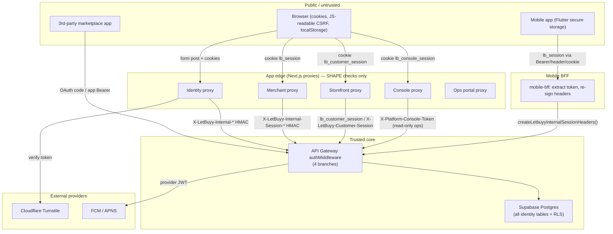
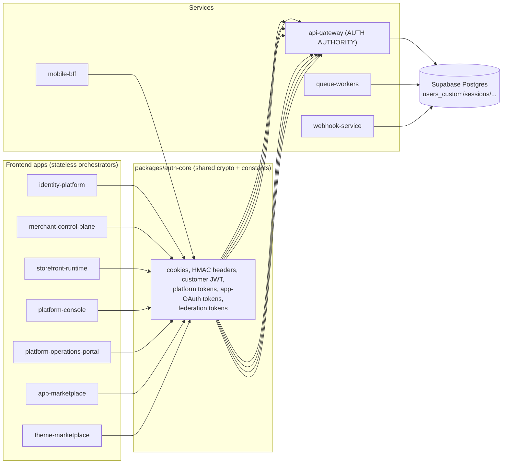

# AUTH_SYSTEM_MAP

**Phase 1 — System Understanding**
Status date: 2026-06-08
Posture: North-star + bridged path (evidence-anchored current-state model)

> **Evidence rule.** Every claim in this document traces to `AUTH_AUDIT_REPORT.md`, `CURRENT_AUTH_ARCHITECTURE.md` (both in `docs/auth/2026-06-08-auth-session-sso-cookie-architecture/`), or a directly-read repository path. Nothing undocumented is asserted as fact; gaps are labelled **UNKNOWN** exactly as the audit labels them. Where this map adds detail beyond the two audit files, the source file/symbol is named inline.

---

## 0. Executive model in one paragraph

LetBuyy has **no central identity service today**. It has an *Identity Platform app* (`apps/identity-platform`) that renders auth UIs and orchestrates flows, but the **real authentication authority is the API Gateway** (`services/api-gateway`), which owns the `users_custom` and `sessions` tables and mints/validates every merchant session. Each frontend app reads a cookie, then **re-asserts the caller's identity to the gateway as HMAC-signed headers** (`X-LetBuyy-Internal-Session-*` or `X-LetBuyy-Internal-User-ID/...`). There are **three parallel session systems** (merchant opaque token, customer JWT, console signed token), **two parallel identity stores** (`users` legacy + `users_custom`), **two parallel CSRF cookies** (`letbuyy_csrf` + legacy `lb_csrf`), and **two parallel server auth systems** in the gateway (custom sessions + legacy Supabase Auth). The only OAuth2-shaped surface is the **App marketplace OAuth** issuer. There is **no OIDC, no SSO broker, no unified consent, and no merchant-organization layer** (`organization_id`/`tenant_id` are UNKNOWN; tenancy is keyed on `site_id`).

---

## 1. Authentication surfaces

Source: `AUTH_AUDIT_REPORT.md` §"Authentication Surface Inventory"; symbols confirmed in `packages/auth-core/src/index.ts`.

| # | Surface | Runtime | Auth type | Identity store | Session artifact | Authority that *validates* |
|---|---------|---------|-----------|----------------|------------------|----------------------------|
| 1 | **Marketing site** | `apps/marketing-site` | None (client preference storage only) | — | — | — |
| 2 | **Merchant control plane** | `apps/merchant-control-plane` | Cookie shape check at proxy + gateway internal-session validation | `users_custom` | `lb_session` (opaque) | API Gateway |
| 3 | **Identity Platform** | `apps/identity-platform` | Owner-of-record for merchant login/signup/OTP/reset/store-create/switch/logout | `users_custom` | `lb_session`, `lb_accounts`, `lb_device`, `lb_password_set_intent` | API Gateway (it calls gateway custom-auth routes) |
| 4 | **Storefront runtime** | `apps/storefront-runtime` | Customer JWT (host-only) + gate/preview signed cookies | `store_customers` + `customer_credentials` | `lb_customer_session` (JWT) | auth-core verify + gateway customer middleware |
| 5 | **Checkout** | `services/api-gateway` (hosted) + storefront UI | Signed handoff (HMAC), no confirmed customer-login requirement | `carts`, `checkout_sessions` | `checkout_sessions` row state | API Gateway (HMAC of handoff) |
| 6 | **Platform console (admin/staff)** | `apps/platform-console` | Email allowlist → magic-link → TOTP MFA | `super_admin_allowlist`, `employees` | `lb_console_session` (signed token) | Console server helpers + gateway platform-token branch |
| 7 | **Platform operations portal** | `apps/platform-operations-portal` | Reuses merchant `lb_session` shape | `users_custom` | `lb_session` | API Gateway (as merchant) |
| 8 | **Internal service APIs** | `services/api-gateway` | HMAC-signed internal app + HMAC-signed internal session headers | `users_custom`, `sessions` | none at the wire (header trust) | API Gateway |
| 9 | **Background workers** | `services/queue-workers`, `services/webhook-service` | Supabase service-role + provider JWTs (FCM/APNS) | service-role | none (no browser session) | Supabase / external providers |
| 10 | **Mobile merchant app** | `apps/mobile/merchant-app` (Flutter) | `lb_session` in secure storage → Mobile BFF re-signs internal headers | `users_custom` | `lb_session` | Mobile BFF → API Gateway |
| 11 | **App marketplace OAuth (3rd-party apps)** | `services/api-gateway` app-store routes | OAuth2 authorization-code + app-scoped Bearer (custom) | `app_installations` | App access/refresh tokens (JWT + stored hash) | API Gateway `appAuthMiddleware` |
| 12 | **Merchant API clients (M2M)** | `services/api-gateway` | Per-site API key (`key_hash`, `scopes[]`) | `site_api_clients` | API key | API Gateway |
| 13 | **CLI tools** | — | **UNKNOWN** (no source recorded) | — | — | — |

**Reading of the table.** Surfaces 2, 3, 7, 8, 10 are all the *same* merchant identity (`users_custom` + `sessions`) reached through different front doors. Surfaces 4/5 are the customer identity. Surface 6 is the staff identity. Surfaces 11/12 are non-human (app + API-key) identities. This is the realm structure that already exists implicitly and that Phase 4 will formalize.

---

## 2. Session surfaces

Source: `CURRENT_AUTH_ARCHITECTURE.md` §"Session Lifecycle"; TTL constants read directly from `packages/auth-core/src/index.ts` and `packages/auth-core/src/customer-session.ts`.

| Session | Type | Where stored | Lifetime (source) | Created by | Validated by | Revocation |
|---------|------|--------------|-------------------|------------|--------------|------------|
| **Merchant session** | Opaque random token row | `sessions` table; cookie `lb_session` | `AUTH_SESSION_DURATION_MS = 30 days` (`auth-core/src/index.ts:127`) | gateway `POST /auth/custom/sessions/create` | gateway `getInternalSessionAuthContext()` + `GET /auth/custom/session` | per-session (`destroySession`) and all-sessions (`destroyAllUserSessions`) |
| **Customer session (host-only)** | JWT | cookie `lb_customer_session` | `LETBUYY_CUSTOMER_SESSION_TTL_SECONDS = 7 days` (`auth-core/src/index.ts:131`) | storefront `createSession()` / `createHostOnlyShopperIdentityProvider()` | `verifyCustomerSessionToken()` | cookie clear only (stateless JWT) |
| **Customer session (gateway)** | JWT | cookie/header `lb_customer_session` / `X-LetBuyy-Customer-Session` | `LETBUYY_CUSTOMER_GATEWAY_SESSION_TTL_SECONDS = 30 min` (`auth-core/src/customer-session.ts:4`) | gateway `issueCustomerSession()` | gateway `verifyGatewayCustomerSession()` | cookie clear only (stateless JWT) |
| **Customer federation token** | Single-use JWT | query/redemption (not a cookie) | `LETBUYY_CUSTOMER_FEDERATION_TTL_SECONDS = 15 min` (`auth-core/src/index.ts:135`) | `createCustomerFederationToken()` (`auth-core/src/index.ts:806`) | `verifyCustomerFederationToken()` / `redeemCustomerFederationToken()` (`:831`,`:856`) | replay store → status `replayed` |
| **Platform console session** | Signed token | cookie `lb_console_session` | `LETBUYY_PLATFORM_SESSION_TTL_SECONDS = 8 hours` (`auth-core/src/index.ts:133`) | console `setConsoleSessionCookie()` | `verifyLetbuyyPlatformSessionToken()` | cookie clear only |
| **Platform magic link** | Signed token | query param | `LETBUYY_PLATFORM_MAGIC_LINK_TTL_SECONDS = 15 min` (`auth-core/src/index.ts:134`) | `createLetbuyyPlatformMagicLinkToken()` | `verifyLetbuyyPlatformMagicLinkToken()` | one-time use via callback |
| **App OAuth access token** | JWT | HTTP/Bearer | `LETBUYY_APP_ACCESS_TOKEN_TTL_SECONDS = 1 hour` (`auth-core/src/index.ts:307`) | `createAppScopedAccessToken()` | `verifyAppScopedAccessToken()` + stored hash | hash revocation in `app_installations.config` |
| **App OAuth authorization code** | JWT | query param | `LETBUYY_APP_AUTHORIZATION_CODE_TTL_SECONDS = 15 min` (`auth-core/src/index.ts:310`) | `createAppAuthorizationCode()` | `verifyAppAuthorizationCode()` | one-time exchange |
| **Internal session headers** | HMAC over headers | request headers | `LETBUYY_INTERNAL_AUTH_MAX_AGE_MS = 5 min` (`auth-core/src/index.ts:132`) | `createLetbuyyInternalSessionHeaders()` (`:602`) | `verifyLetbuyyInternalSessionHeaders()` (`:666`) | timestamp window only |
| **Supabase Bearer (legacy)** | Supabase JWT | `Authorization: Bearer` | Supabase default | Supabase Auth | `supabase.auth.getUser()` | Supabase |

**Critical observation.** The merchant session is the only **stateful/server-revocable** session. Every customer and console artifact is a **stateless JWT or signed token** that cannot be revoked before expiry except by clearing the cookie on the device that holds it — there is **no customer/console server-side revocation list**. This is a target-state requirement (Phase 8).

---

## 3. Cookie surfaces

Source: `AUTH_AUDIT_REPORT.md` §"Cookie Attribute Audit"; `CURRENT_AUTH_ARCHITECTURE.md` §"Current Storage Locations".

| Cookie | Domain | HttpOnly | Secure | SameSite | TTL | Owner runtime | Notes / risk |
|--------|--------|----------|--------|----------|-----|---------------|--------------|
| `lb_session` | `.letbuyy.store` (prod) / undefined | true | true | **lax** | 30 d | Identity Platform | Domain-wide merchant cookie; shared across all `*.letbuyy.store` apps |
| `lb_accounts` | `.letbuyy.store` (prod) | true | true | lax | 365 d | Identity account switcher | JWT list of saved accounts, 1-year |
| `lb_device` | `.letbuyy.store` (prod) | true | true | lax | 90 d | Identity device marker | Device correlation only |
| `lb_password_set_intent` | `.letbuyy.store` (prod) | true | true | strict | 15 m | Identity password creation | Short-lived intent |
| `letbuyy_csrf` | `.letbuyy.store` / none (proxy/gateway differ) | **false** (by design) | mixed | strict/lax (inconsistent) | 1 h | Identity + gateway customer routes | JS-readable double-submit token; **attributes inconsistent across 3 setters** |
| `lb_csrf` (legacy) | UNKNOWN | UNKNOWN | UNKNOWN | UNKNOWN | UNKNOWN | legacy reader | **Still accepted** by identity + gateway; debt |
| `lb_customer_session` | host-only (storefront) / no Domain (gateway) | true | mixed | lax | 7 d / 30 m | Storefront customer | Two different setters, two TTLs |
| `lb_console_session` | no Domain | true | prod-only | strict | 8 h | Platform console | MFA-gated |
| `__Host-lb_store_gate` | host-only | true | prod-only | lax | gate TTL | Storefront | Password-gate token |
| `__Host-lb_preview` | host-only | true | prod-only | lax | preview TTL | Storefront | Merchant theme preview |
| `lb_theme_preview_${subdomain}` | no Domain | true | prod-only | lax | 15 m | Storefront | Per-subdomain preview |

**Cookie risk hot-spots (evidence-backed):**

- `lb_session` is `SameSite=lax` on a **shared parent domain** `.letbuyy.store`, readable by every subdomain app. Any XSS on any `*.letbuyy.store` app, or any subdomain takeover, exposes the merchant session to the whole estate. (Audit §Cookie Attribute Audit + §Client-Side Auth Exposure.)
- `letbuyy_csrf` has **three setters with divergent attributes** (identity helper `Secure=true/SameSite=strict`, identity proxy `Secure=NODE_ENV/SameSite=strict`, gateway customer route `Secure always/SameSite=Lax`). Divergent CSRF cookies are a correctness and security smell. (Audit §Cookie Attribute Audit row `letbuyy_csrf`.)
- `lb_csrf` legacy acceptance is explicit debt and is covered by a test that *enforces* the legacy path (`services/api-gateway/src/__tests__/security.test.ts`). (Audit §Security Findings.)

---

## 4. Identity stores (sources of truth)

Source: `database/supabase/migrations/000_baseline.sql` (read directly), `078_password_set_intents.sql`, `121_mobile_merchant_2fa_factors.sql`.

| Store (table) | Holds | Real authority? | Notes |
|---------------|-------|-----------------|-------|
| `users_custom` | merchant identity: `email`, `email_verified`, `password_hash`, `auth_provider='email'`, `full_name`, `avatar_url` | **Yes** — merchant credential of record | `auth_provider` default `email` implies federation was anticipated but only email exists today |
| `users` (legacy) | profile: `display_name`, `subscription_tier`, `saved_accounts jsonb` | Partial / profile | Coexists with `users_custom`; **dual store** debt |
| `sessions` | opaque merchant session tokens, `expires_at`, `last_active` | **Yes** — merchant session authority | Only server-revocable session in the system |
| `devices` | merchant device records | Yes | `get-or-create` per login |
| `verification_tokens` | OTP/magic/reset tokens, `type`, `used`, **raw `token` text** | Yes | Tokens stored **in plaintext** — see Threat Model |
| `auth_password_set_intents` | password-creation intents | Yes | Backs `lb_password_set_intent` |
| `merchant_2fa_factors` | TOTP + **passkey** factors, `secret_ciphertext`, `recovery_code_hashes[]`, status | Yes (enrollment) | **Scaffolding exists; enforcement UNKNOWN** |
| `store_customers` | per-store customer identity | **Yes** — customer identity | Store-scoped |
| `customer_credentials` | customer password material | Yes | Store-scoped |
| `customer_addresses`, `customer_activity_log`, `customer_wishlists` | customer data | Yes (data) | — |
| `employees`, `employee_roles`, `employee_permissions`, `employee_invites` | staff identity + RBAC | **Yes** — staff authority | — |
| `super_admin_allowlist` | super-admin emails | Yes | Allowlist-based privilege |
| `sites` | tenant/store record | **Yes** — tenant authority | `site_id` is canonical tenant key |
| `site_memberships`, `site_roles`, `site_role_permissions` | merchant-org RBAC | Yes | Per-site membership/role/permission |
| `site_api_clients` | per-site M2M API keys: `key_hash`, `scopes[]`, status | Yes | Merchant machine-to-machine surface |
| `app_installations` | app OAuth grants + `config.oauth.access_token_hash`/`refresh` | Yes | App identity + token hashes |
| `checkout_sessions`, `carts` | checkout state | Yes | Checkout handoff |
| Supabase Auth (`auth.users`) | legacy Supabase identities | Partial | Still reachable via gateway Bearer branch |

**Sources of truth, ranked.** The **API Gateway + Supabase Postgres** is the single backing store for *all* of the above. The Identity Platform app holds **no durable identity state of its own** — it is a stateless orchestrator over gateway routes (Audit §Supabase Integration Points: "Identity Platform … Calls gateway, not direct Supabase"). This is structurally important: **promoting the Identity Platform to the auth authority means moving ownership of these tables out of the gateway, not inventing a new store.**

---

## 5. Trust boundaries

Source: `AUTH_AUDIT_REPORT.md` §"Trust Boundary Mapping"; gateway branch logic confirmed in `services/api-gateway/src/middleware/auth.ts`.

| Boundary | What is trusted across it | How it is enforced | Weakness |
|----------|---------------------------|--------------------|----------|
| Browser → app edge | cookie presence + **shape** only | `verifyLetbuyySessionCookieValue('merchant')` checks token *shape*, not validity | Edge cannot reject a well-shaped revoked token; real check deferred to gateway |
| App → Gateway (internal session) | app-asserted session token | `verifyLetbuyyInternalSessionHeaders()` HMAC + 5-min window | Gateway trusts the *app* to faithfully transcribe the cookie |
| App → Gateway (internal identity) | **app-asserted `user_id`, `email`, `store_id`** | `getInternalAuthContext()` HMAC over headers | **Any app holding the internal secret can assert any identity** — the central zero-trust gap (Phase 12) |
| Console → Gateway | platform-console token for read-only ops | `isReadOnlyPlatformConsoleOperationsRequest()` branch | Static synthetic principal `platform-console@letbuyy.local` |
| Mobile → BFF → Gateway | secure-storage token re-signed | BFF holds internal secret | BFF is a fully-trusted identity asserter |
| Gateway → Supabase | service-role (god mode) + user-scoped | service role bypasses RLS | Most routes run as service role; RLS is defense-in-depth, not primary |

**The defining property of the current trust model:** the gateway's security rests on a **single shared internal HMAC secret** (`getLetbuyyInternalAuthSecret()`, `auth-core/src/index.ts:447`). Possession of that secret = ability to assert *any* user or store identity. Every Next.js app server and the Mobile BFF hold it. This is a flat, secret-bearer trust model, not zero trust.

---

## 6. Mechanism inventory (by category required in the prompt)

### 6.1 Internal authentication mechanisms
- **Internal session headers** — `createLetbuyyInternalSessionHeaders()` / `verifyLetbuyyInternalSessionHeaders()` (`auth-core/src/index.ts:602,666`). Carries the opaque session token + HMAC + timestamp.
- **Internal identity headers** — `createLetbuyyInternalIdentityHeaders()` (`:632`) → gateway `getInternalAuthContext()`. Carries `user_id/email/store_id` + HMAC. **Identity is app-asserted.**
- **Internal app HMAC** — `verifyInternalAppRequest()` (`services/api-gateway/src/lib/internal-auth.ts`) gates `requireAccountsInternal()` custom-auth routes.
- **Platform-console token branch** — read-only ops principal in `authMiddleware()`.

### 6.2 External authentication mechanisms
- **Cloudflare Turnstile** — `verifyTurnstileToken()` (`gateway/src/middleware/security.ts`) on login/signup/reset.
- **Supabase Auth (legacy)** — `/auth/signin`, `/auth/signup`, OTP, reset; returns raw Supabase `access_token`/`refresh_token` in JSON (Audit §Security Findings).
- **FCM OAuth / APNS JWT** — push providers in `queue-workers/src/push-dispatcher.ts`.

### 6.3 Mobile authentication
- Flutter app `store_auth_service.dart` `signInWithPassword()` → persists `lb_session`, `lb_session_user`, `lb_session_expires_at` to `FlutterSecureStorage`.
- Transport to **Mobile BFF** via Bearer / `X-LetBuyy-Session-Token` / cookie → BFF re-signs internal session headers to gateway. (Audit surface 10 + boundary table.)

### 6.4 Customer authentication
- Storefront `POST /api/customer/login` → `verifyCustomerPassword()` against gateway → `createSession()` sets host-only `lb_customer_session` JWT.
- Gateway customer middleware `requireCustomerSession()` / `optionalCustomerSession()` accepts cookie or `X-LetBuyy-Customer-Session`.
- Cross-domain handoff exists via **customer federation token** (single-use, replay-protected).

### 6.5 Merchant authentication
- Identity Platform routes (`login`, `signup`, `verify-otp`, `verify`, `set-password`, `reset-password`, `create-store`, `switch`, `logout`) → gateway custom-auth routes → `users_custom` + `sessions`.
- Account switching via `lb_accounts` JWT + `POST /api/auth/switch` (destroy + create session).

### 6.6 Admin / staff authentication
- Console: email allowlist (`isConsoleEmailAllowed()`) → magic-link callback (`mfaVerified:false`) → TOTP (`verifyConsoleTotp()`, `mfaVerified:true`) → `lb_console_session`.
- Gateway staff RBAC: `requireRoleCategory('ops')`, `requireSuperAdmin()`, `requirePermission()` over `employees` + `super_admin_allowlist` + break-glass grants.

### 6.7 App OAuth authentication
- `createAppAuthorizationCode()` → `createAppScopedAccessToken()` (iss `letbuyy-app-platform`, aud `letbuyy-commerce-api`, scopes), refresh rotation, stored token hashes in `app_installations.config.oauth`. Validated by `appAuthMiddleware()`. **This is the most OIDC-ready primitive in the system.**

---

## 7. Dependency graph (auth runtime → backing authority)

**Single points of failure / coupling:**
1. `packages/auth-core` is imported by **every** app and service — it is already the de-facto identity SDK. (This is good news for Phase 14: the seam exists.)
2. The **API Gateway** is on the critical path for every authenticated request in the estate.
3. One shared **internal HMAC secret** underpins all app→gateway trust.

---

## 8. Ownership graph (who owns each capability *today*)

```mermaid
flowchart TB
  GW["API GATEWAY"] --> OWNS1["Merchant credential verify"]
  GW --> OWNS2["Merchant session create/validate/destroy"]
  GW --> OWNS3["Verification tokens (OTP/magic/reset)"]
  GW --> OWNS4["Password set/reset"]
  GW --> OWNS5["Customer credential verify"]
  GW --> OWNS6["App OAuth issue/verify"]
  GW --> OWNS7["RBAC (site + staff)"]
  GW --> OWNS8["Legacy Supabase Auth bridge"]

  IDP["IDENTITY PLATFORM app"] --> O9["Auth UI + flow orchestration"]
  IDP --> O10["Cookie set/clear (merchant)"]
  IDP --> O11["Account switcher (lb_accounts)"]

  SF["STOREFRONT"] --> O12["Customer cookie set/clear"]
  SF --> O13["Store gate / preview"]

  PC["PLATFORM CONSOLE"] --> O14["Console session + MFA"]

  AC["auth-core"] --> O15["All token crypto + cookie constants"]
  MB["MOBILE BFF"] --> O16["Mobile token → internal headers"]
```

**The ownership inversion problem.** The component *named* "Identity Platform" owns only **UI + cookie plumbing**; the component *named* "API Gateway" owns **all identity logic and data**. The transformation (Phase 3) inverts this: identity logic and data move to a real Identity Platform service, and the gateway becomes a **pure token verifier / policy enforcement point**.

---

## 9. Sources of truth — consolidated register

| Domain | Source of truth (today) | Should-be owner (preview of Phase 2/3) |
|--------|-------------------------|----------------------------------------|
| Merchant credential | `users_custom` (gateway) | Identity Platform service |
| Merchant session | `sessions` (gateway) | Identity Platform service |
| Customer credential | `customer_credentials` (gateway) | Identity Platform (customer realm) |
| Customer session | stateless JWT (storefront + gateway) | Identity Platform (server-revocable) |
| Staff identity + RBAC | `employees`/`super_admin_allowlist` (gateway) | Identity Platform (admin realm) + gateway PEP |
| Tenant (store) | `sites` + `site_memberships` (gateway) | Commerce core (stays) — Identity consumes via claims |
| Merchant org | **none** (`organization_id` UNKNOWN) | **new** org model in Identity Platform |
| App identity / OAuth | `app_installations` (gateway) | Identity Platform OIDC/OAuth provider |
| M2M API keys | `site_api_clients` (gateway) | Identity Platform (client-credentials) |
| Device / MFA factors | `devices`, `merchant_2fa_factors` (gateway) | Identity Platform |
| CSRF | double-submit cookie (2 names) | Identity Platform session design removes need |

---

## 10. Gaps and UNKNOWNs carried forward (must not be silently "designed away")

These are the audit's explicit UNKNOWNs. The transformation must treat each as a **decision to make**, not a fact to assume:

1. **Merchant MFA enforcement** — factors table + `two-factor.ts` route exist; *enforcement* path is UNKNOWN. (Audit §Session Lifecycle "2FA/MFA enforcement".)
2. **Session refresh/renewal** — UNKNOWN beyond `last_active` bump. (Audit §Session Lifecycle.)
3. **Device revocation** — no endpoint recorded. (Audit §Session Lifecycle.)
4. **Privilege-change session rotation** — UNKNOWN. (Audit §Session Lifecycle.)
5. **Checkout customer-login requirement** — UNKNOWN. (Audit §Checkout flow.)
6. **CLI auth** — UNKNOWN. (Audit surface 13.)
7. **`organization_id` / `tenant_id`** — no merchant-org/tenant flow recorded; tenancy is `site_id`-only. (Audit §Multi-Tenant Security.)
8. **Consent** — no consent store/flow exists anywhere (app OAuth has scopes but no recorded consent UI/record).
9. **Passkeys** — factor *type* allowed in schema, no registration/auth ceremony recorded.

---

## 11. Handoff to Phase 2

The single most important structural finding for everything that follows:

> **The "Identity Platform" is a UI shell; the "API Gateway" is the identity authority. There are 3 session systems, 2 identity stores, 2 CSRF cookies, and 2 server-auth systems, all unified only by one shared HMAC secret and one Postgres database. There is no OIDC, no SSO broker, no consent, and no merchant-org layer.**

Phase 2 (`AUTHORITY_MATRIX.md`) takes each capability surfaced here and assigns current owner, future owner, migration difficulty, and risk.
