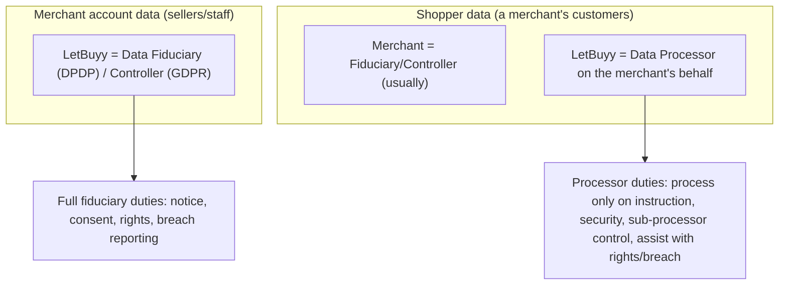
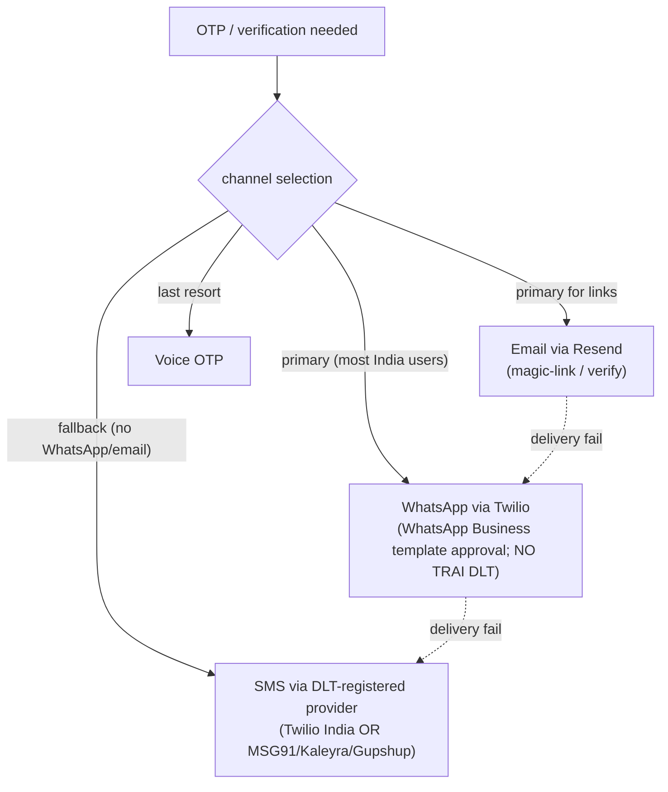
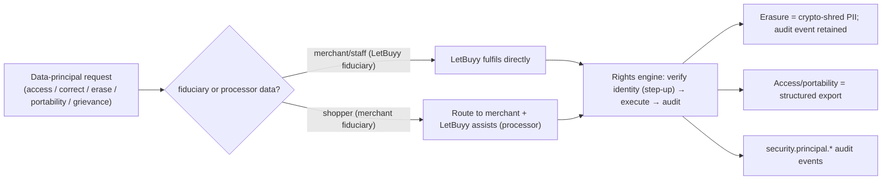

# COMPLIANCE_ARCHITECTURE

**Phase 17 — Document 4 of 5 (DPDP / GDPR / SOC2 / SMS DLT / Data Residency)**
Status date: 2026-06-08
Status: Proposed (implementation-ready architecture; no code). Closes readiness findings **C-4 (India OTP/residency), G-3**.

> **Mandate.** Make the Identity Platform compliant-by-design: India's **DPDP Act 2023**, **GDPR** (current/future EU shoppers), **SOC 2** readiness, India **SMS DLT** for OTP, and **data residency**.

> ⚠️ **Not legal advice.** This is architecture and control design. Regulatory interpretations (especially DPDP rules, still maturing in 2026, and the fiduciary/processor allocation) **must be reviewed by qualified counsel / a DPO** before implementation. Where the law is unsettled, this document flags the decision rather than asserting a legal conclusion.

> **Grounding.** India-first (`sites.currency='INR'`, `locale='en-IN'`, Razorpay). Providers: **email = Resend (US-based processor)**, **messaging = Twilio WhatsApp** (creds `SKIP_NEEDS_HUMAN`, not yet configured), **no SMS/DLT integration exists**. Data on **Supabase** (`*.supabase.co` — region **unconfirmed**; must verify `ap-south-1`).

---

## 1. The compliance model: who is fiduciary vs processor (the B2B2C split)

The single most important compliance decision, because it dictates obligations:

| Data | LetBuyy role | Key obligation |
|------|--------------|----------------|
| Merchant/staff identity (`users_custom`, `employees`) | **Fiduciary / Controller** | full duties: notice, consent, DSAR/rights, retention, breach reporting |
| Shopper identity (`store_customers`) | **Processor** (for the merchant fiduciary) — typically | process on instruction; security; assist merchant with rights/erasure; data-processing agreement (DPA) with each merchant |
| Platform telemetry/audit | Fiduciary (own security records) | retention + protection |

> **Decision CMP-1:** ratify the fiduciary/processor allocation with counsel. It determines whether *LetBuyy* or the *merchant* answers a shopper's erasure request — and the Identity Platform must implement **both** paths (merchant-initiated and platform-assisted). The data model's per-store scoping (`store_customers`, customer-realm principals) already supports this separation.

---

## 2. DPDP Act 2023 (India) — control mapping

| DPDP requirement | Identity Platform control | Where |
|------------------|---------------------------|-------|
| **Notice + consent** (clear, itemized, withdrawable) | consent capture at signup/login; consent records; withdrawal flow | consent ledger + `oauth_grants` (`IDENTITY_DATA_MODEL` §5) |
| **Consent Manager** interoperability (DPDP construct) | consent records structured for export/portability to a registered Consent Manager | consent ledger (forward-compatible) |
| **Data principal rights** (access, correction, erasure, grievance, nominee) | self-service DSAR + erasure; grievance contact; nominee field | rights workflow (§5) |
| **Purpose limitation + retention** | retention classes; delete when purpose served | `IDENTITY_DATA_MODEL` §10 |
| **Erasure** | crypto-shred PII; keep tamper-evident audit | `IDENTITY_DATA_MODEL` §10 + `AUDIT_LOG_ARCHITECTURE` §GDPR |
| **Children's data** (<18: verifiable parental consent; no tracking/targeting) | **age signal + parental-consent gate; flag** | **policy/product decision — CMP-2** |
| **Breach notification** (to Data Protection Board + affected principals) | security-event pipeline → breach workflow | `AUDIT_LOG_ARCHITECTURE` §10 + §6 |
| **Significant Data Fiduciary** duties (DPIA, audit, DPO) — if designated | DPIA template; auditability; named DPO | governance (§7) |
| **Cross-border transfer** (permitted except to notified-restricted countries) | minimize PII to non-India processors; DPA + transfer record | §6 residency |

**CMP-2 (children's data):** a commerce platform will encounter minors. DPDP's verifiable-parental-consent and no-targeting rules for <18 are stringent. Decide the product stance (age gate? block <18? parental consent flow?) **before** customer-realm launch — it is undesigned today and is a real legal exposure.

---

## 3. GDPR — control mapping (EU shoppers, current/future)

| GDPR article | Control | Where |
|--------------|---------|-------|
| Art. 6 lawful basis / Art. 7 consent | consent ledger, granular, withdrawable | §2, data model |
| Art. 15 access / Art. 16 rectification | DSAR export + correction | §5 |
| Art. 17 erasure | crypto-shred (preserves audit) | data model §10 |
| Art. 20 portability | structured export | §5 |
| Art. 30 records of processing | audit of access + processing | audit doc |
| Art. 32 security | encryption, KMS, MFA, least-privilege, zero-trust | whole program |
| Art. 33/34 breach (72h) | breach workflow from security events | audit §10 |
| Ch. V transfers | SCCs + residency minimization for non-EU processors | §6 |

GDPR and DPDP are aligned enough that **one rights/consent/erasure engine serves both**; the deltas are timelines (GDPR 72h breach), children's-age thresholds, and transfer mechanics.

---

## 4. India SMS DLT + the OTP channel strategy (closes C-4)

**The problem:** India's TRAI TCCCPR requires **DLT registration** to send commercial/transactional SMS (including OTP): register the entity, the **Header (Sender ID)**, and **each content template** on a DLT platform, mapped to consent category. Unregistered SMS is **blocked by carriers**. Registration has real lead time (days–weeks). Today there is **no SMS provider and no DLT integration** — only Twilio WhatsApp (unconfigured) and Resend email.

**The strategy (India-pragmatic, using what exists):**

| Channel | Provider (grounded) | India compliance | Role |
|---------|---------------------|------------------|------|
| **WhatsApp** | **Twilio** (already wired) | WhatsApp Business **template approval** (Meta), **not** TRAI DLT — big advantage | **primary OTP** (WhatsApp penetration in India is very high) |
| **Email** | **Resend** (already wired) | no DLT; CAN-SPAM/DPDP notice | **primary for magic-link/verify** |
| **SMS** | **new** — Twilio India **or** an India-native aggregator (MSG91/Kaleyra/Gupshup) that streamlines DLT | **DLT entity + header + template registration required** | **fallback** when WhatsApp/email unavailable |
| **Voice** | optional | DLT for voice too | last resort/accessibility |

> **Decision CMP-3:** make **WhatsApp + email the primary OTP channels** (no TRAI-DLT dependency, best India UX) and treat **DLT-SMS as a fallback** to de-risk the schedule. **Start DLT registration in Wave 0** regardless (lead time), choosing an India-native aggregator if Twilio India DLT onboarding is slow. WhatsApp template + Resend domain auth (SPF/DKIM/DMARC) are also Wave-0 prerequisites.

**Deliverability prerequisites (Wave 0):** Resend domain authentication (SPF/DKIM/DMARC) for OTP/magic-link inboxing; WhatsApp Business template pre-approval for each OTP/notification message; DLT entity+header+templates for the SMS fallback.

---

## 5. Rights, consent & erasure engine (one engine, both regimes)

| Capability | Design |
|------------|--------|
| Identity verification before action | step-up auth (`AUTHENTICATOR_STRATEGY`) — prevents fraudulent DSAR |
| Erasure | crypto-shred (`IDENTITY_DATA_MODEL` §10) — satisfies DPDP/GDPR erasure **and** SOC2/audit retention simultaneously |
| Consent records | granular, versioned, withdrawable; mapped to purpose |
| Grievance/DPO | named contact; SLA-tracked; auditable |
| Processor path | merchant-initiated erasure API + LetBuyy-assisted | 

---

## 6. Data residency

| Asset | Requirement | Action |
|-------|-------------|--------|
| Identity DB (Supabase) | **verify/region-pin `ap-south-1` (Mumbai)** | **Wave-0 verification** — `*.supabase.co` does not confirm region today |
| KMS / signing keys | in-region | `ap-south-1` KMS (`KEY_MANAGEMENT_ARCHITECTURE`) |
| Audit WORM store | in-region | `ap-south-1` object storage; DR replica region documented |
| Hydra / Identity runtime | in-region | managed container `ap-south-1` (`IDENTITY_OPERATIONS` §1) |
| **Email (Resend, US)** | Indian PII (email + OTP) transits a **US processor** | DPDP permits (US not restricted) **but**: DPA, data-minimization (no extra PII in emails), and evaluate an India-region email path; **flag CMP-4** |
| Messaging (Twilio) | global routing | DPA; prefer in-region routing where offered |
| Payments (Razorpay) | India | already in-region |

> **CMP-4 (Resend US residency):** sending OTP/verification emails routes Indian data-principal PII through a US processor. DPDP currently allows this (US is not a notified-restricted country), but it is a **documented cross-border transfer** requiring a DPA and data-minimization, and it may become a concern if India tightens rules or for an enterprise merchant's contractual residency. Decision: accept-with-DPA now; evaluate an India-region email provider as a fast-follow. DR must also stay in-region (Operations §5) — the residency-vs-DR tension is real if a second India region is unavailable.

---

## 7. SOC 2 readiness — control mapping

| TSC | Control provided by the identity program | Doc |
|-----|------------------------------------------|-----|
| **Security (CC6)** | MFA, least-privilege RBAC, zero-trust, KMS, network controls | Permission/Authenticator/Zero-Trust/Key docs |
| **Availability (A1)** | HA, DR, SLOs, error budgets | `IDENTITY_OPERATIONS` |
| **Processing Integrity (PI1)** | tamper-evident hash-chained audit; idempotent flows | `AUDIT_LOG_ARCHITECTURE` |
| **Confidentiality (C1)** | encryption at rest/in transit; crypto-shred; secret management | Key/Data docs |
| **Privacy (P)** | consent, notice, rights, retention, erasure | this doc + data model |
| **CC7 monitoring** | observability, alerting, incident response | Operations §7, Audit §10 |
| **CC8 change mgmt** | flag-gated, reversible migrations, IaC | `MIGRATION_PLAN`, `FOUNDATION_REFACTOR_PLAN` |

SOC 2 is mostly **evidence + consistency** of controls the architecture already defines. The audit ledger (immutable, queryable) is the evidence backbone. A SOC 2 Type II needs an observation window — start control operation early (Wave 0–2) to accrue evidence.

---

## 8. Compliance gaps & decisions (the honest list)

| ID | Gap / decision | Severity |
|----|----------------|:--------:|
| CMP-1 | Fiduciary/processor allocation (shopper data) — counsel sign-off | High |
| CMP-2 | Children's (<18) data: age gate + parental consent — undesigned | High |
| CMP-3 | DLT-SMS registration lead time → WhatsApp+email primary, SMS fallback; **start DLT in Wave 0** | High |
| CMP-4 | Resend (US) processes Indian PII → DPA + minimization + evaluate India email | Medium |
| CMP-5 | Supabase region unconfirmed → verify/pin `ap-south-1` | High |
| CMP-6 | Consent Manager (DPDP) interoperability — forward-compatible records | Medium |
| CMP-7 | DPA templates with every merchant (processor relationship) | Medium |
| CMP-8 | DPIA for significant-data-fiduciary designation (if reached) | Medium |
| CMP-9 | Breach-notification runbook (DPDP Board + 72h GDPR) | High |

---

## 9. Acceptance criteria

- Fiduciary/processor model ratified; both merchant-initiated and platform-assisted rights/erasure paths implemented.
- DPDP + GDPR served by one consent/rights/erasure engine; erasure via crypto-shred preserves the audit chain.
- OTP channel strategy = WhatsApp + email primary, DLT-registered SMS fallback; DLT + WhatsApp templates + Resend domain auth completed in Wave 0.
- Data residency pinned to `ap-south-1` (DB, KMS, audit, runtime); cross-border email transfer documented with DPA + minimization.
- SOC 2 control mapping in place with audit-ledger evidence; breach + children's-data + DPA decisions resolved with counsel.

Cross-references: erasure/retention → `IDENTITY_DATA_MODEL.md` §10; residency of keys/DR → `KEY_MANAGEMENT_ARCHITECTURE.md` / `IDENTITY_OPERATIONS_ARCHITECTURE.md`; breach evidence → `AUDIT_LOG_ARCHITECTURE.md`; origin finding → `IMPLEMENTATION_READINESS_REVIEW.md` C-4/G-3. **Legal review required before implementation.**
