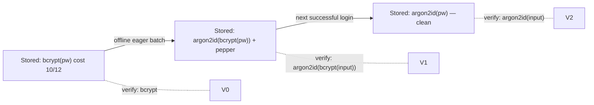
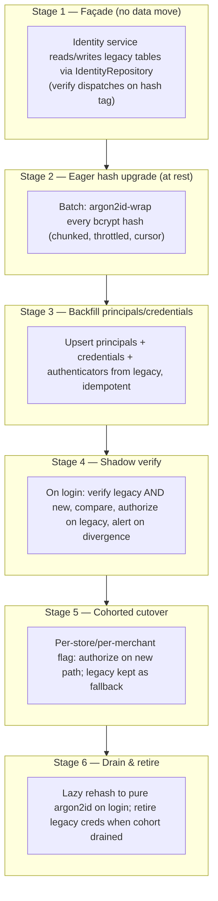

# CUSTOMER_MIGRATION_ARCHITECTURE

**Phase 17 — Document 3 of 5 (Customer & Legacy Password Migration)**
Status date: 2026-06-08
Status: Proposed (implementation-ready; no code). Closes readiness findings **C-3 (credential migration), G-2**.

> **Mandate.** Migrate millions of existing customers and all merchants/staff into the new Identity Platform with **zero lockout, zero mass-logout, and zero plaintext exposure**, including the legacy password-hash upgrade. This is the gate item that blocks the customer-realm cutover (Migration Plan Wave 5).

> **Grounding (the hashes we migrate FROM, confirmed in code).**
> - **Merchant** passwords: **bcrypt, cost 12** — `services/api-gateway/src/lib/merchant-password.ts` (`MERCHANT_PASSWORD_BCRYPT_ROUNDS = 12`, `bcryptjs`).
> - **Customer** passwords: **bcrypt, cost 10** — `services/api-gateway/src/routes/storefront/customer-engagement-routes.ts` (`bcrypt.hash(password, 10)`).
> - Store-access gate passwords: **argon2id** via `hash-wasm` — `store-access-password.ts` (NOT user auth; ignore).
> - Identity stores: merchant `users_custom` (+ legacy `users`), customer `store_customers` + `customer_credentials` (**store-scoped**), MFA in `merchant_2fa_factors`, sessions in `sessions`.
> Target credential hash is **Argon2id** (`IDENTITY_DATA_MODEL.md` §3). So this is a **bcrypt → Argon2id** migration at millions scale.

---

## 1. The legacy password problem and the chosen technique

Two standard ways to move from bcrypt to Argon2id:

| Technique | How | Migrates | Risk |
|-----------|-----|----------|------|
| **Lazy rehash-on-login** | keep bcrypt verify; on successful login, rehash the *plaintext* to Argon2id, replace | only users who log in | dormant users stay on weaker bcrypt indefinitely |
| **Eager layered upgrade-at-rest** | compute `argon2id(bcrypt_hash, pepper)` for **every** stored hash offline (no plaintext needed); verify as `argon2id_verify(bcrypt(input), stored)` | **all users immediately, at rest** | verify cost = bcrypt+argon2 (acceptable); inherits bcrypt's 72-byte truncation until a clean rehash |

> **Decision M-1 — do both (hybrid).**
> 1. **Eager:** layer-wrap *every* existing bcrypt hash in Argon2id at rest (offline batch, no plaintext, no user action). Every credential is strengthened immediately — even dormant accounts.
> 2. **Lazy:** on the next successful login, rehash the plaintext to **pure Argon2id** (fixes bcrypt's 72-byte truncation and removes the layer).
> Each credential row records its scheme (`credentials.algo`/`params`): `bcrypt` → `argon2id(bcrypt)` → `argon2id`. Verification dispatches on the tag.

**Why this is the right answer:** every credential is hardened at rest on day one (Auth0/Okta "layered hashing" pattern), no user is forced to reset, and the hash format converges to clean Argon2id naturally. The **pepper** (a KMS-held secret added before hashing) means a database-only leak yields hashes that can't be attacked without also breaching the KMS.

---

## 2. Migration scope & volumes

| Population | Source | Hash | Identity target | Scale |
|------------|--------|------|-----------------|-------|
| Customers | `store_customers` + `customer_credentials` | bcrypt(10) | customer-realm `principals` + `credentials` (store-scoped) | **millions** |
| Merchants | `users_custom` (+ `users` profile) | bcrypt(12) | merchant-realm `principals` + `credentials` | 100k-scale |
| Staff | `employees`, `super_admin_allowlist` | — / TOTP | admin-realm `principals` + `authenticators` | small |
| MFA factors | `merchant_2fa_factors`, `super_admin_allowlist.two_factor_secret`, console env TOTP | — | `authenticators` (+ re-encrypt under KMS DEK) | small–medium |
| Sessions | `sessions` (opaque), `lb_customer_session` (JWT) | — | dual-accept, no re-issue | live |

---

## 3. The six guarantees (non-negotiable)

1. **Zero lockout** — no valid user is ever rejected during or after migration.
2. **Zero mass-logout** — existing sessions stay valid; no "everyone must re-login" event.
3. **Zero plaintext** — passwords are never logged, exported, or stored in plaintext; tokens hashed at rest.
4. **Reversible** — every cohort can roll back to the legacy path via a flag, with both paths live.
5. **Idempotent & resumable** — batch jobs can re-run and resume from a cursor without double-effect.
6. **In-region** — all processing in `ap-south-1` (DPDP — `COMPLIANCE_ARCHITECTURE.md`).

---

## 4. Migration architecture (façade → backfill → cutover)

This is the dual-run pattern from `MIGRATION_PLAN.md` applied to credentials: **the decision moves before the data, and the old path stays live until the new one is proven per cohort.**

---

## 5. Customer identity consolidation (store-scoped → realm)

Customers are **store-scoped today** (a person shopping at 3 stores = 3 `store_customers` rows). The target customer realm **preserves per-store identity** but introduces an optional global link:

| Step | Action |
|------|--------|
| Backfill | one customer-realm `principal` **per `store_customers` row** (preserve store scope, `store_id`) + `credentials` from `customer_credentials` |
| Email collisions | same email at different stores → distinct principals (store-scoped); record candidate links for optional future merge |
| Global linking | **deferred** — cross-store "one shopper" identity is additive, post-cutover (`ORGANIZATION_ARCHITECTURE`/`account_links`) |
| Guests | no migration (guest checkout carries no credential) |

**Do not force-merge** store-scoped customers during migration — it risks exposing one store's customer to another. Linking is explicit, verified, and later.

---

## 6. Merchant dual-store resolution (`users` vs `users_custom`)

The audit's dual-store ambiguity must be resolved during backfill (readiness Finding A-3/D-3):

| Case | Resolution |
|------|------------|
| Row in `users_custom` (has `password_hash`, `email_verified`) | **authoritative** → merchant `principal` + `credentials` |
| Profile in `users` (`display_name`, `subscription_tier`, `saved_accounts`) | merge profile into the principal; `saved_accounts` → `account_links` |
| In `users` only, no `users_custom` | passwordless/legacy → principal with no password credential; require verify/magic-link on next login |
| Conflicting emails between the two | reconcile by verified email; dry-run report before cutover |

A **dry-run reconciliation report** (counts of each case, conflicts, orphans, null-password accounts) is a mandatory pre-cutover artifact — no backfill runs against production until it is reviewed.

---

## 7. Session & MFA continuity (zero mass-logout)

| Asset | Continuity strategy |
|-------|---------------------|
| Merchant `lb_session` (opaque, 30d) | gateway **dual-accepts** legacy opaque sessions AND new IdP tokens during the window (Migration Plan W2); existing sessions ride out their TTL or upgrade silently on next refresh/login — **no forced logout** |
| Customer `lb_customer_session` (JWT, 7d) | same dual-accept; new customer-realm session issued on next login/refresh |
| `merchant_2fa_factors` | migrate to `authenticators`; **re-encrypt** TOTP `secret_ciphertext` under the KMS DEK; preserve `recovery_code_hashes[]`; **never invalidate an enrolled factor** during migration |
| Shared admin TOTP (`PLATFORM_CONSOLE_TOTP_SECRET`) | re-enroll admins onto per-user factors **before** retiring the shared secret (small population, do first) |

Migrating credentials must **not** touch live sessions — they are independent. This decoupling (credentials vs sessions) is what prevents a migration-induced logout storm.

---

## 8. Batch execution mechanics (millions-scale)

| Concern | Design |
|---------|--------|
| Chunking | process by `(store_id, id)` key ranges; bounded batch size; backpressure-aware |
| Resumability | progress cursor per job (reuse the `audit_export_cursors` pattern already in schema) |
| Idempotency | upserts keyed by source id; hash-upgrade skips already-tagged rows |
| Throttle | rate-limited to protect Postgres (the `last_active` hotspot lesson — Finding D-2); run off-peak for India traffic |
| Verification | post-batch counts + checksum sampling; shadow-verify parity metric |
| Isolation | runs in-region; no plaintext; PII-safe logging |
| Observability | per-job dashboards: rows processed, errors, parity divergence, ETA |

---

## 9. Rollback strategy

| Level | Rollback |
|-------|----------|
| Hash upgrade (eager) | additive (layered) — legacy bcrypt verify still works under the layer; if a defect is found, disable the new verify dispatch and fall back to bcrypt (the wrapped hash still validates via the layer, or restore from the pre-batch snapshot) |
| Backfill | principals/credentials are a copy; reads still served from legacy until cutover — drop the new rows, no user impact |
| Cutover (per cohort) | flag flips authorization back to legacy path instantly; both live |
| Full program | because legacy tables are untouched until drain (Stage 6), the entire migration is reversible up to the point of legacy retirement |

**The point of no return** is Stage 6 (legacy credential retirement) — gated on per-cohort parity ≥ N days and explicit sign-off, with DB snapshots retained.

---

## 10. Edge cases & risks

| Case | Handling |
|------|----------|
| Null/empty `password_hash` (passwordless, OAuth, magic-link-only) | principal with no password credential; bootstrap via OTP/magic-link |
| Account mid-password-reset during migration | in-flight `verification_tokens` honored; reset writes to both paths during dual-run |
| bcrypt 72-byte truncation | inherited by the layered hash; fixed on lazy rehash to pure Argon2id |
| Duplicate emails across stores (customer) | distinct store-scoped principals; no auto-merge |
| Very large stores (millions of customers in one store) | sub-chunk within store; avoid single-store hotspot |
| Pepper rotation | pepper is versioned; re-layer on rotation (offline) |
| Plaintext verification_tokens (existing) | hashed at rest as a **Wave-0 quick win** before customer migration |

---

## 11. Acceptance criteria

- Every legacy bcrypt credential upgraded at rest to `argon2id(bcrypt)+pepper` (eager), converging to pure Argon2id on login (lazy); scheme tagged per credential.
- Customers backfilled store-scoped; no cross-store auto-merge; merchants reconciled across `users`/`users_custom` with a reviewed dry-run report.
- No forced logout: sessions dual-accepted; MFA factors migrated without invalidation; shared admin TOTP replaced by per-user factors first.
- Batches chunked/resumable/idempotent/throttled/in-region; shadow-verify parity gates cohorted cutover; per-cohort rollback live until Stage-6 drain.
- Zero plaintext at any stage; pepper held in KMS.

Cross-references: hash custody/pepper → `KEY_MANAGEMENT_ARCHITECTURE.md`; data targets → `IDENTITY_DATA_MODEL.md`; dual-run/cohort guardrails → `MIGRATION_PLAN.md`; residency of processing → `COMPLIANCE_ARCHITECTURE.md`; origin finding → `IMPLEMENTATION_READINESS_REVIEW.md` C-3.
