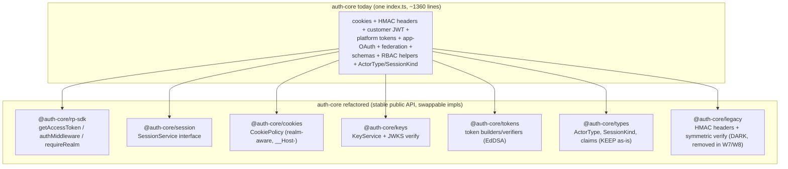
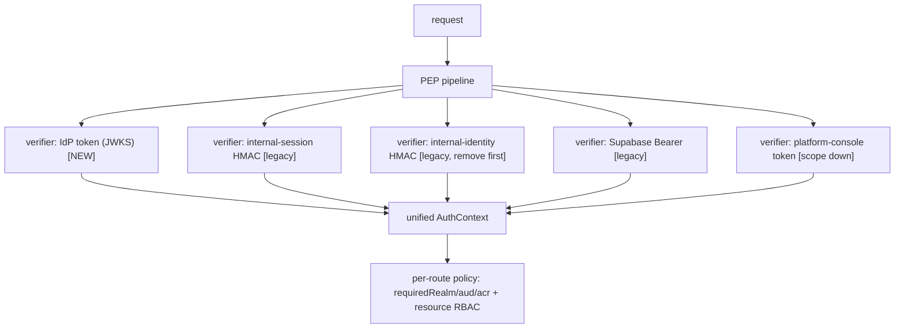

# FOUNDATION_REFACTOR_PLAN

**Phase 14 — Foundation Refactor Plan**
Status date: 2026-06-08

> Identifies the auth, session, cookie, and gateway abstractions — and the shared-library seams — that must be refactored **before** the OIDC migration (Phase 13, Wave 0) can proceed safely. These are not the migration itself; they are the load-bearing seams that make the migration reversible and low-risk.

> **Why this is feasible.** The estate already has one shared auth library, `packages/auth-core`, imported by **every** app and service (Phase 1 §7). The seam exists; it is currently the *wrong shape* (HMAC headers, cookie helpers, bespoke token crypto). Refactoring it in place — behind stable interfaces — lets every app migrate by swapping an implementation, not rewriting call-sites.

---

## 1. Refactor targets (the five seams)

| Seam | Today (evidence) | Target shape | Why it must come first |
|------|------------------|--------------|------------------------|
| **Auth abstraction** | apps call gateway via `merchantApiFetch()`/`identityApiRequest()` that **sign internal headers** (`auth-core` `createLetbuyyInternalSessionHeaders/Identity`) | a **Relying-Party SDK** interface: `getAccessToken()`, `authMiddleware()`, `requireRealm()` — implementation swappable from HMAC-headers → OIDC tokens | Lets each app flip from header-signing to token-bearing with a config change, enabling dual-run |
| **Session abstraction** | `apps/identity-platform/src/lib/auth/session.ts` `createSession/validateSession/destroySession` call gateway; opaque token | a `SessionService` interface (create/validate/refresh/revoke/list) over an implementation that is first the gateway façade, later the Identity service | Decouples "session semantics" from "where sessions live," enabling the data move |
| **Cookie abstraction** | scattered setters with **divergent attributes** (`identity cookies.ts`, proxy, gateway customer route) — 3 CSRF setters, domain-wide `lb_session` | one `CookiePolicy` module: realm-aware, host-only `__Host-` by default, single attribute policy | Removes the inconsistency that makes the domain-wide-cookie removal risky; one place to change |
| **Gateway abstraction** | `authMiddleware` with 4 hard-coded branches (platform token, internal session, internal identity, Supabase Bearer) | a **branch registry / PEP pipeline**: pluggable verifiers (add IdP-token verifier, keep legacy verifiers, remove later) + per-route `requiredRealm/aud/acr` | Enables dual-accept (add Identity-token branch without touching others) and clean legacy removal |
| **Key/JWKS abstraction** | shared symmetric secret via `getLetbuyyInternalAuthSecret()` | a `KeyService`: per-realm asymmetric keys, `kid` lookup, JWKS publish, rotation; symmetric path kept until drained | Everything in the target verifies via JWKS; the seam must exist before any token is issued |

---

## 2. `packages/auth-core` decomposition

`auth-core` is doing too many jobs at once (cookie constants, HMAC headers, customer JWT, platform tokens, app-OAuth tokens, federation, schemas, RBAC helpers). Refactor into clear internal modules behind stable exports:

**Rules:**
- Public types stay stable: `ActorType`, `SessionKind`, `SessionContract`, claim shapes are reused, not renamed (Phase 3 §5). Minimizes churn.
- Legacy crypto (`createLetbuyyInternalSessionHeaders`, `getLetbuyyInternalAuthSecret`, symmetric customer/platform tokens) moves to `@auth-core/legacy` — still functional, clearly quarantined, deleted in Waves 7–8.
- New code only imports the new modules; legacy import is a lint-flagged signal of un-migrated code.

---

## 3. Gateway PEP refactor

- Today's four branches in `services/api-gateway/src/middleware/auth.ts` become **registered verifiers** producing a common `AuthContext`. Adding the IdP-token verifier (Wave 2) is additive; removing the app-asserted-identity verifier (Wave 7) is deletion of one registration.
- Per-route metadata (`requiredRealm`, `aud`, `acr`) is declared once and enforced uniformly — replacing ad-hoc guards. This is also where step-up (`acr`) and audience pinning live.
- Keep `csrfProtection`/`protectedMutationIdempotency` in the chain; the CSRF check becomes a no-op for Bearer-authed routes (Phase 8 §7).

---

## 4. Identity-store boundary preparation

Before data can move (Phase 13 W7), introduce a **repository boundary** over identity tables so the gateway no longer writes them directly:

| Table | Today | Refactor step |
|-------|-------|---------------|
| `users_custom`, `sessions`, `devices`, `verification_tokens`, `auth_password_set_intents`, `merchant_2fa_factors` | gateway routes write directly | wrap in an **IdentityRepository** module; gateway calls the repo, not raw SQL |
| `store_customers`, `customer_credentials` | gateway storefront routes write | same repo boundary (customer partition) |
| `users` (legacy) vs `users_custom` | dual store | introduce a `principals` read-model view that unifies them, ahead of physical merge |

Once the repo boundary exists, "move the table to the Identity service" = point the repo implementation at the Identity service instead of local SQL — without changing callers.

---

## 5. Cookie policy unification (pre-work for de-risking the domain-wide removal)

| Action | Detail |
|--------|--------|
| Centralize | One `CookiePolicy.set(realm, name, value, opts)` replaces the 3 divergent setters |
| Default host-only | `__Host-` prefix + no `Domain` by default; domain-wide requires an explicit, lint-flagged opt-in (only `lb_session` during transition) |
| Single attribute policy | `Secure` always in prod, `HttpOnly` always for auth cookies, `SameSite` per realm (Strict for admin) |
| Kill JS-readable auth cookie | route `letbuyy_csrf` through the policy; mark for removal once APIs are Bearer-authed |

This makes the Wave-7 removal of the domain-wide cookie a **one-module change**, not an estate-wide hunt.

---

## 6. Observability + test seams (must exist before cutovers)

| Seam | Purpose |
|------|---------|
| **Auth decision log** | structured event per auth decision (verifier used, realm, sid, allow/deny) — enables shadow-compare in Wave 2/5 |
| **Legacy-path counter** | per-legacy-verifier traffic metric — the gate for Wave 7 deletions ("zero traffic for N days") |
| **Contract tests** | RP-SDK ↔ gateway verifier contract; Membership-API claim-sourcing contract |
| **Parity harness** | given a request, compute legacy decision and Identity-token decision, assert equal (shadow mode) |

Without the parity harness and legacy-path counters, the Migration Plan's "shadow before enforce" and "delete on drained telemetry" guardrails can't be honored.

---

## 7. Sequenced foundation backlog (all in Wave 0, before W1)

| Order | Refactor | Risk | Blocks |
|-------|----------|------|--------|
| F1 | `auth-core` module split + `@auth-core/legacy` quarantine (no behavior change) | low | everything |
| F2 | Cookie policy unification | low | domain-wide removal (W7) |
| F3 | Gateway verifier-registry refactor (same 4 branches, new shape) | medium | IdP-token branch (W2) |
| F4 | IdentityRepository boundary over identity tables | medium | data move (W7) |
| F5 | KeyService + JWKS publish (keys live, not yet trusted) | low | token issuance (W1) |
| F6 | Auth decision log + legacy counters + parity harness | low | all cutovers/deletions |
| F7 | Hash `verification_tokens`; remove `lb_csrf`; stop raw-token JSON | low | quick security wins |

**Acceptance for Phase 14:** every seam above merged with **zero behavior change** (pure refactor, guarded by existing tests + the new parity harness), so that Wave 1 can introduce the OIDC provider as an additive implementation rather than a rewrite.

Phase 15 consolidates all phases into the executive blueprint.
