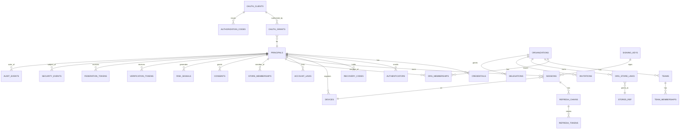

# IDENTITY_DATA_MODEL

**Phase 16 — Document 3 of 4 (Canonical Identity Data Model)**
Status date: 2026-06-08
Status: Proposed (implementation-ready; no code). This becomes the source of truth for the Identity DB.

> **Mandate.** Design the canonical data model for the Identity Platform: every entity, relationship, key, constraint, index, and retention/deletion policy, plus a migration mapping from the existing tables (reuse / replace / deprecate).

> **Grounding.** Existing identity-relevant tables (read from `database/supabase/migrations/000_baseline.sql`): `users`, `users_custom`, `user_profiles`, `sessions`, `devices`, `device_tokens`, `verification_tokens`, `auth_password_set_intents`, `merchant_2fa_factors`, `store_customers`, `customer_credentials`, `employees`, `employee_roles`, `employee_permissions`, `super_admin_allowlist`, `sites`, `site_memberships`, `site_roles`, `site_role_permissions`, `site_api_clients`, `app_installations`, `audit_logs`, `audit_activity_events`, `security_enforcement_events`. The model below **reuses** what is sound, **replaces** what is fragmented, and **deprecates** duplicates.

> **Conventions.** PKs are prefixed ULIDs (sortable, shardable) unless reusing an existing uuid PK (e.g. `store_id`). All tables are realm-tagged where principals differ. Soft delete = `deleted_at`; hard delete + crypto-shred for GDPR. `created_at`/`updated_at`/`created_by`/`updated_by` on every table (matches existing convention).

---

## 1. Entity-relationship overview

---

## 2. Domain 1 — Principals, linking, directory

### `principals`
| Column | Type | Notes |
|--------|------|-------|
| `principal_id` | text PK | `prn:<realm>:user:<ULID>` |
| `realm` | text | merchant / customer / admin (enum) |
| `primary_email` | citext | unique per realm (partial unique where `deleted_at IS NULL`) |
| `email_verified` | bool | from `users_custom.email_verified` |
| `display_name`, `avatar_url` | text | from `users_custom`/`users` |
| `status` | text | active / suspended / locked / pending_deletion / deleted |
| `auth_provider` | text | email / google / … (from `users_custom.auth_provider`) |
| `external_subject` | text | for federated/SSO principals |
| `created_at … deleted_at` | ts | lifecycle |

Constraints: `UNIQUE(realm, primary_email) WHERE deleted_at IS NULL`. Indexes: `(realm, primary_email)`, `(status)`. **Replaces** `users_custom` + `store_customers` + `employees`-as-identity; **unifies** the dual `users`/`users_custom` store.

### `account_links`
Links a human's principals across realms (merchant who is also a customer). Columns: `link_id` PK, `principal_a`, `principal_b`, `link_type` (same_person/org_invite), `verified_at`, `created_at`. **Replaces** the informal `users.saved_accounts` jsonb + `lb_accounts` cookie switcher. Linking never shares tokens (Phase 4 §6).

---

## 3. Domain 2 — Credentials & authenticators

### `credentials` (passwords)
| Column | Type | Notes |
|--------|------|-------|
| `credential_id` PK, `principal_id` FK | | |
| `type` | text | password (passkeys live in `authenticators`) |
| `secret_hash` | text | **Argon2id** (replaces unspecified hash) |
| `algo`, `params` | text/jsonb | rotation-aware |
| `last_rotated_at`, `must_rotate` | ts/bool | |

**Replaces** `users_custom.password_hash` and `customer_credentials`. One credential model across realms.

### `authenticators` (TOTP + passkeys + hardware keys)
| Column | Type | Notes |
|--------|------|-------|
| `authenticator_id` PK, `principal_id` FK | | |
| `factor_type` | text | totp / passkey / hardware_key |
| `status` | text | pending / active / disabled |
| `secret_ciphertext` | text | TOTP secret (encrypted) |
| `webauthn_credential_id`, `public_key`, `aaguid`, `sign_count` | bytea/text | passkey/FIDO2 |
| `transports`, `attestation` | jsonb | |
| `label`, `last_verified_at`, `enrolled_at` | | |

**Reuses/extends `merchant_2fa_factors`** (already totp+passkey, `secret_ciphertext`, status). Generalizes from merchant-only to all realms; adds WebAuthn columns the current factor table lacks. **Consolidates** the three MFA stores (Finding D-1): `merchant_2fa_factors`, `super_admin_allowlist.two_factor_secret`, console-env TOTP → one `authenticators` table.

### `recovery_codes`
`recovery_code_id` PK, `principal_id`, `code_hash` (SHA-256), `used_at`. **Reuses** `merchant_2fa_factors.recovery_code_hashes[]` (normalized into rows for per-code `used_at` + audit).

---

## 4. Domain 3 — Sessions, refresh chains, devices

### `sessions`
| Column | Type | Notes |
|--------|------|-------|
| `sid` PK | text | `sess_<ULID>` |
| `principal_id` FK, `realm` | | |
| `device_id` FK | | binds session ↔ device |
| `amr`, `acr` | jsonb/text | factors + assurance |
| `status` | text | active / revoked / expired |
| `idle_expires_at`, `absolute_expires_at` | ts | per-realm (Phase 8 §2) |
| `last_active_at` | ts | reuses today's `last_active` |
| `created_at`, `revoked_at`, `revoke_reason` | | |

**Replaces** the existing `sessions` (opaque-token) table: same role, adds realm tag, refresh-chain linkage, idle/absolute bounds, assurance, revoke reason. Indexes: `(principal_id, status)`, `(device_id)`, `(absolute_expires_at)` for sweep.

### `refresh_chains` + `refresh_tokens`
- `refresh_chains`: `chain_id` PK, `sid` FK, `client_id`, `audience`, `created_at`, `revoked_at`. One chain per (session, client).
- `refresh_tokens`: `token_id` PK, `chain_id` FK, `token_hash`, `prev_token_id`, `used_at`, `expires_at`. **Rotation** = new row; **reuse-detection** = a `used_at`-non-null token presented again ⇒ revoke whole chain (Phase 9 §2.3). **New** (no refresh tokens exist today for merchant/customer).

### `devices`
**Reuses** existing `devices` + `device_tokens`. Add: `trust_state` (untrusted/trusted/blocked), `trusted_until`, `revoked_at`, fingerprint, last_ip/geo. Enables device revocation (closes Phase 1 UNKNOWN #3).

---

## 5. Domain 4 — OAuth / clients / consent

### `oauth_clients`
| Column | Notes |
|--------|-------|
| `client_id` PK, `realm`, `client_type` (confidential/public/native/m2m) | |
| `client_secret_hash`, `redirect_uris[]`, `grant_types[]`, `scopes[]` | exact-match https redirect validation |
| `owner_org_id`, `owner_principal_id` | partner/marketplace ownership |
| `skip_consent` (first-party), `status` | |

**Replaces/unifies** `app_installations` (app↔store grants), `site_api_clients` (M2M keys), and the bespoke app-OAuth config in `app_installations.config.oauth`. Note: reconcile status enums (`app_installations`: active/paused/uninstalled vs `site_api_clients`: active/paused/revoked → canonical: active/paused/revoked).

### `oauth_grants` (consent records) — **NEW** (no consent today)
`grant_id` PK, `client_id`, `principal_id`, `scopes[]`, `granted_at`, `revoked_at`. Backs revoke-on-uninstall + consent screen.

### `authorization_codes`
`code_id` PK, `client_id`, `principal_id`, `code_hash`, `pkce_challenge`, `redirect_uri`, `expires_at` (≤60s), `consumed_at`. **New** as a first-class table (today codes are stateless JWTs).

---

## 6. Domain 5 — Verification, federation, magic links

### `verification_tokens` (email_verify / magic_link / password_reset)
**Replaces** the existing `verification_tokens` — same purpose, but `token` is **stored hashed** (today it is plaintext — Audit §Security Findings; this is the single most important data-model fix). Columns: `token_id` PK, `principal_id`, `email`, `token_hash`, `type` (enum, keep), `expires_at`, `consumed_at`. **Deprecates** `auth_password_set_intents` (folded in as `type=password_set`).

### `federation_tokens`
`ftoken_id` PK, `principal_id`, `realm`, `target_audience`, `jti`, `expires_at` (≤15m), `redeemed_at`. **Reuses** the existing `createCustomerFederationToken` replay-store concept; generalizes to all realms (Phase 7 §8).

---

## 7. Domain 6 — Organization graph (from `ORGANIZATION_ARCHITECTURE.md`)

| Table | Key columns |
|-------|-------------|
| `organizations` | `org_id` PK, `parent_org_id` (franchise/marketplace), `name`, `status`, `billing_ref` |
| `org_memberships` | `membership_id` PK, `org_id`, `principal_id`, `role_slugs[]`, `status`, `expires_at`, `granted_by` |
| `teams` | `team_id` PK, `org_id`, `name` |
| `team_memberships` | `membership_id` PK, `team_id`, `principal_id` |
| `store_memberships` | `membership_id` PK, `store_id`, `principal_id`, `role_slugs[]`, `permissions[]`, `status`, `expires_at` |
| `org_store_links` | `link_id` PK, `org_id`, `store_id`, `linked_at` (authoritative org↔store) |
| `delegations` | `delegation_id` PK, `grantor_org_id`, `grantee_org_id`, `scope`, `role_slugs[]`, `expires_at` |
| `invitations` | `invite_id` PK, `org_id`/`store_id`, `email`, `role_slugs[]`, `token_hash`, `expires_at`, `accepted_at` |
| `ownership_transfers` | `transfer_id` PK, `store_id`/`org_id`, `from`, `to`, `state`, `initiated_by`, `accepted_at` |

**`store_memberships` migrates from `site_memberships`** (preserving `role_slugs[]`, `permissions[]`, `expires_at`, `status`). `invitations` **unifies** `site_memberships`-invites + `employee_invites`.

---

## 8. Domain 7 — Keys, risk, security, audit

| Table | Purpose | Key columns |
|-------|---------|-------------|
| `signing_keys` | per-realm asymmetric keys + rotation (Phase 9 §1) | `kid` PK, `realm`, `alg` (EdDSA), `public_jwk`, `private_ref` (KMS), `state` (active/next/retiring), `not_before`, `not_after` |
| `risk_signals` | per-principal/session risk inputs | `signal_id` PK, `principal_id`, `sid`, `type` (new_device/ip_velocity/turnstile/impossible_travel), `score`, `created_at` |
| `security_events` | account-security events (lockout, factor reset, password change, suspicious login) | `event_id` PK, `principal_id`, `type`, `severity`, `context` jsonb, `created_at` |
| `audit_events` | full audit trail (schema owned by `AUDIT_LOG_ARCHITECTURE.md`) | see that doc |

**Distinction:** `risk_signals` (inputs to decisions) ≠ `security_events` (notable account-security outcomes) ≠ `audit_events` (immutable compliance record). `signing_keys` **replaces** the shared `getLetbuyyInternalAuthSecret` symmetric secret as the trust root.

---

## 9. Ownership matrix

| Domain | Tables | Owner | Authority |
|--------|--------|-------|-----------|
| Principals/linking | principals, account_links | Identity | yes |
| Credentials/auth | credentials, authenticators, recovery_codes | Identity | yes |
| Sessions/tokens | sessions, refresh_chains, refresh_tokens, devices | Identity | yes |
| OAuth/consent | oauth_clients, oauth_grants, authorization_codes | Identity | yes |
| Verify/federation | verification_tokens, federation_tokens | Identity | yes |
| Org graph | organizations, *_memberships, teams, org_store_links, delegations, invitations, ownership_transfers | Identity | yes |
| Keys/risk/security | signing_keys, risk_signals, security_events | Identity | yes |
| Audit | audit_events | Identity (platform audit service) | append-only |
| Store **resource** | `sites`, products, orders | **Commerce** | yes (resource) |
| Role **catalog** | `site_roles`, `site_role_permissions`, `employee_roles`/`employee_permissions` | **Commerce** policy | yes (policy) |

---

## 10. Retention, archival, soft/hard/GDPR deletion

| Data class | Retention | Delete strategy |
|------------|-----------|-----------------|
| Sessions, refresh tokens, auth/verification codes | purge ≤ 90d after expiry | hard delete (sweep job) |
| Devices | until revoked + 1y | soft then hard |
| Credentials/authenticators | life of principal | crypto-shred on principal deletion |
| Principals (deletion request) | 30-day grace → delete | see GDPR below |
| Org/membership graph | life of org; merged/split retained as audit | soft delete + audit |
| Risk signals | 1y rolling | hard delete |
| Security events | 2y | hard delete |
| **Audit events** | **per AUDIT doc (e.g. 7y legal)** | **never user-deletable; crypto-shred PII fields only** |

### GDPR deletion strategy (the retention-vs-erasure tension, resolved)
The classic conflict: GDPR erasure vs audit/legal retention. Resolution = **pseudonymization + crypto-shredding**, not row deletion of audit:
1. On verified erasure request: delete `credentials`, `authenticators`, `devices`, `sessions`, `risk_signals`; null PII columns in `principals` (keep a tombstone `principal_id` + `deleted_at`).
2. Audit events: **retain the event, crypto-shred the PII** — store PII fields encrypted with a per-principal data key; destroying that key renders PII unrecoverable while preserving the event's existence, actor reference (pseudonymous), and integrity chain. (Satisfies SOC2/legal retention *and* GDPR erasure.)
3. Record the erasure itself as an audit event (`security.principal.erased`).

This is the GitHub/Stripe pattern: you can erase the person without destroying the immutable security ledger. Detail in `AUDIT_LOG_ARCHITECTURE.md` §Tamper resistance & §GDPR.

---

## 11. Multi-tenant & high-scale considerations

| Concern | Design |
|---------|--------|
| Tenant isolation | every tenant-scoped row carries `org_id`/`store_id`; RLS as defense-in-depth (Zero Trust §7); principal realm-tagged |
| Sharding | principals/sessions shardable by `principal_id`; org graph by `org_id`; ULID PKs are shard-friendly + time-sortable |
| Hot tables | `sessions`, `refresh_tokens`, `audit_events` are highest-volume → partition by time; aggressive purge of expired sessions/tokens |
| Read scale | membership resolution cached → claims; check API behind a cache with event invalidation (Org Arch §11) |
| Write hotspots | `last_active_at` bump on every request → batch/throttle writes (write-behind) to avoid row contention (the current per-request `last_active` update is a latent hotspot — Finding D-2) |
| Index discipline | every FK indexed; partial indexes `WHERE deleted_at IS NULL`; bidirectional membership indexes `(principal_id)` and `(store_id)` |

---

## 12. Migration mapping (reuse / replace / deprecate)

| Existing table | Disposition | Target |
|----------------|-------------|--------|
| `users_custom` | **replace** | `principals` (merchant) + `credentials` |
| `users` | **deprecate** | profile fields → `principals`; `saved_accounts` → `account_links` |
| `user_profiles` | merge | `principals` |
| `store_customers` | **replace** | `principals` (customer realm) |
| `customer_credentials` | **replace** | `credentials` |
| `employees` | **replace** (identity part) | `principals` (admin) + `employee_roles` stays as catalog |
| `super_admin_allowlist` | partial reuse | principals(admin) + `authenticators` (its `two_factor_secret`) |
| `sessions` | **replace** | `sessions` (new shape) |
| `devices`, `device_tokens` | **reuse + extend** | `devices` |
| `verification_tokens` | **replace** | `verification_tokens` (hashed) |
| `auth_password_set_intents` | **deprecate** | folded into `verification_tokens` |
| `merchant_2fa_factors` | **reuse + extend** | `authenticators` + `recovery_codes` |
| `site_memberships` | **replace** | `store_memberships` |
| `site_roles` / `site_role_permissions` | **reuse** (as policy catalog) | stay in Commerce |
| `site_api_clients` | **replace** | `oauth_clients` (m2m) |
| `app_installations` | **reuse + extend** | `oauth_clients` + `oauth_grants` (+ keep install record in commerce) |
| `audit_logs`, `audit_activity_events` | **consolidate** | `audit_events` (see AUDIT doc) |
| `security_enforcement_events` | keep (governance) | separate concern (control enforcement, not user security) |

---

## 13. Acceptance criteria

- One `principals` directory across realms; dual `users`/`users_custom` collapsed; one `credentials` and one `authenticators` table (three MFA stores consolidated).
- `verification_tokens` hashed at rest; refresh chains + reuse-detection modeled; device revocation modeled.
- OAuth clients/grants/consent + authorization codes are first-class; `site_api_clients`/`app_installations` reconciled.
- Org graph tables defined with bidirectional indexes and bounded-claim support.
- GDPR erasure via crypto-shredding preserves audit integrity; retention classes defined.
- Migration mapping classifies every existing table reuse/replace/deprecate; `last_active` write-hotspot mitigated.

Cross-references: org tables → `ORGANIZATION_ARCHITECTURE.md`; role catalog → `PERMISSION_MODEL.md`; audit schema → `AUDIT_LOG_ARCHITECTURE.md`; token shapes → `TOKEN_STRATEGY.md`; consolidation risks → `IMPLEMENTATION_READINESS_REVIEW.md` Findings D-1/D-2/D-3.
