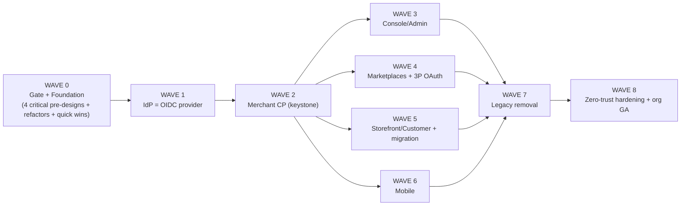
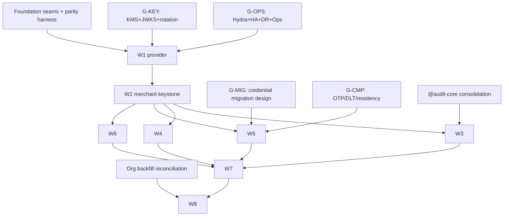

# IDENTITY_IMPLEMENTATION_MASTER_PLAN

**Phase 17 — Document 5 of 5 (Wave-by-Wave Execution Master Plan)**
Status date: 2026-06-08
Status: Proposed. The **single execution source of truth** integrating all 24 architecture documents into a gated, reversible, multi-year delivery plan.

> **Role.** This plan does not restate the architecture; it sequences it. Every wave names its source documents, entry/exit gates, rollback, owner, and success metrics. It elevates the four critical readiness blockers (now designed in Phase 17) into **hard Wave-0 gates**.

> **Authoritative inputs.** Audit pair + Phases 1–16 target docs + the four Phase-17 docs (`IDENTITY_OPERATIONS`, `KEY_MANAGEMENT`, `CUSTOMER_MIGRATION`, `COMPLIANCE`). Governing guardrails from `MIGRATION_PLAN.md`; gate findings from `IMPLEMENTATION_READINESS_REVIEW.md`.

---

## 1. Program shape

Five parallel **workstreams** run across the waves:

| Workstream | Owns | Source docs |
|------------|------|-------------|
| **A. Identity core** | Hydra, login/consent, sessions, tokens, MFA | TARGET, SSO, SESSION, TOKEN, AUTHENTICATOR |
| **B. Authorization & Org** | realms, permission engine, org graph | REALM, PERMISSION, ORGANIZATION |
| **C. Data & Audit** | identity DB, audit ledger | IDENTITY_DATA_MODEL, AUDIT_LOG |
| **D. Platform (Ops/Keys/Compliance)** | HA/DR, KMS, residency, DLT, SOC2 | IDENTITY_OPERATIONS, KEY_MANAGEMENT, COMPLIANCE |
| **E. Migration & Foundation** | refactor seams, dual-run, cutover, credential migration | FOUNDATION_REFACTOR, MIGRATION, CUSTOMER_MIGRATION |

---

## 2. Wave 0 — the gate (do not skip; everything depends on it)

Wave 0 is now a **gate wave**: it must close the four critical readiness blockers (C-1…C-4) and the foundation seams before Wave 1.

### 2.1 Critical pre-designs (the gate)
| Gate | Deliverable | Source | Exit signal |
|------|-------------|--------|-------------|
| **G-OPS** (C-1, C-2) | Hydra deployment decision (managed-container `ap-south-1`) provisioned; HA + DR drilled; SLOs/alerting/staging-identity live; Ops checklist O1–O10 | `IDENTITY_OPERATIONS` | Operational Readiness **≥ 75** |
| **G-KEY** (G-4, H-3) | KMS/HSM in-region; per-realm ES256 keys + JWKS; rotation + compromise runbook | `KEY_MANAGEMENT` | key drill passed; JWKS live in staging |
| **G-MIG** (C-3) | Credential-migration design ratified; dry-run reconciliation report (`users`/`users_custom`, null-pw, dup-email) | `CUSTOMER_MIGRATION` | dry-run reviewed; parity harness ready |
| **G-CMP** (C-4) | WhatsApp+email OTP live; **DLT-SMS registration started**; Supabase region pinned `ap-south-1`; fiduciary/processor + children's-data decisions with counsel | `COMPLIANCE` | OTP delivering; residency verified |

### 2.2 Foundation refactors (zero behavior change) + quick wins
From `FOUNDATION_REFACTOR_PLAN` F1–F7 + Threat-Model P0s:
- `@auth-core` decomposition (RP-SDK, CookiePolicy, KeyService, SessionService) + `@auth-core/legacy` quarantine.
- Gateway verifier-registry refactor; IdentityRepository boundary; parity harness + legacy-path counters.
- `@audit-core` SDK + canonical `audit_events` + dual-write shim over `audit_logs`/`audit_activity_events`.
- **Quick wins:** hash `verification_tokens`; remove legacy `lb_csrf`; stop raw tokens in JSON; replace shared `PLATFORM_CONSOLE_TOTP_SECRET` with per-user factors.
- Permission catalog registry + naming + legacy alias table.

### 2.3 Wave-0 sign-offs (decision log §6)
A-1 (authz boundary), CMP-1 (fiduciary/processor), CMP-2 (children), CMP-3 (DLT/channels), CMP-5 (region), K-1 (ES256), Hydra A-vs-B.

**Wave-0 exit gate:** Operational Readiness ≥ 75 **and** Implementation Readiness ≥ 85 (from 58/72 in the readiness review). No Wave-1 work starts until met.

---

## 3. Wave-by-wave execution table

Each wave: **Entry gate → Goals → Exit gate (success metrics) → Rollback**, with the governing guardrails (dual-accept, shadow-before-enforce, flag-gated, metrics-as-gates) applied throughout.

### Wave 1 — Identity Platform becomes the OIDC provider
- **Owner:** Workstream A. **Entry:** Wave-0 gate passed.
- **Goals:** Hydra login/consent over existing tables (façade); per-realm discovery+JWKS; mint tokens for a pilot client; inject `org`(null)/`sites`/`amr` claims.
- **Exit / metrics:** pilot completes auth-code+PKCE; JWKS-verifiable token with correct claims; IdP SSO session established; **no prod auth touched**.
- **Rollback:** disable provider flag (pilot only).
- **Docs:** TARGET, SSO, TOKEN, KEY.

### Wave 2 — Merchant control plane (keystone)
- **Owner:** A + E. **Entry:** Wave 1 green.
- **Goals:** merchant CP → OIDC RP; gateway **dual-accepts** IdP tokens + legacy internal-headers; host-only CP cookie + IdP SSO; revoked-`sid` cache; **shadow-compare** authz decisions.
- **Exit / metrics:** N% merchants on IdP tokens with parity error rate ≤ legacy; remote logout works; zero cross-tenant divergence in shadow; verification p99 < 10ms.
- **Rollback:** per-merchant flag → internal-header path (both live).
- **Docs:** SSO, SESSION, ZERO_TRUST, MIGRATION W2.

### Wave 3 — Console / Admin realm
- **Owner:** A + D. **Entry:** Wave 2 dual-run proven.
- **Goals:** console → admin-realm OIDC; **revocable** sessions; per-user MFA (retire shared TOTP); begin constraining synthetic `platform-console@letbuyy.local`.
- **Exit / metrics:** staff login via admin realm + MFA; sessions remotely revocable; synthetic principal scoped down; audit events flowing.
- **Rollback:** flag → `lb_console_session` (break-glass legacy login retained during cutover).
- **Docs:** REALM §4, AUTHENTICATOR §3.2, AUDIT.

### Wave 4 — Marketplaces + 3rd-party OAuth
- **Owner:** A + B. **Entry:** Wave 2.
- **Goals:** theme/app marketplaces silent SSO (`prompt=none`); 3P app OAuth → Hydra with **consent**; M2M `site_api_clients` → client-credentials; replace browser app-bridge token with scoped short-lived tokens.
- **Exit / metrics:** marketplaces SSO no-reauth; new installs use Hydra OAuth + consent; ≥X% app traffic on new tokens; zero raw tokens in new flows.
- **Rollback:** per-client flag; bespoke issuer live until drained.
- **Docs:** OIDC_CLIENT_INVENTORY, PERMISSION (consent/scopes).

### Wave 5 — Storefront / Customer (+ credential migration)
- **Owner:** A + E + D. **Entry:** Wave 2; **G-MIG + G-CMP complete**.
- **Goals:** one revocable customer-realm session (collapse 2 systems); storefront+checkout RPs; checkout token-exchange; cross-domain via federation token; **execute customer credential migration** (eager bcrypt→argon2id layer + lazy rehash) cohorted by store.
- **Exit / metrics:** migrated stores on one customer session; **zero lockout / zero mass-logout**; checkout conversion flat-or-better (guardrail); shadow-verify parity ≥ N days per cohort.
- **Rollback:** per-store flag → legacy customer JWT + bcrypt verify (legacy untouched until drain).
- **Docs:** CUSTOMER_MIGRATION, SSO §8, COMPLIANCE (OTP/DLT/children).

### Wave 6 — Mobile
- **Owner:** A + E. **Entry:** Wave 2.
- **Goals:** native OIDC (system browser + PKCE) via BFF; `lb_session`-in-secure-storage → rotating refresh; mobile MFA via `authenticators`; BFF dual-runs legacy transport until app versions update.
- **Exit / metrics:** new builds auth via OIDC/PKCE; refresh rotation on device; legacy transport drained below threshold; forced-update floor set for oldest versions.
- **Rollback:** BFF keeps legacy `extractMobileSessionToken` path.
- **Docs:** OIDC_CLIENT_INVENTORY §2.8.

### Wave 7 — Legacy removal
- **Owner:** E. **Entry:** Waves 2–6 drained (telemetry-gated).
- **Goals:** remove app-asserted-identity branch + internal-session branch; delete legacy Supabase auth routes + raw-token JSON; collapse `users`+`users_custom` → `principals`; remove domain-wide `lb_session`, `lb_accounts`, JS-readable CSRF; consolidate `audit_logs`/`audit_activity_events` → `audit_events`.
- **Exit / metrics:** zero traffic on legacy paths for N days before each deletion; no app-asserted identity remains; single identity directory; cookie matrix matches SESSION §6.
- **Rollback:** re-enable a removed branch via flag within the deprecation window; dark-ship one release before hard delete.
- **Docs:** MIGRATION W7, IDENTITY_DATA_MODEL §12, AUDIT §11.

### Wave 8 — Zero-trust hardening + Org GA
- **Owner:** D + B. **Entry:** Wave 7.
- **Goals:** mTLS workload identity (remove shared HMAC from identity path); decompose service-role into least-privilege DB principals; enforce merchant MFA + step-up + privilege-change rotation + device-revoke UI; **GA the merchant org model** (backfill orgs, populate `org` claim, enable multi-store/agency/enterprise); finalize SOC2 evidence window.
- **Exit / metrics:** zero shared-secret forgery path; least-privilege data access; MFA enforced; `org` claim populated; SOC2 controls operating.
- **Rollback:** per-service-pair mTLS flags; org backfill is additive/reversible.
- **Docs:** ZERO_TRUST §7-8, ORGANIZATION (backfill §10), KEY (HMAC retirement), COMPLIANCE (SOC2).

---

## 4. Dependency graph (what blocks what)

**Critical path:** G-OPS + G-KEY + Foundation → W1 → W2 → (W5 also needs G-MIG + G-CMP) → W7 → W8. The org model (Workstream B) designs early but **GA's last** (W8), so `org` claim stays null until then.

---

## 5. Readiness re-scoring targets (the gate metric per phase)

| Checkpoint | Architecture | Security | Scalability | **Operational** | Implementation |
|------------|:------------:|:--------:|:-----------:|:--------------:|:--------------:|
| Readiness review (Phase 16) | 88 | 82 | 74 | **58** | 72 |
| **Wave-0 exit (target)** | 90 | 85 | 78 | **≥75** | **≥85** |
| Wave-2 exit | 92 | 88 | 82 | 82 | 88 |
| Wave-7 exit | 95 | 92 | 86 | 88 | 92 |
| Wave-8 exit (GA) | 96 | 95 | 90 | 90 | 95 |

**Operational Readiness is the binding gate at Wave 0** (must reach ≥75). Phase 17 (Ops/Keys/Compliance/Migration designs) is what moves it from 58.

---

## 6. Consolidated decision log (sign-offs required before/at Wave 0)

| ID | Decision | Owner | Source |
|----|----------|-------|--------|
| Hydra A/B | managed-container `ap-south-1` vs ORY Network | Infra/Eng leadership | OPERATIONS §1 |
| K-1 | ES256 (HSM) vs EdDSA (software) per realm | Security | KEY §1 |
| A-1 | authz boundary: membership graph → Identity (Identity=relationship authz, Commerce=capability authz) | Architecture | ORG/PERMISSION + REVIEW |
| CMP-1 | fiduciary/processor allocation for shopper data | Legal/DPO | COMPLIANCE §1 |
| CMP-2 | children's (<18) data: age gate + parental consent | Legal/Product | COMPLIANCE §2 |
| CMP-3 | OTP channels: WhatsApp+email primary, DLT-SMS fallback; start DLT now | Product/Compliance | COMPLIANCE §4 |
| CMP-4 | accept Resend US transfer (DPA) vs India email | Legal | COMPLIANCE §6 |
| CMP-5 | pin Supabase `ap-south-1` | Infra | COMPLIANCE §6 |
| M-1 | bcrypt→argon2id hybrid (eager layer + lazy rehash) | Security | CUSTOMER_MIGRATION §1 |
| P-1 | retire `employees.role` enum as authz source | Architecture | PERMISSION §5.4 |
| ORY Kratos / WorkOS timing | per OIDC decision §6 | Architecture | OIDC_DECISION_RECORD |

---

## 7. Go / No-Go criteria (apply at every wave boundary)

A wave advances only when **all** are green:
1. Exit metrics met (parity, error rate, latency, conversion guardrails).
2. Legacy path still live + per-cohort rollback verified.
3. Shadow-compare divergence within tolerance for the required window.
4. No open Critical/High finding introduced by the wave.
5. `node scripts/validate-governance.mjs` passes for any governed change.
6. On-call + runbooks updated for the new surface.

---

## 8. Master acceptance (program done)

- One issuer (`id.letbuyy.com`), three realms, per-realm KMS/JWKS, in-region (`ap-south-1`).
- Gateway trusts only IdP-signed tokens; shared HMAC secret gone; mTLS workload identity; service-role decomposed.
- Every human session server-revocable; remote logout estate-wide ≤ 1 TTL; MFA enforced; passkeys live.
- Customers + merchants migrated with **zero lockout / zero mass-logout**; bcrypt→Argon2id complete; `users`/`users_custom` unified.
- Org model GA (multi-store/agency/enterprise); `org` claim populated; one permission vocabulary.
- One tamper-evident audit ledger; DPDP/GDPR rights + erasure + DLT-compliant OTP; SOC 2 controls operating.
- Readiness: Operational ≥ 90, all dimensions ≥ 90.

> **Bottom line:** the architecture is complete across 25 documents. Execution is gated on **Wave 0** — close the four operational/regulatory blockers (now designed) and the foundation seams, move Operational Readiness 58 → ≥75, and the multi-year migration can begin wave by wave, each reversible, each measured.

Cross-references: this plan supersedes the high-level wave list in `MIGRATION_PLAN.md` by binding it to the operational, key, migration, and compliance designs; all guardrails inherited from `MIGRATION_PLAN.md`; all gates from `IMPLEMENTATION_READINESS_REVIEW.md`.
