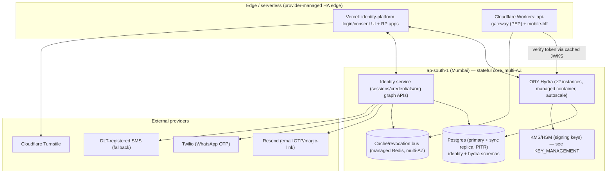
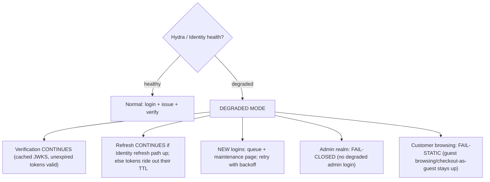

# IDENTITY_OPERATIONS_ARCHITECTURE

**Phase 17 — Document 1 of 5 (High Availability, DR, Operational Readiness)**
Status date: 2026-06-08
Status: Proposed (implementation-ready; no code). Closes readiness findings **C-1 (IdP SPOF), C-2 (operational readiness), G-1, G-10**.

> **Mandate.** Make the Identity Platform operable: high availability, disaster recovery, degradation, SLOs, on-call, and a staging identity environment — before any migration wave begins. The IdP becomes the hard dependency of every login and (via JWKS) every authenticated request, so its operational design is the gate.

> **Grounding (the topology that constrains everything).** Confirmed from the repo:
> - **Frontends on Vercel** — `apps/*` each have `vercel.json` (identity-platform, merchant-control-plane, storefront-runtime, platform-console, app/theme-marketplace, ops-portal, marketing).
> - **Backend services on Cloudflare Workers** — `services/{api-gateway,mobile-bff,webhook-service,queue-workers}` ship `wrangler.toml`; the gateway is Hono on Workers, deployed via `infrastructure/scripts/deploy/deploy-worker-runtime.mjs`.
> - **Data on Supabase Postgres** (`*.supabase.co`).
> - **Email = Resend; messaging = Twilio (WhatsApp); payments = Razorpay** (India).
> **The estate is 100% serverless/managed today.** This is the single most important operational fact: it shapes — and partly challenges — the OIDC decision.

---

## 1. The headline operational finding: ORY Hydra breaks the serverless model

**ORY Hydra is a stateful Go service that requires its own Postgres and a long-running runtime.** It cannot run on Cloudflare Workers or Vercel functions. Adopting it (per `OIDC_DECISION_RECORD.md`) means introducing the **first non-serverless, stateful component** into an all-serverless estate operated by a team whose current maturity the audit characterizes as low. This is the dominant operational risk of the whole program.

Three deployment options, scored for this team:

| Option | What | Pros | Cons | Fit |
|--------|------|------|------|-----|
| **A. Hydra on managed container (Cloud Run / AWS App Runner / Fly.io), in `ap-south-1`** | run the Hydra binary as a managed, autoscaling container; Supabase/own Postgres as its DB | in-region (DPDP), full key/data control, no k8s to run, scales to zero-ish | a new runtime + DB to operate; still real ops | **Recommended** |
| **B. ORY Network (managed Hydra control plane)** | ORY operates Hydra for you | least ops; standards-correct | data residency/region must be verified for India; recurring cost; less control of the token store | viable if region confirmed |
| **C. Self-managed Kubernetes Hydra** | run Hydra on your own cluster | max control | **highest** ops burden; worst fit for a serverless team | reject (for now) |

**Recommendation:** **Option A — Hydra on a managed container service in `ap-south-1`** (Mumbai), backed by a dedicated Postgres (Supabase project or managed RDS/Cloud SQL in-region). It is the only option that simultaneously (a) keeps operations bounded (no k8s), (b) keeps keys + tokens in-region for DPDP, and (c) preserves control. Re-evaluate Option B if ORY Network confirms an India region and the cost is acceptable. **This decision is a Wave-0 gate item.**

> If neither A nor B is operationally acceptable to the team, that is a signal to **reconsider the OIDC core decision** (e.g., a managed IdP for the admin/merchant realms) rather than to run Hydra badly. Running a stateful auth service without the ops muscle to do so is worse than a different architecture. This honesty is the point of the review board.

---

## 2. Target runtime topology (HA view)

**Critical-path components** (each needs HA): Vercel login/consent app, Hydra, Identity service, Postgres, KMS, the revocation cache. The gateway (Workers) is edge-HA by the provider.

---

## 3. High availability design

| Layer | HA mechanism | Target |
|-------|--------------|--------|
| Login/consent UI (Vercel) | provider-managed HA edge; stateless | 99.99% |
| Gateway PEP (Workers) | Cloudflare global edge; stateless; **caches JWKS** | 99.99% |
| **Hydra** | ≥2 instances, multi-AZ, autoscale, health-checked, rolling deploys | 99.95% |
| **Identity service** | ≥2 instances, multi-AZ, stateless behind LB | 99.95% |
| **Postgres** | primary + synchronous standby (multi-AZ), managed standby promotion, PITR | 99.99% (managed) |
| Revocation cache (Redis) | managed, multi-AZ, AOF; **soft dependency** (cache-miss ⇒ fall back to introspection) | degrade-safe |
| KMS | provider multi-AZ; keys replicated/re-wrappable cross-region | 99.999% (managed) |
| Providers (Resend/Twilio) | alternate-channel fallback (email/WhatsApp/SMS) | no single channel SPOF |

**Design principle:** keep the **verification path independent of the issuance path**. Token *verification* (the per-request hot path) depends only on **cached JWKS** at the Workers edge — not on Hydra being up. So an Hydra/Identity outage stops *new logins* but does **not** stop *already-authenticated traffic*. This is the structural answer to the SPOF finding.

---

## 4. Graceful degradation (the "IdP down" answer to C-1)

| Failure | Behavior | Rationale |
|---------|----------|-----------|
| Hydra down, JWKS cached | existing sessions keep working until access-token TTL; new logins fail gracefully | verification ≠ issuance |
| Identity service down | refresh + session create fail; verification continues | bounded blast radius |
| Postgres primary down | managed standby promotion (seconds-minutes); brief write pause | managed HA |
| Revocation cache down | gateway falls back to introspection or fails-safe per route class | cache is a soft dependency |
| KMS unreachable | **cannot sign new tokens**; verification continues via cached JWKS | signing is the hard dependency — keep KMS HA + key caching window |
| Email/WhatsApp down | fall back to alternate channel (WhatsApp/email/SMS) | no single OTP channel SPOF |

**JWKS offline-validation window:** the gateway caches each realm's JWKS with a TTL (e.g. 24h) and **continues to validate** signatures during an IdP outage. Combined with short access tokens, the user-visible impact of a total IdP outage is "you can't log in or refresh," not "you're logged out." Document the window and the max tolerable IdP downtime (≈ access-token TTL for active users).

---

## 5. Disaster recovery

| Asset | Backup | RPO | RTO | Restore runbook |
|-------|--------|-----|-----|-----------------|
| Postgres (identity + hydra) | continuous WAL + PITR; daily snapshots in the approved India backup target | **≤ 5 min** | **≤ 30 min** | restore PITR → repoint Hydra/Identity → verify JWKS/login smoke test |
| Signing keys | KMS-managed; key material never exported; same-region replica or re-wrap | 0 (managed) | minutes | promote approved backup key material; publish JWKS from the restored identity environment |
| Audit ledger (WORM) | immutable object store with approved in-region replication | ≤ 15 min | n/a (read) | independent of identity restore |
| Config/secrets | IaC + secret manager, versioned | 0 | minutes | redeploy from IaC |
| Hydra/Identity runtime | stateless containers from images | 0 | minutes | redeploy image to the approved `ap-south` environment |

**Disaster recovery boundary:** primary `ap-south-1`; DR must keep data in the approved India residency boundary (DPDP — see `COMPLIANCE_ARCHITECTURE.md`). Multi-AZ within `ap-south-1` is the floor; document the residency-vs-DR tradeoff explicitly. Quarterly restore drills (restore-from-backup + standby promotion + key-promotion) are a Wave-0 deliverable.

---

## 6. SLOs and error budgets

| Service | SLI | SLO | Why |
|---------|-----|-----|-----|
| Token verification (gateway) | success rate, p99 latency | **99.99%**, p99 < 10ms (local JWKS verify) | every request depends on it |
| JWKS availability | fetch success | **99.99%** (cacheable → easy) | verification root |
| Login (authorize→token) | success rate, p99 | **99.95%**, p99 < 800ms | user-facing |
| Session refresh | success rate | 99.95% | silent renewal |
| OTP/magic-link delivery | delivered < 30s | 99% (multi-channel) | conversion + access |
| MFA verify | success/latency | 99.95% | step-up |

Error budgets gate releases: burn-rate alerts (fast + slow) on each SLO; budget exhaustion freezes non-critical identity changes. The identity service publishes RED metrics (Rate/Errors/Duration) + auth-specific counters (login success/failure, step-up rate, refresh-reuse detections, revocations).

---

## 7. Observability (the IdP is now on every path)

| Signal | What |
|--------|------|
| Metrics | RED per endpoint; login success/fail; token issue/verify/refresh; reuse-detections; revocations; JWKS cache hit ratio; queue depth (OTP) |
| Tracing | distributed trace with `correlation_id` (ties to `AUDIT_LOG_ARCHITECTURE.md`) across Vercel → Workers → Hydra → Identity → PG |
| Logs | structured, PII-redacted; separate from the audit ledger |
| Synthetic checks | continuous login/refresh/verify probes per realm and environment |
| Alerts | SLO burn-rate; reuse-detection spikes; KMS errors; Hydra/PG health; OTP delivery failure; abnormal denial rate |
| Dashboards | per-realm auth health; migration shadow-compare parity (Phase 13); DR readiness |

---

## 8. Operational readiness checklist (the C-2 gate)

Before Wave 1 may begin, these must exist:

| # | Deliverable | Owner |
|---|-------------|-------|
| O1 | Hydra deployment decision (A/B) ratified + provisioned in `ap-south-1` | Platform/Infra |
| O2 | **Staging identity environment** (full realms, test JWKS, seed data, safe `dev-auth-bypass`) mirroring prod | Identity |
| O3 | Runbooks: key rotation, key compromise, incident response, break-glass, managed standby promotion, OTP-provider fallback | Identity/SRE |
| O4 | On-call rotation + escalation + paging for identity SLOs | SRE |
| O5 | Load + soak test of login/verify/refresh at projected peak (festival-season India peaks) | Identity |
| O6 | Restore/DR drill executed once (restore + standby promotion + key promotion) | SRE |
| O7 | Observability stack live (metrics/traces/alerts/synthetics) | SRE |
| O8 | Capacity model (Hydra instances, PG sizing, Redis, OTP throughput) + autoscale policies | Infra |
| O9 | Backpressure + rate-limit + abuse controls on auth endpoints (ties to Threat Model) | Identity |
| O10 | Rollback tooling (flags, dual-run parity harness from `FOUNDATION_REFACTOR_PLAN.md`) operational | Identity |

**Exit metric:** Operational Readiness re-scored **≥ 75** (from 58 in the readiness review) — the binding gate to start Wave 1.

---

## 9. Capacity & scale notes (India peak-aware)

- India commerce has sharp seasonal peaks (festival sales); size login/OTP throughput for **peak**, not average. OTP delivery and login are the spike-sensitive paths.
- Hydra scales horizontally (stateless); Postgres connection pressure is the usual bottleneck → use a pooler (PgBouncer/Supavisor) and keep token verification off the DB (JWKS-local).
- `sessions.last_active` write-hotspot (Finding D-2) must be write-behind/throttled before peak (`IDENTITY_DATA_MODEL.md` §11).
- OTP queue (Resend/Twilio) must absorb spikes with backpressure, not drop.

---

## 10. Acceptance criteria

- Hydra deployment model chosen (A/B) and provisioned in-region; no k8s burden taken on.
- Verification path proven independent of issuance (cached-JWKS degradation): an IdP outage does not log out active users.
- DR drilled: RPO ≤ 5 min, RTO ≤ 30 min, keys promotable, data in-region.
- SLOs + error budgets + alerting + synthetics live; staging identity env exists.
- Operational readiness checklist (O1–O10) complete; readiness re-scored ≥ 75.

Cross-references: keys/JWKS/KMS → `KEY_MANAGEMENT_ARCHITECTURE.md`; residency/DR-vs-DPDP → `COMPLIANCE_ARCHITECTURE.md`; wave gating → `IDENTITY_IMPLEMENTATION_MASTER_PLAN.md`; SPOF finding origin → `IMPLEMENTATION_READINESS_REVIEW.md` C-1/C-2.
