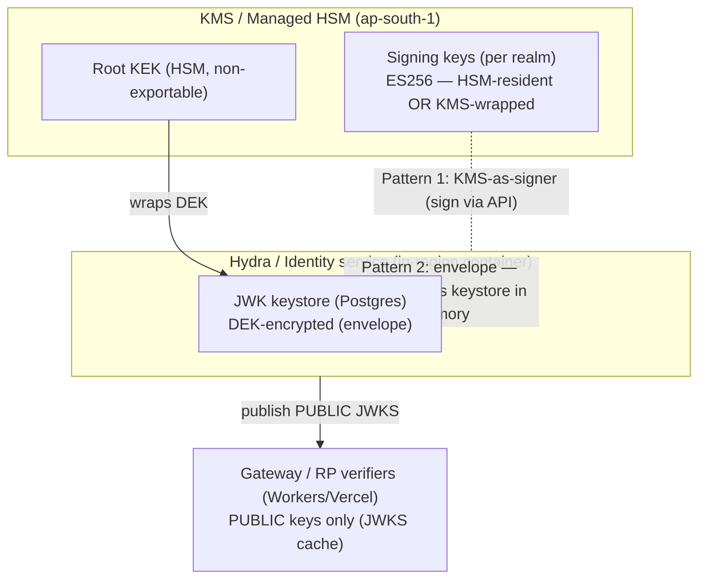
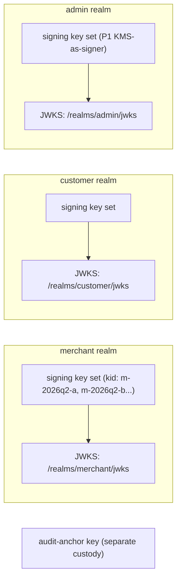
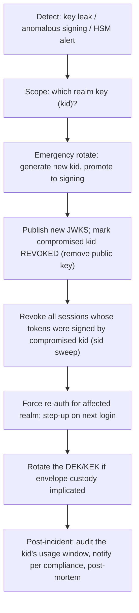

# KEY_MANAGEMENT_ARCHITECTURE

**Phase 17 — Document 2 of 5 (Key Management, KMS/HSM, JWKS Rotation)**
Status date: 2026-06-08
Status: Proposed (implementation-ready; no code). Closes readiness findings **G-4 (key ops), H-3 (key lifecycle)**.

> **Mandate.** Design key custody, the KMS/HSM model, per-realm asymmetric signing, JWKS publication + rotation, signing from a Cloudflare-Workers edge, a compromise runbook, the audit-anchor key, and the migration off today's symmetric env secrets.

> **Grounding (today's keys = symmetric secrets in env).** Confirmed from `apps/identity-platform/.env.local` and service config: `INTERNAL_API_SECRET`, `AUTH_SECRET`, `CUSTOMER_SESSION_SECRET`, `CSRF_SECRET`, `STORE_ACCESS_SIGNING_KEY`, `PREVIEW_SIGNING_KEY`, `PLATFORM_CONSOLE_SESSION_SECRET`, **`PLATFORM_CONSOLE_TOTP_SECRET` (a single shared admin TOTP secret)**. All are **symmetric, in environment variables**, on Vercel/Wrangler. The shared internal HMAC (`getLetbuyyInternalAuthSecret`, `auth-core/src/index.ts:447`) is the identity-forgery root the threat model flags (T13). The target replaces all of this with **per-realm asymmetric keys in a KMS/HSM, published via JWKS**.

---

## 1. The HSM/KMS reality check that picks the algorithm

`TOKEN_STRATEGY.md` §1 stated "EdDSA (Ed25519) preferred, RS256 fallback." **Correction for HSM-backed custody:** the major managed KMS/HSM services **do not offer Ed25519 signing**:

| KMS | Asymmetric signing algorithms (HSM-backed) | Ed25519? |
|-----|---------------------------------------------|:--------:|
| AWS KMS | ECDSA P-256/384/521 (**ES256**…), RSA (RS256/PSS) | ❌ |
| GCP Cloud KMS | EC P-256/P-384 (**ES256**…), RSA | ❌ |
| Azure Key Vault (Managed HSM) | ES256/ES256K/ES384, RS256 | ❌ |

> **Decision K-1:** if signing keys must live in an HSM you call (the strongest custody), use **ES256 (ECDSA P-256)** as the primary JWS algorithm. EdDSA remains acceptable **only** where keys live in software/Hydra's keystore (envelope-encrypted, not HSM-resident). ORY Hydra supports ES256 and RS256 natively. This corrects `TOKEN_STRATEGY.md` and is logged as a refinement, not a contradiction.

**Net:** `ES256` for HSM-custody realms (recommended for **admin**, and for merchant/customer if HSM-signing); `EdDSA` permitted only for software-key realms. JWKS advertises the `alg`/`kid`; verifiers (the gateway) support both. Pick one per realm and be consistent.

---

## 2. Key hierarchy & custody model



Two custody patterns; pick per realm by assurance need:

| Pattern | How | Custody | Latency | Use |
|---------|-----|---------|---------|-----|
| **P1 — KMS-as-signer** | private key never leaves HSM; Hydra/Identity call KMS `Sign` per token | strongest | +10–30ms/sign | **Admin realm**; high-value tokens |
| **P2 — Envelope-encrypted keystore** | signing key generated in Hydra, encrypted by a KMS-managed DEK (KEK in HSM), held in DB, unwrapped into memory at boot | strong | in-process (fast) | merchant/customer realms at volume |

**Verifiers never hold private keys.** The gateway (Workers) and RP apps verify with **public** keys fetched from JWKS — so the per-request hot path needs no HSM and no secret. Only the **issuers** (Hydra + the Identity service for federation/internal-subject tokens) sign. This cleanly resolves "signing from Workers": **Workers don't sign; they verify.**

---

## 3. Per-realm key separation



- **Separate key sets per realm** → a compromise of the customer realm's key cannot forge merchant or admin tokens (realm isolation, `REALM_ARCHITECTURE.md` §5).
- **Separate JWKS endpoint per realm**; each lists current + next + retiring public keys by `kid`.
- **Dedicated audit-anchor signing key** (for the hash-chain anchoring in `AUDIT_LOG_ARCHITECTURE.md` §6), in different custody from token-signing keys, so audit integrity survives a token-key compromise.

---

## 4. JWKS rotation (zero-downtime overlap)

```mermaid
sequenceDiagram
  participant IDP as Issuer (Hydra)
  participant JWKS as JWKS endpoint
  participant GW as Gateway (verifier, caches JWKS)

  Note over IDP,GW: T0 — current key kid=A active
  IDP->>JWKS: publish kid=B (next) alongside A
  GW->>JWKS: refresh cache → knows A and B
  Note over IDP: T1 — promote B to signing; A still published (verify-only)
  IDP->>JWKS: A=retiring, B=active
  Note over GW: tokens signed by A still verify (A public still served)
  Note over IDP: T2 — A drained (all A-signed tokens expired)
  IDP->>JWKS: remove A
  GW->>JWKS: refresh → only B (+ next C)
```

| Parameter | Value |
|-----------|-------|
| Scheduled rotation | every **90 days** per realm |
| Overlap window | ≥ max access+refresh lifetime of the realm (so no live token is orphaned) |
| Publish-ahead | next `kid` published before it signs (verifiers pre-trust) |
| Verifier cache | JWKS cached (TTL ~24h) **with fetch-on-unknown-`kid`** (immediate refresh if a token presents a new kid) |
| Emergency rotation | out-of-band (compromise) — see §6 |

**Fetch-on-unknown-kid** is the safety net: even if a verifier's cache is stale, a token signed by a freshly-rotated key triggers an immediate JWKS refresh rather than a false rejection. This makes rotation safe against cache lag — important on a globally-cached Workers edge.

---

## 5. Migrating off the symmetric env secrets

| Today (symmetric, in env) | Target | Priority |
|---------------------------|--------|----------|
| `INTERNAL_API_SECRET` / `getLetbuyyInternalAuthSecret` (identity-forgery root) | **Removed.** Replaced by IdP-signed tokens (JWKS) + mTLS workload identity (`ZERO_TRUST_ARCHITECTURE.md` §4) | **P0** |
| `AUTH_SECRET` (merchant session signing) | merchant realm signing key (KMS) | P0 |
| `CUSTOMER_SESSION_SECRET` | customer realm signing key (KMS) | P0 |
| `PLATFORM_CONSOLE_SESSION_SECRET` | admin realm signing key (KMS, P1) | P0 |
| **`PLATFORM_CONSOLE_TOTP_SECRET` (shared admin TOTP)** | **per-user** TOTP secrets in `authenticators.secret_ciphertext`, encrypted by a KMS DEK; shared secret deleted | **P0** (real weakness) |
| `CSRF_SECRET` | removed (CSRF model changes — `SESSION_MANAGEMENT.md` §7) | P1 |
| `STORE_ACCESS_SIGNING_KEY`, `PREVIEW_SIGNING_KEY` | low-risk host-only tokens; keep symmetric but **move to secret manager + rotate**, or fold into a scoped key | P2 |

The single most important key change is **deleting the shared internal HMAC secret** — it is the systemic identity-forgery root (Threat Model T13). It is removed only after every consumer verifies IdP tokens (Migration Plan Wave 7) + mTLS lands (Wave 8).

---

## 6. Key compromise runbook (the missing operational piece)



| Property | Design |
|----------|--------|
| Blast radius | **one realm** (per-realm keys) |
| Detection | KMS audit logs + anomalous-issuance alerts + the audit ledger |
| Containment | remove compromised public key from JWKS ⇒ all its tokens instantly fail verification |
| Recovery | new `kid` already publish-ahead-able; force re-auth; sessions revocable (`SESSION_MANAGEMENT.md`) |
| Practice | **rotation + compromise drill quarterly** (Ops checklist O3/O6) |

Removing the compromised key from JWKS is the kill switch: verifiers stop accepting its signatures immediately, unlike the current symmetric model where a leaked secret can't be "un-shared."

---

## 7. Secrets management (beyond crypto keys)

| Concern | Today | Target |
|---------|-------|--------|
| Crypto signing keys | symmetric in env | KMS/HSM (this doc) |
| App/service secrets (provider API keys, DB creds) | Vercel/Wrangler env | central secret manager (Vault/Doppler/cloud secret manager) + Wrangler Secrets / Vercel encrypted env; **least-privilege per service** |
| Rotation | manual/none | automated rotation + expiry alerts |
| Access | broad | per-service scoped; audited access |
| In-CI | — | no plaintext secrets in CI logs; OIDC-to-cloud for deploy |

KMS holds *cryptographic keys*; the secret manager holds *credentials*. Both in-region (`ap-south-1`) for residency.

---

## 8. Acceptance criteria

- Per-realm **asymmetric** signing keys in KMS/HSM (`ES256` for HSM custody; EdDSA only for software keys); separate JWKS per realm; dedicated audit-anchor key.
- Verifiers (Workers/RP) hold **public keys only**; no private key or shared secret on the edge.
- JWKS rotation is overlap-based + publish-ahead + fetch-on-unknown-kid; 90-day cadence; emergency path drilled.
- Shared `INTERNAL_API_SECRET`/HMAC removed from the identity path; `PLATFORM_CONSOLE_TOTP_SECRET` replaced by per-user factors; all token-signing env secrets migrated to KMS.
- Compromise runbook exists; blast radius is one realm; quarterly key drills scheduled.

Cross-references: HSM/KMS hosting + DR of keys → `IDENTITY_OPERATIONS_ARCHITECTURE.md`; algorithm origin/correction → `TOKEN_STRATEGY.md` §1; identity-forgery root → `THREAT_MODEL.md` T13 / `ZERO_TRUST_ARCHITECTURE.md` ZT2; per-user factor storage → `IDENTITY_DATA_MODEL.md` §3.
