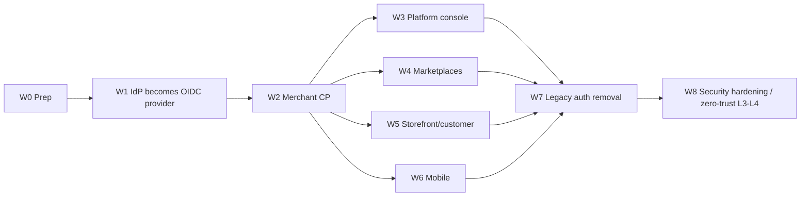

# MIGRATION_PLAN

**Phase 13 — Migration Strategy**
Status date: 2026-06-08
Posture: bridges from **today's actual implementation** (not the north-star) to the target. Every wave is independently shippable, flag-gated, and reversible.

> **Bridging principle (from Phase 2 §3).** Ownership of the *decision* moves before ownership of the *data*. The Identity Platform first becomes a façade over the gateway's existing `users_custom`/`sessions` tables, then issues standard tokens alongside the old ones (dual-run), then downstream flips to verifying Identity tokens, then the legacy paths are deleted. **No big-bang.**

> **Golden rule for every wave:** never a moment where a valid user is logged out or an invalid one admitted. Dual-accept old+new during each cutover; remove old only after new is proven.

---

## Wave map

W2 is the keystone (it proves the dual-run pattern on the highest-risk realm); W3–W6 then parallelize.

---

## Wave 0 — Preparation
**Goals.** De-risk before touching auth. Land the "quick wins" from the Threat Model that don't need OIDC.
- Inventory all callers of legacy Supabase auth routes (`/auth/signin`, `/auth/signin/otp/verify`, employee token route) and app-bridge token usage.
- **Hash `verification_tokens` at rest**; stop returning raw tokens in JSON (T14) — backward-compatible.
- Remove legacy `lb_csrf` acceptance after confirming no clients depend on it; unify `letbuyy_csrf` attributes (T2).
- Stand up the Foundation Refactor seams (Phase 14): `auth-core` relying-party SDK interface, cookie abstraction, key service skeleton, JWKS endpoint stub.
- Provision ORY Hydra (staging) + KMS for per-realm keys; define realms/clients (Phase 6) as config.

**Dependencies.** None (additive).
**Risks.** Removing `lb_csrf`/legacy routes could break an unknown caller → mitigated by Wave 0 inventory + log-based canary.
**Rollback.** Feature-flag each change; revert flag.
**Success criteria.** No raw tokens in bodies; single CSRF cookie; Hydra+KMS live in staging; SDK seams merged with no behavior change.

---

## Wave 1 — Identity Platform becomes the OIDC provider
**Goals.** Promote the *app named* Identity Platform into the login/consent provider for ORY Hydra, over the **existing** `users_custom`/`sessions` tables (façade — no data move yet).
- Implement Hydra login+consent callbacks in `apps/identity-platform`, verifying credentials via existing gateway custom-auth routes (reuse, don't rebuild).
- Publish per-realm discovery + JWKS; mint **ID + access tokens** for a single pilot first-party client (e.g. a throwaway internal app).
- Inject `org`(null for now)/`sites`/`amr` claims from the Commerce Membership API.
- Identity issues new tokens **in parallel**; nothing downstream depends on them yet.

**Dependencies.** Wave 0 (Hydra, keys, SDK seams).
**Risks.** Claim sourcing latency/correctness → cache + contract tests against Membership API.
**Rollback.** Pilot client only; disable provider flag — production auth untouched (still cookie/header based).
**Success criteria.** Pilot client completes auth-code+PKCE login via Hydra, receives a JWKS-verifiable token with correct claims; SSO session cookie established on `id.letbuyy.com`.

---

## Wave 2 — Merchant control plane migration (keystone)
**Goals.** Make the merchant control plane an OIDC RP and make the **gateway verify Identity tokens** alongside the legacy opaque-session/internal-header path (dual-accept).
- Merchant CP swaps `merchantApiFetch()` internal-header signing for "attach Bearer access token"; obtains tokens via OIDC (Phase 7).
- Gateway `authMiddleware` gains an **Identity-token branch**: verify EdDSA via JWKS, check aud/realm/sid → build the same `AuthContext`. Keep the internal-session and internal-identity branches active (dual-run).
- Introduce host-only CP cookie + IdP SSO session; **keep `lb_session` working** for not-yet-migrated apps.
- Add revoked-`sid` cache wiring.

**Dependencies.** Wave 1.
**Risks.** Highest in the program — the merchant hot path. → Canary by % of merchants; shadow-verify (verify Identity token but still authorize on legacy path, compare) before enforcing; instant flag flip back to legacy.
**Rollback.** Per-merchant flag → revert to internal-header path; both run simultaneously, so rollback is a config change, not a deploy.
**Success criteria.** N% of merchants run fully on Identity tokens with parity error rate ≤ legacy; remote logout works for migrated merchants; no cross-tenant regressions in shadow compare.

---

## Wave 3 — Platform console (admin realm) migration
**Goals.** Console becomes an admin-realm OIDC RP; sessions become server-revocable; optional corporate-IdP federation.
- Replace `lb_console_session` signed token with admin-realm OIDC + revocable `sid`; keep MFA mandatory (already enforced).
- Federate to Google/Okta if available; else keep allowlist+magic-link+TOTP behind the realm.
- Begin constraining the `platform-console@letbuyy.local` synthetic principal.

**Dependencies.** Wave 1 (provider), Wave 2 (gateway Identity-token branch proven).
**Risks.** Locking out staff → keep legacy console login as break-glass behind a flag during cutover; on-call runbook.
**Rollback.** Flag back to `lb_console_session`.
**Success criteria.** Staff log in via admin realm with MFA; sessions remotely revocable; synthetic principal scoped down; audit events flowing.

---

## Wave 4 — Marketplace migration (apps + themes + 3rd-party OAuth)
**Goals.** Theme/app marketplaces become merchant-realm RPs with **silent SSO**; 3rd-party app OAuth migrates from the bespoke issuer to Hydra with **consent**.
- Theme/app marketplaces use `prompt=none` SSO (Phase 7 §3); replace browser app-bridge token with scoped short-lived embedded-app tokens.
- 3rd-party app OAuth: stand up Hydra OAuth clients; **dual-run** the bespoke `createAppScopedAccessToken` issuer and Hydra; migrate app developers via versioned endpoints; add consent screen + grant registry.
- M2M `site_api_clients` → client-credentials grant (dual-run).

**Dependencies.** Wave 1, Wave 2.
**Risks.** Breaking installed 3rd-party apps → long dual-run, developer comms, deprecation window; keep old token validation until app traffic drains.
**Rollback.** Per-client flag; bespoke issuer stays until drained.
**Success criteria.** Marketplaces SSO with no reauth; new app installs use Hydra OAuth + consent; ≥X% app traffic on new tokens; zero raw tokens in new flows.

---

## Wave 5 — Storefront / customer migration
**Goals.** Collapse the **two** customer session systems (host-only 7d JWT + gateway 30m JWT) into **one** revocable customer-realm session; storefront + checkout become customer-realm RPs; custom-domain SSO via OIDC/federation.
- Issue customer-realm sessions; dual-accept legacy `lb_customer_session` JWT during cutover.
- Replace checkout HMAC handoff with token-exchange (Phase 7 §4), keeping `checkout_sessions` persistence.
- Generalize `createCustomerFederationToken` for cross-domain (already single-use/replay-safe).
- Decide the checkout customer-login requirement (Phase 1 UNKNOWN #5) as a product call.

**Dependencies.** Wave 1, Wave 2 pattern.
**Risks.** Highest *volume* realm; conversion-sensitive → ramp by store cohort; guest checkout must never regress; watch checkout conversion metrics as a guardrail.
**Rollback.** Per-store flag → legacy customer JWT.
**Success criteria.** One customer session type live for migrated stores; checkout works via token-exchange; cross-domain SSO works; conversion flat or better.

---

## Wave 6 — Mobile migration
**Goals.** Merchant mobile becomes a native OIDC client (system browser + PKCE) via the BFF pattern; `lb_session`-in-secure-storage becomes a rotating refresh token.
- Mobile app does auth-code+PKCE in system browser; BFF (confidential client) holds tokens; device gets opaque session ref.
- Mobile MFA via passkey/TOTP using `merchant_2fa_factors`.
- Dual-run: BFF accepts legacy `lb_session` transport until app versions update (respecting app store update lag).

**Dependencies.** Wave 1, Wave 2.
**Risks.** App-store update lag → long dual-run; forced-update floor for the oldest versions.
**Rollback.** BFF keeps legacy `extractMobileSessionToken()` path.
**Success criteria.** New app builds auth via OIDC/PKCE; refresh rotation on device; legacy transport drained below threshold before removal.

---

## Wave 7 — Legacy auth removal
**Goals.** Delete the parallel systems once traffic has drained.
- Remove gateway internal-identity-header branch (`getInternalAuthContext` app-asserted identity) and internal-session branch once all apps present Identity tokens.
- Delete legacy Supabase auth routes (`/auth/signin`, OTP, employee token) and the raw-token JSON responses.
- Collapse `users` + `users_custom` into the unified `principals` directory; migrate `lb_accounts` switcher to IdP account-linking.
- Remove domain-wide `lb_session`, `lb_accounts`, JS-readable CSRF cookie.

**Dependencies.** Waves 2–6 complete and drained (telemetry-gated).
**Risks.** Premature deletion locks someone out → delete strictly behind "zero traffic for N days" metrics per path; keep DB backups + reversible migrations.
**Rollback.** Re-enable a removed branch via flag within the deprecation window; keep code dark-shipped for one release before hard delete.
**Success criteria.** No code path trusts app-asserted identity; no raw tokens anywhere; single identity directory; cookie matrix matches Phase 8 target.

---

## Wave 8 — Security hardening (zero-trust L3–L4)
**Goals.** Finish the zero-trust ladder (Phase 12 §8).
- Replace shared internal HMAC secret with **mTLS workload identity**; rotate out `getLetbuyyInternalAuthSecret` from the identity path.
- Decompose service-role into least-privilege per-domain/worker DB principals; RLS as real second layer.
- Enforce merchant MFA + step-up for all sensitive ops; privilege-change session rotation; device revocation UI.
- Eliminate/scope the synthetic admin principal; break-glass-only elevation with audit; key rotation drills.

**Dependencies.** Wave 7.
**Risks.** mTLS rollout complexity → phase per service pair; service-role decomposition could break a missed query → shadow-deny logging before enforce.
**Rollback.** Per-service-pair flags; keep HMAC path dark until mTLS proven.
**Success criteria.** Zero shared-secret identity forgery path; least-privilege data access; full MFA enforcement; passing key-rotation + break-glass drills.

---

## Cross-wave guardrails

| Guardrail | Rule |
|-----------|------|
| **Dual-accept everywhere** | Every cutover accepts old+new simultaneously; remove old only on drained telemetry. |
| **Shadow before enforce** | Verify/authorize on new path in shadow, compare to legacy decision, alert on divergence before flipping. |
| **Flag-gated + cohorted** | Per-merchant / per-store / per-app-version flags; ramp by cohort; instant revert. |
| **Metrics as gates** | Auth error rate, login success, checkout conversion, cross-tenant alerts, legacy-path traffic — each wave advances only when green. |
| **Reversible migrations** | DB changes are additive + reversible; backups before destructive steps. |
| **`node scripts/validate-governance.mjs`** | Run after any topology/import/env/governance change (per repo `CLAUDE.md`/`AGENTS.md`). |

---

## Sequencing rationale (one line)

> Prove the dual-run pattern on the **merchant keystone (W2)** behind the **new provider (W1)** built on **de-risked foundations (W0)**; then **parallelize** console/marketplace/storefront/mobile (W3–W6); only then **delete legacy (W7)** and **harden to zero trust (W8)**.

Phase 14 specifies the foundation refactors W0 must land first.
