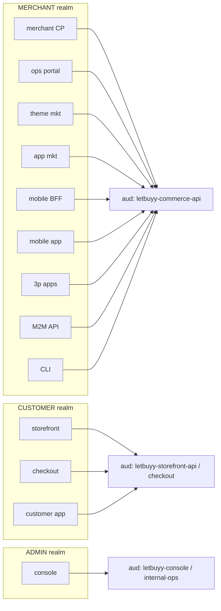

# OIDC_CLIENT_INVENTORY

**Phase 6 — OIDC Client Inventory**
Status date: 2026-06-08

> Every application/agent that integrates with the Identity Platform is an OIDC/OAuth2 **client**. This document classifies each by client type, realm, grant, redirect URIs, scopes, claims, session behavior, and refresh strategy. Client typing drives the security posture (public clients require PKCE and cannot hold secrets; confidential clients can).

**Client-type rules (applied throughout):**
- **Confidential** — server-side, can keep a secret. Grant: auth-code + PKCE (defense in depth) or client-credentials. Refresh tokens allowed.
- **Public** — browser SPA / native, cannot keep a secret. Grant: auth-code + **PKCE mandatory**. Short refresh with rotation; no client secret.
- **Native** — mobile/desktop. Auth-code + PKCE via system browser; refresh in secure storage.
- **Machine-to-machine (M2M)** — no user. Grant: **client-credentials**. No refresh (re-request).

---

## 1. Client register (summary)

| # | Client | Realm | Type | Grant(s) | Today's mechanism (evidence) |
|---|--------|-------|------|----------|------------------------------|
| 1 | Merchant control plane | Merchant | Confidential | auth-code+PKCE | reads `lb_session`, signs internal headers (`merchant-control-plane/src/lib/api/client.ts`) |
| 2 | Identity Platform (login/consent app) | all (special) | Confidential (1st-party) | — (it *is* the login/consent provider for Hydra) | `apps/identity-platform` |
| 3 | Platform console | Admin | Confidential | auth-code+PKCE | `lb_console_session` + magic-link + TOTP |
| 4 | Platform operations portal | Merchant (+ ops claims) | Confidential | auth-code+PKCE | reuses merchant `lb_session` (`platform-operations-portal/src/proxy.ts`) |
| 5 | Storefront runtime | Customer | Confidential | auth-code+PKCE | host-only `lb_customer_session` JWT |
| 6 | Checkout | Customer | Confidential | auth-code+PKCE / token-exchange | signed handoff `CHECKOUT_SIGNING_SECRET` (`gateway/src/routes/checkout.ts`) |
| 7 | Theme marketplace | Merchant | Confidential | auth-code+PKCE | reads `lb_session`, signs internal headers |
| 8 | App marketplace | Merchant | Confidential | auth-code+PKCE | reads `lb_session`; app-bridge token in browser |
| 9 | Mobile BFF | Merchant | Confidential | auth-code+PKCE (on behalf of native) | `extractMobileSessionToken()` → internal headers (`mobile-bff/src/index.ts`) |
| 10 | Merchant mobile app | Merchant | **Native/Public** | auth-code+PKCE via system browser | Flutter secure storage `lb_session` |
| 11 | 3rd-party marketplace apps | Merchant (delegated) | Confidential **or** Public | auth-code+PKCE; client-credentials | `createAppScopedAccessToken()` custom OAuth (`auth-core/src/index.ts:1013`) |
| 12 | Merchant API clients (M2M) | Merchant | M2M | client-credentials | `site_api_clients` (`key_hash`,`scopes[]`) |
| 13 | Future customer app (native) | Customer | Native/Public | auth-code+PKCE; device-code | — (greenfield) |
| 14 | Future CLI | Merchant | Public | **device-code**; PKCE | — (Phase 1 UNKNOWN #6) |
| 15 | Background workers | — (no user) | M2M (internal) | client-credentials / mTLS | service-role today (`queue-workers`) |

---

## 2. Detailed client specifications

### 2.1 Merchant control plane (#1)
- **Type / grant:** Confidential, auth-code + PKCE.
- **Redirect URIs:** `https://app.letbuyy.com/auth/callback`, `https://{merchant-subdomain}.letbuyy.com/auth/callback` (wildcard host registered, exact-path), local dev `http://localhost:3000/auth/callback`.
- **Scopes:** `openid profile email merchant:read merchant:write org:read`.
- **Claims consumed:** `sub, realm=merchant, org, sites, amr, sid`.
- **Session behavior:** Receives short-lived access token; relies on IdP SSO session for silent renewal (`prompt=none`). No domain-wide cookie.
- **Refresh:** Rotating refresh token (confidential), bound to client + `sid`.

### 2.2 Identity Platform login/consent app (#2)
- **Special role:** This is **not** a normal RP — it is the **login & consent provider** that ORY Hydra calls back to (Phase 5). It authenticates the user against owned stores and returns the accept-login/accept-consent responses (with `org`/claims). It holds Hydra admin credentials (confidential, mTLS).

### 2.3 Platform console (#3)
- **Type / grant:** Confidential, auth-code + PKCE; **MFA mandatory**; federated to corporate IdP preferred.
- **Redirect URIs:** `https://console.letbuyy.com/auth/callback` only (single host, no wildcard).
- **Scopes:** `openid profile email admin:console ops:read ops:write` (granted per staff role).
- **Claims:** `sub, realm=admin, roles, amr (must include otp/webauthn), sid`.
- **Session:** Short (idle 30m / abs 8h). No long refresh — re-auth.
- **Refresh:** Short rotating or none; step-up re-prompt for sensitive ops.

### 2.4 Ops portal (#4)
- Merchant realm + ops claims. Same as merchant client but additionally requires `ops:*` scope grant. Redirect `https://ops.letbuyy.com/auth/callback`.

### 2.5 Storefront runtime (#5)
- **Type / grant:** Confidential, auth-code + PKCE. **Per-store + custom-domain hosts.**
- **Redirect URIs:** `https://{store}.letbuyy.com/auth/callback` and registered **custom domains** `https://{merchant-custom-domain}/auth/callback` (managed via the custom-domain reconcile flow already in the gateway).
- **Scopes:** `openid customer:self store:{store_id}` (store-scoped).
- **Claims:** `sub, realm=customer, store_id, amr, sid`. **Never** merchant/org/admin claims.
- **Session:** Long (idle 30d / abs 90d). Guest browsing requires no token.
- **Refresh:** Rotating, host-bound; cross-domain via federation token (§3).

### 2.6 Checkout (#6)
- **Type / grant:** Confidential. Two modes: (a) **token-exchange** from the storefront customer token to a checkout-audience token (preferred over today's HMAC handoff); (b) guest checkout with a signed cart token (no identity).
- **Redirect URIs:** `https://checkout.letbuyy.com/callback` (+ custom-domain checkout hosts).
- **Scopes:** `checkout:session customer:self`.
- **Claims:** `sub (or guest), store_id, cart_id, amr`.
- **Session:** Ephemeral, scoped to the checkout. Replaces `checkout_sessions` HMAC handoff with a verifiable token while keeping `checkout_sessions` persistence.
- **Refresh:** None (short-lived; re-issued from storefront session).

### 2.7 Theme marketplace (#7) & App marketplace (#8)
- **Type / grant:** Confidential, auth-code + PKCE, **silent SSO** (`prompt=none`) from the merchant session — the core SSO requirement (Phase 7).
- **Redirect URIs:** `https://themes.letbuyy.com/auth/callback`, `https://apps.letbuyy.com/auth/callback`.
- **Scopes:** `openid profile merchant:read marketplace:read marketplace:install`.
- **Claims:** `sub, realm=merchant, org, sites, amr, sid`.
- **Session/refresh:** Short access token via SSO; rotating refresh. The app-marketplace browser **app-bridge token** (Audit §Client-Side Exposure) is replaced by a scoped, short-lived token minted per embedded-app session.

### 2.8 Mobile BFF (#9) + Merchant mobile (#10)
- **Pattern:** The native app (#10) is a **public/native client** doing auth-code + PKCE via the **system browser** (not embedded webview). The **Mobile BFF (#9)** is a confidential client that does **token-handling on the server** (BFF pattern): the native app gets an opaque session reference; the BFF holds tokens. This removes long-lived `lb_session` from device storage as the trust anchor.
- **Redirect URIs:** custom scheme `com.letbuyy.merchant://auth/callback` + universal link `https://app.letbuyy.com/mobile/callback`.
- **Scopes:** `openid profile email merchant:read merchant:write offline_access`.
- **Refresh:** `offline_access` rotating refresh in **device secure storage** (or held by BFF in the BFF model). Today's `lb_session` in `FlutterSecureStorage` becomes a rotating refresh token, not a 30-day bearer.

### 2.9 Third-party marketplace apps (#11)
- **Type / grant:** Confidential (server apps) or Public (SPA/native) — auth-code + PKCE; plus **client-credentials** for background app jobs. **Consent screen required** (new — today there's no consent record).
- **Redirect URIs:** developer-registered per app (validated, exact-match, https-only).
- **Scopes:** granular commerce scopes (`orders:read`, `products:write`, `webhooks:manage`, …) — formalizes today's app scopes.
- **Claims/token:** app-scoped access token with `app_id, installation_id, site_id, scopes` (today's `LetbuyyAppAccessTokenPayload`, `auth-core/src/index.ts:331`).
- **Refresh:** rotating refresh with reuse-detection (today already rotates — `billing-oauth-routes.ts`); **stop returning raw tokens in JSON beyond the one-time issuance** and keep storing hashes.

### 2.10 Merchant API clients / M2M (#12)
- **Type / grant:** M2M, **client-credentials**. Replaces direct `site_api_clients` key checks with a standard grant that still records `key_hash`,`scopes[]`,`expires_at`.
- **Claims/token:** `client_id, site_id/org, scopes`; no user `sub`.
- **Refresh:** none; re-request with credentials. Rotation = new client secret.

### 2.11 Future customer app (#13) & CLI (#14)
- **Customer app:** native/public, auth-code + PKCE + device-code for TV/limited-input; customer realm scopes only.
- **CLI:** public, **device-code grant** (RFC 8628) + PKCE; merchant realm; short tokens; `offline_access` optional. Resolves Phase 1 UNKNOWN #6.

### 2.12 Background workers (#15)
- Internal M2M via client-credentials or mTLS service identity; **not** service-role-as-god. Each worker gets a narrowly-scoped service principal. Removes blanket service-role from the identity trust path where feasible.

---

## 3. Cross-cutting client policies

| Policy | Rule |
|--------|------|
| **PKCE** | Mandatory for all public/native clients; applied to confidential clients too (defense in depth). |
| **Redirect URI validation** | Exact-match, https-only (except localhost dev), no open wildcards in path; host wildcards only for the registered storefront/custom-domain pattern. |
| **Refresh rotation** | All refresh tokens rotate on use with reuse-detection → revoke chain on reuse (Phase 8/9). |
| **Scope minimization** | Clients request least scope; sensitive scopes (`merchant:write`, `ops:*`, `marketplace:install`, payouts) require step-up `amr`. |
| **Consent** | Required for 3rd-party (#11) and CLI (#14); skipped for first-party clients (trusted, `skip_consent`). |
| **Audience pinning** | Each client's tokens carry a resource `aud`; gateway rejects mismatched audience (Phase 4 §5). |
| **Silent SSO** | First-party merchant clients (#1,4,7,8) use `prompt=none` against the IdP SSO session for no-reauth navigation. |
| **Logout** | All clients register front-channel + back-channel logout URIs for global logout propagation (Phase 7/8). |

---

## 4. Client → realm → audience map

No client appears in two realms. The only principal that legitimately crosses (operator impersonating a merchant) is handled by the Identity-minted impersonation token (Phase 4 §6), not by registering a client in two realms.

Phase 7 designs how the merchant clients achieve single sign-on across the merchant realm.
