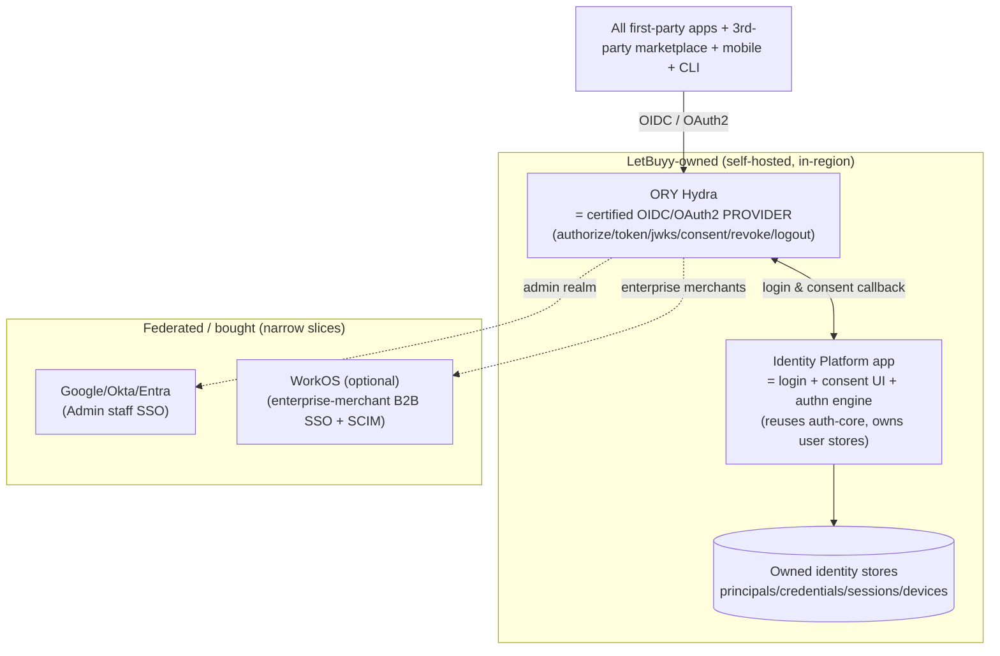

# OIDC_DECISION_RECORD

**Phase 5 — OIDC Provider Decision Analysis**
Status date: 2026-06-08
Decision type: Architecture Decision Record (ADR). Status: **Proposed** (recommendation below; final sign-off is a human decision).

> **Brief.** Score five options — (A) Custom OIDC, (B) Keycloak, (C) Authentik, (D) ORY, (E) Managed — across nine criteria and recommend. The recommendation must respect the constraints surfaced in Phases 1–4 and the project context (India-first, cost-sensitive, marketplace ecosystem, existing custom primitives).

---

## 1. The decision frame (constraints that actually drive this)

Before scoring, four constraints from the evidence collapse the option space:

1. **Tenancy is org-as-claim, not realm-per-tenant.** 100k merchants are **not** 100k OIDC realms. The realms are 3 (merchant/customer/admin); a merchant is an `org` claim within the merchant realm (Phase 4 §2). **Any option whose multi-tenant story is "a realm per tenant" is disqualified at scale** — this directly penalizes Keycloak/Authentik if used that way.
2. **LetBuyy must own the customer relationship and data.** India-first, millions of shoppers, cost-sensitive (memory: "0%-fee pricing, kill GMV rake"). Paying per-MAU managed pricing for the *customer* realm is a strategic and cost risk. Data residency favors self-hosting the consumer realm.
3. **The protocol layer is the risky part, not the user store.** They already own user stores (`users_custom`, `store_customers`, `employees`) and login UIs (`identity-platform`). What they lack is a *certified* OIDC/OAuth2 protocol engine (PKCE, discovery, JWKS rotation, consent, refresh rotation, RP/back-channel logout). The audit shows hand-rolled auth already produced real defects (raw tokens in JSON, dual CSRF, app-asserted identity). **Hand-rolling the *protocol* multiplies that surface at higher stakes.**
4. **Marketplace already needs to be an OAuth2 provider.** `createAppScopedAccessToken()` (iss `letbuyy-app-platform`, aud `letbuyy-commerce-api`) is a custom OAuth2 issuer today. The chosen tech must be a first-class **OAuth2/OIDC *provider*** (for 3rd-party apps), not just an SSO consumer.

These four mean the ideal is: **a headless, certified OIDC/OAuth2 provider that delegates login/consent to LetBuyy's own UI and user stores, self-hostable in-region, that treats tenant as a claim.**

---

## 2. Scoring

Scale 1–5 (5 = best fit for LetBuyy). "Operational simplicity" is scored so 5 = simplest. Weights reflect LetBuyy's situation (sum = 100%).

| Criterion | Weight | A. Custom | B. Keycloak | C. Authentik | D. ORY | E. Managed |
|-----------|:------:|:---------:|:-----------:|:------------:|:------:|:----------:|
| Scalability (millions MAU) | 15% | 3 | 3 | 2 | 5 | 4 |
| Multi-tenancy (org-as-claim) | 14% | 4 | 2 | 2 | 4 | 3 |
| Merchant-ownership / B2B SSO model | 10% | 3 | 3 | 3 | 4 | 5 |
| Custom claims | 8% | 5 | 4 | 4 | 5 | 3 |
| Marketplace OAuth2-provider | 12% | 3 | 3 | 3 | 5 | 3 |
| Extensibility | 10% | 5 | 3 | 4 | 4 | 2 |
| Operational simplicity | 10% | 2 | 2 | 3 | 3 | 5 |
| Security (protocol correctness) | 12% | 2 | 4 | 4 | 5 | 5 |
| Long-term maintainability | 9% | 2 | 3 | 3 | 4 | 4 |
| **Weighted total** | 100% | **3.18** | **2.98** | **2.97** | **4.44** | **3.74** |

**Weighted totals (rounded):** ORY **4.44** · Managed **3.74** · Custom **3.18** · Keycloak **2.98** · Authentik **2.97**.

---

## 3. Per-option analysis

### A. Custom OIDC provider (build the protocol on `auth-core`)
- **For:** Maximum control; reuses `auth-core` (already an OAuth2-ish issuer + federation token + session table); no new runtime; perfect custom claims.
- **Against:** You become responsible for the *certified* correctness of OIDC/OAuth2 forever — PKCE, nonce/state, discovery, JWKS rotation, refresh rotation with reuse-detection, RP-initiated + back-channel logout, consent, token revocation, the long tail of RFC edge cases and CVEs. The audit already shows hand-rolled auth shipping defects (raw tokens in JSON, dual CSRF, app-asserted identity headers). Hand-rolling the protocol layer institutionalizes that risk. **Security 2, maintainability 2.**
- **Verdict:** Rejected as the *protocol* engine. Its value is captured by reusing `auth-core` as the login/authn layer *behind* a real provider.

### B. Keycloak
- **For:** Mature, batteries-included (user store + login themes + admin console + SAML/OIDC federation), strong for **staff/enterprise SSO**, free.
- **Against:** Its model wants to **own users** — migrating millions of store-scoped customers into Keycloak is a heavy lift and an ongoing impedance mismatch with `store_customers`. Its classic multi-tenant pattern is **realm-per-tenant**, which does not scale to 100k merchants (the Organizations feature is newer/heavier and still not "tenant = claim"). JVM ops + memory footprint at scale; login-flow customization is Java SPI work. **Scalability 3, multi-tenancy 2.**
- **Verdict:** Not the core. **Viable narrowly for the Admin realm** (staff SSO) if a turnkey console is wanted there.

### C. Authentik
- **For:** Modern, Python, pleasant flows engine, good for internal/SaaS SSO, self-hostable.
- **Against:** Smallest ecosystem and least battle-tested at **millions-of-consumer** scale; same "owns users" tension; fewer references for high-volume commerce. **Scalability 2.**
- **Verdict:** Rejected as the core; fine for internal SSO if Keycloak weren't already a stronger admin option.

### D. ORY (Hydra + optional Kratos)
- **For:** **ORY Hydra is a certified, headless OAuth2/OIDC *provider* that stores no passwords** — it delegates login and consent to *your* app (the existing `identity-platform`) and *your* user stores. This is an almost-exact match to LetBuyy's reality (Phase 5 §1.3): you keep your stores, UIs, and custom claims, and gain a standards-correct protocol engine. Stateless token verification, horizontal scale, purpose-built as a provider for ecosystems (the marketplace use case). Custom claims via the consent response. Tenant-as-claim is natural (Hydra doesn't care about tenancy; your login/consent app injects `org`). ORY Kratos can later own identity flows if you want to stop hand-maintaining them, but it's **optional**. **Scalability 5, marketplace 5, security 5.**
- **Against:** Two moving parts (Hydra + your login/consent app) and you still write the login/consent UI (you already have it). Self-hosted ops (mitigated by simple, stateless, container-native deployment). Kratos adoption is a separate, later decision.
- **Verdict:** **Recommended core.** It promotes existing primitives into a certified protocol layer instead of hand-rolling OIDC.

### E. Managed (WorkOS / Auth0 / Clerk / Cognito / Supabase Auth)
- **For:** Fastest protocol correctness and least ops; **WorkOS** is purpose-built for **B2B SSO + SCIM** (the "enterprise merchant brings their own IdP" feature) and Admin staff SSO; Auth0/Clerk have excellent DX.
- **Against:** Per-MAU pricing at **millions of shoppers** is a major cost and lock-in risk; data residency (India) and owning the customer relationship argue against managed for the *customer* realm; Cognito multi-tenant/DX is weak; Supabase Auth is already partly present and is *not* a full multi-realm OIDC provider for this scale. **Operational simplicity 5, but multi-tenancy/cost 3, extensibility 2.**
- **Verdict:** Rejected as the core for the customer realm. **Strategically valuable for one narrow slice:** enterprise-merchant B2B SSO/SCIM and possibly Admin staff SSO, where volumes are low and standards-compliance/maintenance savings are worth the spend.

---

## 4. Recommendation

> **Adopt a hybrid: ORY Hydra as the OIDC/OAuth2 protocol engine for all three realms, fronted by LetBuyy's own login/consent/authn app (the promoted Identity Platform) over LetBuyy-owned user stores. Use external-IdP federation (OIDC/SAML) for the Admin realm and for enterprise-merchant "bring-your-own-IdP" SSO; if/when B2B SSO+SCIM demand is real, buy WorkOS for that narrow slice only. Do NOT hand-roll the OIDC protocol, and do NOT put the millions-scale customer realm on per-MAU managed pricing.**

**Why this wins (mapped to the four constraints):**
1. Tenant-as-claim — Hydra is tenancy-agnostic; the login/consent app injects `org`/`sites`. No realm-per-tenant. ✔
2. Own the customer relationship + data, in-region — Hydra + stores are self-hosted; no per-MAU tax on shoppers. ✔
3. Don't hand-roll the protocol — Hydra is certified; LetBuyy keeps only the login/consent UI it already has. ✔
4. First-class OAuth2 provider for the marketplace — exactly Hydra's purpose; replaces the bespoke `createAppScopedAccessToken` issuer with a standard one. ✔

---

## 5. What would change this recommendation

A principal decision states its own falsifiers:

| If… | Then prefer… |
|------|--------------|
| The team has **no appetite to operate any self-hosted identity infra** and cost at scale is acceptable | Managed (Auth0/Clerk) for customer realm + WorkOS for B2B — re-score Operational simplicity to dominate |
| A turnkey **admin console + user management UI** is wanted and staff/enterprise SSO is the *primary* near-term need | Keycloak for the Admin realm specifically (still not for customer realm) |
| Leadership wants to **stop maintaining login/credential flows entirely** | Add **ORY Kratos** (or Managed) behind Hydra to own identity flows, reducing custom login code |
| Marketplace/ecosystem ambitions shrink and OIDC-provider needs disappear | Reconsider Custom — but the security-maintenance argument still disfavors it |

---

## 6. Decision log

- **Chosen:** ORY Hydra (protocol) + LetBuyy Identity Platform (login/consent/authn) + federation for admin/enterprise; WorkOS optional for B2B-SSO slice.
- **Rejected:** Custom OIDC protocol (security-maintenance burden), Keycloak/Authentik as core (realm-per-tenant + owns-users mismatch at consumer scale), full Managed for customer realm (cost/residency/lock-in).
- **Open questions for sign-off:** (a) adopt Kratos now or keep owned stores behind Hydra; (b) buy WorkOS now or defer until first enterprise-merchant SSO request; (c) Hydra deployment target (k8s vs managed-container).

Phase 6 inventories every client that will integrate with this provider.
