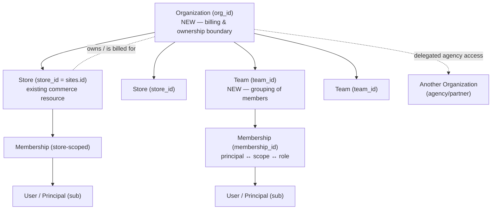
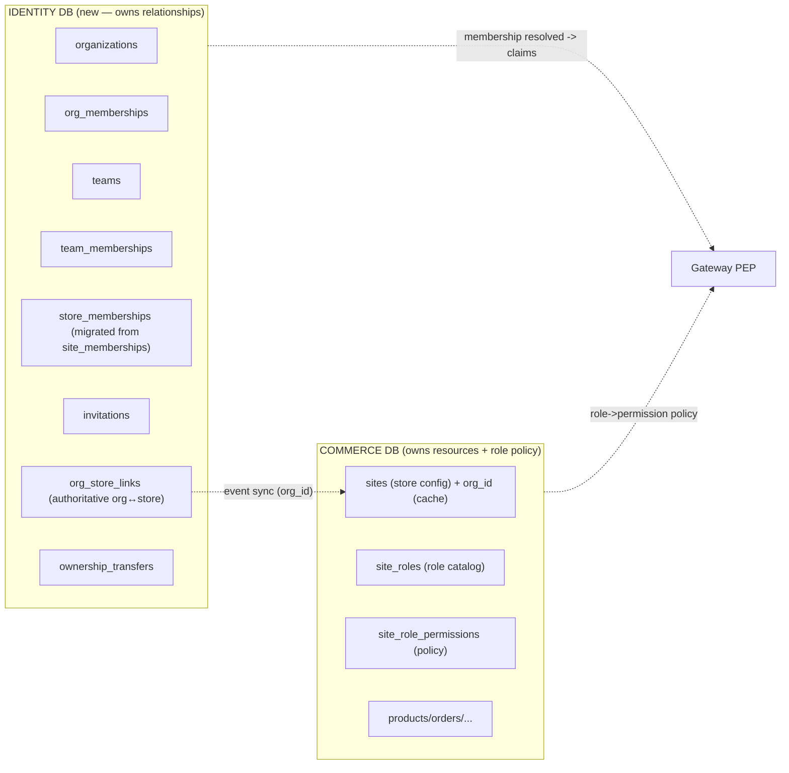
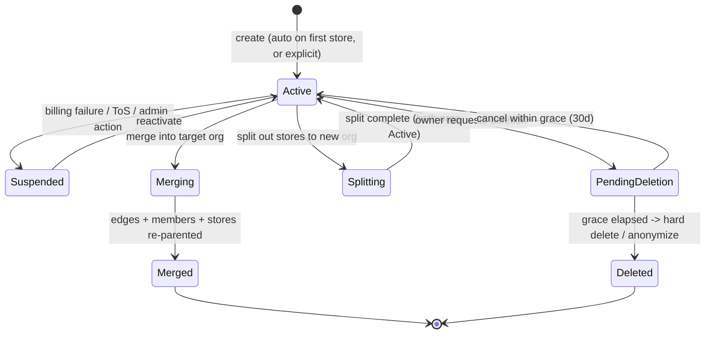
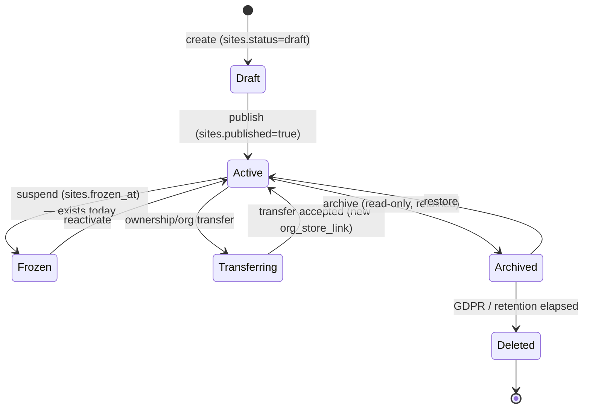
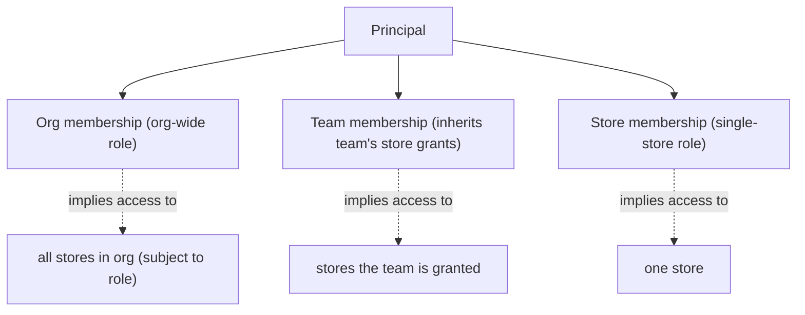
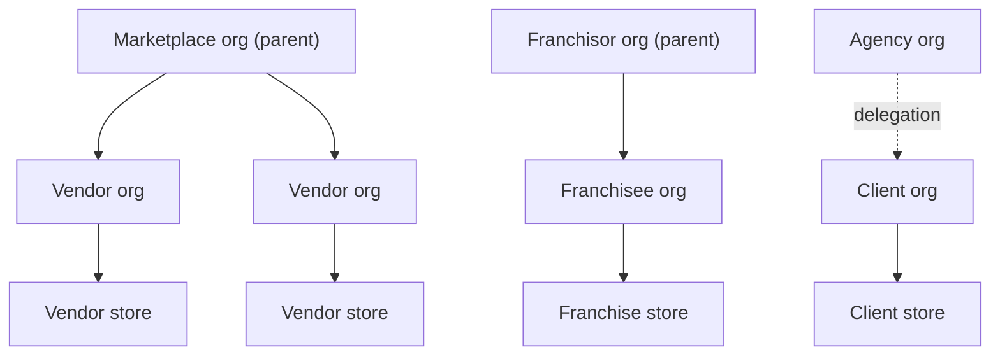

# ORGANIZATION_ARCHITECTURE

**Phase 16 — Document 1 of 4 (Organization & Tenancy)**
Status date: 2026-06-08
Status: Proposed (implementation-ready architecture; no code).

> **Mandate.** Design the complete organization hierarchy. The audit established that **no org/team layer exists** — tenancy is keyed on `site_id` only, `merchant_id` simply maps to `site.id`, and `organization_id`/`tenant_id` are UNKNOWN (`AUTH_AUDIT_REPORT.md` §Multi-Tenant Security). Confirmed against schema: `grep organization_id|org_id` over all migrations returns nothing; `sites` has no `org_id` column. This document introduces Organization, Team, and Membership as first-class architecture on top of the existing store (`sites`) and principal (`users_custom`) primitives.

> **Boundary evolution (read this first).** `TARGET_AUTH_ARCHITECTURE.md` §4 stated "store-membership *data* stays in Commerce (`site_memberships`)." Phase 16 **refines** that: the *relationship graph* (who belongs to which org/team/store, with what role) is an **identity-tenancy concern** and moves to an Identity-owned **Org & Relationship Graph**; Commerce keeps **resource records** (`sites` config, products, orders) and the **role→permission catalog policy**. This is a deliberate change, logged in `IMPLEMENTATION_READINESS_REVIEW.md` as Finding A-1. Rationale: org/team/store membership is the same kind of object (a principal↔resource relationship) and splitting it across two services creates the split-brain the audit already shows (two RBAC systems: `site_*` and `employee_*`). Unifying it as one relationship graph is how Google (Zanzibar), AWS (IAM), Stripe, and Shopify all model tenancy.

---

## 1. The hierarchy

Five first-class concepts, four of them new:

| Concept | ID | New? | Definition | Authority |
|---------|----|----|-----------|-----------|
| **Principal (User)** | `sub` / `principal_id` | exists (`users_custom`) | A human identity in the merchant realm | Identity Platform |
| **Organization** | `org_id` | **NEW** | The top-level ownership + billing + policy boundary; a container of stores and members | Identity Platform |
| **Store** | `store_id` (= `sites.id`) | exists (`sites`) | A commerce storefront/site; the resource | **Commerce core** (record) + Identity (membership) |
| **Team** | `team_id` | **NEW** | A named group of members within an org, for bulk role assignment | Identity Platform |
| **Membership** | `membership_id` | partial (`site_memberships`) | A principal's relationship to an org/team/store with a role | Identity Platform (graph) |

---

## 2. Ownership boundaries (the questions, answered)

| Question | Answer | Evidence / rationale |
|----------|--------|----------------------|
| **Who owns stores?** | An **Organization** owns stores (1 org → N stores). Today a store is owned by a user (`sites.custom_user_id`/`user_id`). Migration: every existing store gets an auto-created single-member org. | `sites.custom_user_id` exists; no org today |
| **Who owns organizations?** | An org is owned by one or more **Owner principals** (org-owner membership). Ownership is a membership role, not a column, so it can transfer without rewriting the org. | Avoids the `sites.user_id` single-owner rigidity |
| **Who owns teams?** | The **Organization** owns teams; teams never span orgs. | Containment invariant |
| **Who owns memberships?** | The **Identity Platform Org & Relationship Graph** owns all memberships (org/team/store). | Boundary evolution above |
| **Who owns permissions?** | **Role→permission catalog** = Commerce policy (`site_roles`/`site_role_permissions` today). **Role *assignment*** = Identity membership. Identity says "P has role R in scope S"; Commerce says "role R ⇒ permissions {…}". | Splits assignment (relationship) from definition (policy) — see `PERMISSION_MODEL.md` |

**The clean sentence:** *Identity owns relationships (who is connected to what, with which role). Commerce owns resources (the store and its data) and role definitions. The gateway composes both.*

---

## 3. Database ownership boundaries

| Table | Owner | Notes |
|-------|-------|-------|
| `organizations` | Identity | NEW; org_id PK |
| `org_memberships` | Identity | principal ↔ org, org-level role, status |
| `teams` | Identity | NEW; team_id PK, org_id FK |
| `team_memberships` | Identity | principal ↔ team |
| `store_memberships` | Identity | **migrated** from `site_memberships`; principal ↔ store, role_slugs, expires_at |
| `org_store_links` | Identity | authoritative org↔store assignment (enables transfer/merge) |
| `invitations` | Identity | unifies `site_memberships` invite + `employee_invites` |
| `ownership_transfers` | Identity | two-phase transfer records (audit + accept) |
| `sites` | Commerce | keeps store config; gains denormalized `org_id` (event-synced cache) |
| `site_roles` / `site_role_permissions` | Commerce | role→permission catalog/policy (see `PERMISSION_MODEL.md`) |

**Sync contract:** `org_store_links` (Identity) is the source of truth for "store S belongs to org O." `sites.org_id` (Commerce) is a **read cache** updated via an event (`store.org_changed`). The gateway never trusts `sites.org_id` for authorization — it resolves membership from Identity (claims for hot path, check API for sensitive ops).

---

## 4. API ownership boundaries

| API | Owner | Surface |
|-----|-------|---------|
| `POST /orgs`, `GET/PATCH /orgs/{id}`, `DELETE /orgs/{id}` | Identity | org lifecycle |
| `POST /orgs/{id}/members`, `DELETE …/members/{mid}` | Identity | org membership |
| `POST /orgs/{id}/teams`, `POST …/teams/{tid}/members` | Identity | teams |
| `POST /orgs/{id}/stores/{sid}:assign` / `:transfer` / `:archive` | Identity | org↔store edges + transfer |
| `POST /orgs/{id}:merge`, `:split`, `:suspend`, `:reactivate` | Identity | org lifecycle ops |
| `POST /invitations`, `POST /invitations/{id}:accept` | Identity | invites |
| `POST /stores` (create commerce resource) | **Commerce** | creates `sites` row; calls Identity to create the `org_store_link` + owner membership |
| `GET /authz/check` (can P do A on S?) | Identity (relationship) + Commerce (policy) | composed at gateway |

**Store creation flow (boundary-crossing, made explicit):** Commerce creates the `sites` resource → emits `store.created` → Identity creates `org_store_links` + owner `store_membership` in the creator's org (auto-created if the creator has none). This replaces today's `identity-platform/create-store` route that calls the gateway directly.

---

## 5. `org_id`, `store_id`, `team_id`, `membership_id` as first-class concepts

| Concept | Format | Properties |
|---------|--------|------------|
| `org_id` | `org_` + base32 ULID | immutable; appears as `org` claim in merchant tokens; billing + policy boundary |
| `store_id` | `sites.id` (uuid) — keep | immutable; the commerce scope; today's canonical `site_id` (do **not** rename — too much depends on it) |
| `team_id` | `team_` + ULID | immutable; org-scoped; cannot move between orgs |
| `membership_id` | `mbr_` + ULID | the edge identity; carries role, scope, status, expiry, grantor (for delegation/audit) |

**Critical naming decision:** keep `store_id`/`site_id` as-is. The audit shows `site_id` is "the canonical persisted tenant/store identifier in many tables" and `store_id` is its public alias. Renaming is an XL, risky migration with no benefit. Introduce `org_id` *above* it, not in place of it. (`IMPLEMENTATION_READINESS_REVIEW.md` Finding A-2.)

---

## 6. Organization lifecycle

| Operation | Definition | Mechanics | Constraints |
|-----------|------------|-----------|-------------|
| **Create** | New org container | auto-created on first store (single-member) or explicit for multi-store/enterprise | exactly one creator becomes Owner |
| **Suspend** | Freeze all access | sessions for org members revoked or downscoped; stores set read-only (commerce `sites.frozen_at` already exists) | reversible; audited |
| **Merge** | Fold org A into org B | re-parent A's `org_store_links`, memberships, teams to B; dedupe members; resolve role conflicts (highest-wins + audit) | both must be Active; owner consent on both; idempotent, resumable |
| **Split** | Move a subset of stores to a new org | create org C; move selected `org_store_links` + relevant memberships; clone needed teams | source stays Active; membership reassignment audited |
| **Delete** | Remove org | 30-day grace → hard delete or anonymize; stores must be archived/transferred first | cannot delete with active stores unless cascaded explicitly |

**Merge/split are the hard ones.** They are **relationship re-parenting** operations, which is exactly why membership must live in one graph (Identity). If membership were split across `site_memberships` (commerce) and a new org table (identity), merge/split would be a distributed transaction across two services — fragile. Unifying the graph makes merge/split a single-service, resumable operation.

---

## 7. Store lifecycle (extends existing `sites` states)

| Operation | Mechanics | Identity vs Commerce |
|-----------|-----------|----------------------|
| **Transfer (store → another org)** | two-phase: initiate (`ownership_transfers` row, target notified) → accept (re-point `org_store_links`, migrate/replace store memberships, emit `store.org_changed`) | Identity owns the edge move; Commerce keeps the `sites` record, updates `org_id` cache |
| **Archival** | store set read-only, data retained, removed from active billing | Commerce sets state; Identity marks memberships dormant |
| **Deletion** | after archival + retention; cascade order = orders/customers retention → store record → memberships | GDPR path in `IDENTITY_DATA_MODEL.md` §GDPR |

**Ownership transfer is two-phase + audited** (initiate → accept), never a silent column update — matching GitHub/Stripe repo/account transfer UX and preventing accidental or malicious single-click handover. Every step emits audit events (`AUDIT_LOG_ARCHITECTURE.md` §Organization Events).

---

## 8. Membership, delegation, and inheritance hierarchies

### 8.1 Membership hierarchy (where a principal can be attached)

A principal's **effective access to a store** = union of (org-level role if org-wide) ⊕ (team grants for that store) ⊕ (direct store membership), resolved by the permission engine (`PERMISSION_MODEL.md` §inheritance). This is a 3-level ReBAC resolution.

### 8.2 Delegation hierarchy (agency/partner)
An org can **delegate** scoped access to *another org* (e.g., an agency managing a merchant's store). Delegation = a typed edge `delegation(grantor_org, grantee_org, scope, role, expires_at)`. The grantee's members get the delegated role on the grantor's stores **without becoming members of the grantor org** — they remain auditable as "acting via delegation from org X." This is how agencies/partners work without privilege leakage.

### 8.3 Inheritance hierarchy (role/permission)
Org role ⊇ team role ⊇ store role by default, with explicit **deny** override available (the existing `site_role_permissions.effect='deny'` is reused). Inheritance and conflict-resolution rules are specified in `PERMISSION_MODEL.md` §6.

---

## 9. The seven business models (all on the same primitives)

| Model | Org shape | Stores | Teams | Delegation |
|-------|-----------|--------|-------|------------|
| **Single-store merchant** | 1 org, 1 owner | 1 | none/optional | none |
| **Multi-store merchant** | 1 org | N | by brand/region | none |
| **Agency** | agency org + client orgs | clients' stores | per-client teams | **delegation** client org → agency org (scoped, time-boxed) |
| **Franchise** | franchisor org (parent) | franchisee stores | regional teams | franchisor holds an org-level oversight role on franchisee stores via delegation/parent-link |
| **Enterprise** | 1 large org | many | many, deep | SSO-federated members (Phase 4 admin-style federation for the merchant's own IdP); org-mandated MFA |
| **Partner (tech/solution)** | partner org | apps, not stores | dev teams | OAuth client ownership + scoped install rights via delegation |
| **Future marketplace (vendors)** | marketplace org → vendor sub-orgs | vendor stores under a marketplace umbrella | vendor teams | marketplace ↔ vendor delegation; revenue/policy at marketplace org |

**Design proof:** every model is expressible as *orgs + stores + teams + memberships + delegations*. No model needs a bespoke schema. Franchise and marketplace introduce a **parent-org link** (`organizations.parent_org_id`, nullable) for hierarchical oversight — the only structural addition beyond the flat model, and it's additive.

---

## 10. Migration considerations

| Step | Action | Risk |
|------|--------|------|
| M1 | Create `organizations`, `org_memberships`, `teams`, `team_memberships`, `org_store_links`, `invitations`, `ownership_transfers` (additive, empty) | low |
| M2 | **Backfill:** for each `sites` row, create a single-member org owned by `sites.custom_user_id` (fallback `user_id`); create `org_store_links`; create owner `store_membership` | medium — must handle `users` vs `users_custom` dual store (Audit) and null owners |
| M3 | Migrate `site_memberships` → `store_memberships` in Identity graph; keep `site_memberships` as a read-replica/view during dual-run | medium — preserve `role_slugs[]`, `permissions[]`, `expires_at`, `status` |
| M4 | Add `sites.org_id` cache column; backfill from `org_store_links`; wire `store.org_changed` events | low |
| M5 | Cut over membership reads to Identity graph; `site_memberships` becomes derived | medium — shadow-compare authz decisions (Phase 13 guardrail) |
| M6 | Multi-store/agency/enterprise onboarding enabled (net-new capability) | low — additive |

**Backfill correctness is the crux:** the `users`/`users_custom` dual-store ambiguity (Audit) and stores with null/legacy owners must be resolved *before* org backfill, or orphan orgs result. This is a Finding (`IMPLEMENTATION_READINESS_REVIEW.md` A-3).

---

## 11. Scalability considerations

| Concern | Design |
|---------|--------|
| 100k merchants → ~100k+ orgs, millions of memberships | org/membership tables sharded by `org_id`; membership lookups by `(principal_id)` and `(store_id)` indexed both directions |
| Hot-path authz must not query the graph per request | resolve membership → **coarse claims** (`org`, `roles`, bounded `sites`) in the token; only sensitive ops call the check API (Phase 8 §4) |
| Large enterprise orgs (deep teams, 10k members) | claim `sites` list is **bounded**; for orgs exceeding the bound, token carries `org`+`roles` only and the gateway resolves store access via check API (avoids unbounded tokens) |
| Merge/split on big orgs | resumable, chunked, idempotent batch jobs; not synchronous API calls |
| Delegation fan-out (agency with 1000 clients) | delegation edges indexed by grantee_org; resolved lazily per-store, cached |
| ReBAC check latency | check-API results cached with short TTL + invalidated on membership change events; consider a Zanzibar-style materialized "reverse index" only if check QPS demands it (deferred — see review) |

**Bounded-claims rule** is the key scalability decision: tokens never carry an unbounded membership list. Above a threshold (e.g. 25 stores), the token carries org+roles and store access is resolved server-side. This keeps tokens small and the hot path fast while supporting 10k-member enterprise orgs.

---

## 12. Acceptance criteria

- `org_id`, `team_id`, `membership_id` are first-class, ULID-typed, immutable; `store_id`/`site_id` preserved.
- Every existing store maps to exactly one backfilled org; no orphans.
- All seven business models expressible without bespoke schema (parent-org link + delegation are the only structural additions).
- Org lifecycle (create/suspend/merge/split/delete) and store lifecycle (transfer/archive/delete) defined as auditable, resumable, two-phase-where-destructive operations.
- Membership graph is single-authority (Identity); `sites.org_id` is a synced cache, never an authz source.
- Tokens carry bounded claims; large orgs resolved via check API.

Cross-references: roles/permissions → `PERMISSION_MODEL.md`; tables/keys/retention → `IDENTITY_DATA_MODEL.md`; lifecycle events → `AUDIT_LOG_ARCHITECTURE.md`; the boundary change vs Phase 3 → `IMPLEMENTATION_READINESS_REVIEW.md` Finding A-1.
