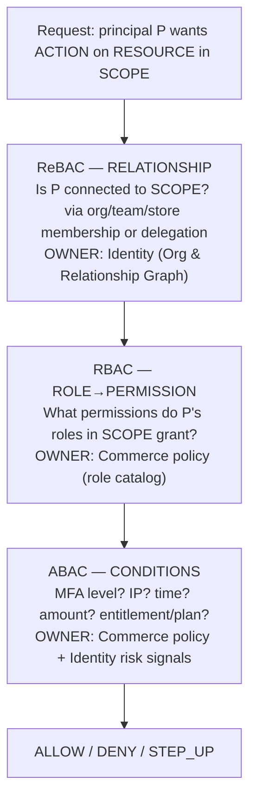
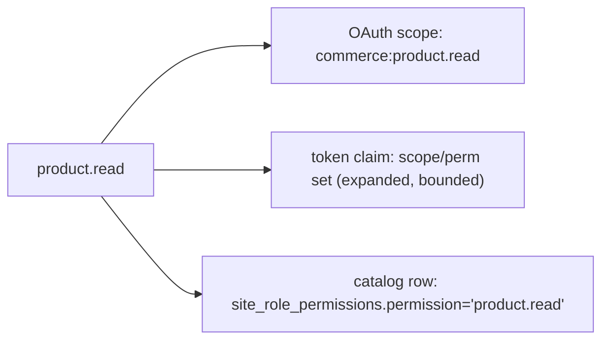
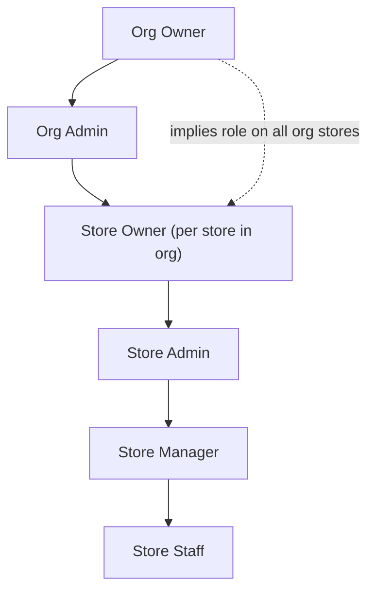
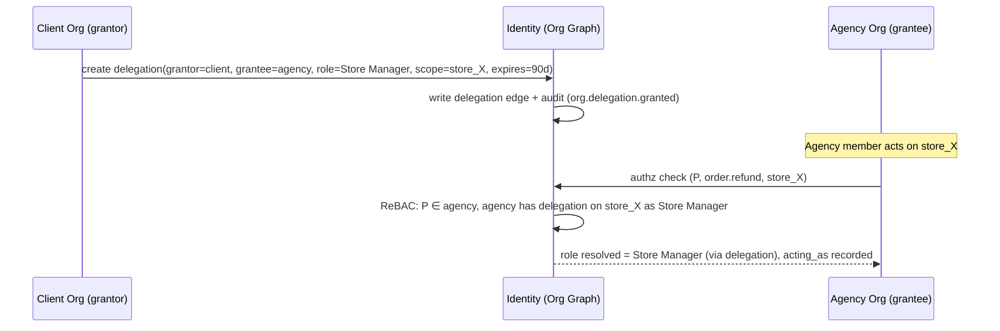

# PERMISSION_MODEL

**Phase 16 — Document 2 of 4 (Authorization Vocabulary)**
Status date: 2026-06-08
Status: Proposed (implementation-ready; no code).

> **Mandate.** *Identity authenticates. Commerce authorizes.* Design the complete authorization vocabulary: permission/role/scope/resource catalogs, inheritance, delegation, temporary access, impersonation, the RBAC/ABAC/ReBAC split, a naming convention, required token claims, gateway authorization inputs, and step-up triggers.

> **Grounding (this is NOT greenfield).** The estate already has a permission vocabulary and two parallel RBAC systems:
> - **Tenant RBAC:** `site_roles` (`slug`, `is_system`), `site_role_permissions` (`permission` string, `effect` allow/deny), `site_memberships` (`role_slugs[]` + direct `permissions[]` + `expires_at` + `status`). Allow/deny and temporary access already exist.
> - **Staff RBAC:** `employees` (`role` enum of support/sales/marketing/operations/manager/admin/editor/viewer/fulfillment/staff **+** `role_id` FK **+** `permissions` jsonb), `employee_roles` (`permissions` jsonb), `employee_permissions` (`role`→`permission`→`description` catalog), `super_admin_allowlist`.
> This document **unifies** these into one vocabulary and one decision algorithm, and resolves the `employees.role`-vs-`role_id` dual model (Finding P-1).

---

## 1. The three planes (and where each belongs)



| Plane | Question | Mechanism | Owner | Why here |
|-------|----------|-----------|-------|----------|
| **ReBAC** | Is the principal *related* to this scope (org/team/store), directly or via delegation? | relationship tuples | **Identity** (Org Graph) | tenancy is relational; merge/split/delegation need a graph (Zanzibar pattern) |
| **RBAC** | Given the principal's role(s) in scope, which permissions? | role → permission catalog | **Commerce** policy | role definitions are commerce-configurable; reuses `site_roles`/`site_role_permissions` |
| **ABAC** | Do request attributes satisfy conditions (MFA `acr`, IP, plan/entitlement, amount, time)? | policy conditions | **Commerce** policy + **Identity** risk/`amr` | conditions need both identity assurance and commerce context |

**The rule:** ReBAC decides *connection*, RBAC decides *capability*, ABAC decides *circumstance*. A request must pass all three. This is the unifying frame for the two existing RBAC systems — `site_*` and `employee_*` become two role catalogs over one decision algorithm.

---

## 2. Permission naming convention

**`<resource>.<action>[.<qualifier>]`** — lowercase, dot-delimited, singular resource.

| Element | Rule | Examples |
|---------|------|----------|
| resource | the noun being acted on | `product`, `order`, `customer`, `theme`, `app`, `api_key`, `payout`, `member`, `org`, `store` |
| action | the verb | `read`, `write`, `create`, `update`, `delete`, `manage`, `publish`, `install`, `refund`, `export`, `transfer` |
| qualifier | optional narrowing | `order.refund.partial`, `payout.manage.bank`, `member.manage.role` |

**Conventions:**
- `manage` = create+read+update+delete on the resource (a coarse grant).
- `*` wildcards allowed in role definitions only (`product.*`, `*.read`), never in a token (tokens carry expanded, bounded scopes).
- OAuth **scopes** use the **same vocabulary**, namespaced by audience: `commerce:product.read`, `commerce:order.refund`, `marketplace:app.install`. One vocabulary, two surfaces (internal permission ⇄ OAuth scope).
- Deny is expressed via `effect` (reusing `site_role_permissions.effect`), not a separate string.



---

## 3. Permission catalog (representative; full catalog is a living registry)

| Domain | Permissions |
|--------|-------------|
| Catalog | `product.read` `product.create` `product.update` `product.delete` `product.publish` `collection.manage` `inventory.read` `inventory.update` |
| Orders | `order.read` `order.create` `order.update` `order.cancel` `order.fulfill` `order.refund` `order.refund.partial` `order.export` |
| Customers | `customer.read` `customer.update` `customer.delete` `customer.export` `customer.pii.read` |
| Billing/Finance | `billing.read` `billing.manage` `payout.read` `payout.manage` `payout.manage.bank` `invoice.read` |
| Storefront/Theme | `theme.read` `theme.update` `theme.publish` `content.manage` `domain.manage` |
| Apps/Dev | `app.read` `app.install` `app.uninstall` `api_key.create` `api_key.revoke` `webhook.manage` `oauth_client.manage` |
| Org/Members | `org.read` `org.manage` `org.transfer` `member.read` `member.invite` `member.manage.role` `member.remove` `team.manage` |
| Store | `store.read` `store.create` `store.update` `store.transfer` `store.archive` `store.delete` |
| Platform (staff) | `platform.merchant.read` `platform.merchant.suspend` `platform.payout.review` `platform.audit.read` `platform.impersonate` `platform.feature_flag.manage` |
| Marketplace | `marketplace.app.submit` `marketplace.app.publish` `marketplace.theme.submit` `marketplace.theme.publish` `marketplace.payout.read` |

The catalog is a **registry** (versioned, in `IDENTITY_DATA_MODEL.md` / commerce policy store), not a hardcoded enum — new resources register permissions without a schema change.

---

## 4. Resource catalog (what permissions attach to)

| Resource class | Examples | Scope axis |
|----------------|----------|-----------|
| Org-level | org settings, billing, members, teams, payouts | `org_id` |
| Store-level | products, orders, customers, themes, content, apps | `store_id` |
| Cross-store (org) | consolidated reporting, org payouts | `org_id` |
| Platform-level | merchant admin, audit, feature flags | global (admin realm) |
| Marketplace | app/theme listings, vendor payouts | `vendor_org_id` |

Every permission check carries a **scope** (`org_id` or `store_id` or global). ReBAC verifies the principal is connected to that scope before RBAC evaluates the role.

---

## 5. Role catalog (all required roles, unified)

### 5.1 Merchant realm — Org-level roles
| Role | Key permissions | Notes |
|------|-----------------|-------|
| **Organization Owner** | `org.*`, `store.*`, `payout.manage`, `member.manage.role`, all store perms | transferable; ≥1 required per org |
| **Organization Admin** | `org.manage`, `member.invite`, `store.create`, most store perms; **not** `org.transfer`/`org.delete` | |

### 5.2 Merchant realm — Store-level roles (reuse `site_roles`, `is_system=true`)
| Role | Permissions | Notes |
|------|-------------|-------|
| **Store Owner** | all store perms incl. `payout.manage.bank`, `member.manage.role`, `api_key.create` | maps to today's `role_slugs=['owner']` default |
| **Store Admin** | all store perms except bank/ownership-transfer | |
| **Store Manager** | `product.*` `order.*` `customer.read` `inventory.*` `theme.update`; no billing/members | |
| **Store Staff** | `product.read` `order.read` `order.fulfill` `customer.read`; no delete/export/PII | |
| **Finance** | `billing.*` `payout.read` `order.refund` `invoice.read` `*.read` | functional role |
| **Support** | `order.read` `customer.read` `order.refund.partial` `customer.pii.read` (step-up) | functional role |
| **Developer** | `app.*` `api_key.*` `webhook.manage` `oauth_client.manage` `theme.*` | maps to partner-developer persistence (Audit `requireRoleCategory`) |

### 5.3 Partner / Agency / Vendor (delegated or marketplace)
| Role | Permissions | Mechanism |
|------|-------------|-----------|
| **Partner** | `app.read` `oauth_client.manage` (own apps), scoped installs | partner org + delegation |
| **Agency** | delegated store/org role on client stores | **delegation edge**, time-boxed |
| **Marketplace Vendor** | `marketplace.app.submit` `marketplace.payout.read` | vendor org |
| **Theme Vendor** | `marketplace.theme.submit` `marketplace.theme.publish` (after review) | vendor org |

### 5.4 Admin realm — Platform staff roles (reconcile `employees.role` + `employee_roles`)
| Role | Permissions | Maps to today |
|------|-------------|---------------|
| **Platform Employee** | `platform.merchant.read` `platform.audit.read` + role-specific | `employees.role` ∈ {support,sales,…} + `employee_permissions` |
| **Platform Operator** | `platform.merchant.suspend` `platform.payout.review` `platform.feature_flag.manage` | `requireRoleCategory('ops')` |
| **Super Admin** | `platform.*` incl. `platform.impersonate` | `super_admin_allowlist` (aal3 mandatory) |

**Reconciliation decision (P-1):** retire `employees.role` (enum) as an authorization source; make `employee_roles`/`employee_permissions` the single staff role catalog (parallel to `site_roles`/`site_role_permissions`). `employees.role` becomes a display/department label only. This removes the dual model the schema currently carries.

---

## 6. Inheritance model

### 6.1 Role inheritance (org → team → store)


- **Downward implication:** an Org Owner implicitly holds Store Owner on every store in the org; a team granted "Manager on Store X" gives members Manager there.
- **Effective role** in a scope = the **highest** role from any path (org, team, direct), unless a **deny** overrides.

### 6.2 Permission inheritance & conflict resolution
1. Expand effective roles → permission set via the role catalog.
2. Apply **direct grants** (`site_memberships.permissions[]`) as additive.
3. Apply **deny** (`site_role_permissions.effect='deny'` or explicit member deny) — **deny always wins** (deny-overrides).
4. Apply ABAC conditions (MFA `acr`, plan, amount, IP, time).
5. Result: `ALLOW` | `DENY` | `STEP_UP`.

**Deny-overrides** is the safe default (a deny anywhere in the resolution beats any allow), matching AWS IAM and the existing `effect` column semantics.

---

## 7. Delegation model



- Delegation grants a **grantee org's members** a role on a **grantor org's stores**, **without** org membership crossover.
- Always **scoped** (specific stores/permissions) and **time-boxed** (`expires_at`).
- Every delegated action is auditable as "via delegation from org X" (`acting_via` in audit events).
- Revocable instantly; revocation propagates like session revocation (Phase 8 §4).

---

## 8. Temporary access

Reuses and generalizes the existing `site_memberships.expires_at`:
| Mechanism | Use | Expiry |
|-----------|-----|--------|
| Time-boxed membership | seasonal staff, contractors | `membership.expires_at` |
| Time-boxed delegation | agency engagement | `delegation.expires_at` |
| Break-glass grant | incident response (platform) | minutes–hours, mandatory reason + audit + auto-revoke |
| Just-in-time elevation | a manager temporarily granted `payout.manage` | short, approval-gated, audited |

All temporary grants are **first-class, audited, auto-expiring**, and surfaced in "who has access" views. Break-glass mirrors the gateway's existing break-glass concept (Audit §RBAC `loadEffectivePermissionScopes`).

---

## 9. Impersonation (the one sanctioned cross-realm/cross-org bridge)

Per `REALM_ARCHITECTURE.md` §6, impersonation is Identity-minted only:
- Requires `platform.impersonate` permission (Super Admin / scoped Operator) + reason + ticket + aal3.
- Issues a **merchant-realm** token carrying the operator's real `sub` **plus** `act_as` (target principal) and `on_behalf_of` (store/org) claims.
- Target service always sees it is impersonated (never silent); read-only by default, write requires explicit elevation.
- Every impersonated action is double-attributed in audit (`actor` = operator, `subject` = impersonated) — `AUDIT_LOG_ARCHITECTURE.md` §Impersonation Events.

---

## 10. Token claims required (what the gateway needs without a DB call)

```json
{
  "sub": "prn:merchant:user:...",
  "realm": "merchant",
  "org": "org_...",                 // primary org context
  "roles": ["org:admin","store:store_abc:manager"],  // resolved, scoped roles (bounded)
  "sites": ["store_abc","store_def"],                // bounded membership snapshot
  "perms_digest": "sha256:...",     // optional hash of expanded perms for cache validation
  "amr": ["pwd","webauthn"],         // drives ABAC step-up
  "acr": "aal2",
  "act_as": null,                    // set only for impersonation
  "delegation": [],                  // active delegations relevant to this session (bounded)
  "sid": "sess_..."
}
```

**Bounded-claims rule (from Org Arch §11):** `roles`/`sites` are bounded snapshots. For large orgs (> threshold) the token carries `org`+org-role only and the gateway resolves store-level access via the check API. Tokens never grow unbounded.

---

## 11. Gateway authorization inputs required

For every protected route the gateway PEP needs:

| Input | Source | Purpose |
|-------|--------|---------|
| Verified subject (`sub`, `realm`, `org`, `roles`, `sites`, `amr`, `acr`, `sid`) | IdP token (JWKS) | who + coarse capability |
| Required `realm` + `aud` | route metadata | realm isolation (Phase 4 §5) |
| Required permission(s) | route metadata (`@requires('order.refund')`) | RBAC check |
| Scope (`org_id`/`store_id`) | route param/path | which tenant |
| Required `acr` (step-up) | route metadata / ABAC policy | sensitive-op gating |
| Entitlement/plan | Commerce policy | plan-gated features |
| Freshness re-check flag | route metadata | sensitive ops re-resolve membership (claims are a cache) |

Decision algorithm at the PEP: **realm/aud → ReBAC connection (claim or check API) → RBAC permission → ABAC conditions → allow/deny/step-up.**

---

## 12. Sensitive operations requiring step-up (aal2/aal3)

| Operation | Permission | Required `acr` |
|-----------|-----------|----------------|
| Configure payout bank account | `payout.manage.bank` | **aal3** |
| Issue/revoke API key or OAuth client secret | `api_key.create` / `oauth_client.manage` | aal2 |
| Manage members / change roles | `member.manage.role` | aal2 |
| Transfer store / org ownership | `store.transfer` / `org.transfer` | **aal3** |
| Refund above threshold / bulk refund | `order.refund` (amount ABAC) | aal2 |
| Export customer PII | `customer.export` / `customer.pii.read` | aal2 |
| Install app with write scopes | `app.install` | aal2 |
| Platform: suspend merchant, impersonate, break-glass | `platform.*` | **aal3** |
| Delete store / org | `store.delete` / `org.delete` | **aal3** + cooldown |

Step-up returns `STEP_UP` (not deny); Identity re-prompts the missing factor and re-mints the token with elevated `amr`/`acr` (`AUTHENTICATOR_STRATEGY.md` §8).

---

## 13. Migration plan (from two RBAC systems to one vocabulary)

| Wave | Action | Risk |
|------|--------|------|
| 1 | Publish the **permission catalog registry** + naming convention; map every existing `site_role_permissions.permission` and `employee_permissions.permission` string to the canonical vocabulary (alias table for legacy strings) | low |
| 2 | Stand up the **decision algorithm** (ReBAC→RBAC→ABAC) at the gateway PEP, **shadow mode**: compute new decision, compare to legacy `requireStoreOwner`/`requirePermission`/`requireRoleCategory`, alert on divergence | medium |
| 3 | Move **role assignment** reads to the Identity Org Graph (`store_memberships`); keep `site_roles`/`site_role_permissions` as the role catalog | medium |
| 4 | Retire `employees.role` enum as an authz source → `employee_roles` catalog only (P-1) | medium |
| 5 | Enforce step-up (`acr`) map for sensitive ops; enable delegation + temporary-access first-class | low–med |
| 6 | Remove legacy guards once shadow parity is proven for N days | medium |

**Backward-compat alias table** is essential: existing permission strings in DB must keep working during the migration; the alias maps legacy → canonical so no merchant's custom roles break.

---

## 14. Acceptance criteria

- One permission vocabulary (`resource.action[.qualifier]`), one registry, used by internal RBAC and OAuth scopes alike.
- One decision algorithm (ReBAC→RBAC→ABAC, deny-overrides) over two role catalogs (merchant `site_*`, staff `employee_*`).
- `employees.role`-vs-`role_id` dual model resolved (P-1).
- Delegation, temporary access, and impersonation are first-class, scoped, time-boxed, and audited.
- Token carries bounded resolved roles/sites + `amr`/`acr`; gateway inputs and step-up map defined.
- Legacy permission strings keep working via alias during migration; shadow-compare gates cutover.

Cross-references: scopes/hierarchy → `ORGANIZATION_ARCHITECTURE.md`; storage of roles/permissions/grants → `IDENTITY_DATA_MODEL.md`; authz event logging → `AUDIT_LOG_ARCHITECTURE.md`; boundary vs Phase 3 "commerce authorizes" → `IMPLEMENTATION_READINESS_REVIEW.md` Finding A-1/P-2.
