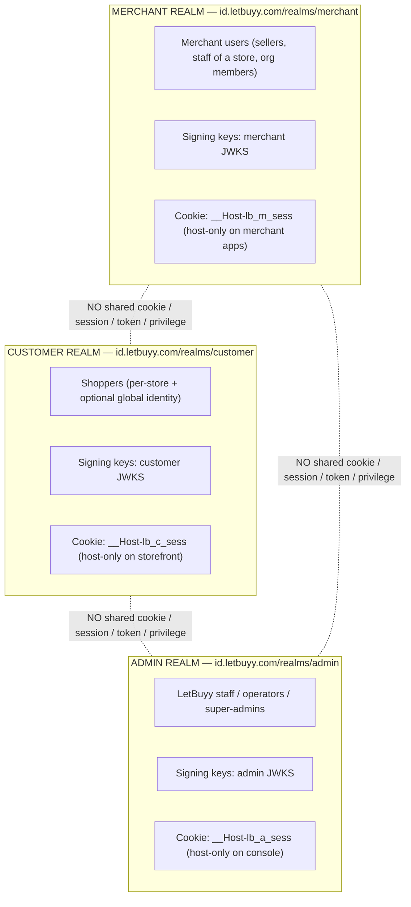

# REALM_ARCHITECTURE

**Phase 4 — Realm Strategy**
Status date: 2026-06-08

> **Requirement (from brief).** Three realms — **Merchant**, **Customer**, **Admin** — with strict separation: no shared cookies, no shared sessions, no shared refresh tokens, no privilege crossover. This document defines each realm and the isolation guarantees between them.

> **Grounding.** The three realms are not invented — they already exist *implicitly* today, separated only by cookie name and partially by store (Phase 1 §1): merchant (`lb_session`), customer (`lb_customer_session`), console/admin (`lb_console_session`). The weakness is that merchant and customer cookies share the parent domain `.letbuyy.store`, and isolation is by convention, not construction. The target makes isolation **structural**: separate issuers, keys, audiences, cookie hosts, and stores.

---

## 1. Realm model overview



Each realm is a self-contained OIDC provider instance: its own discovery document, its own keys, its own audience namespace, its own cookie host, its own principal store partition, its own session store partition. **A token minted in one realm is cryptographically invalid in another** (different `iss`, different keys, different `aud`).

---

## 2. Merchant realm

| Attribute | Specification |
|-----------|---------------|
| **Purpose** | Authenticate sellers and their staff to operate stores: merchant control plane, app/theme marketplaces, ops portal, mobile merchant app, future merchant apps. The SSO hub (Phase 7). |
| **Users / principals** | Store owners, invited staff (`site_memberships`), org members (new org model). Maps to today's `users_custom`. ActorTypes: `merchant`, `partner`. |
| **Issuer** | `https://id.letbuyy.com/realms/merchant` |
| **Audience(s)** | `letbuyy-commerce-api` (gateway), plus per-client audiences for marketplaces |
| **Session strategy** | Server-side revocable session (`sessions` successor), **idle 12h / absolute 30d** (matches today's `AUTH_SESSION_DURATION_MS = 30d` as the absolute ceiling; idle timeout is new). Refresh-token rotation. SSO session at the IdP enables silent re-auth across merchant apps. |
| **Cookie strategy** | IdP session cookie `__Host-lb_m_sess` (host-only on `id.letbuyy.com`, `Secure`, `HttpOnly`, `SameSite=Lax` for top-level OIDC redirects). RP apps hold **short-lived access tokens**, not a shared domain cookie. Retires the domain-wide `.letbuyy.store` `lb_session`. |
| **Authentication methods** | Password (Argon2id) + email OTP/magic-link bootstrap; **passkey** (WebAuthn) as primary or step-up; **TOTP** step-up. Federation/social optional later. |
| **Authorization model** | Identity asserts `sub`, `org`, `sites` (bounded), `amr`. Commerce core decides resource access via `site_memberships`/`site_roles`/`site_role_permissions` (unchanged). Org→site hierarchy enforced in commerce. |
| **Risk model** | Compromise = store/org takeover, financial. **MFA required** for sensitive ops (payouts, staff management, API-key issuance) via step-up. Highest-volume realm. |

## 3. Customer realm

| Attribute | Specification |
|-----------|---------------|
| **Purpose** | Authenticate shoppers on storefronts and checkout. Optimized for conversion (low friction), per-store scoping. |
| **Users / principals** | Shoppers. Today `store_customers` + `customer_credentials`, **store-scoped**. Target keeps per-store identity, adds *optional* global customer principal with explicit linking (a shopper may exist at many stores). ActorTypes: `shopper`, `customer`. |
| **Issuer** | `https://id.letbuyy.com/realms/customer` |
| **Audience(s)** | `letbuyy-storefront-api`, `letbuyy-checkout` |
| **Session strategy** | Server-side revocable session, **idle 30d / absolute 90d** (longer than merchant — shoppers expect persistence). Replaces today's stateless 7-day host-only JWT and 30-min gateway JWT with **one revocable session**. Cross-domain handoff via generalized federation token (replaces `createCustomerFederationToken` ad-hoc use). |
| **Cookie strategy** | Host-only `__Host-lb_c_sess` per storefront host. **Never** on `.letbuyy.store` parent. Custom-domain storefronts get their own host-only cookie. Checkout receives a scoped token, not the storefront cookie. |
| **Authentication methods** | Email OTP / magic-link first (passwordless-friendly), optional password, optional passkey. Guest checkout supported (no auth) — checkout customer-login requirement is a product decision (Phase 1 UNKNOWN #5). |
| **Authorization model** | Customer can only act on **their own** orders/addresses/wishlists within **their store scope**. No platform/merchant privileges ever. |
| **Risk model** | Compromise = one shopper's account at one store (PII, order history). Bounded blast radius by store scoping. Volume is highest; bot/credential-stuffing defense (Turnstile + risk engine) matters most here. |

## 4. Admin realm

| Attribute | Specification |
|-----------|---------------|
| **Purpose** | Authenticate LetBuyy internal staff to platform console and privileged operations. |
| **Users / principals** | Employees, operators, super-admins. Today `employees` + `super_admin_allowlist`. ActorTypes: `platform-employee`, `platform-operator`. |
| **Issuer** | `https://id.letbuyy.com/realms/admin` |
| **Audience(s)** | `letbuyy-console`, `letbuyy-internal-ops` |
| **Session strategy** | Server-side, **short**: idle 30m / absolute 8h (matches today's `LETBUYY_PLATFORM_SESSION_TTL_SECONDS = 8h`). **MFA mandatory** (already enforced — Audit §Security Findings: console requires MFA). No long-lived refresh; re-auth frequently. |
| **Cookie strategy** | Host-only `__Host-lb_a_sess` on console host only. Never shared. |
| **Authentication methods** | SSO via corporate IdP (OIDC federation to Google Workspace/Okta) **strongly preferred** for staff; fall back to email allowlist + magic-link + **mandatory TOTP/passkey**. Today: allowlist→magic-link→TOTP. |
| **Authorization model** | Staff RBAC via `employees`/`employee_roles`/`employee_permissions`, super-admin allowlist, break-glass grants — stays in commerce/ops core. Admin realm supplies verified staff `sub` + role claims; **least privilege + break-glass with audit**. |
| **Risk model** | **Critical** — compromise = platform-wide takeover, all-tenant breach. Hardware-backed MFA, IP allowlisting, mandatory device trust, full audit, session pinning. The static `platform-console@letbuyy.local` synthetic principal (Audit) must be eliminated or tightly scoped. |

---

## 5. Isolation guarantees (the four "no shared" rules, made structural)

| Rule | How it is enforced in the target | Failure mode it prevents |
|------|----------------------------------|--------------------------|
| **No shared cookies** | Host-only `__Host-` cookies per realm host; no `Domain=.letbuyy.store`. Merchant apps no longer read a domain-wide cookie. | A storefront XSS cannot read a merchant cookie; subdomain takeover can't harvest the estate's sessions. |
| **No shared sessions** | Separate session-store partitions keyed by realm; a `sid` from one realm does not resolve in another. | Customer session cannot be replayed as merchant session. |
| **No shared refresh tokens** | Refresh tokens are realm-scoped, bound to client + `sid` + audience; reuse-detection per realm. | A leaked customer refresh token cannot mint merchant access tokens. |
| **No privilege crossover** | Different `iss` + keys + `aud`; gateway rejects any token whose `realm`/`aud` doesn't match the route's required realm. Authorization claims are realm-typed. | A customer token presented to a merchant route fails signature/audience check before any authz runs. |

**Enforcement point.** The gateway (PEP) is configured per-route with a **required realm + audience**. Verification order: (1) signature valid against *that realm's* JWKS, (2) `aud` matches the route's resource, (3) `realm` matches, (4) `sid` not revoked, (5) resource RBAC. A cross-realm token dies at step 1 or 2.

---

## 6. Cross-realm interactions (the *only* legitimate ones)

Strict separation does not mean zero interaction — it means **no implicit trust**. The legitimate cross-realm flows are explicit, brokered, and auditable:

```mermaid
sequenceDiagram
  participant Staff as Admin realm (operator)
  participant IDP as Identity Platform
  participant Merchant as Merchant realm (target store)

  Note over Staff,Merchant: "Impersonation / support access" — the ONLY admin→merchant bridge
  Staff->>IDP: request scoped impersonation grant (store X, read-only, 30 min)
  IDP->>IDP: verify operator role + reason + ticket; write audit_event
  IDP-->>Staff: short-lived MERCHANT-realm access token, act_as=operator, on_behalf_of=store
  Note over Staff,Merchant: Token carries BOTH the operator's real sub AND the impersonation context.<br/>Merchant routes see it is impersonated. Never silent.
```

Rules for the impersonation bridge (the one sanctioned crossover):
- Minted by Identity only, never by an app.
- Carries the operator's real `sub` plus `act_as`/`on_behalf_of` claims — the merchant service always knows it is impersonated.
- Short TTL, narrow scope, mandatory reason + audit event, optionally read-only.
- Customer realm has **no** crossover bridge in either direction.

Account *linking* (a human who is both a merchant and a customer) is **not** a privilege bridge: they hold two independent principals/sessions; linking only lets the UI offer "you also have a shopper account," never a shared token.

---

## 7. Realm comparison (at a glance)

| Dimension | Merchant | Customer | Admin |
|-----------|----------|----------|-------|
| Volume | Medium (100k merchants) | Highest (millions) | Lowest (staff) |
| Idle / absolute timeout | 12h / 30d | 30d / 90d | 30m / 8h |
| MFA | Required for sensitive ops | Optional | **Mandatory always** |
| Primary auth | Password+passkey | OTP/magic-link | Corporate SSO / allowlist+TOTP |
| Cookie | `__Host-lb_m_sess` | `__Host-lb_c_sess` | `__Host-lb_a_sess` |
| Issuer realm | `/realms/merchant` | `/realms/customer` | `/realms/admin` |
| Blast radius if breached | Store/org | One shopper | **Platform-wide** |
| Refresh tokens | Yes, rotating | Yes, rotating | Short/none |
| Federation | Optional social | Cross-store linking | Corporate IdP inbound |

---

## 8. Migration note (bridge from today)

The realms exist by cookie convention now; the target makes them structural. The risky change is the **merchant realm cookie move** from domain-wide `.letbuyy.store` `lb_session` to host-only per-app access tokens — this is exactly what the SSO design (Phase 7) and Migration Plan (Phase 13, Wave 2) handle, because it changes how every merchant app obtains identity. Customer and admin realms already use host-only / no-Domain cookies, so they're closer to target.

Phase 5 selects the OIDC provider technology that hosts these three realms.
