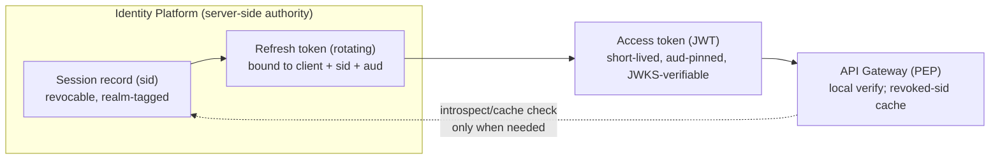
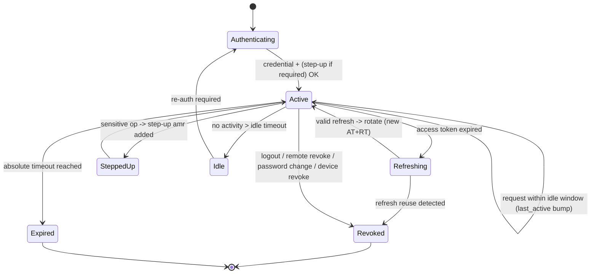

# SESSION_MANAGEMENT

**Phase 8 — Session Architecture**
Status date: 2026-06-08

> Defines access tokens, refresh tokens, session IDs, rotation, revocation, idle/absolute timeout, and device tracking — plus a **Cookie Ownership Matrix** giving every cookie an owner, issuer, validator, domain, lifetime, and rotation strategy.

> **Problem being fixed.** Today: merchant session is a 30-day opaque bearer with no rotation/refresh and only `last_active` bumping (Audit §Session Lifecycle); customer and console sessions are **stateless JWTs/signed tokens with no server-side revocation**; cookies are inconsistent and partly domain-wide. The target makes **every** session server-revocable with short access tokens + rotating refresh + idle/absolute bounds.

---

## 1. Session token model (three layers)

| Token | Form | Holds | Lifetime | Stored where |
|-------|------|-------|----------|--------------|
| **Session ID (`sid`)** | server record (opaque ref) | realm, principal, device, amr, created/last-active, status | idle+absolute (per realm) | Identity DB `sessions`; referenced by IdP cookie + in `sid` claim |
| **Access token** | signed JWT | `sub, realm, aud, org, sites, amr, sid, exp` | **5–10 min** | memory / app session (never localStorage) |
| **Refresh token** | opaque, rotating | bound to client+sid+aud | hours–days (per realm) | httpOnly cookie or device secure storage / BFF |

The `sid` is the revocation anchor: revoke the session → its refresh chain is dead → access tokens expire within one short TTL → access ends platform-wide.

---

## 2. Per-realm timeouts

| Realm | Access TTL | Refresh TTL (rotating) | Idle timeout | Absolute timeout | Basis |
|-------|-----------|------------------------|--------------|------------------|-------|
| Merchant | 8 min | 12 h | 12 h | **30 d** | matches today's `AUTH_SESSION_DURATION_MS=30d` as ceiling; idle is new |
| Customer | 10 min | 30 d | 30 d | **90 d** | shopper persistence; replaces 7d JWT + 30m gateway JWT |
| Admin | 5 min | none / 30 m | 30 m | **8 h** | matches `LETBUYY_PLATFORM_SESSION_TTL_SECONDS=8h`; strict |

Idle timeout = max gap between requests before the session must re-auth. Absolute timeout = hard ceiling regardless of activity. Both enforced **server-side** on the `sid` record (not just cookie `Max-Age`, which the client can't be trusted to honor).

---

## 3. Rotation rules

| Event | Action |
|-------|--------|
| **Each refresh use** | Issue new refresh + new access; invalidate old refresh. **Reuse of an old refresh ⇒ treat as theft ⇒ revoke the whole `sid` chain** (RFC 6819 reuse detection). |
| **Login** | New `sid` (today already creates a new session on login — Audit §Session Lifecycle "rotation after login"). |
| **Account switch** | Destroy current `sid`, create new (today: `switch` route destroys+creates — keep). |
| **Password / credential change** | `destroyAllUserSessions` for that principal, then new `sid` (today does this on reset — extend to all credential changes). |
| **Privilege change** (role/org/membership) | **New requirement** (Phase 1 UNKNOWN #4): revoke or re-mint sessions so stale `org`/`roles` claims can't linger. Minimum: shorten effective claim trust via gateway re-check on sensitive ops. |
| **Step-up** | Add `amr` to the session and re-mint access token; does not require new `sid`. |

---

## 4. Revocation model

| Revocation type | Mechanism | Latency to effect |
|-----------------|-----------|-------------------|
| Single session (logout) | Mark `sid` revoked + kill refresh chain + back-channel logout to RPs | Access dies ≤ 1 access-TTL; RP session immediate via back-channel |
| All sessions (password reset, "log out everywhere") | Revoke all `sid` for principal | ≤ 1 access-TTL across estate |
| Device revoke | Revoke all `sid` bound to device (**new** — Phase 1 UNKNOWN #3) | ≤ 1 access-TTL |
| Admin remote revoke | Console action → Identity revoke API | ≤ 1 access-TTL |
| Token (refresh) compromise | Reuse-detection auto-revokes chain | immediate on reuse |

**Gateway revocation freshness.** To avoid an introspection call on every request, the gateway keeps a **revoked-`sid` cache** (short-TTL, push-invalidated by Identity on revoke, e.g. via a revocation stream/Redis). Common path = local JWT verify (no network); revoked sessions are caught by cache within seconds and definitively at access-token expiry. This is the cost/security tradeoff knob: shorter access TTL = faster revocation = more refreshes.

---

## 5. Device tracking

Builds on the existing `devices` table + `lb_device` cookie (Audit §Session Lifecycle "Device creation"), adding what's missing:

| Capability | Today | Target |
|-----------|-------|--------|
| Device record | `get-or-create` per login | keep; bind `sid`→device |
| Device cookie | `lb_device` 90d | keep as device correlator (host-only on IdP) |
| Device list UI | — | "your devices/sessions" per realm |
| Device revoke | **UNKNOWN** | revoke device ⇒ revoke its sessions |
| Device trust | partial (`merchant_2fa_factors` device-ish) | trusted-device skips step-up for low-risk ops (Phase 10) |
| Risk signals | Turnstile only | device + IP + velocity feed risk engine |

---

## 6. Cookie Ownership Matrix (target)

Every cookie has exactly one owner, one issuer, one validator. Compare to today's sprawl (Phase 1 §3: 11 cookies, 2 CSRF names, inconsistent attributes).

| Cookie | Owner | Issuer | Validator | Domain/Host | HttpOnly | Secure | SameSite | Lifetime | Rotation |
|--------|-------|--------|-----------|-------------|:--------:|:------:|----------|----------|----------|
| `__Host-lb_m_sess` | Identity (merchant realm) | Hydra/IdP | IdP | host-only `id.letbuyy.com` | yes | yes | Lax | idle 12h/abs 30d | on re-auth/step-up |
| `__Host-lb_c_sess` | Identity (customer realm) | IdP | IdP | host-only `id.letbuyy.com` | yes | yes | Lax | idle 30d/abs 90d | on re-auth |
| `__Host-lb_a_sess` | Identity (admin realm) | IdP | IdP | host-only `id.letbuyy.com` | yes | yes | **Strict** | idle 30m/abs 8h | frequent |
| `__Host-{app}_sess` (per RP) | each RP | RP server | RP server | host-only per app host | yes | yes | Lax | ≤ access window | silent renew |
| `__Host-lb_device` | Identity | IdP | IdP | host-only `id.letbuyy.com` | yes | yes | Lax | 90d | stable |
| `__Host-lb_store_gate` | Storefront | storefront | storefront | host-only storefront | yes | yes | Lax | gate TTL | per gate |
| `__Host-lb_preview` | Storefront | storefront | storefront | host-only storefront | yes | yes | Lax | preview TTL | per preview |
| Refresh cookie (if cookie-bound) `__Host-lb_rt` | Identity | IdP | IdP | host-only, path `/token` | yes | yes | Strict | per realm refresh TTL | **every use** |

**What's deleted vs today:**
- `lb_session` domain-wide on `.letbuyy.store` → **gone** (replaced by IdP SSO session + per-app tokens).
- `lb_accounts` (1-year JWT account list) → replaced by IdP account-linking + chooser (no long-lived JWT in browser).
- `letbuyy_csrf` **and** legacy `lb_csrf` → **gone**: with host-only `__Host-` cookies + `SameSite` + token-in-header auth for APIs, the double-submit CSRF cookie is unnecessary for token-authenticated requests; the IdP login form uses a per-request anti-forgery token bound to the login challenge.
- `lb_password_set_intent` → server-side intent record keyed by short code, not a standalone cookie (reduces cookie surface).
- `lb_theme_preview_${subdomain}` → consolidated under `__Host-lb_preview` with subdomain in the signed payload.

**Cookie count: 11 → ~8, with zero domain-wide cookies, zero JS-readable auth cookies, one consistent attribute policy.**

---

## 7. CSRF posture (target)

| Surface | Protection |
|---------|-----------|
| API calls (Bearer access token) | Not cookie-authenticated ⇒ inherently CSRF-resistant; no CSRF cookie needed |
| IdP login/consent forms | Per-request anti-forgery token bound to the login/consent **challenge** (Hydra provides challenge ids); `SameSite=Strict` on IdP session cookie |
| Any remaining cookie-authed endpoint | `SameSite=Strict/Lax` + origin check; no reliance on a JS-readable double-submit token |

This removes the audit's CSRF findings (JS-readable `letbuyy_csrf`, legacy `lb_csrf` acceptance, 3 divergent setters) by **removing cookie-based auth for APIs**, not by patching the double-submit scheme.

---

## 8. Session lifecycle (consolidated state machine)

---

## 9. Acceptance criteria

- Every realm session is **server-side and revocable**; no stateless-JWT-only session remains for humans.
- Access tokens ≤ 10 min; refresh tokens rotate with reuse-detection.
- Idle and absolute timeouts enforced server-side per realm.
- Logout / remote-revoke / password-change end access platform-wide within one access-TTL.
- Cookie matrix has no domain-wide cookie, no JS-readable auth cookie, one attribute policy; CSRF findings closed.
- Device revoke exists (closes Phase 1 UNKNOWN #3); privilege-change rotation exists (closes UNKNOWN #4).

Phase 9 specifies the cryptographic detail of each token referenced here.
