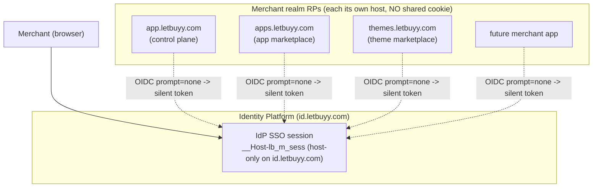
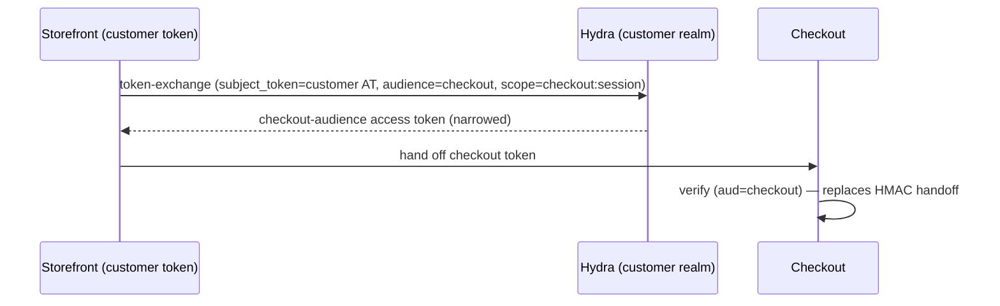

# SSO_ARCHITECTURE

**Phase 7 — Single Sign-On Architecture**
Status date: 2026-06-08

> **Requirement.** A merchant logs in **once** and reaches the merchant control plane, app marketplace, theme marketplace, and future merchant apps **without re-authenticating**. Customers must **never** share a merchant session; admins must **never** share a merchant session. This document defines the login flow, token exchange, session propagation, logout propagation, and cross-app navigation, with sequence diagrams.

> **Today's SSO (the thing being replaced).** "SSO" currently works by accident: every merchant app reads the **same `lb_session` cookie scoped to `.letbuyy.store`** (Phase 1 §3). That is convenient but is exactly the isolation weakness Phase 4 removes — a domain-wide, JS-adjacent, `SameSite=lax` cookie shared by every subdomain. The target replaces *implicit cookie-sharing* with *explicit OIDC SSO* against a central IdP session, so apps no longer share a cookie at all.

---

## 1. SSO model: central IdP session + per-app tokens



The **only** durable cross-app artifact is the **IdP SSO session cookie**, host-only on `id.letbuyy.com`. Each RP holds its own short-lived access token and its own host-only app session; it obtains/renews tokens by silently bouncing to the IdP, which recognizes the SSO session and issues a fresh token **without a credential prompt**. This is standard OIDC SSO and gives "log in once" with **none of** the shared-cookie blast radius.

---

## 2. First login (full auth-code + PKCE)

```mermaid
sequenceDiagram
  participant B as Browser
  participant CP as Merchant CP (app.letbuyy.com)
  participant H as ORY Hydra (id.letbuyy.com)
  participant L as Login/Consent app (Identity Platform)
  participant S as Identity stores

  B->>CP: GET /dashboard (no app session)
  CP->>B: 302 -> Hydra /authorize?client=cp&scope=openid...&code_challenge=...
  B->>H: /authorize
  H->>B: 302 -> Login app (no IdP session yet)
  B->>L: login UI (password / passkey / OTP)
  L->>S: verify credential (Argon2id / WebAuthn)
  L->>L: evaluate MFA/step-up policy (amr)
  L->>H: accept login (sub, amr) + SET IdP SSO session __Host-lb_m_sess
  H->>B: 302 -> consent (first-party: skip_consent)
  H->>B: 302 -> CP /auth/callback?code=...
  B->>CP: /auth/callback?code
  CP->>H: POST /token (code + PKCE verifier + client secret)
  H-->>CP: id_token + access_token (JWT, aud=commerce-api) + refresh
  CP->>B: SET __Host app session; redirect /dashboard
```

Key points: the **IdP SSO session is established once** at the login app. The CP never sees the password. Claims (`org`, `sites`) are injected by the login/consent app at "accept login/consent" time, sourced from the Commerce Membership API.

---

## 3. Cross-app navigation (the "no re-auth" path)

```mermaid
sequenceDiagram
  participant B as Browser
  participant MK as App marketplace (apps.letbuyy.com)
  participant H as Hydra (id.letbuyy.com)

  Note over B,H: User already logged in (IdP SSO session exists). Clicks "Apps".
  B->>MK: GET /apps (no app session yet)
  MK->>B: 302 -> Hydra /authorize?client=appmkt&prompt=none&code_challenge=...
  B->>H: /authorize (sends __Host-lb_m_sess SSO cookie)
  H->>H: SSO session valid -> NO login prompt
  H->>B: 302 -> MK /auth/callback?code (silent)
  B->>MK: /auth/callback?code
  MK->>H: POST /token (code + PKCE)
  H-->>MK: access_token (aud=commerce-api, scope marketplace:*)
  MK->>B: SET __Host app session; render /apps
```

The user experiences a seamless redirect (often sub-second, no UI). `prompt=none` means: *if* the SSO session is valid, issue a token silently; *else* return `login_required` and the RP shows login. This is the OIDC-standard realization of "log in once, use everywhere."

---

## 4. Token exchange (checkout, embedded apps, BFF)

Some flows need a **derived, narrower token** rather than a fresh login. Use **RFC 8693 token exchange**:



Same pattern derives embedded-app tokens for the app marketplace (scoped to one installed app) and BFF-held tokens for mobile. Token exchange keeps the realm and `sub` intact while narrowing audience/scope — strictly safer than today's secret-shared HMAC handoff.

---

## 5. Session propagation model

| Layer | Artifact | Lifetime | Propagation mechanism |
|-------|----------|----------|-----------------------|
| **IdP SSO session** | `__Host-lb_m_sess` on `id.letbuyy.com` | idle 12h / abs 30d | The single source of "logged in"; consulted on every `prompt=none` |
| **RP app session** | `__Host-{app}_sess` per app host | short (≤ access-token TTL window) | Established at callback; renewed silently |
| **Access token** | JWT, `aud=commerce-api` | 5–10 min | Sent to gateway; verified locally via JWKS |
| **Refresh token** | rotating, client+sid-bound | hours–days per realm | Renews access token without IdP round-trip-with-prompt |

Propagation is **pull, not push**: apps pull fresh tokens from the IdP session on demand. There is no shared mutable session object across apps — eliminating the consistency and blast-radius problems of the shared cookie.

---

## 6. Logout propagation (global single logout)

This is where the shared-cookie model fails today (clearing `lb_session` in one app doesn't revoke the server session everywhere, and customer/console logouts are cookie-clears with no server revoke — Phase 1 §2). The target uses **OIDC RP-initiated logout + back-channel logout**:

```mermaid
sequenceDiagram
  participant B as Browser
  participant CP as Any merchant RP
  participant H as Hydra
  participant IDP as Identity (session store)
  participant R as Other RPs (back-channel)

  B->>CP: click Logout
  CP->>H: GET /end_session?id_token_hint=...&post_logout_redirect=...
  H->>IDP: revoke IdP SSO session (sid) + refresh chain
  H->>R: back-channel logout (POST logout_token to each RP's backchannel URI)
  R->>R: invalidate local app session for sid
  H->>B: clear __Host-lb_m_sess; redirect to post-logout
  Note over B,R: Next prompt=none anywhere returns login_required -> truly logged out
```

Guarantees:
- **One logout kills the IdP session + all refresh chains** → no RP can silently renew.
- **Back-channel logout** proactively invalidates each RP's local session for that `sid`.
- **Remote logout** (from console/admin or "log out all devices") revokes the server session; because access tokens are short-lived, access dies within one TTL even before back-channel completes.
- Realm isolation holds: logging out of merchant does **not** touch customer or admin sessions (different IdP sessions, different cookies).

---

## 7. Customer & admin never share merchant sessions (enforcement)

| Guarantee | Mechanism |
|-----------|-----------|
| Customer ≠ merchant | Different realm → different IdP SSO cookie (`__Host-lb_c_sess` vs `__Host-lb_m_sess`), different issuer/keys/audience. A customer's `prompt=none` to the merchant realm has no merchant SSO cookie → `login_required`. |
| Admin ≠ merchant | Same: `__Host-lb_a_sess`, admin issuer, MFA-gated. The historical case where merchant `lb_session` could "redirect to console login" (Audit §Console proxy) is removed — console only accepts admin-realm tokens. |
| No accidental scope bleed | Audience pinning + realm claim checked at the gateway before any authz (Phase 4 §5). |

---

## 8. Cross-domain SSO (custom storefront domains + marketplaces)

Merchant storefronts run on **custom domains** (not `*.letbuyy.com`), so cookie-based SSO can't span them. Two tools:

1. **OIDC across domains** still works: a custom-domain storefront is just an RP with its own redirect URI; the customer realm's IdP session lives on `id.letbuyy.com` and is reached by redirect. Third-party-cookie deprecation doesn't break this (it's top-level redirects, not iframes).
2. **Federation tokens** (generalizing today's `createCustomerFederationToken`, single-use + replay-protected) handle explicit cross-domain handoffs where a redirect is undesirable — e.g. handing a shopper from a marketing domain to a checkout domain. The existing primitive (`auth-core/src/index.ts:806`) is promoted to a first-class, all-realm capability.

---

## 9. SSO design invariants (acceptance)

- Logging in once at `id.letbuyy.com` (merchant realm) yields no-prompt access to control plane, app marketplace, theme marketplace, and any future merchant RP.
- **No app shares a cookie with another app.** The only cross-app artifact is the IdP session on `id.letbuyy.com`.
- A single logout terminates the IdP session, all refresh chains, and all RP sessions (back-channel) within the realm.
- Customer/admin SSO sessions are wholly separate; no token from one realm is accepted by another.
- Custom-domain storefronts participate in customer SSO via OIDC redirects and/or federation tokens.

Phase 8 specifies the sessions, cookies, and token lifetimes that make this SSO model concrete.
