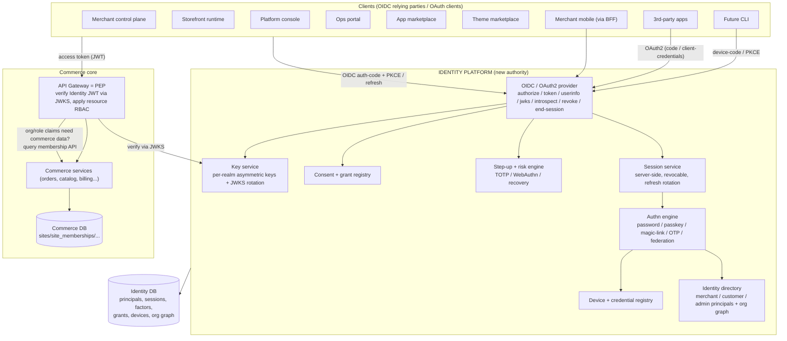
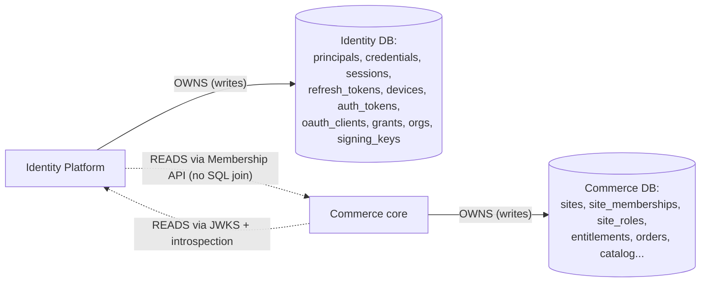
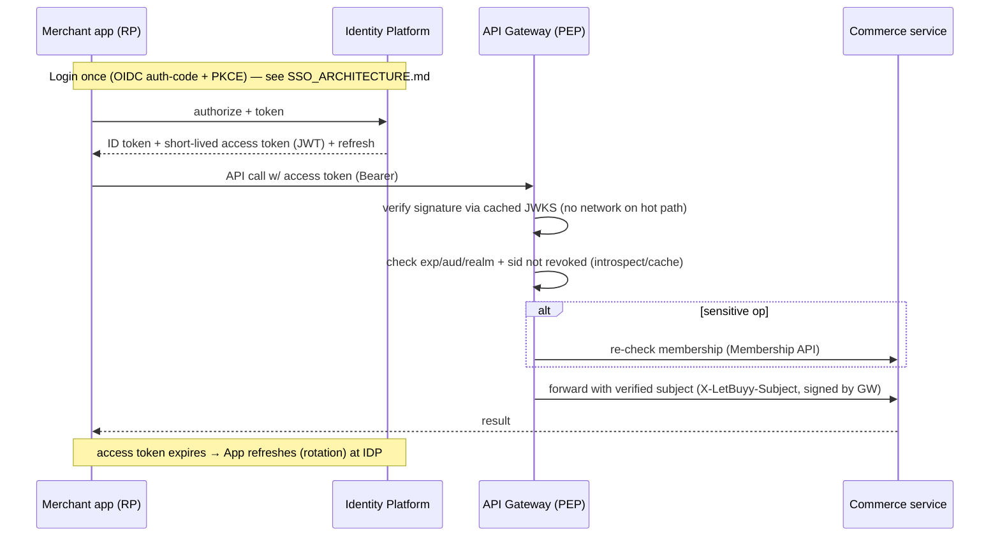

# TARGET_AUTH_ARCHITECTURE

**Phase 3 — Identity Platform Design (the single authentication authority)**
Status date: 2026-06-08
Posture: North-star end-state. The Migration Plan (Phase 13) bridges from today's reality.

> **Design thesis.** Today the component named "Identity Platform" owns only UI + cookies, while the API Gateway owns all identity logic and data (Phase 1 §8). The target **inverts this**: a real **Identity Platform service** becomes the *only* issuer and authority for identity and sessions; the API Gateway becomes a **stateless Policy Enforcement Point** that verifies Identity-issued tokens and applies resource authorization. No app ever again asserts "who the user is" — they *present a token the Identity Platform signed*.

---

## 1. North-star principles

1. **One issuer.** Exactly one component issues identity tokens and sessions for humans and machines: the Identity Platform. (Replaces today's 3 session systems + app-asserted headers.)
2. **Verifiable, not asserted, identity.** Downstream services verify a **signed token** (JWT/JWS, asymmetric) — never an HMAC over app-supplied `user_id` headers. (Closes the Phase 1 §5 zero-trust gap.)
3. **Realm isolation by construction.** Merchant, Customer, and Admin are separate realms with separate keys, cookies, sessions, and token audiences. No cross-realm token is ever valid. (Phase 4.)
4. **Stateful where revocation matters.** Sessions are server-side and revocable; access tokens are short-lived; refresh tokens rotate with reuse detection. (Phase 8.)
5. **Authorization stays with the resource owner.** Identity asserts *who you are* and *what org/roles you hold*; the commerce core decides *what you may do* to commerce resources. (Phase 2 §4.)
6. **Standards over bespoke.** OIDC/OAuth2 for SSO, app, and federation flows; WebAuthn for passkeys; reuse existing primitives (`auth-core` app-OAuth issuer, federation token) as the seed, not a parallel system. (Phase 5/6.)
7. **Secrets are asymmetric and rotatable.** Token signing uses per-realm asymmetric keys exposed via JWKS; the shared symmetric internal HMAC secret is retired. (Phase 9/12.)

---

## 2. Target component model



---

## 3. Responsibilities (what the Identity Platform owns)

| Domain | Owned responsibilities |
|--------|------------------------|
| **Authentication** | Password (Argon2id), magic-link, email OTP, WebAuthn/passkey, TOTP step-up, federated/social (future), customer federation across domains |
| **Session management** | Create/validate/refresh/revoke server-side sessions; idle + absolute timeout; rotation on login, switch, privilege change, password/credential change |
| **Token issuance** | OIDC ID tokens, OAuth2 access/refresh, authorization codes, device codes, magic-link/reset/verification tokens (hashed), M2M client-credentials |
| **OIDC/OAuth2 provider** | `/authorize`, `/token`, `/userinfo`, `/jwks`, `/introspect`, `/revoke`, `/end_session`, discovery `/.well-known/openid-configuration` per realm |
| **MFA & step-up** | Factor enrolment/verify, recovery codes, backup devices, device trust, policy-driven step-up |
| **Consent** | Scope consent screens + persisted grants for app/3rd-party/CLI clients |
| **Directory** | Merchant, customer, admin principals; account linking; **merchant org graph** (new); principal lifecycle (suspend/delete) |
| **Devices & credentials** | Device registry, credential registry (passwords/passkeys/factors), revocation |
| **Federation/SSO** | OIDC SSO across all first-party apps; generalized single-use federation tokens for cross-domain |
| **Keys** | Per-realm asymmetric signing keys, JWKS publication, scheduled + emergency rotation |

## 4. Boundaries (what the Identity Platform does NOT own)

| Out of scope | Owner | Interface |
|--------------|-------|-----------|
| Resource authorization policy (can this user edit this product?) | Commerce core (gateway PEP + services) | Gateway verifies Identity token, then applies its own RBAC over `site_memberships` etc. |
| Store/site records and membership **data** | Commerce core (`sites`, `site_memberships`) | Identity **reads** membership via a Commerce *Membership API* to mint org/role claims |
| Plan/entitlement/billing | Commerce/billing | Not an identity concern |
| Bot defense keys (Turnstile) | Edge/gateway | Risk signal fed into Identity's risk engine |
| Push provider creds (FCM/APNS) | Workers | Unrelated to user identity |

**The boundary rule:** Identity answers *"who is this principal and what org/roles do they legitimately hold?"* Commerce answers *"may this principal perform this action on this resource?"* Identity never reaches into commerce tables to make authorization decisions; commerce never re-authenticates.

---

## 5. The subject contract (the heart of the design)

Every downstream service receives the **same verifiable subject**, regardless of realm or client, shaped like this (claims detailed in Phase 9):

```json
{
  "iss": "https://id.letbuyy.com/realms/merchant",
  "sub": "prn:merchant:user:7f3a...",          // stable principal id
  "aud": "letbuyy-commerce-api",
  "realm": "merchant",
  "act": "merchant",                            // ActorType (auth-core already defines 7)
  "org": "org_9b21...",                         // merchant org (NEW) — null until org model lands
  "sites": ["site_abc"],                        // memberships snapshot (bounded; authority = commerce)
  "amr": ["pwd","otp"],                         // auth methods → drives step-up
  "sid": "sess_...",                            // server session id (revocable)
  "exp": 1750000000, "iat": 1749999100
}
```

Two non-negotiable properties:
- **`sub` is realm-scoped and opaque.** A merchant `sub` and a customer `sub` can never collide or be confused (different `iss`, different keys, different audience).
- **`sites`/`org` claims are a *bounded snapshot*, not the authority.** For sensitive operations the gateway re-checks membership against the Commerce Membership API (defense against stale claims after a membership revocation). Claims optimize the common path; commerce data is the source of truth for authorization.

Today's `auth-core` already defines `ActorType = 'shopper'|'customer'|'merchant'|'partner'|'platform-employee'|'platform-operator'|'service'` (`auth-core/src/index.ts:44`) and `SessionKind` (`:45`). The target reuses these as the `act`/`realm` vocabulary rather than inventing new ones.

---

## 6. API surface (target)

### 6.1 OIDC / OAuth2 (per realm, e.g. `/realms/merchant`)
| Endpoint | Purpose |
|----------|---------|
| `GET /.well-known/openid-configuration` | Discovery |
| `GET /jwks` | Public signing keys (rotation-aware) |
| `GET /authorize` | Auth-code flow start (PKCE required for public clients) |
| `POST /token` | Code → tokens; refresh rotation; client-credentials; device-code |
| `GET /userinfo` | Standard claims |
| `POST /introspect` | Opaque/AT introspection (confidential clients, gateway) |
| `POST /revoke` | Token revocation |
| `GET /end_session` | RP-initiated logout (front + back channel) |

### 6.2 First-party identity APIs (internal, mTLS)
| Endpoint | Purpose |
|----------|---------|
| `POST /sessions` / `DELETE /sessions/{sid}` | Create/revoke server session |
| `POST /sessions/{sid}/refresh` | Rotate refresh + access |
| `POST /authn/password` `/passkey` `/magic-link` `/otp` | Credential verification |
| `POST /mfa/enroll` `/mfa/verify` `/mfa/recovery` | Step-up |
| `POST /devices` `DELETE /devices/{id}` | Device registry + revoke |
| `POST /federation/tokens` `POST /federation/redeem` | Cross-domain handoff (generalizes existing primitive) |
| `GET /principals/{sub}` `POST /principals/link` | Directory + account linking |
| `POST /orgs` `POST /orgs/{id}/members` | Merchant org graph (NEW) |
| `POST /m2m/clients` | API-key / client-credentials issuance (replaces `site_api_clients` direct use) |

### 6.3 Admin/back-office APIs
Session listing + remote revoke, factor reset, principal suspend/delete, grant revoke, key rotation, audit query.

---

## 7. Data ownership (target Identity DB)

The Identity Platform owns a **dedicated Identity datastore** (logically separate schema/database, even if physically the same Postgres during migration):

| Identity DB table (target) | Seeded from (today) | Notes |
|----------------------------|---------------------|-------|
| `principals` | `users_custom` + `store_customers` + `employees` | unified, realm-tagged; one row per realm-principal |
| `principal_links` | `lb_accounts` JWT (informal) | verified account linking |
| `credentials` | `users_custom.password_hash`, `customer_credentials`, `merchant_2fa_factors` | per-credential rows; Argon2id passwords |
| `sessions` | `sessions` | server-side, revocable, realm-tagged, refresh-chain id |
| `refresh_tokens` | **new** | rotating, reuse-detection |
| `devices` | `devices` | + revocation, trust state |
| `auth_tokens` | `verification_tokens`, `auth_password_set_intents` | **hashed** single-use tokens |
| `oauth_clients` | `app_installations` (oauth), `site_api_clients` | unified client registry |
| `grants` / `consents` | **new** | persisted consent |
| `orgs` / `org_members` | **new** | merchant org graph |
| `signing_keys` | **new** | per-realm key versions |
| `audit_events` | scattered logs | identity audit trail |

**Commerce DB retains** `sites`, `site_memberships`, `site_roles`, `site_role_permissions`, `site_entitlement_overrides`, all commerce tables. Identity reads memberships through an API, not by joining tables — preserving the service boundary.

---

## 8. Database ownership rule



No component writes across the boundary. The historical anti-pattern — the gateway owning identity tables — is explicitly dissolved: during migration the gateway's identity tables are **moved to the Identity schema and fronted by the Identity service**, and the gateway loses direct write access to them.

---

## 9. Request-time architecture (target hot path)



**Hot-path cost.** Token verification is **local signature check against cached JWKS** — no per-request call to Identity for the common case. Revocation freshness is handled by a short access-token TTL (e.g. 5–10 min) plus a revoked-session bloom/cache, so a revoked session stops working within one TTL without an introspection call on every request. (Tuning in Phase 8.)

---

## 10. How existing primitives are reused (not rebuilt)

| Existing primitive (evidence) | Target role |
|-------------------------------|-------------|
| App-OAuth issuer: `createAppScopedAccessToken()` iss `letbuyy-app-platform` aud `letbuyy-commerce-api` (`auth-core/src/index.ts:307,1013`) | Seed of the OIDC/OAuth2 token service; generalize iss→per-realm, add ID tokens + PKCE + discovery |
| `createCustomerFederationToken()` single-use + replay store (`:806`) | Seed of generalized cross-domain federation for all realms |
| `merchant_2fa_factors` (totp+passkey, `secret_ciphertext`, `recovery_code_hashes[]`) | Seed of the MFA/credential registry |
| `sessions` table + `createSession/validateSession` | Seed of the server-side session service (add refresh chain + realm tag) |
| `auth-core` shared SDK imported by all apps | Seed of the relying-party SDK (swap HMAC-headers for OIDC client) |
| `site_api_clients` (`key_hash`, `scopes[]`) | Seed of client-credentials M2M grant |

The transformation is **consolidation and promotion of primitives that already exist**, not a from-scratch IdP. This materially lowers risk and is the basis for the "extend then standardize" thread in the OIDC decision (Phase 5).

---

## 11. What "done" looks like (acceptance for the target)

- One issuer host (`id.letbuyy.com`) with three realms, each with its own JWKS and discovery doc.
- Gateway has **zero** code paths that trust app-asserted `X-LetBuyy-Internal-User-ID/Email/Store-ID`.
- No raw `access_token`/`refresh_token` returned in any JSON body.
- Every session is server-revocable; remote logout works across all first-party apps within one access-token TTL.
- Merchant org model exists; `org` claim populated.
- Legacy `users` vs `users_custom` collapsed to one `principals` directory; legacy Supabase Auth bridge deleted; single CSRF mechanism.

Phase 4 defines the three realms this architecture is built around.
