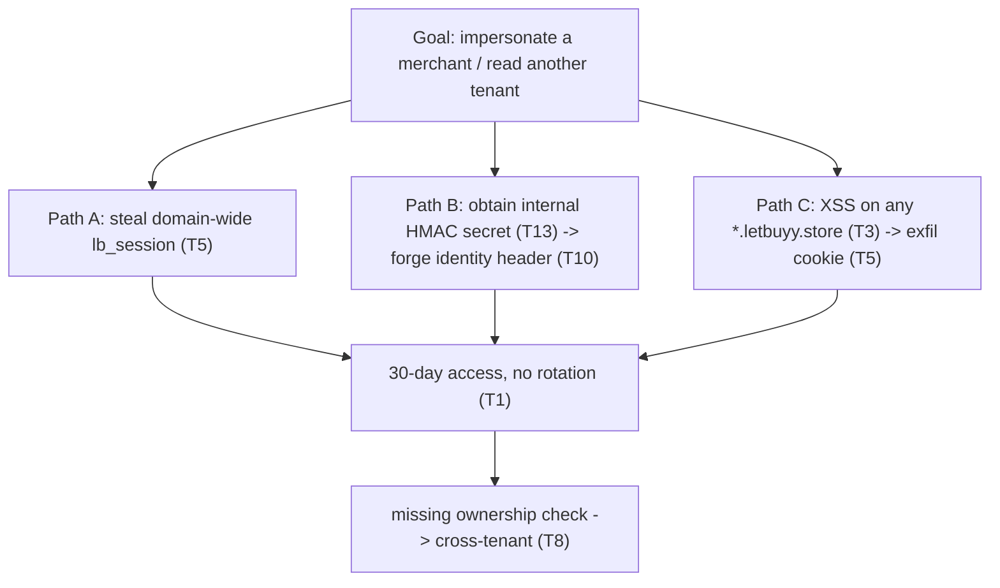

# THREAT_MODEL

**Phase 11 — Threat Model**
Status date: 2026-06-08
Method: STRIDE-informed, scored. Each threat is rated for the **current** system (evidence-backed) and the **target** system (after the transformation).

**Scoring.** Likelihood (L) and Impact (I) on 1–5. Risk = L × I (1–25). Bands: 1–6 🟢 low · 7–12 🟡 medium · 13–18 🟠 high · 19–25 🔴 critical.

---

## 1. Risk register (current vs target)

| # | Threat | Current L | Current I | Current Risk | Target L | Target I | Target Risk |
|---|--------|:---------:|:---------:|:------------:|:--------:|:--------:|:-----------:|
| T1 | Session hijacking | 3 | 5 | 🟠 15 | 2 | 4 | 🟡 8 |
| T2 | CSRF | 3 | 4 | 🟡 12 | 1 | 3 | 🟢 3 |
| T3 | XSS → token/cookie theft | 3 | 5 | 🟠 15 | 2 | 4 | 🟡 8 |
| T4 | Refresh-token theft | 3 | 4 | 🟡 12 | 2 | 3 | 🟢 6 |
| T5 | Cookie theft / domain-wide exposure | 4 | 5 | 🔴 20 | 1 | 3 | 🟢 3 |
| T6 | Replay attacks | 3 | 4 | 🟡 12 | 1 | 3 | 🟢 3 |
| T7 | OAuth misconfiguration | 3 | 4 | 🟡 12 | 2 | 4 | 🟡 8 |
| T8 | Tenant escalation (cross-store data) | 3 | 5 | 🟠 15 | 2 | 5 | 🟡 10 |
| T9 | Store escalation (within tenant) | 3 | 4 | 🟡 12 | 2 | 4 | 🟡 8 |
| T10 | Privilege escalation (role/claim) | 4 | 5 | 🔴 20 | 2 | 5 | 🟡 10 |
| T11 | Admin takeover | 2 | 5 | 🟠 10 | 1 | 5 | 🟡 5 |
| T12 | Marketplace / 3rd-party app abuse | 3 | 4 | 🟡 12 | 2 | 4 | 🟡 8 |
| T13 | Internal-secret compromise (identity forgery) | 3 | 5 | 🟠 15 | 1 | 5 | 🟡 5 |
| T14 | Token-at-rest / plaintext leakage | 4 | 4 | 🟠 16 | 1 | 3 | 🟢 3 |

T13/T14 are added because the audit surfaces them directly and they are among the most material risks.

---

## 2. Threat detail

### T1 — Session hijacking 🟠15 → 🟡8
- **Current exposure.** Merchant `lb_session` is a **30-day opaque bearer** with no rotation/refresh (Audit §Session Lifecycle). Steal it once → 30 days of access; only `last_active` bumps, no anomaly rotation.
- **Mitigations (target).** Short access tokens (≤10m) + rotating refresh + server-revocable `sid` (Phase 8); device binding; idle/absolute timeouts; risk-based re-auth. Stolen access token expires in minutes; stolen session revocable.
- **Residual.** A live refresh-token theft within its window — bounded by rotation + reuse-detection.

### T2 — CSRF 🟡12 → 🟢3
- **Current exposure.** Double-submit `letbuyy_csrf` is **JS-readable** (`httpOnly:false`, Audit §Security Findings), legacy `lb_csrf` still accepted, **3 setters with divergent attributes** (Phase 1 §3). Divergence + JS-readability weakens the defense.
- **Mitigations (target).** APIs are Bearer-token authenticated (not cookie-authed) ⇒ inherently CSRF-resistant; IdP forms use challenge-bound anti-forgery tokens + `SameSite=Strict`; legacy `lb_csrf` and the JS-readable cookie removed (Phase 8 §7).

### T3 — XSS → token/cookie theft 🟠15 → 🟡8
- **Current exposure.** Auth cookies are `HttpOnly` (good), but `letbuyy_csrf` is JS-readable, app-bridge **access tokens sit in browser memory/props** (`EmbeddedAppBridgeClient.tsx`, Audit §Client-Side Exposure), and marketplace profile data + telemetry live in localStorage. XSS on any `*.letbuyy.store` app is high-value.
- **Mitigations (target).** No tokens in localStorage; access tokens short-lived + audience-pinned; strict CSP; host-only cookies so XSS on one host can't reach another's session; embedded-app tokens scoped + short. XSS still bad, but blast radius and token value collapse.

### T4 — Refresh-token theft 🟡12 → 🟢6
- **Current exposure.** No merchant/customer refresh tokens exist; the *whole 30-day session token* is the de-facto refresh and isn't rotated. App OAuth refresh **is** rotated (`billing-oauth-routes.ts`) but raw values are returned in JSON.
- **Mitigations (target).** Rotating refresh with **reuse-detection** (reuse ⇒ revoke chain); httpOnly path-scoped cookie or device secure storage; no raw refresh in JSON bodies (Phase 9 §5).

### T5 — Cookie theft / domain-wide exposure 🔴20 → 🟢3
- **Current exposure (highest current risk).** `lb_session` is `Domain=.letbuyy.store`, `SameSite=lax`, shared by **every** subdomain app (Phase 1 §3). One subdomain takeover or one XSS anywhere on the estate, and the merchant session is exposed platform-wide.
- **Mitigations (target).** **Eliminate the domain-wide cookie.** Host-only `__Host-` cookies per realm/app; SSO via IdP redirects, not shared cookies (Phase 4 §5, Phase 7). This single change removes the largest current risk.

### T6 — Replay attacks 🟡12 → 🟢3
- **Current exposure.** Internal session/identity headers are HMAC + 5-min timestamp window (`LETBUYY_INTERNAL_AUTH_MAX_AGE_MS`) — replayable within 5 min by anyone who captures them; federation token has a replay store (good).
- **Mitigations (target).** mTLS service identity + per-request nonce/jti; auth codes single-use ≤60s + PKCE; federation single-use replay store retained; remove replay-prone header trust (Phase 12).

### T7 — OAuth misconfiguration 🟡12 → 🟡8
- **Current exposure.** Bespoke app-OAuth issuer; redirect-URI validation and PKCE enforcement not evidenced in the audit (UNKNOWN); raw tokens in JSON.
- **Mitigations (target).** Standard provider (ORY Hydra) with exact-match https redirect URIs, mandatory PKCE for public clients, no open redirects, audience pinning, consent (Phase 6 §3). Residual 🟡 because OAuth config is perennially error-prone — needs ongoing review + automated client-registration policy.

### T8 — Tenant escalation (cross-store data) 🟠15 → 🟡10
- **Current exposure.** Tenancy keyed on `site_id`; `verifySiteOwnership()`/`storeContext()` guard access, but most gateway code runs as **service-role (RLS-bypassing)** — a missing ownership check = cross-tenant read. App API rejects store mismatch (`assertTokenStoreScope`), which is good.
- **Mitigations (target).** Verified subject + `org`/`sites` claims; gateway re-checks membership on sensitive ops (claims are a cache, not authority — Phase 9 §4); keep RLS as defense-in-depth; reduce blanket service-role (Phase 12). Impact stays 5 (cross-tenant breach is severe) so risk floors at 🟡 — this is why authorization stays a first-class, separately-reviewed concern.

### T9 — Store escalation (within a tenant/org) 🟡12 → 🟡8
- **Current exposure.** `site_memberships`/`site_roles`/`site_role_permissions` exist, but role granularity and privilege-change rotation are partial (RBAC is "role-coarse" per project memory; privilege-change rotation UNKNOWN).
- **Mitigations (target).** Org→site hierarchy; finer roles; **privilege-change session rotation** (Phase 8 §3) so a downgraded staff member loses access promptly; step-up for staff/role management.

### T10 — Privilege escalation (role/claim forgery) 🔴20 → 🟡10
- **Current exposure (tied-highest current risk).** The gateway trusts **app-asserted identity headers** `X-LetBuyy-Internal-User-ID/Email/Store-ID` once an HMAC validates (`getInternalAuthContext`). **Any holder of the shared internal secret can assert any user/store/role.** Combined with one shared secret across all app servers + BFF, this is a systemic escalation path.
- **Mitigations (target).** **Remove app-asserted identity entirely.** Downstream trusts only IdP-signed tokens verified via JWKS (Phase 3 §5, Phase 12). Apps can no longer claim identities; they present tokens the IdP minted. Impact stays 5; likelihood drops to 2.

### T11 — Admin takeover 🟠10 → 🟡5
- **Current exposure.** Console requires allowlist + magic-link + TOTP (good — Audit), but there is a **static synthetic principal** `platform-console@letbuyy.local` for read-only ops, and admin sessions are stateless signed tokens (no server revoke).
- **Mitigations (target).** Admin realm: mandatory aal3/hardware-key for super-admin, server-revocable sessions, IP allowlist, eliminate/constrain the synthetic principal, full audit (Phase 4 §4, Phase 10 §3.2). Impact stays 5 (platform-wide) — defense is depth + least privilege + auditability.

### T12 — Marketplace / 3rd-party app abuse 🟡12 → 🟡8
- **Current exposure.** App OAuth scopes exist but **no consent record/UI**; raw app tokens in JSON; over-broad scopes possible; app-bridge token in browser.
- **Mitigations (target).** Mandatory consent + grant registry; least-scope; scoped short-lived embedded-app tokens; per-app rate limits; app review; revoke-on-uninstall; reuse-detection (Phase 6 §2.9). Residual 🟡 — third-party code is inherently semi-trusted.

### T13 — Internal-secret compromise → identity forgery 🟠15 → 🟡5
- **Current exposure.** One shared symmetric secret (`getLetbuyyInternalAuthSecret`) underpins **all** app→gateway trust; leak = forge any internal session/identity header = impersonate anyone.
- **Mitigations (target).** Asymmetric per-realm keys + JWKS (no shared secret to leak for forgery); mTLS service identity; KMS-held private keys; key rotation (Phase 9 §1, Phase 12). Impact stays 5; likelihood 1.

### T14 — Token-at-rest / plaintext leakage 🟠16 → 🟢3
- **Current exposure.** `verification_tokens.token` stored **in plaintext**; raw access/refresh tokens returned in JSON by legacy Supabase + employee + app-OAuth routes (Audit §Security Findings). DB read or log capture = usable tokens.
- **Mitigations (target).** Hash all single-use tokens at rest; never return raw long-lived tokens in bodies; redact logs (Phase 9 §5).

---

## 3. Attack-tree highlights (where current weaknesses chain)

The transformation **cuts every edge of this tree**: no domain-wide cookie (T5), no shared-secret identity forgery (T13/T10), short revocable sessions (T1), claims-as-cache + membership re-check (T8).

---

## 4. Prioritized mitigation backlog (by current risk)

| Priority | Mitigation | Closes | Effort |
|----------|-----------|--------|--------|
| P0 | Remove domain-wide `lb_session`; host-only cookies + OIDC SSO | T5, T3 | L |
| P0 | Replace app-asserted identity headers with IdP-signed token verification | T10, T13, T6 | L |
| P0 | Hash `verification_tokens`; stop raw tokens in JSON | T14 | S |
| P1 | Short access + rotating refresh + revocable `sid` | T1, T4 | L |
| P1 | Enforce merchant MFA + step-up for sensitive ops | T9, T11, T12 | M |
| P1 | Consolidate/remove CSRF cookies; drop legacy `lb_csrf` | T2 | S |
| P2 | Standard OIDC provider w/ PKCE + consent + redirect validation | T7, T12 | L |
| P2 | Privilege-change session rotation; membership re-check on sensitive ops | T8, T9 | M |
| P2 | Admin realm hardening (aal3, kill synthetic principal, IP allowlist) | T11 | M |

The three P0 items are the highest-leverage and map directly to the audit's most severe findings; several are "quick wins" (token hashing, CSRF cleanup) that can land before the full OIDC migration.

Phase 12 details the zero-trust redesign that closes T10/T13/T6.
