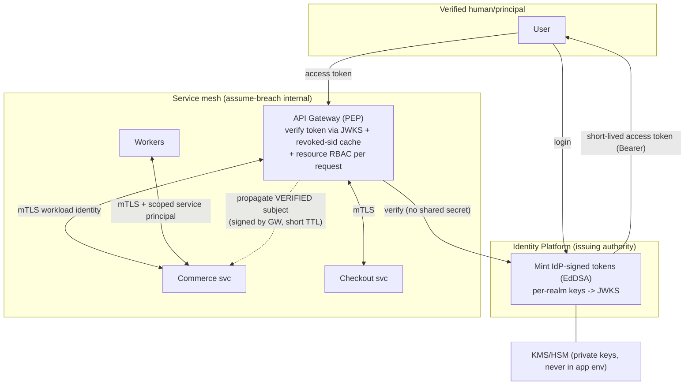
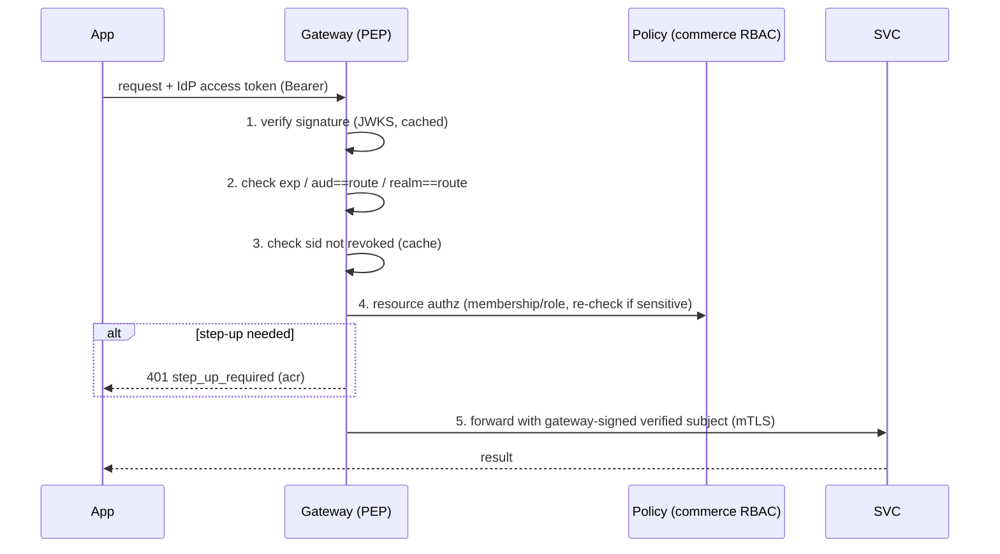
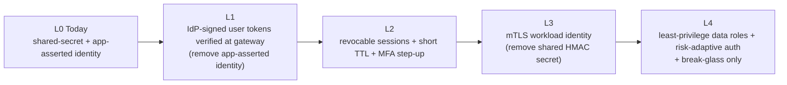

# ZERO_TRUST_ARCHITECTURE

**Phase 12 — Zero Trust Model**
Status date: 2026-06-08

> Analyzes the current trust assumptions — internal header trust, gateway trust, session trust — and designs a future zero-trust identity model. Zero trust = **never trust, always verify**: no implicit trust from network location, app identity, or asserted headers; every request carries a verifiable, scoped, short-lived credential.

---

## 1. Current trust assumptions (the things "just trusted" today)

| # | Implicit trust today | Evidence | Why it violates zero trust |
|---|----------------------|----------|----------------------------|
| ZT1 | **App-asserted identity is true.** Gateway trusts `X-LetBuyy-Internal-User-ID/Email/Store-ID` if an HMAC validates. | `getInternalAuthContext()` (`services/api-gateway/src/middleware/auth.ts`) | The *app*, not the IdP, asserts who the user is. Any app with the secret can assert any identity. |
| ZT2 | **One shared symmetric secret = the whole trust root.** | `getLetbuyyInternalAuthSecret()` (`auth-core/src/index.ts:447`); used by every app + BFF | A single leaked secret forges any identity across the estate. Network-position-equivalent trust. |
| ZT3 | **Edge proxies gate on cookie *shape*, not validity.** | `verifyLetbuyySessionCookieValue('merchant')` shape check (Audit §Trust Boundary) | A well-shaped but revoked/forged token passes the edge; real check deferred. |
| ZT4 | **Gateway runs mostly as service-role (RLS bypass).** | `createSupabaseServiceClient()` god-mode (Audit §Supabase Integration) | Compromise of a single route handler can read/write any tenant; RLS isn't the primary guard. |
| ZT5 | **Replay window of 5 min on internal headers.** | `LETBUYY_INTERNAL_AUTH_MAX_AGE_MS = 5*60*1000` | Captured headers are replayable for minutes. |
| ZT6 | **Stateless sessions can't be distrusted before expiry.** | customer/console JWTs, no revocation (Phase 8) | Can't revoke a compromised session in real time. |
| ZT7 | **Static synthetic admin principal.** | `platform-console@letbuyy.local` read-only branch | A non-human, non-MFA identity is trusted by name. |
| ZT8 | **Workers hold blanket service-role.** | `queue-workers`/`webhook-service` service-role | Worker compromise = full data-plane access. |

**The core violation:** trust flows from **possession of a shared secret** and **app self-assertion**, not from **a credential the central authority verifiably issued to a verified principal**. This is a perimeter/secret-bearer model wearing HMAC clothing.

---

## 2. Zero-trust target principles

1. **Identity is asserted only by the IdP, verified by everyone.** No service ever trusts another service's claim about *who the user is*; it verifies an IdP-signed token (asymmetric, JWKS). (Closes ZT1, ZT2.)
2. **Workloads have their own cryptographic identity.** Service-to-service calls use **mTLS / SPIFFE-style workload certs**, not a shared HMAC secret. (Closes ZT2, ZT5, ZT8.)
3. **Every request is authenticated and authorized at the resource.** The gateway (PEP) verifies token + audience + realm + `sid` + resource RBAC on every call; edge shape-checks are UX only, never security. (Closes ZT3.)
4. **Least privilege, short TTL, explicit scope.** Access tokens are minutes-long, audience-pinned, least-scope; service identities are narrowly scoped; service-role is decomposed. (Closes ZT4, ZT8.)
5. **Continuous verification / revocability.** Sessions are server-side and revocable; risk signals can force re-auth mid-session. (Closes ZT6.)
6. **No standing human or synthetic super-identity.** Break-glass only, time-boxed, MFA aal3, audited; synthetic principals removed or constrained. (Closes ZT7.)
7. **Verify explicitly at boundaries, assume breach internally.** Internal network position grants nothing.

---

## 3. Target trust architecture

**Two distinct identities on every internal hop:**
- **User identity** — the IdP-signed access token (or a gateway-minted, short-lived *verified-subject* token derived from it after verification), carried inward. Downstream services trust it because it's signed by a key they can verify, not because an upstream app said so.
- **Workload identity** — mTLS/SPIFFE cert proving *which service* is calling. Authorization can require both ("checkout-svc, acting for customer X").

This replaces `X-LetBuyy-Internal-*` HMAC headers entirely.

---

## 4. Internal header trust → verifiable subject propagation

| Aspect | Today | Zero-trust target |
|--------|-------|-------------------|
| Who asserts user identity | the calling app (`X-LetBuyy-Internal-User-ID`) | the IdP (signed token); gateway *verifies*, then re-signs a short-lived verified-subject header `X-LetBuyy-Subject` with the **gateway's** key for inward hops |
| Trust mechanism | shared HMAC secret | asymmetric signatures (JWKS) + mTLS workload identity |
| Forgeability | any secret-holder forges any identity | requires the IdP private key (KMS) to forge a user; requires a valid workload cert to even connect |
| Replay | 5-min window | per-request mTLS + short-TTL subject token + jti |
| Audit | app-attributed | IdP-attributed, end-to-end `sid`/`jti` correlation |

The `X-LetBuyy-Subject` inward header is **only ever set by the gateway after it has verified an IdP token** — services reject it unless it carries the gateway's signature and is fresh. Apps cannot mint it.

---

## 5. Gateway trust → policy enforcement point

The gateway stops being a "trusted translator of app assertions" and becomes a strict **PEP**:

No step trusts the network or the calling app. Step 4's authority is commerce data (claims are a cache); step 5 uses workload identity.

---

## 6. Session trust → continuous, revocable

| Trust property | Today | Target |
|----------------|-------|--------|
| Session validity | implied by unexpired bearer | server-side `sid`, revocable any time |
| Compromise response | wait for 30-day expiry | revoke `sid` → access dies in ≤1 TTL |
| Risk adaptation | none mid-session | risk signals (new device/IP/velocity) force step-up or revoke |
| Privilege freshness | stale claims until expiry | privilege-change rotation + sensitive-op re-check |

---

## 7. Decomposing service-role (ZT4/ZT8)

| Principal | Today | Target |
|-----------|-------|--------|
| Gateway → DB | one service-role (god) | per-domain DB roles, least table/column grants; RLS as real second layer |
| Workers → DB | blanket service-role | per-worker scoped service principal (only the tables that worker needs) |
| Webhook svc | service-role | scoped principal + signed-egress only |
| Break-glass | n/a | explicit, time-boxed, aal3, audited elevation |

Assume-breach: if one handler or worker is compromised, its blast radius is bounded to its scoped grants, not the whole database.

---

## 8. Zero-trust maturity ladder (where the program lands each wave)

Mapping to the Migration Plan (Phase 13): **L1** lands by Wave 2–3 (gateway verifies IdP tokens), **L2** by Wave 2 + Wave 8, **L3** in Wave 8 (foundation/hardening), **L4** in Wave 8.

---

## 9. Acceptance criteria

- Gateway has **zero** code paths trusting app-asserted `X-LetBuyy-Internal-User-ID/Email/Store-ID`.
- Cross-service identity uses asymmetric signatures + mTLS; the shared internal HMAC secret is removed from the identity path.
- Every protected request is verified (signature + aud + realm + sid + RBAC) at the gateway; edge checks are non-authoritative.
- Service-role is decomposed; workers hold scoped principals; no standing super-identity (break-glass only, audited).
- Sessions are revocable with ≤1-TTL effect; risk signals can force step-up/revoke.

Phase 13 sequences how to get here without downtime.
