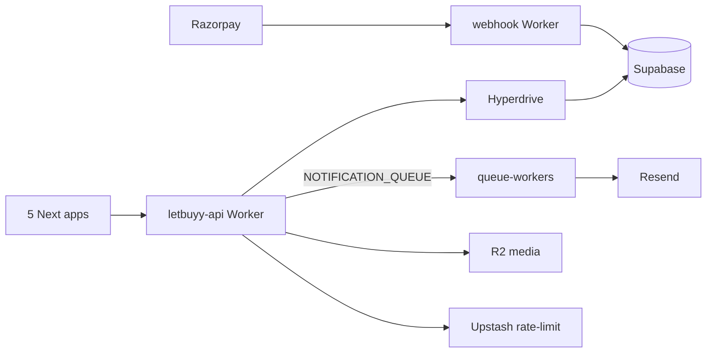

# LCIS v2 — Infrastructure Intelligence (Phase 5)

Parsed from `wrangler.toml` (×4) + `production-deploy.yml` + CODEOWNERS by `infra-intel.mjs`. Query: `pnpm graph:intel infra` / `/api/infra` / **◇ Infrastructure** UI tab.

## Topology (repository truth)
| Resource | Value |
|----------|-------|
| Cloudflare Workers | 4 — `letbuyy-api`, `letbuyy-queue-workers`, `letbuyy-webhook`, `letbuyy-mobile-bff` |
| Queues | producers 5 (`EVENT_QUEUE`, `ANALYTICS_QUEUE`, `SEARCH_QUEUE`, `NOTIFICATION_QUEUE`, `RUNTIME_QUEUE`) · consumers 7 |
| Storage | R2 (`R2_BUCKET`, media) · Hyperdrive ✓ (Postgres pooling) · KV/D1 as configured |
| Cron triggers | per wrangler `[triggers]` |
| Vercel apps | 5 — marketing-site, identity-platform, merchant-control-plane, storefront-runtime, platform-console |
| Database | Supabase Postgres (migrations applied via gated `db push --include-all`) |
| Providers | Resend (email), Razorpay (payments), Turnstile (bot), Supabase, Upstash Redis (rate-limit) |
| Production secrets required | 19 (`wrangler secret put` in production-deploy.yml) |
| Deploy gate | `migrate-production` job ✓ before worker/app deploy |

## Capacity & cost — FRAMEWORK, not fabricated figures
> The program asked for "free-tier / 100-merchant / 1000-merchant / 100k-user cost models." Specific dollar figures at those scales require **load assumptions + live pricing** — they are **projections, not repository truth**, so this report gives the **scaling levers and where the first limits hit**, not invented numbers. Fill the numbers from current Cloudflare/Vercel/Supabase/Razorpay/Resend pricing + a measured load test.

| Scale | What scales | First limit to watch |
|-------|-------------|----------------------|
| **Free tier** | Workers (100k req/day free), Vercel hobby, Supabase free (500MB/2 CPU), Resend free (3k/mo), Razorpay per-txn | Supabase row/storage + Resend monthly cap |
| **~100 merchants** | DB rows, R2 media, queue volume | Supabase compute tier; bump to a paid Postgres |
| **~1,000 merchants** | gateway req/s, Hyperdrive pool, queue consumers | Worker CPU-ms + Postgres connections (Hyperdrive mitigates) |
| **~100k concurrent users** | edge req/s, queue backlog, DB read load | Postgres read replicas, queue consumer concurrency, R2 egress, CDN cache hit-rate |

**Cost drivers (real levers):** Worker requests + CPU-ms, Supabase compute + storage + egress, R2 storage + egress, Resend volume, Razorpay per-transaction %, Vercel bandwidth/build. **Free-tier-friendly choices already in place:** Workers/queues, Hyperdrive (connection pooling), cached storefront (`stale-while-revalidate`), R2 (no egress fees to Workers).

## Recommendation
Add a `infra:capacity` doc with measured numbers after a staging load test; LCIS `infra` already gives the topology those numbers attach to.
