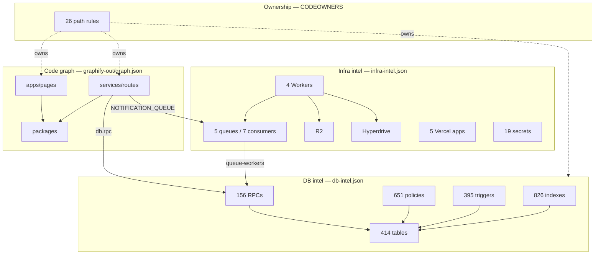

# LCIS v2 — Unified Knowledge Model (Phase 1)

LCIS now spans four layers, joined on file paths and symbol names.

## Join keys
- **Code ↔ DB:** the gateway's `.rpc('name')` call sites link a `route.ts` node to an RPC, and the RPC's body links to its tables (`route → rpc → table`).
- **Code ↔ Infra:** queue binding names (`NOTIFICATION_QUEUE`, …) link producer routes to consumer workers.
- **Anything ↔ Ownership:** a file path matched against CODEOWNERS rules.

## Entities covered
Apps · Services · Packages · Routes · Pages · RPCs · Tables · Policies · Triggers · Indexes · Queues (producers/consumers) · R2/Hyperdrive · Crons · Vercel targets · Secrets · Providers (Resend/Razorpay/Turnstile/Supabase/Upstash) · CODEOWNERS.

## Single query surface
- CLI: `pnpm graph:intel <deps|consumers|blast|critical|rpc|table|policy|payment|refund|payout|tenant|flow|owner|infra>`.
- HTTP: `/api/{search,blast,table,rpc,policy,owner,infra,db,atlas,domain,community,path,neighbors}`.
- One unified model, one query surface — the goal of LCIS v2.
