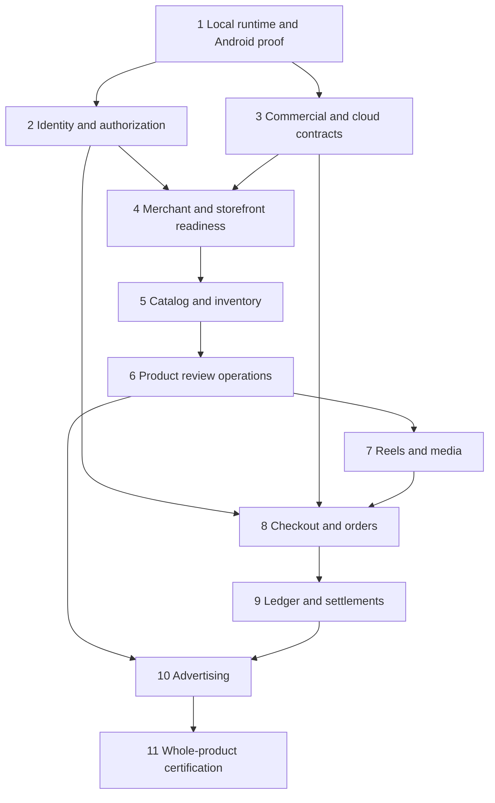

# LetBuyy foundation programme — complete canonical systems, prove complete journeys

## Owner execution mandate — 3 October 2026

The owner locked all eleven phases below as one active end-to-end goal and authorized direct implementation by Codex, using the personal `$letbuyy` skill on every work turn. This supersedes the earlier reviewer/Claude-worker arrangement and the original proposed-only programme status. The original dated baseline below remains historical evidence.

| Phase | Locked outcome | Execution position on 3 October |
|---|---|---|
| 1 / 1R | Reproducible local stack and canonical Android buyer journey | Locally accepted and integrated; preserve the accepted work. |
| 2 | Shared identity, scoped access, privacy and order ownership | In progress. First bounded outcome: P2-OPERATOR-MUTATION-INTEGRITY. |
| 3 | Commercial, compliance, provider and cloud contracts | Upcoming; research dependencies early. |
| 4 | Merchant onboarding, subscriptions and storefront operations | Upcoming. |
| 5 | Canonical catalog, inventory and discovery | Upcoming. |
| 6 | Revision-bound human product review | Upcoming. |
| 7 | Approved reel commerce and media | Upcoming. |
| 8 | Server-authoritative checkout, payments and order recovery | Upcoming. |
| 9 | Accounting, weekly eligible settlements and reconciliation | Upcoming. |
| 10 | Credit-backed CPC, CPM and purchase advertising | Upcoming. |
| 11 | Whole-product security, performance, recovery and operations certification | Upcoming. |

The seven packages and closure evidence per phase remain the execution scope. Completion requires integrated positive, denied, concurrent, retry and failure journeys appropriate to each package, including provider/device evidence where required. Implemented, locally verified, sandbox verified, hosted and released remain distinct verdicts. Missing business decisions or inaccessible external systems stay explicit; they cannot be replaced by invented approval or simulated acceptance.

Execute as one agent in the existing isolated Phase 2 worktree, initially at `eb49fe27cae28612d10884dd5513242a40afd64a`. Preserve unrelated analyzer edits, local runtime evidence, signing assets and backups. Existing exclusions on merge, push, deployment, hosted cutover, external messages, live transactions and backup deletion remain in force until explicitly changed.

Current bounded acceptance: all seven operator support mutation endpoints (reply includes internal notes) commit their effects and durable actor/operation/target/key/payload receipts together; retries and concurrent duplicates return one coherent result; mismatched payloads conflict; fresh authorization precedes replay; transaction failure leaves neither partial effects nor a poisoned key. Verify through the real worker and an owned disposable database, with named write/lost-response faults, concurrency, actor separation and revocation controls. Inspect typed-client and real callers without activating a frozen portal.

> **Superseded in part by the owner on 26 September 2026:** no real marketplace users require migration; remove Firebase from the marketplace runtime and use direct canonical LetBuyy sign-in. Do not request Firebase credentials or preserve the legacy login gate. Read [Phase 1R revised plan](PHASE_1R_FIREBASE_FREE_MARKETPLACE_PLAN.md) before using this historical plan/prompt. Other preservation and no-deployment constraints remain.

Date: 26 September 2026. Planning baseline: `develop` at `6eb01d95867e1c7d0eb15c704eeaf2195ca8cc68` on the restored Apple Silicon Mac. **Proposed detailed programme; not an implementation report, constitutional amendment, deployment authorization or schedule.**

This expands the accepted scope of the [eleven-phase roadmap](../commerce-2026-09-26/COMMERCE_11_PHASE_ROADMAP.md). It preserves its eleven parent phases and defines **77 work packages**, seven per phase. Packages are bounded implementation outcomes, not 77 separate services or mandatory standalone prompts. The sequence incorporates the older foundation roadmap's tenant, money, theme, UI, merchant operations, notification and first-merchant foundations.

Companions: [research and cloud findings](RESEARCH_AND_CLOUD_FINDINGS.md), [decisions and acceptance](DECISIONS_AND_ACCEPTANCE.md), [execution and prompt contract](EXECUTION_CONTRACT.md). Read the current Constitution, root/local AGENTS and canonical registry before implementation. Evidence documents explain findings; they do not become higher authority by being newer or longer. Explicit current owner decisions take precedence over historical conversation instructions; record necessary governance alignment without inventing signatures.

## What we are building

A merchant can start a storefront with proportionate verification, manage one catalog and inventory, publish a Liquid storefront, and opt into a more strongly verified marketplace. A marketplace buyer discovers approved products through ordinary browsing and approved product-matched reels, signs in through canonical identity, purchases through provider-managed payments, and receives support through the full order lifecycle. Merchants understand every fee, refund, adjustment and weekly eligible settlement. Operators can review, investigate and act with bounded permissions and auditable reasons. Advertising supports CPC, CPM and qualified-purchase billing with measurable validity and controlled budgets.

The foundation is complete only when these outcomes work through normal interfaces with the real authorization role and canonical backend. Tables, adapters, route counts and passing unit tests establish components, not whole-product completion.

### Preserved decisions

- V1 includes storefront and reel-led marketplace. Quick commerce, dark stores and delivery-app expansion remain V2.
- One identity issuer; shared canonical buyer ownership across approved channels; merchant and operator privileges remain separate. No duplicated buyer passwords or automatic identity merging by email.
- `sites` remains the tenant root. Reuse canonical catalog, orders, inventory, ledger, themes, identity and notification systems.
- Storefront LetBuyy sales commission is zero. Marketplace commission is category-based and versioned. Subscription, provider, shipping and applicable tax lines remain separately disclosed.
- Licensed provider-managed marketplace collection and weekly **eligible** settlement; no LetBuyy custody workaround or invented provider approval.
- Seller approval, product revision approval and reel-to-product match approval are different controls. Humans approve marketplace products and attached reels; upload/transcoding success does not approve a listing.
- CPC, CPM and purchase-based ads remain in scope. Paid reach cannot bypass eligibility, and ad credits are separate from seller proceeds.
- Liquid-first storefronts and canonical design tokens remain. Do not replace the theme system or build a second merchant OS.
- Keep the modular monolith and approved satellites. Reserved services remain empty. Use transactional outbox and typed contracts, not an event bus, distributed saga, second money database or speculative multi-region system.

## Measured starting point

The restored HEAD equals the expected transfer HEAD. Cached Git tracking says 13 commits ahead of `origin/develop`; no fetch was performed. The two original commerce research documents were untracked and preserved. This programme adds documentation only.

Earlier verification in [NewMacSetup/VERIFICATION.md](../../../../NewMacSetup/VERIFICATION.md) established compatible local dependencies, owned database restore, identity/gateway operation, startup checks for identity and the four other web apps, a fresh Android debug build, backend buyer tests and selected Flutter/console tests. They are dated recorded results, not all rerun for this planning document.

**Phase 1 is partially verified and still open.** Ordinary signed-in Android profile/address navigation lacks a legitimate usable Firebase test login. Android association reports `legacy_failure`; public apex assetlinks currently redirects to a `www` URL returning 404. The app's home failure banner needs diagnosis. The public directory deliberately rejects an unscoped tenant query; source comments require a decision for platform-wide directory exposure. Four safe governance checks remain red. These facts must remain visible.

The owned restore contains a pristine migration-258 database plus a working copy with pending 259/260 applied. Logical restore success is not proof that encrypted values can be decrypted or that every future media byte is recoverable. Local Supabase ports were observed published on all interfaces; its dedicated Docker network did not establish loopback-only binding. Keep old Mac and T7 backups until required new-machine runtime verification succeeds.

Public APIs and accounts respond in some probes, but API health varied between 200 and 403. No hosted commit was established. Cloudflare CLI lacks authentication; the accessible Supabase account's project list did not match the restored LetBuyy project reference. None of this authorizes changing other projects.

## Sequencing and architecture

This is the **closure** dependency graph. Discovery of provider eligibility, cloud ownership, legal applicability and ledger invariants starts early. Existing checkout and ledger code can be inspected before Phase 7; completing the integrated reel-commerce purchase gate requires the earlier eligibility controls. No graph edge requires delaying all research until its predecessor closes. One implementation agent works one bounded phase at a time, carrying unfinished dependencies explicitly.

Security, UI and operations are continuous: instrumentation starts in Phase 1; authorization in 2; contracts and privacy in 3; accessible merchant UI in 4; abuse controls in 5–7; money recovery in 8–9; spend integrity in 10; certification of the assembled product in 11. Phase 11 cannot rescue eleven phases of deferred testing.

## Phase 1 — Reproducible local stack and Android closure

**Outcome:** the new Mac is a reliable engineering environment and a real buyer can use the canonical backend through the Android app. Size: medium; main uncertainty is credentials/domain ownership, not initial installation. Entry: restored repository and owned backups. Canonical surfaces: NewMacSetup tooling, identity, gateway, marketplace mobile, local database.

| Package | Complete work | Required proof |
|---|---|---|
| F1.1 Transfer and toolchain contract | Preserve tracked/untracked work, signing and env originals; reconcile Node 20 app and Node 22 Wrangler requirements; document Flutter/Java/SDK compatibility and supported scripts. | Fresh-shell version resolution and frozen installs without lockfile drift; before/after Git and signing checks. |
| F1.2 Owned restore and isolation | Verify dump/version/schema compatibility, migration ledger and storage scope; preserve pristine and working copies; resolve or explicitly contain non-loopback published ports. | Owned resource/port inventory, runtime-role connection, repeatable restore instructions and no unrelated resource changes. |
| F1.3 Reproducible services and fixtures | Start identity/gateway and required app surfaces through supported launchers; deterministic non-sensitive test fixtures, correct issuer/origins and readiness diagnostics. | Health plus functional backend call, occupied-port refusal, restart without duplicate fixtures or leaked secrets. |
| F1.4 Ordinary Android account journey | Normal Profile → login → browser consent/callback → profile → address create/edit/default/delete → restart/session restore → logout → buyer switch. | Device/UI evidence joined to backend ownership assertions; no token injection, admin impersonation or bypass substitution. |
| F1.5 Link association and runtime errors | Verify debug/release association requirements separately; diagnose home banner; treat directory as explicitly unavailable until public scope is decided. | Callback routing and Android domain verification reported separately; safe unavailable UI or authorized scoped directory design, no tenant guard removal. |
| F1.6 Honest development gates | Repair stale validator targets against actual console MFA implementation; classify exposed Firebase web configuration accurately; preserve caches/research when checking stale artifacts. | Relevant validators enforce intended behavior, with existing failures/skips named; no disabling checks to make a dashboard green. |
| F1.7 Reproduction and handoff | Record exact tools, commands, artifacts, data boundaries and remaining external gaps; reproduce startup after stop/restart. | Another shell can run the documented stack; exact APK identity and source checkpoint; local-vs-hosted verdicts remain distinct. |

**Closure journey:** a normal buyer performs F1.4 twice with account switching, with matching canonical database observations. Negative controls deny the other buyer's addresses and revoked sessions. No public-directory activation is needed merely to repair safe error handling. Hosted assetlinks cannot be fixed under the current no-deployment limit: prepare the exact patch if needed, record hosted verification as blocked. A credential/device/hosting blocker means partial closure, never an invented pass.

## Phase 2 — Shared buyer identity, privacy and order visibility

**Outcome:** the same buyer has correctly scoped cross-channel ownership, and merchant/staff/operator authorization cannot borrow buyer or owner privileges. Size: large; migration risk high. Entry: stable Phase 1 backend and account flows. Reuse identity-core, session/token/tenant/permission contracts and existing buyer APIs.

| Package | Complete work | Required proof |
|---|---|---|
| F2.1 Identity authority and transition map | Inventory every active issuer/session consumer and legacy Firebase dependency; distinguish historical completed work from remaining paths. | Consumer/issuer matrix tied to current imports, HTTP flows and feature flags; one canonical subject mapping per account. |
| F2.2 Buyer sessions across origins | Complete trusted platform account flow and constrained merchant-domain sessions with PKCE, redirect allowlists, audience and cookie protections. | Trusted domains work; hostile custom domain, redirect replay, wrong audience and CSRF cannot obtain global access. |
| F2.3 Buyer profile and addresses | Atomic default-address handling, account switching, ownership enforcement and consistent TS/Dart contracts. | Concurrent default changes preserve invariants; stale UI responses cannot show previous buyer data. |
| F2.4 Historical and new order ownership | Verify every order writer records canonical buyer ownership; define safe treatment of historical unlinked orders and scoped views. | Storefront orders and marketplace views show permitted records only; matching an unverified email cannot claim an order. |
| F2.5 Merchant and staff convergence | Reconcile active employees with the declared identity/organization target; preserve site tenancy and explicit permission mapping. | Invited staff use their own login, see only allowed sites/actions, lose access on revocation; migration reconciliation and rollback before flag cutover. |
| F2.6 Operator identity and privileged actions | Complete existing console MFA/session integration, bootstrap/recovery policy, step-up and audited high-risk permissions. | Real operator and limited reviewer accounts, denied privilege escalation, session invalidation and recovery audit; owner-role testing is insufficient. |
| F2.7 Privacy and database isolation | Purpose/consent hooks, redacted diagnostics, access/export/deletion workflow contracts; audit actual DB roles, RLS/GUC transaction boundaries and pooling. | Alternating tenants through runtime pool cannot leak data; privileged functions are constrained; retention conflicts preserve required records. |

**Closure journey:** buyer across two storefront contexts and marketplace; merchant owner, restricted staff and operator separately; cross-tenant/account attempts denied through actual APIs. The existing `employees` → declared organization-model transition is a migration project, not permission to turn on dormant flags or import EDYNOX's hierarchy. Current console hardening is retained. Implementation-ready policy questions are in D03/D04/D05.

## Phase 3 — Commercial, regulatory and governance specification

**Outcome:** downstream engineers implement explicit, versioned rules and real provider contracts rather than inventing commercial behavior. Size: medium engineering, potentially long external lead time. Entry: current owner decisions; research can begin alongside Phase 1. Complete specification and executable configuration seams; no activation.

| Package | Complete work | Required proof |
|---|---|---|
| F3.1 Authority alignment | Narrowly reconcile global zero-commission prose with accepted storefront-zero/marketplace-category policy; retain dated history and required governance approval records. | Consistent governing rule, canonical configuration owner and validators; no fabricated ARB approval. |
| F3.2 Commercial configuration | Effective-dated category rates, founding/subscription commitments, fee bases, tax inclusion and refund allocation examples. | Worked examples and boundary fixtures; changing future rates cannot rewrite historical order snapshots. |
| F3.3 Provider eligibility and fund flow | Compare existing adapters and written marketplace eligibility; identify contracting entity, seller onboarding, collection, settlement and dispute responsibilities. | Provider-confirmed route for LetBuyy's entity and seller types, sandbox capability/access checklist and explicit outstanding approvals. |
| F3.4 Category and tax applicability | Launch allowlist, restricted categories, GST/entity/geography matrix and required declarations/licenses. | Category-by-category implementation fields, verification owner and effective-date source record; no universal GST or KYC assumption. |
| F3.5 Consumer, privacy and content policy | Version seller/buyer terms, grievance and return rules, consent/retention schedule, sponsored labels, ranking explanations and reel rights. | UI/API requirements traced to applicable dates and professional review; future rules separated from currently effective obligations. |
| F3.6 Cloud and recovery contract | Prove project ownership; map environment, domain, provider resource, region, secret custody, release lineage and recovery scope. | Read-only inventory and drift register; approved cost/RPO/RTO assumptions; no provisioning against unmatched accounts. |
| F3.7 Transaction and evidence contracts | Inspect existing money/outbox/idempotency primitives early; define channel, revision, source, attribution and immutable financial snapshot fields. | State-transition examples cover retry/refund/reversal; ownership of each field/event is explicit before later migrations. |

**Closure:** every money-changing or seller-unlocking rule is executable or blocked by a named unresolved value. This phase may deliver local contract readiness before provider approval, but must not claim commercial activation readiness. Preserve the accepted commercial direction; request missing numbers or policy choices only when they materially affect implementation.

## Phase 4 — Progressive merchant onboarding, subscriptions and readiness

**Outcome:** storefront-only merchants get a useful operating product; marketplace sellers meet stronger requirements without duplicating their business identity. Size: large. Entry: Phases 2–3 contracts. Reuse canonical onboarding, billing, KYC adapters, merchant surfaces, theme engine/editor and design system.

| Package | Complete work | Required proof |
|---|---|---|
| F4.1 Lifecycle and capability model | Separate account, site, storefront publication, marketplace seller, provider and subscription states; derive capabilities centrally. | State transition table and API enforcement agree; neither payment nor UI flags can bypass verification. |
| F4.2 Basic storefront onboarding | Business/site creation, minimum identity/contact validation, channel choice, useful onboarding checklist and resumable drafts. | Real merchant reaches an owned draft storefront without unrelated marketplace paperwork. |
| F4.3 Marketplace verification | Entity-aware tax, bank/beneficiary and required document flows, correction, rejection, appeal, expiry and reverification. | Sandbox/manual/live states remain distinct; missing provider verification cannot unlock live selling. |
| F4.4 Private document custody | Purpose-specific upload/access, retention, reviewer permissions, redaction and audited download controls. | Wrong tenant/reviewer, expired URL and replaced file denied; backups preserve required bytes securely. |
| F4.5 Plans and entitlements | Existing plan catalog, subscription lifecycle, renewal/failure/grace and founded commitments; server-side entitlements across web/mobile. | Plan restrictions cannot remove access to existing orders, refunds or statements; retries cannot double bill. |
| F4.6 Theme and storefront publishing | Complete canonical Liquid preview/editor/publish flow, safe sections/settings, assets, domain verification and rollback to prior published version. | Draft/published separation, tenant-safe rendering, custom-domain ownership, mobile layout and coherent checkout handoff. |
| F4.7 Merchant operations and accessibility | Navigation, role-aware tasks, loading/empty/denied/error states, shared tokens and accessible forms across required merchant web/mobile paths. | New merchant and restricted staff complete their real tasks; keyboard/TalkBack checks complement automated checks. |

**Closure journey:** storefront-only onboarding and publication; marketplace opt-in with rejection/correction and eventual test approval; subscription restriction; staff access; theme edit/preview/publish/rollback. No theme marketplace, extension runtime or second design system is introduced.

## Phase 5 — Canonical catalog, category compliance and inventory

**Outcome:** merchants maintain one product truth and buyers see accurate, eligible products on their chosen channels. Size: large. Entry: approved channel/category contracts and usable merchant lifecycle.

| Package | Complete work | Required proof |
|---|---|---|
| F5.1 Catalog ownership and legacy mapping | Inventory product/variant/media writers and duplicate marketplace data; map IDs before cutover. | Reconciled counts and references; no live consumer left writing a second catalog. |
| F5.2 Product and variant management | Canonical forms/import where supported, validation, variant identity, prices, availability and safe edit concurrency. | Merchant web/mobile changes arrive consistently at API and buyer detail; malformed/stale edits fail clearly. |
| F5.3 Compliance attributes | Category-required seller/pack/importer/origin/tax/license fields with applicability and effective dates. | Missing declarations prevent the relevant channel's publication; non-applicable fields do not block valid sellers. |
| F5.4 Channel publishing | Separate acquisition source from channel eligibility; preserve independent storefront and marketplace state. | Storefront-only product remains usable; marketplace submission neither auto-approves nor mutates storefront promises. |
| F5.5 Inventory correctness | Reuse reservation/release primitives, quantities per variant, concurrency and stock adjustment audit. | Simultaneous last-item purchases, timeout release and late capture cannot oversell or double-release. |
| F5.6 Discovery and geographic eligibility | Searchable/filterable browsing alongside reels, pagination, country/origin/category filters and shipping/pincode eligibility. | Search/detail agree on availability and scope; no draft metadata or owner PII leaks. |
| F5.7 Migration and user-flow parity | Migrate only verified consumers, preserve IDs/URLs/history and provide correction reports. | Product edit → selected-channel publication → buyer search/detail works; rollback restores routing without lost writes. |

**Closure:** a multi-variant product travels from merchant entry to each permitted buyer surface with the correct current price, stock and declarations. Geography means V1 sale/serviceability rules, not a new quick-commerce dispatch system. Public store-directory exposure remains the separate D02 decision.

## Phase 6 — Product approval and internal review operations

**Outcome:** product eligibility is enforced everywhere and operators can run a defensible review service. Size: medium-large. Entry: merchant verification, canonical product revisions and operator permissions.

| Package | Complete work | Required proof |
|---|---|---|
| F6.1 Revision-bound eligibility | Reuse listing/revision approval primitives; define material changes and approval invalidation. | An approved revision cannot authorize a different material product state. |
| F6.2 Operator review workbench | Queue, assignment, evidence, revision diff, reason codes and actionable merchant response. | Limited reviewer completes normal UI review; merchant cannot self-approve or access another applicant's evidence. |
| F6.3 Concurrency and appeals | Stale decision protection, correction/resubmission, appeal and reviewer audit. | Two reviewers or simultaneous edits cannot overwrite newer decisions; history remains attributable. |
| F6.4 Read-surface enforcement | One eligibility contract for feed, search, sponsored results, detail and deep links. | Unapproved/revoked products absent or safely denied in each actual surface, including ads. |
| F6.5 Purchase-time enforcement | Revalidate seller/product/channel eligibility at relevant checkout transitions. | Cached cart or stale approval cannot create an unauthorized purchase; established paid-order remedies remain explicit. |
| F6.6 Complaints and takedowns | Report flows, triage, evidence access, emergency disable, appeal and policy retention. | Revocation reaches cache/media/purchase paths within a measured bound; actions carry reasons and actor identity. |
| F6.7 Operational capacity | Review statuses, oldest-item/age metrics, staffing assumptions and response commitments. | Operator rehearsal with backlog and escalation; no unstaffed approval SLA represented as guaranteed. |

**Closure:** approved seller/product proceeds; rejected, edited and revoked revisions cannot escape through sponsored discovery, deep links or direct API purchase. Storefront eligibility changes only where the policy actually applies. Source findings about sponsored joins are investigation targets, not proof that every current ad route bypasses approval.

## Phase 7 — Canonical reel commerce and product-match approval

**Outcome:** secure, usable reels lead buyers to the exact approved product while moderation remains enforceable. Size: large; provider and migration risk high. Entry: product review and managed media decision.

| Package | Complete work | Required proof |
|---|---|---|
| F7.1 Media authority and provider boundary | Inventory Firebase ReelService, embeds and storage; select provider against measured upload/playback needs and ownership contract. | Canonical DB owns asset/review references; provider metadata and adapter responsibilities documented; no media microservice. |
| F7.2 Secure upload and processing | Scoped uploads, resumable transfer, size/type/duration limits, quota and processing callbacks; private unapproved assets. | Wrong merchant, forged callback, abandoned upload and retry cannot publish or exhaust uncontrolled resources. |
| F7.3 Immutable product match | Bind asset version/hash, product revision, allowed variant reference, caption and thumbnail to review. | Replacing media/product/caption cannot inherit approval; stale review rejected atomically. |
| F7.4 Human review and rights | Product-match review, rights/claims/disclosures, reason codes, correction and appeal using canonical operator workflow. | External links and provider-ready state never skip review; seller sees actionable reasons. |
| F7.5 Buyer playback and commerce | Feed pagination, captions/mute/accessibility, low-bandwidth recovery and reel → current product → cart navigation. | Android real playback and recovery; current server price/stock authoritative despite old reel display. |
| F7.6 Revocation and abuse control | Signed access where appropriate, cache invalidation, bounded token life, report flow and emergency takedown. | Previously issued URLs/caches tested after revocation; residual exposure window measured, not assumed zero. |
| F7.7 Verified Firebase cutover | Reconcile asset/subject/product mappings, migrate owned content, switch consumers and preserve recoverable originals. | No remaining direct Firebase authority on the completed path; before/after counts and rollback; backup deletion not authorized. |

**Closure:** submit → process → human approval → buyer playback → product/cart; replacement, rejection and takedown all work. Whether all marketplace listings require a reel remains D09; every item entering the reel feed requires approved matching media. Video review does not certify physical product quality.

## Phase 8 — Shared checkout, provider payments and order lifecycle

**Outcome:** ordinary buyers can buy and recover from failures across storefront and marketplace, with canonical orders and no duplicate financial effects. Size: very large; split into dependency-ready implementation changes within this parent phase. Entry: identity, commercial contracts and eligible product/reel paths; provider sandbox access.

| Package | Complete work | Required proof |
|---|---|---|
| F8.1 Cart and checkout authority | Reuse checkout-core/server pricing, shipping, discounts, tax, address and inventory contracts; preserve source attribution separately. | Tampered totals/provider/source rejected; stale price or serviceability produces a recoverable UI. |
| F8.2 Multi-seller order structure | Canonical parent/merchant allocations as supported by existing model, buyer linkage, item snapshots and reservation boundaries. | One buyer purchase yields correct scoped merchant orders; neither merchant sees another's customer/order details beyond permitted needs. |
| F8.3 Payment initiation and confirmation | Storefront supported gateway choices; marketplace approved provider seller mapping and signed/captured evidence. | Provider sandbox normal UI success, abandonment and failure; redirect success alone cannot mark paid. |
| F8.4 Retry and recovery state machine | Reuse outbox, idempotency, late-capture and reservation-release work; handle duplicates/out-of-order callbacks and timeouts. | Crash/retry at material boundaries produces one order/payment effect and a recoverable customer state. |
| F8.5 Fulfillment and communication | Merchant accept/fulfill/cancel, shipment/tracking where supported, buyer status and canonical email/WhatsApp notifications. | Actual permitted staff flow and outbox delivery/retry; consent respected; no competing notification authority. |
| F8.6 Returns, refunds, COD and complaints | Partial/item refunds, cancellation after capture, return evidence, COD remittance semantics and customer grievance flow. | Partial failure and provider reconciliation exposed; replay cannot duplicate refund or release; COD not treated as provider cash already received. |
| F8.7 Complete channel certification | Storefront and marketplace web/mobile journeys, seller/product revocation, role isolation and operational recovery. | Real provider sandbox identifiers linked to source and orders; inaccessible provider tests stay blocked, not replaced by mocks. |

**Closure:** browse/reel → cart → sign-in/address → provider payment → order → fulfillment → partial refund and complaint. Rehearse payment succeeded/client timed out and late capture after stock release. Contract tests may proceed without provider credentials; they cannot close F8.3/F8.7.

## Phase 9 — Commission, tax accounting, weekly settlement and statements

**Outcome:** every financial amount has an explainable canonical ledger trail and provider reconciliation. Size: very large; financial correctness dominates speed. Entry: commercial configuration and verified order/payment lifecycle. Ledger invariants were inspected earlier in F3.7.

| Package | Complete work | Required proof |
|---|---|---|
| F9.1 Accounting map and invariants | Enumerate canonical writers/accounts/currencies and immutable postings; define rounding and reversals using existing ledger. | Balanced postings and reproducible examples for sale, refund, chargeback, ad funding and subscription separation. |
| F9.2 Commission and financial snapshots | Storefront zero sales commission, effective-dated category marketplace rates and item-level allocation. | Rate edits and category changes cannot rewrite completed orders; splits sum exactly with deterministic rounding. |
| F9.3 Tax and withholding exports | Approved GST/withholding applicability, invoice/credit-note references and effective-year configuration. | CA-reviewed examples reconcile to item and ledger totals; no unverified rate hardcoded as current law. |
| F9.4 Settlement eligibility | Weekly cutoff/timezone, holds, returns, negative balances, COD remittance and exclusions. | Boundary-time tests, refund after cutoff and unresolved debt remain visible; no zero-clamp hiding liabilities. |
| F9.5 Atomic provider batches | Lock/claim eligible entries, idempotent provider instructions, status transitions and maker/checker where required. | Concurrent/repeated jobs cannot settle twice; partial provider batch failure can be retried without rebilling. |
| F9.6 Reconciliation and recovery | Provider reports/webhooks, unmatched transactions, suspense, adjustments and controlled resolution. | Settlement/refund/chargeback discrepancies traced and resolved with compensating entries and audit, not edited history. |
| F9.7 Merchant and operator statements | Estimated versus finalized payout, included/excluded items, fees/taxes/adjustments and downloadable statements. | Merchant explains an order through partial refund to bank/provider outcome; restricted staff cannot authorize payout changes. |

**Closure:** a complete weekly provider sandbox cycle including refund, hold, adjustment and retry balances from orders to provider evidence. Local balanced ledgers alone do not prove provider settlement. No direct custody fallback if a provider cannot support the approved schedule.

## Phase 10 — Advertising credits and CPC/CPM/purchase-based campaigns

**Outcome:** merchants buy accountable, eligible reach without hidden spend, duplicate billing or false attribution. Size: large. Entry: product/reel eligibility and verified purchase/refund/ledger events.

| Package | Complete work | Required proof |
|---|---|---|
| F10.1 Credit funding and accounting | Captured-payment-backed top-up, canonical credit ledger and idempotent funding; separate seller proceeds. | Forged/replayed payment cannot mint credits; balances and funding reversals reconcile. |
| F10.2 Campaign lifecycle and budgets | One explicit billing model per campaign, target eligibility, schedule, pauses, bid units, caps and versioned creative. | Parallel spend cannot exceed permitted budget; suspension or invalid creative stops future eligibility. |
| F10.3 CPC event validity | Define billable clicks and invalid/self/replayed traffic handling with bounded event identity. | Duplicate and disallowed events do not bill; accepted event and debit correlate. |
| F10.4 CPM measurement and precision | Define served versus qualified impression, event collection and exact accumulation/rounding policy. | Tiny batches and retries yield the same charge as aggregate accounting; invisible/invalid events handled by approved semantics. |
| F10.5 Purchase attribution | Define attribution window, qualified purchase, cross-device policy, reservation/finalization and cancellation/refund reversal. | Replayed order events, attribution conflict and partial refund produce the agreed single net charge. |
| F10.6 Eligible ranking and disclosures | Comparable expected-value/relevance ranking across mixed billing units, sponsored labels and organic separation. | Raw incomparable bid units do not dominate; rejected product/reel cannot win a sponsored slot. |
| F10.7 Merchant analytics and disputes | Trace impressions/clicks/orders/spend, reconcile reports to ledger, expose provisional/final states and complaint tools. | Merchant can trace disputed spend; late events and reversals do not silently rewrite billed history. |

**Closure:** all three billing models complete normal campaign UI, delivery, charge, budget exhaustion, pause and reversal scenarios. No “CPC shipped, other models later” claim of Phase 10 completion. Use simple explainable validity rules first; no speculative fraud ML or external analytics service fleet.

## Phase 11 — End-to-end release, operations and gated legacy retirement

**Outcome:** an exact candidate is demonstrably operable for the first merchants; release authorization remains separate. Size: large, with external prerequisites. Entry: mandatory acceptance of Phases 1–10; no blanket waivers based on test totals.

| Package | Complete work | Required proof |
|---|---|---|
| F11.1 Candidate and full-journey matrix | Bind Git/source/config/schema/client artifacts and provider versions to the complete user-role/channel matrix. | Every critical journey has current evidence; stale or different-build reports cannot certify the candidate. |
| F11.2 Security and privacy verification | Authorization, session lifecycle, tenant isolation, private uploads, abuse controls, retention/export and privileged operations. | Negative tests use runtime roles; findings have reproduction, severity and closure evidence. |
| F11.3 Performance and accessibility | Measure buyer/merchant critical paths, DB pool, queue lag and reel playback under stated device/network/load mix. | Agreed budgets and accessible interactions pass; video/ads demand measured separately from order-volume envelope. |
| F11.4 Recovery and cloud readiness | Database + storage + encryption/secret recovery, migration rehearsal, rollback and actual environment resource/deploy lineage. | Timed owned restore and rollback with integrity checks; no assumption a database backup includes media. |
| F11.5 Operational service rehearsal | Moderation backlog, refund/settlement reconciliation, alerts, incident ownership, grievance escalation and safe scheduled-job retry. | A named operator follows runbooks to resolve representative failures; alerts lead to actionable records. |
| F11.6 Legacy retirement | Prove all consumers/writers migrated, reconcile data and preserve recoverable records before approved deletions. | No caller evidence plus runtime parity and migration proof; static search alone cannot justify deleting tables/assets/backups. |
| F11.7 First-merchant release packet | Initial merchant cohort/readiness checklist, support capacity, stop conditions and staged exposure plan with explicit provider/hosting approvals. | Separate verdicts for implementation, local/device, sandbox, hosted and launch; no deployment or promotion performed by this plan. |

**Closure:** complete buyer and merchant journeys plus operator recovery on the exact candidate. Hosted verification requires separately authorized release work and correct accounts. The first 100 merchants is an operating-readiness objective from the earlier roadmap, not an instruction to bulk onboard or promise a calendar date.

## Earlier foundation roadmap coverage

| June foundation topic | Owning packages here |
|---|---|
| P0 Constitution and validator truth | F1.6, F3.1, F11.1 |
| P1 Deployment foundation | F1.1–F1.3, F3.6, F11.4/F11.7 |
| P2 Tenant foundation | F2.5–F2.7, F4.4, F5.4 |
| P3 Money foundation | F3.2/F3.7, F8.3–F8.6, all Phase 9 |
| P4 Identity | all Phase 2; real Android entry F1.4 |
| P5 Simplification | F2.1/F2.5, F5.1/F5.7, F7.7, F11.6 |
| P6 Themes | F4.6, F5.4, F8.1/F8.7 |
| P7 UI | F4.7 plus every phase's normal journey; F11.3 |
| P8 Checkout | all Phase 8, with ledger coupling Phase 9 |
| P9 Merchant OS | F4.1–F4.7, catalog Phase 5, fulfillment F8.5, statements F9.7 |
| P10 WhatsApp | F3.5 consent, F8.5 notification/outbox integration, F11.5 operations; no in-chat checkout expansion |
| P11 Production readiness | all Phase 11, preceded by continuous evidence |
| P12 First 100 merchants | F4.7, F6.7, F11.5/F11.7 |

## Delivery size and precise next task

This is a substantial programme, not eleven equal one-day prompts. Phase 8 and Phase 9 require several reviewable changes; identity/media transitions have migration risk; provider access can be the longest lead time. Estimate dates only after Phase 1 closes and initial discovery establishes remaining code gaps, provider lead time and actual staffing. Do not recycle older six-to-nine-engineer estimates for a single agent.

**Next implementation task: Phase 1 closure against the current source.** Refresh Git/runtime status, finish all dependency-ready local checks, diagnose home/directory error handling without widening tenant access, resolve relevant validator drift and local port exposure, then execute ordinary signed-in Android profile/address/account-switch testing using a legitimate test account. Record domain-association hosting and unavailable credentials explicitly. Preserve old Mac and T7 backups.

In the same planning window, collect the Phase 3 cloud ownership and provider eligibility facts so they do not surprise checkout work. This is research preparation, not concurrent autonomous implementation of the other ten phases.
