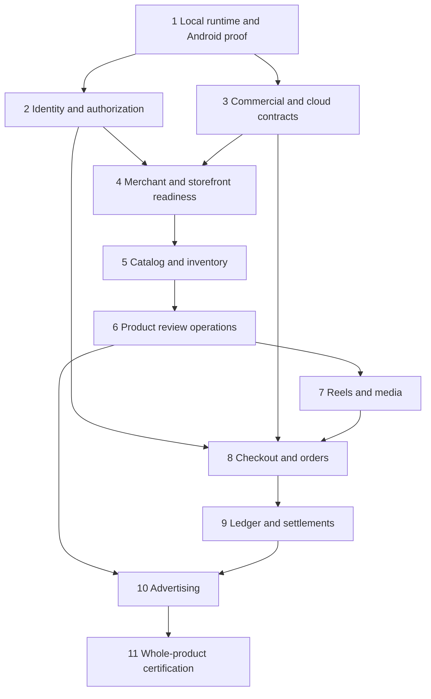

# LetBuyy foundation programme — complete canonical systems, prove complete journeys

> Current native catalog checkpoint15October2026: normal native pricing/billing/verification now use canonical Gateway slugs, server totals and real retained status; local native13 and owned Gateway21 pass, analysis/types/1427 units pass. Exact debug APK metadata is in N1.1/native-catalog-apk.json; its owned device journey is next and is not yet certified. See N2_6_NATIVE_CANONICAL_CATALOG_2026-10-15.md.

> Current consumer checkpoint15October2026: normal web subscription recovery and store-aware effective pricing pass21/21 in5bc11a5ac2ad; one provider-fixture create survives lost reply, reload, dismissal and activation rollback, ending in one paid subscription/invoice/audit. Native retry transport tests4/4 and analysis pass, but the normal native pricing screen still uses legacy enums/hardcoded prices; canonical catalog selection and exact new APK proof are next. Provider/hosted/whole-phase acceptance remains open. See N1_1_SUBSCRIPTION_CONSUMER_RECOVERY_2026-10-15.md.

> Current checkpoint15October2026:328 persists subscription checkout source before provider create, refuses the wrong first store, reuses saved quote terms/shared verification, and finalizes the original billing row atomically. Local source/role18, guarded activation9 and affected ad-credit/ledger5 cases pass; Gateway units1427/1427. Actual results and empty owned cleanup are tracked in active-run-state.json. Web/native manual retry lifecycle and normal consumer proof remain next; provider/hosted/acceptance remain open. R02 factor recovery is now owner-decided: configured per-account TOTP plus independently approved administrator reset. See N1_1_SUBSCRIPTION_CHECKOUT_SOURCE_2026-10-15.md.

**14 October N1.1 fresh baseline follow-up:** the locked fresh installation and all 81 workspace typecheck tasks pass. The Merchant route export defect found by the full build is repaired; its targeted real build and 7 ownership/resubmission checks pass. All seven missing route proxies are reviewed in the 213-route inventory, canonical source assertions and untracked reachability guards are reconciled, and controlled browser/native/recovery checks have current owned evidence. The full pure baseline is now 1,930 pass / 2 fail / 15 explicitly retained human-required skips (1,947 total). Final-chain role grants and rollback preconditions remain required work; no phase closes. See [the updated baseline record](N1_1_VERIFICATION_BASELINE_2026-10-14.md).

**14 October N1.3 owner policy decision:** retain seven-day legacy store-customer compatibility for V1. No issuer or lifetime was changed to record it; shorter transport credentials and hosted drain/cutover remain distinct gates. See [the session decision](N1_3_SESSION_POLICY_DECISION_2026-10-14.md).

**14 October N1.2 canonical ledger source recovery:** migration 308 restores ad-credit
funding after the final resolver replacement, preserving every other source family
and ownership/replay guards. Concurrent Gateway funding and full-chain source,
rollback/reapply and money regressions pass in owned disposable infrastructure.
The audit's 284/291 signature alerts are corrected as scanner false positives,
proven by actual round trips; historical rollback SQL remains intact. N1.2 has
local engineering evidence, while N1/Phase 2 and real provider/device/hosted
acceptance remain open. Work continues in N1.1 under the same active native Goal.
See [dated recovery evidence](N1_2_LEDGER_SOURCE_RECOVERY_2026-10-14.md).

**8 October Phase 2 issuer-transition correction:** a proposed step in the
customer-session retirement evidence routed Commerce login/reset through a
Gateway issuer. Constitution ART-05 and Canonical Systems DOC 03 make
`identity-platform` the sole asymmetric issuer and Gateway verify-only, so that
proposal is superseded before implementation. No source behavior changed. The
existing explicit buyer/store-customer link, unlinked-customer recovery,
owner-approved timeout policy, hosted telemetry/drain and rollback gates remain
open. See the [dated correction](../phase2-2026-09-27/P2_CUSTOMER_SESSION_RETIREMENT.md#8-october-architecture-correction--identity-platform-remains-the-sole-issuer).

**8 October F8 Android buyer-switch storage isolation:** a third process-restart pair runs against the actual Android secure-storage plugin. Buyer one stores a synthetic checkout attempt; after force-stop/relaunch, buyer two uses a different namespace and an empty cart. The app returns `CHECKOUT_CART_EMPTY` with no API request, preserves buyer one's attempt and does not create a buyer-two record (**1/1 prepare and 1/1 recovery**). Teardown removes both dedicated synthetic keys. This proves client-side namespace isolation only, not account authentication or server authorization. Physical handset, hosted/provider/release acceptance, D08 and remaining Phase 8 work remain open. See [the native COD client evidence](F8_MARKETPLACE_NATIVE_COD_CLIENT_2026-10-04.md#native-checkout-attempt-storage-integration--8-october-2026) and [the run record](F8_MARKETPLACE_MOBILE_RESPONSE_LOSS_OWNED_RUN_2026-10-08.json).

**8 October Phase 8.3 committed-order response-loss recovery:** the continuous
native checkout integration now closes the gap where Gateway/Postgres commits
a COD order but the mobile confirmation response is lost. The actual Flutter
`MarketplaceCheckoutService` retries against the production Gateway and reads
seller-scoped checkout status first, returning the committed receipt without a
second order. Owned Gateway/Postgres suite passes **14/14**, zero skips/TODOs
(`e065d4584aae`); the test verifies one additional seller order, one
checkout-session binding and `pending_cod`, with owned fixture cleanup passed.
Gateway typecheck and focused diff checks pass. This is local service/API/DB
integration only; device/hosted/provider acceptance, D08, cross-seller
allocation, fulfillment/refund recovery and broader Phase 8 remain open. See
[dated recovery evidence](F8_1_STALE_LISTING_CHECKOUT_RECOVERY_2026-10-04.md#committed-order-response-loss-recovery-through-native-client--8-october-2026).

**7 October Phase 8.3 marketplace COD material-revision recovery:** a canonical
product edit invalidates listing approval to `draft`, and the order transaction
refuses confirmation as `MARKETPLACE_LISTING_UNAVAILABLE`. The native client
retires the incomplete checkout capability, clears the stale reviewed total
and requires another review while retaining the local cart. Owned
Gateway/Postgres passes **13/13** (`1a3119505ad9`); focused Flutter
service/widget tests pass **5/5** and exercise second review, withdrawn-item
recovery and buyer-directed removal. A new continuous Flutter-client to real
Gateway/owned-Postgres mobile journey now verifies both one successful COD
order and stale-listing refusal in the governed suite (**14/14**,
`56118bbddbfe`): server-authoritative repricing, the reviewed seller delivery
charge, a final-confirmation product edit, secure-attempt retirement, and no
additional order or inventory effects from the stale cart. The integration
also exposed and fixed a missing `site_id` predicate
on the public listing-disclosure read. Targeted analysis/typecheck/diff checks
pass. Device/hosted verification, provider recovery and the remaining Phase 8
contracts stay open.
See [stale-listing recovery evidence](F8_1_STALE_LISTING_CHECKOUT_RECOVERY_2026-10-04.md#corrected-owned-database-and-native-client-revalidation--7-october-2026).

**7 October Phase 4.7 merchant product select-all keyboard action:** the bulk
product-selection summary retains one accessible named button and now supports
keyboard focus and Enter via `InkWell`. The synthetic product bulk-selection
journey passes **1/1**; targeted Flutter analysis and diff checks pass. This is
local widget evidence only; ADB/physical keyboard, TalkBack and independent
screen-reader acceptance remain open, as does Phase 4. See [the dated F4.7
evidence](F4_RESUMABLE_IDENTITY_ONBOARDING_DRAFT_2026-10-04.md#7-october-f47-mobile-continuation--select-all-keyboard-action).

**7 October Phase 4.7 merchant orders select-all keyboard action:** the orders
bulk-selection summary is now keyboard-focusable and Enter activates “select
all visible orders” while retaining its single accessible count and hint. The
two-order synthetic widget journey passes **1/1**; targeted analysis and diff
checks pass. Physical keyboard, TalkBack and independent screen-reader
acceptance remain open, as does Phase 4. See [the dated F4.7 evidence](F4_RESUMABLE_IDENTITY_ONBOARDING_DRAFT_2026-10-04.md#7-october-f47-orders-bulk-select-keyboard-action).

**7 October Phase 4.7 settings store URL copy keyboard action:** the merchant
settings store-info URL action now accepts keyboard focus and Enter while
preserving its accessible label/hint and clipboard confirmation. The synthetic
widget test passes **1/1**; targeted analysis and diff checks pass. Physical
keyboard, TalkBack and independent screen-reader acceptance remain open. See
[the dated F4.7 evidence](F4_RESUMABLE_IDENTITY_ONBOARDING_DRAFT_2026-10-04.md#7-october-f47-settings-store-url-copy-keyboard-action).

**7 October Phase 4.7 settings tile keyboard activation:** the reusable
merchant settings tile now activates by Enter as well as pointer while
preserving its named button semantics and haptic feedback. The synthetic
settings/quick-action test passes **1/1**; targeted analysis and diff checks
pass. Physical keyboard, TalkBack and independent screen-reader acceptance
remain open. See [the dated F4.7 evidence](F4_RESUMABLE_IDENTITY_ONBOARDING_DRAFT_2026-10-04.md#7-october-f47-settings-tile-keyboard-activation).

**7 October Phase 6.5 material-revision checkout regression revalidated:** the
owned marketplace checkout suite passes **13/13** (`4d207e8bb986`) through the
real Gateway worker, PostgREST and disposable Postgres. The material-edit case
proves approval invalidation blocks confirmation with 409 and leaves orders and
inventory unchanged. The test also exposed and fixed a missing required queue
event ID that had made buyer-identity updates return 500. Runner cleanup passed.
This is local owned-database evidence; provider capture recovery, ordinary
storefront continuity, browser/device journeys and broader Phase 6 acceptance
remain open. See [F6.5 evidence](F6_PURCHASE_TIME_ELIGIBILITY_DEPENDENCY_2026-10-04.md#7-october-material-revision-checkout-regression-authored).

**7 October Phase 6.2 operator review-workbench helper correction:** the
first-submission revision comparison no longer renders a blank-name row when
there is no approved baseline, and evidence links containing URL credentials
are filtered out. Review-helper tests pass **3/3**, the admin-web typecheck
passes with a temporary link to the existing matching Commerce dependency
tree, the admin-web test set passes **31/31**, and root admin-web/session
contracts pass **12/12**. This verifies source/helpers locally, not a signed-in
operator browser journey. Structured decision reasons, merchant correction
resubmission, cross-applicant evidence authorization, F6.3 and wider Phase 6
acceptance remain open. See [F6.2 review-workbench evidence](F6_2_REVIEW_WORKBENCH_FIRST_SLICE_2026-10-04.md#7-october-review-workbench-ui-revalidation).

**7 October Phase 5.5 last-unit conflict recovery:** the real Gateway now
preserves a specific `INSUFFICIENT_INVENTORY` conflict through the Commerce
checkout BFF, with buyer-safe copy asking the shopper to review their cart.
The runner-owned concurrent last-unit test passes **9/9** (`f5bafc2764a3`),
and the focused Commerce checkout BFF suite passes **9/9**; the API Gateway
typecheck passes. Postgres confirms one winner and no partial inventory/order
effects for the loser. The local browser failure and same-checkout retry are
now verified; device and provider acceptance remain open. See the [dated F5.5
record](F5_VARIANT_LAST_UNIT_RACE_2026-10-04.md#7-october-buyer-safe-conflict-projection-revalidation)
and [sanitized run](F5_VARIANT_LAST_UNIT_RACE_OWNED_REVALIDATION_2026-10-07.json).

**7 October Phase 5.5 checkout browser failure and retry journey:** the owned
Commerce/Gateway/Postgres Chromium suite passes **4/4** (`2cda33e4da17`),
including a stock-change-at-confirm journey through the normal checkout BFF.
The real browser sees the safe `INSUFFICIENT_INVENTORY` message, retains the
cart, and creates no order; after one synthetic unit is restored, the same
checkout retries with the same asserted idempotency key and creates exactly
one order and one completed checkout. The
disposable database cleanup check is clear. The test simulates the competing
stock change with an owned-fixture update; the separate API suite verifies two
buyer requests racing concurrently. This is local Chromium/Postgres evidence
only. See the [dated F5.5 record](F5_VARIANT_LAST_UNIT_RACE_2026-10-04.md#7-october-real-checkout-browser-failure-and-retry-journey)
and [retry-enabled sanitized run](F5_VARIANT_LAST_UNIT_BROWSER_RETRY_OWNED_RUN_2026-10-07.json).

**7 October Phase 5.5 timeout-release replay regression:** the owned inventory
lifecycle suite now asserts a second unpaid-reservation sweep, using a distinct
request ID, leaves stock and the released reservation unchanged and emits no
duplicate `sale_released` inventory event. The initial unprivileged runner
attempt was blocked at Docker preflight; the reviewed local-owned-database rerun
then passed **1/1** (`53ec1183300e`) with zero skips/TODOs and no remaining
containers, networks or volumes. Gateway typecheck, the 3/3 source-contract
suite and diff checks pass. This proves the repeated-sweep database behavior
against disposable Postgres, not production. See the [dated F5.5 record](F5_VARIANT_LAST_UNIT_RACE_2026-10-04.md#7-october-timeout-sweep-replay-regression-added)
and [sanitized run](F5_INVENTORY_RELEASE_REPLAY_OWNED_RUN_2026-10-07.json).

**7 October Phase 5.5 late-capture-after-release revalidation:** the existing
Gateway/owned-Postgres hosted-checkout suite was rerun and passes **8/8**
(`2af4352a4549`). It confirms that a late capture after reservation release is
recorded once but remains unfulfillable, preserves one refund obligation,
emits no `order.paid`, and safely replays confirmation without duplicate money
effects. API Gateway typecheck and scoped diff checks pass; owned resources were
cleaned. This is synthetic-provider local acceptance only. See the [dated F5.5
record](F5_VARIANT_LAST_UNIT_RACE_2026-10-04.md#7-october-late-capture-after-release-revalidation)
and [sanitized run](F5_LATE_CAPTURE_OWNED_RUN_2026-10-07.json).

**7 October Phase 5.3 importer-disclosure browser revalidation:** a fresh
owned `storefront-customer-profile.postgres.test.ts` run passes **12/12** and
reconfirms the seller-entered importer value on the real Commerce product
detail through the owned Gateway/Postgres path and headless Chromium
(`f229408e551b`). This supersedes the earlier preflight-blocked statement for
that specific assertion. The local synthetic display journey is verified;
legal applicability, publication eligibility, physical-device, standalone
merchant-web/Dart runtime and hosted gates remain separate. See the [dated
F5.3 evidence](F5_IMPORTER_DISCLOSURE_2026-10-04.md#7-october-owned-browser-revalidation--prior-docker-block-superseded)
and [sanitized run record](F5_IMPORTER_DISCLOSURE_BROWSER_REVALIDATION_2026-10-07.json).

**7 October Phase 5 pagination revalidation:** the current marketplace mobile
provider and scroll/retry tests pass **5/5** together, and targeted Flutter
analysis is clean. A fresh owned Gateway/Postgres rerun was blocked before test
execution because no real Docker daemon answers `docker info`; the existing
4 October database evidence remains the integration record. This verifies the
current local synthetic client/UI continuation only. The Phase 5 country
vocabulary decision, device verification, compliance review and broader phase
requirements remain open. See the [dated F5 record](F5_COUNTRY_ORIGIN_FILTER_2026-10-04.md#7-october-pagination-revalidation).

**5 October Phase 9 atomic payout statement creation:** migration 295 and the
real Gateway/owned-Postgres path now create a payout statement, its pending
wallet credit, optional canonical fee journal and ledger link in one
transaction. Two injected database failures roll the complete transaction
back; retry succeeds exactly once. Concurrent requests for the same source
order produce one statement and one conflict. Settlement ingestion also
resumes its payout instruction, item and typed outbox effects after a failed
payout-statement transaction. Owned Postgres passes **1/1**, including
migration rollback/reapply; focused Gateway money tests pass **13/13** and
event-core tests **5/5**; API Gateway typecheck, migration safety and
`git diff --check` pass. The synthetic commission values only test journal
balance. D07 remains unresolved; no rate or fee basis was adopted. Phase 9 and
the eleven-phase goal remain active. See the [dated atomicity evidence](F9_PAYOUT_STATEMENT_ATOMICITY_2026-10-05.md).

**5 October Phase 3/F3.7 marketplace category attribution snapshot:** migration
296 captures the approved listing's category on each newly purchased
marketplace order item during canonical checkout. The real Gateway marketplace
cart/checkout suite passes **12/12**, including category persistence,
post-checkout edit denial, and safe pre-use rollback/reapply. Historical rows
without provable category remain unsnapshotted. No commission rates, fee/tax
basis, or rounding rule were introduced. See the [dated F3.7 evidence](F3_7_MARKETPLACE_CATEGORY_ORDER_SNAPSHOT_2026-10-05.md)
and [sanitized owned-run record](F3_7_MARKETPLACE_CATEGORY_ORDER_SNAPSHOT_OWNED_RUN_2026-10-05.json).

**5 October Phase 3/F3.7 COD writer privilege correction:** migration 297
removes `PUBLIC`/API-role execute access to the `SECURITY DEFINER` COD
remittance money RPC while retaining the Gateway service-role caller. The real
Gateway/owned-Postgres regression passes **10/10**, including direct-call
denial for `anon`, `authenticated`, and `app_tenant`, the public ACL check, and
rollback that preserves the corrected boundary. See the [dated evidence](F3_7_COD_WRITER_PRIVILEGES_2026-10-05.md)
and [sanitized run record](F3_7_COD_WRITER_PRIVILEGES_OWNED_RUN_2026-10-05.json).

**5 October Phase 3/F3.7 COD reconciliation replay correction:** migration
298 adds a checked service-role SQL boundary that binds same-key retries to one
entry, deposited amount and notes. The Gateway route no longer returns from a
key lookup without checking the submitted entry. The real Gateway/owned-Postgres
refund and COD suite passes **11/11**, including exact replay, changed-amount
denial, cross-entry key reuse denial, one ledger posting, both rollback
boundaries and clean migration reapplication. See the [dated replay evidence](F3_7_COD_RECONCILIATION_REPLAY_2026-10-05.md)
and [sanitized run record](F3_7_COD_RECONCILIATION_REPLAY_OWNED_RUN_2026-10-05.json).

**5 October Phase 9 payout claim safety correction:** test-first owned-Postgres
reproduction proved that separate payout statements could each claim the same
unchanged canonical payable while an earlier transfer remained in `processing`.
Migration 294 serializes claims per site and reserves in-flight payable until a
canonical payout debit exists. The regression verifies exact replay, changed-key
denial, sequential and concurrent overclaim denial, insufficient balance, and
paired rollback; the owned Postgres suite passes **1/1** and its resources were
cleaned. No provider, hosted database, or live settlement was used. This closes
only the reservation race, not Phase 9. The payout adapter's direct-transfer
provider boundary is documented with the [F9 evidence](F9_PAYOUT_CLAIM_RESERVATION_2026-10-05.md)
and [sanitized owned-run record](F9_PAYOUT_CLAIM_RESERVATION_OWNED_RUN_2026-10-05.json).

**5 October Phase 10 ad-credit idempotency integrity:** migration 291 binds
prepaid ad-credit purchase, allocation, CPC/CPM spend, and campaign-budget
release retries to their original request payload. The owned-Postgres regression
proved that all four previous RPCs accepted changed retries, then verified each
now rejects a changed amount, payment reference, campaign, event quantity, or
release mode while exact retries remain idempotent. Migration replay validation,
safety checks, JavaScript syntax, and `git diff --check` pass. The source audit
also found a second-payment race in billing verification. Migration 292 adds a
service-role-only SQL finalizer that locks and records the verified payment
reference, issues the entitlement credit, and marks the billing row paid
atomically. Owned Postgres proves exact replay, second-payment and cross-tenant
denial, unique payment binding, and rollback when credit posting fails; Gateway
route contracts pass 8/8 and the worker typecheck passes. The real Gateway
Worker-to-owned-Postgres journey passes **1/1** (run `b4b06355a749`), including
an invalid-signature denial, exact retry, second valid payment attempt and
foreign-tenant denial; all owned resources were cleaned. The proxy reports 61
forwarded requests, zero refused and one upstream error for an expected denied
payment attempt. Razorpay sandbox and canonical cash/liability accounting remain
open.
See the updated [F3.7 contract](F3_7_LEDGER_IDEMPOTENCY_CONTRACT_2026-10-05.md)
and [owned-run evidence](F3_7_LEDGER_IDEMPOTENCY_OWNED_RUNS_2026-10-05.json).

**5 October Phase 3/F3.7 canonical ledger writer access correction:** the
test-first source audit found that default `PUBLIC` execute rights let `anon`
call the `SECURITY DEFINER` low-level ledger writer directly, bypassing the
source-row ownership resolver. Migration 290 revokes that function from API
and service roles; only the server `service_role` can invoke the validated
settlement wrapper. The owned Postgres before/after exploit control, privilege
matrix and rollback pass **1/1**; the real Gateway refund path and explicit
wrapper ACL checks pass **10/10**, and owned checkout capture/ledger/outbox
journeys pass **3/3** with a synthetic provider. The canonical-ledger
validator, focused B1/B2/D5 contracts (**11/11**), migration checks and
whitespace validation pass. See the [F3.7 contract](F3_7_LEDGER_IDEMPOTENCY_CONTRACT_2026-10-05.md)
and [sanitized run record](F3_7_LEDGER_IDEMPOTENCY_OWNED_RUNS_2026-10-05.json).
The local privilege boundary now matches the sole-writer design; this is not
hosted verification or Phase 3 closure.

**5 October Phase 3/F3.7 immutable checkout line-snapshot correction:** the
locked-checkout guard now protects `order_items` product identity, quantity,
price, discount, tax/GST and product snapshot from later edits or deletion,
while leaving fulfillment/return/refund progress mutable and draft orders
editable. Test-first owned-Postgres evidence reproduces the missing guard, then
passes the corrected order fixture **1/1** and the real Gateway marketplace
cart/order regression **11/11**; migration validation and safety/replay checks
pass. The marketplace transaction still binds its approved listing fingerprint.
The updated [F3.7 contract and field map](F3_7_LEDGER_IDEMPOTENCY_CONTRACT_2026-10-05.md)
and [sanitized owned-run record](F3_7_LEDGER_IDEMPOTENCY_OWNED_RUNS_2026-10-05.json)
capture scope and cleanup. This closes one persisted-snapshot gap, not the full
F3.7 event/attribution contract or Phase 3.

**5 October Phase 3/F3.7 canonical ledger idempotency integrity:** migration
288 now permits an idempotency-key replay only when currency, normalized
ordered accounting lines, and stable transaction metadata match the original
posting. Transport request IDs and top-level provider event IDs may differ;
the first event reference remains on the ledger row while delivery receipts
continue through their own payment-event records. A test-first owned-Postgres
negative control reproduced the former silent acceptance of changed accounting
payloads; the correction and neighboring late-capture, RPC idempotency, money
kernel, and refund/reconciliation suites pass **27/27** across the executable
and Gateway database runners. Migration validation, migration safety/replay,
rollback, and whitespace checks pass. The [F3.7 evidence](F3_7_LEDGER_IDEMPOTENCY_CONTRACT_2026-10-05.md)
and [sanitized run record](F3_7_LEDGER_IDEMPOTENCY_OWNED_RUNS_2026-10-05.json)
document the owned-run IDs and scope. This is a local accounting-integrity
slice, not hosted or live-money acceptance; F3.7 still needs the full channel,
revision, source, attribution, and immutable-snapshot ownership matrix, and
Phase 3 remains open.

**5 October Phase 2/F2.1 owned session-consumer acceptance:** the production
Gateway worker and owned Postgres/PostgREST customer-profile suite now passes
**12/12** (zero failures, skips, cancellations or TODOs). It covers the real
Next Commerce login and canonical Identity registration-entry journey, signed
store-scoped customer sessions across profile/wishlist/addresses/orders, and
atomic buyer-support intake rollback. The Identity package was missing its
local symlink for declared, lockfile-pinned `tailwindcss@4.1.18`; a verified
temporary link enabled the run and was removed afterward without manifest or
lockfile changes. The [sanitized run record](../phase2-2026-09-27/P2_CUSTOMER_SESSION_PROFILE_OWNED_DATABASE_RUN_2026-10-05.json)
captures scope and cleanup. The seven-day versus thirty-minute session lifetime
choice and hosted usage/retirement gates remain open, so no issuer or verifier
policy changed and Phase 2 remains active.

**5 October Phase 8 Razorpay refund lifecycle correction:** verified Razorpay
`refund.created` webhook examples can report entity status `processed` or
`pending`. The webhook now normalizes those creation events to the canonical
pending state so a reserved payment-session refund is reconciled without
advancing its ledger or falling through to the legacy writer. Refund transition
contracts pass 3/3 and the full Razorpay retry/reclaim contract passes 16/16;
`git diff --check` passes. The legacy order-level partial-refund bridge remains
open pending owner approval, and no provider sandbox, live refund or deployment
was performed. See [the dated F8 evidence](F8_REFUND_PROVIDER_LIFECYCLE_2026-10-04.md#5-october-continuation--normalize-razorpays-created-refund-payload).

**5 October Phase 4.2 / F4.7 onboarding browser acceptance:** the owned Postgres/Gateway/Identity/Merchant/Chromium journey passes **1/1**. It exercises the delayed account-bound draft read, keyboard onboarding, reserved-name rejection, draft save/resume and creation; verifies the real five-card first-store dashboard and draft-publication notice; then follows Identity's automatic redirect to the authenticated, trial-aware plan catalog and changes the billing-period control to Annual. It checks that a not-yet-created store cannot reach the route and a signed-out browser is sent to Identity sign-in without catalog content. It does not select a plan or open checkout. The delayed load exposed a UI race that could reset merchant input; the wizard now waits for the account-bound draft response and retains heading focus. Identity, Merchant and Gateway typechecks, focused Identity/Merchant ESLint and diff checks pass. This used a pre-minted synthetic session; no browser sign-in or outbound email was exercised. It is local acceptance of this path, not screen-reader/WCAG conformance or Phase 4 closure. See [the F4.2 continuation](F4_RESUMABLE_IDENTITY_ONBOARDING_DRAFT_2026-10-04.md#5-october-continuation--first-store-dashboard-and-plan-catalog) and [sanitized run record](F4_ONBOARDING_BROWSER_RUN_2026-10-05.json).

**5 October F4.7 accessible URL context:** the Identity store-subdomain field now exposes its visible platform-host suffix together with the live availability status through `aria-describedby`, and the owned Chromium journey asserts both relationships. Identity TypeScript and focused ESLint pass using a temporary dependency link that was removed; Gateway typecheck and `git diff --check` pass. The owned browser runner is currently unable to reach Docker, so no fresh runtime acceptance is claimed. This improves one onboarding field; screen-reader, TalkBack and full F4.7 accessibility acceptance remain open. See the [dated F4.7 record](F4_RESUMABLE_IDENTITY_ONBOARDING_DRAFT_2026-10-04.md#5-october-f47-continuation--announce-the-complete-store-url).

**5 October F4.7 merchant mobile product-image controls:** the add-image tile now has an explicit button label/action; product previews expose an image description; remove controls use a 44px minimum target and an explicit labelled button semantic. The focused Flutter widget journey passes, checking the preview's image label and the add/remove actions, and Flutter analysis reports no issues in the screen and test. The run used a temporary SDK/cache overlay and the existing Dart workspace config; the installed SDK and dependency lockfile were not changed. This is targeted local semantics evidence, not device TalkBack/screen-reader acceptance or full F4.7 completion. See the [dated F4.7 mobile record](F4_RESUMABLE_IDENTITY_ONBOARDING_DRAFT_2026-10-04.md#5-october-f47-mobile-continuation--product-image-controls).

**5 October Phase 8.1 storefront stale-quote browser recovery:** Commerce Chromium now submits the previously reviewed seller rate through the real Gateway and owned Postgres after the configured price changes. The stale quote is refused before a payment intent or order exists, the UI refreshes the current rate and requires explicit buyer reselection, then completes one COD order at the newly reviewed amount. Normal storefront COD and synthetic hosted Razorpay browser journeys remain green; the owned suite passes **3/3**, and Commerce/Gateway typechecks plus diff checks pass. No live PSP or device acceptance is claimed. See [F8.1 browser evidence](F8_3_STOREFRONT_SHIPPING_RATE_SELECTION_2026-10-04.md#5-october-browser-continuation--stale-quote-recovery) and [sanitized runner record](F8_1_STOREFRONT_STALE_QUOTE_BROWSER_RUN_2026-10-05.json).

**5 October Phase 2/3 buyer-support continuation:** the existing canonical signed-buyer session now reaches a working account support screen through same-origin Commerce BFF routes and the site's real Gateway support API. The browser submission displays the persisted complaint copy/reference, reads the buyer-owned ticket and public thread, and posts a reply. Migration 287 makes ticket plus first complaint one service-role-only database transaction; a real-worker failure injection proves a rejected first-message insert rolls back both rows. The owned Postgres/Gateway/Identity/Chromium suite passes **12/12**; focused Gateway support tests pass **14/14**, Commerce BFF tests pass **6/6**, and Commerce/Gateway typechecks plus diff checks pass. This is local disposable-stack verification, not a hosted migration or evidence of grievance-officer acknowledgement/redress, NCH integration, legal applicability or release readiness. Phase 2 remains active, F3.5 and Phase 3 remain open, and the eleven-phase goal remains ACTIVE. See the [dated F3.5 record](F3_5_GRIEVANCE_RECEIPT_2026-10-05.md#5-october-integration-and-atomic-write-correction).

**5 October Phase 2 registration-screen handoff:** legacy HTML registration submissions now preserve their create-account intent through the compatibility route and open canonical Identity in registration mode. The owned local Gateway/Postgres/Identity Chromium suite passes 11/11, focused registration/start/PKCE tests pass 11/11, and disposable services are cleaned. The route-helper regression tests pass 2/2, and Commerce typecheck passes after moving the helper out of the App Router route module. This verifies screen selection, not account creation, email delivery, session cutover or hosted adoption. See the [registration acceptance and run record](../phase2-2026-09-27/P2_CANONICAL_BUYER_REGISTRATION_ENTRY_ACCEPTANCE.md#5-october-correction--legacy-registration-handoff-verified-in-chromium). Phase 2 remains active; the eleven-phase goal remains ACTIVE.

**5 October Phase 2 address-data and test-runner correction:** the legacy store-customer atomic address writer is now accepted through the real Gateway/Postgres owned suite (5/5); the runner/guard database-name mismatch found on its first execution is fixed, and the focused ownership-guard suite passes 14/14. Gateway TypeScript, migration safety and diff checks pass; the Commerce address UI contract is in the 947/947 web suite. This is local disposable-database acceptance, not a live-browser address journey or hosted migration. Next F2.1 work removes Commerce's duplicate HS256 session signer while preserving store ownership; the owner has been asked whether the replacement should keep a seven-day login or use Gateway's thirty-minute lifetime, so no session policy changed this turn. See the [dated Phase 2 record](../phase2-2026-09-27/P2_LEGACY_STORE_CUSTOMER_ADDRESS_ATOMICITY_2026-10-05.md#5-october-correction--owned-worker-acceptance-and-runner-name-repair).

**5 October F2.1 consumer-rehearsal expansion:** the owned-worker compatibility test now checks both HS256 formats across the legacy profile, wishlist, address and order routes under all six verifier modes, including deny and rollback configurations. Fresh Commerce auth/link checks pass 28/28, Gateway compatibility/telemetry checks pass 11/11, Gateway typecheck and diff checks pass. The owned-Postgres runner could not start because no real Docker daemon answers on this host, so this expanded worker matrix is not yet DB-accepted. No session policy changed. See the [dated session-transition record](../phase2-2026-09-27/P2_CUSTOMER_SESSION_RETIREMENT.md#5-october-continuation--verifier-rehearsal-spans-four-legacy-consumers).

**5 October F2.1 legacy issuer inventory guard:** the root session-security test now pins all active legacy storefront session issuance to the two Commerce login/reset and two Gateway login/reset callsites. `node --test tests/auth/session-verifier.test.mjs` passes 10/10; the focused Gateway compatibility/telemetry pair passes 11/11. The guard preserves every current token and policy. Docker remains inaccessible, leaving the four-consumer owned-worker matrix unexecuted; the already-raised seven-day versus thirty-minute session-duration choice and hosted usage/drain gates still prevent an issuer or verifier cutover. Phase 2 and the eleven-phase goal remain active. See the [dated F2.1 record](../phase2-2026-09-27/P2_CUSTOMER_SESSION_RETIREMENT.md#5-october-continuation--guard-the-active-legacy-issuer-census).

**5 October Phase 3 primary-source correction and F3.5 grievance receipt slice:** the official eGazette PDF for G.S.R. 789(E) was directly downloaded from the government endpoint, its notification details verified, and pages 5–7 visually checked against extracted text. This replaces the 4 October retrieval limitation only for the amendment's exact text, not legal applicability. The buyer's canonical support create route now returns an explicit copy of the complaint message actually recorded and its receipt timestamp while preserving existing ticket response fields; focused route tests pass 12/12, Gateway typecheck passes, and `git diff --check` passes. This is Gateway API-level acceptance, not a buyer browser journey. The immediate receipt is not evidence of grievance-officer acknowledgement, the 48-hour service level, or one-month redress. Phase 3 and F3.5 remain open pending buyer-surface integration, counsel/owner applicability and operational review. See [source and clause mapping](RESEARCH_AND_CLOUD_FINDINGS.md#official-gazette-text-verified--5-october-2026) and [grievance receipt checkpoint](F3_5_GRIEVANCE_RECEIPT_2026-10-05.md).

**4 October Phase 4.2 dashboard-check correction:** the first-store setup guide now distinguishes failed product/page, shipping and payment reads from valid empty results and retries unknown checks through an authenticated server refresh. It uses the ready LetBuyy subdomain until a custom domain is active; the owner/staff handle route supplies that lifecycle state without changing its access boundary. Focused mapping tests pass 5/5, the Gateway unit lane passes 1,415 with one unrelated open TODO and no failures, both Gateway/Merchant typechecks pass, and focused ESLint reports no errors. Browser/keyboard acceptance remains unavailable in this locked Mac session, so the new-merchant journey and F4.7 are still open. See the [dated onboarding and dashboard evidence](F4_RESUMABLE_IDENTITY_ONBOARDING_DRAFT_2026-10-04.md#same-day-continuation--merchant-setup-check-availability).

**4 October Phase 4.2/4.7 onboarding continuation:** the signed-in Identity wizard loads/saves its draft through the authenticated create-store BFF and Gateway's canonical `onboarding_attempts` aggregate. Owned Gateway/Postgres acceptance passes 4/4, focused contracts pass 13/13, and migration safety passes. The browser journey for resume and creation, including keyboard focus assertions, is added but the owned runner could not start because no Docker daemon is available; it has no runtime result yet. Step headings now receive focus after progression/restoration and success; Identity TypeScript and focused ESLint pass using a temporary dependency link, and Gateway TypeScript passes. Channel intent and verified email are implemented; F4.7 accessibility acceptance and other Phase 4 requirements remain open. See [the dated onboarding record](F4_RESUMABLE_IDENTITY_ONBOARDING_DRAFT_2026-10-04.md#same-day-f47-correction--onboarding-step-focus).

**4 October Phase 2 order-ownership correction:** the legacy storefront contact/password order-history path is retired locally; `/store/{subdomain}/orders` redirects to the canonical signed-buyer order page, and the former contact-check/login/password endpoints fail closed. The accepted buyer-link/order-claim path remains canonical. Phase 2 is still active; continue the recorded identity/session transition and preserve both legacy HS256 formats until hosted usage, drain and recovery gates are evidenced. See [customer-session retirement evidence](../phase2-2026-09-27/P2_CUSTOMER_SESSION_RETIREMENT.md#4-october-correction--legacy-contact-based-order-access-retired).

**4 October Phase 2 privacy-source correction:** the inactive buyer-export data source now excludes soft-deleted support tickets and requester messages. Its draft field contract matches the query and a focused test proves deleted tickets/messages, agent notes and content on deleted tickets do not enter the export source. Contract/source tests pass 12/12; Gateway typecheck passes. The generator remains unavailable and unwired, so this does not release buyer data or resolve D05 verification, download protection, retention, erasure or legal-hold decisions. See [the dated privacy evidence](../phase2-2026-09-27/P2_PRIVACY_CONCURRENCY_DB_ACCEPTANCE.md#4-october-correction--buyer-export-source-excludes-deleted-request-content).

**4 October Phase 3 primary-source recheck:** the Department's official index and latest-news listing both identify the 2026 E-Commerce Amendment and report the notification PDF; the official PIB release confirms the January 2027 commencement and headline summary. The official eGazette PDF still renders without readable content in the available web and in-app browser tools, so exact clauses, exceptions, applicability and counsel review remain open. This confirms the official listing, not clause-level legal text. See the [dated retrieval record](RESEARCH_AND_CLOUD_FINDINGS.md#primary-source-retrieval-recheck--4-october-2026).

**4 October Phase 3 clause discovery:** a secondary full-text transcription of G.S.R. 789(E) is now available for engineering comparison and agrees with the official PIB summary on commencement and headline subjects. It adds candidate details for complaint copies/timelines, entity/seller disclosures, ranking-factor explanations, invoice seller-name prominence, consumer-information consent, government-issued seller identifiers and the loyalty/membership bundled-fee exception. The official Gazette PDF remains unreadable in available tools; these clause details are explicitly provisional and no legal applicability or enforcement policy is claimed. See the [dated comparison and remaining gates](RESEARCH_AND_CLOUD_FINDINGS.md#gazette-text-comparison--4-october-2026).

**4 October Phase 2 password-reset browser acceptance:** the local Chromium journey opens the real storefront reset page with a synthetic one-use link, verifies the bearer token is scrubbed from the address bar, changes the password through Commerce and the actual Gateway/owned Postgres, receives the store-customer session, reads the authenticated session and profile, then confirms a replay is refused. During integration, Commerce was also fixed to translate Gateway's `INVALID_RESET_TOKEN` 400 into the sanitized invalid-link result instead of a generic 500. Focused BFF/session tests pass 12/12 and the owned `storefront-customer-profile.postgres` suite passes 11/11 with zero failures/skips. This is local synthetic evidence; no email was sent and it does not retire legacy sessions or close Phase 2. See [the dated evidence](../phase2-2026-09-27/P2_CUSTOMER_SESSION_RETIREMENT.md#4-october-correction--password-reset-through-storefront-browser) and [sanitized runner record](../phase2-2026-09-27/P2_CUSTOMER_PASSWORD_RESET_BROWSER_OWNED_DATABASE_RUN.json).

**4 October Phase 2 realm-specific logout acceptance:** the owned Commerce/Identity Chromium journey now checks the actual `__Host-lb_store_buyer` cookie and proves that store-customer logout leaves the site-bound buyer session valid, while buyer logout leaves the legacy store session valid. Both logout endpoints run in the real local apps; buyer session reads pass through the real Gateway and owned Postgres. The owned suite passes 11/11 with no skips, and the runner confirms disposable database cleanup. This is local synthetic-account evidence; it does not retire legacy sessions or close Phase 2. See [realm-specific logout evidence](../phase2-2026-09-27/P2_CUSTOMER_SESSION_RETIREMENT.md#4-october-correction--browser-verifies-realm-specific-logout-and-cookie-scope) and the [sanitized runner record](../phase2-2026-09-27/P2_REALM_EXPLICIT_LOGOUT_DATABASE_RUN.json).

**3 October implementation checkpoint:** two further bounded Phase 2 outcomes are locally accepted: storefront own-data audience wiring (`26660485`) and atomic canonical default-address mutation (`70baef80`). Current next work is normal Liquid/React account caller integration and store-bound verified-link order access, followed by remaining legacy issuer retirement. The eleven-phase goal remains ACTIVE; hourly same-chat continuation remains configured; unresolved D04/D05 remain human decisions.

## Owner execution mandate — 3 October 2026

**Continuous execution update (3 October):** the eleven-phase goal remains active. The owner requested ongoing engineering and an update for each completed work package; hourly heartbeat `letbuyy-continuous-engineering` is ACTIVE on this same chat. It inspects live handles to avoid duplicate workers/fixtures and resumes when the host is available. It does not guarantee execution while the Mac/Codex host is unavailable. A genuinely missing owner decision stops dependent work; independent work continues. Support mutation integrity is implemented with owned-database verification and a green 114-validator source gate; [its final acceptance record](../phase2-2026-09-27/P2_OPERATOR_MUTATION_INTEGRITY_ACCEPTANCE.md) tracks the full behavioral result. The next dependency-ready package is [customer-session issuer retirement](../phase2-2026-09-27/P2_CUSTOMER_SESSION_RETIREMENT.md). Wider Phase 2 and phases 3–11 remain open.

The owner locked all eleven phases below as one active end-to-end goal and authorized direct implementation by Codex, using the personal `$letbuyy` skill on every work turn. This supersedes the earlier reviewer/Claude-worker arrangement and the original proposed-only programme status. The original dated baseline below remains historical evidence.

**4 October Phase 5 storefront origin-filter acceptance:** connected the country-of-origin GET form through the normal Commerce all-products page to the actual Gateway and owned Postgres. The owned `storefront-customer-profile.postgres` suite passes 11/11 through Postgres 16, PostgREST, Gateway, Commerce/Identity Next and headless Chromium; Japan excludes the India control, clearing restores it, and applying the filter again excludes it. This journey also confirms the list/detail/variant reference-price display. While bringing up the test, corrected product projections that named columns absent from the canonical `products` table and made the filter-compatible projection retain `country_of_origin`. Gateway typecheck, focused Gateway suites (23/23), storefront form tests (2/2), browser-script syntax and `git diff --check` pass. This is local owned-database/browser evidence only; physical-device, canonical country-vocabulary and legal review remain open. See [F5 country-origin evidence](F5_COUNTRY_ORIGIN_FILTER_2026-10-04.md).

**4 October Phase 5.5 variant inventory race slice:** two authenticated buyers were released together at the real `create_checkout_order_for_buyer` PostgREST call against one remaining variant unit. The owned `authenticated-checkout.postgres` suite passes 6/6 (0 skipped); exactly one order, buyer link, committed reservation and sale adjustment persist, the variant availability and cached inventory reach zero, and the losing checkout receives a sanitized 409 conflict. Gateway typecheck and `git diff --check` pass. This is one locally verified last-unit race, not Phase 5.5 or Phase 8 acceptance; timeout recovery, late capture, adjustment audit journeys, normal client/browser and device coverage remain open. The runner verified and removed its disposable Postgres/PostgREST resources. See [F5 variant inventory race evidence](F5_VARIANT_LAST_UNIT_RACE_2026-10-04.md).

**4 October Phase 5.5 merchant adjustment and audit slice:** the normal inventory editor path now supplies and forwards the required site-bound idempotency key, preserving the exact adjustment across an ambiguous retry. The owned `inventory-adjustment-audit.postgres` suite passes against the real worker/PostgREST/Postgres: concurrent variant stock corrections are additive; repeating one keyed request replays without another stock change, audit row or outbox event; below-zero adjustment is rejected atomically; the owner sees both audit rows in Inventory History; an unrelated merchant can neither adjust nor read them. This suite also exposed and fixed the unscoped product lookup and indirect-only history predicate that tripped the Gateway tenant guard. Gateway typecheck and `git diff --check` pass. Merchant-web typecheck could not run because its `node_modules` and Next/React/workspace packages are absent in this checkout; browser/device acceptance remains open. See [F5 merchant inventory adjustment evidence](F5_INVENTORY_ADJUSTMENT_AUDIT_2026-10-04.md).

**5 October Phase 5.5 merchant browser continuation:** the owned Chromium scenario now enters Merchant's actual Inventory screen using the synthetic owner session, submits a +5 stock correction through the same-origin BFF and real Gateway worker, and reloads the screen. The final run passes 1/1 with zero skips and verifies the owned Postgres quantity, one actor-attributed audit row and one outbox event (`71fb3a4085b9`). This closes the local synthetic web journey only; merchant-web typecheck, normal sign-in, device behavior, timeout/release/late capture, and the rest of Phase 5 remain open. See [the sanitized run record](F5_INVENTORY_ADJUSTMENT_BROWSER_RUN_2026-10-05.json) and [F5.5 evidence](F5_INVENTORY_ADJUSTMENT_AUDIT_2026-10-04.md).

**4 October implementation update:** completed one dependency-ready Phase 3 storefront integration slice: the commerce web now consumes only complete 30-day prior-price observations for product and variant reference-price claims. The API already hydrates observations; this change connects them through the typed model to cards and detail pages. Focused web mapping tests passed 2/2, gateway public price projection tests passed 4/4, commerce web typecheck passed, and `git diff --check` passed. This is an implemented/local-code-verified package, not Phase 3 closure, legal approval, database acceptance or browser/provider/hosted verification; see [the dated evidence](F3_PUBLIC_REFERENCE_PRICE_STOREFRONT_INTEGRATION_2026-10-04.md). The exact Gazette/legal applicability review and owned-database acceptance remain open. Phase 2 is still active; the next package remains [customer-session issuer retirement](../phase2-2026-09-27/P2_CUSTOMER_SESSION_RETIREMENT.md).

**4 October Phase 3 price-history correction:** owned Postgres revealed that the public product select named nonexistent product columns and that the reference-window RPC included the new price in its own preceding window. Migration 280 now anchors the reference before the actual price/availability transition, and the normal Commerce list/detail/variant flow passes through the real Gateway and Chromium. Owned price-history Postgres passes 4/4; the owned Commerce/Identity browser suite passes 11/11, including product ₹120/reference ₹150, Small ₹110/reference ₹150 and Large ₹160/reference ₹200. API/client typechecks, focused Gateway tests and migration-safety validation pass. The Gazette PDF and counsel applicability review remain open; Phase 3 is not closed. See [the dated F3 evidence](F3_PUBLIC_REFERENCE_PRICE_STOREFRONT_INTEGRATION_2026-10-04.md).

**4 October Phase 2 browser continuation:** headless Chromium now exercises the real Commerce and Identity Next.js apps through the actual Gateway worker and runner-owned Postgres/PostgREST: Identity consent, PKCE issue/redemption, buyer/store linking, the site-bound callback cookie and sibling-store refusal. The `storefront-customer-profile.postgres` suite passes 10/10 with zero skips. The initial buyer session remains synthetic; password/OTP/email login, hosted domains, production traffic and release acceptance remain open. See [the owned browser/database record](../phase2-2026-09-27/P2_CUSTOMER_SESSION_RETIREMENT.md#4-october-correction--owned-database-browser-identity-journey).

**4 October Phase 2 continuation:** added a reversible per-format Gateway verifier policy for the two transitional HS256 payloads. The unset default still accepts both; invalid values reject both. Policy and source-contract tests pass 10/10, the Hono middleware suite passes 7/7 through its mounted test harness, Gateway typecheck passes, and the stale password-reset source assertion now checks the atomic RPC. The complete production worker route tree and owned-database lane remain unverified. No issuer was changed, no verifier was disabled, and no hosted value or traffic was inspected; see the detailed transition record in [customer session retirement](../phase2-2026-09-27/P2_CUSTOMER_SESSION_RETIREMENT.md).

**4 October Phase 5.3 slice:** added optional seller-entered importer details to the canonical product contract, merchant editor, public storefront detail, and approved marketplace detail, with a paired migration and bounded storage/schema limits. Rule 4(6) of the 2026 E-Commerce Amendment was cross-checked against a machine-readable Gazette transcription and the official 2020 Rules PDF: importer name/details predate the amendment, while the amendment adds identification and full country-of-origin name for imported goods. The Department index links the official 2026 Gazette PDF, but that PDF was not readable in the research tool; applicability and counsel review remain open. Gateway behavior and API/core/customer-web typechecks, migration-pair validation, and owned Postgres constraint acceptance pass. Merchant-web dependencies, Dart runtime tests and browser/device acceptance remain open; see [the dated evidence](F5_IMPORTER_DISCLOSURE_2026-10-04.md). This is not Phase 5.3 acceptance or legal activation.

**4 October Phase 5.3 database correction:** the owned importer-disclosure Postgres suite now passes 1/1 after fixing its overlong synthetic tenant tag. It verifies persistence, the exact 1,000-character limit and rejection at 1,001 characters through isolated Postgres 16. Merchant-web dependencies, Dart runtime tests, browser/device evidence, Gazette interpretation and counsel review remain open; see the later correction in [F5 importer-disclosure evidence](F5_IMPORTER_DISCLOSURE_2026-10-04.md).

**4 October Phase 6.4 security slice:** sponsored marketplace discovery now requires the matching listing to be approved and public. The replacement preserves the current budget, daily-cap, bid-order, tenant/site, active-product and published-site serving contract. Gateway route/source tests pass 11/11; the owned disposable Postgres suite passes 7/7; migration safety, Gateway typecheck and `git diff --check` pass. This closes only the identified paid-feed source bypass; every other read surface, purchase-time revalidation and Phase 6 acceptance remain open. See [the dated evidence](F6_SPONSORED_MARKETPLACE_APPROVAL_FENCE_2026-10-04.md).

**4 October Phase 6.1 implementation:** migration 275 binds marketplace submission/approval to SHA-256 of buyer-facing and compliance product fields, canonical variants/options and marketplace terms. Material edits withdraw approved, paused or pending listings to draft with an append-only `system` event; stock, variant inventory and activation toggles do not invalidate the review. Legacy active approvals without a recoverable historical revision are withdrawn at migration time. The new owned-Postgres suite passes 5/5, and affected sponsored-feed, marketplace-detail and historical realm suites pass 16/16. Migration safety, syntax checks and `git diff --check` pass. This is a local database-verified F6.1 slice, not Phase 6 closure; see [the dated evidence](F6_MARKETPLACE_REVISION_BOUND_APPROVAL_2026-10-04.md). Next: F6.2 operator review workbench, followed by concurrency/appeals and remaining read/purchase/takedown acceptance.

**4 October Phase 6.2 first workbench slice, updated:** migration 275 retains sanitized submitted and approved revision snapshots; snapshot/fingerprint tampering is denied. The operator detail path and console compare revisions, show moderation history and safe image references, and require details to be opened before decisions. The same migration adds idempotent reviewer self-claim and append-only assignment events. Assignment is rechecked under the listing row lock before approval/rejection, closing the stale-reviewer race; only the currently assigned operator can decide. Owned Postgres revision/rollback tests now pass 7/7; focused API, auth-chain and console contracts pass 33/33; Gateway typecheck, migration safety and whitespace validation pass. Console typecheck remains unavailable because linked app dependencies are missing. Lead reassignment UI/RPC, structured reasons, merchant corrective response/resubmission and cross-applicant evidence authorization remain open, so F6.2 is not accepted. Migration 275 remains local and unapplied to hosted/shared DB. See [the dated evidence](F6_2_REVIEW_WORKBENCH_FIRST_SLICE_2026-10-04.md).

**4 October Phase 6.2 assignment progress:** lead/admin reviewer reassignment is now implemented through an atomic, version-checked RPC with idempotency, append-only previous/new reviewer history, server-session actor binding and MFA-gated console actions. The production router has its own active-platform tier gate and is mounted before the broader incident-command gate. Existing platform roles (`operations`, `manager`, `admin`) are used; the database has no literal `lead` role. Focused API, auth-chain and console contracts pass 35/35; owned Postgres revision/rollback suite passes 7/7; Gateway typecheck, migration safety and `git diff --check` pass. Admin-web typecheck still cannot resolve dependencies in this worktree. This advances one F6.2 path; structured reasons, merchant corrective response/resubmission and cross-applicant evidence authorization remain open. See the dated evidence for details.

**4 October Phase 6.2 merchant correction slice, verified:** the authenticated merchant product editor now shows listing status and reviewer feedback and can resubmit a saved correction through a single tenant-scoped RPC transaction. The RPC reuses canonical listing transitions, captures the new revision snapshot, binds idempotency to the complete request and rolls both status edges back together on failure. Gateway channel-listing tests pass 19/19; Gateway typecheck and migration-pair safety pass; the isolated owned-Postgres revision/resubmission suite passes 8/8, including cross-tenant denial and rollback/retry. Merchant-web typecheck is locally verified using the matching installed Commerce dependencies; browser/Gateway/Postgres acceptance remains unavailable here. A 10 October source correction now preserves the same idempotency key across retries of unchanged normalized correction text and assigns a fresh key after a material edit; its tests pass 3/3, merchant-web local tests 17/17 and shared suites 771/771. F6.2 remains partial; structured reason policy is awaiting the owner's category preference, while private applicant documents are not yet modeled (the existing review screen exposes authorized reviewer links to seller-provided catalog images only). See [the dated acceptance record](F6_2_MERCHANT_CORRECTION_RESUBMISSION_2026-10-04.md#10-october-retry-idempotency-correction).

**4 October Phase 5 owned-database follow-up:** migration 272 now passes through the production Gateway worker and the owned Postgres/PostgREST lane (**3/3**), including legacy/new marketplace-feed overload compatibility, normalized origin filters before pagination, public eligibility in the facet, and function grants. Focused storefront/Gateway unit suites pass 30/30, Gateway typecheck, migration safety and diff validation pass. The owned database lane registry was reconciled from 18 to the 25 actual suites; its governance test passes 12/12. Official Department/Gazette sources confirm the searchable/sortable imported-product country filter commencement is 1 July 2027 under G.S.R. 312(E); the later September Fourth Amendment addresses different clauses. This remains engineering verification, not compliance sign-off. Browser/device, Flutter widget/build, canonical country vocabulary and legal review remain open; see [F5 evidence](F5_COUNTRY_ORIGIN_FILTER_2026-10-04.md).

**4 October Phase 2 operator-read correction:** reproduced the recorded tenant-guard 500s on outbox, risk and Trust & Safety overview through the production worker, then repaired only those bounded cross-site reads behind their existing super-admin and route-permission gates. Owned Postgres verifies four seeded overview reads, unauthorized 403s and sensitive-read audit rows (1/1; runner `8bd2e30c3a08`); Gateway typecheck and the focused operator/overview allowlist tests pass. This does not grant a new tier or prove RLS/hosted behavior. See [operator overview acceptance](../phase2-2026-09-27/P2_OPERATOR_QUEUE_GATE_ACCEPTANCE.md) and the [sanitized owned-run record](../phase2-2026-09-27/P2_OPERATOR_OVERVIEW_TENANT_GUARD_DATABASE_RUN.json).

**4 October Phase 8.2 marketplace order foundation and D08 fail-closed gate:** migration 278 adds a service-role-only marketplace order transaction that rechecks the seller, product, publication state, public listing status and approved revision under row locks, then delegates pricing, inventory, purchase creation and buyer ownership to the existing canonical RPCs. It records the marketplace parent origin plus immutable per-order-item listing/fingerprint snapshots. The production worker's owned Postgres suite passes 7/7, including guest COD checkout, authenticated buyer ownership, snapshot immutability, product withdrawal before order creation, and refusal of marketplace Razorpay before any pending order or intent is created. Focused checkout tests pass 18/18, Gateway typecheck and migration-pair validation pass. This proves one seller-bound marketplace COD order path and blocks marketplace online collection pending D08 acceptance; cross-seller purchase/payment allocation, provider capture/recovery, marketplace cart UI and device acceptance remain open. See [F8.2 evidence](F8_MARKETPLACE_ORDER_BINDING_2026-10-04.md) and [F3 provider evidence](F3_PROVIDER_ELIGIBILITY_2026-10-04.md).

**4 October Phase 8.3 native marketplace COD client:** the normal marketplace cart and address flow now reaches the signed hosted checkout contract in the app. The app revalidates listing/seller identity, creates server-priced cart lines, requires an explicit seller-rate choice and a second buyer submission after reviewing the server total, and creates only seller-bound COD orders. Secure cart-token recovery, minimal seller-scoped order receipts, stable step keys, variant-aware snapshot cleanup, account-switch protection and an item-specific stale-listing recovery action are integrated. Flutter checkout/address/pricing tests pass 9/9, cart persistence/scope/guest-transfer tests 33/33, variant snapshot tests 2/2, API-client tests 11/11, hosted checkout tests 18/18, and the Gateway owned-Postgres suite passes 9/9 including configured shipping, out-of-zone denial, rate-change refusal, checkout-status recovery and cross-seller denial. Targeted Dart analysis, Gateway typecheck, migration safety and focused Gateway shipping contracts pass. There is no device/browser/provider/hosted verification. Shipping rates are matched to seller-declared zones; live carrier serviceability and delivery promises are not verified. Online marketplace payments remain blocked pending D08; cross-seller allocation and Phase 8.7 remain open. See [F8.3 evidence](F8_MARKETPLACE_NATIVE_COD_CLIENT_2026-10-04.md), [F8.1 shipping evidence](F8_1_SELLER_ZONE_SHIPPING_SELECTION_2026-10-04.md) and [stale-listing recovery evidence](F8_1_STALE_LISTING_CHECKOUT_RECOVERY_2026-10-04.md).

**4 October Phase 8.1 seller-zone rate selection:** marketplace COD now displays active seller-configured rates for the destination country/state/pincode, binds the selected amount through server repricing and the canonical order RPC, and fails closed for uncovered addresses or a concurrently changed rate. Migration 279 is paired with rollback and remains local. The owned Postgres suite passes 9/9, Gateway shipping/checkout contracts 25/25, Flutter checkout tests 9/9, targeted Dart analysis, API client wire tests 11/11, Gateway typecheck and migration safety. Seller-zone matching is not live-carrier serviceability; provider/device/hosted acceptance remains open. See [F8.1 shipping evidence](F8_1_SELLER_ZONE_SHIPPING_SELECTION_2026-10-04.md).

**4 October Phase 8.2 shipping estimate hardening:** Gateway shipping configuration no longer fabricates universal pincode coverage or a ₹60 sandbox rate when merchant records are absent, and database read failures return an unavailable response. The focused Gateway shipping suite passes 8/8, Gateway typecheck passes, and the targeted diff check passes. This closes only the fabricated-result defect in the authenticated configuration API: normal Commerce checkout still uses its separate legacy fallback and rate BFF, so buyer-facing quote discovery plus server-side address/rate revalidation remain the next shipping integration task. See [F8.2 shipping fail-closed evidence](F8_2_SHIPPING_SERVICEABILITY_FAIL_CLOSED_2026-10-04.md).

**4 October normal storefront shipping continuation:** the preceding paragraph records the state before this continuation. Buyer checkout now retrieves address/subtotal-matched saved rates from a public store-scoped Gateway endpoint, requires an explicit reviewed rate and amount, restricts COD to eligible rate+zone pairs and binds the quote to the canonical order transaction under rate/zone row locks. The signed checkout now lists storefront online-only rates as well as COD rates and preserves each rate's actual COD eligibility; the owned test caught and fixed its earlier use of a COD-only marketplace resolver. Focused Gateway shipping/checkout tests pass 16/16 after that correction, Commerce signed-checkout BFF tests pass 6/6, Gateway/Commerce/API-client typechecks pass, and migration validation passes. Owned Postgres `authenticated-checkout` passes 9/9 (`6df0dc41bec4`) and `hosted-checkout-buyer-ownership` passes 7/7 (`08f845a50c00`) on Postgres 16, including online-only rate discovery, COD denial, selected-rate order creation and existing buyer/payment recovery cases. Both runners exited 0 and confirmed owned-resource cleanup. Browser/device, live provider, carrier, hosted and release acceptance remain open. See [F8.3 storefront shipping selection](F8_3_STOREFRONT_SHIPPING_RATE_SELECTION_2026-10-04.md).

**4 October Phase 8.1 stale-listing recovery:** checkout now reports the withdrawn listing IDs before cart creation; the buyer screen clears any old quote/total, shows the unavailable items, blocks submission and removes only those cart snapshots through the buyer-scoped serialized cart mutation. The service regression and widget tap-through pass within a focused checkout suite of 10/10, and targeted analysis is clean. Device/browser acceptance remains open. See [stale-listing recovery evidence](F8_1_STALE_LISTING_CHECKOUT_RECOVERY_2026-10-04.md).

| Phase | Locked outcome | Execution position (dated evidence; Phase 4 refreshed 5 October) |
|---|---|---|
| 1 / 1R | Reproducible local stack and canonical Android buyer journey | Locally accepted and integrated; preserve the accepted work. |
| 2 | Shared identity, scoped access, privacy and order ownership | In progress. Identity PKCE/link, realm-specific logout isolation, password-reset-to-session/profile, and signed hosted checkout buyer binding/order ownership are implemented locally. Hosted Razorpay now uses the signed Gateway payment-intent/confirmation path when enabled. Commerce checkout/order/availability tests pass 16/16 and Gateway checkout contracts pass 11/11. Owned Chromium/Postgres stale-address, profile, review, wishlist and order-visibility journeys pass; the separate support-page cross-tab journey is prepared but blocked at Docker preflight (0 tests). The four operator overview reads also pass seeded-result, deny and sensitive-audit checks. Identities/data are synthetic; legacy issuer retirement, hosted telemetry, runtime-role RLS and human-governance gates remain. |
| 3 | Commercial, compliance, provider and cloud contracts | Several bounded packages verified locally, including public price-history storefront display through real Gateway/Postgres/Chromium, importer-disclosure, a provider-specific fail-closed live-split evidence gate, ledger payload-conflict rejection, and locked checkout item snapshot integrity. F3.7 field/event ownership is still partial; Gazette/counsel applicability, provider eligibility, commercial authority and hosted/cloud acceptance remain open. |
| 4 | Merchant onboarding, subscriptions and storefront operations | In progress: account-bound drafts persist through the Gateway; verified email and five sales-intent values are enforced. The owned Chromium/Identity/Merchant/Gateway/Postgres journey passes 1/1 for delayed-draft race protection, accessible reserved-name feedback, keyboard-only creation, draft resume, the owner-scoped first-store dashboard, five setup cards and draft status, then Identity's automatic redirect to the trial-aware plan catalog and Annual billing toggle. The test confirms a not-yet-created store cannot access that route and signed-out users are redirected to Identity sign-in without catalog content. It does not select a plan or open checkout. Typechecks and focused ESLint pass. This is local synthetic-session acceptance, not email delivery, screen-reader verification, WCAG conformance or full F4.2/F4.7 closure. Plan purchase/subscription lifecycle, marketplace verification, private documents, theme publication and broader merchant/staff web/mobile accessibility remain open. |
| 5 | Canonical catalog, inventory and discovery | In progress in parallel: origin-filter/importer constraints, one real-worker last-unit checkout race, and the merchant adjustment/history path are locally verified. Concurrent corrections, keyed replay, audit rows, below-zero refusal and tenant denial pass against owned Postgres. Flutter/device journeys, canonical origin values, legal applicability, timeout/late-capture and full buyer journeys remain open. |
| 6 | Revision-bound human product review | In progress: F6.1 revision binding and F6.4 sponsored eligibility are locally database-verified; F6.2 includes review detail, claim, lead/admin reassignment, assigned-reviewer decisions and merchant correction/resubmission. Merchant BFF and rendered review-panel tests plus typecheck pass locally; browser/owned-Postgres correction acceptance remains open. Structured reasons await the owner's category choice; dedicated private applicant evidence is not modeled; appeals, full read/takedown/operations and purchase-time eligibility remain open. |
| 7 | Approved reel commerce and media | F7.1 provider research started: current R2 media is generic file storage and the retired Firebase reel feed has no canonical successor. Official Cloudflare Stream and Mux upload, processing, privacy, webhook and pricing contracts are compared; recommend Cloudflare Stream, pending owner/provider-account approval and data-processing review. No provider code or provisioning is authorized until that choice is accepted. See [the F7.1 provider decision brief](F7_MEDIA_PROVIDER_SELECTION_2026-10-04.md). |
| 8 | Server-authoritative checkout, payments and order recovery | In progress: real Commerce Chromium/Gateway/owned-Postgres paths cover server-selected quotes, normal COD, synthetic hosted Razorpay and stale delivery-price recovery requiring buyer reselection before exactly one updated-price COD order. Stale-listing recovery and late-capture compensation are also verified locally. Razorpay webhook refunds and manual provider-referenced refunds pass owned Postgres with canonical ledger/outbox effects. Marketplace Razorpay remains denied pending D08. Legacy order-level refund reconciliation, fulfillment/partial-failure, carrier/provider sandbox, physical-device journeys, cross-seller allocation decisions and channel certification remain open. See [F8.1 cart origin](F8_MARKETPLACE_CART_ORIGIN_2026-10-04.md), [F8.1 shipping](F8_1_SELLER_ZONE_SHIPPING_SELECTION_2026-10-04.md), [stale-listing recovery](F8_1_STALE_LISTING_CHECKOUT_RECOVERY_2026-10-04.md), [F8.2](F8_MARKETPLACE_ORDER_BINDING_2026-10-04.md), [F8.3 marketplace client](F8_MARKETPLACE_NATIVE_COD_CLIENT_2026-10-04.md), [F8.3 storefront shipping](F8_3_STOREFRONT_SHIPPING_RATE_SELECTION_2026-10-04.md) and [refund lifecycle](F8_REFUND_PROVIDER_LIFECYCLE_2026-10-04.md). |
| 9 | Accounting, weekly eligible settlements and reconciliation | Canonical ledger and settlement components exist; live settlement needs provider-specific approval evidence. Weekly eligible-cycle, sandbox reconciliation and end-to-end acceptance remain open. |
| 10 | Credit-backed CPC, CPM and purchase advertising | In progress: migrations 291–293 bind purchase/allocation/spend/release retries, atomically finalize one provider payment into one prepaid credit, and post each verified top-up through the canonical ledger (`pa_clearing` → `ad_credit_liability`), separate from merchant sales payable. Owned Postgres and real Gateway/owned-PostgREST purchase journeys pass, including exact retry and failure atomicity. Before recognizing spend against the liability, preserve purchased-versus-granted funding provenance under an explicit allocation/expiry/reversal contract. Provider statement/sandbox reconciliation, purchase attribution, and complete merchant campaign journeys also remain open. See [F3.7 ledger evidence](F3_7_LEDGER_IDEMPOTENCY_CONTRACT_2026-10-05.md). |
| 11 | Whole-product security, performance, recovery and operations certification | Upcoming. |

The F6.5 purchase-time gate now has a server-side seller-order boundary: the signed marketplace cart reaches a dedicated transaction that locks and revalidates the currently approved listing revision, delegates to canonical inventory/order creation, binds marketplace origin, and stores immutable listing/fingerprint snapshots. Owned Postgres proves the authenticated and guest COD order paths and denies a product withdrawn before order creation. This does not yet certify repurchase/payment recovery after order creation, cross-seller allocations, or normal mobile/web purchase journeys. See the [F6.5 source finding](F6_PURCHASE_TIME_ELIGIBILITY_DEPENDENCY_2026-10-04.md), [F8.1 evidence](F8_MARKETPLACE_CART_ORIGIN_2026-10-04.md), and [F8.2 evidence](F8_MARKETPLACE_ORDER_BINDING_2026-10-04.md).

**4 October correction:** the normal marketplace Flutter mobile/web-layout checkout now has widget-level UI acceptance through seller-rate discovery, buyer-reviewed server repricing and COD confirmation. This does not constitute real browser/device purchase acceptance. See [F8.1 UI continuation](F8_1_SELLER_ZONE_SHIPPING_SELECTION_2026-10-04.md#4-october-checkout-ui-acceptance-continuation).

**4 October checkout recovery continuation:** the buyer-facing widget now models the order committing while its response is lost; retry recovers the minimal checkout-status receipt for the same secure cart token, shows the order once and leaves the confirmation request count at one. The focused checkout UI/service/address/pricing run passes 11/11, and targeted Flutter analysis reports no issues. This combines simulated client API behavior with the separately owned Gateway/Postgres route result; it is not real browser/device/provider/hosted verification. See the [checkout evidence](F8_1_SELLER_ZONE_SHIPPING_SELECTION_2026-10-04.md#4-october-checkout-retry-recovery-continuation).

**4 October D08 source refresh:** current Razorpay Terms require marketplace seller onboarding and contractual obligations and reserve the supported use case to onboarding or written approval; its Route product page documents linked accounts and splits but cannot prove LetBuyy account eligibility. Marketplace online intent stays fail-closed pending provider-written account/use-case acceptance and counsel review. See [F3.3 provider evidence](F3_PROVIDER_ELIGIBILITY_2026-10-04.md#4-october-official-provider-terms-refresh).

The seven packages and closure evidence per phase remain the execution scope. Completion requires integrated positive, denied, concurrent, retry and failure journeys appropriate to each package, including provider/device evidence where required. Implemented, locally verified, sandbox verified, hosted and released remain distinct verdicts. Missing business decisions or inaccessible external systems stay explicit; they cannot be replaced by invented approval or simulated acceptance.

Execute as one agent in the existing isolated Phase 2 worktree, initially at `eb49fe27cae28612d10884dd5513242a40afd64a`. Preserve unrelated analyzer edits, local runtime evidence, signing assets and backups. Existing exclusions on merge, push, deployment, hosted cutover, external messages, live transactions and backup deletion remain in force until explicitly changed.

**5 October F3.7 census update:** the route-to-ledger and immutable-snapshot inventory, including capture/COD/refund/reversal source transitions and Phase 10 purchase-attribution ownership, is recorded in [the dated ledger evidence](F3_7_LEDGER_IDEMPOTENCY_CONTRACT_2026-10-05.md#5-october-route-to-ledger-and-immutable-snapshot-census). This closes that inventory slice only. F3.7 remains open for the exact legacy refund bridge, provider reversal/recovery, payout eligibility, funded-versus-granted ad-credit consumption, and owner-approved conversion attribution rules. Do not invent commercial values or enable marketplace online intents while D08 and cross-seller contracts remain unresolved. For F8.2, resolve buyer-facing grouping, per-seller shipping/COD collection, refund responsibility and merchant privacy before enabling multi-seller checkout, while preserving the locally accepted seller-rate and one-seller COD path. Live carrier serviceability and Phase 8.7 remain open. See [F8.1 shipping evidence](F8_1_SELLER_ZONE_SHIPPING_SELECTION_2026-10-04.md), [stale-listing recovery](F8_1_STALE_LISTING_CHECKOUT_RECOVERY_2026-10-04.md), [F8.1 stale-quote browser evidence](F8_3_STOREFRONT_SHIPPING_RATE_SELECTION_2026-10-04.md#5-october-browser-continuation--stale-quote-recovery), [F8.2](F8_MARKETPLACE_ORDER_BINDING_2026-10-04.md), [F8.3 marketplace client](F8_MARKETPLACE_NATIVE_COD_CLIENT_2026-10-04.md), and [F8.3 storefront shipping](F8_3_STOREFRONT_SHIPPING_RATE_SELECTION_2026-10-04.md).

**5 October F4.7 positive logout journey:** the mobile store wizard now has a passing keyboard-driven test that signs in through a synthetic Identity HTTP client, activates the confirmed logout, verifies the session cookie is sent, checks local session clearing and confirms navigation to login. The complete merchant-mobile services suite passes **187/187**, with targeted Flutter analysis and diff checks clean. This is synthetic local UI/service evidence only; physical-device keyboard, TalkBack and independent screen-reader checks remain open. See [the dated onboarding evidence](F4_RESUMABLE_IDENTITY_ONBOARDING_DRAFT_2026-10-04.md#5-october-f47-mobile-continuation--authenticated-wizard-logout).

**5 October F5 marketplace mobile keyset pagination:** `ProductProvider` now consumes `nextCursor`, carries forward active category/search/origin filters, deduplicates appended listings and discards stale continuation responses. The shop loads near the end of the scroll range, exposes loading/failure feedback, and retries the same cursor only after an explicit action. Four provider/API-client tests and the synthetic shop-scroll 503/retry journey pass (**5/5 total**); the same journey passes **1/1** through Flutter's standard Chrome widget-test runner. Targeted analysis and `git diff --check` pass. The journey also found and fixed disposal of the shop's periodic refresh timer. iPhone 17 simulator discovery succeeded, but the iOS run never reached compilation: CocoaPods spent 296 seconds cloning the Specs Git repository, so simulator acceptance remains open. Flutter's auto-migrated tracked Xcode files were restored; generated ignored CocoaPods output was preserved. This is local synthetic API/UI verification only, not hosted or legal acceptance. It supersedes the earlier “Next dependency-ready package” paragraph and one-page limitation stated in [the preceding F5 evidence](F5_COUNTRY_ORIGIN_FILTER_2026-10-04.md#5-october-marketplace-mobile-category-searchorigin-composition). Next, obtain the owner’s canonical country-vocabulary and legacy-mapping choice after reviewing real value distribution; the repository only supplies synthetic India/Japan examples, so it does not establish production data coverage. Complete compliance review separately and keep simulator acceptance queued for an iOS dependency environment that can resolve Pods. Compare ISO/M49 options in [the dated vocabulary research](F5_COUNTRY_ORIGIN_FILTER_2026-10-04.md#5-october-country-vocabulary-decision-research). Phase 5 and the eleven-phase goal remain active; see [pagination evidence](F5_COUNTRY_ORIGIN_FILTER_2026-10-04.md#5-october-marketplace-mobile-keyset-pagination) and [Chrome/iOS follow-up](F5_COUNTRY_ORIGIN_FILTER_2026-10-04.md#5-october-chrome-and-ios-simulator-follow-up).

> **Superseded in part by the owner on 26 September 2026:** no real marketplace users require migration; remove Firebase from the marketplace runtime and use direct canonical LetBuyy sign-in. Do not request Firebase credentials or preserve the legacy login gate. Read [Phase 1R revised plan](PHASE_1R_FIREBASE_FREE_MARKETPLACE_PLAN.md) before using this historical plan/prompt. Other preservation and no-deployment constraints remain.

Date: 26 September 2026. Planning baseline: `develop` at `6eb01d95867e1c7d0eb15c704eeaf2195ca8cc68` on the restored Apple Silicon Mac. **Proposed detailed programme; not an implementation report, constitutional amendment, deployment authorization or schedule.**

This expands the accepted scope of the [eleven-phase roadmap](../commerce-2026-09-26/COMMERCE_11_PHASE_ROADMAP.md). It preserves its eleven parent phases and defines **77 work packages**, seven per phase. Packages are bounded implementation outcomes, not 77 separate services or mandatory standalone prompts. The sequence incorporates the older foundation roadmap's tenant, money, theme, UI, merchant operations, notification and first-merchant foundations.

Companions: [research and cloud findings](RESEARCH_AND_CLOUD_FINDINGS.md), [decisions and acceptance](DECISIONS_AND_ACCEPTANCE.md), [execution and prompt contract](EXECUTION_CONTRACT.md). Read the current Constitution, root/local AGENTS and canonical registry before implementation. Evidence documents explain findings; they do not become higher authority by being newer or longer. Explicit current owner decisions take precedence over historical conversation instructions; record necessary governance alignment without inventing signatures.

## What we are building

A merchant can start a storefront with proportionate verification, manage one catalog and inventory, publish a Liquid storefront, and opt into a more strongly verified marketplace. A marketplace buyer discovers approved products through ordinary browsing and approved product-matched reels, signs in through canonical identity, purchases through provider-managed payments, and receives support through the full order lifecycle. Merchants understand every fee, refund, adjustment and weekly eligible settlement. Operators can review, investigate and act with bounded permissions and auditable reasons. Advertising supports CPC, CPM and qualified-purchase billing with measurable validity and controlled budgets.

The foundation is complete only when these outcomes work through normal interfaces with the real authorization role and canonical backend. Tables, adapters, route counts and passing unit tests establish components, not whole-product completion.

### Preserved decisions

- V1 includes storefront and reel-led marketplace. Quick commerce, dark stores and delivery-app expansion remain V2.
- One identity issuer; shared canonical buyer ownership across approved channels; merchant and operator privileges remain separate. No duplicated buyer passwords or automatic identity merging by email.
- `sites` remains the tenant root. Reuse canonical catalog, orders, inventory, ledger, themes, identity and notification systems.
- Storefront LetBuyy sales commission is zero. Marketplace commission is category-based and versioned. Subscription, provider, shipping and applicable tax lines remain separately disclosed.
- Licensed provider-managed marketplace collection and weekly **eligible** settlement; no LetBuyy custody workaround or invented provider approval.
- Seller approval, product revision approval and reel-to-product match approval are different controls. Humans approve marketplace products and attached reels; upload/transcoding success does not approve a listing.
- CPC, CPM and purchase-based ads remain in scope. Paid reach cannot bypass eligibility, and ad credits are separate from seller proceeds.
- Liquid-first storefronts and canonical design tokens remain. Do not replace the theme system or build a second merchant OS.
- Keep the modular monolith and approved satellites. Reserved services remain empty. Use transactional outbox and typed contracts, not an event bus, distributed saga, second money database or speculative multi-region system.

## Measured starting point

The restored HEAD equals the expected transfer HEAD. Cached Git tracking says 13 commits ahead of `origin/develop`; no fetch was performed. The two original commerce research documents were untracked and preserved. This programme adds documentation only.

Earlier verification in [NewMacSetup/VERIFICATION.md](../../../../NewMacSetup/VERIFICATION.md) established compatible local dependencies, owned database restore, identity/gateway operation, startup checks for identity and the four other web apps, a fresh Android debug build, backend buyer tests and selected Flutter/console tests. They are dated recorded results, not all rerun for this planning document.

**Phase 1 is partially verified and still open.** Ordinary signed-in Android profile/address navigation lacks a legitimate usable Firebase test login. Android association reports `legacy_failure`; public apex assetlinks currently redirects to a `www` URL returning 404. The app's home failure banner needs diagnosis. The public directory deliberately rejects an unscoped tenant query; source comments require a decision for platform-wide directory exposure. Four safe governance checks remain red. These facts must remain visible.

The owned restore contains a pristine migration-258 database plus a working copy with pending 259/260 applied. Logical restore success is not proof that encrypted values can be decrypted or that every future media byte is recoverable. Local Supabase ports were observed published on all interfaces; its dedicated Docker network did not establish loopback-only binding. Keep old Mac and T7 backups until required new-machine runtime verification succeeds.

Public APIs and accounts respond in some probes, but API health varied between 200 and 403. No hosted commit was established. Cloudflare CLI lacks authentication; the accessible Supabase account's project list did not match the restored LetBuyy project reference. None of this authorizes changing other projects.

## Sequencing and architecture

This is the **closure** dependency graph. Discovery of provider eligibility, cloud ownership, legal applicability and ledger invariants starts early. Existing checkout and ledger code can be inspected before Phase 7; completing the integrated reel-commerce purchase gate requires the earlier eligibility controls. No graph edge requires delaying all research until its predecessor closes. One implementation agent works one bounded phase at a time, carrying unfinished dependencies explicitly.

Security, UI and operations are continuous: instrumentation starts in Phase 1; authorization in 2; contracts and privacy in 3; accessible merchant UI in 4; abuse controls in 5–7; money recovery in 8–9; spend integrity in 10; certification of the assembled product in 11. Phase 11 cannot rescue eleven phases of deferred testing.

## Phase 1 — Reproducible local stack and Android closure

**Outcome:** the new Mac is a reliable engineering environment and a real buyer can use the canonical backend through the Android app. Size: medium; main uncertainty is credentials/domain ownership, not initial installation. Entry: restored repository and owned backups. Canonical surfaces: NewMacSetup tooling, identity, gateway, marketplace mobile, local database.

| Package | Complete work | Required proof |
|---|---|---|
| F1.1 Transfer and toolchain contract | Preserve tracked/untracked work, signing and env originals; reconcile Node 20 app and Node 22 Wrangler requirements; document Flutter/Java/SDK compatibility and supported scripts. | Fresh-shell version resolution and frozen installs without lockfile drift; before/after Git and signing checks. |
| F1.2 Owned restore and isolation | Verify dump/version/schema compatibility, migration ledger and storage scope; preserve pristine and working copies; resolve or explicitly contain non-loopback published ports. | Owned resource/port inventory, runtime-role connection, repeatable restore instructions and no unrelated resource changes. |
| F1.3 Reproducible services and fixtures | Start identity/gateway and required app surfaces through supported launchers; deterministic non-sensitive test fixtures, correct issuer/origins and readiness diagnostics. | Health plus functional backend call, occupied-port refusal, restart without duplicate fixtures or leaked secrets. |
| F1.4 Ordinary Android account journey | Normal Profile → login → browser consent/callback → profile → address create/edit/default/delete → restart/session restore → logout → buyer switch. | Device/UI evidence joined to backend ownership assertions; no token injection, admin impersonation or bypass substitution. |
| F1.5 Link association and runtime errors | Verify debug/release association requirements separately; diagnose home banner; treat directory as explicitly unavailable until public scope is decided. | Callback routing and Android domain verification reported separately; safe unavailable UI or authorized scoped directory design, no tenant guard removal. |
| F1.6 Honest development gates | Repair stale validator targets against actual console MFA implementation; classify exposed Firebase web configuration accurately; preserve caches/research when checking stale artifacts. | Relevant validators enforce intended behavior, with existing failures/skips named; no disabling checks to make a dashboard green. |
| F1.7 Reproduction and handoff | Record exact tools, commands, artifacts, data boundaries and remaining external gaps; reproduce startup after stop/restart. | Another shell can run the documented stack; exact APK identity and source checkpoint; local-vs-hosted verdicts remain distinct. |

**Closure journey:** a normal buyer performs F1.4 twice with account switching, with matching canonical database observations. Negative controls deny the other buyer's addresses and revoked sessions. No public-directory activation is needed merely to repair safe error handling. Hosted assetlinks cannot be fixed under the current no-deployment limit: prepare the exact patch if needed, record hosted verification as blocked. A credential/device/hosting blocker means partial closure, never an invented pass.

## Phase 2 — Shared buyer identity, privacy and order visibility

**Outcome:** the same buyer has correctly scoped cross-channel ownership, and merchant/staff/operator authorization cannot borrow buyer or owner privileges. Size: large; migration risk high. Entry: stable Phase 1 backend and account flows. Reuse identity-core, session/token/tenant/permission contracts and existing buyer APIs.

| Package | Complete work | Required proof |
|---|---|---|
| F2.1 Identity authority and transition map | Inventory every active issuer/session consumer and legacy Firebase dependency; distinguish historical completed work from remaining paths. | Consumer/issuer matrix tied to current imports, HTTP flows and feature flags; one canonical subject mapping per account. |
| F2.2 Buyer sessions across origins | Complete trusted platform account flow and constrained merchant-domain sessions with PKCE, redirect allowlists, audience and cookie protections. | Trusted domains work; hostile custom domain, redirect replay, wrong audience and CSRF cannot obtain global access. |
| F2.3 Buyer profile and addresses | Atomic default-address handling, account switching, ownership enforcement and consistent TS/Dart contracts. | Concurrent default changes preserve invariants; stale UI responses cannot show previous buyer data. |
| F2.4 Historical and new order ownership | Verify every order writer records canonical buyer ownership; define safe treatment of historical unlinked orders and scoped views. | Storefront orders and marketplace views show permitted records only; matching an unverified email cannot claim an order. |
| F2.5 Merchant and staff convergence | Reconcile active employees with the declared identity/organization target; preserve site tenancy and explicit permission mapping. | Invited staff use their own login, see only allowed sites/actions, lose access on revocation; migration reconciliation and rollback before flag cutover. |
| F2.6 Operator identity and privileged actions | Complete existing console MFA/session integration, bootstrap/recovery policy, step-up and audited high-risk permissions. | Real operator and limited reviewer accounts, denied privilege escalation, session invalidation and recovery audit; owner-role testing is insufficient. |
| F2.7 Privacy and database isolation | Purpose/consent hooks, redacted diagnostics, access/export/deletion workflow contracts; audit actual DB roles, RLS/GUC transaction boundaries and pooling. | Alternating tenants through runtime pool cannot leak data; privileged functions are constrained; retention conflicts preserve required records. |

**Closure journey:** buyer across two storefront contexts and marketplace; merchant owner, restricted staff and operator separately; cross-tenant/account attempts denied through actual APIs. The existing `employees` → declared organization-model transition is a migration project, not permission to turn on dormant flags or import EDYNOX's hierarchy. Current console hardening is retained. Implementation-ready policy questions are in D03/D04/D05.

## Phase 3 — Commercial, regulatory and governance specification

**Outcome:** downstream engineers implement explicit, versioned rules and real provider contracts rather than inventing commercial behavior. Size: medium engineering, potentially long external lead time. Entry: current owner decisions; research can begin alongside Phase 1. Complete specification and executable configuration seams; no activation.

**Current checkpoint (4 October 2026):** F3 has one locally verified storefront reference-price slice across owned Postgres, the real Gateway and Chromium (see the dated correction above). This does not close F3. Gazette text and counsel applicability, provider eligibility and sandbox, commercial-policy records, category/tax decisions, and owned cloud/recovery contracts remain open.

| Package | Complete work | Required proof |
|---|---|---|
| F3.1 Authority alignment | Narrowly reconcile global zero-commission prose with accepted storefront-zero/marketplace-category policy; retain dated history and required governance approval records. | Consistent governing rule, canonical configuration owner and validators; no fabricated ARB approval. |
| F3.2 Commercial configuration | Effective-dated category rates, founding/subscription commitments, fee bases, tax inclusion and refund allocation examples. | Worked examples and boundary fixtures; changing future rates cannot rewrite historical order snapshots. |
| F3.3 Provider eligibility and fund flow | Compare existing adapters and written marketplace eligibility; identify contracting entity, seller onboarding, collection, settlement and dispute responsibilities. | Provider-confirmed route for LetBuyy's entity and seller types, sandbox capability/access checklist and explicit outstanding approvals. |
| F3.4 Category and tax applicability | Launch allowlist, restricted categories, GST/entity/geography matrix and required declarations/licenses. | Category-by-category implementation fields, verification owner and effective-date source record; no universal GST or KYC assumption. |
| F3.5 Consumer, privacy and content policy | Version seller/buyer terms, grievance and return rules, consent/retention schedule, sponsored labels, ranking explanations and reel rights. | UI/API requirements traced to applicable dates and professional review; future rules separated from currently effective obligations. |
| F3.6 Cloud and recovery contract | Prove project ownership; map environment, domain, provider resource, region, secret custody, release lineage and recovery scope. | Read-only inventory and drift register; approved cost/RPO/RTO assumptions; no provisioning against unmatched accounts. |
| F3.7 Transaction and evidence contracts | Inspect existing money/outbox/idempotency primitives early; define channel, revision, source, attribution and immutable financial snapshot fields. | State-transition examples cover retry/refund/reversal; ownership of each field/event is explicit before later migrations. |

**Closure:** every money-changing or seller-unlocking rule is executable or blocked by a named unresolved value. This phase may deliver local contract readiness before provider approval, but must not claim commercial activation readiness. Preserve the accepted commercial direction; request missing numbers or policy choices only when they materially affect implementation.

## Phase 4 — Progressive merchant onboarding, subscriptions and readiness

**Outcome:** storefront-only merchants get a useful operating product; marketplace sellers meet stronger requirements without duplicating their business identity. Size: large. Entry: Phases 2–3 contracts. Reuse canonical onboarding, billing, KYC adapters, merchant surfaces, theme engine/editor and design system.

| Package | Complete work | Required proof |
|---|---|---|
| F4.1 Lifecycle and capability model | Separate account, site, storefront publication, marketplace seller, provider and subscription states; derive capabilities centrally. | State transition table and API enforcement agree; neither payment nor UI flags can bypass verification. |
| F4.2 Basic storefront onboarding | Business/site creation, minimum identity/contact validation, channel choice, useful onboarding checklist and resumable drafts. | Real merchant reaches an owned draft storefront without unrelated marketplace paperwork. |
| F4.3 Marketplace verification | Entity-aware tax, bank/beneficiary and required document flows, correction, rejection, appeal, expiry and reverification. | Sandbox/manual/live states remain distinct; missing provider verification cannot unlock live selling. |
| F4.4 Private document custody | Purpose-specific upload/access, retention, reviewer permissions, redaction and audited download controls. | Wrong tenant/reviewer, expired URL and replaced file denied; backups preserve required bytes securely. |
| F4.5 Plans and entitlements | Existing plan catalog, subscription lifecycle, renewal/failure/grace and founded commitments; server-side entitlements across web/mobile. | Plan restrictions cannot remove access to existing orders, refunds or statements; retries cannot double bill. |
| F4.6 Theme and storefront publishing | Complete canonical Liquid preview/editor/publish flow, safe sections/settings, assets, domain verification and rollback to prior published version. | Draft/published separation, tenant-safe rendering, custom-domain ownership, mobile layout and coherent checkout handoff. |
| F4.7 Merchant operations and accessibility | Navigation, role-aware tasks, loading/empty/denied/error states, shared tokens and accessible forms across required merchant web/mobile paths. | New merchant and restricted staff complete their real tasks; keyboard/TalkBack checks complement automated checks. |

**Closure journey:** storefront-only onboarding and publication; marketplace opt-in with rejection/correction and eventual test approval; subscription restriction; staff access; theme edit/preview/publish/rollback. No theme marketplace, extension runtime or second design system is introduced.

## Phase 5 — Canonical catalog, category compliance and inventory

**Outcome:** merchants maintain one product truth and buyers see accurate, eligible products on their chosen channels. Size: large. Entry: approved channel/category contracts and usable merchant lifecycle.

| Package | Complete work | Required proof |
|---|---|---|
| F5.1 Catalog ownership and legacy mapping | Inventory product/variant/media writers and duplicate marketplace data; map IDs before cutover. | Reconciled counts and references; no live consumer left writing a second catalog. |
| F5.2 Product and variant management | Canonical forms/import where supported, validation, variant identity, prices, availability and safe edit concurrency. | Merchant web/mobile changes arrive consistently at API and buyer detail; malformed/stale edits fail clearly. |
| F5.3 Compliance attributes | Category-required seller/pack/importer/origin/tax/license fields with applicability and effective dates. | Missing declarations prevent the relevant channel's publication; non-applicable fields do not block valid sellers. |
| F5.4 Channel publishing | Separate acquisition source from channel eligibility; preserve independent storefront and marketplace state. | Storefront-only product remains usable; marketplace submission neither auto-approves nor mutates storefront promises. |
| F5.5 Inventory correctness | Reuse reservation/release primitives, quantities per variant, concurrency and stock adjustment audit. | Simultaneous last-item purchases, timeout release and late capture cannot oversell or double-release. |
| F5.6 Discovery and geographic eligibility | Searchable/filterable browsing alongside reels, pagination, country/origin/category filters and shipping/pincode eligibility. | Search/detail agree on availability and scope; no draft metadata or owner PII leaks. |
| F5.7 Migration and user-flow parity | Migrate only verified consumers, preserve IDs/URLs/history and provide correction reports. | Product edit → selected-channel publication → buyer search/detail works; rollback restores routing without lost writes. |

**Closure:** a multi-variant product travels from merchant entry to each permitted buyer surface with the correct current price, stock and declarations. Geography means V1 sale/serviceability rules, not a new quick-commerce dispatch system. Public store-directory exposure remains the separate D02 decision.

## Phase 6 — Product approval and internal review operations

**Outcome:** product eligibility is enforced everywhere and operators can run a defensible review service. Size: medium-large. Entry: merchant verification, canonical product revisions and operator permissions.

| Package | Complete work | Required proof |
|---|---|---|
| F6.1 Revision-bound eligibility | Reuse listing/revision approval primitives; define material changes and approval invalidation. | An approved revision cannot authorize a different material product state. |
| F6.2 Operator review workbench | Queue, assignment, evidence, revision diff, reason codes and actionable merchant response. | Limited reviewer completes normal UI review; merchant cannot self-approve or access another applicant's evidence. |
| F6.3 Concurrency and appeals | Stale decision protection, correction/resubmission, appeal and reviewer audit. | Two reviewers or simultaneous edits cannot overwrite newer decisions; history remains attributable. |
| F6.4 Read-surface enforcement | One eligibility contract for feed, search, sponsored results, detail and deep links. | Unapproved/revoked products absent or safely denied in each actual surface, including ads. |
| F6.5 Purchase-time enforcement | Revalidate seller/product/channel eligibility at relevant checkout transitions. | Cached cart or stale approval cannot create an unauthorized purchase; established paid-order remedies remain explicit. |
| F6.6 Complaints and takedowns | Report flows, triage, evidence access, emergency disable, appeal and policy retention. | Revocation reaches cache/media/purchase paths within a measured bound; actions carry reasons and actor identity. |
| F6.7 Operational capacity | Review statuses, oldest-item/age metrics, staffing assumptions and response commitments. | Operator rehearsal with backlog and escalation; no unstaffed approval SLA represented as guaranteed. |

**Closure:** approved seller/product proceeds; rejected, edited and revoked revisions cannot escape through sponsored discovery, deep links or direct API purchase. Storefront eligibility changes only where the policy actually applies. Source findings about sponsored joins are investigation targets, not proof that every current ad route bypasses approval.

## Phase 7 — Canonical reel commerce and product-match approval

**Outcome:** secure, usable reels lead buyers to the exact approved product while moderation remains enforceable. Size: large; provider and migration risk high. Entry: product review and managed media decision.

| Package | Complete work | Required proof |
|---|---|---|
| F7.1 Media authority and provider boundary | Inventory Firebase ReelService, embeds and storage; select provider against measured upload/playback needs and ownership contract. | Canonical DB owns asset/review references; provider metadata and adapter responsibilities documented; no media microservice. |
| F7.2 Secure upload and processing | Scoped uploads, resumable transfer, size/type/duration limits, quota and processing callbacks; private unapproved assets. | Wrong merchant, forged callback, abandoned upload and retry cannot publish or exhaust uncontrolled resources. |
| F7.3 Immutable product match | Bind asset version/hash, product revision, allowed variant reference, caption and thumbnail to review. | Replacing media/product/caption cannot inherit approval; stale review rejected atomically. |
| F7.4 Human review and rights | Product-match review, rights/claims/disclosures, reason codes, correction and appeal using canonical operator workflow. | External links and provider-ready state never skip review; seller sees actionable reasons. |
| F7.5 Buyer playback and commerce | Feed pagination, captions/mute/accessibility, low-bandwidth recovery and reel → current product → cart navigation. | Android real playback and recovery; current server price/stock authoritative despite old reel display. |
| F7.6 Revocation and abuse control | Signed access where appropriate, cache invalidation, bounded token life, report flow and emergency takedown. | Previously issued URLs/caches tested after revocation; residual exposure window measured, not assumed zero. |
| F7.7 Verified Firebase cutover | Reconcile asset/subject/product mappings, migrate owned content, switch consumers and preserve recoverable originals. | No remaining direct Firebase authority on the completed path; before/after counts and rollback; backup deletion not authorized. |

**Current checkpoint (4 October 2026):** F7.1 research has been refreshed against the provider's current official direct-upload, webhook-signature, signed-playback and pricing documentation. Cloudflare Stream remains a candidate, not an approved selection: LetBuyy still needs owner-approved account ownership/spend limits and measured upload/watch/retention demand. The current Gateway has generic R2 media assets but no canonical reel-to-product review model; establish that canonical authority before enabling a real video upload or playback path. See the dated provider verification in [reel commerce research](../commerce-2026-09-26/REEL_COMMERCE_RESEARCH.md#media-provider-verification-4-october-2026).

**Closure:** submit → process → human approval → buyer playback → product/cart; replacement, rejection and takedown all work. Whether all marketplace listings require a reel remains D09; every item entering the reel feed requires approved matching media. Video review does not certify physical product quality.

## Phase 8 — Shared checkout, provider payments and order lifecycle

**Outcome:** ordinary buyers can buy and recover from failures across storefront and marketplace, with canonical orders and no duplicate financial effects. Size: very large; split into dependency-ready implementation changes within this parent phase. Entry: identity, commercial contracts and eligible product/reel paths; provider sandbox access.

| Package | Complete work | Required proof |
|---|---|---|
| F8.1 Cart and checkout authority | Reuse checkout-core/server pricing, shipping, discounts, tax, address and inventory contracts; preserve source attribution separately. | Tampered totals/provider/source rejected; stale price or serviceability produces a recoverable UI. |
| F8.2 Multi-seller order structure | Canonical parent/merchant allocations as supported by existing model, buyer linkage, item snapshots and reservation boundaries. | One buyer purchase yields correct scoped merchant orders; neither merchant sees another's customer/order details beyond permitted needs. |
| F8.3 Payment initiation and confirmation | Storefront supported gateway choices; marketplace approved provider seller mapping and signed/captured evidence. | Provider sandbox normal UI success, abandonment and failure; redirect success alone cannot mark paid. |
| F8.4 Retry and recovery state machine | Reuse outbox, idempotency, late-capture and reservation-release work; handle duplicates/out-of-order callbacks and timeouts. | Crash/retry at material boundaries produces one order/payment effect and a recoverable customer state. |
| F8.5 Fulfillment and communication | Merchant accept/fulfill/cancel, shipment/tracking where supported, buyer status and canonical email/WhatsApp notifications. | Actual permitted staff flow and outbox delivery/retry; consent respected; no competing notification authority. |
| F8.6 Returns, refunds, COD and complaints | Partial/item refunds, cancellation after capture, return evidence, COD remittance semantics and customer grievance flow. | Partial failure and provider reconciliation exposed; replay cannot duplicate refund or release; COD not treated as provider cash already received. |
| F8.7 Complete channel certification | Storefront and marketplace web/mobile journeys, seller/product revocation, role isolation and operational recovery. | Real provider sandbox identifiers linked to source and orders; inaccessible provider tests stay blocked, not replaced by mocks. |

**Closure:** browse/reel → cart → sign-in/address → provider payment → order → fulfillment → partial refund and complaint. Rehearse payment succeeded/client timed out and late capture after stock release. Contract tests may proceed without provider credentials; they cannot close F8.3/F8.7.

## Phase 9 — Commission, tax accounting, weekly settlement and statements

**Outcome:** every financial amount has an explainable canonical ledger trail and provider reconciliation. Size: very large; financial correctness dominates speed. Entry: commercial configuration and verified order/payment lifecycle. Ledger invariants were inspected earlier in F3.7.

| Package | Complete work | Required proof |
|---|---|---|
| F9.1 Accounting map and invariants | Enumerate canonical writers/accounts/currencies and immutable postings; define rounding and reversals using existing ledger. | Balanced postings and reproducible examples for sale, refund, chargeback, ad funding and subscription separation. |
| F9.2 Commission and financial snapshots | Storefront zero sales commission, effective-dated category marketplace rates and item-level allocation. | Rate edits and category changes cannot rewrite completed orders; splits sum exactly with deterministic rounding. |
| F9.3 Tax and withholding exports | Approved GST/withholding applicability, invoice/credit-note references and effective-year configuration. | CA-reviewed examples reconcile to item and ledger totals; no unverified rate hardcoded as current law. |
| F9.4 Settlement eligibility | Weekly cutoff/timezone, holds, returns, negative balances, COD remittance and exclusions. | Boundary-time tests, refund after cutoff and unresolved debt remain visible; no zero-clamp hiding liabilities. |
| F9.5 Atomic provider batches | Lock/claim eligible entries, idempotent provider instructions, status transitions and maker/checker where required. | Concurrent/repeated jobs cannot settle twice; partial provider batch failure can be retried without rebilling. |
| F9.6 Reconciliation and recovery | Provider reports/webhooks, unmatched transactions, suspense, adjustments and controlled resolution. | Settlement/refund/chargeback discrepancies traced and resolved with compensating entries and audit, not edited history. |
| F9.7 Merchant and operator statements | Estimated versus finalized payout, included/excluded items, fees/taxes/adjustments and downloadable statements. | Merchant explains an order through partial refund to bank/provider outcome; restricted staff cannot authorize payout changes. |

**Closure:** a complete weekly provider sandbox cycle including refund, hold, adjustment and retry balances from orders to provider evidence. Local balanced ledgers alone do not prove provider settlement. No direct custody fallback if a provider cannot support the approved schedule.

## Phase 10 — Advertising credits and CPC/CPM/purchase-based campaigns

**Outcome:** merchants buy accountable, eligible reach without hidden spend, duplicate billing or false attribution. Size: large. Entry: product/reel eligibility and verified purchase/refund/ledger events.

| Package | Complete work | Required proof |
|---|---|---|
| F10.1 Credit funding and accounting | Captured-payment-backed top-up, canonical credit ledger and idempotent funding; separate seller proceeds. | Forged/replayed payment cannot mint credits; balances and funding reversals reconcile. |
| F10.2 Campaign lifecycle and budgets | One explicit billing model per campaign, target eligibility, schedule, pauses, bid units, caps and versioned creative. | Parallel spend cannot exceed permitted budget; suspension or invalid creative stops future eligibility. |
| F10.3 CPC event validity | Define billable clicks and invalid/self/replayed traffic handling with bounded event identity. | Duplicate and disallowed events do not bill; accepted event and debit correlate. |
| F10.4 CPM measurement and precision | Define served versus qualified impression, event collection and exact accumulation/rounding policy. | Tiny batches and retries yield the same charge as aggregate accounting; invisible/invalid events handled by approved semantics. |
| F10.5 Purchase attribution | Define attribution window, qualified purchase, cross-device policy, reservation/finalization and cancellation/refund reversal. | Replayed order events, attribution conflict and partial refund produce the agreed single net charge. |
| F10.6 Eligible ranking and disclosures | Comparable expected-value/relevance ranking across mixed billing units, sponsored labels and organic separation. | Raw incomparable bid units do not dominate; rejected product/reel cannot win a sponsored slot. |
| F10.7 Merchant analytics and disputes | Trace impressions/clicks/orders/spend, reconcile reports to ledger, expose provisional/final states and complaint tools. | Merchant can trace disputed spend; late events and reversals do not silently rewrite billed history. |

**Closure:** all three billing models complete normal campaign UI, delivery, charge, budget exhaustion, pause and reversal scenarios. No “CPC shipped, other models later” claim of Phase 10 completion. Use simple explainable validity rules first; no speculative fraud ML or external analytics service fleet.

## Phase 11 — End-to-end release, operations and gated legacy retirement

**Outcome:** an exact candidate is demonstrably operable for the first merchants; release authorization remains separate. Size: large, with external prerequisites. Entry: mandatory acceptance of Phases 1–10; no blanket waivers based on test totals.

| Package | Complete work | Required proof |
|---|---|---|
| F11.1 Candidate and full-journey matrix | Bind Git/source/config/schema/client artifacts and provider versions to the complete user-role/channel matrix. | Every critical journey has current evidence; stale or different-build reports cannot certify the candidate. |
| F11.2 Security and privacy verification | Authorization, session lifecycle, tenant isolation, private uploads, abuse controls, retention/export and privileged operations. | Negative tests use runtime roles; findings have reproduction, severity and closure evidence. |
| F11.3 Performance and accessibility | Measure buyer/merchant critical paths, DB pool, queue lag and reel playback under stated device/network/load mix. | Agreed budgets and accessible interactions pass; video/ads demand measured separately from order-volume envelope. |
| F11.4 Recovery and cloud readiness | Database + storage + encryption/secret recovery, migration rehearsal, rollback and actual environment resource/deploy lineage. | Timed owned restore and rollback with integrity checks; no assumption a database backup includes media. |
| F11.5 Operational service rehearsal | Moderation backlog, refund/settlement reconciliation, alerts, incident ownership, grievance escalation and safe scheduled-job retry. | A named operator follows runbooks to resolve representative failures; alerts lead to actionable records. |
| F11.6 Legacy retirement | Prove all consumers/writers migrated, reconcile data and preserve recoverable records before approved deletions. | No caller evidence plus runtime parity and migration proof; static search alone cannot justify deleting tables/assets/backups. |
| F11.7 First-merchant release packet | Initial merchant cohort/readiness checklist, support capacity, stop conditions and staged exposure plan with explicit provider/hosting approvals. | Separate verdicts for implementation, local/device, sandbox, hosted and launch; no deployment or promotion performed by this plan. |

**Closure:** complete buyer and merchant journeys plus operator recovery on the exact candidate. Hosted verification requires separately authorized release work and correct accounts. The first 100 merchants is an operating-readiness objective from the earlier roadmap, not an instruction to bulk onboard or promise a calendar date.

## Earlier foundation roadmap coverage

| June foundation topic | Owning packages here |
|---|---|
| P0 Constitution and validator truth | F1.6, F3.1, F11.1 |
| P1 Deployment foundation | F1.1–F1.3, F3.6, F11.4/F11.7 |
| P2 Tenant foundation | F2.5–F2.7, F4.4, F5.4 |
| P3 Money foundation | F3.2/F3.7, F8.3–F8.6, all Phase 9 |
| P4 Identity | all Phase 2; real Android entry F1.4 |
| P5 Simplification | F2.1/F2.5, F5.1/F5.7, F7.7, F11.6 |
| P6 Themes | F4.6, F5.4, F8.1/F8.7 |
| P7 UI | F4.7 plus every phase's normal journey; F11.3 |
| P8 Checkout | all Phase 8, with ledger coupling Phase 9 |
| P9 Merchant OS | F4.1–F4.7, catalog Phase 5, fulfillment F8.5, statements F9.7 |
| P10 WhatsApp | F3.5 consent, F8.5 notification/outbox integration, F11.5 operations; no in-chat checkout expansion |
| P11 Production readiness | all Phase 11, preceded by continuous evidence |
| P12 First 100 merchants | F4.7, F6.7, F11.5/F11.7 |

## Delivery size and precise next task

This is a substantial programme, not eleven equal one-day prompts. Phase 8 and Phase 9 require several reviewable changes; identity/media transitions have migration risk; provider access can be the longest lead time. Estimate dates only after Phase 1 closes and initial discovery establishes remaining code gaps, provider lead time and actual staffing. Do not recycle older six-to-nine-engineer estimates for a single agent.

**Current next implementation task:** decide and enforce payout eligibility
when a paid source order has missing or non-matching canonical money lineage.
The 7 October owned revalidation also confirms that a linked capture plus a
distinct succeeded partial refund are both retained in statement detail: the
source-order delta is 7,500 paise from a 10,000-paise synthetic capture and
2,500-paise refund, with one origin transaction and two canonical transactions.
This adds no payout formula or release policy.
Migration 304 now snapshots every matching canonical capture, COD remittance,
refund or reversal transaction for each source order, records signed payable
deltas and exposes the result on statement creation/detail. It preserves
multiple linked transactions and marks an order with no money origin as
`missing`; it does not change amounts or block statement creation. The
writer audit found captures keyed by provider payment ID and tied to `order_id`,
and COD remittances keyed by reconciliation entry with their own `order_id`.
The existing statement calculation still uses paid order gross, while partial
refunds reduce canonical payable separately. Resolve whether payout creation
must reject missing/short lineage, calculate from canonical net payable, or
retain the gross snapshot under explicit review before changing settlement
amounts. The owned payout suite passes **1/1** (original runner
`db600042d67c`, 7 October revalidation `c0dce10c9acc`) for linked capture,
missing COD lineage, mismatched-order denial, tenant-scoped readback, multiple
linked capture/refund transactions and migration rollback/reapply. This proves
lineage capture, not partial-refund payout eligibility; see [source lineage
evidence](F9_PAYOUT_SOURCE_LEDGER_LINEAGE_2026-10-05.md).
After that decision, define and test approved provider-reversal treatment. No
active payout-reversal writer was found. The 5 October
money-RPC audit also found four `SECURITY DEFINER` helpers left executable by
`PUBLIC`, including cross-site ledger backfill, balance reconciliation and
payout claim. Migration 302 restricts refresh/assert/claim to `service_role`
and the unused all-sites backfill to the migration owner; the focused
source/PostgreSQL suite reproduces the pre-fix exposure, proves API-role denial,
and passes rollback/reapply (`25/25` source tests, `1/1` database test). See
[RPC privilege evidence](F3_7_MONEY_RECONCILIATION_RPC_PRIVILEGES_2026-10-05.md).
This closes the direct RPC privilege gap only; it does not close Phase 3 or 9.
The 5 October
source trace now confirms current payout-credit rows are compatibility
projections: `/wallet` uses the reconciled canonical `merchant_payable` account
for `available_minor` and reports pending projections separately. The writer
census traced these projections to migration 295 and the legacy/manual replay
repair, confirmed COD remittance credits are canonical-linked (migration 165),
and confirmed released payout debits are canonical-linked atomically (migration
301). Refund journals use the distinct `refund` source type; no active payout
reversal writer was found, and source-order-to-capture-transaction linkage plus
provider reversal treatment remain open. It also found and fixed a generic-route
replay that added a second projection to a settlement-backed statement; the
owned regression reproduces two rows before the fix and passes afterward
(`a68db73f7cf1`). See the updated [F3.7 contract](F3_7_LEDGER_IDEMPOTENCY_CONTRACT_2026-10-05.md).
The broader F3.7 census still spans capture, settlement, refund, COD and Phase
10 attribution paths. The
settlement-backed payout statement, wallet projection, payout instruction,
item and scheduled event now commit atomically under migration 300; see [F9
payout-instruction evidence](F9_SETTLEMENT_PAYOUT_INSTRUCTION_ATOMICITY_2026-10-05.md).
Migration 301 now also finalizes a provider result, canonical payout debit,
wallet debit and settlement payout-instruction status in one database
transaction after the external adapter returns. On 5 October the Route adapter
was aligned to Razorpay's documented Direct Transfers retry contract: stable
tenant/statement-scoped `X-Transfer-Idempotency`, the same payload on retries,
and retryable handling of 409/429/5xx. The Gateway no longer caches a pending
payout response as a completed idempotency result. The latest owned Postgres
run (`a68db73f7cf1`) starts with a synthetic 409, injects both database failure
boundaries, then completes exactly once; it also checks the settlement-credit
replay fix. Focused contracts pass 20/20. Details
and the sanitized run record are in [F9 payout-release evidence](F9_PAYOUT_RELEASE_FINALIZATION_ATOMICITY_2026-10-05.md)
and [the owned-run record](F9_PAYOUT_RELEASE_FINALIZATION_OWNED_RUN_2026-10-05.json).
This is local retry and database-state evidence only; it does not establish
provider-account eligibility, sandbox acceptance or operator reconciliation
for persistently ambiguous outcomes. The new category snapshot is
in place, but F3.1 must reconcile the global zero-commission doctrine with the
accepted storefront-zero/marketplace-category direction before fee calculation
is wired; resolve D07 rates, fee/tax basis and rounding without assumption.
The COD writer's direct-API and same-key replay gaps are closed, and migration
299 now makes the separate route-level collection mutation atomic and locally
verified; see [COD collection evidence](F3_7_COD_COLLECTION_ATOMICITY_2026-10-05.md).
COD receivable recognition remains subject to the recorded finance/ARB decision.
Weekly eligible selection, holds/refunds/COD treatment, release authorization,
operator recovery for persistently ambiguous outcomes, reversals and provider
reconciliation remain open. The statement/wallet/fee transaction,
settlement-ingest retry and post-adapter local release finalization are locally
verified, but no payout is provider-verified.
Keep the Route direct-transfer versus payment-split boundary explicit. Phase 2's
remaining identity/lifetime and hosted gates, and the other open phase work,
continue in dependency order. See the [Phase 9 claim evidence](F9_PAYOUT_CLAIM_RESERVATION_2026-10-05.md),
[retry history](F9_PAYOUT_STATEMENT_RETRY_2026-10-05.md) and [atomic writer evidence](F9_PAYOUT_STATEMENT_ATOMICITY_2026-10-05.md).

In the same planning window, collect the Phase 3 cloud ownership and provider eligibility facts so they do not surprise checkout work. This is research preparation, not concurrent autonomous implementation of the other ten phases.

## Current execution correction — 4 October 2026

The owner's 4 October instruction locks the eleven phases below into one active
programme goal and authorizes direct implementation across the project. The
earlier Phase 1-only next-task paragraph above is superseded: Phase 1/1R is
locally accepted in the current evidence, while Phase 2 remains open and no
later phase is accepted as complete merely because a slice is implemented.
The current checkout is `LetBuyy-phase2`, branch
`letbuyy/phase2-shared-buyer-identity`, source HEAD
`0862687a5008d604d0df23357b2eb511293139fa`; substantial pre-existing dirty
work remains and has not been staged or cleaned.

On 4 October, work continued the F3.5/F5 prior-price evidence slice by adding
channel-scoped public-offer observations. See the dated **Channel availability
follow-up** in
[`RESEARCH_AND_CLOUD_FINDINGS.md`](RESEARCH_AND_CLOUD_FINDINGS.md). Local unit,
typecheck, migration-safety and whitespace checks passed. The owned Postgres
suite did not run: the runner reports that no real Docker daemon answers
`docker info`. The database trigger assertions and commerce browser journey
remain required before accepting this slice. Legal applicability and exact
Gazette clause review remain separate dependencies; no compliance claim is
made.

**Immediate next task:** run the owned price-history Postgres suite on a host
with the supported Docker daemon, resolve any SQL/trigger failures, then verify
the current browser storefront's displayed reference price against the worker
response. After that, continue Phase 2's issuer/consumer transition acceptance;
do not begin authoritative identity cutover or hosted rollout. The overall
eleven-phase goal remains active.

**4 October supersession:** that immediate-next-task paragraph is historical. The price-history migration and buyer storefront journey were subsequently verified against owned Postgres and Chromium (see the correction at the start of this programme); the importer/origin detail journey now also passes its full 11-test owned Gateway/Postgres/Commerce browser suite (`25331169be81`), recorded in [F5 importer disclosure evidence](F5_IMPORTER_DISCLOSURE_2026-10-04.md#4-october-browser-journey-correction--buyer-disclosure-verified). Continue the remaining Phase 2–11 acceptance from the live records below; hosted, device and legal gates remain separate.

## F3.3 provider eligibility follow-up — 4 October 2026

The Razorpay Route / Cashfree Easy Split / RBI source review is recorded in
[`F3_PROVIDER_ELIGIBILITY_2026-10-04.md`](F3_PROVIDER_ELIGIBILITY_2026-10-04.md).
Live Razorpay PA-split settlements and payouts now require a provider-specific
approval-reference configuration in addition to provider settings; the value
is only an evidence pointer, not proof of acceptance. Live COD records reject
provider/rail mismatches, and Cashfree live settlement ingest remains disabled
until a matching execution and reconciliation adapter exists. The 16 focused
Gateway tests, 5 payments-domain tests, Gateway/payments typechecks, migration
validator and diff check pass. No provider account, credential, request, hosted
configuration or funds movement was used. F3.3 and the programme remain open
pending written entity-specific provider/legal acceptance and sandbox journey.

Continue independent local integration and test work while that external
eligibility decision remains open. The nearest runnable deferred acceptance
still requiring environment support is the owned Postgres price-history / F5
suite; the current host reports no Docker daemon. Do not disable the live gates
or perform authoritative identity/hosted cutover to advance the roadmap.

## Phase 2 React wishlist action integration — 4 October 2026

The React product-detail wishlist control had remained a local visual toggle,
so a buyer could see an item marked without the canonical wishlist receiving a
write. It now uses the existing identity-aware context and the normal buyer,
legacy-customer or guest persistence path. Loading/unavailable states disable
the action; an unlinked buyer sees the existing Account Settings linking path.
Commerce TypeScript passed, the 61-test buyer proxy suite passed, wishlist
identity passed 3/3, the buyer drop suite passed 3/3, focused lint exited 0
with 18 theme-token warnings, and the diff check passed. Details are in
[`P2_BUYER_STORE_WISHLIST_ACCEPTANCE.md`](../phase2-2026-09-27/P2_BUYER_STORE_WISHLIST_ACCEPTANCE.md).

This closes the React product-detail persistence seam only. No interactive
browser or owned database run occurred. The local Docker socket currently
returns permission denied, so owned-Postgres acceptance cannot run on this
host now. Phase 2 still requires identity transition/runtime evidence and its
accepted D03/D04/D05 scope; the 11-phase goal remains active.

## Phase 2 wishlist write-concurrency follow-up — 4 October 2026

Reviewing the newly connected React product-detail action found that its shared
context speculatively changed authenticated wishlist state and restored a
captured array on failure. This could erase another product's confirmed update
when requests completed out of order. The provider now disables duplicate
same-product writes while pending, applies authenticated changes only after
server success using functional updates, and shows a retryable mutation error
without corrupting the confirmed list. Results are scoped to the active
store/account key so an old account response cannot replace new-account UI.

The UI interaction test covers same-item duplicate suppression, concurrent
different-item writes, out-of-order success/failure, and a store switch while
a write is pending; the stale response does not populate the next store's
wishlist. Buyer-email-only switching has not been separately exercised.
Focused context/state tests pass 6/6. The full customer-web package test script
now passes (its root contract stage is 947/947), its TypeScript check passes,
and focused lint exits 0 with 18 theme-token warnings. The account-switch
stale-response guard lacks a dedicated race test. This remains local automated
evidence, not interactive browser or hosted verification. See the dated
[wishlist acceptance record](../phase2-2026-09-27/P2_BUYER_STORE_WISHLIST_ACCEPTANCE.md).

## F5 origin-filter correction — 4 October 2026

The next implementation turn corrected the Legal Metrology origin-filter date:
the April 2026 Second Amendment sets 1 July 2027, superseding the February
amendment's original 1 July 2026 date. It adds country-of-origin projection and
filtering to canonical store products and the marketplace feed RPC overload.
The official Second Amendment PDF returned HTTP 502 on retrieval; legal source
verification remains open. Gateway targeted checks and the migration-safety
validator passed; the SQL was not run against Postgres and there is no hosted
acceptance. The shipped marketplace browse UI and storefront filter controls
are also still pending. Details and exact next checks are in
[`F5_COUNTRY_ORIGIN_FILTER_2026-10-04.md`](F5_COUNTRY_ORIGIN_FILTER_2026-10-04.md).

The immediate dependent task at this checkpoint was to exercise migration 272
with the owned Postgres runner, then connect and test the customer browse
controls on supported surfaces. The prior price-history and Phase 2 identity
acceptance tasks remain open; work on F5 did not close or replace them. Phase 2
remains open and no later phase is accepted by this slice.

## F5 marketplace mobile follow-on — 4 October 2026

The current source now exposes sorted origin facets from approved/public
marketplace offers and wires them through the shared Dart API client into the
marketplace mobile shop filter. The selection is sent with the canonical feed
request, including search/category context. Gateway typecheck, 21 focused tests,
10 Dart API-client tests, migration-safety validation and diff checks pass. The
Dart analyzer reported no issues, but its process exits on a protected telemetry
log cleanup. The Flutter wrapper cannot write its SDK cache. No Postgres
execution was possible because Docker socket access is denied. The F5 evidence
record now reflects these limits and the remaining mobile build/widget test,
database run, storefront/Liquid control and canonical country-value work.

This follow-on supersedes the preceding checkpoint's statement that marketplace
browse controls were still pending: the marketplace mobile filter is now wired.
The next dependency-ready implementation was the storefront/Liquid collection
filter; that route is now integrated locally as recorded in the latest F5
evidence. Migration 272 still needs owned Postgres execution when that environment
is available. The broader price-history and Phase 2 identity tasks remain open.

## F5 storefront follow-on — 4 October 2026

The country-of-origin filter now reaches all-products, search, and assigned
collection pages in the buyer storefront and applies through tenant-scoped
gateway queries. The form preserves active search/category/page query values.
Gateway and web typechecks pass; 30 focused gateway tests and 2 web form tests
pass. Owned Postgres, browser/device and legal verification remain open. Exact
commands and limits are recorded in
[`F5_COUNTRY_ORIGIN_FILTER_2026-10-04.md`](F5_COUNTRY_ORIGIN_FILTER_2026-10-04.md).
Next dependency: validate migration 272 and its filter/pagination behavior in the
owned Postgres environment, then exercise browser/mobile journeys. Phase 2,
price-history acceptance and the overall eleven-phase goal remain open.

## Phase 2 issuer integration continuation — 4 October 2026

The active Gateway store-customer password issuer is now exercised end to end through the real
Gateway worker and an owned disposable Postgres database: synthetic account login emits its actual
session cookie, the normal profile route accepts it, and the same cookie cannot authorize a
different storefront. The focused owned suite passes 8/8; Gateway typecheck and diff validation
pass. The test uses the local-only Turnstile bypass under an explicit local test binding; production
verification is unchanged. This is stronger local F2.1 transition evidence, not issuer retirement,
Commerce shopper-issuer/browser acceptance, hosted traffic evidence or a verifier cutover. See the
[session-transition record](../phase2-2026-09-27/P2_CUSTOMER_SESSION_RETIREMENT.md).

The next Phase 2 transition slice is to exercise Commerce's shopper-format issuer with its normal
storefront consumer and reconcile both real issuer outputs with the reversible Gateway compatibility
policy. Preserve both formats and the dual-verifier default until existing-account recovery and
separately authorized hosted use are established. The eleven-phase goal remains active.

The Commerce shopper-session boundary is now explicit: production login/password-reset and account
read entry points use shared issuance and verification functions that bind the signed store to the
request host. Focused cookie/scope and login-origin tests pass 6/6; the customer-web typecheck and
full package tests pass, including root contracts at 947/947. This does not yet prove the positive
Next.js browser/BFF journey or hosted usage, and it does not change the compatibility policy. See
the [session-transition record](../phase2-2026-09-27/P2_CUSTOMER_SESSION_RETIREMENT.md). The next
acceptance slice is a real sign-in/account-read browser journey plus legacy-account recovery.

The local Next.js sign-in/session/profile journey is now verified against the actual Gateway worker
and its owned disposable Postgres fixture: the production BFF writes the Commerce shopper cookie,
the worker accepts that format under the default dual-verifier policy, the profile route reads the
seeded customer, and sibling-store reuse is refused. The owned suite passes **10/10**; focused
Commerce session/login/profile tests pass **12/12**; both affected package typechecks pass. The
worker integration uses an ephemeral local adapter and the repository's explicit local-only
Turnstile bypass. It is not hosted/browser/provider acceptance and does not justify retiring a
compatibility format. See the [session-transition record](../phase2-2026-09-27/P2_CUSTOMER_SESSION_RETIREMENT.md).
Next Phase 2 work is the real existing-account recovery and canonical buyer/store handoff, followed
by issuer telemetry and separately authorized hosted-use evidence. The eleven-phase goal remains
active.

The existing buyer-to-store-account link now has a real owned-Gateway/Postgres route acceptance:
verified linking upgrades the legacy relationship with audit, unverified email is refused, a
conflicting owner is preserved without disclosure, sibling-store attempts fail, and concurrent
first-time requests converge on one link. The new owned suite passes **5/5**, with route unit tests
at **21/21** and Gateway typecheck passing. This does not prove a browser or identity-platform
sign-in/verification journey. The next Phase 2 task is to connect the production PKCE callback to
the real local issuer and link transaction; the overall goal remains active. See the
[existing-account link evidence](../phase2-2026-09-27/P2_LEGACY_ACCOUNT_LINK_ENTRY_ACCEPTANCE.md).

The 4 October continuation added an owned test path spanning the actual Identity authorization/token
routes, Commerce PKCE callback, real Gateway worker and seeded Postgres relationship. Commerce and
Gateway typechecks pass; Commerce tests pass 947/947, Identity tests/contracts pass 44/44, and the
standalone controlled-Gateway Next session smoke passes 9/9. The combined owned suite could not run
because no local Docker daemon answered `docker info`; the new cross-runtime path is pending runtime
acceptance. No user login/OTP, browser, hosted, provider or release result is inferred. See the dated
continuation in [session transition evidence](../phase2-2026-09-27/P2_CUSTOMER_SESSION_RETIREMENT.md).

The separate local app-to-app PKCE smoke now passes 10/10 checks using the actual Identity and
Commerce Next.js endpoints, real Identity code redemption/signing, and a controlled Gateway HTTP
double. It covers state/verifier exchange, one-time code replay refusal, site-bound cookie issuance,
legacy cookie clearing, canonical session read and sibling-store refusal. It does not replace the
owned worker/Postgres run: the Docker Desktop app bundle here lacks its executable, so the joined
route/database/audit/concurrency acceptance remains pending. The eleven-phase goal remains active.

**4 October Phase 2 verifier rollback rehearsal:** focused Gateway middleware coverage passes
dual-format → strict Gateway-only → dual rollback for still-valid synthetic sessions; compatibility
and privacy-safe telemetry tests pass 11/11, the owned Gateway/Postgres session suite passes 11/11,
and Gateway typecheck passes. Identity's missing package-local Next link was temporarily supplied
from the matching installed Commerce dependency tree and removed after the owned run. The runtime
default remains dual, with no hosted usage or cutover claim. See the dated [session-retirement evidence](../phase2-2026-09-27/P2_CUSTOMER_SESSION_RETIREMENT.md).

**4 October Phase 2 credential-to-browser continuation:** the owned runtime now calls the actual local Identity buyer-login endpoint with a synthetic account, verifies wrong-password denial without cookie issuance, and uses a valid login cookie to enter Chromium consent/PKCE/callback and site-bound sibling-store checks. The Gateway/Postgres suite passes 11/11; Identity and Gateway typechecks and the smoke-script syntax check pass. Local HTTP submits credentials; Chromium exercises consent and callback. No email/OTP delivery, hosted login, or legacy verifier retirement is claimed. See the [credential session evidence](../phase2-2026-09-27/P2_CUSTOMER_SESSION_RETIREMENT.md#4-october-continuation--real-identity-credential-login-before-browser-pkce) and [sanitized run record](../phase2-2026-09-27/P2_CUSTOMER_SESSION_CREDENTIAL_OWNED_DATABASE_RUN.json). Phase 2 remains active within the locked eleven-phase programme.

**4 October Phase 2 browser credential continuation:** signed-out Chromium now enters valid synthetic buyer credentials directly into the Identity sign-in form, then completes named-store consent, PKCE, the Commerce callback and sibling-store refusal. The same owned Gateway/Postgres suite passes 11/11 and retains the wrong-password/no-cookie negative control through the real Identity login endpoint. A local-only Turnstile development bypass is used; no external CAPTCHA, hosted account, email/OTP delivery or legacy session cutover is inferred. See [updated session evidence](../phase2-2026-09-27/P2_CUSTOMER_SESSION_RETIREMENT.md#4-october-correction--credential-login-entered-in-chromium) and [sanitized run record](../phase2-2026-09-27/P2_CUSTOMER_SESSION_CREDENTIAL_BROWSER_OWNED_DATABASE_RUN.json). Phase 2 remains active.

**4 October Phase 2 same-origin guard follow-up:** the shared Commerce guard now compares against the trusted forwarded public host/protocol when Next's internal URL is rewritten, while retaining exact Origin/Fetch Metadata checks and fail-closed malformed-forwarding behavior. Focused tests pass 9/9, Commerce typecheck passes, and the owned session suite passes 11/11 (`6ec21ebba100`). The Account Settings native POST still could not be browser-accepted locally: Chromium blocked it with the page's `form-action 'self'` before the route; a matching minimal CSP control passed, so the app-context cause remains open and no policy was relaxed. Continue Phase 2 by identifying that mismatch and verifying the explicit browser account-link journey; current route/database link coverage is not a substitute. See the [session transition record](../phase2-2026-09-27/P2_CUSTOMER_SESSION_RETIREMENT.md#4-october-correction--proxied-same-origin-validation-and-current-browser-evidence).

**4 October Phase 2 Account Settings first-link browser acceptance:** the settings action now starts the existing explicit PKCE link with a same-origin JSON POST, preserving the server's Origin/Fetch Metadata guard, host-only HttpOnly flow cookie and strict `form-action 'self'` policy. Chromium starts with an unlinked synthetic legacy customer, signs into local Identity, grants named-store consent, completes the real Commerce callback and owned Gateway link, confirms the legacy cookie is retired and canonical buyer cookie installed, and proves sibling-store denial. The direct link transaction/replay check runs after this first-link journey. Owned Gateway/Postgres suite passes 11/11 (`1ab57802f691`), focused flow/link/login tests pass 10/10, and Commerce typecheck passes. The reason native form submission triggered a CSP violation remains undiagnosed; this workaround does not relax CSP. Phase 2 and the eleven-phase goal remain active. See the [dated session evidence](../phase2-2026-09-27/P2_CUSTOMER_SESSION_RETIREMENT.md#4-october-follow-up--account-settings-link-verified-in-chromium) and [sanitized run record](../phase2-2026-09-27/P2_CUSTOMER_SESSION_CREDENTIAL_BROWSER_OWNED_DATABASE_RUN.json).

**4 October Phase 3/F5 price-history owned-database acceptance:** the price-observation migration now passes its four owned-Postgres tests (`20acca71ae56`). Execution corrected a tenant fixture tag, closed inherited `service_role` DML on the append-only observation table, and updated marketplace fixtures to use revision-bound review transitions. Gateway public projection tests pass 4/4, Commerce mapping tests 2/2, Gateway and customer-web typechecks pass, and migration-safety validation passes. This proves the local schema/projection boundary only; next is a running Commerce Chromium check against the real local Gateway product and variant response. Official Gazette applicability/counsel review and hosted/database use remain open, as do the identity source count/hosted retirement requirements and the broader programme. See [F3 reference-price evidence](F3_PUBLIC_REFERENCE_PRICE_STOREFRONT_INTEGRATION_2026-10-04.md) and the [dated research follow-up](RESEARCH_AND_CLOUD_FINDINGS.md#owned-postgresql-correction--4-october-2026).

**4 October Phase 8.3 normal storefront browser acceptance:** actual Chromium now starts at a synthetic published store host, follows the signed handoff to the isolated checkout host, loads the saved COD and online-only rates, refuses COD on the online-only rate, and confirms one COD order bound to the reviewed ₹20 seller rate. The test uses Commerce Next, the production Gateway worker and Postgres/PostgREST 16 provisioned only for `checkout-browser.postgres`; the owned run passes 1/1 (`44ca45e83dbe`, zero skipped/TODO) and confirms database/container cleanup with no leftovers. This browser run exposed and fixed the Commerce same-origin check for forwarded public hosts; focused handoff tests pass 4/4, including forwarded same-origin acceptance and cross-site denial, with Gateway/Commerce typechecks passing. See [F8.3 storefront shipping and browser evidence](F8_3_STOREFRONT_SHIPPING_RATE_SELECTION_2026-10-04.md). This is local Chromium evidence, not physical-device, provider-sandbox, hosted or deployment acceptance. Phase 8 remains active.

**4 October Phase 5.3 importer-disclosure browser assertion added:** the owned Commerce/Gateway Chromium journey now seeds optional seller-entered importer details and asserts the exact value on the normal product detail page, with a trace assertion that the detail read reaches the production Gateway adapter. The script syntax, Gateway typecheck, focused public projection/marketplace detail tests (16/16), Commerce price mapping tests (2/2), and diff check pass. The named owned suite could not start because `docker info` found no real daemon (0 tests); this browser assertion is written but unverified. No compliance sufficiency, merchant-web dependency, Dart runtime, device or hosted acceptance is claimed. See [F5.3 evidence](F5_IMPORTER_DISCLOSURE_2026-10-04.md).

**4 October Phase 5.3 merchant-mobile continuation:** the merchant product edit UI now hydrates and saves optional origin/importer disclosure through the existing product service, with matching API bounds and public/unverified copy. `ProductSchema` no longer drops `importer_details`; shared TypeScript tests pass 10/10, shared/Commerce Core typechecks pass, Dart ProductContract and shared conformance tests pass 3/3, merchant-mobile create-payload and editor UI-to-API tests pass 2/2, and targeted Flutter analysis reports no issues. Device, real API/Postgres, browser, legal-applicability and channel-publication gates remain open; the owned buyer-browser assertion is still blocked before test start by absent Docker. See [F5.3 evidence](F5_IMPORTER_DISCLOSURE_2026-10-04.md).

**4 October Phase 5.3 storefront disclosure continuation:** the normal product detail now renders optional country of origin and importer details together with a clear seller-provided, not-independently-verified disclosure. The component DOM test passes 1/1 and Commerce web typecheck passes. The owned browser/database run is still unavailable because the Docker socket denies access; no legal or hosted acceptance is inferred. See [F5.3 evidence](F5_IMPORTER_DISCLOSURE_2026-10-04.md).

**4 October correction — Phase 5.3 buyer disclosure browser acceptance:** the later repository-owned run resolves the Docker preflight limitation for this slice. The real Commerce + Gateway + Postgres Chromium journey passes **11/11**, zero skips/TODOs (`25331169be81`), and confirms the importer value and seller-provided/unverified wording on product detail. The first run revealed a missing fixture `NULL`; the next exposed an assertion using the wrong section-heading text. Both were corrected before the passing run. Cleanup was verified. This accepts only the local synthetic display path, not legal applicability, device or hosted behavior. See the [dated F5.3 correction and sanitized run](F5_IMPORTER_DISCLOSURE_2026-10-04.md#4-october-browser-journey-correction--buyer-disclosure-verified) and [run record](F5_IMPORTER_DISCLOSURE_BROWSER_OWNED_DATABASE_RUN.json).

**4 October Phase 5.3 marketplace mobile disclosure continuation:** the approved marketplace detail Gateway contract now includes country of origin alongside importer details; the canonical Dart API client preserves it and the marketplace product screen displays both with seller-provided/unverified wording. Gateway detail tests pass 12/12, Dart client tests 11/11, marketplace app repository/widget tests 6/6, and targeted Flutter analysis/typechecks pass. No owned database or browser/device acceptance is claimed. The UI currently uses the canonical marketplace repository for the origin read because the bounded compatibility provider omits that detail field. See [F5.3 evidence](F5_IMPORTER_DISCLOSURE_2026-10-04.md).

**4 October Phase 2 operator mutation integrity checkpoint:** all seven operator support mutation types now route through migration 265's durable actor/action/target/key receipt transaction, with action effects, audit and the replay result committed together. Focused support/operator checks pass 18/18; adjacent support privacy, idempotency and operator-scope checks pass 32/32; Gateway typecheck and migration-safety validation pass. The authored owned database suite was attempted as run `ec3ccc4c4218` but Docker preflight failed before tests (0 run). Atomicity, races, lost-response recovery and database-role assertions remain unverified; keep Phase 2 open until that owned suite passes. See the [Phase 2 closure continuation](../phase2-2026-09-27/PHASE2_CLOSURE.md#4-october-continuation--operator-support-mutation-transaction-authored-owned-acceptance-pending).

**4 October correction — Phase 2 operator mutation owned-database acceptance:** the initial Docker preflight was unavailable without elevated socket access; the repository's isolated runner now executes the same suite against its own labeled PostgreSQL 16/PostgREST fixture. The real Gateway worker, signed operator requests and migration 265 transaction pass **12/12** with zero skips/TODOs (`f2bcd63f2ef1`), including multi-action retries, payload conflicts, concurrency, lost response, permission downgrade before replay, actor isolation, mandatory-write fault rollback/retry, service-role grant refusal and migration rollback/reapply. The runner verified cleanup. This supersedes the pending-runtime statement above for this slice; Phase 2 and the eleven-phase goal remain open. See the [Phase 2 closure correction](../phase2-2026-09-27/PHASE2_CLOSURE.md#4-october-correction--operator-mutation-owned-database-acceptance).

**F8.2 boundary correction (4 October 2026):** the policy-independent seller boundary is now covered at both entry points: the public Gateway marketplace-cart route rejects mixed-seller listings before cart/inventory writes, and migration 278's canonical order writer rejects a mixed-seller item set without partial purchase/order/session or inventory effects. The owned Gateway/Postgres/PostgREST suite passes **11/11**, zero skips/TODOs (`967520c0bc87`); see the [route regression evidence](F8_MARKETPLACE_ORDER_BINDING_2026-10-04.md#4-october-public-gateway-mixed-seller-cart-refusal) and [canonical writer evidence](F8_MARKETPLACE_ORDER_BINDING_2026-10-04.md#4-october-canonical-writer-mixed-seller-database-denial). No multi-seller allocation is enabled. Further F8.2 allocation work depends on buyer grouping, per-seller shipping/COD, refund and merchant privacy decisions; marketplace online payment remains fail-closed pending D08/provider/legal acceptance. The eleven-phase goal remains active.

**4 October F8.2 mobile negative-control continuation:** the existing marketplace COD checkout test now asserts that two approved listings from different sellers fail with `MARKETPLACE_SINGLE_SELLER_REQUIRED` before any server cart is created, alongside the positive single-seller path. The test source is authored but not run: the Flutter SDK could not write its engine cache in this workspace, and the direct cached-Dart runner could not resolve app dependencies because `.dart_tool/package_config.json` is absent. No cross-seller behavior or schema changed. See the [F8.2 order-binding evidence](F8_MARKETPLACE_ORDER_BINDING_2026-10-04.md#4-october-single-seller-regression-continuation). The broader one-seller end-to-end Gateway/Postgres evidence remains the latest accepted runtime result; this additional mobile assertion needs execution when the SDK/package environment is available.

**4 October F5.3 origin-normalization continuation:** merchant-web now caps country-of-origin input at 100 characters and trims it on save; the shared `ProductSchema` and Commerce Core create/update contracts also trim the field. Shared Types and Commerce Core contract tests pass 3/3 across two package suites; both typechecks pass, Gateway typecheck passes, Gateway product-route tests pass 7/7, channel-listing/marketplace-detail contracts pass 31/31, and merchant-web typecheck passes using a temporary link to its version-matched Commerce dependency tree (the link was removed; no install or lockfile edit occurred). Standalone merchant-web dependency installation, database/browser/device and legal acceptance remain unverified. See the [F5 disclosure evidence](F5_IMPORTER_DISCLOSURE_2026-10-04.md#4-october-2026-origin-normalization-continuation).

**4 October F8.2 Gateway seller-bound cart continuation:** the actual production marketplace-cart router now has a positive same-seller hydration control and a mixed-seller refusal test. Cross-seller lines return 409 before product hydration or cart/event/queue writes; the suite passes 2/2 and Gateway typecheck passes. This is handler-level verification, not owned-database or browser acceptance; the mobile mixed-seller regression remains unrun due Flutter SDK/package setup. Existing one-seller COD behavior stays in place while buyer grouping, per-seller COD/shipping, refunds and privacy decisions remain unresolved. See the [F8.2 order-binding evidence](F8_MARKETPLACE_ORDER_BINDING_2026-10-04.md#4-october-production-gateway-seller-bound-cart-regression).

**4 October F8.2 mobile mixed-seller denial correction:** the earlier Flutter test limitation is resolved without modifying the installed SDK or package lock. The real Flutter runner now passes `marketplace_checkout_service_test.dart` **1/1** using a temporary SDK overlay and a reviewed localhost test socket. The test proves the mobile service returns `MARKETPLACE_SINGLE_SELLER_REQUIRED` without issuing another server-cart request after a mixed-seller attempt, while retaining the positive single-seller and retry controls. Together with the Gateway handler suite (2/2), this verifies both client and server seller boundaries at unit/handler level. Device, browser, fresh owned-database and multi-seller allocation acceptance remain open. See the [F8.2 evidence](F8_MARKETPLACE_ORDER_BINDING_2026-10-04.md#4-october-mobile-mixed-seller-denial-verified).

**4 October F8.2 canonical database writer mixed-seller denial:** the runner-owned Gateway/Postgres/PostgREST suite now passes **10/10**, zero skips/TODOs (`c3009fd8958a`). A direct call to migration 278's canonical writer with approved products from two sellers is rejected, and purchase/order/order-item/session counts plus inventory availability and reservations remain unchanged. The existing one-seller COD, buyer-ownership, listing-revocation and marketplace online-payment-denial journeys still pass in that suite. Gateway typecheck and `git diff --check` pass. The direct SQL call adds writer rollback evidence; it is not API/browser/device acceptance. The next work still needs the buyer grouping, per-seller shipping/COD, refund and merchant-privacy decisions before any multi-seller allocation is designed or enabled; D08 continues to keep online collection fail-closed. See the [dated F8.2 evidence](F8_MARKETPLACE_ORDER_BINDING_2026-10-04.md#4-october-canonical-writer-mixed-seller-database-denial).

**4 October F8 late-capture owned-checkout acceptance:** the real Gateway checkout journey against runner-owned PostgREST/PostgreSQL now covers capture after the unpaid reservation is swept. The suite passes **8/8**, zero skips/TODOs/cancellations (`8a2836646cbe`): capture is ledgered once, the released order is cancelled and not fulfilled, one refund obligation is retained, no `order.paid` event is emitted, checkout becomes failed, and retry does not requery the provider or duplicate effects. Inventory returns one released unit to available stock. The provider is synthetic/test-only; no Razorpay sandbox request or actual refund is verified. Gateway typecheck and focused diff checks pass; runner cleanup is clear. Provider-sandbox reconciliation/refund, fulfillment/partial-failure, channel/device acceptance and remaining commerce decisions keep Phase 8 and the eleven-phase programme open. See the [late-capture evidence](F8_LATE_CAPTURE_OWNED_CHECKOUT_2026-10-04.md) and [sanitized run record](F8_LATE_CAPTURE_OWNED_CHECKOUT_RUN_2026-10-04.json).

**4 October F8 provider refund lifecycle correction:** Razorpay's `refund.created` response/webhook no longer triggers a successful ledger reversal. Provider-created refunds remain pending in the merchant route with a durable idempotent response; full order reconciliation only follows a valid, full-amount `refund.processed` event. Refund webhook event identity now includes the provider refund ID. Focused adapter, payment contract, webhook contract and Hono webhook tests pass 30/30; payments and Gateway typechecks pass. This is not yet the full initiation-to-readback journey: provider refund events are not yet atomically reconciled to payment-session attempts/ledger, and partial/cumulative refunds remain open. No owned Postgres route run, Razorpay sandbox request or live refund was performed. See [refund lifecycle evidence](F8_REFUND_PROVIDER_LIFECYCLE_2026-10-04.md). Next: implement gateway-owned atomic refund-event reconciliation with partial-refund bounds and owned-Postgres retry/concurrency coverage; Phase 8 and the eleven-phase goal remain active.

**4 October F8 refund reconciliation continuation:** Provider refund webhooks now call a service-role-protected Gateway resolver and site-scoped attempt lookup, then a single locked SQL writer reconciles pending, failed, partial and full states through the canonical ledger. If no unique reserved attempt exists for a matched provider payment, Gateway leaves the webhook retryable and does not acknowledge it or fall through to legacy refund handling. The authenticated merchant refund route now has an owned-Postgres provider-fixture journey: reservation before provider call, fresh-credential same-key replay, cross-merchant denial, and same-key/different-key concurrent bounds. The integrated test drives HMAC-signed `refund.created`, `refund.processed` and `refund.failed` events through the real webhook-service worker, durable PostgREST event state, internal Gateway binding and canonical writer. It proves failed-event reclaim after transient Gateway failure, retry after a lost post-commit response without duplicate ledger/outbox effects, and concurrent duplicate delivery with one ledger reversal. Owned Gateway/Postgres/PostgREST coverage passes **8/8**; focused adapter/payment/Gateway/webhook/event tests pass **43/43**; Gateway typecheck and `git diff --check` pass. Non-Razorpay manual refunds and legacy order-level partial refunds remain open. No PSP sandbox or live refund was performed. See [refund lifecycle evidence](F8_REFUND_PROVIDER_LIFECYCLE_2026-10-04.md). The eleven-phase foundation goal and Phase 8 remain active.

**4 October F8 manual refund atomicity verification:** Non-Razorpay provider-confirmed refunds now reserve their reference and use one service-role SQL transaction to finalize the attempt, payment totals, canonical balanced ledger posting and `payment.refunded` outbox event. If finalization fails transiently, the request receives a retryable `503`; repeating the same idempotency key/reference reclaims the durable attempt and safely reruns the writer. The expanded owned Gateway/Postgres/PostgREST suite passes **9/9** (`520ada39e6f0`), including injected failure, same-key recovery, balanced ledger, outbox and replay. Focused refund route checks pass **15/15**, Gateway typecheck passes and `git diff --check` passes. This uses synthetic UPI references and a disposable database; no PSP sandbox or live refund was performed. Legacy order-level partial-refund reconciliation remains open. See the [updated refund lifecycle record](F8_REFUND_PROVIDER_LIFECYCLE_2026-10-04.md) and [sanitized owned-database run record](F8_REFUND_MANUAL_UPI_OWNED_DATABASE_RUN_2026-10-04.json). The eleven-phase foundation goal and Phase 8 remain active.

**4 October hosted online checkout continuation:** checkout-origin Razorpay now runs contact and delivery through the signed checkout session, opens Razorpay only for the Gateway-bound provider order, and submits the provider signature for capture verification and canonical order/ledger confirmation. Store-enabled hosted online payment is no longer suppressed; merchant-origin payment behavior is unchanged. Commerce route/availability tests pass **16/16**, Gateway checkout contracts pass **11/11**, and Commerce/Gateway typechecks plus `git diff --check` pass. Added a Chromium owned-Postgres journey asserting payment, unique order, captured provider transaction, canonical ledger and `order.paid` outbox effects using only a synthetic provider adapter. That browser journey has not run: the Docker socket has no responding daemon, and `/Applications/Docker.app` is missing its executable. No PSP sandbox or live transaction was used. Hosted UI/runtime acceptance remains outstanding; Phase 2, Phase 8 and the eleven-phase goal remain active. See [hosted checkout evidence](../phase2-2026-09-27/P2_BUYER_LOYALTY_ACCEPTANCE.md#4-october-correction--hosted-online-checkout-joins-the-signed-state-machine).

**5 October F8 legacy refund compatibility review:** focused code review found old Razorpay refunds without a canonical payment-session attempt are not fully reconciled: the legacy webhook path posts a full-order reversal only when the processed refund equals the full order total; partial refunds only reach the generic payment-event recorder and do not reconcile the stored legacy refund row/ledger. The legacy schema retains provider references and amounts, but the bridge must resolve an exact tenant-scoped refund/payment pair and compare the event against its stored amount before using `complete_order_refund`. This compatibility policy is pending the owner's answer; no bridge or migration was written. Focused Gateway route/ledger checks pass **10/10**; webhook-service tests pass **16/16** via direct Node/tsx. The pnpm webhook test script hits sandbox `EPERM` while tsx creates its IPC pipe, and package typecheck is blocked by missing package-local workspace dependency links (`@letbuyy/auth-core`, `hono`); no dependency installation or lockfile change was made. See [F8 refund lifecycle evidence](F8_REFUND_PROVIDER_LIFECYCLE_2026-10-04.md#5-october-review--legacy-order-refund-compatibility-decision-pending). Phase 8 and the eleven-phase goal remain active.

**5 October Phase 2 legacy store-customer address atomicity and browser journey:** the older per-store customer-address routes had split default-clear and save requests even though the separate canonical buyer address writer was already atomic. Migration 286 adds a serialized backend-only mutation function, rechecks/locks the active store-customer row in the same transaction, and connects both the signed storefront compatibility route and merchant customer-address create/update endpoints. The owned real-worker/Postgres mutation suite passes **5/5**, including write-failure rollback, foreign-row denial, active-account recheck, concurrent creates, backend-only grants and rollback/reapply parity. Chromium then exposed a missing BFF same-origin check and absent server-origin signature on the Gateway CSRF boundary. Commerce now refuses cross-site POST/PUT/DELETE requests and signs the base address endpoint plus only UUID-shaped address mutation routes; the normal form journey proves those denials, successful default-address create/edit through BFF/Gateway, and exact tenant-bound Postgres readback. The full owned browser/session suite passes **12/12** (run `833f57d8788e`; [sanitized report](../phase2-2026-09-27/P2_LEGACY_ADDRESS_FORM_BROWSER_OWNED_RUN_2026-10-05.json)); cleanup is complete. The earlier guard-generated database-name defect and initial zero-test attempt are superseded by the passing owned suite. Focused origin/signing-path tests pass **11/11**. The Identity app needed a temporary symlink to its already locked `tailwindcss@4.1.18`, verified before the run and removed afterward with no manifest or lockfile change. This remains local acceptance only. Merchant customer-merge can still move address emails outside this writer, so no table-wide uniqueness claim is made. Phase 2 and the eleven-phase goal remain active.

**5 October F8 hosted-checkout browser acceptance:** Commerce's storefront-to-checkout-origin journey now passes Chromium against the real Gateway worker and runner-owned Postgres/PostgREST for saved-rate COD and synthetic Razorpay capture (**2/2**, zero failures/skips/TODOs/cancellations, run `34b3931106ab`). The Razorpay journey confirms one paid/confirmed order, provider capture, canonical ledger entry, `order.paid` outbox event and one signed store-scoped confirmation-email job containing the order line. COD creates no paid event or email. The journey found and fixed the missing hosted `order.paid` emitter and a tenant-guarded email item lookup that selected a nonexistent column. Gateway email tests pass **3/3**, Gateway typecheck and `git diff --check` pass; owned database and disposable resources were cleaned. The proxy also reports one upstream connection error in 354 forwarded requests (zero refused); no worker HTTP 4xx/5xx or error event appears in the suite log, and all assertions pass. No Razorpay sandbox, live transaction, custom domain or deployment was used. See [hosted checkout acceptance](../phase2-2026-09-27/P2_HOSTED_CHECKOUT_ACCEPTANCE.md#5-october-correction--hosted-buyer-journey-passes-in-owned-postgres-and-chromium) and [sanitized browser-run report](../phase2-2026-09-27/F8_HOSTED_CHECKOUT_BROWSER_RUN_2026-10-05.json). Phase 2/F2.1, provider-sandbox acceptance and the remaining eleven-phase work remain open.

**5 October F2.1 source census correction:** current source now routes Commerce `/api/customer/register` form requests through canonical buyer PKCE and rejects stale JSON registration with 410; Gateway `/storefront/customer/register` also returns 410. That supersedes the 4 October three-Commerce-issuer count: two Gateway login/reset and two Commerce login/reset issuance entrypoints remain, plus an unused exported federation-token helper. The live legacy consumers and exact route methods are recorded in [the refreshed session-retirement matrix](../phase2-2026-09-27/P2_CUSTOMER_SESSION_RETIREMENT.md#5-october-source-correction--registration-no-longer-issues-a-legacy-session). The seven-day versus thirty-minute session-lifetime choice remains pending; no issuer/verifier behavior or hosted policy changed. Phase 2/F2.1 remains open.

**5 October F3.7 cart acquisition-channel preservation:** buyer identity updates with no `channel` were silently rewritten to `web` because the shared channel schema's nested default survived `.optional()`. The cart routes now remove that default at partial-update boundaries and let cart persistence preserve an existing channel (or choose `web` only for a new cart). A real Hono/Gateway-route test verifies an identity-only update retains `whatsapp` and `marketplace`; focused cart/checkout contracts pass 12/12, Gateway typecheck passes, and diff checks pass. The owned marketplace-cart database suite includes persisted readback coverage but could not start because this host has no responding Docker daemon (`642b45c78581`). This closes the route regression locally, not the broader F3.7 event/ledger census. Phase 3 and the eleven-phase goal remain active. See [F3.7 evidence](F3_7_LEDGER_IDEMPOTENCY_CONTRACT_2026-10-05.md#5-october-cart-acquisition-channel-preservation).

**5 October F4.7 merchant product editor accessibility:** specification delete controls now expose a value-specific tooltip, and the widget test verifies semantics and removal through the normal Details flow. The focused Flutter widget test passes 1/1 and targeted analysis reports no issues. This is local widget acceptance, not device TalkBack or full Phase 4 accessibility acceptance. See the [dated F4.7 evidence](F4_RESUMABLE_IDENTITY_ONBOARDING_DRAFT_2026-10-04.md#5-october-f47-mobile-continuation--product-specification-removal).

**5 October F4.7 variant action context:** variant edit/delete controls now name the affected variant in their tooltips. The real product-editor widget journey adds a `Small` variant, checks its semantic delete action, and removes it; the variant-matrix regression and new accessibility journey pass **2/2**, and targeted Flutter analysis passes. Device TalkBack and full merchant accessibility acceptance remain open. See the [dated F4.7 evidence](F4_RESUMABLE_IDENTITY_ONBOARDING_DRAFT_2026-10-04.md#5-october-f47-mobile-continuation--variant-action-context).

**5 October F4.7 merchant plan-catalog controls:** plan cards now provide a keyboard-capable button action and one clear semantic summary of plan, price, allowance, fee and features; current/popular state is announced, and the default trial is correctly selected and disabled when no plan is stored. The focused synthetic-data widget test passes **1/1**, Flutter analysis reports no issues, and the fake client confirms no plan/payment request ran. Device keyboard/TalkBack and independent screen-reader verification remain open. See the [dated F4.7 evidence](F4_RESUMABLE_IDENTITY_ONBOARDING_DRAFT_2026-10-04.md#5-october-f47-mobile-continuation--plan-catalog-controls).

**5 October F4.7 plan keyboard journey and compact payment-sheet layout:** Enter-key activation now opens the selected paid-plan details; a compact viewport exposed an overflow that the new scrollable-details/fixed-action layout resolves. The journey passes **1/1**, confirms the payment CTA remains visible with no layout exception, and the fake Gateway client records only its paginated store read. The payment CTA was not pressed. The corrected current/selectable semantics journey passes **1/1**, targeted Flutter analysis reports no issues, and diff checks pass. Physical-device keyboard, TalkBack and independent screen-reader verification remain open. See the [dated plan-catalog evidence](F4_RESUMABLE_IDENTITY_ONBOARDING_DRAFT_2026-10-04.md#5-october-f47-mobile-continuation--keyboard-plan-journey-and-compact-sheet).

**5 October F4.7 merchant product-list keyboard access:** product cards now expose a named enabled button action in normal catalog mode, with product status/stock/price and an editor hint; Enter opens the existing editor, and selection mode reports selected state with select/deselect context. The focused synthetic product journey passes **1/1** through the importer-disclosure update; targeted Flutter analysis reports no issues and diff checks pass. No phone-device check was possible because this shell has no `adb` binary, so device keyboard/TalkBack acceptance remains open. See the [dated merchant mobile evidence](F4_RESUMABLE_IDENTITY_ONBOARDING_DRAFT_2026-10-04.md#5-october-f47-mobile-continuation--product-list-edit-access).

**5 October F4.7 merchant product bulk-selection semantics:** the product selection control now reports selected state and supports keyboard activation; the product card reports selected state only during selection mode. The synthetic product-list journey enters selection mode, activates the checkbox with Enter and verifies the label/state/count transition (**1/1 passed**). Targeted Flutter analysis and diff checks pass. Device keyboard/TalkBack and screen-reader acceptance remain open. See the [dated selection-state evidence](F4_RESUMABLE_IDENTITY_ONBOARDING_DRAFT_2026-10-04.md#5-october-f47-mobile-continuation--product-bulk-selection-state).

**5 October F4.7 merchant product-filter keyboard journey:** active/inactive filter chips now accept keyboard focus and Enter, preserve selected/current semantics, and meet the 48px minimum target. The synthetic list test selects Inactive and verifies filtered contents with no layout exception (**1/1 passed**); targeted analysis and diff checks pass. Phone keyboard and TalkBack checks remain open because `adb` is unavailable. See the [dated filter evidence](F4_RESUMABLE_IDENTITY_ONBOARDING_DRAFT_2026-10-04.md#5-october-f47-mobile-continuation--product-status-filters).

**5 October F4.7 merchant order-filter keyboard journey:** pending/confirmed/shipped/delivered/cancelled filters retain named button, current and selected semantics and accept keyboard Enter; the row meets the 48px minimum. The synthetic journey loads pending and delivered orders through the fake API, selects Pending with Enter, and verifies Delivered is excluded (**1/1 passed**). Targeted Flutter analysis and diff checks pass. Device keyboard/TalkBack remains unverified because `adb` is unavailable; F4.7 and Phase 4 stay open. See the [dated order-filter evidence](F4_RESUMABLE_IDENTITY_ONBOARDING_DRAFT_2026-10-04.md#5-october-f47-mobile-continuation--order-status-filters).

**5 October F4.7 merchant order-card keyboard selection:** order cards expose a descriptive button action and switch their hint/selected state in bulk-selection mode; per-order selection checkboxes now expose a named selected action at a 48px target. The synthetic pending-order journey selects the card using Enter and confirms the card/checkbox states and bulk count (**1/1 passed**). The prior order-filter journey remains green (**1/1**), targeted Flutter analysis reports no issues, and diff checks pass. Device keyboard/TalkBack is still unverified because `adb` is unavailable; F4.7 and Phase 4 remain active. See the [dated order-card evidence](F4_RESUMABLE_IDENTITY_ONBOARDING_DRAFT_2026-10-04.md#5-october-f47-mobile-continuation--merchant-order-card-selection).

**5 October F4.7 merchant dashboard period keyboard journey:** the reporting-period control now exposes its current selection as a named 48px button and opens by Enter; choosing `7 Days` reloads dashboard analytics with the expected `store_id` and `period=7d` query. The journey caught and fixed a decorated-sheet ink-splash warning. The focused synthetic dashboard test and existing StoreMainScreen gateway-data regression pass (**2/2**); targeted analysis and diff checks pass. Device keyboard/TalkBack remains open because `adb` is unavailable; F4.7 and Phase 4 remain active. See the [dated dashboard evidence](F4_RESUMABLE_IDENTITY_ONBOARDING_DRAFT_2026-10-04.md#5-october-f47-mobile-continuation--dashboard-reporting-period).

**5 October F4.7 merchant dashboard quick-action keyboard journey:** dashboard action rows and compact action pills now use keyboard-capable ink controls while preserving their labels, callbacks, haptic feedback and press animation. The synthetic Manage Orders journey verifies named button semantics and a 48px minimum target, presses Enter and reaches the normal Orders route; the reusable Add product pill also passes Enter activation (**2 focused journeys passed**). Targeted Flutter analysis and diff checks pass. Device keyboard/TalkBack remains unverified because `adb` is unavailable; F4.7 and Phase 4 remain active. See the [dated quick-action evidence](F4_RESUMABLE_IDENTITY_ONBOARDING_DRAFT_2026-10-04.md#5-october-f47-mobile-continuation--dashboard-quick-action-keyboard-access).

**5 October F4.7 merchant dashboard notification keyboard journey:** the header notification bell now exposes a named focusable button with a 48px target and shares its existing Notifications route callback across screen-reader, keyboard and pointer activation. The focused synthetic journey verifies semantics and reaches the named Notifications destination by Enter (**1/1 passed**); targeted Flutter analysis and diff checks pass. Device keyboard/TalkBack remains open because `adb` is unavailable; F4.7 and Phase 4 remain active. See the [dated notification evidence](F4_RESUMABLE_IDENTITY_ONBOARDING_DRAFT_2026-10-04.md#5-october-f47-mobile-continuation--dashboard-notification-access).

**5 October F4.7 merchant dashboard store-picker keyboard journey:** the active-store pill and store rows now expose concise named button semantics, with current-store selection state; Enter opens the existing picker and switches to another store through `StoreContext.selectStore`. The focused synthetic two-store journey verifies the active-store and store-row targets, current/unselected row state and post-selection context/callback (**1/1 passed**). The notification-route keyboard regression also passes (**1/1**); targeted Flutter analysis and diff checks pass. Physical keyboard/TalkBack remains open because `adb` is unavailable; F4.7 and Phase 4 remain active. See the [dated store-picker evidence](F4_RESUMABLE_IDENTITY_ONBOARDING_DRAFT_2026-10-04.md#5-october-f47-mobile-continuation--dashboard-store-selection).

**5 October F4.7 merchant dashboard account-menu keyboard journey:** the profile avatar and shared account/store sheet actions now provide named, keyboard-capable button controls at 48px minimum targets. The synthetic account journey presses Enter to open the sheet, then Enter on Add account and reaches the `/login` route (**1/1 passed**); the store-picker regression also passes (**1/1**). Targeted Flutter analysis and diff checks pass. Device keyboard/TalkBack remains unverified because `adb` is unavailable; F4.7 and Phase 4 remain active. See the [dated account-menu evidence](F4_RESUMABLE_IDENTITY_ONBOARDING_DRAFT_2026-10-04.md#5-october-f47-mobile-continuation--dashboard-account-menu).

**5 October F4.7 merchant dashboard payout-summary keyboard journey:** the next-payout summary now exposes the dynamic amount/status and a named button at the 48px minimum, with Enter opening the existing Money route. The dashboard widget journey returns to Home and continues its period-change analytics assertion; it makes no payout or eligibility change (**1/1 passed**). Targeted Flutter analysis and diff checks pass. Physical keyboard/TalkBack remains open because `adb` is unavailable; F4.7 and Phase 4 remain active. See the [dated payout-navigation evidence](F4_RESUMABLE_IDENTITY_ONBOARDING_DRAFT_2026-10-04.md#5-october-f47-mobile-continuation--dashboard-payout-summary-navigation).

**5 October F4.7 merchant dashboard hero-store keyboard journey:** Copy store URL now exposes the actual public URL to assistive technology and copies it on Enter/Space; Visit and Go Live are named 48px buttons, Share and QR are named, and unavailable Settings reports disabled. The focused synthetic dashboard test checks those semantics and keyboard clipboard behavior while retaining the payout-route/reporting-period journey (**1/1 passed**). Targeted Flutter analysis and diff checks pass. No live store mutation or provider action runs. Device keyboard/TalkBack and independent screen-reader acceptance remain open because `adb` is unavailable. See the [dated hero-store evidence](F4_RESUMABLE_IDENTITY_ONBOARDING_DRAFT_2026-10-04.md#5-october-f47-mobile-continuation--dashboard-hero-store-actions).

**5 October F4.7 mobile store-wizard option keyboard journey:** shared onboarding choice cards now expose translated title/subtitle, a platform-localized selected state and keyboard activation; Enter and Space both change selection through the existing callback. The focused synthetic journey passes **1/1**, targeted Flutter analysis and diff checks pass, and it exercises no network or store mutation. Physical-device keyboard/TalkBack and broader screen-reader acceptance remain open; other wizard controls and Phase 4 requirements remain. See the [dated wizard-option evidence](F4_RESUMABLE_IDENTITY_ONBOARDING_DRAFT_2026-10-04.md#5-october-f47-mobile-continuation--wizard-option-keyboard-access).

**5 October F4.7 mobile wizard-shell keyboard journey:** the shared onboarding shell now exposes Back, Skip and theme mode as localized named buttons with keyboard activation and 48px minimum height. Enter activates Back and theme; Space activates Skip; the theme label changes to the next mode after activation. The focused synthetic journey passes **1/1**, targeted Flutter analysis passes, and only local state/mock preferences are used. Device keyboard/TalkBack and independent screen-reader checks remain open; broader F4.7 and Phase 4 stay active. See the [dated shell-controls evidence](F4_RESUMABLE_IDENTITY_ONBOARDING_DRAFT_2026-10-04.md#5-october-f47-mobile-continuation--wizard-shell-controls).

**5 October F4.7 mobile store-category keyboard journey:** the mobile wizard's two-column category cards now expose translated names and selected state, with Enter advancing through the normal onboarding-progress save. The end-to-end synthetic wizard journey reaches category through the first three steps, selects Fashion, and verifies `/onboarding/mobile-progress` received `category: fashion` (**1/1 passed**); targeted Flutter analysis and diff checks pass. Device keyboard/TalkBack and independent screen-reader acceptance remain open, as do the wizard's theme-selection controls and broader Phase 4 outcomes. See the [dated category evidence](F4_RESUMABLE_IDENTITY_ONBOARDING_DRAFT_2026-10-04.md#5-october-f47-mobile-continuation--store-category-keyboard-journey).

**5 October F4.7 mobile wizard theme keyboard journey:** step-7 theme cards expose enabled button and selected-state semantics and support keyboard activation. The synthetic flow reaches theme selection using a mocked subdomain-availability response and changes Minimal Modern to Vibrant Bold with Enter. It now also checks the localized Create Store button's enabled/tap semantics and 52px target without activating it; no store is created. The localized availability assertion was corrected to follow current language-service copy. The focused journey passes (**1/1**), and the wider wizard filter passes (**10/10**); targeted analysis and diff checks pass. Device keyboard/TalkBack and independent screen-reader acceptance remain open, as do broader Phase 4 outcomes. See the [dated theme evidence](F4_RESUMABLE_IDENTITY_ONBOARDING_DRAFT_2026-10-04.md#5-october-f47-mobile-continuation--wizard-theme-selection).

**5 October F4.7 mobile wizard name/subdomain Back keyboard journey:** the bottom Back controls on store-name and subdomain now provide localized enabled button semantics, keyboard activation, and 48px targets. The focused flow reaches both steps and uses Enter to return from subdomain to name and from name to category (**1/1 passed**); targeted Flutter analysis and diff checks pass. Device keyboard/TalkBack and independent screen-reader acceptance remain open, as do the remaining wizard controls and broader Phase 4 outcomes. See the [dated back-action evidence](F4_RESUMABLE_IDENTITY_ONBOARDING_DRAFT_2026-10-04.md#5-october-f47-mobile-continuation--wizard-name-and-subdomain-back-actions).

**5 October F4.7 mobile subdomain status accessibility journey:** checking, available and taken states on the merchant wizard now expose live-region semantics; available/taken messaging uses the existing English, Tamil and Hindi translations, including a localized instruction for occupied names. A synthetic delayed-lookup flow verifies checking, mocked-404 availability, occupied-name handling and Tamil/Hindi updates (**1/1 passed**), with no store creation. Targeted Flutter analysis and diff checks pass. Device/TalkBack acceptance and the remaining Phase 4 work stay open. See the [dated subdomain status evidence](F4_RESUMABLE_IDENTITY_ONBOARDING_DRAFT_2026-10-04.md#5-october-f47-mobile-continuation--subdomain-availability-announcements).

**5 October F4.7 mobile store-name validation journey:** minimum-length errors and valid-name confirmation now announce through live-region semantics and use English, Tamil and Hindi translations. The focused flow verifies the three-character error, changes locale, enters four characters, verifies valid confirmation, then presses Enter on Next to reach the subdomain step (**1/1 passed**); the subdomain-status regression also passes (**1/1**). Targeted Flutter analysis and diff checks pass. Device/TalkBack acceptance and broader Phase 4 outcomes remain open. See the [dated name-validation evidence](F4_RESUMABLE_IDENTITY_ONBOARDING_DRAFT_2026-10-04.md#5-october-f47-mobile-continuation--store-name-validation-announcements).

**5 October F4.7 mobile wizard exit-dialog keyboard journey:** Cancel and Logout in the step-1 confirmation now have localized button names, enabled/tap semantics, keyboard controls and 48px targets. The focused journey verifies both actions' semantics and presses Enter on Cancel; the dialog closes, the wizard stays on step 1 and no API call is made (**1/1 passed**). Logout was not activated. Targeted Flutter analysis and diff checks pass; device/TalkBack and broader Phase 4 acceptance remain open. See the [dated exit-dialog evidence](F4_RESUMABLE_IDENTITY_ONBOARDING_DRAFT_2026-10-04.md#5-october-f47-mobile-continuation--wizard-exit-confirmation-actions).

**5 October F4.7 mobile subdomain validation/failure journeys:** the URL step now distinguishes too-short, invalid-character, occupied and availability-service failure statuses using localized live announcements. Invalid values make no lookup; service failures keep Next disabled; request-generation guards prevent a late response for an older value from replacing current validation. Four focused subdomain/back journeys pass (**4/4**), targeted Flutter analysis reports no issues, and diff checks pass. Verification uses a synthetic API fixture; provider, device/TalkBack and hosted acceptance remain open, and no store is created. See the [dated validation evidence](F4_RESUMABLE_IDENTITY_ONBOARDING_DRAFT_2026-10-04.md#5-october-f47-mobile-continuation--subdomain-validation-failures).

**7 October F4.7 mobile wizard language-selector arrow-key journey:** a focused test exposed that Flutter's prior `PopupMenuButton` did not traverse choices with ArrowUp/ArrowDown. The selector now uses `MenuAnchor`/`MenuItemButton`, retaining its compact styling and explicit focusable/expandable semantics, current-language tooltip and 48px target. A synthetic journey opens with Enter, selects Tamil with ArrowDown + Enter, returns to English with ArrowUp + Enter, then selects Tamil with Tab + Enter. The selector journey passes and the full focused wizard filter passes **13/13**; targeted Flutter analysis and `git diff --check` pass. Physical-device keyboard, TalkBack and independent screen-reader acceptance remain open. F4.7 and Phase 4 remain active. See the [dated selector evidence](F4_RESUMABLE_IDENTITY_ONBOARDING_DRAFT_2026-10-04.md#7-october-f47-wizard-language-selector--arrow-key-navigation).

**5 October F4.7 mobile store-publish retry:** if store creation returns a draft but its first publish request fails, the mobile wizard now retries publishing that same draft and presents a localized retry label. A synthetic full-wizard journey verifies one create request, the failed and successful publish attempts, published-store adoption and completion-route arguments; it passes **1/1**, and the focused wizard filter passes **11/11**. Targeted Flutter analysis reports no issues and diff checks pass. This does not resolve a create request whose server-side commit succeeds while its response is lost; that requires a server idempotency/recovery contract. No real Gateway, device or hosted execution is claimed; F4.7 and Phase 4 remain active. See the [dated mobile wizard evidence](F4_RESUMABLE_IDENTITY_ONBOARDING_DRAFT_2026-10-04.md#5-october-f47-mobile-continuation--store-publish-retry).

**5 October F4.8 mobile store-create lost-response recovery:** the wizard now persists an owner request key/fingerprint and sends it through `StoreService`; Gateway `POST /stores` records the owner-scoped key and canonical payload hash, replays the exact draft, conflicts on changed payload and recovers concurrent inserts. A real owned Gateway/Postgres suite passes **2/2**, including four concurrent retries, an injected committed-response loss, cross-owner key isolation and one idempotent `store.created` outbox row; the owned runner cleans up its fixture. The full synthetic mobile wizard now verifies the same key on two create attempts after a lost response, then completes a publish retry (**1/1**, wizard filter **11/11**). Gateway typecheck, migration safety, targeted Flutter analysis and diff checks pass. The schema was tested only in the disposable owned database; device, hosted rollout and app-restart UI acceptance remain open. This closes only the keyed mobile caller path; Phase 4 remains active. See [mobile create recovery evidence](F4_RESUMABLE_IDENTITY_ONBOARDING_DRAFT_2026-10-04.md#5-october-f48-mobile-store-create-lost-response-recovery).

**5 October F4.8 process-restart recovery correction:** the pending mobile store request body is now stored with its key/fingerprint and restored to the wizard's final step after rebuilding the app flow; the current subdomain check runs before retry. Snapshot preferences are scoped by the authenticated merchant ID and cleared after successful publication/adoption. The focused synthetic recovery journey destroys and recreates the wizard between the committed-but-lost create response and retry; a separate widget regression verifies one merchant's request is not restored for another merchant. The wizard filter passes **12/12**, the complete mobile services test file passes **186/186**, and targeted Flutter analysis and diff checks pass. Process-kill/device verification remains open; the previous 11/11 count is the earlier checkpoint. No full Phase 4 or eleven-phase closure is claimed. See [the updated F4.8 recovery evidence](F4_RESUMABLE_IDENTITY_ONBOARDING_DRAFT_2026-10-04.md#5-october-f48-mobile-store-create-lost-response-recovery).

**5 October F5 marketplace mobile category-search/origin composition:** applying an origin filter on a category page with active search text previously replaced the category-scoped feed with a search-only request. The shop now keeps category and origin on the canonical feed request and preserves its existing local text-search narrowing; unscoped searches continue to send search + origin together. Focused real-ProductProvider/ApiClient transport tests pass **2/2**, targeted Flutter analysis reports no issues, and `git diff --check` passes. This is local synthetic transport verification; device/browser, one-page feed limits, canonical country-vocabulary decision, compliance review and the rest of Phase 5 remain open. See [F5 country-of-origin filter evidence](F5_COUNTRY_ORIGIN_FILTER_2026-10-04.md#5-october-marketplace-mobile-category-searchorigin-composition).

**5 October F9 merchant payout statement details:** the merchant mobile app now opens the existing tenant-scoped statement detail route and explains its recorded gross/fee/tax/net fields and source-order ledger lineage, including linked capture/refund deltas and explicit missing lineage. Widget tests pass **2/2**, the focused MoneyService route test passes **1/1**, targeted Flutter analysis and `git diff --check` pass. This is read-only local UI verification; the prior owned Gateway/Postgres detail readback remains the database evidence (`db600042d67c`). No statement amount, payout eligibility, release or provider behavior changed. Owner approval is still required before choosing missing/short-lineage and partial-refund eligibility; provider reversal/recovery and Phase 9 remain open. See [F9 payout source-lineage evidence](F9_PAYOUT_SOURCE_LEDGER_LINEAGE_2026-10-05.md#5-october-merchant-mobile-statement-detail).

**5 October F5 marketplace mobile origin-facet widget journey:** the searchable `FilterDrawer` facet now has focused widget coverage for selecting and applying an origin by tap and keyboard, and retrying when the facet request reports failure. The focused suite passes **3/3** on the local runner and **3/3** in Flutter's Chrome test device with synthetic options/callbacks; targeted analysis reports no issues. Keyboard selection uses ArrowDown plus the text-input Done action, which invokes Flutter Autocomplete's submit callback; a raw Enter event alone did not do so in the test harness. This is local widget/browser-rendered evidence only; it does not choose canonical country vocabulary or establish physical-device, hosted or legal acceptance. See [F5 origin-facet widget evidence](F5_COUNTRY_ORIGIN_FILTER_2026-10-04.md#5-october-marketplace-mobile-origin-facet-widget-journey). Phase 5 and the eleven-phase goal remain active.

**7 October F4.2 owned onboarding revalidation:** the Identity/Merchant/Gateway/Chromium journey passes **1/1** against the runner-owned Postgres 16/PostgREST stack (`93efe4eed24b`), with no failures, skips or TODOs and a clean run-id-scoped resource check. It covers account-bound save/resume, keyboard-only creation, reserved-name denial, first-store draft dashboard, authenticated plan-catalog access and signed-out denial; no plan selection or checkout occurs. This revalidates the local synthetic-session path only; normal sign-in, email delivery, screen-reader/WCAG and wider Phase 4 acceptance remain open. See the [dated run record](F4_ONBOARDING_REVALIDATION_2026-10-07.json).

**7 October F5 origin-filter owned Postgres revalidation:** `marketplace-origin-filter.postgres.test.ts` passes **3/3** through Postgres 16/PostgREST and the real Gateway worker (`797b61510e46`), with zero skips/TODOs and a clean run-id-scoped cleanup check. It proves old/new RPC overload compatibility, normalized exact filtering across cursor pages, public-only facet eligibility and scoped function grants. This supersedes the earlier sandbox-only Docker-unavailable result for this suite, not for the Flutter mobile-pagination UI test. It does not test RLS, choose the canonical country vocabulary/legacy map, establish legal acceptance or complete Phase 5. See [the sanitized owned run](F5_ORIGIN_FILTER_OWNED_RUN_2026-10-07.json) and [the corrected F5 checkpoint](F5_COUNTRY_ORIGIN_FILTER_2026-10-04.md#7-october-fresh-owned-database-rerun).

**7 October Phase 2 session-consumer owned-database revalidation:** the real Gateway/PostgREST `storefront-customer-profile.postgres.test.ts` suite passes **12/12** (`f229408e551b`), with zero skips/TODOs and a clean runner-owned cleanup check. It exercises both signed formats across four consumers under six verifier modes, dual-format rollback, Gateway login issuance, Commerce Next login/profile and atomic buyer-intake rollback. This supersedes the earlier 5 October statement that this matrix had not run against Postgres. It does not authorize or exercise a lifetime change, issuer/verifier cutover, deployed telemetry/drain, hosted rollback or real email/OTP login. The seven-day versus thirty-minute owner choice remains open; Phase 2 and the eleven-phase goal remain active. See the [dated revalidation record](../phase2-2026-09-27/P2_SESSION_CONSUMER_REVALIDATION_2026-10-07.json).

**8 October F8.1 marketplace mobile COD recovery after cart/contact changes:** `MarketplaceCheckoutService` now asks seller-scoped checkout status for a prior buyer-scoped secure attempt before validating the current cart/email or re-resolving listings. The owned production-Gateway/PostgREST test simulates a committed order with a lost response, then retries with an empty cart, changed invalid email and newer local revision; it recovers the same receipt and verifies one order and one checkout binding (**14/14**, `e065d4584aae`, no skips/TODOs; cleanup passed). The native UI retry now reaches that recovery path even after the local cart is emptied; a widget journey changes both cart and email after response loss and recovers the committed receipt. A second widget journey switches the stored session to a different canonical buyer while recovery is in flight, refreshes it through the account API, and verifies that the first buyer's receipt is hidden, the second session stays active, and both scoped retry records and the cart remain intact (**7/7** focused service/UI tests on Android emulator `sdk_gphone64_arm64`, using fake API/in-memory stores). Targeted Flutter analysis and diff checks pass. This is local Gateway/Postgres plus Android-emulator widget evidence, not physical-device, hosted, provider or release acceptance. D08, cross-seller allocation, fulfillment/refund recovery and Phase 8 remain open. See [the dated recovery evidence](F8_1_STALE_LISTING_CHECKOUT_RECOVERY_2026-10-04.md#recover-committed-order-before-validating-changed-cart-input--8-october-2026).

**8 October F8 Android secure checkout-attempt integration:** staged `integration_test` runs exercise the production-default `FlutterSecureStorage` adapter on Android emulator `sdk_gphone64_arm64`. The completed-order pair persists a synthetic buyer-scoped COD attempt, force-stops/relaunches the app without clearing its data, then recovers a synthetic receipt before validating changed empty-cart input (**1/1 prepare and 1/1 recovery**). A second process-restart pair returns synthetic checkout-status 404; the app reuses the stored cart token to refresh its seller cart, keeps the secure attempt unchanged and sends no confirmation pending a new buyer review (**1/1 prepare and 1/1 retry**). Both use fake HTTP only, with no Gateway/database/provider/live-order access. Physical handset, hosted/provider/release acceptance, D08 and remaining Phase 8 work remain open. See [the native COD client evidence](F8_MARKETPLACE_NATIVE_COD_CLIENT_2026-10-04.md#native-checkout-attempt-storage-integration--8-october-2026) and [the run record](F8_MARKETPLACE_MOBILE_RESPONSE_LOSS_OWNED_RUN_2026-10-08.json).

**8 October Phase 2 internal-auth replay correction:** the former isolate-local replay `Map` is removed from the three signed internal-credential verifiers. Migration 307 provides an atomic shared Postgres JTI claim with short expiry, bounded cleanup, RLS and function-only service-role access; database/RPC failure denies the request. Gateway typecheck and the focused source suite pass (**18/18**), and `git diff --check` passes. The owned Postgres suite was attempted through the required runner but could not start because Docker has no responding daemon (`306e14aaa493`), so migration apply, cross-worker concurrent replay denial, and database privilege/rollback checks remain unverified; no remote migration or deployment occurred. Phase 2 remains active, including the unanswered 30-minute versus 7-day session-lifetime decision. The same working tree's definer-function ratchet also reports 31 functions in other untracked migrations 271–305; they were not changed in this package. See the dated correction in [operator queue acceptance](../phase2-2026-09-27/P2_OPERATOR_QUEUE_GATE_ACCEPTANCE.md#8-october-correction--internal-identity-replay-claims-now-have-a-shared-store-implementation).

**8 October Phase 2 test follow-up:** after updating the signed-app auth test fakes to model a successful replay claim, the six affected Gateway auth/consumer unit files pass **66/66** and the complete Gateway unit lane passes **1,422 assertions with zero failures and one existing TODO**. This additional unit evidence does not close the real Postgres test gap noted above. Phase 2 and the eleven-phase programme remain active. See [the test follow-up](../phase2-2026-09-27/P2_OPERATOR_QUEUE_GATE_ACCEPTANCE.md#8-october-verification-follow-up).

**8 October Phase 2 replay-claim owned-database follow-up:** the earlier Docker-unavailable result is superseded for the owned replay suite only. `operator-queue-correctness.postgres.test.ts` passes **22/22** via the executable-suite runner (`7bae03fad00b`), including cross-instance duplicate-JTI denial, fresh-credential positive control, fail-closed replay-store outage/recovery, migration 307 ACL/rollback/reapply, and sibling-route protection. The suite uses synthetic identities and the runner's disposable Postgres/PostgREST fixture; cleanup passed. Its first run caught an outdated test expectation for the separately gated F6.2 listing-review workbench; the final run verifies that route's own reviewer-tier boundary and the inherited gate on the other siblings. No hosted database or deployment was touched. Phase 2 and the eleven-phase programme remain active; the 30-minute vs. 7-day session-lifetime choice is still unanswered. See [the sanitized run evidence](../phase2-2026-09-27/P2_INTERNAL_AUTH_REPLAY_OWNED_RUN_2026-10-08.json).

**8 October Phase 2 buyer-wishlist browser acceptance:** the owned
`storefront-customer-profile.postgres` suite now carries a linked canonical
buyer through Identity sign-in and consent, Chromium product-detail save, the
buyer Commerce BFF and real Gateway worker, then account-wishlist readback.
Postgres confirms the saved row belongs to the store customer resolved by the
verified buyer/site link. The suite passes **12/12** with zero failures,
skips/TODOs/cancellations (`4ec852a32e9e`); disposable Postgres/PostgREST
cleanup is clear. The standalone buyer-wishlist Gateway suite also revalidates
at **3/3** (`2ec2d46f9729`). This is local synthetic browser/database evidence,
not hosted adoption, buyer-role RLS proof or whole Phase 2 acceptance. Loyalty,
reviews, checkout association, the unresolved seven-day versus thirty-minute
legacy session decision, hosted telemetry/drain and the rest of the eleven
phases remain open. See the [dated wishlist acceptance](../phase2-2026-09-27/P2_BUYER_STORE_WISHLIST_ACCEPTANCE.md#8-october-correction--linked-buyer-wishlist-verified-in-chromium-and-owned-postgres)
and [sanitized run record](../phase2-2026-09-27/P2_BUYER_WISHLIST_BROWSER_RUN_2026-10-08.json).

**8 October Phase 2 buyer-wishlist stale-tab isolation:** the Commerce wishlist
provider now revalidates its site-bound buyer session when its tab becomes
visible, focused or restored from the back-forward cache. It immediately marks
the session as refreshing and pauses wishlist reads while checking the host-only
session, hiding the prior list and link/session indicators before the identity
response. Once revalidation completes it increments the local generation and
loads the matching list; late responses from the prior generation cannot
overwrite it. This also reloads when the account email has not changed. The
focused jsdom test passes **2/2**; the full customer-web
test command passes **1,165 across its 95/123/947 stages**, Commerce typecheck
and focused ESLint pass.
This is local React-state evidence, not a real cross-tab Chromium account
switch. No cookie, issuer, session lifetime, Gateway or hosted policy changed.
The seven-day versus thirty-minute legacy-session choice, hosted telemetry and
remaining Phase 2/3–11 acceptance remain open. See the [wishlist acceptance
follow-up](../phase2-2026-09-27/P2_BUYER_STORE_WISHLIST_ACCEPTANCE.md#8-october-follow-up--refresh-wishlist-identity-when-a-storefront-tab-returns).

**8 October cross-tab buyer-switch follow-up (not yet browser-accepted):** the
owned browser suite now includes a second synthetic, unlinked buyer and a real
Identity account-switch flow while the first wishlist tab stays mounted. The
planned assertions hold the first tab's real buyer-session BFF response and
check that the old product is hidden and no wishlist read starts until the
replacement identity is verified. The owned runner stopped before fixture
startup (`7e808703e7f3`) because `docker info` found no real daemon; it reports
zero executed tests, no owned resources created and clean cleanup. Node syntax
check and Gateway typecheck pass, but do not count as Chromium or database
acceptance. Rerun the same owned suite when its Docker daemon is available.
No production login, token, lifetime or authorization policy changed. See the
[dated wishlist verification attempt](../phase2-2026-09-27/P2_BUYER_STORE_WISHLIST_ACCEPTANCE.md#8-october-browser-switch-verification-attempt--runner-blocked-before-fixture-startup).

**8 October Phase 2 wishlist identity-generation race follow-up:** the focused
React test now also holds a prior-account wishlist read across a same-email
identity switch and verifies that the new generation loads its own list while
the prior response is ignored. The focused jsdom file passes **2/2**, Commerce
web typecheck and `git diff --check` pass. This supersedes the prior note that
same-email switching and late prior-account reads had not been exercised at the
React-state boundary. The second-tab Chromium/owned-Postgres test remains
unexecuted because the runner cannot access a Docker daemon; no browser or
database acceptance is claimed. The seven-day versus thirty-minute policy,
hosted telemetry/drain and remaining Phase 2/3–11 work remain open.

**8 October Phase 2 cross-tab buyer-switch browser acceptance:** the owned
`storefront-customer-profile.postgres` suite passes **12/12** (`285d90778e4e`),
including a Chromium sibling-tab Identity account switch while the first
storefront wishlist remains mounted. The host-only buyer cookie changes through
real Identity login/consent/PKCE; the first tab's Commerce session response is
held while the prior wishlist is hidden and reads are paused, then the new
unlinked buyer's empty Gateway/Postgres wishlist is verified. Test-owned Next
dev outputs use unique `distDir` paths to avoid touching existing developer
servers; the spawned process groups and runner-owned database resources were
cleaned. Headless Chromium receives an explicit focus lifecycle event after
`bringToFront`, and Identity needed temporary local Tailwind links because its
ignored `node_modules` directory is absent in this checkout; those links were
removed after the run. No hosted session or policy was changed. The 30-minute
versus seven-day legacy-session decision, hosted telemetry/drain and remaining
Phase 2/3–11 work stay open. See the [dated acceptance and sanitized run](../phase2-2026-09-27/P2_BUYER_STORE_WISHLIST_ACCEPTANCE.md#8-october-cross-tab-buyer-switch-browser-acceptance).

**8 October mounted buyer-account surface refresh:** account chrome, settings,
addresses, the account sheet, and product reviews now consume the shared
focus-revalidated buyer session. The address page's jsdom switch/failure
journey, buyer-session context tests, Commerce web suite (**1,165 tests**),
typecheck, and diff check pass. The owned Gateway/Postgres/Chromium run
`8b14fea1807f` could not begin because the Docker daemon is unavailable; no
fixture resources were created. Rerun the owned suite with Docker and add a
real address/profile two-tab assertion. This local change does not close the
session-lifetime/hosted-telemetry decisions or remaining Phase 2/3–11 work.

**8 October buyer-settings identity-refresh verification:** a focused mounted
React test now covers the Settings page during focus revalidation: old buyer
content is hidden/inert while pending, same-email same-principal reload works,
same-email different canonical buyer IDs load the replacement profile, and a
failed session check keeps prior details hidden. The test passes **1/1**;
Commerce's full web test script exits 0 with it included, typecheck and
`git diff --check` pass, and scoped lint has zero errors (39 existing style
warnings). This is jsdom/BFF-mock coverage, not browser/Gateway/Postgres
acceptance. The Docker-owned browser lane remains blocked, and session lifetime,
hosted telemetry/drain, Phase 2 and Phases 3–11 remain open; see the [dated
record](../phase2-2026-09-27/P2_BUYER_STORE_WISHLIST_ACCEPTANCE.md#8-october-buyer-settings-refresh-verification).

**8 October account-sheet refresh verification:** a mounted React regression
now covers the open AccountBottomSheet on tab focus: the old buyer email and
orders link are hidden during revalidation, the new verified email is shown on
success, and a 503 falls back to guest entry without disclosing the previous
email. The focused test passes 1/1; the full Commerce web script exits 0 across
all three stages, typecheck and diff check pass, and scoped ESLint reports no
errors (53 existing component warnings). This uses synthetic BFF responses,
not Chromium/Gateway/Postgres. Docker-owned browser acceptance, session
lifetime/hosted telemetry decisions, Phase 2 and Phases 3–11 remain open; see
the [dated acceptance](../phase2-2026-09-27/P2_BUYER_STORE_WISHLIST_ACCEPTANCE.md#8-october-account-sheet-refresh-verification).

**8 October review-draft identity-switch verification:** a mounted React
regression now enters a private review title under buyer A, hides the form
during focus revalidation, then verifies buyer B receives a fresh empty form;
a session-check 503 also hides the buyer-bound form. The focused test passes
1/1, the complete Commerce web script exits 0 across all three stages, type
check and diff check pass, and scoped ESLint has 0 errors (36 design-token
warnings). This is jsdom with synthetic BFF responses, not an owned
Chromium/Gateway/Postgres journey. Account chrome still lacks a dedicated
mounted assertion, and the owned account-surface browser run remains blocked
at Docker preflight. Session policy, Phase 2 and Phases 3–11 stay open; see the
[dated acceptance](../phase2-2026-09-27/P2_BUYER_STORE_WISHLIST_ACCEPTANCE.md#8-october-review-draft-identity-switch-verification).

**8 October account-chrome refresh verification:** a mounted React regression
now confirms a returning account page keeps its prior buyer subtree hidden and
inert during revalidation, reveals only the replacement buyer after success,
and shows a retryable error without redirecting on 503. The focused test passes
1/1; all Commerce web test stages, typecheck and diff check pass; scoped lint
has 0 errors (9 existing token warnings). This is jsdom/BFF-mock coverage, not
the owned Chromium/Gateway/Postgres journey. Local mounted assertions now cover
settings, addresses, chrome, the account sheet, and review form; real
cross-tab account-surface verification remains open. The 30-minute versus
seven-day policy decision, hosted telemetry/drain and Phases 2–11 remain open;
see [dated evidence](../phase2-2026-09-27/P2_BUYER_STORE_WISHLIST_ACCEPTANCE.md#8-october-account-chrome-refresh-verification).

**8 October Phase 2 linked-order identity-refresh fix:** React's canonical
order list/detail clients previously fetched only on mount, allowing the
account chrome's hidden-but-mounted buyer A view to reappear after buyer B's
cross-tab session was verified. Results are now bound to the verified session
generation and detail ID; identity changes reload under the new session,
obsolete reads/claims cannot update the active view, and results remain hidden
until the matching read completes. Mounted account-provider tests verify the
A→B list/detail transition, B's empty/denied result, and 503 revalidation
without displaying A's order (**2/2**). Commerce web tests pass **101/101**,
**123/123**, and **947/947** across their three stages; typecheck, focused
ESLint (0 errors/warnings) and diff check pass. This is local jsdom with
synthetic BFF responses, not browser/Gateway/Postgres/hosted acceptance. No
session policy changed; hosted telemetry/drain, D03/D04/D05, Phase 2 and
Phases 3–11 remain open. See [buyer order acceptance](../phase2-2026-09-27/P2_STOREFRONT_BUYER_ORDERS_ACCEPTANCE.md#follow-on--react-order-views-revalidate-after-buyer-switches-8-october-2026).

**8 October review-session identity contract:** the Commerce session BFF now returns the canonical buyer ID already verified by Gateway, and the shared buyer-session context carries it to the mounted product-review form. A same-email principal switch clears the old review draft; session-verification failure also clears it. The direct BFF route tests pass **3/3** with a synthetic Gateway response, including host/store binding, token-header forwarding without cookie forwarding, safe no-store projection, malformed-principal failure and signed-out no-call behavior. The mounted same-email review regression and context tests pass **3/3**. The full Commerce web command passes **101/101**, **126/126**, and **947/947**; typecheck and diff check pass; scoped lint has no errors (36 existing review-component token warnings). This remains local synthetic BFF/jsdom evidence, not hosted browser/Gateway/Postgres acceptance; no identity or timeout policy changed. See [buyer review acceptance](../phase2-2026-09-27/P2_BUYER_REVIEWS_ACCEPTANCE.md#8-october-continuation--bind-a-review-draft-to-the-verified-buyer-id).

**8 October Phase 3 marketplace reference-price channel correction:** the cross-merchant feed previously called `product_price_reference_window` without `p_channel`, so the RPC defaulted to `storefront` history; marketplace listing detail already selected its own channel. The feed now explicitly requests `marketplace`, preventing storefront offer history from supplying a marketplace comparison. The Hono route contract asserts the selected channel, the focused Gateway suite passes **19/19**, typecheck and diff checks pass, and the existing owned-Postgres observation suite covers channel-separated windows. The owned database lane was not rerun because the local Docker daemon is unavailable. Counsel/applicability, hosted schema, provider and release acceptance remain open; this does not certify compliance. See the [dated F3 correction](F3_PUBLIC_REFERENCE_PRICE_STOREFRONT_INTEGRATION_2026-10-04.md#8-october-correction--marketplace-feed-now-requests-marketplace-channel-history).

**8 October Phase 3 marketplace-mobile reference-price disclosure:** the
canonical `compare_price` was rendered by several Flutter marketplace surfaces
as M.R.P., generic “% OFF,” or “Limited time deal,” despite the Gateway now
returning the verified lowest price in the preceding 30-day window. The
canonical product model and listing, detail, cart, wishlist, home/recently-
viewed, and share surfaces now preserve that meaning; legacy non-marketplace
M.R.P. wording remains, while unknown current
prices suppress reference-price claims; zero-priced cart rows also suppress the
comparison because local cart rows do not retain `priceKnown`. The focused feed-mapping suite passes
**11/11**, the model/cart reference test passes **4/4**, scoped analysis reports
no issues across eleven display files, and the diff check passes. No hosted system or migration changed. This is local source
and mapping evidence, not device/browser or legal acceptance; exact
Gazette/applicability counsel review, hosted provider/schema and release
acceptance remain open. See [the dated F3 mobile correction](F3_PUBLIC_REFERENCE_PRICE_STOREFRONT_INTEGRATION_2026-10-04.md#8-october-correction--marketplace-mobile-labels-the-verified-reference-price).

**8 October mobile card/detail/cart follow-up:** the focused Flutter suite now passes **7/7**. It verifies the synthetic Gateway→`ApiClient`→`ProductProvider`→card mapping, product-detail prior-30-day label, preserved catalog M.R.P. wording, and cart reference/savings display plus suppression for an unknown-price row. The Gateway response is a test fixture; no live Gateway or device/browser journey ran. `adb` is absent, CoreSimulator is unavailable, and Docker access is denied for the separate browser/Postgres suite. Device/runtime and browser/Postgres acceptance remain open. Gazette applicability/counsel, hosted provider/schema and release acceptance remain open. See [the dated F3 evidence](F3_PUBLIC_REFERENCE_PRICE_STOREFRONT_INTEGRATION_2026-10-04.md#8-october-correction--marketplace-card-widget-acceptance).

**8 October wishlist reference-price widget follow-up:** the focused Flutter
suite now also mounts the actual `WishlistItemCard`, verifying marketplace
“30-day low” wording, retained catalog M.R.P. wording, and suppression when the
listing's current price is unknown. The combined card/detail/cart/wishlist
widget suite passes **10/10**; the Gateway feed remains synthetic. No live
Gateway, mobile device, browser, hosted system, or release was exercised.
Android/iOS device availability and Docker-backed browser/Postgres acceptance
remain open, as do Gazette applicability/counsel, provider/schema and release
gates. See the [dated F3 follow-up](F3_PUBLIC_REFERENCE_PRICE_STOREFRONT_INTEGRATION_2026-10-04.md#8-october-follow-up--wishlist-reference-price-disclosure).

**8 October compact-card reference-price follow-up:** mounted-widget tests now
also verify the actual `CompactProductCard` labels a supported marketplace
comparison “30d low” and suppresses that label when the current price is
unknown. The combined focused suite passes **12/12** across card, detail, cart,
wishlist, and compact card coverage. Gateway data remains a synthetic fixture;
no mobile device, live browser/Gateway/Postgres path, hosted environment, or
release was exercised. Device/browser, counsel, hosted provider/schema and
release gates remain open. See the [dated F3 follow-up](F3_PUBLIC_REFERENCE_PRICE_STOREFRONT_INTEGRATION_2026-10-04.md#8-october-follow-up--compact-product-card-disclosure).

**8 October recently-viewed reference-price widget and crash fix:** a mounted
`RecentlyViewedWidget` regression now verifies the marketplace prior-30-day
label. It exposed and fixed an empty-image crash (`images.first`) and a price
row overflow on the compact card width; the widget renders its existing
placeholder for blank/missing images and constrains the struck-through
reference text to the remaining row width. Focused Flutter tests pass **13/13**;
scoped Flutter analysis and `git diff --check` pass. The journey uses a local
product and mock preferences, not a live Gateway/browser/device/hosted system.
Device/browser/Postgres, Gazette applicability/counsel, hosted provider/schema,
and release acceptance remain open. See the [dated F3 follow-up](F3_PUBLIC_REFERENCE_PRICE_STOREFRONT_INTEGRATION_2026-10-04.md#8-october-follow-up--recently-viewed-widget-journey).

**8 October AI shopping-chat price-reference correction:** the chat search
already called the canonical marketplace feed but discarded listing identity
and price-known status while projecting `compare_price` into product maps.
Consequently its two chat cards could display the verified low as an
unqualified strike-through or generic discount. The result now preserves
`marketplaceListingId` and `priceKnown`; both cards disclose “30d low,” and the
reference is suppressed without canonical listing identity/current-price
coverage. A synthetic Gateway → AI-search → mounted-chat-card journey and
horizontal-card positive/unknown-price tests pass in the focused Flutter suite
(**16/16**); scoped analysis and `git diff --check` pass. No live Gateway,
conversation, device/browser, hosted system or release was exercised. Device,
browser/Postgres, counsel, provider/schema, and release acceptance remain open.
See the [dated F3 follow-up](F3_PUBLIC_REFERENCE_PRICE_STOREFRONT_INTEGRATION_2026-10-04.md#8-october-follow-up--ai-shopping-chat-reference-price-identity).

**8 October Phase 3 suggested/related marketplace card continuation:** mounted
`SuggestedForYouSection` and `RelatedProductsSection` tests now verify the
synthetic Gateway feed's supported comparison is disclosed as “30d low” and
not as M.R.P. or a generic discount. The suggested-card journey exposed a
price-row overflow at compact card width; its reference text now uses the
remaining row width with ellipsis. The combined focused Flutter suite passes
**18/18**, scoped analysis of the two widgets and test passes, and diff check
passes. These are local synthetic-feed widget results, not live Gateway,
device/browser/Postgres, legal, hosted-provider/schema, or release acceptance.
See the [dated F3 follow-up](F3_PUBLIC_REFERENCE_PRICE_STOREFRONT_INTEGRATION_2026-10-04.md#8-october-follow-up--suggested-and-related-marketplace-cards).

**8 October Phase 3 home deal-card disclosure correction:** the marketplace
feed's `compare_price` is the lowest observed price in the preceding 30 days,
but `DealCardsSection` presented its derived percentage as “Up to X% Off.” The
card now labels it “X% below prior 30-day low,” and its test rejects the old
wording. The focused fake-repository Flutter suite passes **11/11**, scoped
analysis and `git diff --check` pass. This is local widget-fixture evidence,
not live Gateway/device/browser/Postgres, counsel, hosted-provider/schema, or
release acceptance. See the [dated F3 correction](F3_PUBLIC_REFERENCE_PRICE_STOREFRONT_INTEGRATION_2026-10-04.md#8-october-follow-up--home-deal-cards-disclose-the-comparison-basis).

**8 October Phase 2 buyer-profile stale-form guard:** the React and Liquid
settings forms now bind a profile update to the canonical buyer ID they loaded.
Commerce verifies that comparison against the current profile using the same
captured signed, site-bound buyer session before forwarding only allowlisted
profile fields; stale identity is rejected and identity-read failure fails
closed. The route, mounted React and Liquid regression suites pass **63/63**,
**1/1** and **3/3**; Commerce typecheck passes; scoped ESLint reports no errors
(61 UI-token warnings); diff check passes. This is synthetic Gateway
and jsdom evidence, not owned Postgres, Chromium or hosted acceptance. Phase 2
and the eleven-phase programme remain incomplete; buyer session policy,
hosted-use/drain and other required acceptance gates remain open. See
[the dated Phase 2 record](../phase2-2026-09-27/P2_CUSTOMER_SESSION_RETIREMENT.md#8-october-continuation--bind-profile-edits-to-the-loaded-buyer).

**8 October Phase 2 buyer-address stale-form guard:** create, edit, delete and
set-default requests now carry the loaded canonical buyer ID as a compare-only
value. The Commerce BFF verifies it against the current profile using the same
captured signed site-bound session before mutation and fails closed when the
identity read is unavailable; Gateway still authorizes from the signed token
and ownership predicate. Route tests pass 65/65, the mounted address journey
passes 1/1, Commerce typecheck passes, scoped lint reports 0 errors and 35
existing UI-token warnings, and `git diff --check` passes. This does not prove
live Gateway/Postgres, Chromium or hosted behavior; Phase 2 and the full eleven-
phase programme remain incomplete. See [the dated Phase 2 evidence](../phase2-2026-09-27/P2_CUSTOMER_SESSION_RETIREMENT.md#8-october-continuation--address-writes-compare-the-loaded-buyer).

**Historical 8 October Phase 2 evidence correction:** the initial owned Postgres/Gateway/Chromium address-write test attempts failed before the stale-address database no-write check. They record a missing Identity Tailwind dependency and browser/Docker timeouts, with disposable fixture cleanup. This was the accurate status at that date; the later successful 10 October run supersedes it for the local stale-address create-denial journey.

**10 October Phase 2 owned stale-address evidence:** the isolated browser/Postgres executable suite passes **12/12**. With an owned Postgres 16/PostgREST fixture, real Gateway worker, local Commerce/Identity runtimes and Chromium, the shared signed cookie is switched to buyer B while the page holds buyer A's address; Commerce returns 409, the browser renders the conflict, and SQL confirms no address rows were inserted for either buyer. Disposable containers/network/volumes were removed. See the [successful run report](../phase2-2026-09-27/P2_BUYER_ADDRESS_STALE_FORM_OWNED_RUN_PASS4_2026-10-10.json) and [detailed session-retirement evidence](../phase2-2026-09-27/P2_CUSTOMER_SESSION_RETIREMENT.md#10-october-continuation--owned-stale-address-journey-passes). This is local acceptance for one journey only; hosted behavior, buyer-session policy, hosted-use/drain, unlinked-customer recovery and other Phase 2 gates remain open. The eleven-phase programme remains incomplete.

**10 October Phase 2 owned stale-profile evidence:** the Chromium journey now also displays a controlled stale buyer-A profile only after the real profile BFF verifies the shared cookie as buyer B. The actual BFF returns 409 on save, the UI displays the conflict, and owned Postgres confirms both buyer profiles remain unchanged. The address-create negative control remains in the same passing 12/12 owned Gateway/Postgres suite; cleanup is empty. Focused buyer proxy tests pass 65/65, BuyerSettings passes 1/1, and Commerce typecheck/syntax/diff checks pass. The initial sandboxed database attempt ran zero tests because the Docker daemon was inaccessible; the successful runner-owned retry is [recorded here](../phase2-2026-09-27/P2_BUYER_PROFILE_STALE_FORM_OWNED_RUN_PASS2_2026-10-10.json), with the zero-test attempt preserved [separately](../phase2-2026-09-27/P2_BUYER_PROFILE_STALE_FORM_OWNED_RUN_2026-10-10.json). This is local stale-form evidence only; the session-duration decision, hosted-use/drain and remaining Phase 2 and eleven-phase gates remain open.

**10 October Phase 2 stale-review draft guard:** the canonical review form sends its displayed buyer ID as a compare-only header, and the Commerce BFF rejects a mismatched current session before calling the review writer. Missing identity and profile-read failure also fail closed. Buyer proxy routes pass 67/67, mounted review-identity coverage 1/1, Commerce typecheck and diff check pass; the separate Gateway owned-Postgres review writer suite passes 4/4 with empty cleanup. The sandboxed owned-suite attempt ran zero tests due Docker access; the successful run and preflight report are linked from [the review record](../phase2-2026-09-27/P2_BUYER_REVIEWS_ACCEPTANCE.md#10-october-continuation--refuse-a-stale-review-draft-after-buyer-switch). This is local BFF/component and Gateway-database evidence, not Chromium coverage of the new BFF guard or hosted acceptance. The session-duration choice and remaining Phase 2 and eleven-phase requirements remain open.

**10 October Phase 2 stale-review browser evidence update:** the preceding summary's statement that the new Commerce BFF comparison lacked Chromium coverage is superseded. The owned `storefront-customer-profile.postgres` run passes 12/12 using Chromium, local Identity and Commerce runtimes, the real Gateway worker, and owned Postgres. The cross-tab journey switches the shared buyer cookie from A to B, submits A's still-mounted review draft before revalidation, renders the BFF's 409, and verifies no review row for either buyer. Cleanup is empty; report: [P2_BUYER_REVIEW_STALE_CROSS_TAB_OWNED_RUN_PASS_2026-10-10.json](../phase2-2026-09-27/P2_BUYER_REVIEW_STALE_CROSS_TAB_OWNED_RUN_PASS_2026-10-10.json). Buyer proxy tests pass 67/67, mounted review identity passes 1/1, Commerce typecheck/syntax/diff checks pass, and the separate Gateway review-writer suite passes 4/4. This is local acceptance for one Phase 2 journey only. The session-lifetime choice, hosted use/drain, other Phase 2 gates and full eleven-phase completion remain open.

**10 October Phase 2 stale-wishlist cross-tab acceptance:** the Commerce BFF refuses a wishlist write when the buyer ID rendered for the page differs from the buyer in the current host-bound session; React and Liquid callers send that ID only as a compare value. The owned Chromium/Gateway/Postgres suite passes 12/12 (`runId 6a7eca1f734a`), and SQL confirms the stale DELETE leaves buyer A's row intact, buyer B has no row, and Gateway receives no DELETE. Focused BFF/Liquid/theme tests and typecheck pass. This supersedes the earlier wishlist note that this browser run was pending, for this journey only; hosted behavior, session policy, F2.1 retirement, and the remaining Phase 2 and eleven-phase gates stay open. See [wishlist acceptance](../phase2-2026-09-27/P2_BUYER_STORE_WISHLIST_ACCEPTANCE.md#10-october-correction--stale-wishlist-owned-browser-journey-passes) and [the sanitized run](../phase2-2026-09-27/P2_BUYER_WISHLIST_STALE_CROSS_TAB_OWNED_RUN_FINAL3_2026-10-10.json).

**10 October Phase 2 support cross-tab isolation — owned run blocked at preflight:** the support page's mounted test covers buyer A → revalidation → same-email buyer B, a delayed A conversation response, and verifier failure (**1/1**); focused support BFF routes pass **6/6**, the full Commerce suites pass **105/105**, **135/135**, and **947/947**, typecheck and diff checks pass. The existing owned Chromium/Gateway/Postgres harness was extended to test ticket, conversation and draft retirement on the real support page plus buyer-A-only persistence, but the single run stopped before tests because `docker info` found no daemon (**0 tests**, run `61f61c2aa6ec`). Its sanitized [preflight report](../phase2-2026-09-27/P2_BUYER_SUPPORT_CROSS_TAB_OWNED_RUN_2026-10-10.json) shows no fixture resources were created. Keep owned browser acceptance pending until the same suite can rerun with the local Docker daemon available. Session policy and the remaining Phase 2 and eleven-phase gates remain open; details are in the [support transition evidence](../phase2-2026-09-27/P2_CUSTOMER_SESSION_RETIREMENT.md#10-october-continuation--support-page-cross-tab-failure-journey-is-prepared-owned-runtime-blocked-before-tests).

**10 October Phase 6.4 mobile cached-feed startup correction:** the shipped mobile home previously hydrated persisted marketplace cards before a canonical approval check, and did not fetch a feed at startup when no snapshot existed. It now starts a forced canonical marketplace feed request; category taxonomy caching is unchanged and no stored data was deleted. The focused mobile regression file passes **4/4**: the app-level cache-path contract, provider/API fake-transport request with a stale persisted snapshot seeded, and two provider refresh checks. This is local source/fake-transport evidence only, not a real Gateway, database, Chromium/device, or revocation-time test. In-memory feed contents can remain visible until a new canonical request completes, and other discovery surfaces, hosted propagation and measured revocation bounds remain open. This correction does not close F6.4 or Phase 6; see the [dated F6.4 evidence](F6_SPONSORED_MARKETPLACE_APPROVAL_FENCE_2026-10-04.md#10-october-mobile-cached-feed-startup-correction). The eleven-phase programme remains incomplete.

**10 October Phase 6.4 mobile shop revalidation:** the mobile shop previously called `loadProducts()` without `forceReload`, so its dedup guard skipped the canonical request when a prior screen had already populated the provider. Shop entry now requests a forced marketplace-feed reload. A mounted test preloads one synthetic listing, opens the shop, and proves a second fake-transport response replaces it in provider state and rendered cards. The two focused mobile files pass **6/6** (home/provider 4/4; shop pagination/revalidation 2/2); targeted analysis and `git diff --check` pass, and the new test block is formatter-checked. This is synthetic Gateway transport/widget evidence only. In-memory cards remain shown while the request is pending; the offline freshness bound still awaits the owner's policy answer. Kept-alive tab re-entry and other mobile/web surfaces, real Gateway/database/device/hosted revocation timing, F6.4 and Phase 6 remain open. See the [dated F6.4 evidence](F6_SPONSORED_MARKETPLACE_APPROVAL_FENCE_2026-10-04.md#10-october-mobile-shop-revalidation). The eleven-phase programme remains incomplete.

**10 October Phase 6.4 kept-alive mobile shop re-entry:** the native `MainScreen` keeps Shop mounted in an `IndexedStack`, so its initialization request did not rerun after tab switches. A subsequent selection of the Shop tab now forces a canonical feed reload; first selection continues to use Shop's existing startup request. The focused home/provider and shop widget tests pass **6/6**, and Dart analysis reports no issues in `main_screen.dart` and the shop test. The mounted shop test verifies feed replacement after a forced reload, but does not exercise `MainScreen` tab navigation itself. In-memory cards remain visible while revalidation is pending, the offline stale-card expiry policy still awaits the owner, and search suggestions, other mobile/web surfaces, real Gateway/database/device/hosted timing, F6.4 and Phase 6 remain open. See the [dated tab-return evidence](F6_SPONSORED_MARKETPLACE_APPROVAL_FENCE_2026-10-04.md#10-october-kept-alive-mobile-shop-tab-return). The eleven-phase programme remains incomplete.

**10 October Phase 6.4 mobile search suggestion refresh:** opening mobile Search now forces a canonical marketplace-feed request because keyword autocomplete reads product names from the in-memory `ProductProvider`. A mounted widget test seeds a prior synthetic listing, opens Search, and verifies the fake current feed replaces it; the search, shop, and provider regression files pass **7/7**. This does not test typing before a pending request completes, offline failure behavior, live Gateway/database responses, or hosted timing. Cached suggestions may remain visible while revalidation is pending. The owner's offline freshness bound and other mobile/web discovery surfaces remain open, as do F6.4, Phase 6, and the eleven-phase programme. See the [dated search-surface evidence](F6_SPONSORED_MARKETPLACE_APPROVAL_FENCE_2026-10-04.md#10-october-mobile-search-suggestion-revalidation).

**10 October Phase 6.4 web shop feed refresh:** `WebShopScreen` now bypasses ProductProvider's loaded-feed deduplication and fetches current canonical eligibility on mount. A mounted web-shop test replaces a synthetic prior listing from the fake feed; the full focused mobile/web discovery set passes **8/8**. The normal sidebar route initially exposed a Flutter `RadioListTile` ink/material assertion; each category tile now has a transparent `Material` ancestor, and the normal-route test passes without framework errors. This remains synthetic Gateway transport/widget evidence; the test asserts provider state rather than card pixels and does not cover WebMainScreen navigation or offline expiry. The owner freshness policy, remaining discovery surfaces, F6.4, Phase 6, and the eleven-phase programme remain open. See the [dated web-shop evidence](F6_SPONSORED_MARKETPLACE_APPROVAL_FENCE_2026-10-04.md#10-october-web-shop-feed-revalidation).

**10 October Phase 6.4 web home feed refresh:** `WebHomeScreen` also rendered from a previously loaded ProductProvider feed without forcing canonical revalidation. Home entry now bypasses feed deduplication; a mounted test verifies an earlier synthetic listing is replaced by the fake current feed. The focused provider, mobile shop/search, web shop, and web home regression files pass **9/9**, and targeted Flutter analysis passes. Mounting Home exposed footer social/store-button rows overflowing a constrained column; wrapping layouts now adapt to available width, and the widget test completes without framework errors. Evidence remains local fake-transport/widget coverage, not live Gateway/database/device/browser or hosted revocation timing. In-memory content may remain visible while revalidation is pending or offline. The owner freshness policy, route inventory, WebMainScreen navigation, other unverified discovery surfaces, F6.4, Phase 6, and the eleven-phase programme remain open. See the [dated web-home evidence](F6_SPONSORED_MARKETPLACE_APPROVAL_FENCE_2026-10-04.md#10-october-web-home-feed-revalidation).

**10 October Phase 6.4 seller-store refresh:** seller-store pages derive public listings by filtering the shared marketplace feed; the route now bypasses the loaded-feed deduplication before rendering. The mounted negative journey seeds a prior seller listing, returns an empty canonical feed, and confirms the stale listing disappears; the focused cache/discovery regression set passes **10/10**, with targeted analysis passing. The backend still exposes no per-seller feed filter, so this page filters only the current canonical feed page and can omit seller listings on later pages. The in-memory/offline visibility bound remains undecided by the owner, and Gateway/database/device/browser/hosted revocation timing, remaining route inventory, F6.4, Phase 6, and the eleven-phase programme remain open. See the [dated seller-store evidence](F6_SPONSORED_MARKETPLACE_APPROVAL_FENCE_2026-10-04.md#10-october-seller-store-feed-revalidation).

**10 October Phase 6.4 web-header search refresh:** `WebHeader` suggestions read the shared feed directly, so focusing its search field now forces canonical revalidation and recomputes the typed query when the response completes. The mounted test replaces an old synthetic item with the current suggestion. An empty-image canonical item exposed an existing `images.first` crash; result rows now show a neutral placeholder for listings without images. The focused seven-file cache/discovery/header suite passes **11/11**, targeted analysis and new-test formatting pass. This remains fake-transport/widget evidence; stale suggestions may still be shown while a refresh is pending or fails offline. The owner freshness bound, live browser/hosted timing, complete route inventory, F6.4, Phase 6, and the eleven-phase programme remain open. See [the dated header evidence](F6_SPONSORED_MARKETPLACE_APPROVAL_FENCE_2026-10-04.md#10-october-web-header-suggestion-revalidation).

**10 October Phase 6.2 merchant-correction path:** seven BFF contract tests cover verified-store scoping, session-required Gateway calls, validation, GET/POST ownership denial, missing listings and conflict propagation; three rendered-markup tests cover reviewer feedback, correction readiness/disabled states, errors, and pending/approved states. A 10 October idempotency correction now retains the key for retries with unchanged normalized correction text and creates a fresh key after material edits; its tests pass 3/3. The full `pnpm --filter @letbuyy/merchant-web test` passes **17/17** package-local tests and **771/771** shared contract/editor tests; typecheck passes using the already-installed matching Commerce dependency tree through a temporary symlink that was removed after verification. This is local BFF/rendered-markup/key-state/type evidence, not browser or owned-Postgres acceptance; Docker remains unavailable for this path. Structured decision-category policy still requires the owner's choice, and private applicant evidence is not modeled. See [F6.2 merchant correction evidence](F6_2_MERCHANT_CORRECTION_RESUBMISSION_2026-10-04.md#10-october-retry-idempotency-correction). Phase 6 and the eleven-phase programme remain incomplete.

**10 October Phase 6.4 approval-cache correction:** the marketplace feed,
direct-listing detail, and sponsored-product endpoints now bypass the Worker
Cache API and emit `Cache-Control: no-store` so a cached approved listing
cannot remain visible after rejection, takedown, or a material revision. The
sponsored route retains the no-store headers when it adds per-response ad
tokens. A regression uses an old cached approval, changes the canonical query
to an empty eligible set, and verifies the subsequent request sees no listing
without consulting cache. The prescribed Gateway unit suite passes **1,424**
with zero failures/skips and one existing TODO; typecheck and diff checks pass.
This intentionally increases database reads on these paths; Phase 11 must
measure the effect without weakening the canonical eligibility check.
This is local source/unit verification only, not hosted Cloudflare or owned
Postgres/Chromium acceptance. The local Docker API socket currently denies
runner access; hosted exposure timing, the remaining F6.4 surfaces, F6.5/F6.6,
the rest of Phase 6 and the eleven-phase programme remain open. See [the dated
F6.4 evidence](F6_SPONSORED_MARKETPLACE_APPROVAL_FENCE_2026-10-04.md#10-october-cache-freshness-correction).

**10 October Phase 6.4 route-regression follow-up:** feed search, direct listing
detail, and sponsored-product tests now each run with a fake old approval in the
Worker Cache API while their canonical result is revoked/empty. They prove the
route emits `no-store`, skips both cache reads and writes, and returns the
current fenced result (including indistinguishable 404 for direct detail). The
three focused Gateway files pass **46/46**, Gateway typecheck passes, and
`git diff --check` passes. This is local route-level evidence, not a
database-backed, Chromium, or hosted Cloudflare revocation-time test; the Docker
socket remains inaccessible to the runner. Phase 11 must measure the extra
database reads before any cache optimization. The remaining F6.4 surface matrix,
F6.5/F6.6, the rest of Phase 6, and the eleven-phase programme remain open. See
the [dated cache regression follow-up](F6_SPONSORED_MARKETPLACE_APPROVAL_FENCE_2026-10-04.md#10-october-read-surface-cache-regression-follow-up).

**10 October Phase 6.4 wishlist feed refresh:** mobile and web wishlist entry
and pull-to-refresh now force-revalidate the canonical marketplace feed used to
resolve saved product IDs; desktop uses the same web screen. Two mounted
negative-journey tests seed a prior listing and confirm it disappears when the
current fake feed is empty. A third mounted offline journey confirms the prior
feed remains visible when revalidation fails; tests pass **3/3** and targeted
analysis passes. This remains local fake-transport/widget coverage. Wishlist
IDs remain local to the device, only the first feed page is available to the
screen, and cached products may remain visible while refresh is pending or
offline. The owner
freshness bound, route inventory, live Gateway/database/device/browser/hosted
revocation timing, F6.4, Phase 6, and the eleven-phase programme remain open.
See the [dated wishlist revalidation evidence](F6_SPONSORED_MARKETPLACE_APPROVAL_FENCE_2026-10-04.md#10-october-wishlist-feed-revalidation).

**13 October Phase 6.4 mobile shop pull-to-refresh:** the mobile shop previously
called the ProductProvider's deduplicated `loadProducts()` path from its refresh
gesture, leaving the already-loaded feed unchanged. It now forces the canonical
marketplace request. The focused shop entry/refresh/pagination file passes
**3/3**; targeted Dart analysis finds no issues and formatting checks pass.
A red regression confirmed the old behavior made no second feed request and
kept the stale synthetic listing. This is a local fake-transport/widget result,
not owned Postgres/device/browser/hosted timing; the owner offline freshness
bound and complete surface inventory remain open. See [F6.4 evidence](F6_SPONSORED_MARKETPLACE_APPROVAL_FENCE_2026-10-04.md#13-october-mobile-shop-pull-to-refresh-revalidation).

**13 October Phase 2 support cross-tab evidence correction:** the 10 October
entry above stating that the owned support browser run stopped at Docker
preflight is superseded for this journey by the successful retry
[`P2_BUYER_SUPPORT_CROSS_TAB_OWNED_RUN_RETRY10_2026-10-13.json`](../phase2-2026-09-27/P2_BUYER_SUPPORT_CROSS_TAB_OWNED_RUN_RETRY10_2026-10-13.json).
The owned Chromium/Gateway/Postgres suite passes **12/12**, with no skips,
cancellations, TODOs, or remaining fixture resources. It loads buyer A's actual
support data, changes the shared signed session to buyer B in a sibling tab,
verifies A's private state is hidden and a delayed real A conversation response
cannot restore it, confirms B receives an empty support list, and asserts the
ticket remains linked only to A. This is local evidence for that failure
journey only; hosted behavior, the session-duration owner decision, and the
remaining Phase 2 and eleven-phase requirements remain open. See the
[detailed dated record](../phase2-2026-09-27/P2_CUSTOMER_SESSION_RETIREMENT.md#13-october-continuation--owned-support-cross-tab-journey-passes).

**13 October F2.1 Liquid account-link form correction:** the runtime-generated
Liquid buyer settings form now submits the sanitizer-safe account-link intent
field expected by the existing same-origin route. The Liquid island and route
contract suites pass **5/5** each. This is local component/route evidence only;
no new browser or hosted Liquid-account journey is claimed, and the pending
session-duration owner decision and remaining Phase 2 requirements are
unchanged. See the [dated session-transition record](../phase2-2026-09-27/P2_CUSTOMER_SESSION_RETIREMENT.md#13-october-continuation--liquid-settings-uses-the-sanitizer-safe-link-intent).

**13 October F6.4 mobile marketplace buyer read-surface inventory:** a source
audit now maps canonical Gateway reads and derivative product-card surfaces
across mobile/web home, shop, search, headers, seller store, wishlist, AI chat,
detail/deep links, cart/checkout, recently viewed and the disabled visual
search route. It confirms current feed/detail/sponsored authority paths while
calling out in-memory cards, absent mounted tab/browser tests, seller
first-page limits, and the separate storefront channel. No owner-defined
offline/pending visibility bound or new cache policy is assumed. The focused
Flutter rerun could not start because the SDK attempted an engine-stamp write
outside the workspace sandbox; invoking its cached tool snapshot directly then
failed on the external SDK cache lock, and no test body ran. This inventory is
source evidence, and prior dated fake-transport/widget results remain explicitly
dated. Hosted and owned database/device/browser timing is still unverified;
F6.4, Phase 6 and the eleven-phase programme remain open. See the [dated F6.4
inventory](F6_SPONSORED_MARKETPLACE_APPROVAL_FENCE_2026-10-04.md#13-october-f64-buyer-read-surface-inventory).

**13 October F6.4 direct detail denial UI:** the marketplace detail screen now exits loading after a canonical null/404 and renders an indistinguishable unavailable state; transport failure has a separate retry path. The focused fake-Dio mounted tests pass **2/2**, and targeted Flutter analysis plus `git diff --check` pass. This closes the previously missing mounted denied-detail journey only; similar-product cards still consume the shared in-memory feed, and offline/pending visibility policy, other route/device/browser/database/hosted revocation evidence, F6.4, Phase 6 and eleven-phase acceptance remain open. See the [dated direct-detail evidence](F6_SPONSORED_MARKETPLACE_APPROVAL_FENCE_2026-10-04.md#13-october-direct-marketplace-detail-denial-ui).

**13 October F6.4 product-detail sibling refresh:** after canonical detail confirms the directly linked listing, `ProductDetailsScreen` now force-refreshes the shared marketplace feed used for similar-product cards. A mounted fake-Dio regression replaces a stale sibling with the current feed item; the focused denied-detail/retry/sibling suite passes **3/3**, and targeted Flutter analysis plus `git diff --check` pass. Previously loaded siblings remain during pending/offline refresh, so the owner's visibility bound is still unanswered. This is not owned-database/device/browser/hosted revocation-time evidence; F6.4, Phase 6, and the eleven-phase goal remain open. See the [dated sibling-refresh evidence](F6_SPONSORED_MARKETPLACE_APPROVAL_FENCE_2026-10-04.md#13-october-product-detail-related-feed-revalidation).

**13 October F6.4 MainScreen Shop-tab return:** a mounted test now exercises the kept-alive `MainScreen` Shop → Home → Shop transition against a fake Gateway feed and verifies the return causes a fresh request and replaces the prior listing. The combined MainScreen/shop/detail focus passes **7/7**; targeted analysis and diff checks pass. This closes the listed MainScreen tab-transition test gap only. It is local Linux-VM/fake-transport evidence, not device, owned-database, browser or hosted revocation timing; cached cards may remain during pending/offline reads, and the owner-defined visibility bound plus F6.4, Phase 6 and eleven-phase acceptance remain open. See the [dated F6.4 record](F6_SPONSORED_MARKETPLACE_APPROVAL_FENCE_2026-10-04.md#13-october-mainscreen-mobile-shop-tab-return-integration).

**14 October F6.4 mobile search recomputes suggestions after its entry refresh:** a mounted fake-Dio regression holds the feed request, enters a query mid-flight, then confirms the latest provider response generates the suggestion without another keystroke. The focused search test passes **1/1** and targeted Flutter analysis/diff checks pass. Old suggestions can remain while a request is pending or offline; no freshness age was chosen. This is local widget/fake-transport evidence only, not database/device/browser/hosted validation, and F6.4, Phase 6 and eleven-phase acceptance remain open. See the [dated F6.4 record](F6_SPONSORED_MARKETPLACE_APPROVAL_FENCE_2026-10-04.md#14-october-mobile-search-suggestions-after-feed-revalidation).

**14 October Phase 6.4 AI shopping-chat inventory honesty:** the canonical feed
contains no stock quantity, but AI search had derived `inStock` from price
presence and emitted `stock: 0`. The horizontal card said “In Stock”; the
vertical card said “OUT OF STOCK” and allowed neither cart action. AI results
now mark stock unknown, the cards no longer claim either state, and the
vertical card leaves add/buy disabled until price and stock are known while
the horizontal card remains navigable to canonical detail. The focused fake-
Dio/widget and reference-price suites pass **21/21**; targeted analysis and
diff checks pass. A compact-card overflow found by the initial run was fixed
by placing the neutral stock cue inline with price. This does not resolve stale
AI response cards in active chat or the owner-selected offline/pending
visibility policy; F6.4, Phase 6, and the eleven-phase goal remain open. See
[dated evidence](F6_SPONSORED_MARKETPLACE_APPROVAL_FENCE_2026-10-04.md#14-october-ai-shopping-chat-inventory-honesty).

**14 October F6.4 mobile app-resume feed revalidation:** returning from the
background now force-refreshes the shared canonical marketplace feed alongside
cart and wishlist refresh. The mounted MainScreen fake-Gateway regression
passes **1/1** across both Shop-tab return and app pause/resume, targeted
analysis reports no issues, and `git diff --check` passes. Cached listings can
still remain during a pending or failed/offline refresh; this does not select
the owner freshness bound or validate device, owned-database, browser, or hosted
revocation timing. F6.4, Phase 6, and eleven-phase acceptance remain open. See
the [dated resume evidence](F6_SPONSORED_MARKETPLACE_APPROVAL_FENCE_2026-10-04.md#14-october-mobile-resume-feed-revalidation).

**14 October F6.5 storefront continuity:** an owned Gateway/Postgres regression
creates an active storefront-only product without a marketplace listing and
completes the signed COD checkout. It verifies storefront sales origin and
purchase channel plus the absence of marketplace listing snapshots. The full
marketplace-cart-origin suite passes **14/14** with zero skips/TODOs against
the real Gateway worker and runner-owned disposable Postgres; labeled cleanup
passed. This local database run does not prove provider capture/recovery,
multi-seller checkout, browser/device flows or complete F6.5/F6.6 acceptance.
See [the dated F6.5 evidence](F6_PURCHASE_TIME_ELIGIBILITY_DEPENDENCY_2026-10-04.md#14-october-storefront-purchase-continuity).

**15 October N1.6 Console session and approval storage:** migration 313 closes
ordinary-role fabrication of approval records with exact journalled recovery.
The existing Console credential is now bound to canonical principal/session
records, with atomic registration/audit, MFA rotation, durable logout and
permanent membership/identity revocation. Ten actual Gateway/database session
checks and a normal local-development Chromium magic-link/TOTP/restart/logout
journey pass, including a real storage outage, exact recovery and cookie replay
denial. The browser proof sends no external email. The typed-ID moderation
approval bypass is still open, and real independent consent/atomic protected
effects, provider delivery, recovery, staff journeys and phase acceptance remain
incomplete. See the [dated scoped evidence](N1_6_DURABLE_CONSOLE_SESSIONS_2026-10-15.md).

### 15 October 2026 — N1.6 merchant consent correction

Migration315 and canonical Gateway merchant moderation now require a bound requester session and independently consenting active super admin. Real API/database workflow21/21 passes, with role/definer recovery14/14 from the preceding complete run. Typed UUID regression6/6 passes. Ordinary two-operator browser navigation remains under repair after observed development Fast Refresh interference; no browser/provider/hosted acceptance claimed. See [current merchant consent evidence](N1_6_SESSION_BOUND_MERCHANT_APPROVALS_2026-10-15.md). Six remaining protected families and wider N1 criteria remain open.

N1.6 current correction:normal two-operator local browser98080ed8b726 passes. After reproducing lost post-commit response c34ce1eca190, the form retains intent/key and current browser06a41000d8b5 passes110 Gateway calls, independent consent, execution and both retry transports with exactly one effect. Console44 checks, inventory6, lane/thin-client14, operator-read5, Gateway/Console/SDK types, production Console build and current214-route/302-table security guards pass. Provider/hosted/full N1.6 acceptance remains open; earlier diagnostic failures remain historical evidence.

### 15 October 2026 — N1.6 money-resolution consent and recovery

The existing approval/session owner now also protects money-reconciliation review. Reproduction e03d35d6626c proves typed-ID, missing-human-session and non-atomic audit defects. Current d99270f4c0b4 passes21 actual API/database cases and two normal browser journeys, including financial-projection outage/recovery and a lost committed money-execution reply. Role recovery8 and final-definer6 are also verified; current compilation/security guards pass. Acknowledgment never clears a mismatch or writes money. The canonical money:reconcile scope is admin by default or explicitly granted through existing controls. Frozen developer/app activation remains excluded; full N1.6 and N1 acceptance stay open. See [money consent evidence](N1_6_MONEY_RESOLUTION_CONSENT_2026-10-15.md).

### N1.6 trust-and-safety independent consent and storage authority — 2026-10-15

The maintained Console now reviews/enforces site cases and requests independently session-bound reinstatement through the canonical Gateway/approval owner.317/318 preserve status provenance, other active holds and exact evidence/policy context; effects/events/audit/receipts commit atomically. Explicit probes reproduced and fixed typed-ID consent, ignored audit failures, competing-hold publication, mismatched case subject, incorrect audit actor and a concurrent existing-evidence edit.30 actual worker cases pass. The corrected local two-actor/TOTP browser journey passed; provider delivery remains pending.

Actual own-site tenant-role probes then reproduced direct hold-reversal/publication authority from older grants. Paired319 closes mutation authority over six existing safety tables while preserving reads/backend; identity-bound journal and exact guarded recovery6 plus authority2/TS30 pass38/38 (`a1c177c15218`). Final assembled319 browser/merchant/money/predecessor-role/tenant recovery passes67/67 (`bfd1ab74b546`), zero skips and verified owned cleanup. Current five source guards, affected types, enhanced Console build/tests and scoped diff review pass. See [the scoped report](N1_6_TRUST_SAFETY_CONSENT_2026-10-15.md). N1.6/N1 remain open for full staff/invite/revoke/permissions/recovery, remaining accepted protected actions and required external proof. Resend access is owner-confirmed pending (`ACCESS-RESEND-V1`); runtime-control topology must be classified before activation. Frozen dispositions and all63/77/103 traceability obligations remain intact.

### N1.6 runtime safety closure and staff baseline — 2026-10-15

Actual worker/DB reproduction `8ca469daba36` proves unconsenting typed-ID command acceptance, acceptance despite failed audit, and tenant-role global claim access. The unintegrated generic command intake now explicitly503s; Console false execution/approval claims are removed. Paired320 closes ordinary-role claim execution with exact identity-bound ACL recovery, preserving backend/body/data. Runtime safety/recovery/predecessor checks pass15/15 (`10558dbed095`); final complete-journal-loss recovery passes6/6. This is not delivered runtime execution: original N9 operational ownership/approval/effect obligations remain open, and no workflow/dispatcher/reserved owner was activated.

Correction: staff baseline `140702a4e258` proves1 positive; the other4 failures are synthetic store-name collisions before the probes executed. The four source hypotheses (ID/email binding, disabled membership, store-picker visibility and audit atomicity) are being re-run with unique fixture names against exact pre-repair hashes; they are not yet proved runtime findings. Normal browser/invitation/device/provider proof is still required. [Scoped evidence and next repair](N1_6_RUNTIME_CONTROL_SAFETY_2026-10-15.md). N1.6/N1 remain in progress; all63/77/103 obligations and owner-confirmed pending Resend access are preserved.

### N1.6 canonical merchant staff lifecycle — 2026-10-15

Corrected exact-source baseline37a1e21f52ef validly reproduced the four staff findings after the earlier fixture collision correction. Canonical subject-only identity, active/bound membership checks and private accessible-store discovery321 close the navigation/access gaps. Atomic322 staff creation/update/removal saves effect, mandatory audit and existing-authority receipt together; serializes last-seat races; rechecks owner; binds retries and observed versions; and applies shared role defaults on native role-only downgrades. Web/Flutter consumers retain stable retry keys and versions and show truthful active/pending record status. Normal compiled owner/staff password sign-in, UI committed-reply retry, permission downgrade and removal plus actual-worker/DB faults, races, role denial and recovery pass19/19 (1cdcfa0b3b13). Preserved staff product regression1/1; native client contracts2/2 and existing staff service1/1 pass; native device/approved delivery/hosted gates remain separate. [Current staff report](N1_6_MERCHANT_STAFF_LIFECYCLE_2026-10-15.md). Continue canonical invitation/acceptance, operator recovery and required external proof; N1.6/N1 remain open. All63/77/103 obligations, frozen boundaries and pendingACCESS-RESEND-V1 are preserved.

### N1.6 durable invitation prerequisite: queue authority — 2026-10-15

Actual worker reproduction retains missing invitation503; ordinary-role token reads are denied. A separate actual app_tenant call exposed global platform-job claiming by arbitrary worker label. Paired323 closes exactly canonical claim/complete/fail/quarantine execution to ordinary roles, preserves backend/body/owner/ACL and private identity-bound recovery, and refuses retained-job privilege reopening. Owned recovery6 plus preserved definer recovery6 pass12/12 (`ae3ff96d032f`), zero skips/TODO and empty owned cleanup. [Scoped source/evidence and next invitation implementation](N1_6_PLATFORM_QUEUE_AUTHORITY_2026-10-15.md). Invitation creation/acceptance and durable email execution remain incomplete accepted N1.6 work; no provider delivery/hosted/device claim or frozen-service activation follows. All63/77/103 obligations and pendingACCESS-RESEND-V1 remain preserved.

### N1.6 canonical staff invitation and consent — 2026-10-15

Paired324 connects existing employees/employee_invites, canonical verified Identity subjects and platform_queue_jobs for owner invitation, pending-seat reservation, exact-version renewal, explicit consent, immutable grants/message proof, atomic audit/receipt, and fenced worker recovery. Both canonical and existing mirrored queue catalogs are compatible. Unknown/unverified direct provisioning now409 without a dead pending record; verified direct provisioning remains. Normal compiled browser plus lifecycle20/20 (`70e18ff5706c`) and final invitation API/worker/323 recovery26/26 (`6cbfbdb93bd8`) pass. Web and shared Dart/native consumers are connected; native storage/consent-widget/capability15/15, existing service1/1, Darttransport7/7 and changed native analysis pass. Dedicated minute invitation catch-up does not accelerate other sweepers. [Current implementation, evidence and limits](N1_6_CANONICAL_STAFF_INVITATIONS_2026-10-15.md). Actual Merchant Android journey is next; approved Resend remains pending, operator recovery and wider accepted effects remain open. N1.6/N1 remain in progress, all63/77/103 obligations and frozen dispositions preserved.

### N1.6 actual Android consent and store-session repair — 2026-10-15

Actual native run7bc32342522a observed owner invitation, wrong-account refusal, encrypted pending restart, normal staff login, explicit permission review/acceptance and product access. Owner switch then incorrectly reached setup, so the controlled run was interrupted143 with retained partial evidence and verified owned cleanup; no completed device verdict. Canonical StoreContext/StoreService invalidation, account-scoped private projection keys and shared Dart late-response context fencing repair the demonstrated state/cache failure. Focused client13/13, preserved store/cache8/8, Darttransport7/7 and changed analysis pass; current APK rebuild/full native verification remains required. [Source/evidence details](N1_6_CANONICAL_STAFF_INVITATIONS_2026-10-15.md). Broader offline/domain cache and dashboard permission observations remain open. N1.6/N1 remain in progress, pendingResend and all63/77/103 preserved.

### N1.6 exact-source native staff lifecycle passed — 2026-10-15

Actual native run `b8feecbc7c4e` passed1/1 against immutable APK85913/source9455, with175 traced requests and exactly one audit each for invite/consent/downgrade/removal. Normal owner/staff login, explicit consent, restart recovery, corrected owner return, live Viewer product-write denials, removal and revoked-link denial are corroborated by real backend assertions.49 sanitized durable artifacts are manifest-bound; all owned fixture/emulator/assets stopped with empty database cleanup. [Current evidence and limits](N1_6_CANONICAL_STAFF_INVITATIONS_2026-10-15.md). Dashboard signed-envelope reuse401 and report-grant403 are next; operator recovery/provider/hosted and broader acceptance stay open. All63/77/103 obligations preserved.

### N1.6 dashboard replay, report grants and local session refusal — 2026-10-15

Actual BFF/Gateway/database reproduction exposed reused signed-envelope401 and inert `reports:read`; both are repaired with per-hop canonical signatures and existing live owner/employee grant checks. Further logout testing exposed a hard-coded local identity fallback; missing/revoked sessions now401 and unavailable session/account state503. Final owned run `d07f0f45f173` passes10/10 with concurrency, nonempty tenant separation, retained-token membership denial and canonical logout/recovery; payout ownership and307 replay fencing remain. [Exact results and limits](N1_6_MERCHANT_REPORTS_DASHBOARD_2026-10-15.md). Console aggregate500 and operator MFA/recovery remain next; N1.6/N1 stay open with all63/77/103 and pending provider/hosted gates preserved.

### N1.6 live Console aggregates and truthful absent-rollup rendering — 2026-10-15

Paired325 repairs global summary/analytics500 through private bounded PostgreSQL aggregates, existing live MFA Console sessions and canonical exec:view, permission-witness recheck and mandatory audit. Tenant query guards remain unchanged. Expanded owned database/browser11/11 and final rendered-count browser1/1 pass with ordinary-role denials, race/audit faults, rollback/reapply and exact ACL recovery; screenshots are durable. MRR/ARR absent rollups now show Unavailable, preserving the legacy paid-history projection without labeling it MRR. Gateway1434total/1433pass/zero failures/one existing billing TODO; Gateway/admin types and owned-lane12/12 pass. [Scoped evidence and limits](N1_6_CONSOLE_OVERVIEW_READS_2026-10-15.md). Next actual MFA multi-instance replay/lockout defects are reproduced; durable fix/recovery and provider/hosted gates remain open. N1.6/N1 and all63/77/103 retained.

### N1.6 shared MFA replay/lockout and atomic elevation — 2026-10-15

Paired326 replaces process-local authorization with existing canonical actor/session metadata, atomic one-use/attempt state, session rotation and mandatory audit. Normal form uses real factor matching and the private transaction; legacy flag-only elevation is closed. Connected20/20 and normal replay plus prior merchant/money/trust approval79/79 pass, with exact successful retry, shared lockout, ordinary-role denial and retained-counter rollback/reapply. Gateway1434total/1433pass/zero failures/one existing billing TODO; types, Console29+separate12 tests, inventory12 and SQL policy validation pass. [Scoped source/results and limits](N1_6_DURABLE_CONSOLE_MFA_2026-10-15.md). Custody/recovery policy question, operator issuer retirement and provider/hosted gates remain open. Continue the independent captured-payment/two-store billing defect while awaiting R02. All63/77/103 retained.

### N1.1 / N2.6 captured-payment duplicate activation repaired; first-use source binding open — 2026-10-15

Paired327 and the canonical Gateway transaction stop the measured two-store/two-invoice replay and commit subscription/invoice/store/audit effects atomically. Core9, all8 preserved former fake-DB scenarios and structural5 pass; Gateway1426/1426 now has no TODO because the8 financial scenarios moved to stronger real-worker/database tests. Billing18, webhook17 and inventory12 pass; type checks pass. Final assembled17pass/1fail preserves a new mandatory negative: a payment created for A can still first activate B. [Exact evidence, source transition and remaining work](N1_1_ATOMIC_SUBSCRIPTION_ACTIVATION_2026-10-15.md). Durable canonical checkout quote/reference binding is next; no phase or provider/hosted/payment acceptance is claimed. All63/77/103 retained.

## 15 October 2026 — Native billing readback correction

N1.1/N2.6 remain in progress. The actual Gateway reproduced history returning a subscription ID as an invoice. Canonical billing_history reads now preserve paid receipt identity/status after cancellation, exclude pending source quotes and retain published SDK aliases. Normal native settings links to invoices; the dashboard reads canonical plan/product usage and avoids the legacy plan/commission display. Saved minor units are exact. Store/account load fences and explicit outage recovery preserve isolation.

Current local scope:23 owned database checks,1427 Gateway units and18 focused native checks pass; Gateway types and native analysis pass. Normal exact-APK native checkout/retry run45475442dbbc and invoice readback runb4c20a9823d9 pass their stated synthetic-provider/setup boundaries. The final54474d6e808cc76deb6b64a204371e8a8634b520012c528d8bb50e3df3ead9d8 APK includes contrast/compact-display and recovery follow-ups; its final normal visual/readback runf39843181c31 now passes1/1 with real app/Identity/BFF/Gateway/database and a synthetic paid setup; final dashboard/invoice screenshots were inspected, owned cleanup is empty and only the owned device was stopped. Tax basis/recorded total versus captured amount remains N7-open; provider sandbox/inbox/hosted/release proofs remain open. See [native billing report](N2_6_NATIVE_BILLING_READBACK_2026-10-15.md).

R02 MFA custody/recovery owner decision is received: retain per-account configuration and independently approved administrator reset. Implement that flow through the existing approval/principal/session owners after the current consumer check. Active platform super admins alone may independently approve, and the requester may never self-approve. ACCESS-RESEND-V1 stays owner-confirmed pending. No phase is closed;63/77/103 source obligations remain intact.

N1.6 continuation: the new real administrator-reset regression run006e44fca134 reproduces the missing operator.mfa.reset request: actual Gateway400 validation failure where201 is required, with live distinct requester/checker/target fixtures. This is an expected red reproduction, not implementation or acceptance. The next action is the canonical approved-reset effect and normal Console proof under the received owner policy.

### N1.6 configured operator recovery verified; N1.7 export decision received — 2026-10-15

Paired329 implements the owner-selected per-account configured factor and independently approved administrator reset through existing approval/principal/session/audit/notification owners. Actual DB64/64 (`139b322a1e96`) and complete normal browser1/1 (`f2ab1e0c67a4`,291 calls) prove independent/self reset, durable factor retirement, replacement sign-in, cookie revocation, lost-response recovery and reauthenticated receipt. Canonical worker retry/lease/dead-letter proof uses explicitly synthetic Resend HTTP; no real provider/inbox or hosted claim. Gateway1427/1427, factor9/9, types, SQL and maintained inventory pass. [Current source/evidence and limits](N1_6_APPROVED_OPERATOR_MFA_RESET_2026-10-15.md).

N1.7 now has the owner’s D05.2–3 decision: fresh password verification within10minutes and authenticated buyer-bound single-use in-app download expiring10minutes. [Accepted policy and boundaries](N1_7_BUYER_EXPORT_POLICY_2026-10-15.md). Actual missing-export reproduction is running next; existing restricted fields, canonical encrypted DSR storage and privacy intake must be reused. Erasure/retention/holds remain separate unresolved requirements; operator issuer, provider/hosted and other accepted-scope gaps remain open. N1.6/N1 are not closed and all63/77/103 obligations remain preserved.

### N1.7 owner-approved restricted export integrated; current actual-device proof — 2026-10-15

Paired330 reuses canonical buyer privacy intake, step-up proof and encrypted DSR storage. Current password, exact sign-in/epoch, coherent accepted field scope, immutable source/expiry, durable quota, private role-denied RPCs, mandatory audit and atomic single-use release are enforced through Gateway. Identity owns password entry and CSRF-protected exact-byte transport; storefront Settings and the Android canonical account link to the same page with a refusal-only buyer hint. Explicitly expired-proof revival was reproduced24/26 in974d886e9dc0 and repaired; current26/26 passes. Separate paired331 repairs the discovered pre-existing staff-invitation FORCE RLS omission without changing policies/grants; prior retained export/actual-role/staff/delivery scope46/46 passes.

Normal browserf7085c95ce6a passed its full two-buyer/lost-response/exact-byte/restart scope before final layout/literal-loopback follow-ups. Current exact-APK Android suite1/1 now passes in aggregatef494a31de5c9, independently checking two real downloaded device files against DB digests, normal PKCE actors/native entry, restart and stale-hint refusal. That aggregate retains a browser instrumentation failure; the corrected final browser run is ongoing and is not reported green prematurely. Gateway1427 units, Dart27, focused native analysis/build and scoped governance pass. [Current source, proof boundaries and remaining work](N1_7_VERIFIED_BUYER_EXPORT_2026-10-15.md).

No live KMS/provider, inbox, hosted or erasure acceptance is inferred. D05.4–8 retention/deletion exceptions/holds/deletion approver/incident owner remain open; one precise owner request is pending. ACCESS-RESEND-V1 remains owner-confirmed pending. All63/77/103 source obligations are retained; N1.7/N1 and other incomplete packages remain open.

Current N1.7 close-of-scope checkpoint: final complete normal browser `b0629315054d` passes1/1 after authenticated denials were moved to actual browser fetch; Android suite `f494a31de5c9` passes1/1 with real device files and independent exact DB digests. Final owned cleanup is empty and only the owned emulator/debug forward was stopped. Restricted export scope is locally/device verified; full N1.7/N1 remains open for erasure/retention/live KMS/provider/hosted obligations. Continue the N1.3 Console issuer split next while preserving durable MFA/reset/session authority and owner-selected legacy compatibility.

Final visual/readback follow-up: browser `580b417576d3` passes1/1 and now explicitly waits for buyer B’s latest grant to read Released once and controls to re-enable before capturing the final screenshot. Product runtime is unchanged from actual Androidf494 proof. N1.3 next-source preflight confirms the current Console helper still mints/verifies a two-part symmetric platform-session envelope without an Identity key; signing-only expected-red probe is saved, without claiming durable/browser authority proof. Continue the real normal-route operator issuer regression and canonical integration next.

**16 October N1.3 canonical operator issuer:** actual normal browser reproduced the Console's two-part HMAC credential, then the canonical Identity asymmetric issuer replaced that production path. Console/Gateway verify public keys; Identity matches configured factors; paired332 atomically exchanges existing magic proofs into existing durable sessions. Normal issuer/outage/lost-reply/restart and three-operator approved-reset browser journeys pass in8ed3ca533254 (10/10 combined with seven exchange checks); final connected exchange/buyer-regression8e274b46fa42 passes17/17. Retained MFA/reset/session/approval scopes pass; the earlier whole54/55 aggregate stays failed with its corrected same-window browser cause retained. Gateway1420, contracts336, auth26, Identity50, Console31 and focused governance30 pass; fresh private Identity/Console production builds and affected validators/types pass. [Current report, evidence and limits](N1_3_CANONICAL_OPERATOR_ISSUER_2026-10-16.md). Full N1.3/N1 stays open for provider/inbox, hosted/cutover and other accepted scope. N1.7 erasure policy stays pending; continue remaining N1.5 supported-client ownership reconciliation without repeating verified work. All63/77/103 preserved.

**16 October N1.5 local identity race:** the next source reconciliation reproduced four cart/wishlist failures: a queued A write saves A data into B's key, and getters retain A during a switch. Existing providers now capture submission identity/generation, clear visible state immediately and reject late results; local connected45/45, focused races8/8 and analysis0 pass. [Correction and proof limits](N1_5_PENDING_IDENTITY_WRITES_2026-10-16.md). The current ARM64 debug APK compiled successfully and its exact hash/source/configuration are saved; actual populated A/B/guest native persistence remains required. Previous APK/device evidence is retained as prior scope, not current correction acceptance. Programme63/77/103 unchanged.

**16 October N1.5 populated-device continuation:** two real product-detail regressions exposed stale saved-heart state and false success after storage refusal. Its UI now reads live provider membership and respects identity revision; Buy Now uses one atomic local replacement write. Final client52/52, consumer/race15/15, analyzer0 and fixture typecheck pass. Current APKde4eca0a89be753c passes actual Androidf34feae09e63:1/1 with76 backend requests, two normal registrations/PKCE callbacks and nine independently read device-disk stages for guest/A/B separation, explicit transfer, populated restart and logout. [Current correction, precise artifacts and limits](N1_5_PENDING_IDENTITY_WRITES_2026-10-16.md). The supervised controller's initial XML/label diagnostics are retained; no token/session injection or fixture reset. Owned cleanup empty; only the new emulator stopped. Scope locally/device verified; full N1/programme/provider/hosted acceptance remains open.

### N1 current baseline and native seller rewards — 2026-10-16

Seven observed maintained pure-source baseline failures are repaired without raising ratchets, deleting caches or suppressing external requirements. Current baseline:180 suites,1947 passed,0 failed/cancelled/TODO,15 explicit external skips. Owned rollback/definer run e6ad29426761 passes14/14, including20 guarded ABI signatures and exact-snapshot apply/rollback/reapply. The tested baseline source manifest10446aa2 is preserved separately. [Current baseline evidence](N1_1_CURRENT_BASELINE_REPAIRS_2026-10-16.md).

The existing canonical per-seller loyalty ledger now has an Android buyer read transport, product-page entry and honest balance/recent-activity/paused/empty/error states. SDK7,widget13,analysis8 and actual GatewayDB5 pass. Current APK2b5f05d7 was installed-byte verified on a fresh private API35 ARM64 emulator. Supervised actual device run1a8610ce5a53 passes1/1:ten backend-acknowledged stages,85 real requests,normal A17/B29 registration/consent/callbacks, app restarts,actual storage-read outage/retry and logout/isolation. Controller scrolling/visibility corrections and earlier failures remain explicit. Exact owned backend and emulator cleanup is verified; shared resources were preserved. [Native seller rewards evidence](N1_5_NATIVE_SELLER_REWARDS_2026-10-16.md).

N1.5/N1 and the full programme remain open. Remaining review ownership/client integration, erasure/retention decisions, approved provider delivery/custody and hosted gates retain their requirements. Synthetic display entries do not certify earning, redemption, refunds or merchant programme configuration. All63 execution packages,77 original acceptance packages and103 feature dispositions remain intact.

### N1.5 canonical loyalty earning authority — 2026-10-16

Actual worker/DB runs293100d796bd and d34287ac0c93 retain a legitimate earning control and reproduce batch starvation, wrong-buyer credit, conflicting receipt acceptance and duplicate earning under another key. Earlier syntax/tag fixture failures remain diagnostics. Paired333 now filters eligible work before LIMIT, shares the unchanged earning calculation, rechecks/locks the live order owner, binds replay and enforces once-per-order credit. It preserves value-at-earn metadata and the existing point valuation policy. Gateway/worker types and22 focused source checks pass. Current owned run b61da795b724 passes49/49 across worker races/recovery/roles, programme/value/refund/fence regressions and actual definer closure; cleanup is empty. Historical243 rollback now runs at its own snapshot without erasing current security. [Scoped loyalty lifecycle evidence](N1_5_LOYALTY_LIFECYCLE_2026-10-16.md).

Merchant configuration, ordinary earning/tender/refund readback, required provider/hosted gates and N1 privacy policy remain open. D-LOY-REVALUE was asked once and is pending; no answer is inferred. N1 loyalty scope has not moved to another phase. All63 execution/77 original acceptance/103 feature dispositions remain intact.

### N1.5 merchant loyalty authority and approved value policy — 2026-10-16

The direct owner response resolves D-LOY-REVALUE: block value decreases while points remain. Actual-role run92c3efaa7772 reproduces absent-context mutation and duplicate creation audit. Paired334 repairs scope/first-write serialization, guards saves with current ownership, exact versions and existing durable receipts, preserves private buyer rows behind the canonical aggregate reader, and synchronizes allowed value changes with canonical earning/redemption/refund. Latest real Gateway/pooled DB runa663f2f95778 passes12/12 including audit/receipt failure recovery, policy races and retained-history rollback/reapply. Focused source37/37 and Gateway types pass. Separately scoped worker11 and original lifecycle38 pass; no single assembled61-test verdict is claimed. Full governance remains red with9 findings; no guard or authority was bypassed. [Detailed current evidence](N1_5_MERCHANT_LOYALTY_AUTHORITY_2026-10-16.md).

Merchant web/Android configuration and complete normal earning/tender/refund journeys continue in N1.5. Native read-only evidence remains separate, provider/hosted/physical proof stays open, and privacy retention/delivery inputs remain pending. All63/77/103 programme mappings are preserved.

### N1.5 maintained merchant loyalty web — 2026-10-16

Normal-browser run b57ea0791940 reproduces the missing404 page. The maintained Settings entry/form, shared loyalty resource, account/store-bound Gateway-only BFF and persisted exact-command recovery now pass real normal-browser run539fe2138034 (two normal password sign-ins, pooled tenant-role DB, lost-response/reload replay, concurrent point-policy/stale-version and origin/account denials). The scheduled worker produces123 points from explicit synthetic paid input; normal buyer checkout/provider capture are not claimed. Desktop/390px screenshots inspected; existing host-forced-light leaves dark verification open. Focused38/38, merchant/client types/build and scoped lint pass. Full governance remains red9. [Scoped implementation and evidence](N1_5_MERCHANT_LOYALTY_WEB_2026-10-16.md).

Android merchant configuration and normal full earning/tender/refund assembly continue in N1.5. All63/77/103 mappings remain; no phase acceptance, hosted/provider/physical proof or release is inferred.
