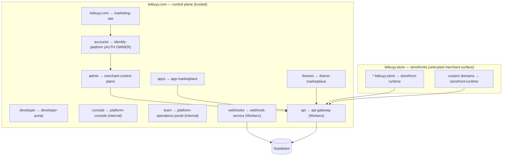

# Domain Topology Governance (Two-Domain Split)

> Status: **Target / planned.** This document is the canonical design + implementation
> runbook for splitting public DNS into `letbuyy.com` (platform control plane) and
> `letbuyy.store` (storefronts only). It is **human-authored governance memory**, not a
> generated scan. Built behavior today is the single-zone `letbuyy.store` topology in
> `infrastructure/dns/dns.tf`; everything marked _Target_ below is not yet live.
>
> Not to be confused with [`domain-governance.md`](./domain-governance.md), which governs
> **DDD package boundaries** (commerce-core, checkout-core, …), not internet domains.
>
> Related: [`runtime-boundaries.md`](./runtime-boundaries.md),
> [`repository-topology.md`](./repository-topology.md),
> [`environment-governance.md`](./environment-governance.md),
> [`security-operations-governance.md`](./security-operations-governance.md).

## 1. Why split into two apex domains

The single most important property is **origin isolation between merchant-controlled
surfaces and the platform control plane.**

- Storefronts render merchant content, third-party themes, and installed-app code. They are
  the least-trusted surface.
- Keeping storefronts on a **different registrable domain** (`letbuyy.store`) means a
  storefront origin can **never** read cookies, tokens, or `localStorage` scoped to
  `*.letbuyy.com`. Cross-apex is a hard browser boundary; cross-subdomain is not.
- This directly satisfies the AGENTS.md non-negotiables: _"Storefront customer auth must
  remain separate from merchant/admin auth"_ and _"Never store auth tokens in
  `localStorage`."_

Secondary benefits: independent WAF/cache rules per zone, blast-radius containment, cleaner
SEO separation (merchant storefront authority is not commingled with the brand domain), and
independent certificate / nameserver lifecycles.

## 2. Canonical domain model

### 2.1 `letbuyy.com` — Platform control plane (Vercel apps + Cloudflare Workers)

| Host | Runtime root | Hosting | Exposure | Notes |
|---|---|---|---|---|
| `letbuyy.com`, `www.letbuyy.com` | `apps/marketing-site` | Vercel | Public | Marketing/pricing/conversion. **Must not host auth pages** (AGENTS auth rule) — login links redirect to `accounts.`. |
| `accounts.letbuyy.com` | `apps/identity-platform` | Vercel | Public | **Canonical auth owner.** Login, signup, OTP, password, OAuth callback, store selection, session issuance. |
| `admin.letbuyy.com` | `apps/merchant-control-plane` | Vercel | Auth-gated | Per-store merchant dashboard, CMS, products, orders, settings, themes, analytics. |
| `apps.letbuyy.com` | `apps/app-marketplace` | Vercel | Public + partner-gated | App marketplace storefront + partner app submission/review. |
| `themes.letbuyy.com` | `apps/theme-marketplace` | Vercel | Public + partner-gated | Theme catalog, detail, acquisition. |
| `developer.letbuyy.com` | `apps/developer-portal` | Vercel | Public docs + partner dash | API reference, SDK quick-starts, partner dashboard shell. |
| `console.letbuyy.com` | `apps/platform-console` | Vercel | **Internal-restricted** | Super-admin. Email allowlist + 2FA/TOTP + IP/VPN + audit (AGENTS console rule). |
| `team.letbuyy.com` | `apps/platform-operations-portal` | Vercel | **Internal-restricted** | Employee support/ops portal. Same hardening as console. |
| `api.letbuyy.com` | `services/api-gateway` | Cloudflare Workers | Public API | Sole Commerce API backend. Hono `/v1`. Proxied (orange-cloud). |
| `webhooks.letbuyy.com` | `services/webhook-service` | Cloudflare Workers | Provider callbacks | Signature-verified provider webhooks. Proxied. |

### 2.2 `letbuyy.store` — Storefronts only (Vercel wildcard)

| Host | Runtime root | Hosting | Exposure | Notes |
|---|---|---|---|---|
| `{merchant}.letbuyy.store` | `apps/storefront-runtime` | Vercel (wildcard `*`) | Public shopper | Default per-tenant subdomain, e.g. `myshop.letbuyy.store`. |
| `<merchant-custom-domain>` | `apps/storefront-runtime` | Vercel custom domains | Public shopper | Merchant brings own domain via CNAME (see §7). |
| `letbuyy.store`, `www.letbuyy.store` | — | Cloudflare redirect | Public | **Decision (§14):** recommend 301 → `letbuyy.com`. Apex is not a tenant. |

> Naming reminder (AGENTS): database tables use `sites`; URLs/UI say `store`. The host label
> `{merchant}` resolves to a `sites` row via the tenant lookup — do **not** introduce a
> `stores` table.

### 2.3 Topology diagram



Cross-apex rule: storefront surfaces (`letbuyy.store`, custom domains) talk to the platform
**only** through `api.letbuyy.com` over CORS — never by sharing cookies with `*.letbuyy.com`.

## 3. Cookie & session architecture (the crux of the split)

Two **independent** session realms. They never share a cookie scope.

| Realm | Issued by | Cookie `Domain` | Scope rule | Env secret |
|---|---|---|---|---|
| Platform (merchant/staff/partner) | `accounts.letbuyy.com` | `.letbuyy.com` | Shared across `admin/apps/themes/developer/console/team` for SSO | `SESSION_SECRET` |
| Storefront (shopper) | storefront-runtime | **host-only** (no `Domain` attr) | Bound to the exact storefront host so one store can't read another | `CUSTOMER_SESSION_SECRET` |

Hard rules:

- **Platform SSO cookie** is set on the parent `Domain=.letbuyy.com` so a single
  `accounts.letbuyy.com` login is valid across `admin`, `apps`, `themes`, `developer`. Scope
  it to the auth/session cookie only — do not blanket-set unrelated cookies on the parent.
- **Storefront cookies are host-only**: omit the `Domain` attribute entirely. A cookie set on
  `myshop.letbuyy.store` (or `shop.coolbrand.com`) must not be readable by
  `othershop.letbuyy.store`. **Never** set `Domain=.letbuyy.store`. This is the tenant-isolation
  guarantee for shoppers and is why storefronts live on their own apex.
- All cookies: `HttpOnly`, `Secure` in production, `SameSite=Lax` for the top-level auth
  redirect flow (`accounts` → app), `SameSite=Strict` for everything that doesn't cross a
  redirect (AGENTS cookie rule). Document any `Lax` exception inline where it's set.
- `COOKIE_DOMAIN` env is set **per app**: `.letbuyy.com` for platform apps; **empty/unset**
  for storefront-runtime so the framework emits host-only cookies.
- Console/team are internal — prefer a **separate, non-SSO** session (or a distinct cookie
  name) so an ops session is never reusable on merchant apps, on top of allowlist + 2FA.

## 4. Authentication / SSO flow

`accounts.letbuyy.com` is the only auth UI/issuer for the platform realm (AGENTS: _"Keep
authentication centralized in the accounts app … Landing must not host login/signup pages
except redirects."_).

1. Unauthenticated hit on `admin.letbuyy.com` → 302 to
   `accounts.letbuyy.com/login?return_to=https://admin.letbuyy.com/...` (validate `return_to`
   against an **allowlist of `*.letbuyy.com` hosts** — never an open redirect).
2. `accounts` authenticates (Supabase Auth), sets the `.letbuyy.com` SSO session cookie,
   redirects back.
3. `admin/apps/themes/developer` read the shared cookie; no re-login. Store selection and
   `switch` happen in `identity-platform` (existing `/api/auth/stores`, `/api/auth/switch`).
4. Shoppers authenticate **only** within storefront-runtime against the storefront host; that
   session grants **no** merchant/admin privileges and lives in the `.store` realm.

## 5. Edge routing & hosting

### 5.1 Cloudflare DNS — add the `letbuyy.com` zone (Target)

Create a **second Cloudflare zone** for `letbuyy.com` and a sibling Terraform file
`infrastructure/dns/letbuyy_com.tf` mirroring the existing `dns.tf` style. Prereq: add
`letbuyy.com` to Cloudflare and point registrar nameservers at Cloudflare; provision a
zone-scoped API token with `Zone:DNS:Edit` (+ WAF edit if porting the scanner ruleset).

```hcl
# infrastructure/dns/letbuyy_com.tf  (Target — control-plane zone)
variable "cloudflare_zone_id_com" {
  type        = string
  description = "Cloudflare zone ID for letbuyy.com"
}

# Apex + www → Vercel (marketing-site)
resource "cloudflare_record" "com_root_a" {
  zone_id = var.cloudflare_zone_id_com
  name    = "@"
  content = "76.76.21.21"          # Vercel apex A
  type    = "A"
  proxied = false
  comment = "Vercel — letbuyy.com (marketing-site)"
}
resource "cloudflare_record" "com_www" {
  zone_id = var.cloudflare_zone_id_com
  name    = "www"
  content = "cname.vercel-dns.com"
  type    = "CNAME"
  proxied = false
  comment = "Vercel — www.letbuyy.com"
}

# Vercel app subdomains (proxied = false so Vercel manages TLS)
locals {
  com_vercel_hosts = {
    accounts  = "identity-platform"
    admin     = "merchant-control-plane"
    apps      = "app-marketplace"
    themes    = "theme-marketplace"
    developer = "developer-portal"
    console   = "platform-console"
    team      = "platform-operations-portal"
  }
}
resource "cloudflare_record" "com_vercel" {
  for_each = local.com_vercel_hosts
  zone_id  = var.cloudflare_zone_id_com
  name     = each.key
  content  = "cname.vercel-dns.com"
  type     = "CNAME"
  proxied  = false
  comment  = "Vercel — ${each.key}.letbuyy.com (${each.value})"
}

# Cloudflare Workers (proxied = true / orange-cloud)
resource "cloudflare_record" "com_api" {
  zone_id = var.cloudflare_zone_id_com
  name    = "api"
  content = "100::"
  type    = "AAAA"
  proxied = true
  comment = "Cloudflare Workers — api.letbuyy.com (api-gateway)"
}
resource "cloudflare_record" "com_webhooks" {
  zone_id = var.cloudflare_zone_id_com
  name    = "webhooks"
  content = "100::"
  type    = "AAAA"
  proxied = true
  comment = "Cloudflare Workers — webhooks.letbuyy.com (webhook-service)"
}
```

### 5.2 Cloudflare DNS — reduce `letbuyy.store` to storefronts only (Target edit to `dns.tf`)

- **Keep:** the `*` wildcard CNAME → `cname.vercel-dns.com` (proxied=false), and the WAF
  scanner-block ruleset.
- **Remove/relocate:** `admin`, `accounts`, `console`, `team`, `api`, `webhooks` records — they
  move to the `letbuyy.com` zone. During migration keep them as **301-redirect hosts** (§13)
  before deleting.
- **Apex:** repoint `letbuyy.store` root + `www` to a 301 → `https://letbuyy.com` (Cloudflare
  Bulk Redirect or a tiny redirect Worker), unless §14 decides otherwise.

### 5.3 Vercel project domains

Each Next app is its own Vercel project. Attach the host to the matching project and let Vercel
auto-provision the cert:

| Vercel project | Production domain |
|---|---|
| identity-platform | `accounts.letbuyy.com` |
| merchant-control-plane | `admin.letbuyy.com` |
| app-marketplace | `apps.letbuyy.com` |
| theme-marketplace | `themes.letbuyy.com` |
| developer-portal | `developer.letbuyy.com` |
| platform-console | `console.letbuyy.com` |
| platform-operations-portal | `team.letbuyy.com` |
| marketing-site | `letbuyy.com`, `www.letbuyy.com` |
| storefront-runtime | `*.letbuyy.store` (wildcard) **+** merchant custom domains |

### 5.4 Cloudflare Workers routes

Update `services/api-gateway/wrangler.toml` and `services/webhook-service/wrangler.toml` route
patterns to the new hosts (`api.letbuyy.com/*`, `webhooks.letbuyy.com/*`). Keep the old
`*.letbuyy.store` routes only for the redirect window, then remove.

### 5.5 Storefront wildcard → tenant rewrite (already built; host source changes)

Storefront-runtime already resolves tenants from the host label and rewrites to
`/store/[subdomain]` (`apps/storefront-runtime/src/app/store/[subdomain]/...`,
`src/app/api/store-lookup`, identity `validate-subdomain`). The split changes only the **host
the middleware trusts**:

```ts
// apps/storefront-runtime/src/middleware.ts  (canonical host resolution — illustrative)
const host = req.headers.get("host")!.toLowerCase();
const STORE_ROOT = "letbuyy.store";

let subdomain: string | null = null;
if (host.endsWith(`.${STORE_ROOT}`)) {
  const label = host.slice(0, -(STORE_ROOT.length + 1)); // strip ".letbuyy.store"
  if (label && label !== "www") subdomain = label;       // myshop.letbuyy.store → "myshop"
} else if (host !== STORE_ROOT) {
  subdomain = await resolveCustomDomain(host);           // custom domain → site lookup (§7)
}
if (!subdomain) return NextResponse.redirect("https://letbuyy.com");
return NextResponse.rewrite(new URL(`/store/${subdomain}${pathname}`, req.url));
```

Reserved labels (`www`, `api`, `admin`, `accounts`, `assets`, …) must be rejected as tenant
subdomains in the create-store validator so a merchant can't claim a system label.

## 6. TLS / certificates

- `*.letbuyy.store` — **Vercel-managed wildcard cert** (requires the wildcard domain on the
  storefront project and DNS verifiable; record stays **grey-cloud / proxied=false**).
- Platform Vercel hosts — per-host managed certs (automatic).
- `api` / `webhooks` — Cloudflare edge certs (orange-cloud, Workers).
- Merchant custom domains — automated per-domain ACME issuance on add (§7); monitor expiry/renew.

## 7. Custom merchant domains (already a feature — canonical flow)

Surfaces exist: `apps/merchant-control-plane/src/app/[store]/settings/domains/page.tsx`,
mobile `custom_domains.dart` / `domain_settings_screen.dart`. Canonical activation sequence
(AGENTS custom-domain rule):

1. Merchant enters `shop.coolbrand.com` in admin.
2. Platform issues a **verification token**; merchant adds a `TXT` (ownership) + `CNAME` →
   `connect.letbuyy.store`. `connect.letbuyy.store` is LetBuyy-owned and currently chains to
   Vercel; if Vercel rejects chained custom-domain validation, temporarily fall back to direct
   Vercel CNAME instructions or stand up the Phase-2 storefront ingress behind `connect`.
3. Verify TXT, then **map host → `site_id`** in the tenant table (the source for
   `resolveCustomDomain`).
4. Trigger SSL issuance; block activation until cert is live.
5. **Takeover prevention:** never serve a custom host until ownership is re-verified; release
   mapping on domain removal; guard against dangling-CNAME reuse.
6. Keep `www` canonical. Merchant apex domains require ALIAS/ANAME/CNAME-flattening at their DNS
   provider; warn before an apex CNAME attempt when MX records are present.

## 8. CORS, CSRF & origin allowlists

- `api.letbuyy.com` allows credentialed CORS from the **platform** origins
  (`accounts/admin/apps/themes/developer/console/team .letbuyy.com`) and from **storefront**
  origins (`*.letbuyy.store` + verified custom domains) — with **different policies** per class
  (storefront origins get shopper-scoped routes only, never admin routes).
- CSRF protection on all state-changing auth routes (already flagged across
  `identity-platform/api/auth/*`); `return_to`/redirect targets validated against the
  `*.letbuyy.com` allowlist.
- Maintain the origin allowlist as config, not hard-coded per route.

## 9. Environment variable contract

These names already exist in the scan; the split formalizes their values. Names only — **never
commit values** (AGENTS env rule). Owned under `config/env/` per `environment-governance.md`.

| Variable | letbuyy.com apps | storefront-runtime |
|---|---|---|
| `NEXT_PUBLIC_API_URL` / `API_URL` | `https://api.letbuyy.com` | `https://api.letbuyy.com` |
| `NEXT_PUBLIC_ACCOUNTS_URL` / `ACCOUNTS_URL` | `https://accounts.letbuyy.com` | `https://accounts.letbuyy.com` |
| `NEXT_PUBLIC_ADMIN_URL` / `ADMIN_URL` / `ADMIN_ORIGIN` | `https://admin.letbuyy.com` | n/a |
| `NEXT_PUBLIC_APP_URL` | per-app origin | storefront host |
| `COOKIE_DOMAIN` | `.letbuyy.com` | **unset** (host-only cookies) |
| `SESSION_SECRET` | platform realm | n/a |
| `CUSTOMER_SESSION_SECRET` | n/a | storefront realm |
| `LETBUYY_E2E_STORE_HOST_URL` / `_SUBDOMAIN` | n/a | `*.letbuyy.store` test host |
| `WORKER_API_BASE_URL` | `https://api.letbuyy.com` | `https://api.letbuyy.com` |

Add a `*_STORE_ROOT` (e.g. `NEXT_PUBLIC_STORE_ROOT_DOMAIN=letbuyy.store`) so the storefront
host parser and admin "your store URL" copy share one source of truth.

## 10. SEO / robots

- Storefronts (`*.letbuyy.store`, custom domains): **indexable**; per-store canonical = the
  custom domain when configured, else the `.store` subdomain.
- `admin`, `accounts`, `console`, `team`, `api`, `webhooks`: `noindex` + `robots: disallow`.
- `letbuyy.com` marketing + `apps`/`themes`/`developer`: indexable.
- Keep storefront `robots.ts` (already present) authoritative; do not let preview hosts index.

## 11. Internal surface hardening (console / team)

Per AGENTS console rule: email allowlist, 2FA/TOTP, IP/VPN restriction for production, full
audit logging. Prefer a dedicated session cookie name + shorter TTL, isolated from the merchant
SSO cookie even though both sit under `.letbuyy.com`.

## 12. Implementation checklist

- [ ] Add `letbuyy.com` to Cloudflare; move registrar nameservers; create zone-scoped token.
- [ ] Add `infrastructure/dns/letbuyy_com.tf` (§5.1); `terraform plan` + apply.
- [ ] Attach production domains to each Vercel project (§5.3); confirm certs issue.
- [ ] Update `wrangler.toml` routes for api-gateway + webhook-service to `*.letbuyy.com` (§5.4).
- [ ] Set per-app env (`COOKIE_DOMAIN`, `*_URL`, secrets) in Vercel/Cloudflare/CI (§9).
- [ ] Implement `.letbuyy.com` SSO cookie + host-only storefront cookies (§3); split secrets.
- [ ] Update storefront middleware `STORE_ROOT` + reserved-label guard (§5.5).
- [ ] Configure `api` CORS origin allowlist for both realms (§8).
- [ ] Edit `dns.tf` to storefront-only + apex redirect; keep old hosts as 301 during cutover (§5.2, §13).
- [ ] Update robots/noindex per §10; verify custom-domain flow end-to-end (§7).
- [ ] Run `node scripts/validate-governance.mjs`; regenerate intelligence with
      `node scripts/generate-repository-intelligence.mjs`.

## 13. Migration plan (single-zone → split, zero-downtime)

1. **Stand up `letbuyy.com` in parallel.** Add zone + records + Vercel domains; apps reachable
   on both old `*.letbuyy.store` and new `*.letbuyy.com` hosts.
2. **Dual-origin auth.** Temporarily allow the accounts cookie/redirect allowlist to include
   both apexes; verify SSO on `.com` before flipping defaults.
3. **Flip env defaults** (`*_URL`, `COOKIE_DOMAIN=.letbuyy.com`) so apps emit `.com` links.
4. **301 the old control-plane hosts** (`admin/accounts/console/team/api/webhooks
   .letbuyy.store`) → `.letbuyy.com` equivalents. Keep redirects ≥ one release.
5. **Apex redirect** `letbuyy.store` → `letbuyy.com`; storefront wildcard untouched throughout.
6. **Decommission** old `.store` control-plane records + Worker routes after traffic drains.
7. Storefronts (`*.letbuyy.store`, custom domains) **never move** — no shopper-facing migration.

## 14. Open decisions

- **`letbuyy.store` apex:** recommend 301 → `letbuyy.com`. Alt: a storefront directory page.
- **Developer surface:** `developer.letbuyy.com` now; optionally a dedicated `letbuyy.dev`
  later (Shopify uses `shopify.dev`). Partner _app submission_ currently lives in
  app-marketplace `/developers` — decide whether it consolidates under `developer.` or stays on
  `apps.`.
- **Region/locale hosts** (future India-first → global): keep as path/Accept-Language, not new
  apexes, unless data-residency forces it.

## 15. Enforcement & ownership

- DNS authority: `infrastructure/dns/dns.tf` (store) + `infrastructure/dns/letbuyy_com.tf`
  (com). Secrets/zone IDs stay out of git (AGENTS Cloudflare rule).
- Worker hosts: service `wrangler.toml` files; topology mirrored in
  `config/cloudflare/resource-names.json` and `config/runtime/cloudflare-topology.json`.
- Cookie/auth realm separation is covered by existing auth governance; storefront host-only
  cookies and the no-`Domain=.letbuyy.store` rule are **hard requirements** of this doc.
- Run `node scripts/validate-governance.mjs` after any topology/import/env/DNS change (AGENTS
  required validation), and regenerate repository intelligence so the generated `domains/`,
  `subdomains/`, and `routing/` READMEs reflect reality.
