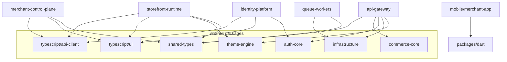

# Cross-App Dependency Map

How the workspaces depend on each other (graph node counts + import edges).

## Workspace weight (graph nodes)
mobile/merchant-app 4,980 · api-gateway 3,623 · merchant-control-plane 1,293 · shared-types 1,049 · storefront-runtime 910 · typescript/ui 664 · theme-engine 464.

## Rules the graph helps enforce
- **No cross-domain leakage** — apps depend on shared packages + the api-client, not on each other (`one-system-per-domain`, `no-rejected-package-imports`).
- **`api-client` is the contract** — apps call the gateway only through `@letbuyy/api-client`; stale types surface as broken edges.
- **theme-engine boundary** — its barrel must not pull server-only `jsdom` into app client bundles (verified by `next build`; see `docs/architecture/theme-engine-map.md`).

**Explore:** `/graph-dependencies @letbuyy/api-client` (or any package) to see every consumer; the UI's workspace table (Overview) jumps into each tree.
