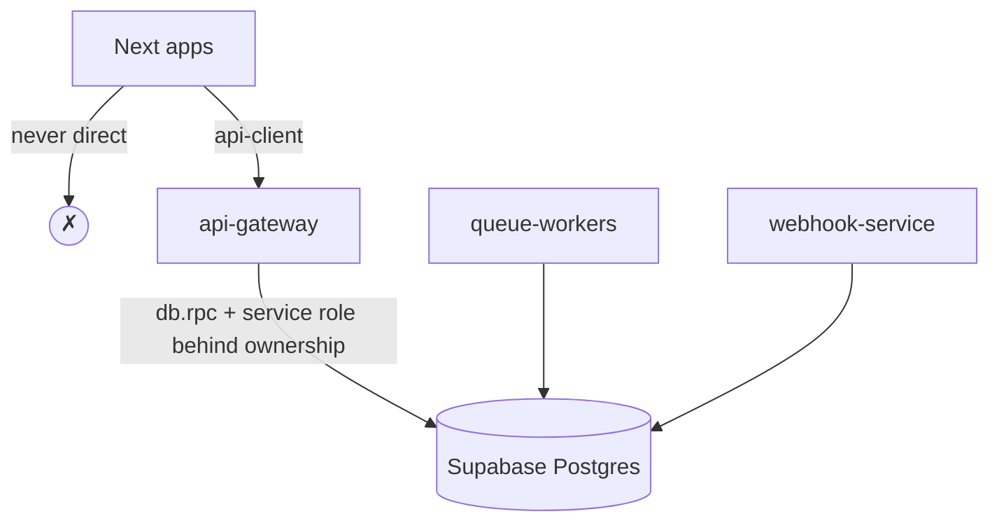

# Database Dependency Map

Graph view (`/api/domain?key=database` → 1,656 nodes / 477 files). **Caveat:** Graphify indexes code symbols, not SQL function bodies — so this map is about *who reaches the data layer*, with the migrations as the authoritative schema source.

## Access pattern

- **Only services write the DB** — apps proxy through the gateway; no app touches Supabase directly (`route-ownership`, `app-utils-service-role-edge` validators).
- **Money/tenant writes** go through `SECURITY DEFINER` RPCs (`create_checkout_order`, `complete_order_refund`, `issue_gift_card`, `restore_gift_card_on_refund`, `set_gift_card_status`, …), never raw TS table writes.
- **Schema source of truth:** `database/supabase/migrations/` (000_baseline → 174, sequential, with rollbacks). RLS forced on tenant tables.

## Key tables (from migrations)
`sites`, `store_customers` / `customer_credentials`, `orders` / `order_items`, `payment_transactions` / `refunds` / `payouts`, `gift_card_accounts` / `gift_card_ledger_entries` / `gift_card_redemptions`, `shipping_rates`, `idempotency_keys`.

**Explore:** Database tab in the UI surfaces the code that references DB concepts; pair with the migrations for schema truth and `node scripts/validators/rls-force-coverage-validator.mjs` for RLS posture.
