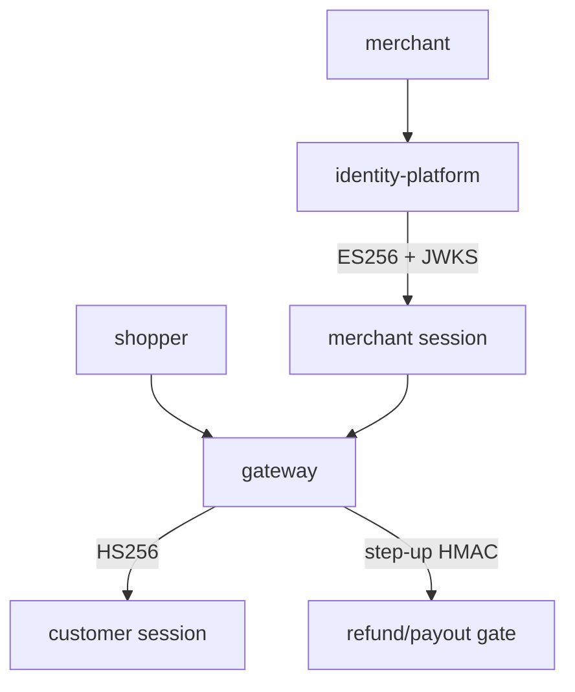

# Identity Intelligence

Graph view of auth/identity. **5,586 nodes** (attention score 74). Live: **Identity** tab or `curl /api/domain?key=identity`.

## Surfaces (graph entry points)
| Concept | Node(s) | Read |
|---------|---------|------|
| **Customer auth (HS256)** | `issueCustomerSession`, `createSession`, `registerCustomer`, `verifyCustomerPassword` | `packages/auth-core`; `services/api-gateway/src/routes/storefront/customer-registration.ts`, `customer-engagement-routes.ts` |
| **Merchant auth (ES256)** | `identity-platform`, `LETBUYY_IDENTITY_PUBLIC_JWKS` | `apps/identity-platform` |
| **JWT** | token verify/sign | auth-core; gateway middleware |
| **Step-Up** | `step-up`, `STEP_UP_SIGNING_SECRET` | `security-controls.ts` (HMAC-SHA256) |
| **OAuth / PKCE** | (developer-portal, frozen) | `docs/architecture/developer-platform-map.md` |
| **Sessions / RBAC** | session/permission cores | `packages/session-core`, `permission-core` |
| **Turnstile / rate-limit** | registration guard | customer-registration route |

## Invariant to verify
**Two issuers, never crossed** (`identity-sole-issuer-validator`). No code mints a merchant token with the customer secret or vice-versa. Token verification (sig/expiry/aud) on every protected route. Registration is takeover-safe (no overwrite) + enumeration-safe (Turnstile + rate-limit). Drive with `/graph-auth`.
