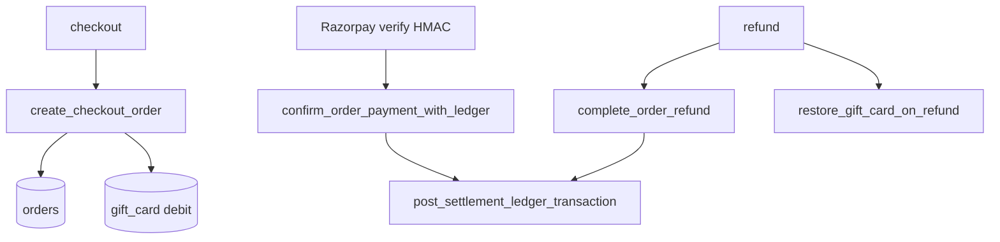

# Payment Intelligence

Graph view of the LetBuyy money path. **6,393 nodes across 826 files** (attention score 82 — the densest money surface). Explore live: `pnpm graph:ui` → **Payments** tab, or `curl /api/domain?key=payments`.

## Flows (graph entry points)
| Flow | Entry node | Where to read |
|------|-----------|---------------|
| **create_checkout_order** | order RPC | `database/supabase/migrations/000_baseline.sql`; `services/api-gateway/src/execution/order-execution.adapter.ts` |
| **Refund** | `complete_order_refund` | `000_baseline.sql`; `orders.ts` (`PATCH /:id`) |
| **Gift card** | `issue_gift_card` / `restore_gift_card_on_refund` | `173_*`, `174_*`; `routes/gift-cards.ts` |
| **Commission** | `commission_bps` | `commission-bps-zero-validator`; settlement migrations |
| **Settlement** | `post_settlement_ledger_transaction` | `confirm_order_payment_with_ledger`, `complete_order_refund` |
| **Razorpay** | `createRazorpayPaymentProvider`, `razorpay_signature` | `checkout-payment-routes.ts:464–646`; `lib/crypto.ts` |
| **COD** | `cod`, `cod_reconciliation_entries` | checkout routes; settlement layer |

## Invariants the graph helps you check
- **Canonical ledger only** — money mutations are `SECURITY DEFINER` RPCs via `db.rpc`; the graph's TS nodes around money tables should show no direct `.insert/update` (enforced by `canonical-ledger-only-validator`).
- **Server-authoritative** amounts; Razorpay signature verified server-side (`timingSafeEqualHex`).
- **Idempotency + `FOR UPDATE`**; refund ≤ capture; balances ≥ 0; gift-card balance is a ledger projection.

## Coverage note
SQL RPC bodies are not deep graph nodes — pair the Payments tab with the migrations + `node scripts/validators/canonical-ledger-only-validator.mjs`. Use `/graph-payments` to drive a full audit.
