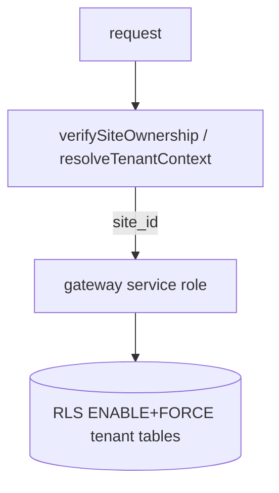

# Tenant Intelligence

Graph view of multi-tenancy. **1,802 nodes** (attention score 28 — contained, by design). Live: **Multi-Tenancy** tab or `curl /api/domain?key=tenancy`.

## Surfaces (graph entry points)
| Concept | Node(s) | Read |
|---------|---------|------|
| **`site_id`** | the tenant key, threaded everywhere | tenant tables + every scoped query |
| **Merchant ownership** | `verifySiteOwnership`, `verifySite…`, `resolveTenantContextForOrder` | `services/api-gateway/src/lib/auth-user.ts`, `lib/tenant-context.ts` |
| **Service-role boundary** | `getSupabaseAdmin` | gateway — only **behind** ownership checks |
| **RLS** | policies | `database/supabase/migrations/` |
| **Ownership validators** | governance | `route-ownership`, `rls-force-coverage`, `no-public-using-true`, `no-blanket-service-role` |

## Two-layer isolation
1. **Postgres RLS** — tenant tables `ENABLE`+`FORCE`; no public `USING (true)`; ledger/redemption tables service-role-only.
2. **Gateway** — service role used **only behind** `verifySiteOwnership`; app routes are gateway-proxies that can't touch the DB locally.

## Verify
`node scripts/validators/rls-force-coverage-validator.mjs` + `no-public-using-true-validator.mjs`. On any new tenant table: add RLS + register in `tenant-tables.registry` + access via the gateway with an ownership check. Drive with `/graph-tenancy`.
