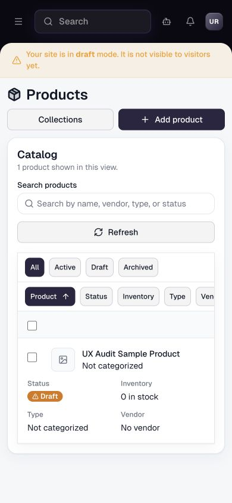

# Local tests and coverage

22 October 2026 · Checkout `/Volumes/Projects/LetBuyy` · Branch `letbuyy/theme-release-performance-resume` · Starting source HEAD `85aac99043d8dc10469e12cbb810609a3b6f1b0d`.

The owner requested actual local startup and end-to-end testing because no hosted preview exists. The current-build comparison therefore uses source inspection plus the restored local stack and normal browser journeys. The public accounts site differed from the checkout and is not used as current-build acceptance.

## Implementation follow-up

The audit results below are historical baseline evidence. The subsequent [implementation results](09_IMPLEMENTATION_RESULTS.md) records newly exercised Products and Settings protection, responsive dialog/SaveBar checks, current test/build results and remaining acceptance. Do not count the earlier reproduced draft-loss outcome as the current implementation behavior.

## Local startup and preserved state

The existing PostgreSQL and PostgREST containers were running. Database `letbuyy_development_20261022` was retained: 488 public tables, initially three sites and sixteen products. Counts establish fixture presence only, not security or correctness. No migration, reset, reseed or unrelated data cleanup was performed.

An earlier governance invocation had cleaned generated development files while servers remained running, producing missing `.next/dev` manifests and HTTP 500. Workspace links were restored with `pnpm install --offline --frozen-lockfile --ignore-scripts`. Only verified existing canonical jobs were restarted through `.tmp/local-dev/control.mjs restart <name>`: identity, merchant, gateway, commerce, marketing and console. The broad `up` and reseeding startup paths were not used because they include actions/surfaces outside this audit. Do not run cleanup-bearing governance against live development outputs; use an owned disposable checkout.

Current [endpoint check](evidence/local-health-check.json):

| Surface | Local entry | Result |
| --- | --- | --- |
| Identity | `http://localhost:9002/lookup` | HTTP 200 |
| Merchant | `http://localhost:9001/` | Redirects followed to HTTP 200 |
| Gateway | `http://localhost:9010/health` | HTTP 200 |
| Commerce fixture | `http://localhost:9000/store/ux-audit-1022` | Anonymous HTTP 401 for private storefront; browser shows unavailable/private gate |
| Signed theme preview | Opened inside merchant editor | Actual commerce storefront rendered with edited heading |
| Marketing | `http://localhost:9006/` | HTTP 200 |
| Thin console entry | `http://localhost:9007/` | Redirects followed to HTTP 200 |

These checks establish reachable entries, not complete backend/provider acceptance. Existing queue/webhook/mobile-BFF jobs were not activated or certified by this endpoint table. The user can continue from the private fixture in the running merchant app; application ports use the existing local configuration.

## Browser journey results

Normal UI actions used the existing authenticated local account. No cookie/session injection was used. An isolated store named **UX Research Fixture**, slug **ux-audit-1022**, was created through onboarding. It remains draft/private. The synthetic product **UX Audit Sample Product** is Draft, price ₹199, stock 0. Its description is synthetic. The theme has the saved Hero heading **Local UX audit preview**. The audit did not invoke Publish, buy a plan/domain, send an external message, install an app, change account credentials or factors, or alter existing store records.

| Scenario | Actual result | Evidence |
| --- | --- | --- |
| Store picker → Create store | Existing identity/onboarding handoff opened | Redacted onboarding records |
| Format selection | Online Store enabled; other formats visibly disabled | Source and browser inspection |
| Name/subdomain/channel entry | Availability result arrived; Next/review worked | [Reload state](evidence/onboarding-reload-ax.txt) |
| Reload during step 2 | Name, subdomain, channel and step restored | Same record; **passed** |
| Review → create → plan handoff | Store created; plan selection displayed; Back to dashboard allowed trial | [Handoff](evidence/onboarding-created-plan-handoff-ax.txt) |
| Empty Products | Valid Add product entry and empty state | [Empty state](evidence/products-empty-ax.txt) |
| Empty product Save | Title-required error displayed | Normal UI observation |
| Dirty product → sidebar Products → Add product | **Failed:** no confirmation; title/input not restored | [Reproduction](evidence/product-unsaved-navigation-result.json) |
| Product save/reopen/reload | Draft title, price, zero stock and description retained | [Result](evidence/product-save-reload-result.json); independent SQL read-back of synthetic record |
| Product no-match/Clear search | Correct no-match state; Clear restored product | [No-match](evidence/products-no-match-ax.txt) |
| Row selection | Explicit one-selected actions; reset without bulk mutation | [Selection](evidence/products-selection-ax.txt) |
| Themes → Edit | Existing editor opened; preview worked after commerce startup recovery | [Working preview image](evidence/local-editor-working-preview.png) |
| Hero heading undo/redo | Original restored, then edit restored | [Undo/redo](evidence/theme-undo-redo-result.json); **passed** |
| Save theme draft/reload | Edited heading persisted; dirty Save/Publish separation observed | [Save/reload](evidence/theme-save-reload-result.json); **passed** |
| Library status after draft save | Hero Unpublished and library Published appear together; storefront stays Private | [Library state](evidence/local-themes-after-save-ax.txt); semantic inconsistency recorded |
| Theme rename | Labeled 640 × 268 dialog, Cancel returned without rename | [Metrics](evidence/local-theme-rename-dialog-metrics.json) |
| Theme catalog preview | Explicit illustrative label and actual interactive-preview link | [Dialog](evidence/local-theme-preview-dialog-ax.txt) |
| Editor 1440/1920 | Controls stacked in 300 px left column at both widths | [1440](evidence/local-editor-1440-metrics.json), [1920](evidence/local-editor-1920-metrics.json) |
| Editor mobile 390 | Tabs present; selecting Hero moved to properties | [Mobile state](evidence/local-editor-mobile-hero-ax.txt); preserve working behavior |
| Settings keyword search | `dns` narrowed navigation to Domains | Normal browser inspection |
| Domains overview/connection | Five-step wizard; invalid domain blocked Continue; Cancel worked | [Overview](evidence/local-domains-overview-ax.txt), [invalid input](evidence/local-domain-invalid-ax.txt) |
| Settings Apps entry | **Failed:** available-looking link reached generic 404 with feature disabled | [State](evidence/local-apps-capability-entry-ax.txt) |
| 404 recovery | Back to dashboard reached global store picker, losing originating store context | Normal browser inspection |
| Setup readiness | Draft/0-stock product completed sellable-item step; helper/checklist denominators differ | [Dashboard](evidence/local-dashboard-readiness-ax.txt), [helper](evidence/local-setup-assistant-ax.txt) |
| Analytics empty-data presentation | Loaded; catalog/average labels differ from dashboard; internal endpoint wording visible | [Analytics](evidence/local-analytics-ax.txt) |
| Mobile merchant drawer | Open focused navigation; selecting Products closed after destination resolved | Source + normal UI; [mobile product result](evidence/local-products-mobile-ax.txt) |
| Mobile Products | Summary fields/selection rendered; no claim that every keyboard/reflow condition passed | [Screenshot](evidence/local-products-mobile.png) |
| Orders entry | Resolved to Order queue with No orders yet | Normal browser inspection; no fulfillment/refund case exercised |
| Navigation responsiveness | Old page sometimes retained before destination/loading; owner reported delay and insufficient UX | [Owner observation](evidence/user-navigation-observation.md); UX-03/UX-40 |

No numeric navigation latency is reported from the browser-control tool. A heading wait did not establish a reliable render-time sample; tool scheduling, cold development compilation and data readiness are different boundaries. The symptom is observed, and the implementation plan includes real instrumentation and measurable targets.

The [final local fixture capture](evidence/local-fixture-final-result.png) shows the saved Draft product in the private store. Temporary viewport overrides were reset after capture, and the existing user-owned Shopify and local tabs were preserved.

## Existing automated suites

| Command | Actual outcome |
| --- | --- |
| `pnpm --filter @letbuyy/identity-platform test` | Exit 0; TAP groups 50/50 and 6/6 passed, zero failed/skipped |
| `pnpm --filter @letbuyy/merchant-web test` | Exit 0; TAP groups 204/204 and 810/810 passed, zero failed/skipped |
| `pnpm --filter @letbuyy/ui test --maxWorkers=2` | Exit 0; 3 files, 51 tests passed |

These command-reported groups are not a claim of unique end-to-end journeys or platform completion. Some tests are source/contract checks. The reproduced draft-loss and dead-link failures coexist with green suites and need meaningful regression cases. The initial sandboxed identity command could not start its TypeScript IPC; the same command ran successfully with the required local process access. That startup error is not counted as a product test failure.

Detailed raw logs remain in the local temporary run area; the portable [summary](evidence/automated-test-summary.json) contains commands/counts without sensitive environment output. A new whole-repository build/governance run was not needed for documentation-only changes and was not repeated against the live stack.

## Independent canonical API probe

An isolated Node cookie jar authenticated the existing synthetic local fixture through the real identity entry/API. Credentials were read locally and never emitted or saved in this documentation. Development auth bypass remained disabled. The existing official Cloudflare test-key configuration and published dummy validation token were used as documented by [Cloudflare](https://developers.cloudflare.com/turnstile/troubleshooting/testing/). This is test validation, not production bot-defense acceptance. Local email mode uses a sink; no real mail delivery is certified.

[Probe results](evidence/local-canonical-api-results.json): **10/10 passed**—anonymous entry/CSRF cookie; missing-CSRF rejection; wrong-password rejection; canonical password login; independent authenticated session read-back; owned-store directory; merchant BFF read with the issued session; different-owner store denial after positive control; logout; subsequent unauthenticated session.

The probe did not inject a browser session or alter the user's active browser session. Application/BFF denial is not the full PostgreSQL RLS red-team suite. It is API integration evidence, not normal browser password-entry, MFA, recovery, provider or full tenant-security certification.

## Coverage boundary and next acceptance

The source inventory lists **13 identity and 80 merchant page files**, with hashes and route families in [the coverage inventory](07_ROUTE_COVERAGE.md). Inventory is deliberately separate from inspected implementation and browser acceptance. Markers such as a dialog import are not proof that the relevant task works.

Before claiming identity/merchant acceptance, finish the appropriate remaining cases:

- Browser password/MFA/recovery/invite and expired-session continuations using owned synthetic accounts; no real factor/password change by the audit agent.
- >100-product matching, multi-page selection, staff/denied access, stale edit and uncertain mutation recovery.
- Real populated order/customer/stock/purchase/return flows that are in the beta scope; financial paths need their existing money security/concurrency/reconciliation gates.
- Provider-safe DNS/SSL/registration, subscription/payment and notification acceptance. Local sinks and dummy validation never prove real provider readiness.
- Theme schema/control, import, publication/rollback, conflict, translation, sandbox/render-parity and performance acceptance. Hero text save alone does not certify all editor functions.
- Keyboard/screen-reader, 200% text, narrow reflow, mobile keyboard, touch targets, reduced motion and composed contrast across representative pages/overlays.
- A production-like warm/cold performance baseline with real timing boundaries, repetitions, p50/p95 and errors; no Shopify speed ranking from local development.

No application source was changed for the redesign during this audit. Documentation, synthetic fixture state and local generated/dependency recovery are the reviewable outputs. Any later implementation closes findings with its own revision and evidence.

## Canonical-system follow-up on 22 October

Fresh Shopify research inspected native index/create/Settings headers, product and General dirty bars, guarded product departure/discard, domain modal validation/detail, Payments/Shipping/Apps/Users context and the dedicated theme editor. Temporary Shopify input was discarded; no record/settings save or publication occurred. The [study coverage](../../research/shopify-product-intelligence/identity-onboarding-2026-10-22/canonical-system/04_EVIDENCE_AND_VERIFICATION.md) distinguishes fresh, prior, documented and open branches.

Fresh LetBuyy Products DOM verified nested main landmarks ([evidence](evidence/canonical-current-products-semantics.json)). On the saved synthetic product without edits, the saved SaveBar's enabled controls remained in the keyboard/AX tree under opacity 0. Tab from Tags focused invisible Discard ([evidence](evidence/canonical-saved-savebar-focus.json)). No product value was changed. Grouped-heading and header-action contract findings are source-backed; complete consumer screen-reader/busy-state coverage remains pending.

During this follow-up, local identity/merchant again returned 500 for missing generated manifests, and the gateway had missing dependency resolution. The offline frozen-lockfile/no-scripts install restored links, and only verified identity/merchant/gateway jobs were restarted. No database reset/reseed or frozen-app activation occurred. Post-recovery entry checks returned merchant 307, identity 200 and gateway 200; the existing saved synthetic product reopened. The cause of this repeated external artifact removal was not established in this follow-up; do not attribute all development downtime to application route performance.

Earlier automated suite results above remain earlier results; they were not rerun or promoted to fresh whole-product acceptance. The added work changed documentation and research artifacts, with no redesign application-source edits. UX-43–UX-46 capture the four new distinct findings in the existing register.

## Canonical palette acceptance — 23 October 2026

See [current adoption and limits](10_CANONICAL_ADOPTION.md). Real Products/General UI journeys and route-family DOM/style checks cover desktop/tablet/mobile. Fault, conflict and unknown-outcome coverage remains attributed to the actual component/contract harnesses. Runtime-generated Storybook files are classified as artifacts; negative controls keep similarly named source directories governed. Final gate/build logs and source snapshots are under `evidence/premium-canonical/`.
