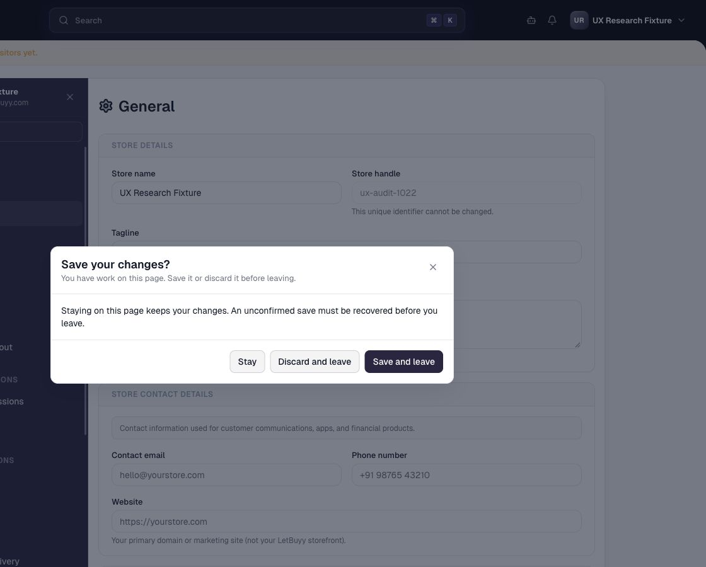
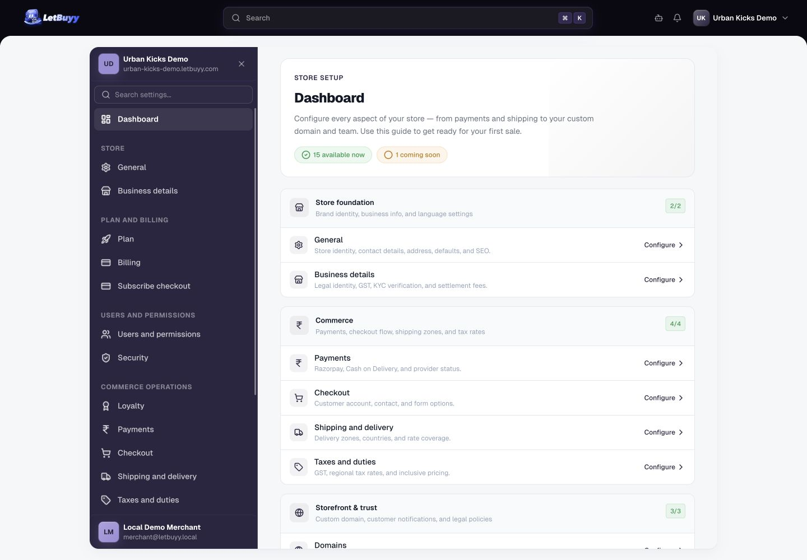
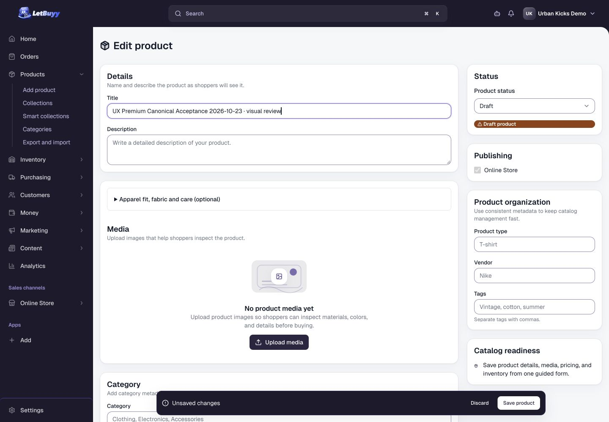

# Merchant experience: implementation results

**Latest tranche — 23 October 2026:** the approved premium purple roles and canonical Card/Section/MetricCard, PageHeader, field and SaveBar contracts are implemented across representative Merchant and Settings families. Merchant **220 + 810**, shared UI **61**, and all **114** governance validators pass; Merchant and Storybook production builds pass. Desktop, tablet and mobile normal-browser saves and readback are recorded below. The final tranche section supersedes historical unchanged-palette and failing-gate statements for its scope. The broader 46-finding programme remains open.

22 October 2026 · Branch `letbuyy/theme-release-performance-resume` · HEAD `85aac99043d8dc10469e12cbb810609a3b6f1b0d` plus uncommitted changes.

The representative Products → edit → protect → save/discard → return journey now works on the retained local stack, including departure into Settings. General Settings uses the same shared protection and SaveBar behavior. This is the first delivery slice in the existing programme; the full 46-finding programme is not complete.

The owner’s latest direction governs the implementation: **preserve the existing LetBuyy interface, branding and architecture.** No color values, font families, sidebar structure, page layout or product defaults were replaced with generated mockups. The existing UI remains the foundation. The mockup manifest still names generated-review reference boards; interrupted revision outputs are not approved specifications.

## Working position and boundaries

The source HEAD matches the research snapshot. Concurrent theme/catalog/apparel work appeared during implementation, including additions inside the product editor. Those changes were preserved. The [source snapshot](evidence/implementation/source-snapshot.json) pins the exact slice files and identifies the product editor’s shared ownership. Do not restore entire shared files to roll back this slice; preserve unrelated hunks.

The retained database, synthetic store, environment files and existing local services were used. Missing development dependencies/manifests were repaired with the existing offline install and scoped controller restarts. A later Next development memory restart interrupted one test; that interrupted attempt was repeated in an isolated acceptance tab and was not credited as a pass.

This slice did not run migrations, reset/reseed the database, push, merge, deploy, purchase/register domains, transact payments, send external messages, change security factors or activate frozen apps. Other concurrent work has its own status and evidence.

## Implemented changes

| Existing behavior / demonstrated gap | Existing owner and correction | Evidence and limits |
| --- | --- | --- |
| Page transitions lacked sufficient acknowledgement; an optional store-list read could hold the authorized shell | Merchant navigation adapter uses the installed Next 16.1.6 `useLinkStatus` and transitions. A restrained token-based strip and destination spinner follow actual pending state. The optional switcher streams separately with loading/error/retry; session and current-store authorization remain mandatory | Pending status observed during normal navigation. Controlled layout tests prove the authorized shell resolves before an unresolved optional switcher. No production speed target is claimed |
| Sidebar departure lost a dirty product | Thin merchant routing coordinator uses the existing shared Modal and shared form-protection contract. Relevant same-tab links, shell/command navigation, store-switch links and supported browser traversal defer departure while dirty/saving | Native Back and sidebar departure exercised in the current browser. Full browser/store-switch/imperative-route matrix remains open |
| Save-and-leave could otherwise mistake callback completion for persistence | Departure waits for the existing form owner to report an acknowledged clean state. Validation, dirty newer work, pending saving and uncertain edit commands retain the form. A departure requested during an existing save waits for that save | Real Products and General Settings save/readback; actual-editor integration tests cover validation, delayed save, in-flight departure and unknown command retry |
| Ordinary unsaved product input lacked interruption recovery | Product editor extends its existing recovery owner with a separate unsaved snapshot, scoped by actor/store/record, server version and a 12-hour expiry. Restore is offered for review; it does not silently replace the server record | Actual-editor remount tests, including scope isolation and newer drafts after an earlier acknowledgement. Native reload/termination recovery was not fully exercised in the browser |
| A clean SaveBar remained invisible but keyboard-focusable | Shared SaveBar unmounts when saved. Dirty/saving state remains truthful; discard is disabled when unsafe. If the focused bar disappears, focus returns to the task heading without scrolling | Shared regression, clean Products/General inspection and browser focus verification after explicit discard |
| Header action metadata could not express ordinary loading consistently | Shared PageHeader forwards loading/loadingLabel, disabled and busy semantics to the existing Button. The product header consumes that contract | Shared loading-action regression and product integration; every long/localized header composition is not yet accepted |
| Grouped sections used spans; Settings labels used divs | Grouped Section uses h2. Thirty-seven static Settings/domain group labels use h2 with their existing classes and zero heading margin. Skeleton placeholders and text inside buttons remain non-headings | Shared regression, General heading navigation and Settings source review; wider assistive-device coverage remains open |
| Inner Page created a nested main | Page defaults to a div inside the shell, retaining explicit `as="main"` for standalone composition. Fifteen standalone Storybook examples opt in explicitly | Products and General each have one main; shared standalone regression and identity/console/shared typechecks |
| Mobile dialog and SaveBar actions were too small; dialog body could inherit an unsuitable foreground | Shared Modal/SaveBar use a canonical 44 px mobile action-target role and safe-area padding. Modal body uses the existing text color role | Browser geometry/computed styles and screenshots at 1440, 768 and 390 px. No palette change; physical keyboard/safe-area testing remains open |

Private sidebar prefetch remains false. The coordinator does not patch global fetch, replace browser history or fabricate completion percentages. Current destination remains route-owned; a pending target is not marked current before arrival. Fullscreen theme editing keeps its existing draft/release protections and persistent command system.

## Work preservation and command authority

The shared hook registers only dirty/saving flags, capabilities and callbacks. It stores no form fields and grants no permission. Routing remains in the merchant adapter. Products retain their existing version checks, immutable edit payload, original idempotency key, reauthorization, conflict checks and late-response isolation.

Ordinary unsaved recovery and a pending edit command are distinct states within the existing product owner. The recoverable snapshot excludes importer details and media references with credentials/query/hash. Its existing snapshot validation and size bound reject unreadable/oversized records. Storage failures keep the form and show a persistent recovery message. Explicit discard or acknowledged save removes the appropriate recovery record; newer work after an earlier acknowledged command remains dirty and recoverable.

Settings is not generically serialized into browser storage. Its shared SaveBar registers work protection while each Settings form retains its own data, validation, permissions and save callback. A callback returning void is insufficient by itself to authorize departure; the owner must report clean completion.

Browser unload uses native confirmation. The current browser’s Navigation API allows traversal to be cancelled before leaving a dirty page and resumed after a decision. **Beforeunload does not intercept every same-document history transition or mobile termination.** Older-browser traversal compatibility and the complete physical-device interruption matrix remain open; do not claim universal prevention.

**Creation limitation:** existing durable command reconciliation is for product edits. The successful create journey was verified through normal UI and readback, but the existing create path does not gain edit-equivalent lost-response idempotency/reconciliation in this slice. That remains explicit follow-up work; an uncertain create must not be described as a recovered immutable edit command.

## Normal browser acceptance

An agent-owned acceptance tab used the existing authenticated local session through normal UI. No cookie/session injection was used.

1. A dirty Add product form survived native Back in the current browser and offered the departure dialog. Stay retained input.
2. Save and leave held the form during creation, then reached Products after **UX Work Protection Check** appeared as Draft, ₹199, zero stock. The synthetic item remains in the private fixture.
3. An edit of that record’s description remained protected on departure into Settings. Save and leave reached the requested Settings destination.
4. General Tagline survived Stay; desktop focus returned to the initiating link. Discard and leave restored the saved empty value and reached Business details.
5. General Save and leave reached Billing. Returning to General read back the saved synthetic Tagline. The Tagline was then restored to empty through normal Save.
6. The clean SaveBar had no Save/Discard controls. Removing a focused dirty bar through explicit Discard returned focus to General h1; the shared test also covers the acknowledged-clean transition.
7. At 390 px, dialog close and footer actions measured 44 px high, close measured 44 px wide, and the mobile SaveBar Save measured 44 px high. The dialog had no horizontal overflow at 390, 768 or 1440 px. Viewport overrides were reset afterward.

[Classified acceptance record](evidence/implementation/acceptance.json) separates normal browser evidence from component tests with synthetic HTTP and unverified cases.

### Responsive evidence

These are screenshots of the implemented existing interface, not generated mockups. The desktop screenshot excludes the unrelated account-contact footer.

[Tablet dialog](evidence/implementation/settings-guard-tablet.png) · [Mobile dialog](evidence/implementation/settings-guard-mobile.png) · [Clean mobile form](evidence/implementation/settings-clean-mobile.png)

## Validation results

| Check | Actual result |
| --- | --- |
| Merchant suites | **210 + 810 passed**, zero failures/skips. The 14 product-protection tests are included in 210 |
| Shared UI | **56 tests passed** across four files |
| Actual product editor/provider suite | **14 passed** independently, with synthetic HTTP; not 14 additional real-backend journeys |
| Typechecks | Merchant, shared UI, identity and thin console passed |
| Merchant production build | Passed in an owned disposable checkout; live development outputs were not used for the build |
| Shared Storybook production build | Passed, including Clean/Dirty/Saving/Unconfirmed specimens and explicit standalone main compositions |
| Targeted merchant component ESLint | Zero errors; two unchanged AdminShell warnings retained |
| Merchant CSS stylelint | Passed |
| Shared public API/token-variable protection | Passed |
| DTCG/mobile token parity | Passed. The new mobile target size role is projected through the existing token interchange; no color value was changed |
| Shared token-alias check | **Failed** on existing color duplicate groups outside its allowlist. Only the intentional 44 px touch-target alias was added to the existing 44 px group; no color failure was baselined away |
| Governance, disposable checkout | **112 PASS, 2 FAIL, 0 BLOCKED, 0 SKIP**, with one report-lane NOT_APPLICABLE. This is not a green gate |

The two governance failures are the design-system radius ratchet (389 versus baseline 388 in the combined working tree) and migration-safety’s TRUNCATE match in concurrently added `382_threadline_catalog_v2.sql`. Inspection found the keyword in embedded Liquid/copy; this is not evidence that a destructive TRUNCATE statement was executed. This slice did not modify that migration or weaken the validator.

Logs and the [machine-readable governance matrix](evidence/implementation/governance.json) are retained alongside this report. Governance’s generated-artifact cleanup ran only in `.tmp/local-dev/merchant-experience-validation-20261022`. The four additional standalone Storybook composition changes were typechecked and included in the subsequent successful Storybook build; the source snapshot distinguishes that build boundary.

No authenticated production-like p50/p95 benchmark, 100+ catalog performance acceptance, production Shopify speed comparison, full accessibility certification, provider acceptance or deployment is claimed. Development logs contained both cold compilation and a memory restart; those are not production navigation measurements.

## Remaining programme work

The existing finding register remains the completion authority for this programme. UX-02/03/21/40 and the broader header/heading/consumer checks retain explicit remaining acceptance. UX-44’s demonstrated invisible-control defect is corrected through the shared owner; that does not certify every editor workflow.

Next acceptance within this slice is the rapid/superseded/failed navigation matrix, other-browser traversal, store switching, permission/session interruption, physical mobile keyboard/safe area, and authenticated production-like timing. Existing create-command uncertainty also needs its canonical contract completed before claiming equivalent recovery.

The following broader work packages remain open: identity/MFA continuations, whole-collection matching and selection, safe rich product descriptions, truthful setup/metrics, complete Settings/domain continuity and capability consistency, theme library/editor refinements, and assistance/remaining route-family acceptance. Their existing research and implementation specifications remain in place, subject to preserving the owner’s current visual foundation.

The changes are uncommitted and reviewable in the working tree. No release or deployment approval is inferred from local validation.

## Continuation: gate repair and measured navigation

22 October 2026. The existing UI, purple values, fonts, shell, component owners and backend architecture remain intact. The [validation snapshot](evidence/continuation/validation-snapshot.json) pins the dirty/untracked inputs copied to the owned disposable checkout, including preserved concurrent work. No reset/reseed, migration application, deployment, push, real provider operation or real credential/factor change occurred.

### Navigation and authorization

- The mandatory current-session and current-store reads now start together. Both endpoints independently authenticate the current cookie; neither result permits rendering without the other. The optional store directory still streams separately.
- `getStoreForUser` retains its existing compatibility signature, but the React request cache is keyed by handle. The formerly ignored user hint can no longer split identical layout/page reads. A different store still needs a separate authorized lookup, and no private data is cached across requests.
- Missing/invalid cookies and authoritative rejection of a well-formed but revoked cookie use one configured-origin sign-in URL helper. The proxy overwrites the return-path request header, preserving the actual route and query. Protocol-relative, external and backslash-origin paths fall back safely; the caller's Host/forwarded Host cannot choose the origin.
- The existing router-based loading strip, destination cue, dirty guard, SaveBar and canonical header/form behavior are retained. Warm/cold/expired-session behavior is distinguished rather than hidden with animation.

Controlled tests prove concurrent start, denial without rendering, optional directory failure, request deduplication, new-request isolation, configured-origin redirects, forged header overwrite and external-path refusal. They do not establish production click-to-paint speed or all-browser history behavior.

### Failing gates corrected through their existing owners

| Failure | Correction and boundary |
| --- | --- |
| Radius ratchet 389 > 388 | Added `--radius-lb-md` as a named Tailwind utility projecting the existing radius role. Two concurrent ApparelFactsEditor uses now use `rounded-lb-md`; rendered radius stays the same. Ratchet is **387**, baseline unchanged |
| Migration 382 embedded Liquid JSON matched TRUNCATE | Generator and migration use the already recognized `$liquidbundle$` JSON delimiter; generator rejects a delimiter collision. The JSON payload hash and canonical theme bundle hash are unchanged. Nine migration safety tests, including destructive-SQL negative controls, pass. No migration was applied |
| Token-alias snapshot out of sync | Reviewed all flagged groups against committed HEAD. The existing color/role values already matched HEAD; only the prior 44 px touch-target role was new. Refreshed the intentional alias snapshot and retained its future-alias negative control. [Exact review](evidence/continuation/token-alias-review.json) |
| Generated Storybook output entered source scanning in the validation clone | Ignore `**/storybook-static/`; removed only the owned clone's generated output. No generated source is committed and no dependency exception is added for bundled output |
| Public test key in concurrent Threadline browser fixture | Added one exact file/value SHA-256 exception under the existing registry. This is Cloudflare's [published always-pass testing key](https://developers.cloudflare.com/turnstile/troubleshooting/testing/), verified 22 October. Auth bypass remains disabled; no privileged credential or directory-wide exception is introduced. Secret-scan negative controls still pass |

The final full gate is **114 PASS, 0 FAIL, 0 BLOCKED, 0 SKIP**, plus one report-lane NOT_APPLICABLE. Missing local integration refs remain declared branch advisories, not deployment acceptance. The cleanup-bearing gate ran only in the owned clone and left the live development outputs/services intact.

### Response measurements

The private CLI probe used normal canonical synthetic-account login, the existing local backend/catalog and its own cookie jar. It did not inject browser cookies. Each route has one first-request sample and ten warm samples. Logout affected the probe's own session. The revoked valid-format cookie was then retried against the exact private path/query.

| Production-mode HTTP route | Before p50 / p95 | Final p50 / p95 |
| --- | --- | --- |
| Products document | 34.84 / 58.56 ms | **39.53 / 71.49 ms** |
| General Settings document | 33.23 / 62.37 ms | **32.80 / 54.41 ms** |
| Products summary BFF | 24.02 / 39.27 ms | **24.96 / 26.78 ms** |

These small, unthrottled local samples show no consistent overall speedup. They establish a local response baseline and prevent a misleading claim that a loading strip made backend work faster. The final expired-session return check passes; it failed in the baseline. Existing cold development compilation accounted for multi-second waits (Products first document 5.37 s, summary BFF first request 2.74 s in the baseline). It remains distinct from production response time and browser interactive readiness.

An experimental package-import optimization had no demonstrated benefit and was removed; `next.config.ts` has no change from this continuation. Its exploratory `dev-after`/`production-after` samples are retained as diagnostics and are not the final measurement. [Before](evidence/continuation/navigation-production-before.json) · [Final](evidence/continuation/navigation-production-final.json).

### Verification of the pinned continuation

| Check | Result |
| --- | --- |
| Merchant suites in the final owned snapshot | **215 + 810 passed**, zero failures/skips |
| Shared UI | **56 passed** |
| Navigation/read regression file | **37 passed**, included in merchant 215 |
| Session verifier / session-security validator | **10 passed** / validator passed |
| Migration destructive-SQL controls | **9 passed** |
| Secret-scan exception controls | **8 passed** |
| Merchant typecheck and production build | Passed; production build includes the final preserved concurrent source snapshot |
| Design-system radius / alias snapshot and negative control | Passed; radius baseline unchanged; no palette change |
| Scoped ESLint | Zero errors; one existing unused compatibility hint warning remains after the final no-op use annotation |
| Full governance gate | **114 passed**, no failures/blocked/skips |

The 13 touched-file hashes match the validated clone: [continuation source snapshot](evidence/continuation/source-snapshot.json). Logs and exact classifications are retained in [continuation evidence](evidence/continuation/). Temporary runtime diagnostics were removed. A browser attempt interrupted by a cookie from another localhost test issuer is explicitly excluded from acceptance; [sanitized diagnosis](evidence/continuation/session-interruption.json). Fresh normal sign-in restored the intended session without weakening issuer, membership or replay checks.

### Normal browser and responsive acceptance

The [classified acceptance record](evidence/continuation/acceptance.json) records normal UI actions separately from synthetic component HTTP and read-only SQL. Stay retained the dirty product and focus; Save and leave created a named synthetic Draft and reached the requested Settings route. Products and the existing edit form read back its saved description, ₹199 price, zero stock and Draft state. A later temporary edit was discarded through the guard, restoring the old description and reaching Settings.

General Settings used the same dialog and SaveBar. Mobile Save and leave reached Business details, returning to General read back the saved temporary Tagline, and normal Save restored the original empty value. The clean bar disappeared and focus returned to the heading. A subsequent browser reload was interrupted by another localhost test cookie; [read-only SQL](evidence/continuation/durable-readback.json) independently confirms the original Tagline and exactly one synthetic Draft. The test record remains a draft; nothing was published or deleted.

At 390 px the dialog measured 390 px wide without horizontal document overflow; all four buttons measured 44 px high. At 768 and 1440 px the dialog measured 640 px wide. The viewport override was reset. Immediately resized/clipped captures were rejected; the retained images were visually inspected after settling.

[Tablet Settings](evidence/continuation/settings-tablet.png) · [Mobile work-protection dialog](evidence/continuation/product-guard-mobile.png). These are current application captures, not replacement mockups. The dashboard's existing readiness counts are not newly certified business readiness.

### Remaining work

This continuation completes the failing-gate repair and the request-authority/return-context portion of the navigation slice. It does not close all 46 findings. Full rapid/superseded/error navigation timing, physical mobile and older-browser traversal, 100+ product matching/pagination, immutable uncertain create reconciliation, MFA continuation, rich descriptions and the remaining route/Settings/theme/editor acceptance remain in the same programme. No production deployment or exhaustive accessibility/provider acceptance is claimed.

## Premium purple and shared Merchant/Settings tranche

23 October 2026. The owner explicitly authorized the supplied premium-purple color roles while preserving existing layouts and architecture. The preceding unchanged-palette statements describe earlier slices. This delivery edits the existing shared owners; it does not install a replacement mockup layout or add a second design/draft/token system. The [adoption inventory](10_CANONICAL_ADOPTION.md) names each family and exception.

### Delivered behavior and appearance

- The existing admin surface uses deep plum `#1E1A2D` for rail/header/save context, `#2C2642` for primary actions, `#523F97` for links, `#6C54C4` for focus and `#E7E3F7` for selection. The existing white surfaces, `#F6F7F9` canvas, shell curves, sidebar arrangement, typography and page grids remain. Input boundaries use `#8F88A9` after the previous near-white boundary failed rendered contrast review.
- Card owns ordinary surfaces. Grouped Section and MetricCard delegate that boundary instead of maintaining competing card recipes. Main and Settings sections share heading/description/padding contracts. Thirty-five Settings containers and eleven domain-task containers were migrated. Settings overview availability chips use Badge; availability is not claimed as sellability or launch readiness.
- PageHeader actions use Button with explicit disabled/loading behavior. Index/record/editor/settings/workbench metadata and route icon identities are explicit. Long titles wrap. Settings navigation keys resolve the shared icon vocabulary; existing task-specific overflow controls remain.
- Input/Textarea/Select/Combobox retain their existing contracts and responsive field grids. A missing product title has an associated inline error and focus without dispatch. The read-only publishing checkbox is visibly disabled. Full rich-description HTML support is still a separate content/security contract.
- SaveBar uses inverse plum context, white Save and quiet Discard, reports accurate capabilities and forwards the complete supported contract through SettingsPane. Clean bars leave the DOM. Dirty product headers defer to one active contextual save surface. Domain owners still decide when a command is acknowledged, clean, uncertain or safe to discard.
- Solid admin semantic badges, banners and toasts retain green/amber/red/blue meanings with darker fills. Admin descriptions are opaque: compositing the legacy 90% white description over green700 measured 4.381:1 and correctly failed the added contrast regression. Changing the scoped description-opacity role to 1 resolves that state without changing other surface identities.
- Theme library uses PageHeader and shared Card boundaries for current/installed themes. Its Customize action used an undefined text-on-primary alias; it now uses the canonical primary Button, measured white on `#2C2642`. The specialized editor preserves its tree, preview, draft autosave, undo/redo and publication commands. Visual review caught overlapping tablet toolbar groups; two-row reflow within the existing tablet breakpoint removes the overlap. Save remains draft persistence, Publish remains a distinct command.

Identity remains light-only and storefront themes keep their independent visual identity. Dart receives brandInk primitives through the existing generator but its application theme is not switched. The token generator projects from `tokens.ts`; `tokens.json` is generated interchange, not another authoring source.

### Normal local journeys and responsive review

The retained local backend/database and normal identity sign-in were used. No cookie injection or authorization bypass was introduced. At **1440×1000**, **768×1024** and **390×844** CSS pixels, Products and General Settings exercised edits, guarded departure, Stay, acknowledgement-dependent Save and leave, destination arrival, saved readback and explicit Discard. General's temporary Tagline was restored to its original empty value through normal Save. The synthetic product **UX Premium Canonical Acceptance 2026-10-23** remains Draft, ₹1,290, quantity 10; temporary tablet/mobile suffixes were restored. A final visual-only product edit was discarded, restoring title and handle, removing the dirty bar and returning focus to the heading.

Mobile SaveBar actions measured **44px** high. Tablet actions measured 32px; this is CSS viewport acceptance, not physical touch/keyboard certification. Settings SaveBar remained in its content column. Representative General/business/domains/billing/plan/users/security/loyalty/payments/checkout/shipping/tax/notifications/policies/overview and nine Merchant route families were inspected at three sizes. Measured ordinary routes have one main and no horizontal document overflow. The [route sweep](evidence/premium-canonical/route-compositions.json) retains intermediate observations; [final compositions](evidence/premium-canonical/final-compositions.json) explicitly supersede the old theme rows.

Theme library final measurements show one main, a 24px workbench heading and shared 16px section/article boundaries at three sizes. Editor preview loading and clean mobile Preview/Settings/Sections switching were checked on the configured origin at wide desktop **1920×1080**, tablet and mobile. Tablet toolbar group rectangles do not intersect. No theme draft or publication mutation was performed during these checks.

The production verification port is not an approved storefront `frame-ancestors` origin. Security policy was preserved; the real iframe was checked under configured Merchant port 9001. That exposed a missing retained-development catalog function. The existing migration 383 and paired rollback were reviewed, and its maintained isolated-Postgres suite passed (1 suite/test, zero skipped). Migration 383 was then applied only to the verified retained development container, followed by a PostgREST schema reload. Product count remained **20 before and after**; the required function changed from absent to present. No reset/reseed or product write was used to repair the dependency. [Classified repair evidence](evidence/premium-canonical/local-preview-dependency.json).

The iframe now loads sections, but its current storefront header is visibly under-styled and its footer still exposes an unresolved shop-name template literal. Those are separate renderer defects and remain open; loading is not accepted render parity. The editor itself and the shared Merchant/Settings contracts are the acceptance scope here.

[Settings desktop](evidence/premium-canonical/settings-overview-desktop.png) · [Settings tablet](evidence/premium-canonical/settings-overview-tablet.png) · [Settings mobile](evidence/premium-canonical/settings-overview-mobile.png) · [Repaired tablet editor toolbar](evidence/premium-canonical/editor-tablet.png).

All retained final images were visually reviewed. Explicitly named intermediate captures document rejected header/status states, not acceptance. Screenshots are real application captures; generated mockup boards remain references.

### Final validation and source pin

| Check | Result and scope |
| --- | --- |
| Merchant regression suites | **220 + 810 passed**, zero failures/skips; includes navigation, real editor component protection/validation and SettingsPane forwarding contracts. Synthetic transport tests are not additional real-provider E2E journeys |
| Shared UI | **61 passed** across five files, including scoped/composited contrast, shared surface/header and capability-aware SaveBar regressions |
| Governance source traversal | **38 passed**, including generated Storybook export exclusion and a source-like-name negative control |
| Existing preview dependency suite | **1 isolated Postgres suite/test passed**, zero skipped; separate concurrent migration dependency, not a new UI migration |
| Full governance gate | **114 PASS, 0 FAIL, 0 BLOCKED, 0 SKIP**, one report-lane NOT_APPLICABLE; 115 discovered. Missing local integration refs remain explicit advisories |
| Typechecks | Merchant, shared UI, Identity and thin console passed |
| Production builds | Merchant passed after final theme-action/toolbar fixes; shared Storybook passed with the final shared UI source |
| Shared contracts | Public API **381** protected exports, token-variable **439** roles, alias **138** duplicate groups; maintained lint-rule controls and codemod fixtures passed |
| Token interchange | **221** resolved DTCG tokens; Dart primitive generation/check passed without switching mobile theme |
| Scoped lint/CSS | Zero scoped ESLint errors; existing unused-variable/image-optimization warnings retained. Merchant/shared-surface and editor module stylelint passed. `git diff --check` passed |

Building Storybook originally reintroduced generated bundles into source validators. The fix is in the existing governance walker: exact `storybook-static` outputs are excluded from source traversal and forbidden as tracked artifacts; source-like names remain governed. The export directory was deliberately not added to destructive runtime-cache cleanup. Negative controls pass. Full cleanup-bearing governance ran only in the owned disposable checkout, preserving active development servers. No ratchet was raised and no validator was disabled.

[Source hashes](evidence/premium-canonical/source-snapshot.json) compare the live owners/consumers with the validated checkout. They include preserved concurrent hunks and do not claim ownership of all existing dirty work. [Acceptance classifications](evidence/premium-canonical/acceptance.json), sanitized logs and the governance matrix are retained with the evidence manifest.

### Remaining scope

This completes the premium-purple/shared-contract tranche, not all 46 findings or every provider/role/device combination. Frozen Apps routes remain disabled under ART-22; their advertised unavailable navigation remains UX-14/15. Custom data remains deferred. Unknown product-create outcomes still lack edit-equivalent immutable reconciliation. Whole-catalog matching/pagination above 100 records, physical mobile keyboard/safe area, older-browser traversal, identity/MFA, AI, publication/recovery and renderer parity remain in the existing programme.

Earlier navigation loading/protection/authorization fixes remain intact. Local HTTP measurements showed no consistent total speedup; this tranche makes no new latency claim. Cold development compilation and Next memory restarts are distinct from production response and interactive readiness. No push, merge, production migration or deployment occurred. The implementation remains uncommitted and reviewable in the existing checkout.
